数据库迁移功能是 DTS 迁移工具最主要的功能之一。数据库迁移是指将数据、数据库对象（如表、视图等）据以及通常与之相关的应用程序，从一个计算环境转移到另一个计算环境的过程。DTS 提供了主流大型数据库迁移到 DM，DM 到 DM，文件迁移到 DM 以及 DM 迁移到文件的功能。

## 4.1 实现原理

DTS 迁移实施过程可以分为两部分，包括对象迁移和对象中的数据迁移。

1. **对象迁移**

对象迁移实现原理如下:

图4.1 对象迁移流程

如上图所示，对象迁移是从源库中通过源库的标准 jdbc 接口或者查询系统表获取对象的组成信息；然后 DTS 根据各组成部分和迁移策略，转换成对应目的对象的各组成部分；再根据目的对象的组成部分，根据目的对象的语法，拼成创建目的对象的 SQL；然后在目的上执行对应 SQL。

2. **数据迁移**

数据迁移实现原理如下:

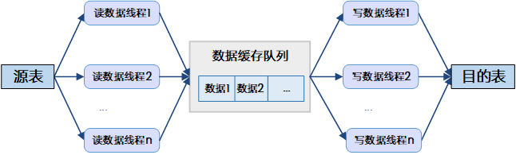

图4.2 数据迁移流程

如上图所示，数据迁移是 DTS 通过读线程从源库中读取数据；读取到一批数据后，放到数据缓存队列；另一边写线程从数据缓存队列中取数据，插入到目的表中。读线程根据源库的类型，可以配置多个读线程同时进行读操作，写数据线程也可以根据目的库类型配置多个写线程同时往目的表中写入数据。

## 4.2 迁移配置

一个迁移节点需要指定迁移过程中多个维度的配置项才能够进行迁移实施。迁移配置包括全局配置、迁移节点配置和模板配置。其中，全局配置应用于所有工程的所有迁移节点；迁移节点配置应用于当前节点；模板配置应用于当前工程中的节点，但不是必须配置项，用户可选择是否添加模板到当前节点。

全局配置具体参见 4.2.9 全局选项配置 ，模板配置具体参见 4.2.10 迁移模板配置 。

节点配置较为复杂，根据数据源和获取对象的方式不同，每一个迁移节点需要配置的内容也不同，总体来看，主要包括以下几个方面：配置源数据源、配置目的数据源、配置迁移对象、配置迁移策略、配置远程连接、配置执行页面显示方式，具体可根据实际使用中 DTS 的向导页指引进行。以下是对迁移节点中各向导页中配置项的介绍。

### 4.2.1 配置数据源连接

配置路径：向导页->”数据源”或”目的”。

配置数据源的连接信息。

以 ORACLE 作为数据源，DM 作为目的，其图形化配置如下所示：

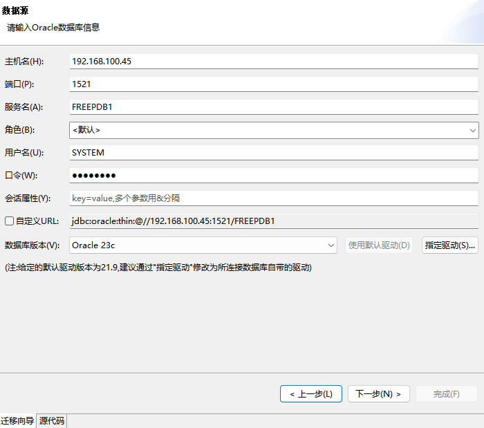

图4.3数据源界面（ORACLE）

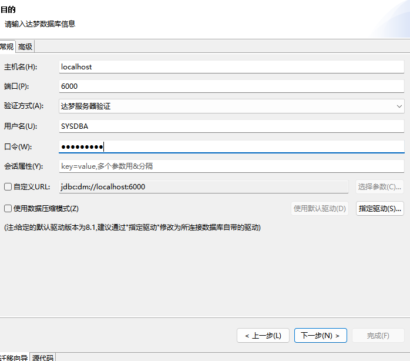

图4.4 目的界面（DM）

数据源和目的的类型不同，所需要配置的内容也有所不同，以下是对各项配置的介绍。

#### 4.2.1.1 数据库

根据不同的数据库类型，填写数据库连接信息。

DTS 会自带数据库驱动，缺省使用 DTS 自带的数据库驱动，自带的数据库驱动版本信息，在数据库连接页面有显示，具体的也可以参考 [附录一 默认驱动信息](default_driver_information.md) 。

迁移时，建议使用与所连接的数据库版本匹配的驱动，指定方法:

在数据库连接配置页面，点击”指定驱动”，可以指定对应的驱动文件，以及配置驱动类和自定义 URL。

默认的 URL 只有基本的主机，端口，库信息等基本信息，如果需要指定其他连接参数，则需要自己自定义 URL。例如，连接 DM 时，需要开启 DM 的 jdbc 驱动日志，则可以按如下步骤操作:

在数据库连接配置页面，点击”指定驱动”，指定驱动文件所在的路径。通过”自动获取”获取驱动类名信息，然后选中”使用自定义 URL”，这样 URL 对应的编辑框就可以编辑 URL 了。

> **注意**
> 
> 建议迁移时指定与数据库版本匹配的驱动。指定驱动时可以指定多个jar文件(有时查询数据库除jdbc驱动外还需要其他的jar，比如oracle的xdb.jar，这是需要同时指定oraclejdbc.jar和xdb.jar)。

#### 4.2.1.2 文件

根据不同的文件类型，填写文件路径，编码等信息。不同的文件作为源端数据源和作为目的端数据源填写的信息也不一样。

##### 4.2.1.2.1 TXT 文件

1. **源端(即 TXT-DM)**

需要指定 TXT 文件或目录，即可以支持同时迁移 1 个或多个 TXT 文件的迁移。

需要指定 TXT 文件的编码，缺省是自动识别，特殊的识别不准确的情况下需要指定。

需要指定 TXT 文件的行分隔符，可以是十六进制表示的字符。

需要指定 TXT 文件的列分隔符，可以是十六进制表示的字符。

需要指定 TXT 文件的文本限定符，可以是十六进制表示的字符。

需要指定 TXT 文件的是否第一行含列名称，即第一行是列名还是内容。

需要指定将什么作为 null 值导入，即数据中存在什么样的字符时认为是 null 值。

需要指定是否对单个文本文件多线程乱序迁移到数据库。

2. **目的端(即 DM-TXT)**

需要指定文件目录，迁移的文件名是 DTS 根据模式名和表名生成的，这里只需指定文件所要存放的目录。

需要指定文件的编码，即迁移创建的文件的编码格式。

需要指定”将 null 值导出为”什么，即迁移数据中如果有值为 null，则指定导出到文件时，null 用什么字符表示。

> **注意**
> 
> TXT-DM，DM-TXT只迁移表数据，不迁移结构信息，TXT-DM TXT内容必须是有一定格式的TXT，并且如果目的表由DTS创建，则所有列类型都为VARCHAR(200)。

##### 4.2.1.2.2 EXCEL 文件

1. **源端(即 EXCEL-DM)**

需要指定文件路径。

需要指定数据读取方式，包括：

1）全部按照字符串读取，即所有都当成字符串处理。

2）按照设定的数据格式读取(每列的格式以第二行格式为基准，第一行为列名)，即 EXCEL 文件中第一行为列名，每列的数据类型通过读取第二行数据自动识别。

需要指定将什么作为 null 值导入，即数据中存在什么样的字符时认为是 null 值。

2. **目的端(即 DM-EXCEL)**

需要指定文件路径或目录:

1）所有表使用一个 EXCEL 文件，即所有表数据迁移到一个 EXCEL 文件，这时只需指定要存放的 EXCEL 文件路径，如果是迁移多个表，这每个表按 sheet 写到 EXCEL 中。

2）每张表使用单独的 EXCEL 文件，这时只需指定要存放的 EXCEL 文件目录，文件名根据模式和表名自动生成。

需要指定”将 null 值导出为”什么，即迁移数据中如果有值为 null，则指定导出到文件时，null 用什么字符表示。

> **注意**
> 
> EXCEL-DM，如果全部按照字符串读取，且目的表由DTS创建，则所有列类型都为VARCHAR(200)。

##### 4.2.1.2.3 SQL 文件

1. **源端(即 SQL-DM)**

需要指定 SQL 文件或目录，即可以支持同时迁移 1 个或多个 SQL 文件的迁移。

需要指定 SQL 文件的编码，缺省是自动识别，特殊的识别不准确的情况下需要指定。

需要配置迁移参数选项，包括:

1）一次提交 SQL 语句条数。

2）缓存批数。

2. **目的端(即 DM-SQL、ORACLE-SQL)**

需要指定定义脚本文件路径。

需要指定数据脚本文件路径，数据脚本可以选择:

1）使用对象定义脚本文件，即与对象定义脚本存放在同一个文件中。

2）对每个表使用单独的数据脚本文件，即每个表的数据脚本单独存放在一个文件中，这里只需指定存放的目录，数据脚本文件根据表模式和表名自动生成。

3）所有数据脚本使用一个单独的文件，即所有表的数据脚本存放在同一个文件中，且该文件与对象定义脚本文件不为同一个，这里需要指定的是存放数据脚本的文件的路径。

需要指定文件编码，即迁移写文件内容的编码格式。

需要指定迁移选项，包括：

1）仅迁移对象定义。

2）仅迁移数据。

3）迁移对象定义和数据。

需要指定定义脚本末尾是否加”/”。

需要指定脚本文件是否分片，如果分片需要指定分片大小，即达到多少条 SQL 则分为多个文件存储。

> **注意**
> 
> DM-SQL，迁移数据时迁移为insert into语句。

##### 4.2.1.2.4 WORD 文件

1. **源端(即 WORD-DM)**

需要指定文件路径。

需要指定数据读取方式，包括：

1）格式化读取文本，同 txt-dm ，按一定格式读取内容，可以设置读取格式:

2）行分隔符。

3）第一行含有列名称，即第一行是否当作列名信息读取，不作为表数据。

4）列分隔符。

5）文本限定符。

6）只读取表格，只读取 word 文件中的表格内容作为表数据，可以配置第一行是否作为列信息导入。

需要指定将什么作为 null 值导入，即数据中存在什么样的字符时认为是 null 值。

2. **目的端(即 DM-WORD)**

需要指定文件路径。

需要指定”将 null 值导出为”什么，即迁移数据中如果有值为 null，则指定导出到文件时，null 用什么字符表示。

> **注意**
> 
> DM-WORD，是把数据导入到WORD表格中，每张表一个表格。

##### 4.2.1.2.5 CSV 文件

1. **源端(即 CSV-DM)**

配置项跟 TXT-DM 一样。

2. **目的端(即 DM-CSV)**

配置项跟 DM-TXT 一样。

##### 4.2.1.2.6 PARQUET 文件

1. **源端(即 PARQUET-DM)**

需要指定文件路径。

### 4.2.2 配置迁移选项

配置路径：向导页->”配置迁移选项”。

即配置要迁移的对象的获取方式和迁移的策略。

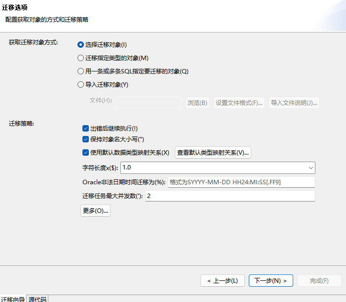

图4.5 迁移选项界面

#### 4.2.2.1 获取对象的方式

迁移对象获取方式包括：导入迁移对象、用一条或多条 SQL 指定要迁移的对象、迁移指定类型的对象、选择迁移对象。方式 1 和 3 界面操作比较轻量，统一配置类型相同的对象迁移策略，方式 4 比较灵活，可以具体配置每个对象的迁移策略。

##### 4.2.2.1.1 导入迁移对象

通过其他方式把要迁移的对象名信息放入文本文件中，迁移工具直接从文本文件中读取要迁移的对象，进行填充，迁移，如果对象名在源数据源中不存在，则跳过，格式不正确的也跳过，对于跳过的对象仅会在日志中记录。

文本文件格式如下:

```
#source_schema,source_object,dest_schema,dest_object,object_type
#例如"SYSTEM","T1","SYSTEM","T2","table"
#说明:
#1.如果目的和源一样,可以不指定
#例如"SYSTEM","T1","table"
#2.如果对象是表,可以不指定
#例如"SYSTEM","T1"
#3.object_type包括如下值:
table,view,schema,sequence,procedure,function,package,
synonym,public_synonym,class,trigger,mview,type,directory,
context,job,program,schedule,profile,user,role,tablespace
#4.对于库对象(不属于某个模式),source_schema应该置空
```

选择”导入迁移对象”后后续迁移配置包括：配置对象迁移策略->配置执行页面显示方式。

##### 4.2.2.1.2 用一条或多条 SQL 指定要迁移的对象

通过 SQL 语句指定要迁移的对象，迁移的是 SQL 的结果集。

选择”用一条或多条 SQL 指定要迁移的对象”后后续迁移配置包括：选择迁移对象->配置执行页面显示方式。

##### 4.2.2.1.3 迁移指定类型的对象

指定要迁移的对象类型，或者是模式下的哪些类型的对象，即不需要把每个对象列出来，适合迁移某一类的所有对象，例如迁移某个模式下的所有表。

选择”迁移指定类型的对象”后后续迁移配置包括：指定对象复制(指定对象类型)->配置对象迁移策略->配置执行页面显示方式

##### 4.2.2.1.4 选择迁移对象

通过选择来指定要迁移的对象，这样会列出所有的模式，且在指定对象类型后，列出所有的该类型的对象供选择，并可以对每一个对象单独配置迁移策略。

选择”选择迁移对象”后后续迁移配置包括：指定对象复制(指定对象类型)->选择迁移对象->配置执行页面显示方式。

#### 4.2.2.2 迁移策略

各迁移策略根据数据源和目的、获取对象方式的不同，可能会有部分不必要的配置项隐藏的情况，需根据实际显示的配置项进行配置。迁移策略可单独配置，也可使用模板进行配置，模板配置请参考 4.2.10.1 策略配置模板 。

##### 4.2.2.2.1 保持对象名大小写

配置是否保持对象大小写，如果勾选，则保持对象大小写，即源端对象名是什么目的端对象名是什么；如果手动修改对象名，则与修改的保持一致；否则如果不勾选，则会提升对象名为大写。

缺省情况下，Access-dm，MySql-dm，SqlServer-dm 不保存对象大小写，即提升对象名为大写，其他迁移缺省保存对象大小写。

##### 4.2.2.2.2 配置数据类型映射关系

如果选中”使用默认数据类型映射关系”，则按默认规则转换数据类型关系，默认数据类型映射关系可参考 [附录二 迁移默认类型映射关系](default_mapping_relationships.md) ；如果取消勾选，则优先使用配置的数据类型映射关系。

其中，手动配置数据类型映射关系有 2 种方式:第一种是迁移工程全局配置，在“数据类型映射节点”进行配置，配置方法可参考 4.2.9.3 数据类型映射全局配置选项 ；第二种是直接对本节点进行数据类型映射配置，配置方式如下：

向导页”配置获取对象的方式和迁移策略”->取消勾选”使用默认数据类型映射关系”->点击旁边的”配置类型映射关系”按钮->打开数据类型映射关系配置对话框，可以查看已经配置的和默认的数据类型映射关系，也可以增删该本次迁移要用的数据类型映射关系。配置规则同迁移工程全局配置。

源端数据类型最好参考向导页”选择迁移对象”->选择要迁移的表，选中->点击转换—>打开表映射关系表对话框，查看”列映射选项”，最后 3 列，查看源列的数据类型，精度，标度信息。

> **注意**
> 
> 数据类型映射配置中源精度和源标度如果配置，则会严格匹配，即如果配置VARCHAR，精度10，标度0，映射为目的的TEXT，则严格的只有源VARCHAR类型，且精度为10，标度为0的，才会映射为目的的TEXT；如果精度和标度不配置，则所有的VARCHAR，全部都映射为目的TEXT。另外默认值不会影响目的类型，只是作为一种默认值转换。

源端数据类型到目的端数据类型映射查找顺序为:

1. 如果取消选择”使用默认数据类型映射关系”选项，则首先查找手动配置的数据类型映射关系。

因为目前收到配置的数据类型映射关系有迁移工程全局配置和每一个迁移单独配置 2 种，优先从每一个迁移单独配置的数据类型映射关系中查找，没有找到对应的映射关系，再从迁移工程全局配置的数据类型映射关系中查找。

2. 如果 1.中没有找到对应的数据类型映射关系，则从默认的数据类型关系中查找。
3. 如果 2.中没有找到对应的数据类型映射关系，则通过与 JDBC 类型的映射来查找。

一般数据库的每种类型都会映射到标准 JDBC 类型，例如 Oracle 的 Long 类型对应的 JDBC 类型为 Types.LONGVARCH(一个常量)，而对应 JDBC 类型的 Types.LONGVARCH 的，DM 数据库的类型有 CLOB，TEXT 等。按顺序操作，第一个为 CLOB，则 Oracle 的 Long 类型如果没有配置类型映射关系也没有默认的类型映射关系，则通过 JDBC 映射查找的话，对应目的端 DM 的 CLOB 类型。

4. 如果 3.中没有找到对应的数据类型映射关系，则源端数据类型是什么，目的端数据类型就是什么。

##### 4.2.2.2.3 字符长度\*n

配置字符长度扩展倍数倍数，缺省 1，可以选择也可以手动输入，但必须是整数倍。

迁移时默认目的端字符长度与源端保持一致，特殊的，如果需要扩大长度，可以配置该倍数，通常对于多字节字符类型的迁移需要扩大。

扩大后如果精度超过目的端支持的最大精度长度，则会自动调整为目的端支持的最大精度长度。

具体的支持扩展的数据类型，即配置后会起作用的数据类型，包括所有映射为 JDBC 类型的 CHAR、VARCHAR、NCHAR、NVARCHAR 类型。

##### 4.2.2.2.4 索引名重复时重命名索引

配置索引名重复时是否重命名索引。如果勾选该策略，则当迁移过程中迁移索引任务出现了“索引已存在”错误就会重命名索引并重新执行任务；如果不勾选，则在上述情况下直接抛出错误。

##### 4.2.2.2.5 字符集转换

配置字符集转换。勾选此选项后，在迁移数据时，如果源库支持获取字符串对应的字节就直接获取字节；否则将从源库获取的字符串根据指定的编码字符集转换成字节，获取字节后再根据解码字符集将字节转换为字符串。

##### 4.2.2.2.6 出错后继续执行

配置迁移出错后是否继续执行。如果勾选，则如果迁移过程中某个任务出错了会继续执行其他任务；否则如果不勾选，则如果迁移过程中某个任务出错了，整个迁移停止。

##### 4.2.2.2.7 迁移任务最大并发数

配置是最大多少个迁移任务并行执行，缺省是 2。可以并发执行的默认只有迁移表数据和删除表数据任务，但可以配置创建表任务，创建索引任务，创建主键任务为并行执行。

##### 4.2.2.2.8 每次分析对象个数

每个对象迁移之前都需要先从源对象中获取对象的信息。分析对象即读取要迁移的对象，然后从源数据源中获取对象的信息填充对象，然后提交给任务分发器，分发给任务执行器执行，分析对象可以批量的执行。

“每次分析对象个数”即配置批量的大小，缺省是 50。

##### 4.2.2.2.9 对象缓存池大小

分析对象时读取要迁移的对象和填充对象是并发执行的。读取对象线程读到一批之后就会放入到缓存池，填充对象线程从缓存池获取一批对象进行填充，填充完成后提交给任务分发器。

“对象缓存池大小”即配置对象缓存池的最大大小，缺省是 4，对象缓存池大小达到这个配置的最大大小，则读取对象线程等待，如果对象缓存池为空，则填充对象线程等待。

##### 4.2.2.2.10 填充对象线程个数

分析对象时，填充对象线程通常是从源数据源中查询系统表/视图，获取源对象信息。这个操作通常比较耗时，可以设置多个线程同时填充，缺省是 2。

##### 4.2.2.2.11 任务缓存池大小

分析对象和任务执行是并发执行的。分析对象分析完一批对象后生成对应的迁移任务，放入任务缓存池；任务分发器从缓存池获取一批任务，提交给任务执行器执行。

“任务缓存池大小”即配置任务缓存池的最大大小，缺省是 4，任务缓存池大小达到这个配置的最大大小时，则分析任务等待，如果任务缓存池为空，则任务分发器等待。

##### 4.2.2.2.12 忽略编译选项

如果勾选，且目的端是 DM，创建类、包、存储过程/函数、触发器、自定义类型以及视图时，会先执行”SELECT SET\_SESSION\_COMPILE(0)”，这样即使这些对象定义中也错误目的数据库服务器也不会报错，对象可以正常迁移过去。默认勾选。

##### 4.2.2.2.13 迁移任务最大并发数

该参数配置迁移任务的并发数，缺省是 2。

可以并发执行的默认只有迁移表数据和删除表数据。

可配置的包括创建表任务、创建索引任务、创建主键任务。

该参数对于表，即多少张表同时迁移数据，表间并发，需要多少张表同时迁移数据就配置成多少。

> **注意**
> 
> 该参数老版本是”迁移数据并发数”， 需要配置成2的倍数，即2张表并发迁移数据，需要配置成4；但现在是”迁移数据并发数”，即实际并发数是多少就是多少，例如2张表并发迁移数据，则只需配置成2。

##### 4.2.2.2.14 并发创建表

该参数配置是否需要并发执行创建表任务。

##### 4.2.2.2.15 并发创建索引

该参数配置是否需要并发执行创建索引任务。

##### 4.2.2.2.16 并发创建主键

该参数配置是否需要并发执行创建主键任务。

##### 4.2.2.2.17 所有任务并发

该参数配置是否需要并发执行所有任务。

##### 4.2.2.2.18 使用快速装载

当迁移的目的端是 DM 时，可选择在迁移数据时是否使用快速装载，加快数据迁移的速度。一般数据量比较大时使用。其中”多实例”表示是否需要多个快速装载同时往一张表中导数据，“参数配置”可以配置快速装载相关参数。

##### 4.2.2.2.19 每批装载最大大小

每批装载最大大小，单位为 M，缺省值为 0，即不限制。

迁移数据时，读取线程每次从源端获取多少行之后提交到缓存池中，然后写线程从缓存池中读取该批数据写入到目的端。本来这个多少行数是由“目的一次提交行数”来控制，但如果一行数据比较大，需要的内存比较多，则通过设置该参数，控制一次提交的数据大小，即如果数据大小达到了“每批装载最大大小”，即使这时没有达到“目的一次提交行数”，也会把已读到的数据放入到缓存池中。

##### 4.2.2.2.20 大字段表每批装载最大大小

参数和“每批装载最大大小”用法一样，但该配置仅对大字段表生效。一般仅包含大字段的表需要限制每批装载最大大小时，可以通过该参数配置。

##### 4.2.2.2.21 每批装载最大等待时间

每批装载最大时间，单位为秒，缺省值为 60。

迁移数据时，读取线程每次从源端获取多少行之后提交到缓存池中，然后写线程从缓存池中读取该批数据写入到目的端。本来向缓冲池中提交多少行数是由“目的一次提交行数”来控制，但如果读取线程比较慢，读一行数据时间比较长，则通过设置该参数控制。也就是说如果超过“每批装载最大时间”还没有向缓冲池提交数据，而且此时缓存池中还不满，即使这时没有达到“目的一次提交行数”，也会把已读到的数据放入到缓存池中，供写入线程写。

##### 4.2.2.2.22 源一次读取行数

配置迁移数据任务从源一次读取多少行作为一批数据。

##### 4.2.2.2.23 目的一次提交行数

配置迁移数据任务目的一次提交多少行数据。

##### 4.2.2.2.24 缓存批数

配置缓存队列的长度。调整该参数可以调整迁移过程中内存的使用。

##### 4.2.2.2.25 并发导出

配置迁移数据任务是否使用多个连接同时从源读取数据以及具体的连接数。默认不开启，开启后缺省连接个数为 2，连接数可以手动修改。

##### 4.2.2.2.26 并发导入

配置迁移数据任务是否使用多个连接同时向目的插入数据以及具体的连接数。默认不开启，开启后缺省连接个数为 2，连接数可以手动修改。

##### 4.2.2.2.27 自动重连

配置迁移任务执行过程中，如果是连接断开问题是否需要自动重连，如果勾选，则需要配置”重连次数”和”重连间隔”，即每隔多长时间重连一次，总共试着重连多少次，如果自动重连还是连接不上，才抛出异常。

##### 4.2.2.2.28 按字节流迁移 CHAR 和 VARCHAR 数据

是否直接按字节流迁移字符类型数据。仅 Oracle 到 DM、DM 到 DM 支持。缺省是按字符串迁移，但某些特殊编码按字符串迁移会导致乱码，此时可以使用按字节流来迁移，如果按字节流迁移，需要保证源数据源和目的数据源编码一致。

##### 4.2.2.2.29 Oracle 非法日期时间迁移为

Oracle 中会因为某些原因插入一些非法的日期时间数据，这些数据会导致迁移失败，为了保证正常迁移，可以通过该设置将这些非法的数据统一迁移为一个固定的值，比如 1999-01-0100:00:00。

##### 4.2.2.2.30 日期时间类型数据使用 TO\_DATE

导出 SQL 脚本时，日期时间类型数据是否使用 TO\_DATE，如果不是，则直接使用日期时间格式串。仅 DM-SQL，Oracle-SQL 支持。

##### 4.2.2.2.31 MySQL 的 CHAR 默认迁移为 DM 的 VARCHAR

是否 MySQL 的 CHAR 类型默认迁移为 DM 的 VARCHAR 类型，缺省否，即 MySQL 的 CHAR 类型迁移为 DM 的 CHAR 类型。但由于 MySQL CHAR 类型数据读取时默认不会补齐空格，需要配置 MySQL 的相关参数才会补齐，但迁移到 DM 的 CHAR，会默认补齐空格，为了保持应用一致，可以勾选该选项，把 CHAR 迁移为 VARCHAR。

##### 4.2.2.2.32 MySQL 的 Unsigned 类型添加 CHECK(列>=0)

迁移 MySQL 的 tinyint/smallint/mediumint/int/bigint unsigned 等类型迁移到 DM 时，由于 DM 没有对应的 unsigned 类型，所以通常默认都加上 check 约束 check(列>=0))，如果不需要可以通过该配置项取消。

##### 4.2.2.2.33 INTERVAL 默认迁移为 DM 的 VARCHAR

PostgreSQL、Kingbase 的 INTERVAL 类型迁移为 DM 的 VARCHAR 还是 INTERVAL 类型。缺省迁移为 VARCHAR，因为 PostgreSQL、Kingbase 的 INTERVAL 类型数据格式支持非常丰富，DM 无法完全转换兼容，所以迁移为 VARCHAR。如果不勾选该选项，则迁移为 DM 的 INTERVAL，但这样需要注意的是会有些不兼容的格式数据迁移失败。

##### 4.2.2.2.34 默认 VARCHAR 精度

TXT、CSV、WORD、EXCEL 迁移到 DM 时默认迁移都是 VARCHAR 类型。VARCHAR 类型的精度缺省是 200，也可以通过该参数来配置修改。

##### 4.2.2.2.35 分区列为函数表达式时，使用虚拟列处理

有些源库支持分区列为函数表达式，但 DM 不支持，如果勾选该选项，则会对表新增一个虚拟列，虚拟列表达式为对应的函数表达式，然后分区列为该新增的虚拟列；否则保持原有，由服务器进行报错。目前 MySQL 到 DM、Kingbase 到 DM、PostgreSQL 到 DM 支持。

### 4.2.3 指定模式

配置路径：向导页->“指定模式”。

配置要迁移的对象类型，包括库对象类型以及要迁移的模式和模式对象类型。

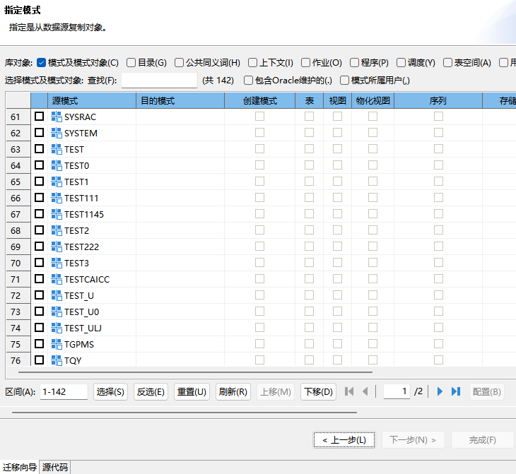

图4.6 指定模式界面

如果源端数据源是 Oracle，且版本大于等于 12，则会有如下配置。

#### 4.2.3.1 包含 Oracle 维护

该配置控制是否迁移 Oracle 数据库系统的一些对象，oracle12 之后，系统会创建很多系统对象。有时，用户只需迁移用户自己的对象，这些系统的对象查出来，因为比较多，会影响用户选择用户自己的对象，所以如果想移除这种系统对象的影响的话，则取消该选项。

该选项默认勾选，即不做任何对象过滤，查询出当前用户能够查询到的所有对象供选择迁移。

#### 4.2.3.2 模式所属用户

该配置控制是否迁移 Oracle 数据库系统的所有用户。勾选时只会迁移与选中模式同名的用户，不勾选时可以迁移所有用户。该选项默认不勾选，即可以迁移全部的用户。

### 4.2.4 指定对象

配置路径：向导页->“指定对象”。

选择要迁移的对象，可以通过过滤选择要迁移的对象，同时选中对象并点击转换配置每一个对象的迁移策略。

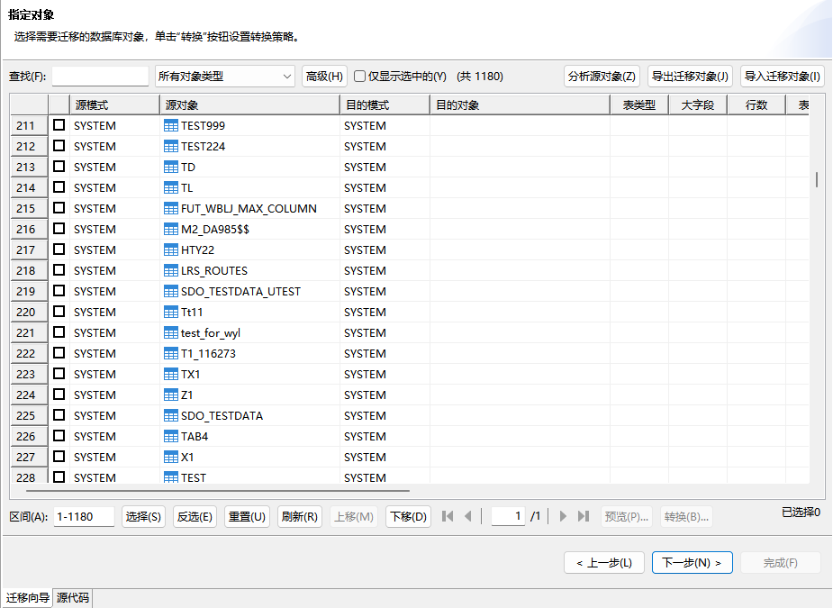

图4.7 指定对象界面

#### 4.2.4.1 导入迁移对象

导入迁移对象是从文件中获取要迁移的对象名信息，可以直接选中对应的对象进行迁移，不用自己一个一个选。

包括从文本文件中获取对象名信息，和从 SQL 脚本中获取。

另外导入迁移对象文件，存放的是要迁移对象的模式名和对象名，可以按照一定的行分隔符，列分隔符，文本限定符，以及是否第一行为列信息的格式进行存储，导入时只要设置的文件格式与实际文件存储的格式一致即可。

从 SQL 脚本中获取，SQL 脚本中需要包含当前列出的任何供选择的迁移对象的任何一个对象，否则无法解析出。

#### 4.2.4.2 导出迁移对象

导出迁移对象的对象名信息到文本文件。可以作为下次迁移的导入迁移对象方式的输入文件，详细参见 4.2.2.1 配置对象获取方式 和 4.2.2.2 迁移策略 。

#### 4.2.4.3 分析源对象

对要迁移的对象进行分析，统计要迁移的对象个数分布。如果包含表对象，可以分析表对象的表类型、大小、空间、包含主键、外键、LOB 字段等情况等。用户可以根据统计信息来配置对象迁移策略。

#### 4.2.4.4 迁移对象映射关系

每种对象映射关系，可以选择其中一个对象配置，然后使用“映射当前选项到其他同类对象”，把相同的配置应用到其他同类对象中。

> **注意**
> 
> 不是所有的当前的映射关系配置都可以应用，手动编辑的不可以应用。选中“映射当前选项到其他同类对象”后打开“选择其他同类对象”对话框中，点击“选择要应用的选项”可以查看和选择哪些配置选项可以应用。

每种类型的对象，都可以通过手动编辑 SQL 方式，编辑要在目的端创建对象的 SQL 语句，如果选中编辑后，则配置的属性选项无用，默认自动生成。

每种类型的对象，迁移映射关系配置不一样，可点击“转换”按钮进行迁移映射配置，配置项包括：

##### 4.2.4.4.1 表

包括迁移策略选项和列映射选项。

###### 4.2.4.4.1.1 迁移策略选项

1. **表定义**

配置是否迁移表定义，默认的如果表存在会不选中，即不迁移表定义，如果表不存在会选中，即需要迁移表定义。

可以配置是否迁移表的存储信息，勾选“包含存储”，可以选择“保留原有存储选项”和：“配置存储选项”。如果选择“保留原有存储选项”，则源端表的存储信息是怎么样的，目的就是怎么样的；如果选择“配置存储选项”，则目的端表的存储信息按配置的来创建。如果该配置应用到其他同类对象，则所有应用的表的存储信息都按照该配置来创建。

2. **如果目的表存在**

配置当目的表存在时，需要对已存在的目的表所做的操作：

1）不处理

即 DTS 不做任何处理，直接创建表，由服务器报错。

2）先删除

即先删除已存在的目的表，再创建。

3）跳过

即当 DTS 检测到目的表存在时，不创建该表。

3. **压缩**

配置是否迁移表的压缩属性。如果要迁移，缺省保留源端压缩属性，也可以自己配置。

4. **保留列属性的原有模式信息**

配置表中的默认值，自定义类型等属性中如果包含模式信息时，是保留原有的模式信息还是使用当前要迁移表的目的模式。

5. **主键迁移策略**

配置是否迁移主键。如果迁移，主键类型可以选择:保留主键类型(即源端主键是什么类型目的端主键就创建成什么类型)、强制聚集主键(即不管源端主键类型，目的端都创建为聚集主键)、强制非聚集主键(即不管源端主键类型，目的端都创建为非聚集主键)。

> **注意**
> 
> 如果目的是DM数据库，且包含大字段，则会强制转化为非聚集主键，即使选项为强制聚集主键。

6. **列名转换**

配置迁移时是否转换列名。如果勾选，需要配置列名转换规则，迁移时会根据列名转换规则处理列名，列名转换规则分为两类：

1）根据关键字匹配列名：如果原始列名是 DM 数据库中不支持作为列名的关键字，可根据配置为列名添加前缀或后缀。

2）根据自定义正则表达式匹配：输入正则表达式和替换后文本，如果列名能与正则表达式完全匹配，列名会被替换为指定的替换后文本。

7. **约束**

配置是否迁移约束，包括外键约束、唯一约束、检验约束。迁移外键时，如果勾选“保留引用表原有模式信息”，则迁移表的外键时，外键引用表的模式为源端外键引用表的模式一样；如果取消勾选，则外键引用表的模式为所迁移的目的表所在的模式。如果勾选“WITH INDEX”选项后，迁移外键会带上关键字 with index，缺省勾选。

8. **索引**

配置是否迁移索引。

也可以配置是否迁移索引的存储信息。勾选“包含存储”，可以选择“保留原有存储选项”和“配置存储选项”。如果选择“保留原有存储选项”，则源端索引的存储信息是怎么样的，目的就是怎么样的；如果选择“配置存储选项”，则目的端索引的存储信息按配置的来创建。如果该配置应用到其他同类对象，则所有应用的表的索引的存储信息都按照该配置来创建。

“异步索引”，勾选了该选项后迁移目的索引为异步索引。

“并行创建索引，并行数”，配置是否并行创建索引,并可设置并行数。

9. **对象权限**

选择该选项后，迁移对象的同时会迁移该对象的相关权限，如果要成功的迁移对象权限，目的数据库上必须有需要迁移的对象权限涉及到的用户和角色。

10. **表及字段注释**

配置是否迁移表及字段注释。

11. **子分区名转换**

配置是否转换子分区名，仅 Oracle-DM、Kingbase-DM 可以配置。

其中 Oracle 创建分区表使用分区模板时，Oracle 中二级分区名格式为：模板名\_二级分区名。勾选该按钮后，会将二级分区中符合<模板名\_二级分区名>格式的分区，自动修改为<二级分区名>，不勾选时保持从 Oracle 系统表中获取的分区名。

其中 Kingbase 创建分区表的语法包括原始的 PostgreSQL 语法和其兼容的 Oracle 语法。例如：表名为 test，分区子表为 part，采用原始 PostgreSQL 语法创建会获取到子分区名为 part；采用兼容的 Oracle 语法创建分区子表，实际表名为 test\_part。金仓里可同时使用这两种语法。勾选该按钮后，会处理符合<表名>\_<分区名>格式的分区名，自动修改为<分区名>，例如：test\_part，调整为 part；否则保持原有。

12. **范围分区转换**

配置是否转换范围分区，仅 Kingbase-DM 适用。如果勾选该按钮，Kingbase 的 range 分区的 from to 更改为 less than，将 default 更换为 maxvalue；否则保持原有。

由于 Kingbase 的 range 范围可以无序，而 DM 的范围要求有序，DTS 无法进行完全转换，所以增加配置，建议进行转换时都勾选该配置，但勾选后也不一定可以完全迁移。

13. **分区表迁移为堆表**

配置是否把分区表迁移为堆表，仅 Oracle-DM 适用。解决 Oracle 分区表迁移到达梦时，经常遇到报错“局部唯一索引必须包含全部分区列”问题，所以用户可以配置把 Oracle 的分区表迁移为 DM 的堆表。

14. **强制全局索引**

配置是分区表迁移为堆表时，是否强制全局索引，仅 Oracle-DM 适用。Oracle 分区表的索引默认为创建全局索引，DM 堆表的分区表索引默认为创建局部索引，所以新增”强制全局索引”选项，用户可以选择配置是否创建为全局索引。

15. **使用 IDENTITY 自增列**

配置自增列是迁移为 DM 的 IDENTITY 自增列方式，还是迁移为 AUTO\_INCREMENT 方式。缺省不勾选保持原样。

16. **列 ON UPDATE 语法**

配置是否迁移列的 ON UPDATE 属性，仅 Mysql-DM 适用。DM8 暂不支持该属性，DTS 无法迁移该属性，忽略。

17. **Row Change Timestamp Column 迁移为触发器**

配置是否把 DB2 的 Row Change Timestamp Column 迁移为 DM 触发器，仅 DB2-DM 适用。DB2 的 generated always for each row on update as row change timestamp 用于自动获取行更新的时间戳，DM 没有对应语法，但可以通过 DM 的触发器实现该功能，所以该选项可以配置是否将 generated always for each row on update as row change timestamp 转换为 DM 的触发器迁移。

18. **数据**

配置是否迁移数据。

19. **如果目的表存在，不迁移数据**

配置如果目的表存在时，是否迁移数据。

20. **启动标志列插入**

配置是否启动标志列插入（即是否开启自增列的插入）。如果选中，则迁移表数据时，即使是自增列，也会从源中读取数据，绑定插入到目的表中；否则如果不选中，则迁移表数据时，如果是自增列，则对应列不绑定插入数据。

21. **显示行数**

配置迁移时是否先查询表数据行数，通常考虑到性能问题，有的数据库查询表数据行数会比较慢，所以缺省不显示行数，该配置并不会影响迁移。

22. **拷贝记录/删除后拷贝记录**

配置迁移之前是否需要先删除目的端表中原有的数据，缺省选“拷贝记录”，即不执行删除数据操作，直接迁移。

23. **忽略错误**

配置迁移数据时是否忽略数据错误，即如果表数据中其中某一个数据有问题，是否忽略。如果选中，则忽略，会继续迁移，错误数据保持到文件，可以查看，也可以重迁；否则如果没有选中，则直接抛出错误，停止该表的数据的迁移任务。

24. **源允许脏读**

配置是否允许读到源库中的脏数据。

25. **限制行数/最多迁移行数**

配置是否限制迁移行数，并可以配置限制最多迁移多少行。例如，需要配置仅迁移该表的 1000 行数据，则可以勾选该选项，并配置最多迁移行数为 1000。

26. **日期时间类型格式**

配置文件中日期时间文本的格式。

27. **转换数据**

配置数据迁移过程中是否对数据进行转换处理。如果勾选，则可以配置数据转换规则，对表中符合规则的数据进行相应的处理。其中转换规则包括匹配条件和转换模板，转换规则可以手动配置，也可以使用内置规则。内置规则对应系统中的数据转换模板，可以参考 4.2.10.2 数据转换模板 。

手动添加规则的流程如下：

点击“添加”按钮进行添加，过程中需要配置：

1）匹配条件

匹配条件是按源表的列进行匹配的，即当源表的列符合配置的规则时才会对相应的数据进行处理。其中可以按源表列的名称 (name)、 类型(type)、精度(precision)、标度 (scale)进行匹配。

可以配置比较匹配条件的比较符、比较值以及多个匹配条件直接的关系(OR 或者 AND)，支持通过下拉列表方式选择相应条件的比较值，会展示该表的列名称或者列字段类型；支持手动输入的方式，这种情况会对列字段类型进行检测。

2）处理方式

配置使用什么函数对数据进行处理，通过“转换类型”的下拉列表，用户可以选择 DTS 内置的函数（即 JAVA 实现的函数），或可以通过导入 Jar 包的方式使用自定义函数，自定义方式参考 4.3 自定义数据转换接口 章节；也可以选择使用数据库函数，即使用目的库支持的函数对相应的列进行处理；还可以填入策略函数名以及掩码函数名以使用 DBMS\_RLS 的动态脱敏流程。

配置 Java 函数以及自定义函数都可以使用“函数参数”表格来指定函数的参数值，并对结果进行校验。

函数的配置可以通过“导入模板”的方式来快速应用，已经配置好的函数配置，可以点击“保存为模板”将其持久化到“迁移”节点下的“数据转换模板”中，支持增删改查操作。

注意，使用 DTS 内置转换函数时，函数的参数类型要求与 DTS 使用 JDBC 获取到的 Java 类型一致，多数情况下会进行适配。

28. **主键冲突处理**

配置主键冲突处理策略，包括：默认、覆盖、忽略。其中默认指的是不处理；覆盖指的是覆盖原有已存在的主键列相同的记录；忽略指的是如果原有存在相同的主键列的记录，则忽略不迁移。

其中主键列如果存在主键或唯一约束的话，则给定主键或唯一约束列，否则可以指定。

29. **表迁移参数**

配置表的迁移参数，普通表和大字段表单独配置，包括源一次读取行、目的一次提交行数、缓存批数。数据迁移执行流程如下：

读数据线程从源读取数据，把读取到的数据存放入数据缓存池中，如果数据缓存池满，则读数据线程阻塞等待，否则重复。写数据线程从数据缓存池读取数据，导入数据到目的表，如果数据缓存池为空，则写数据线程阻塞等待，否则重复。

每次读数据线程读取到多少行数据后放入数据缓存池（写数据线程一次从缓存中读取到多少行数据后提交到目的端执行），这个数据行数通过“目的一次提交行数”来设置，数据缓存池的大小通过“缓存批数”来配置。

另外“源一次读取行数”，用于设置 fetchsize。

> **注意**
> 
> 每次读数据线程读取到多少行数据后放入数据缓存池，除了“目的一次提交行数”来控制之外，还受“每批装载最大大小”，“每批装载最大时间”影响，详细参见相关章节介绍。 TXT-DM，DM-TXT只迁移表数据，不迁移结构信息，TXT-DM TXT内容必须是有一定格式的TXT，并且如果目的表由DTS创建，则所有列类型都为VARCHAR(200)。

30. **并行导出，并发数**

配置是否使用并行导出。如果使用，则需要配置并发数。DTS 的并行导出通过分页查询实现，即配置的并发数平均分页查询一部分数据，同时并发读取，所以是否正在并发导出依赖于各数据库是否支持分页查询，并发导出的的性能依赖于各数据库的分页查询的性能。支持分页查询的数据库有 DM、DB2、Kingbase、Oracle、ShenTong、PostgreSQL。

如果使用并行导出，则不保证迁移到目的端的数据与源端数据顺序一致。

如果使用并行导出，则默认的开启”显示行数”参数（见上述“13 显示行数”配置项）。

31. **并行导入，并发数**

配置是否使用并行导入，如果使用，则需要配置并发数，即是否使用多线程并发导数据导目的端。

如果使用并发导入，则不保证迁移到目的端的数据与源端数据顺序一致。

32. **使用快速装载**

配置是否使用 DM 的快速装载，目前仅目的端为 DM 时支持快速装载。使用快速装载前需要配置快速装载相关参数，具体参数说明参见《DM8 快速装载工具使用手册》。

也可以配置使用快速装载“多实例”，如果勾选该选项，则相当于多个快速装载工具同时向同一张表中迁数据。在某些性能要求比较高的情况下可以勾选该选项，但多实例的使用有一些场景的限制，具体限制请参考《DM8 快速装载工具使用手册》中的 PARALLEL 参数说明。

###### 4.2.4.4.1.2 列映射选项

配置源端表的列和目的端表的列的转换关系，可以增加列和删除列。如果是增加列，即目的端的列比源端列多，则源端有相关列映射到目的端的多个列；如果删除列，即目的端的列比源端列少，即源端有些列不迁移。

也可以配置目的端列的属性，包括类型、精度、标度、缺省值、虚拟列等等。目的列的值也可以是表达式，表达式可以为数据库函数，也可以是用 JAVA 实现的自定义转换函数，具体使用方法参见 4.3 自定义数据转换接口 。

##### 4.2.4.4.2 上下文/目录/类/自定义类型/包/同义词/触发器

迁移选项包括：

1. **如果目的上下文/目录/类/自定义类型/包/同义词/触发器已经存在**

配置如果目的对象已经存在的情况下，可以选择不处理、先删除或者跳过操作。

2. **替换已经存在的目的上下文/目录/类/自定义类型/包/同义词/触发器**

配置是否替换已经存在的目的对象，如果选中则拼的 SQL 语句为 CREATE OR REPLACE，否则为 CREATE。

3. **语法转换（触发器专用）**

配置是否进行语法转换转换，如果选中，则可以点击转换规则进行语法规则转换，各转换规则的含义可以查看对应行的描述。

仅 SQLServer->DM 和 MYSQL->DM 提供该选项。

4. **强制为确定性函数（包专用）**

配置包中的函数是否迁移为确定性函数。

##### 4.2.4.4.3 物化视图

迁移选项包括：

1. **如果目的物化视图已经存在，先删除**

配置如果目的对象已经存在的情况下，是否先执行删除操作。

2. **包含存储**

配置是否迁移物化视图的存储信息，如果迁移，也可以配置存储选项。

3. **索引**

也可以配置是否迁移索引的存储信息，勾选“包含存储”，可以选择“保留原有存储选项”和“配置存储选项”，如果选择“保留原有存储选项”，则源端索引的存储信息是怎么样的，目的就是怎么样的；如果选择“配置存储选项”，则目的端索引的存储信息按配置的来创建，如果该配置应用到其他同类对象，则所有应用的物化视图的索引的存储信息都按照该配置来创建。

4. **物化视图注释**

配置是否迁移物化视图的注释信息。

##### 4.2.4.4.4 存储过程/函数

迁移选项包括：

1. **如果目的存储过程/函数存在**

配置如果目的对象已经存在的情况下，是否先执行删除操作。选择 不处理 选项后，迁移过程中不会删除已存在的目的存储过程，而是直接创建存储过程；选择 先删除 选项后，迁移过程中会先删除已存在的目的存储过程，再重新创建新目的存储过程；选择 跳过 选项后，迁移过程中如果目的存储过程已存在，将不会删除和创建目的存储过程。

2. **替换对象**

配置是否替换已经存在的目的对象，如果选中则拼的 SQL 语句为 CREATE OR REPLACE，否则为 CREATE。

3. **语法转换**

配置是否进行语法转换。如果选中，则可以点击转换规则进行语法规则转换，各转换规则的含义可以查看对应行的描述。

仅 SQLServer->DM 和 MYSQL->DM 提供该选项。

4. **对象权限**

配置是否迁移对象权限，DM-DM 提供该选项。

5. **强制为确定性函数**

配置是否迁移为确定性函数，DM-DM 提供该选项。

##### 4.2.4.4.5 序列

迁移选项包括：

1. **如果目的序列已经存在，先删除**

配置如果目的对象已经存在的情况下，是否先执行删除操作。

2. **以源序列的下一个值作为目的序列的开始值**

配置迁移后的目的序列的开始值策略。如果勾选，则目的序列的开始值为源序列的下一个值。

3. **以源序列的 LAST\_NUMBER 值作为目的序列的开始值**

配置迁移后的目的序列的开始值策略。如果勾选，则目的序列的开始值为源序列的 LAST\_NUMBER 值。

4. **以源序列的开始值作为目的序列的开始值**

配置迁移后的目的序列的开始值策略。如果勾选，则目的序列的开始值为源序列的开始值，Oracle-DM 不提供该选项。

5. **对象权限**

配置是否迁移对象权限，DM-DM 提供该选项。

##### 4.2.4.4.6 视图

迁移选项包括：

1. **如果目的视图已经存在，先删除**

配置如果目的对象已经存在的情况下，是否先执行删除操作。

2. **替换已经存在的目的视图**

配置是否替换已经存在的目的对象。如果选中，则拼的 SQL 语句为 CREATE OR REPLACE，否则为 CREATE。

3. **语法转换**

配置是否进行语法转换。如果选中，则可以点击转换规则进行语法规则转换，各转换规则的含义可以查看对应行的描述。

仅 SQLServer->DM 和 MYSQL->DM 提供该选项。

4. **对象权限**

配置是否迁移对象权限。DM-DM 提供该选项。

5. **视图注释**

配置是否迁移视图的注释信息。

##### 4.2.4.4.7 资源限制

配置当目的资源限制存在时，需要对已存在的目的资源限制所做的操作。

如果目的资源限制存在时，可做的操作有：

1. **不处理**

即 DTS 不做任何处理，直接创建资源限制，由服务器报错。

2. **先删除**

即先删除已存在的目的资源限制，再创建。

3. **跳过**

即当 DTS 检测到目的资源限制已存在时，不创建该资源限制。

##### 4.2.4.4.8 表空间

1. **如果目的表空间存在**

配置当目的表空间存在时，需要对已存在的目的表空间所做的操作：

1）不处理

即 DTS 不做任何处理，直接创建表空间，由服务器报错。

2）先删除

即先删除已存在的目的表空间，再创建。

3）跳过

即当 DTS 检测到目的表空间存在时，不创建该表空间。

2. **自定义表空间信息**

配置是否使用表空间默认信息，默认不勾选。不勾选时可以查看默认表空间信息，迁移时保持源库表空间信息不变；勾选时可以配置表空间配置信息，迁移时使用配置的表空间信息。

##### 4.2.4.4.9 用户

1. **用户定义**

配置是否迁移用户定义，缺省选中。

2. **如果目的用户存在**

配置当目的用户存在时，需要对已存在的目的用户所做的操作：

1）不处理

即 DTS 不做任何处理，直接创建用户，由服务器报错。

2）先删除

即先删除已存在的目的用户，再创建。

3）跳过

即当 DTS 检测到目的用户存在时，不创建该用户。

3. **迁移资源限制**

配置是否迁移用户对应的资源限制。如果迁移可以配置“关联资源限制对象”，修改用户的资源限制信息时可以绑定一个资源限制对象或者直接修改用户的相关配置信息。勾选“关联资源限制对象”时会直接将给用户绑定资源限制对象，要求目的库中存在与源库同名的资源限制对象；不勾选时，会从源库的资源限制中获取具体配置信息，将这些配置直接设置给用户，默认勾选。

4. **包含表空间**

配置迁移用户时是否指定默认表空间，默认不勾选。勾选后可以选择“保留表空间原有选项”和“配置表空间选项”。

选择“保留表空间原有选项”时，创建用户时指定的默认表空间与源库默认表空间同名；选择“配置表空间选项”时可以修改用户的默认表空间名，同时可以配置“新建表空间”并设置表空间基本信息，配置新建表空间选项后，创建用户前会按照配置的表空间信息来创建用户默认表空间。

5. **自定义用户信息**

配置是否使用默认用户信息。如果不勾选，则目的用户信息会保持和源库的用户配置信息一致；勾选后，可以配置用户信息，创建用户时会按配置的信息来创建。

6. **迁移权限**

配置是否迁移权限，默认勾选。勾选后可以选择“保留权限原有选项”和“配置权限选项”，选择“保留权限原有选项”时会迁移全部兼容的权限；选择“配置权限选项”时可以选择需要迁移的权限，执行时只会迁移选中的权限。

7. **使用默认系统权限映射关系**

配置是否使用默认的系统权限映射关系。源库和目的库之间权限不一定完全兼容，迁移时会构建源库和目的库系统权限的映射关系，勾选时会使用默认的映射关系；不勾选时用户可以新增映射关系或修改已有映射关系，配置后迁移时会根据配置的映射关系迁移权限。

##### 4.2.4.4.10 角色

1. **角色定义**

配置是否迁移角色定义，默认勾选

2. **如果目的角色存在**

配置当目的角色存在时，需要对已存在的目的角色所做的操作：

1）不处理

即 DTS 不做任何处理，直接创建角色，由服务器报错。

2）先删除

即先删除已存在的目的角色，再创建。

3）跳过

即当 DTS 检测到目的角色存在时，不创建该角色。

3. **迁移权限**

同 4.2.4.4.9 用户 “迁移权限”配置。

4. **使用默认系统权限映射关系**

同 4.2.4.4.9 用户 “使用默认系统权限映射关系”配置。

### 4.2.5 输入查询语句

配置路径：向导页->“输入查询语句”。

如果“获取对象的方式”选择“用一条或多条 SQL 指定要迁移的对象”，则会需要配置查询语句，用户可以手动输入查询 SQL，或导入 SQL 脚本。

对于输入的 SQL 或导入的 SQL 脚本，主要迁移查询结果集，即每一个查询语句，把它的查询结果集作为源端的表，迁移策略和方法与表的迁移一致。

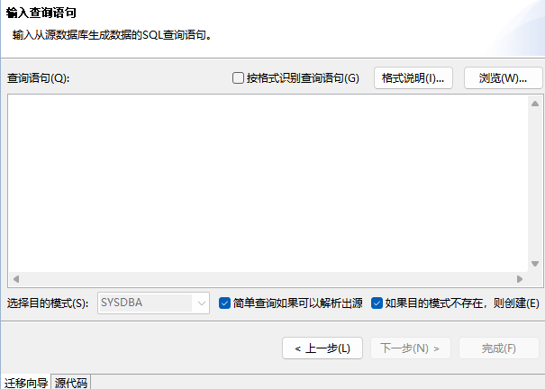

图4.8 输入查询语句界面

### 4.2.6 配置对象迁移策略

配置路径：向导页->“配置对象迁移策略”。

统一配置所有要迁移的对象的迁移策略，对于同类对象迁移策略一致。

具体可以配置:

1. **按对象名过滤**

即可以配置只迁对象名符合哪些规则的对象。

2. **配置表迁移策略**

即配置要迁移的所有表对象的迁移策略，具体迁移策略可以参考 4.2.4.4.1.1 迁移策略选项 。

3. **配置其他对象迁移策略**

配置除表对象之外其他对象的迁移策略，仅需配置“如果目的对象已经存在，先删除”选项，即如果目的对象已经存在，是否先删除已存在的对象，然后再开始迁移创建对象的任务。

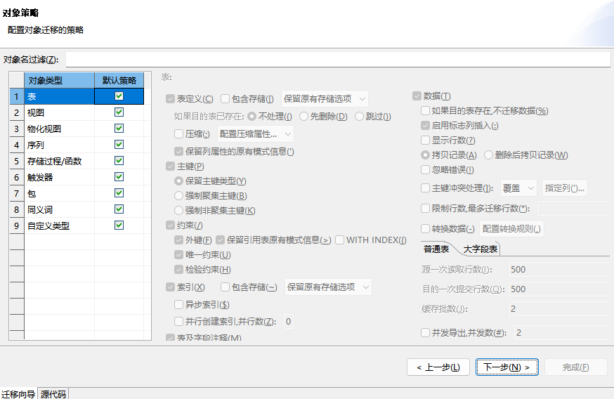

图4.9 配置对象迁移策略界面

### 4.2.7 配置远程代理

配置路径：向导页->“执行方式”。

配置本地执行任务还是远程执行任务以及具体的远程代理。

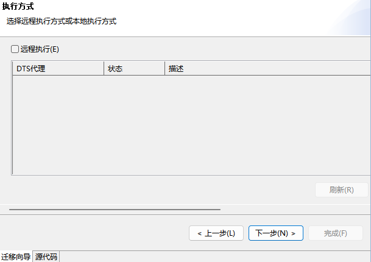

图4.10 执行方式界面

具体可以配置：

1. **远程执行。**

即可以配置是否远程执行，若不配置则默认本地执行。

2. \*\*配置 DTS 代理。\*\*可参考 [3.4 代理使用](dts_agent.md) 章节。

即通过主机名、端口号和校验 KEY 配置执行任务的 DTS 代理。

### 4.2.8 配置执行页面显示方式

配置路径：向导页->“审阅迁移任务”。

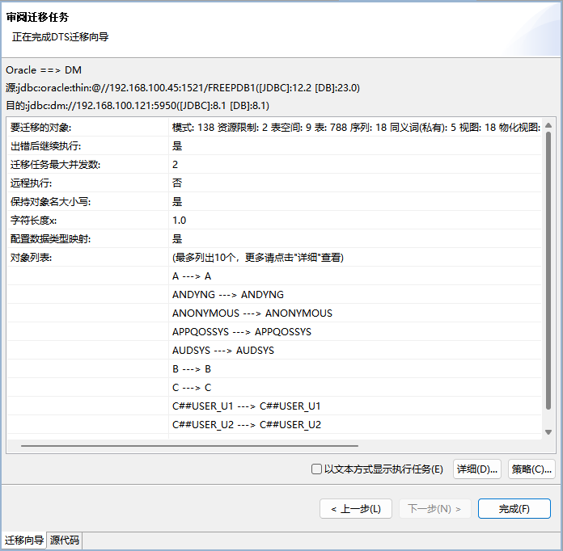

图4.11 审阅迁移任务界面

迁移执行任务显示方式包含 2 种：

1. 显示执行的概述统计信息，以及正在执行的任务信息，出错的任务信息，以及迁移日志信息，定时刷新这些信息，出错的任务信息分页显示，迁移日志信息缺省最多显示 1000 条。

默认使用这种显示方式，页面上面显示执行的概述统计信息，下面显示正在执行的任务信息，出错的任务信息，以及迁移的日志信息。

其中正在执行的任务信息、出错的任务信息以及迁移的日志信息、迁移日志的最大显示条数可以在“全局选项配置”中配置。

2. 以文本方式显示执行。

即所有迁移任务进度信息以文本方式显示，定时刷新进度信息。

在显示页面上面文本框显示整个迁移的进度信息，下面文本框显示正在迁移的任务进度信息。

### 4.2.9 全局选项配置

#### 4.2.9.1 整体全局配置选项

配置路径：窗口->选项->数据迁移工具。

整体全局选项配置即配置后对所有工程的迁移、评估、对比都适用。配置后应用，刷新导航树对应的工程节点即可生效。

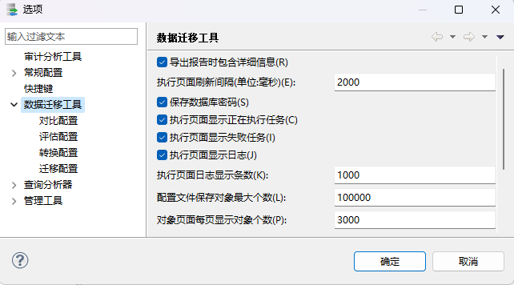

图4.12 整体全局迁移选项配置

下面分别介绍各配置选项。

##### 4.2.9.1.1 导出报告时包含详细信息

配置导出报告时是否包含详细信息，默认包含，但如果迁移的对象特别多，可能导出的报告会非常大，同时页会影响导出性能，可以选择不包含详细。

##### 4.2.9.1.2 执行页面刷新间隔

执行页面的显示信息都是定时刷新的，刷新间隔缺省为 2000ms。

##### 4.2.9.1.3 执行页面显示正在执行任务

执行页面是否需要显示正在执行的任务，缺省显示，可以取消。

##### 4.2.9.1.4 执行页面显示失败任务

执行页面是否显示失败的任务，缺省显示，可以取消。

##### 4.2.9.1.5 执行页面显示日志

执行页面是否显示日志，缺省显示，可以取消。

##### 4.2.9.1.6 执行页面日志显示条数

执行页面如果显示日志的话，日志显示最大条数，缺省 1000。

##### 4.2.9.1.7 html 报告单表最大错误数据行数

导出 html 报告时，错误数据导出的最大行数。缺省全部导出，但可能会有内存问题，可以通过该参数配置导出最大行数。

##### 4.2.9.1.8 保存数据库密码

是否保存数据库的密码信息到迁移配置文件中，默认勾选。

##### 4.2.9.1.9 对象页面每页显示对象个数

该配置控制向导页“选择对象”每页显示的对象个数，缺省为 3000。

##### 4.2.9.1.10 配置文件保存对象最大个数

配置保存对象最大个数。缺省为 100000 个，0 表示不限制。

如果要迁移的对象超过配置的最大个数，则不保存配置文件。

#### 4.2.9.2 迁移全局配置选项

配置路径：窗口->选项->数据迁移工具->迁移配置。

迁移全局选项配置即配置后对所有工程的迁移节点都适用，配置后应用，刷新导航树对应的迁移工程节点即可生效。

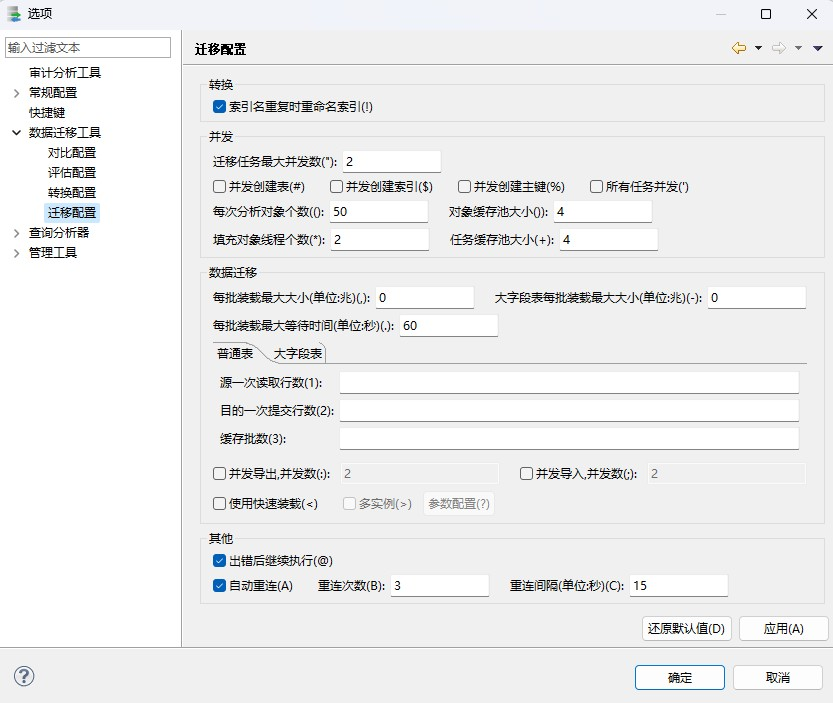

图4.13 迁移全局选项配置

其中各配置选项功能请参考 4.2.2.2 迁移策略 小节。

#### 4.2.9.3 数据类型映射关系全局配置选项

可对当前工程的迁移节点手动配置全局数据类型映射关系。

配置方式：迁移管理->找到对应的迁移工程->展开”数据类型映射”节点->找到对应的源端数据源->找到对应的目的端数据源->双击打开数据类型配置页面->在右边打开面板中可以对数据类型映射关系进行增删改操作。

新增一行数据映射关系时，源端数据类型如果要匹配精度和标度信息，可参考 4.2.2.2.2 配置数据类型映射关系 中对节点映射关系配置的介绍。

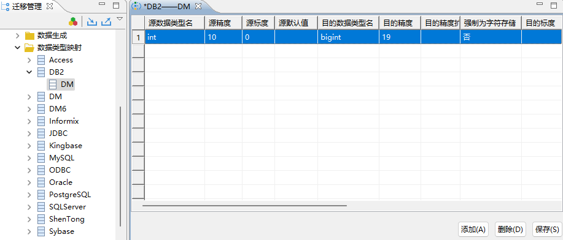

图4.14 DB2->DM手动新增一行数据类型映射关系

### 4.2.10 迁移模板配置

DTS 节点进行迁移配置时，可提前配置规则模板，并保存在对应模板管理中，供后续配置迁移节点时使用。目前 DTS 迁移有三类模板可进行配置，分别为策略配置模板、数据转换模板和语法规则模板。

#### 4.2.10.1 策略配置模板

策略配置模板中配置的内容为迁移过程中的整体策略，如是否保持对象名大小、迁移任务最大并发数等，对应向导页“迁移选项”中的内容，配置项可参考 4.2.2.2 迁移策略 的介绍。

目前系统中默认的策略配置模板有三个，分别为“对象比较多场景”、“数据量比较大场景”和“对象比较多以及数据量比较大场景”，这三个模板都着重勾选了并发方面内容，以降低迁移时间。用户可酌情使用上述模板，也可自己创建合适的模板进行使用。

- **创建模板**

DTS 支持两种创建策略配置模板的方式。

1. 直接在模板管理界面新建模板并进行配置。可直接在迁移管理->迁移->策略配置模板->右侧点击“添加模板”，勾选各策略选项并调整参数，进行新模板的创建和配置。
2. 在节点配置完成后将该节点的迁移配置策略保存为模板。可在正在配置的迁移节点的向导页“配置迁移选项”中点击“更多”进行迁移策略配置，配置完成后点击“保存为模板”，即可将该节点中的迁移策略保存为模板。
- **使用模板**

DTS 支持将配置好的策略配置模板应用于节点。

可在正在配置的迁移节点的向导页“配置迁移选项”中点击“更多”，并点击“导入模板”，选择合适的模板进行该节点的模板配置。

#### 4.2.10.2 数据转换模板

数据转换模板中的配置的内容为数据迁移过程中对数据进行转换的策略配置，当迁移节点选择对表中数据进行数据迁移，且对迁移的数据进行数据转换时，可进行该项配置，对应“对象策略”向导页和“指定对象”向导页中对“表对象”进行数据转换配置的内容，可参考 4.2.4.4.1.1 迁移策略选项 中的“转换数据”配置项。

目前系统中默认的数据转换模板有以下六个：

1. 当列类型为字符串时，数据去掉前导和末尾空格：即如果是插入类型的列，不管数据是什么，都进行去掉前导和末尾空格的处理，处理后再插入到目的表中。
2. 当列类型为字符串时，数据去掉前导空格：即如果是插入类型的列，不管数据是什么，都进行去掉前导空格的处理，处理后再插入到目的表中。
3. 当列类型为字符串时，数据去掉末尾空格：即如果是插入类型的列，不管数据是什么，都进行去掉末尾空格的处理，处理后再插入到目的表中。
4. 当列类型为字符串时，中国大陆身份证号只展示前 3 位和后 4 位：即如果是插入类型的列，不管数据是什么，只展示前三位及后四位字符，目的是对中国大陆 18 位身份证号形式的数据进行脱敏后插入到目的表中，不足 18 位的数据会进行遮盖，超过 18 位的不会处理。
5. 当列类型为字符串时，中国大陆手机号字段遮盖中间 4 位：即如果是插入类型的列，不管数据是什么，都会遮盖掉中间 4 位，目的是对中国大陆 11 位手机号形式的数据进行脱敏后再插入到目的表中，不足 11 位的数据也会进行处理，超过 11 位的不会处理。
6. 当列类型为字符串时，中国大陆银行卡号仅显示最后 4 位：即如果是插入类型的列，不管数据是什么，都只展示末尾 4 位，目的是对中国大陆的银行卡号进行脱敏处理后再插入到目的表中，不足位数的会进行遮盖，空格字符会跳过。
- **创建模板**

对数据进行转换的功能本质上依赖于函数，包括系统内置函数和用户自定义函数。创建数据转换模板之前，需要先确认当前系统中存在符合用户需求的函数。如果不存在，用户可参考 4.3 自定义数据转换接口 自行创建函数。

系统中存在用户所需函数后，即可基于该函数创建数据转换模板，有以下两种方法：

1. 直接在模板管理界面新建模板并进行配置。可直接在迁移管理->迁移->数据转换模板->右侧点击“添加模板”，在弹窗中填入新模板名称，选择合适的函数分类，找到目标函数名，点击确定即可添加成功。
2. 在节点配置完成后将该节点的数据转换策略保存为模板。可在正在配置的迁移节点的“对象策略”向导页或“指定对象”向导页中，在进行表对象的数据配置时，选中“转换数据”，点击配置，进行数据转换配置，配置完成后点击“保存为模板”，即可将该节点中的数据转换策略保存为模板。
- **使用模板**

DTS 支持将配置好的数据转换模板应用于节点。

可在正在配置的迁移节点的“对象策略”向导页或“指定对象”向导页中，进行表对象的数据配置时，点击“转换数据”->配置->内置规则，找到目标模板并点击确定，即可将该模板应用于当前表中符合列匹配条件的列数据上。

#### 4.2.10.3 语法规则模板

语法规则模板中配置的内容为对视图、存储过程/函数、触发器这些以 SQL 语句形式存在于库中的对象进行 SQL 语法转换，使之符合 DM 的语法规则，便于迁移完成后能够在新库中正常发挥作用，对应“对象策略”向导页和“指定对象”向导页中对视图、存储过程/函数、触发器的语法转换配置，可参考 4.2.4.4 迁移对象映射关系 中对视图、存储过程/函数、触发器的描述。该模板仅支持 SQLServer->DM 和 MYSQL->DM。

- **创建模板**

DTS 支持两种创建模板的方式。

1. 直接在语法规则模板界面新建模板并进行配置。可直接在迁移管理->迁移->语法规则模板->右侧点击“添加模板”，勾选各语法规则转换选项进行新模板的创建和配置。
2. 在节点配置完成后将该节点的迁移配置策略保存为模板。可在正在配置的迁移节点的“对象策略”向导页和“指定对象”向导页中，对视图、存储过程/函数、触发器这几类对象进行语法规则配置，并在配置完成后点击“保存为模板”，即可将该节点中的迁移策略保存为模板。
- **使用模板**

DTS 支持将配置好的模板应用于节点。

可在正在配置的迁移节点的“对象策略”向导页和“指定对象”向导页中，在视图、存储过程/函数、触发器这几类对象进行语法规则配置的界面点击“导入模板”，选择合适的模板进行该节点的模板配置。

## 4.3 自定义数据转换接口

DTS 迁移时支持自定义数据转换接口，用于数据迁移过程中的数据转换配置。

### 4.3.1 实现和使用方法

要实现和使用自定义数据转换接口需要完成以下步骤:

1. **实现自定义转换类**

使用 ClassAnnotation 注解标记，属性包括 name(名称)。

2. **实现自定义转换函数**

在自定义转换类中实现自定义转换函数，使用 FunctionAnnotation 注解标记，属性包含 order(序号)，category(类别)，param(参数)，desc(描述)。

3. **存放自定义类到指定路径**

通常自定义类存放在 DTS jar 包相同路径下，即安装目录的 tool\\dropins\\com.dameng\\plugins 下，也可以放在其他路径，如果放在其他路径，则启动时需要配置 DTS 启动参数-Ddameng.registry.classpath 来执行存放的路径。

4. **使用自定义转换类**

自定义转换类实现好后，在向导页”选择迁移对象”->选择要迁移的表，选中->点击转换—>打开表映射关系表对话框，查看”列映射选项”，对需要进行自定义设置的表列，双击“表达式”列，转换类型选择自定义函数，即可选择自定义转换，需要注意的是，在选择使用自定义转换时，不能选中”是否数据库函数”。

### 4.3.2 示例

具体示例如下:

1. 实现自定义转换类和函数如下，将其打包为 jar 包，并放入指定路径中:
```
@ClassAnnotation (name = "UserFuntion")
public class UserFunction
{
    @FunctionAnnotation (order = "1", category = "测试", desc = "返回数值2")
    public int convert(int a)
    {
        return 3;
    }
}
```
2. DTS 中使用自定义转换配置，在向导页”选择迁移对象”->选择要迁移的表，选中->点击转换—>打开表映射关系表对话框，查看”列映射选项”，对需要进行自定义设置的表列，双击“表达式”列，转换类型选择自定义函数，即可选择步骤 1 中实现的自定义转换:

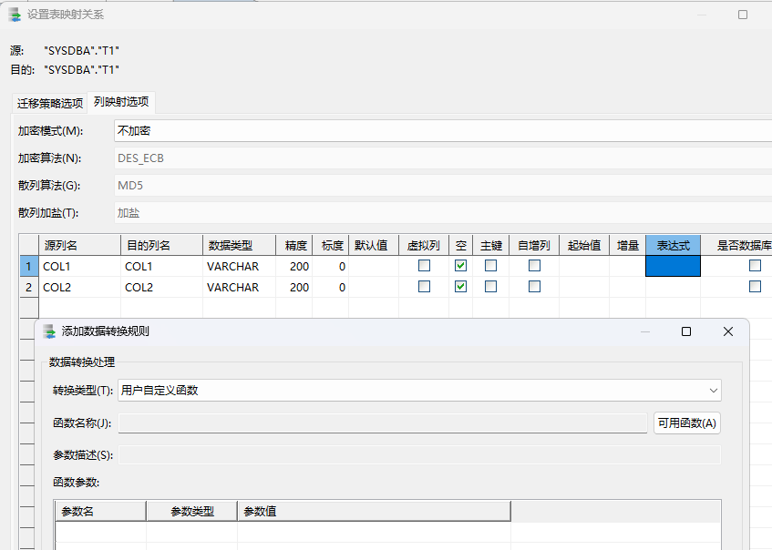

图4.15 设置表映射关系界面

## 4.4 迁移报告

查看路径：向导页“执行迁移”页面->点击“查看迁移报告”按钮，即可打开迁移报告对话框查看。

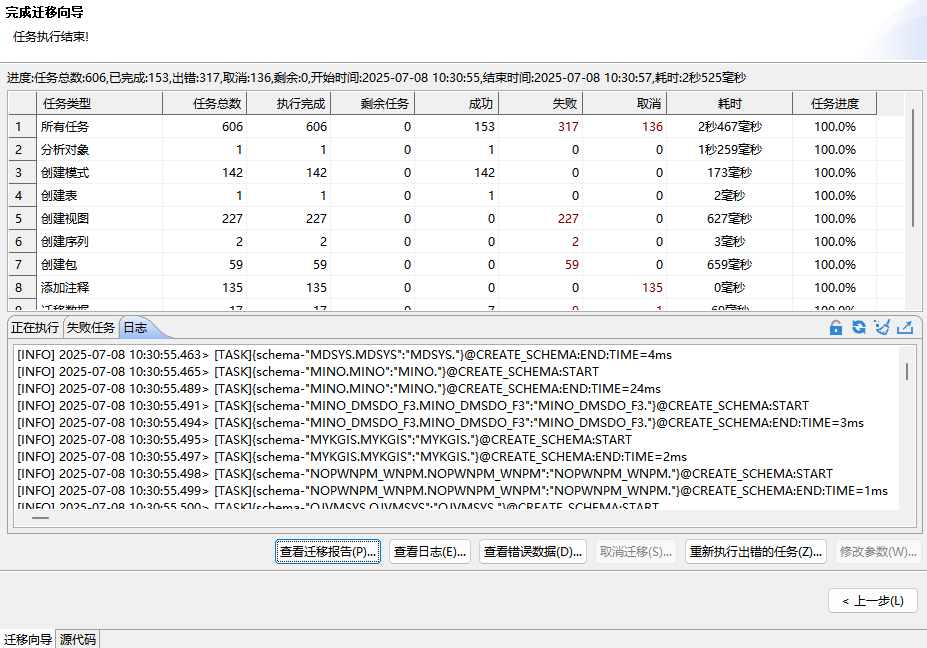

图4.16 执行迁移结束，可查看迁移报告

另外如果迁移工具退出后再打开，也可以通过：迁移管理->展开“迁移”节点->选择要查看的迁移，右键->选择“上一次迁移历史”->选择“迁移报告”，即可打开迁移报告对话框查看上一次执行的报告。

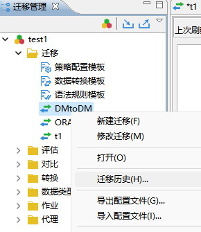

图4.17 迁移历史查询

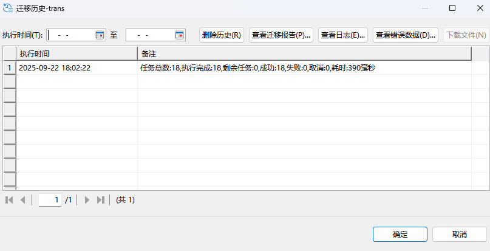

图4.18 迁移历史界面中可查看历史迁移的报告和日志

迁移报告内容报告：

1. **迁移概述**

包括源和目的连接信息，如果是数据库，包括数据库版本和驱动版本信息；也包括迁移执行信息：每一种类型的任务、总共多少、成功多少、失败多少、取消多少、正在执行的多少等等。

2. **迁移详细**

包括每个任务的信息，具体的包括每个迁移任务名称、任务类型、执行状态。

迁移报告支持导出到 html 或 excel 文件，另外也可以导出未成功迁移的对象到文件，这样可以通过”导入迁移对象”(详见 4.2.2.1.1 导入迁移对象 ）重新直接配置迁移未成功迁移的对象。

> **注意**
> 
> DTS可在节点创建时指定保存历史迁移信息的次数，默认次数为1，超过次数会覆盖旧信息，建议用户及时导出报告信息，或修改最大保留历史次数为合适范围。

## 4.5 迁移日志

查看路径：向导页“执行迁移”页面->点击“查看日志”按钮，即可打开迁移日志对话框查看，可参考图 4.16。

另外如果迁移工具退出后再打开，也可以通过：迁移管理->展开“迁移”节点->选择要查看的迁移，右键->选择“迁移历史”->选择“迁移日志”，即可打开迁移日志对话框查看上一次执行的日志，可参考图 4.17 和图 4.18。

迁移日志包括本次迁移的详细迁移记录，一个迁移一份迁移日志信息。

迁移日志支持导出到文件，并且支持仅导出错误的迁移日志到文件。

> **注意**
> 
> DTS可在节点创建时指定保存历史迁移信息的次数，默认次数为1，超过次数会覆盖旧信息，建议用户及时导出日志信息，或修改最大保留历史次数为合适范围。

## 4.6 迁移常见问题

### 4.6.1 性能调优问题

DTS 整个迁移过程为从源端获取要迁移的对象->填充对象信息->迁移对象。

其中获取对象和填充对象在分析对象任务中执行，迁移对象由任务执行器执行。

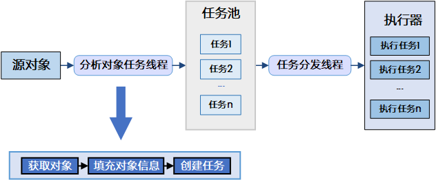

图4.19 迁移执行流程

整体的性能调优可以通过调整分析对象任务和执行器执行任务进行。

1. **分析对象任务调优**

分析对象的任务主要完成获取要迁移的对象，填充对象，然后创建任务，提交给 TaskDispatcher 任务线程。具体如下图:

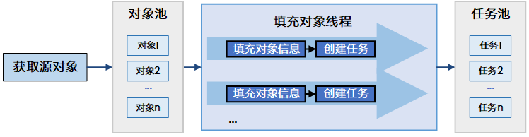

图4.20 分析任务对象

获取源对象和填充对象信息并行执行，并且填充对象信息可以多线程执行，每次可以填充一批对象，这样可以调整的参数包括：

1）获取对象的方式

获取对象的方式包括:导入迁移对象、用一条或多条 SQL 指定要迁移的对象、迁移指定类型的对象、选择迁移对象。

如果是导入迁移对象，则在分析对象阶段会读取给定的输入文件，读取到一批就提交一批到对象池的，可以和后面填充对象，迁移对象并发执行。

如果是用一条或多条 SQL 指定的迁移对象，通常不会很多，而且到分析对象阶段，对象已确定，可以直接提交到对象池，供填充对象。

如果是迁移指定类型的对象，就需要从源数据源中获取相应类型的对象名信息，这个依赖于各数据源的查询对象的性能，也是读取到一批就提交一批到对象池的，可以和后面填充对象，迁移对象并发执行。

如果是选择对象，则对象已确定(对象已经在前面向导页中获取，所以在向导页时可能或有卡顿一下，等待获取所有对象供选择)，可以直接提交到对象池，供填充对象。

2）每次分析对象个数

即每次获取到多少个对象后提交到对象缓存池供填充对象线程获取填充。如果源数据源是数据库的话，批量填充通常使用源数据库的 IN 查询，一次从源数据库获取多个对象的信息，批量越大，与源数据库的交互就会越少，但也不能设置过大，否则获取对象、填充对象、迁移对象就无法很好的并行执行。

3）对象缓存池大小

即对象缓存池的最大大小，等同于最多缓存多少批对象，建议配置成填充对象线程个数\*2。如果内存够大，也可以配置更大，但一般没有实际意义，因为获取对象通常比较快。

4）填充对象线程个数

即多少个线程同时填充对象，根据机器线程合理分配。

5）任务缓存池大小

即任务缓存池的最大大小，即最多缓存多少批任务，建议配置成填充线程个数\*2，如果内存够大，也可以配置更大。

2. **任务执行调优**

DTS 迁移包括对象定义迁移和表数据迁移。

- 对象定义迁移默认是不可并发执行，但创建表和创建索引可以配置成并发，对应定义迁移主要可以调整：

1）迁移任务最大并发数

即有多少个对象的定义可以同时迁移，但这个仅对表定义迁移有效，而且需要打开并发创建表和并发创建索引的配置。

- 对应表数据的迁移，可以调整：

1）表间并发（即多少张表一起迁移数据）

可以调整“窗口”->“选项”->“数据迁移工具”->“迁移工具”->“迁移任务最大并发数”，值越大，并发越大，同时迁移表的数量=迁移数据并发数。

2）表内并发（即迁移一张表的数据时）

表数据迁移本来就是并发的从源中读取出数据的同时也同时把数据写入到目的，可以调的是读取数据的线程数（即同时有多少个线程从源端读取数据）和写入线程的线程数（即同时有多少个线程写数据到目的端）。

表内数据并发可以调整：

（1）向导页“选择迁移对象”->选中要迁移的表->点击“转换”->选中“并发导出”，并配置“并发数”，配置并发读；或向导页“配置对象迁移策略”->“表迁移策略”->选中“并发导出”，并配置“并发数”，配置并发读。

（2）向导页“选择迁移对象”->选中要迁移的表->点击“转换”->选中“并发导入”，并配置“并发数”，配置并发写入；或向导页“配置对象迁移策略”->“表迁移策略”->选中“并发导入”，并配置“并发数”，配置并发写入。

（3）数据批量。

即一次从源中读取多少数据，和一次提交多少数据到目的端，因为读数据和写数据是并发执行的，中间需要一个数据缓存池，所以可以调整：

① 向导页”选择迁移对象”->选中要迁移的表->点击”转换”->配置”源一次读取行数”。或向导页”配置对象迁移策略”->”表迁移策略”->配置”源一次读取行数”。

② 向导页”选择迁移对象”->选中要迁移的表->点击”转换”->配置”目的一次提交行数”。或”配置对象迁移策略”->”表迁移策略”-> 配置”目的一次提交行数”。

③ 向导页”选择迁移对象”->选中要迁移的表->点击”转换”->配置”缓存批数”。或”配置对象迁移策略”->”表迁移策略”->配置”缓存批数”。

**性能调优建议：**

（1）在内存允许的情况下，尽量调大表间并发和数据批量。

（2）根据迁移进度提示信息和操作系统核数调整表间并发。数据迁移过程中，会显示“已导出{0}，已导入{1}，缓存{2}”，如果缓存满（双击任务，可以查看配置的缓存池大小），则导入线程比较慢，则需要调大“并发导入，并发数”，如果缓存空或小于缓存池大小，则导出线程比较慢，则需要调到“并发导出，并发数”。

（3）主键后迁或强制为非聚集主键。因为目的为 DM 的话，如果是聚集主键，主键会在创建表时创建（即先创建主键，再迁数据），这样再迁移数据的话会比较慢，所以建议主键后迁，或强制为非聚集主键（非聚集主键会在迁移数据后通过修改表的方式迁移）。

### 4.6.2 连接 Access 数据源问题

目前 DM 客户端工具都使用 JDK8，JDK 在 JDK8 及以后版本都不自带 jdbcodbc 驱动，因此连接 Access 数据源时会报错，需要找到一个对应版本的 JDK7(即相同平台的 JDK)，把 JDK7 中对应的文件拷到 JDK8 中，具体如下:

1. 找到 JDK7 的 rt.jar，路径 jdk\\jre\\lib\\rt.jar。
2. 把 rt.jar 里面的 sun\\jdbc 整个 jdbc 目录，拷贝到 JDK8 的 rt.jar 的 sun 目录下。
3. 把 rt.jar 里面的 sun\\security\\action\\LoadLibraryAction.class，拷贝到 JDK8 的 rt.jar 的目录下。
4. 把 JDK7 的 JdbcOdbc.dll，路径为 jdk\\jre\\bin\\JdbcOdbc.dll，拷贝到 JDK8 的 jdk\\jre\\bin 目录下。

> **注意**
> 
> 步骤4中的JdbcOdbc.dll由于跟平台相关，需要根据所使用JDK8的平台相同的JDK7中获取，所以需要找与JDK8相同平台的JDK7

另外，目前 WINDOWS 64 位操作系统都不带 access odbc 数据源驱动，需要自己安装(AccessDatabaseEngine\_x64.exe)。

### 4.6.3 字符串截断

在从其他数据源迁移到 DM 时，迁移数据报错”字符串截断”的错误，通常是目的表的精度无法存放源表中的字符数据。这需要分析错误原因：

1. 检查目的端表的字段精度是否与源端表的对应字段的精度一致，如果目的端精度小于源端字段精度，则可以扩大成一致精度试试，否则，需要进一步分析。
2. 查看源端数据库和目的端数据库的编码，如果编码不一致，比如源的为 GBK 占 2 个字节，目的编码 UTF8 占 3 个字节，如果目的以字节为单位存储 VARCHAR 类型，则会出现上述错误。
3. 查看源端数据库和目的端数据库字符存储策略，以字符为单位存储还是以字节为单位存储。

解决方法有:

1. 修改目的端数据源和源端数据源编码一致。

DM 编码修改方法是在初始化时指定，即 dminit 时指定 charset/Unicode\_flag 参数，字符集选项。取值：0 代表 GB18030；1 代表 UTF-8；2 代表韩文字符集 EUC-KR。缺省为 0。

2. 修改目的端字符存储策略。

DM 字符存储策略修改方法是在初始化时指定，即 dminit 时指定 length\_in\_char 参数，取值：1 或 Y 表示以字符为单位，0 或 N 表示以字节为单位。缺省值为 0。

### 4.6.4 记录超长

在从其他数据源迁移到 DM 时，迁移数据报错”记录超长”的错误，通常是目的端 DM 的页大小太小导致，DM 中表每行的长度之和(普通类型)不能超过一页大小，如果超过则报”记录超长”错误。

解决方法有:

1. 修改目的端 DM 的页大小。

DM 的页大小是在初始化时指定的，即 dminit 时指定 page\_size 参数，取值:4、8、16、32，单位为 K，缺省值为 8。

2. 修改目的表字段类型为 TEXT。

找到对应 VARCHAR 类型字段，修改为 TEXT 类型。

### 4.6.5 违反唯一性约束

迁移数据时报”违反唯一性约束”的错误，通常是目的表已存在数据，或者是源表没有唯一性约束，但数据有重复的，同时目的表中已经创建了唯一性约束，所以需要检查:

1. 目的端表的约束。
2. 目的端表的数据与源端表数据是否存在重复。
3. 源端表的约束。
4. 源端表数据本身是否存在重复。

### 4.6.6 Socket read timed out(Oracle-DM)

从 Oracle 迁移到 DM 报错”Socket read timed out”错误，通常是 Oracle 驱动报出的错误，可以尝试在 DTS 启动参数(启动参数如何配置参见 [2.2.2.1 图形化启动](introduction_to_dts.md) ）中增加-Doracle.jdbc.ReadTimeout=60000，单位是毫秒，可以设置大点试试。

### 4.6.7 SQLCODE=-551(DB2-DM)

从 DB2 迁移到 DM 报错”com.ibm.db2.jcc.am.io: DB2 SQL Error: SQLCODE=-551，SQLSTATE=42501， SQLERRMC=DB2ADMIN;SELECT;ADMIN.ACT，DRIVER=3.57.82”，通常是 DB2 的权限问题，需要给 DB2 当前迁移用户授权，授权方法:

1. 打开 DB2 命令行处理器。
2. 连接到数据库 connect to sample。
3. 授权 grant dbadm(一切权限) on database to user <迁移用户>。