本章简单介绍 DTS 的基本结构和简单使用。

## 2.1 系统结构

DTS 系统结构分为单机 DTS 和多机 DTS。对于轻量级任务，DTS 可以在单机上执行，消耗较少资源即可满足用户需求。然而当业务较为复杂，对性能要求较高时，就需要多台机器联合执行。以下为两种系统的结构介绍。

### 2.1.1 单机 DTS

DTS 采用插件式的体系结构来实现功能，每个数据源之间的迁移/对比/评估/转换以插件的方式加入系统。

系统结构图如下：

图2.1 DTS本地单机系统架构图

其中迁移功能是从源端数据库或文件中通过 jdbc 或读取文件的 API 读取对象和数据信息，通过对象和数据转换，把对象和数据迁移到目的端的数据库或文件中。其中配置文件用于保存迁移的元数据信息，包括迁移管理的迁移信息和迁移配置信息，迁移过程中会把迁移日志写到日志文件中，把迁移过程中出错的数据信息写到错误文件中。

对比功能是分别从源端和目的端数据库或文件中通过 jdbc 或读取文件的 API 读取对象和数据信息，进行对比。其中配置文件用于保存对比的元数据信息，包括对比管理的对比信息和对比配置信息，对比过程中会把对比日志写到日志文件中，把对比过程中不一致的对象/数据写到不一致文件中。

评估功能是从源端数据库通过 jdbc 读取对象和数据信息，进行评估。其中配置文件用于保存评估的元数据信息，包括评估管理的评估信息和评估配置信息，评估过程中会把评估日志写到日志文件中。

转换功能分为两步：一是根据源端数据库 SQL 语法规则解析源 SQL；二是根据配置的转换规则转换成符合目的端数据库 SQL 语法规则的 SQL。

### 2.1.2 多机 DTS

在单机上安装并使用 DTS 工具执行任务，由于各个任务为串行执行，可能存在性能瓶颈问题。为了解决高并发情况下任务执行效率受电脑性能的限制，使用 DTS 多机器执行的方式支持任务的并行执行，用户可以在多台机器上配置 DTS 代理，用于接收指令和执行任务，并在本地机器上使用 DTS 图形化工具作为中心，统一执行信息的配置、发起远程执行，以及接收各 DTS 代理的任务执行反馈，汇总展示任务的状态、资源占用等信息。

下面介绍 DTS 多机器方式的执行原理与结构，将 DTS 图形化工具作为中心，配合 DTS 代理，支持将任务发送至多台远程机器上，通过 DTS 代理远程执行任务。

其中向 DTS 代理发送的任务（迁移、对比、评估）的执行过程与本地执行一致，此处不再赘述。

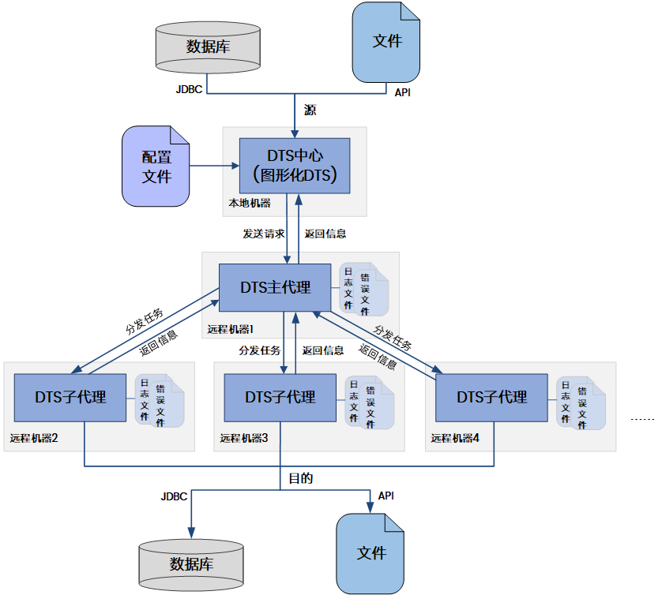

图2.2 DTS多机器执行的结构

DTS 中心在本地机器上以图形化界面方式启动，主要用于统一配置执行信息、发起远程执行请求和监控远程执行情况，区别于普通单机上的 DTS 工具，实际并不执行各类任务，即使关闭页面也不影响 DTS 代理执行任务。

DTS 代理（主代理、子代理）在远程机器上以命令行或服务方式启动，主要用于接收任务指令，执行迁移、对比、评估等任务，并返回执行的相关信息。其中主代理为在所有部署成功的代理中被指定成为处理中心的 DTS 代理，除与子代理一样拥有执行任务的功能，还支持接收 DTS 中心传输的请求，生成并分发任务，执行过程中最先可连接的代理会被选做主代理。

## 2.2 使用 DTS

DTS 可以通过命令行和图形化两种方式使用其功能。使用命令行执行迁移等各类功能，操作简单迅速，但要求用户提前准备好配置文件；图形化操作稍微复杂，但可以在没有配置文件时当下进行配置。另外，图形化操作也可以生成配置文件，用于命令行进行迁移等操作。下面将对两种方式进行介绍。

### 2.2.1 命令行启动与使用

在安装目录的“tool”子目录下可找到 DTS 命令行启动脚本文件 dts\_cmd\_run.bat（Windows）或 dts\_cmd\_run.sh（Linux）。

命令行启动主要支持以下几种方式：

1. config

DTS 迁移配置文件中配置迁移方式，这种方式支持所有图形化支持的迁移方式，其中迁移配置文件通过图形化工具配置和导出，详细参见 [8.2 节点配置文件](metadata_management.md) 。

2. compare\_config

DTS 对比配置文件中配置对比方式，这种方式支持所有图形化支持的对比方式，其中对比配置文件通过图形化工具配置和导出，详细参见 [8.2 节点配置文件](metadata_management.md) 。

3. estimate\_config

DTS 评估配置文件中配置评估方式，这种方式支持所有图形化支持的对比方式，其中评估配置文件通过图形化工具配置和导出，详细参见 [8.2 节点配置文件](metadata_management.md) 。

4. imp\_txt

TXT 迁移到 DM。

5. exp\_txt

DM 迁移到 TXT。

6. imp\_excel

EXCEL 迁移到 DM。

7. exp\_excel

DM 迁移到 EXCEL。

每种迁移方式可以配置的参数可以通过以下语句进行查看。

```
dts_cmd_run.bat（或./dts_cmd_run.sh）
< config |
compare_config |
extimate_config |
imp_txt |
exp_txt |
imp_excel |
exp_excel > help
```

命令行启动分交互式和非交互式 2 种运行方式。

#### 2.2.1.1 非交互式

非交互式启动即在启动脚本后直接跟参数运行。

例如 采用 config 方式执行 dm\_dm.xml 迁移配置文件如下：

```
./dts_cmd_run.sh config file=/opt/dm_dm.xml report=/opt/report
```

回车即可开始运行 dm\_dm.xml，迁移报告保存到 report 指定的目录。更多参数信息可以通过./dts\_cmd\_run.sh config help 查看。

同样方法的可以执行对比、评估、TXT 迁移到 DM、DM 迁移到 TXT、EXCEL 迁移到 DM、DM 迁移到 EXCEL。

#### 2.2.1.2 交互式

根据提示，交互输入使用，具体操作如下：

启动操作系统的命令行窗口，进入“tool”目录，输入 dts\_cmd\_run.bat 或./dts\_cmd\_run.sh 可以查看 DTS 命令行工具的使用帮助，如下：

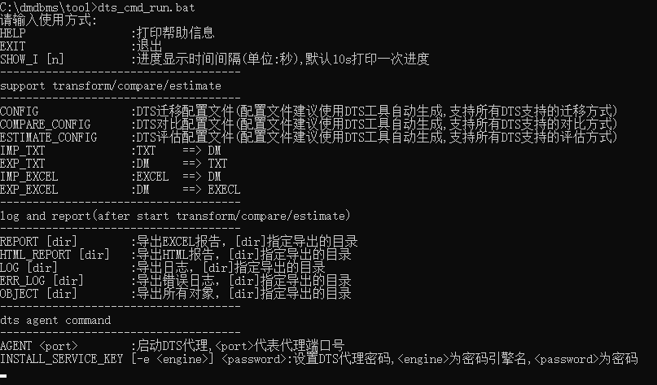

图2.3 DTS命令行工具的帮助信息

进度信息缺省是 10s 打印一次，可以通过 show\_i \[n\]命令来配置。

另外在迁移/对比/评估结束后，支持导出迁移/对比/评估报告，迁移/对比/评估日志，迁移/对比/评估错误日志，以及迁移错误 SQL 等分别通过 report \[dir\] / html\_report \[dir\]，log \[dir\]，err\_log \[dir\]，err\_sql \[dir\]实现，其中\[dir\]为要导出到的目录位置，具体命令可以查看 help 信息。

根据上述提示，输入迁移/对比/评估方式，比如输入 config，就可以看到具体的 config 方式迁移的帮助信息，如下：

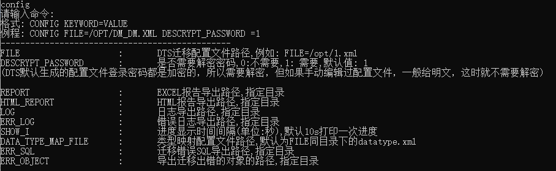

图2.4 config方式迁移的帮助信息

然后根据提示，输入 config 迁移方式的迁移命令。例如：

```
config FILE=/opt/dm_dm.xml DESCRYPT_PASSWORD=1
```

回车即可开始根据/opt/dm\_dm.xml 文件中的配置信息进行迁移。

同样方法的可以执行对比，评估，TXT 迁移到 DM、DM 迁移到 TXT、EXCEL 迁移到 DM、DM 迁移到 EXCEL。

### 2.2.2 图形化启动与使用

#### 2.2.2.1 图形化启动

安装好 DM 数据库管理系统后，在安装目录的“tool”子目录下可找到 DTS 图形化执行文件 dts.exe(Windows)或 dts(Linux)。

启动操作系统的命令行窗口，进入“tool”目录，输入 dts.exe 或./dts 即可启动 dts 图形化工具。

DTS 图形化工具可以配置启动参数，包括 Java 虚拟机（JVM）本身可配置的参数，比如-Xms 设置 JVM 初始堆大小，-Xmx 设置 JVM 最大堆大小等等，具体请查看 Java 官方文档；以及 DTS 自己提供的一些启动参数，详见下表：

表2.1 DTS图形化工具启动参数

| **参数** | **可选值** | **含义** |
| --- | --- | --- |
| \-Ddameng.dts.log\_and\_report\_dir | 字符串 | 日志和报告路径，缺省为用户工作空间下的 workspace |
| \-Ddameng.dts.drivers.third.dir | 字符串 | 驱动使用到的第三方 jar 包的加载路径，缺省不给定 |
| \-Ddameng.dts.drivers.dir | 字符串 | 日志和驱动 jar 包的加载路径，缺省为安装目录下的 tool/dropins/com.dameng/plugins/com.dameng.jdbc.drivers |

> **注意**
> 
> DTS图形化工具配置启动参数时，Windows环境中配置dts.exe相同目录下的dts.ini；Linux环境中直接编辑dts启动脚本。

#### 2.2.2.2 图形化使用

在 DTS 工具启动后，就可开始进行迁移等功能的使用了。本小节仅进行简单使用介绍，更详细内容可以参考后文各功能对应章节。

**（一）创建节点并使用完成节点任务**

可使用 DTS 创建一个迁移/对比/评估/转换节点，并对其进行配置，完成配置后执行相应功能。以迁移为例，操作步骤如下：

1. “迁移管理”中右键，选择“新建工程…”，创建迁移工程 test。

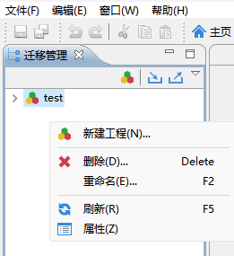

图2.5 新建迁移工程test

2. 展开刚刚创建的迁移工程 test，选中”迁移”节点右键，选择”新建迁移”，创建迁移 t1，可在新建时指定节点名称和最大保留历史次数，其中最大保留历史次数表示节点的历史执行任务结果可保留次数。

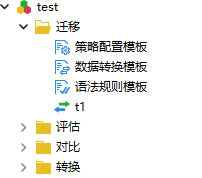

图2.6 新建迁移t1

3. 在右边打开 t1 的迁移向导面板中，按向导提示配置和执行迁移。用户可以在向导页中配置迁移源和目标数据库、迁移方式、迁移对象等。向导页配置项含义介绍可以参考 [4.2 迁移配置](dts_migrate.md) 章节。

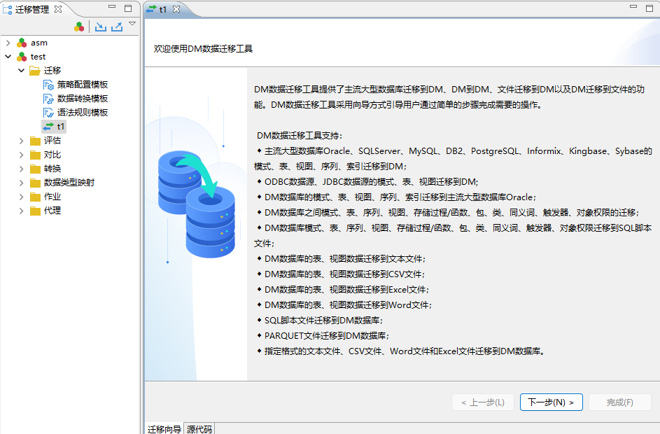

图2.7 按照向导提示进行迁移配置

4. 配置完成后，可在审阅迁移任务向导页进行审阅，确认无误后点击完成可直接进行迁移。

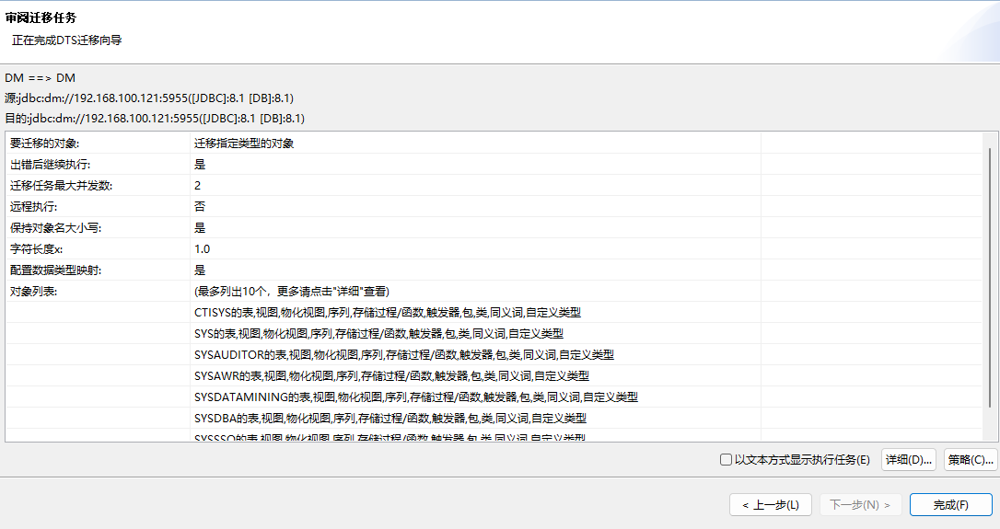

图2.8 点击完成可执行迁移

> **注意**
> 
> 对比和评估使用示例与迁移相同，选择工程中的”对比”或”评估”节点右键，选择”新建对比”或”新建评估”，创建对比或评估，然后在对比或评估向导面板中根据向导提示完成对比或评估。向导页中各项配置项的含义可以参考各功能对应的配置介绍章节。

**（二）节点管理**

用户可以对迁移、评估、对比、转换节点进行项目、组管理，类似于以文件夹的形式进行文件管理。以迁移为例，用户可以创建不同的工程项目，在工程项目的“迁移”中创建迁移节点或者组，在组中创建子组或者子迁移节点。当迁移任务较多时，使用项目和组管理对迁移节点进行分类管理，更加清晰。

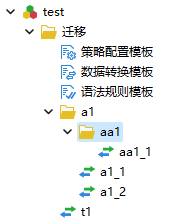

图2.9 一个工程项目中以组为单位对迁移节点进行管理

**（三）导出配置文件**

图形化工具可在节点成功完成迁移/对比/评估/转换任务后，进行相应任务配置文件的导出。以迁移节点 t1 为例，右击该节点，并选择导出配置文件获取对应配置文件。

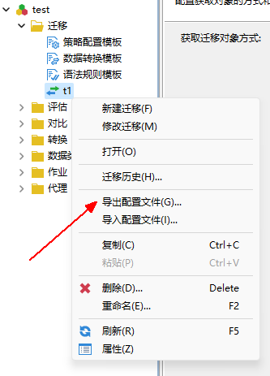

图2.10 t1导出配置文件

**（四）使用配置文件完成节点配置**

图形化既可以进行手动配置，也可以使用提前准备好的配置文件。创建新节点 t2，选中并导入配置文件，各向导页中配置项内容即为配置文件中选项，用户无需再逐一配置，可直接跳转到最后一页执行迁移。

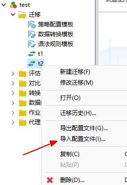

图2.11 t2导入配置文件

**（五）工程导出导入**

除了手动新建工程外，DTS 也支持对配置好的工程导出为文件，或者对导出的工程文件进行导入操作，可以将工程文件的导出和导入理解为工程中所有配置的集体动迁。

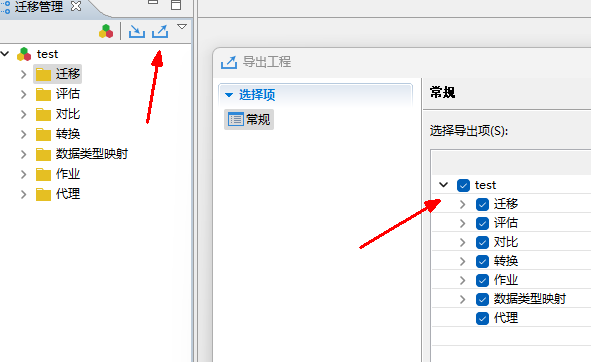

图2.12 将test工程进行导出操作