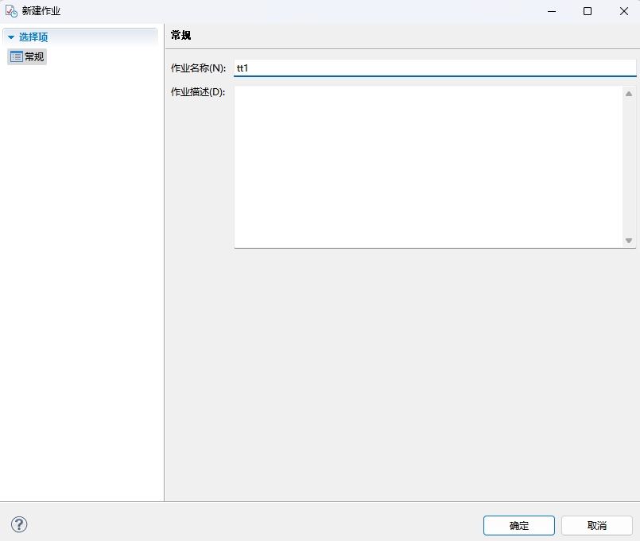
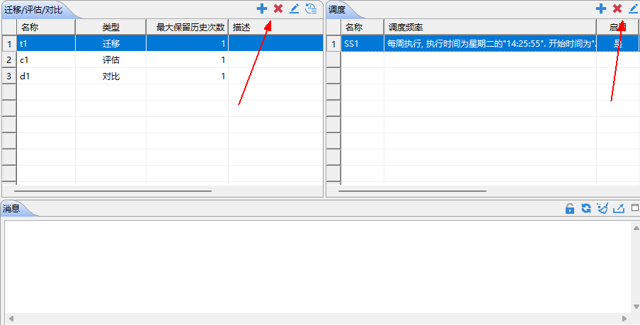
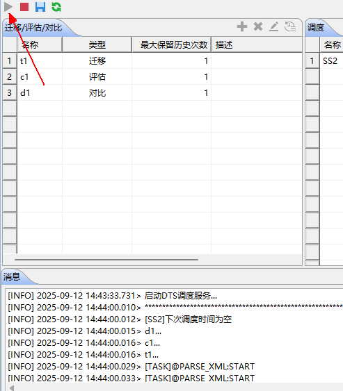

数据迁移支持 2 种调度执行方式：第一种是通过 DM 数据库服务器的作业系统完成，需要用户提前准备配置文件，详细内容可参考《DM8 作业系统使用手册》，此处不再赘述；第二种则是通过 DTS 的作业功能完成。

DTS 是基于时间的作业调度来定时执行迁移任务。作业调度是基于迁移工具的配置文件来完成的。

迁移工具的作业包含调度和迁移/评估/对比。其中调度用来配置迁移/评估/对比时间，包括执行频率，持续时间，执行时间点等信息，作业的执行，即为根据调度设定的时间来定期执行迁移迁移。其中迁移/评估/对比为通过元数据管理从配置文件中解析获取。

配置步骤如下：

1. **新建调度**

展开“作业”->右击“调度”->点击“新建调度”->进行新调度的配置。

配置内容包括调度类型、发生频率、持续时间等，用户可根据需求进行配置。

图9.1 新建调度时进行调度信息配置

2. **新建作业**

右击“作业”->点击“新建作业”->创建作业

图9.2 新建名为tt1的作业

3. **导入节点和调度信息**

创建作业后，可在右侧对作业进行配置，可分别添加需要进行作业管理的迁移/评估/对比节点和已经配置好的调度信息，进行作业调度管理。如误添加，也可选中已添加的行并点击删除键进行删除。节点信息和调度信息导入到作业中后，如果用户有修改需求，可以选中需要修改的行，点击框体右上角的配置项，即可进行配置调整，调整后的配置信息会同步到之前节点中。

图9.3 作业tt1通过调度SS1控制迁移t1/评估c1/对比d1

4. **作业启动**

点击左上角启动键即可启动，启动后，可在消息栏查看作业信息

图9.4 启动作业可查看运行信息

> **注意**
> 
> DTS的作业调度功能，在DTS工具退出时不会进行执行。