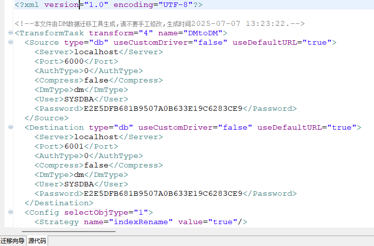
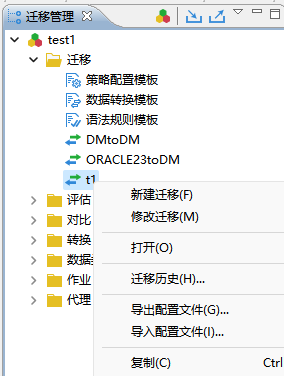
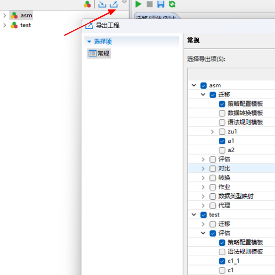
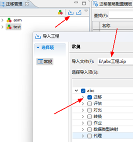

DTS 提供了元数据管理功能，主要是对迁移/对比/评估/转换的配置信息进行保留与再解析。这不仅能够使多次重复执行相同配置更加方便，也对配置信息进行了备份，方便后续问题排查，同时能够满足迁移信息在不同机器上进行流转，使各类操作都更加灵活。

配置信息是以 xml 文件的形式进行存储的，根据存储内容的不同，可以分为以下三类：模板文件、节点配置文件和工程文件，其中节点配置文件是使用场景最多的文件。

## 8.1 模板文件

在迁移/评估/对比/转换各章节，已介绍了各配置模板，DTS 可以对这些模板进行元数据管理，转换成 xml 文件，方便不同工程之间进行模板同步。图形化中对节点进行配置时，不可直接使用模板文件，而应该先在对应模板管理中导入模板，然后再将其应用于节点。

以迁移的“策略配置模板”为例，配置完成后，可选中该行，并点击“导出模板”生成模板文件。

图8.1 创建迁移策略配置模板mycl并导出为模板文件

可在另一个工程的相同界面，点击“导入模板”，将模板文件中的模板导入新的工程。

导入完成后，可在导入了该模板文件的工程中进行节点配置时选择该模板，过程与一般模板使用方式一致。

## 8.2 节点配置文件

节点配置文件包含一个节点成功运行所需的各配置项，包含源数据、目的数据、迁移对象等、迁移规则等，相较于模板文件，信息更加丰富。

1. **文件获取**

节点配置过程中，可以在 DTS 工具的向导面板选择“源代码”查看部分内容。

图8.2 查看迁移的源代码

节点配置完成后，可以通过“迁移管理”->展开“迁移”节点->右键目标节点->选择“导出配置文件”导出配置文件。

图8.3 导出配置文件

同样的操作步骤可以对新节点选择“导入配置文件”，进行配置信息的导入。

2. **使用场景**

节点配置文件的使用场景包括：

- 新节点配置

即上文介绍的对节点导入配置文件信息。适用于迁移/对比/评估/转换配置文件。

- 命令行版 DTS 工具

可以使用节点配置文件，完成配置文件中配置的迁移任务等，具体可以参考 [2.2.1 命令行启动与使用](introduction_to_dts.md) 章节。适用于迁移/对比/评估配置文件。

- DM 服务器的作业系统调度执行数据迁移

使用配置文件进行调度是对迁移任务等进行作业调度的方法之一，具体可以参考《DM8 作业系统使用手册》。适用于迁移/对比/评估配置文件。

> **注意**
> 
> 要使用配置文件时，建议使用”导出配置文件”功能导出配置文件，不能直接从”源代码”中直接拷贝内容到文件，因为考虑到占用内存问题，”源代码”中的内容是不全的。

## 8.3 工程文件

工程文件是以 xml 文件的形式对一个或多个工程项目的配置信息进行保存，包括工程，工程中包含的各类节点，各类节点的配置信息，各模板配置信息等。各种信息存储在多个 xml 文件中，并以文件夹的形式进行分层管理。

工程文件生成过程中，可以指定文件内容包括哪些工程、工程中的哪些节点、以及是否包含模板信息等。工程文件的导入导出都以.zip 压缩包的形式进行。

可以点击工程侧边栏的右上角“导出”图标，选择需要导出的工程和工程中的节点，以及需要用到的模板，进行导出。

图8.4 导出asm工程中的a1迁移节点和test工程中的c1\_1评估节点，以及需要的配置模板

可以点击工程侧边栏的右上角“导入”图标，对已有的工程文件中的工程信息进行导入，导入时可以只选择需要的配置信息，其它信息会自动填充为默认信息，导入成功后的信息也可在图形化中进一步调整。

图8.5 仅导入abc工程中的迁移信息