本章将以一个示例为载体，简单介绍使用 DTS 工具执行迁移任务的完整流程，读者可参考此示例，进一步了解 DTS 工具的使用方法和完整迁移流程。

## 10.1 确认迁移目标

在进行迁移之前，需要根据实际需求确认此次迁移的目标，包括迁移路径和迁移内容，简单来说，就是需要明确从哪迁移到哪，迁移什么。

例：以下是一个小型员工工作管理系统，相关对象和数据存储在某 ORACLE 实例的 C##DEMO\_USER 模式下，预计将该工作管理系统迁移到一个 DM 数据库实例下。

```
--创建序列(用于记录员工ID)
create sequence emp_seq start with 1001 increment by 1;

--创建序列（用于记录任务ID）
create sequence task_seq start with 1 increment by 1;

--创建自定义类型(用于记录员工地址)
create or replace type address_type as object
(
street varchar2(50),
city varchar2(30),
postal_code varchar2(10)
);
/

--创建主表（员工表）
create table employees(
emp_id number primary key,
emp_name varchar2(50) not null,
emp_address address_type,
hire_date date default sysdate);

--创建从表（任务表）
create table tasks(
task_id number primary key,
emp_id number references employees(emp_id),
task_desc varchar2(100),
deadline date);

--创建视图（员工任务视图）
create view emp_tasks_view as
select e.emp_id,e.emp_name,t.task_desc,t.deadline
from employees e join tasks t on e.emp_id=t.emp_id;

--创建包规范
create or replace package emp_pkg AS
procedure add_employee(
p_name in varchar2,
p_street in varchar2,
p_city in varchar2,
p_postal in varchar2
);
function get_emp_task_count(p_emp_id in NUMBER)RETURN NUMBER;
END emp_pkg;
/

--创建包体
create or replace package body emp_pkg as
procedure add_employee(
p_name in varchar2,
p_street in varchar2,
p_city in varchar2,
p_postal in varchar2
)is
begin
insert into employees(emp_id,emp_name,emp_address)
values(emp_seq.nextval,p_name,address_type(p_street,p_city,p_postal));
commit;
end;
function get_emp_task_count(p_emp_id in number)return number is
v_count number;
BEGIN
select count(*) into v_count
from tasks
where emp_id=p_emp_id;
return v_count;
END;
END emp_pkg;
/

--创建触发器（自动设置任务期限）
create or replace trigger set_task_deadline
before insert on tasks for each row
begin
if :new.deadline is NULL THEN
:new.deadline:=SYSDATE+7;
END IF;
END;
/

--创建同义词
create synonym emp_syn for employees;

--创建存储过程（添加带任务的员工）
create or replace procedure add_employee_with_task(
p_name in varchar2,
p_task in varchar2
)is
v_emp_id NUMBER;
BEGIN
v_emp_id:=emp_seq.nextval;
insert into employees(emp_id,emp_name)values (v_emp_id,p_name);
insert into tasks(task_id,emp_id,task_desc)
values(task_seq.nextval,v_emp_id,p_task);
COMMIT;
END;
/
```

其中存储的数据如下所示：

```
--EMPLOYEES员工表：
insert into employees(emp_id,emp_name,emp_address,hire_date)
values(emp_seq.nextval,'张明',address_type('长安街100号','北京','100000'),to_date('2010-03-15','YYYY-MM-DD'));
insert into employees(emp_id,emp_name,emp_address,hire_date)
values(emp_seq.nextval,'李华',address_type('南京路200号','上海','200000'),to_date('2016-08-15','YYYY-MM-DD'));
insert into employees(emp_id,emp_name,emp_address,hire_date)
values(emp_seq.nextval,'王芳',address_type('天河路300号','广州','510000'),to_date('2017-07-12','YYYY-MM-DD'));
insert into employees(emp_id,emp_name,emp_address,hire_date)
values(emp_seq.nextval,'刘强',address_type('科技园路400号','深圳','518000'),to_date('2018-01-12','YYYY-MM-DD'));
insert into employees(emp_id,emp_name,emp_address,hire_date)
values(emp_seq.nextval,'陈静',address_type('西湖路500号','杭州','310000'),to_date('2019-03-19','YYYY-MM-DD'));
insert into employees(emp_id,emp_name,emp_address,hire_date)
values(emp_seq.nextval,'赵勇',address_type('长江道600号','武汉','430000'),to_date('2020-07-08','YYYY-MM-DD'));
insert into employees(emp_id,emp_name,emp_address,hire_date)
values(emp_seq.nextval,'孙丽',address_type('滨海大道700号','天津','103000'),to_date('2020-11-29','YYYY-MM-DD'));
insert into employees(emp_id,emp_name,emp_address,hire_date)
values(emp_seq.nextval,'周涛',address_type('天府广场800号','成都','610000'),to_date('2021-01-16','YYYY-MM-DD'));
insert into employees(emp_id,emp_name,emp_address,hire_date)
values(emp_seq.nextval,'吴刚',address_type('中山路900号','南京','210000'),to_date('2022-09-15','YYYY-MM-DD'));
insert into employees(emp_id,emp_name,emp_address,hire_date)
values(emp_seq.nextval,'郑小红',address_type('解放路1000号','重庆','400000'),to_date('2023-01-15','YYYY-MM-DD'));

\--TASKS任务表
\--张明
INSERT INTO TASKS(task_id,emp_id,task_desc,deadline)
values(task_seq.nextval,1001,'完成季度财报'，to_date('2025-12-15','YYYY-MM-DD'));
INSERT INTO TASKS(task_id,emp_id,task_desc,deadline)
values(task_seq.nextval,1001,'准备年度预算方案'，to_date('2025-12-20','YYYY-MM-DD'));
\--李华
INSERT INTO TASKS(task_id,emp_id,task_desc,deadline)
values(task_seq.nextval,1002,'开发新客户管理系统'，to_date('2025-11-30','YYYY-MM-DD'));
INSERT INTO TASKS(task_id,emp_id,task_desc,deadline)
values(task_seq.nextval,1002,'优化数据库查询性能'，to_date('2025-12-10','YYYY-MM-DD'));
\--王芳
INSERT INTO TASKS(task_id,emp_id,task_desc,deadline)
values(task_seq.nextval,1003,'组织团队建设活动'，to_date('2025-12-10','YYYY-MM-DD'));
INSERT INTO TASKS(task_id,emp_id,task_desc,deadline)
values(task_seq.nextval,1003,'安排员工培训计划'，to_date('2025-12-18','YYYY-MM-DD'));
\--刘强
INSERT INTO TASKS(task_id,emp_id,task_desc,deadline)
values(task_seq.nextval,1004,'服务器安全漏洞修复'，to_date('2025-12-05','YYYY-MM-DD'));
INSERT INTO TASKS(task_id,emp_id,task_desc,deadline)
values(task_seq.nextval,1004,'系统备份策略优化'，to_date('2025-12-12','YYYY-MM-DD'));
\--陈静
INSERT INTO TASKS(task_id,emp_id,task_desc,deadline)
values(task_seq.nextval,1005,'设计产品用户界面'，to_date('2025-12-15','YYYY-MM-DD'));
\--赵勇
INSERT INTO TASKS(task_id,emp_id,task_desc,deadline)
values(task_seq.nextval,1006,'代码审查和质量检查'，to_date('2025-12-20','YYYY-MM-DD'));
\--孙丽
INSERT INTO TASKS(task_id,emp_id,task_desc,deadline)
values(task_seq.nextval,1007,'客户满意度调研报告'，to_date('2025-12-20','YYYY-MM-DD'));
\--赵勇
INSERT INTO TASKS(task_id,emp_id,task_desc,deadline)
values(task_seq.nextval,1008,'制定部门工作流程'，to_date('2025-12-20','YYYY-MM-DD'));
\--吴刚
INSERT INTO TASKS(task_id,emp_id,task_desc,deadline)
values(task_seq.nextval,1009,'采购办公设备'，to_date('2025-12-15','YYYY-MM-DD'));
\--郑小红
INSERT INTO TASKS(task_id,emp_id,task_desc,deadline)
values(task_seq.nextval,1010,'整理供应商材料'，to_date('2025-12-20','YYYY-MM-DD'));
```

本示例中数据所在源库 ORACLE 和目标库 DM 的信息如下所示：

表10.1 数据源和目的服务

| **源、目的** | **IP** | **PORT** | **服务名** | **数据库版本** |
| --- | --- | --- | --- | --- |
| ORACLE(源) | 192.168.6.8 (localhost) | 1521 | orcl.dameng.com | Oracle 21c |
| DM(目的) | 192.168.100.121 | 5956 | 略 | DM8 |

如果想要将员工工作任务管理系统从 ORACLE 中成功迁移到 DM，迁移完成后在 DM 数据库中拥有和迁移前一样的功能，则需要对上述罗列出的所有数据库对象和数据进行迁移。

可在 DTS 中新建工程 oracle\_dm，用于此次员工工作任务管理系统的迁移。

图10.1 创建oracle\_dm工程用于迁移员工工作任务管理系统

## 10.2 迁移前评估

确认移植目标后如果直接进行迁移，则整个迁移工作会存在很多潜在风险，从而降低迁移成功率。因此，在执行正式迁移之前，对迁移任务进行充分的评估是非常必要的。评估本身是多方面的，包括对象语法兼容性，目的库配置等，使用者可以在评估完成后查看评估报告获取评估结果。

例：对员工工作管理系统进行迁移前，使用 DTS 工具进行语法评估。

1. 创建评估节点 ass1，并选取评估路径为 ORACLE=>DM，则后续向导页显示从 ORACLE 到 DM 的配置项。

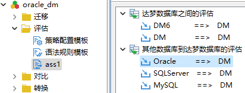

图10.2 创建评估节点ass1

2. 在“数据源”向导页填写合适内容，配置数据源信息。假设待迁移内容在本机的 ORACLE 实例中，并且已经确定迁移目的库为某远程机器上的 DM 实例，则可以勾选“指定目的库”，并在下一页进行目的库配置。

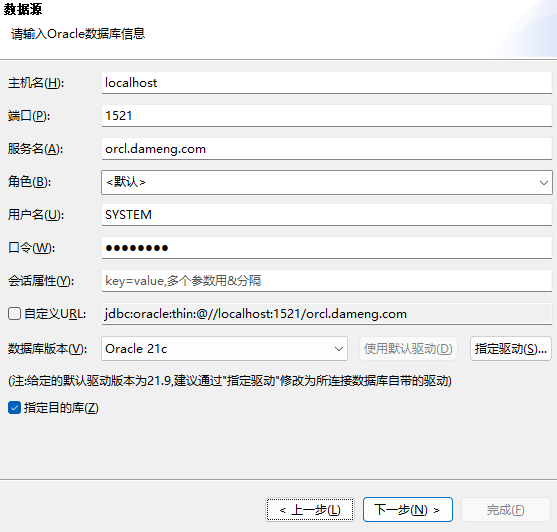

图10.3 ass1配置评估源库

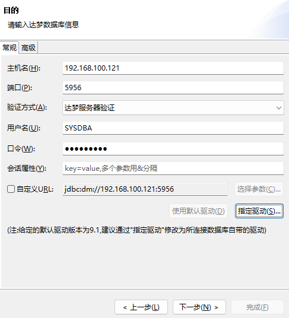

图10.4 ass1配置评估目的库

3. 对评估内容和评估策略进行配置。

评估内容：由于本次评估的对象很少，且有多种类型，直接选择反而方便，因此，获取评估对象的方式定为“选择评估对象”，表中数据简单，因此不必进行表信息的统计。此处也省略 SQL 和程序的兼容性评估。

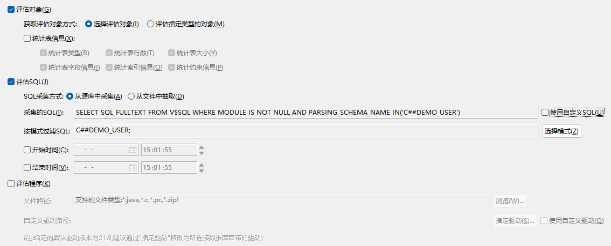

图10.5 ass1配置评估内容

评估策略：由于数据量较少，因此无需刻意配置并发，保持默认即可。其他内容也按默认策略配置。

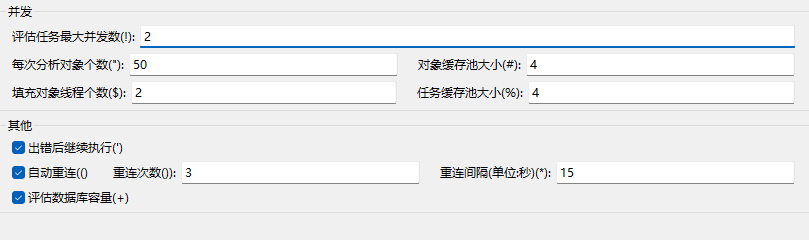

图10.6 ass1配置评估策略

4. 选择对象所在模式。所有对象均在 C##DEMO\_USER 中，因此可直接勾选 C##DEMO\_USER，并选中其中拥有的所有数据类型。

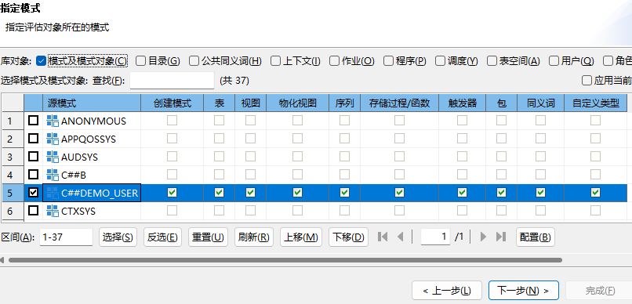

图10.7 ass1配置对象所在模式

5. 选择待评估对象。点击选择即可全选 C##DEMO\_USER 中的对象。

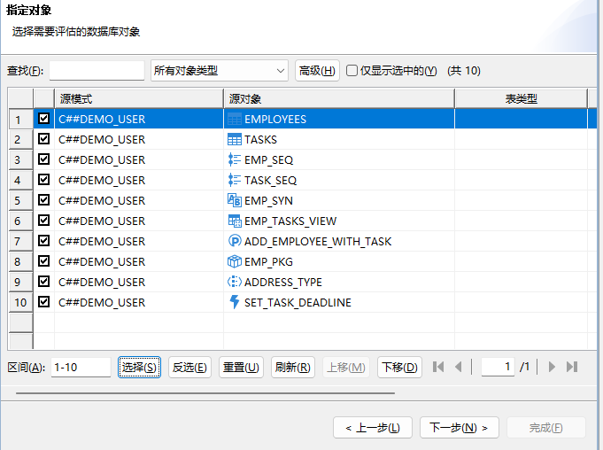

图10.8 ass1指定待评估对象

6. 配置执行方式。本次任务量较小，可直接单机执行评估任务，不需要配置远程，可直接点击下一步。
7. 审阅评估任务。审阅内容无误后，点击完成，即可开始进行评估。

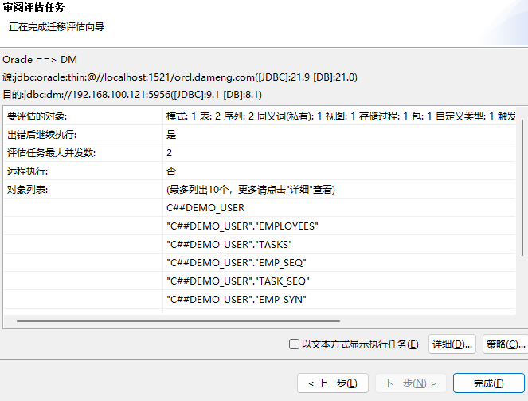

图10.9 审阅ass1节点的评估任务

8. 评估完成。可查看评估报告，报告信息可着重关注以下几页。

目的库页：该页主要介绍推荐的目的库配置，由于之前已经指定了版本，所以本页显示当前目的库在迁移中可能存在的风险，以及推荐配置更新项。迁移工程师可根据相关风险介绍和推荐配置，进一步评估是否需要采取措施进行风险规避。

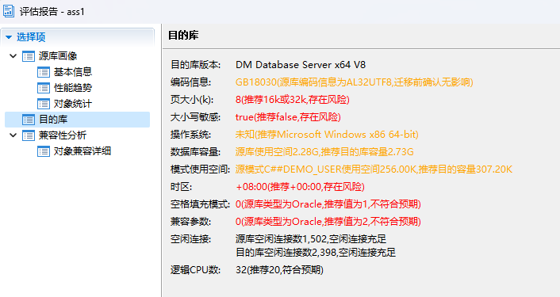

图10.10 ass1评估完成后对目的数据库可能存在的风险罗列

兼容性分析：本次评估仅进行了对象评估，因此兼容性分析只有一栏，主要介绍对象兼容性分析结果，下图显示没有不兼容的情况，则无需进行其他操作进行对象兼容。

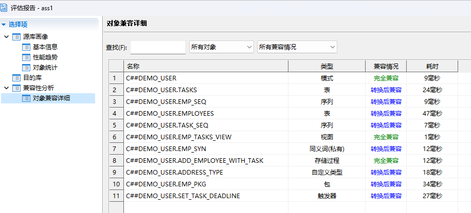

图10.11 ass1评估完成后的对象兼容性统计

9. 查看评估报告完成后，对需要采取措施的内容进行调整，包括库配置调整，不兼容对象或语句的手动调整等。在尽可能对风险进行规避，确保不会发生大的错误后，可执行迁移过程。

## 10.3 执行迁移

确认迁移目标且进行了评估以后，可正式执行迁移操作。迁移过程需要进行迁移配置，配置过程中需要指定数据源和目的、迁移对象、迁移策略等。

例：对员工工作任务管理系统进行迁移配置。

1. 创建 trans 迁移节点，并选取迁移路径为 ORACLE=>DM，则后续向导页显示从 ORACLE 到 DM 的配置项。

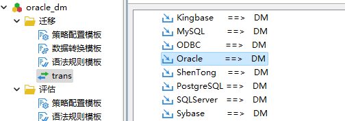

图10.12 创建trans迁移节点用于迁移员工工作任务管理系统

2. 进行源数据库和目的数据库的连接。该步骤与评估的数据连接类似，此处省略详细介绍。
3. 配置获取迁移对象的方式和迁移策略配置。获取迁移对象方式的选择和评估一致，“选择迁移对象”方式简单清晰，而且后续可对每个迁移对象进行单独的对象策略配置。由于没有特殊需求，其余迁移策略可保持默认。

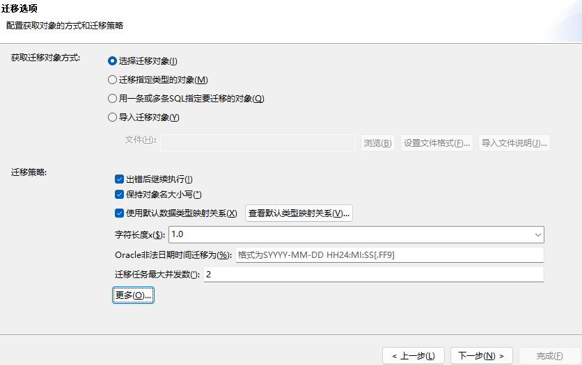

图10.13 trans迁移节点进行对象获取方式和迁移策略配置

4. 指定对象所在模式为 C##DEMO\_USER，该步骤与评估的数据连接类似，此处省略详细介绍。
5. 指定需要迁移的对象。可勾选 C##DEMO\_USER 中的所有对象，与评估的数据连接类似。但是相较于评估，对单独的对象，可以进行转换配置。但对于本迁移而言，没有特殊需求需要实现，因此可保存为缺省值。

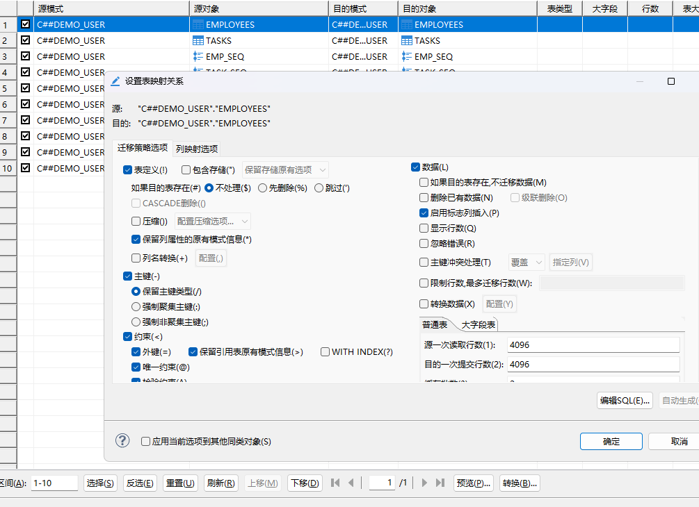

图10.14 trans迁移节点进行对象配置

6. 配置执行方式。本次任务量较小，可直接单机执行评估任务，不需要配置远程，可直接点击下一步。
7. 审阅迁移任务。审阅页面显示要迁移的对象，源和目的的对象对应关系，以及部分迁移策略等。审阅无误后点击完成，即可开始进行迁移。

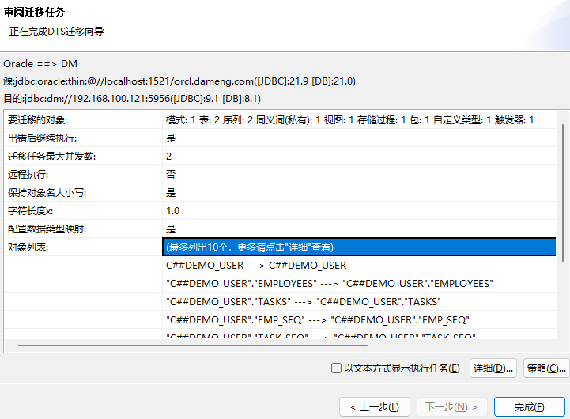

图10.15 trans迁移节点配置完成，进行审阅

8. 迁移任务完成后，可查看迁移报告确认是否完全迁移成功。由下图可知，本次迁移任务全部成功。从迁移详细中可以看出具体迁移过程：在 DM 中创建新的模式，并在该模式中创建各种对象。

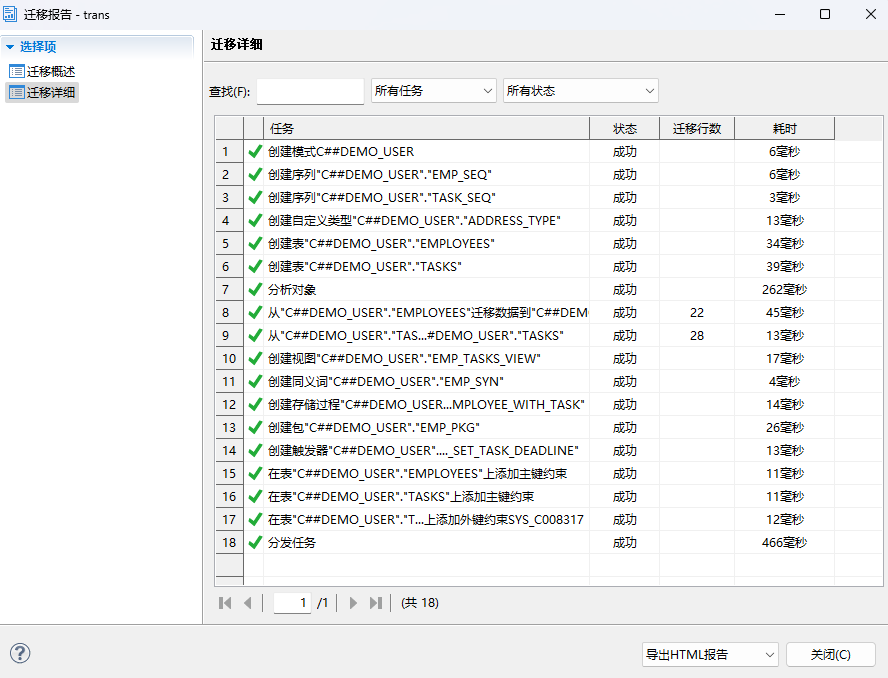

图10.16 trans迁移节点报告详细

## 10.4 迁移后对比

在完成了迁移之后，为了进一步确保迁移任务执行成功，可将源库和目的库进行对比。由于此次迁移包括对象迁移和数据迁移，因此对比也包括对象对比和数据对比。

例：对源库和目的库中的员工工作任务管理系统进行对比。

1. 创建 comp 对比节点，并选取迁移路径为 ORACLE=>DM，则后续向导页显示从 ORACLE 到 DM 的对比配置项。

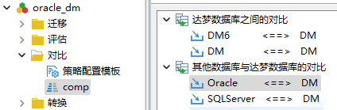

图10.17 创建comp对比节点并选择ORACLE=\\>DM路径

2. 进行源数据库和目的数据库的连接。该步骤与评估的数据连接类似，此处省略详细介绍。
3. 配置获取对比对象的方式和对比策略。对比方式可以和评估中类似，为“选择对比对象”，也可以是其他方法。本次选择“对比指定类型的对象”。由于没有特殊需求，对比策略可以为缺省值。

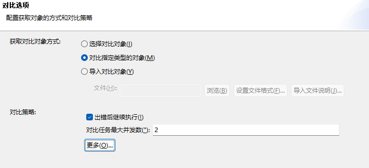

图10.18 comp对比节点进行对比方式和对比策略配置

4. 选择对象所在模式。虽然获取对象的方式发生了变化，但是都需要指定对象所在的模式，选择 C##DEMO\_USER 即可，默认勾选该模式中的所有对象类型。勾选完成后目的模式栏会自动匹配，同名模式存在时优先匹配同名模式。

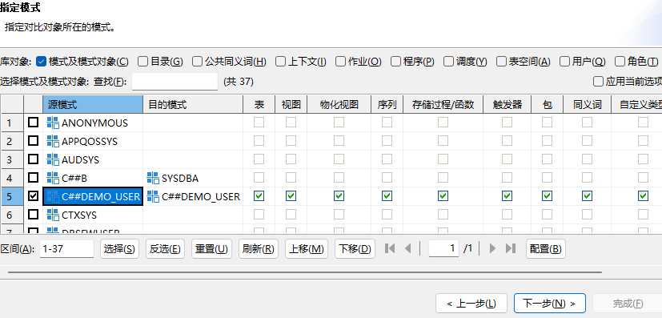

图10.19 comp节点进行模式选择和目的模式匹配

5. 配置对象对比策略和数据对比策略。可在该向导页选中对象行进行对象配置，由于数据存储在表中，因此数据策略和表策略配置在同一页，点击“数据对比策略”进行数据策略配置。

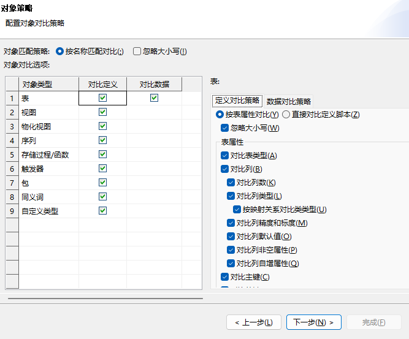

图10.20 comp节点进行对象对比策略和数据对比策略配置

6. 配置执行方式。本次任务量较小，可直接单机执行评估任务，不需要配置远程，可直接点击下一步。
7. 审阅对比任务。审阅界面包含数据源和目的、对比策略、对比对象等内容。审阅无误后，可点击完成进行对比。

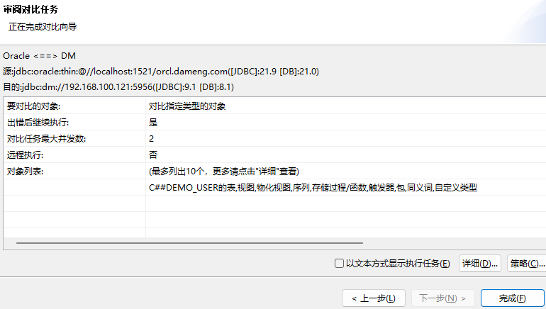

图10.21 comp节点对对比配置进行审阅

8. 对比完成后，可查看对比报告获取对比结果。查看本次对比结果，不一致数量为 0，可知源和目的中 C##DEMO\_USER 模式下的对象和数据完全一致。

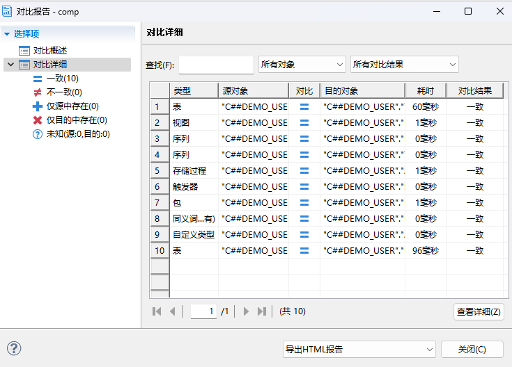

图10.22 comp节点对比报告

至此，可确认员工工作任务管理系统从 ORACLE 到 DM 的迁移完全成功，没有因迁移导致的潜在风险。