## 前言

本章节主要介绍 JAVA 应用开发常见问题，为用户提供 JAVA 应用开发常见问题的分析和解决思路。除此之外，用户还可前往达梦技术社区参与更多问题讨论。

## 目录

## 正文

### JDBC 程序获取存储过程元数据信息为空

**【问题描述】**

利用如下程序获取存储过程的元数据信息，执行完后获取的元数据信息为空，jdbc 程序代码片段如下：

```java
DatabaseMetaData dbMetaData = conn.getMetaData();
ResultSet rs = dbMetaData.getProcedureColumns("PERSONPACKAGE", dbMetaData.getUserName(), "ADDPERSON", null);
ResultSet rs = dbMetaData.getProcedureColumns("PERSONPACKAGE", dbMetaData.getUserName(), "ADDPERSON", null);
System.out.println("Get getProcedureColumns：");
while (rs.next()) {
System.out.println("PROCEDURE_NAME："+rs.getString("PROCEDURE_NAME"));
System.out.println("COLUMN_NAME："+rs.getString("COLUMN_NAME"));
}
```

**【问题解决】**

需要 JDBC 打开兼容 Oracle 模式，在 jdbc 的 url 串中添加 compatibleMode=oracle，例如：

```
jdbc:dm//localhost:5236?compatibleMode=oracle
```

### JDBC 驱动连接数据库报错：failed to initialize ssl

**【问题描述】**

JDBC 驱动连接数据库报错：failed to initialize ssl 。

**【问题解决】**

该问题由于未配置 SSL 环境而使用 SSL 登录导致，应当关闭 SSL 参数。

1. 使用 SYSDBA 登录执行以下语句：
	```
	SP_SET_PARA_VALUE(2,'ENABLE_ENCRYPT',0);
	```
2. 重启达梦数据库服务。

### JDBC 如何通过服务名连接读写分离集群

**【问题解决】**

dm\_svc.conf 文件位置：

Linux 环境将 dm\_svc.conf 文件放在应用服务器 /etc 目录下；Windows 32 位环境将 dm\_svc.conf 文件放在应用服务器 system32 目录下；Windows 64 位环境将 dm\_svc.conf 文件放在应用服务器 system32 和 syswow64 目录下。  
应用连接串配置：

```
<DRIVER>dm.jdbc.driver.DmDriver</DRIVER>
<URL>jdbc:dm://GRP_RW1?rwSeparate=1&rwPercent=0</URL>
```

> **注意**
> 
> dm\_svc.conf 文件不是在主机或备机上配置，而是在应用所在的机器上配置。 应用所在的机器上没有要求必须安装数据库，可以自己新建一个 dm\_svc.conf 文件来使用。

### JDBC 驱动连接数据库 Error: for input String 8

**【问题解决】**

需使用对应版本的 JDBC 驱动，可以在数据库安装目录的 drivers/jdbc 目录下找到对应的驱动包 DmJdbcDriver18.jar 。如有其他问题，请在 [社区](https://eco.dameng.com/community/question?_blank) 内咨询。

### JDBC 连接 DM 数据库时，是否可以使用 dm8 的驱动连接 dm7 的数据库

**【问题解决】**

可以，但是最好使用 DM8 的驱动去连 DM8 。

### JDBC 连接数据库查询的时间与客户端连接查询的时间相差 8 个小时

**【问题解决】**

检查数据库服务器 / 应用服务器 / JDBC 连接串属性 / dm\_svc.conf 中的时区设置。若确认都设置正确，建议申请一线技术支持。

### JDBC 程序中如何获取存储过程的元数据信息

**【问题描述】**

利用如下程序获取存储过程的元数据信息，执行完后获取的元数据信息为空，jdbc 程序代码片段如下：

```java
DatabaseMetaData dbMetaData = conn.getMetaData();
ResultSet rs = dbMetaData.getProcedureColumns("PERSONPACKAGE", dbMetaData.getUserName(), "ADDPERSON", null);
ResultSet rs = dbMetaData.getProcedureColumns("PERSONPACKAGE", dbMetaData.getUserName(), "ADDPERSON", null);
System.out.println("Get getProcedureColumns：");
while (rs.next()) {
System.out.println("PROCEDURE_NAME："+rs.getString("PROCEDURE_NAME"));
System.out.println("COLUMN_NAME："+rs.getString("COLUMN_NAME"));
}
```

**【问题解决】**

需要 JDBC 打开兼容 Oracle 模式，在 jdbc 的 url 串中添加 compatibleMode=oracle 。例如：

```
jdbc:dm//localhost:5236?compatibleMode=oracle 。
```

### JDBC XA 框架下应用报错："事务分支中发生资源管理器错误"

**【问题描述】**

在 JDBC XA 框架下高并发应用报错："事务分支中发生资源管理器错误"。


**【问题分析】**

XA 框架为二次提交模式，在准备阶段有一个超时时间，如果超过了阈值则会话会报错回滚，高并发下响应时间变长可能会出现此问题。

**【问题解决】**

调整参数 XA\_TRX\_IDLE\_TIME 和 XA\_TRX\_LIMIT 至一个合适值，建议 XA\_TRX\_IDLE\_TIME=600, XA\_TRX\_LIMIT=10000 。

**参数解释：**

1. XA\_TRX\_IDLE\_TIME：允许未 PRE-COMMITTED 的 XA 事务活动的时间，单位秒，取值范围 30~36000，默认值为 60 。
2. XA\_TRX\_LIMIT：XA 事务数量上限，取值范围 1024~65535，默认 1024 。

### 使用 JDBC 连接如何配置字符集

**【问题解决】**

JDBC 加 characterEncoding=XX（字符集）或者在 dm\_svc.conf 中配置。

DM 安装时生成一个配置文件 dm\_svc.conf ，不同的平台所在目录有所不同。

32 位的 DM 安装在 Win32 操作平台下，此文件位于 %SystemRoot%\\system32 目录；

64 位的 DM 安装在 Win64 操作平台下，此文件位于 %SystemRoot%\\system32 目录；

32 位的 DM 安装在 Win64 操作平台下，此文件位于 %SystemRoot%\\SysWOW64 目录；

在 Linux 平台下，此文件位于 /etc 目录。

dm\_svc.conf 文件中包含 DM 各接口及客户端需要配置的一些参数，具体的配置项如下：

| 配置项 | 缺省值 | 简述 |
| --- | --- | --- |
| CHAR\_CODE | 操作系统编码格式 | 客户端使用的编码格式，会影响帮助信息和错误提示信息，要与客户端使用的编码格式一致。支持的选项为：PG\_UTF8（表示 UTF8 编码）；PG\_GBK/PG\_GB18030（两者都表示 GBK 编码）；PG\_BIG5（表示 BIG5 编码）；PG\_ISO\_8859\_9（表示 ISO88599 编码）；PG\_EUC\_JP（表示 EUC\_JP 编码）；PG\_EUC\_KR（表示 EUC\_KR 编码）；PG\_KOI8R（表示 KOI8R 编码）；PG\_ISO\_8859\_1（表示 ISO\_8859\_1 编码）。可以不指定，若不指定，系统会读取操作系统信息获得编码信息，建议有需要才指定。 |

### 应用 JDBC 连接数据库失败问题/连接超时

**【问题解决】**

首先验证 disql 连接性，其次排查参数 MAX\_SESSIONS 的设置，MAX\_SESSIONS 参数在安装目录的 dm.ini 文件里，如果都没问题在 jdbc 连接串里设置 socketTimeout 套接字配置超时时间。如果还是不行，尝试更换 jar 包。

### JDBC 执行 explain 语句，resultset 是空的，用了 explain for，resultset 还是空的

**【问题解决】**

用 rowset 来执行 explain for 语句。

### 使用 DM8 的 JDBC 驱动连接 DM7 数据库，报错：“网络通讯“ 错误和 “拒绝连接”

**【问题描述】**

应用使用 DM8 的 JDBC 驱动连接 DM7 数据库，但是报达梦 jdbc 驱动 “网络通信” 相关错误和 “拒绝连接” 错误，无法连接数据库。问题描述如下

```
WARN [main] (c.d.dms.metadata.database.JdbcDataSource):72 -数据源连接失败: 网络通信的异常: 拒绝连接 (Connection refused)
com.dameng.dms.framework.exception.SystemException: 网络通信错误异常: 拒绝连接 (Connection refused)
Caused by: dm.jdbc.driver.DMException: 网络通信的异常
```

**【问题解决】**

按以下步骤进行排查：

1. 确认本地数据库服务启动，本地 disql 可以登录，从应用服务器可以登录；
2. 确认数据库版本和替换对应版本的 JDBC 驱动版本测试；
3. 测试调试应用，是否属于应用问题。

例如：可能是应用设置了防火墙，未打开需要的端口（8087）等原因。解决办法是打开防火墙相应的端口：

```
systemctl status firewalld.service
firewall-cmd --list-all
firewall-cmd --zone=public --add-port=8087/tcp --permanent
firewall-cmd --list-all
firewall-cmd --reload
firewall-cmd --list-all
```

### 报错：driver dm.jdbc.driver.DmDriver is not sequoia compliant

**【问题描述】**

JDK 包和驱动不匹配 driver dm.jdbc.driver.DmDriver is not sequoia compliant ，详细信息如下:

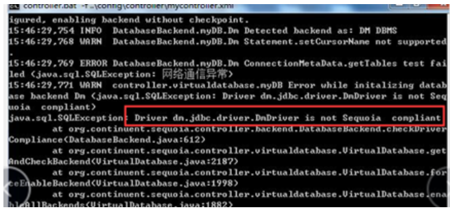

**【问题解决】**

更换 JDK 包即可，使用 DM 安装数据库后自带的 JDK 包。

### 插入大字段数据报错 Caused by: dm.jdbc.driver.DMException: 数据大小已超过可支持范围

**【问题描述】**

排查发现数据库中存储图片的数据类型为 VARBINARY 。

**【问题解决】**

数据类型修改为 IMAGE/BLOB 后解决。

### buffer index out of range

**【问题描述】**

批量插入数据的时候插一条没问题，插入两条及以上的时候提示 ”buffer index out of range“ 。

**【问题解决】**

可按照如下步骤进行排查：

1. 可能是 JDBC 驱动不匹配，建议使用较新的驱动。
2. 换驱动后还有问题，可以尝试将 dm.ini 修改 BATCH\_PARAM\_OPT = 1 ，然后重启一下数据库服务。
3. 如果还有问题，修改 JDBC 的 URL，开启 JDBC 的 log 日志辅助分析。可参考： [达梦数据库 JDBC 如何开启 log 日志](https://eco.dameng.com/docs/zh-cn/article/article-011.html#%E8%BE%BE%E6%A2%A6%E6%95%B0%E6%8D%AE%E5%BA%93-JDBC-%E5%A6%82%E4%BD%95%E5%BC%80%E5%90%AF-log-%E6%97%A5%E5%BF%97)

### Communication error "dm network timeout executor" Set network timeout error 。

**【问题解决】**

具体请参考 [Communication 通信错误问题分析](https://eco.dameng.com/docs/zh-cn/article/article-011.html#Communication-%E9%80%9A%E4%BF%A1%E9%94%99%E8%AF%AF%E9%97%AE%E9%A2%98%E5%88%86%E6%9E%90) 。

### Java 的连接配置方式

**【问题解决】**

1. 连接单机数据库配置如下：

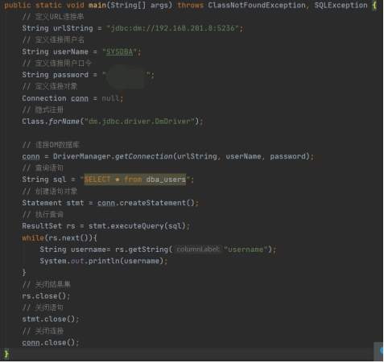

2. 连接集群配置

在应用程序所在服务器上配置 dm\_svc.conf 文件，文件中配置服务名，通过服务名连接集群可实现故障自动重连，参考如下配置，服务名为 dw\_svc 。

```
dw_svc=(192.168.100.136:32141,192.168.100.137:32142)
LOGIN_MODE=(1)
SWITCH_TIME=(3)
SWITCH_INTERVAL=(1000)
RW_SEPARATE=(1)
RW_PERCENT=(25)
CHAR_CODE=(PG_UTF8)
```

Windows 环境下：dm\_svc.conf 文件位于 %SystemRoot%\\system32 目录下。

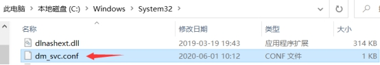

Linux 环境下：dm\_svc.conf 文件位于 /etc 目录下。

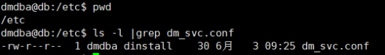

JDBC URL 连接串写法如下：

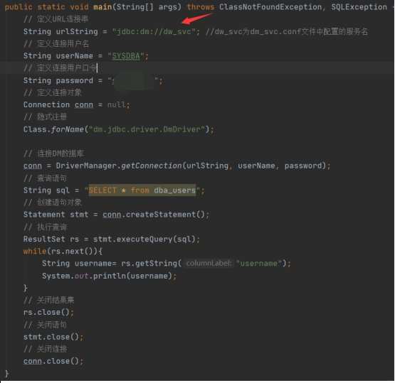

其他环境：在部分云环境下配置达梦的数据库连接时，由于云环境无法配置 /etc/dm\_svc.conf 文件，针对集群的连接就无法配置服务名了。此时，可利用 jdbc 连接串中指定服务名的属性连接 DM 数据库，使用方式如下：

```
jdbc:dm://test?test=(192.168.137.101:5236，192.168.137.102:5236) & loginMode=1
```

### Java 更新 clob 或 blob 字段，提示无效的十六进制数字

**【问题解决】**

关于大字段的更新，请参考《DM 程序员操作手册》的 JDBC 相关章节，手册位于数据库安装路径的 doc 文件夹下。

### Java 程序指定访问模式

**【问题描述】**

数据库一个用户下存在多个模式，JAVA 程序访问登录的数据库用户下非默认模式下的对象时，不在 SQL 中添加"模式名.对象名" 的方式来访问数据的方法。

**【问题解决】**

使用较新版本的达梦 JDBC 驱动（比如 2021 年 4 月之后的驱动），可以在 JDBC 连接串中指定 schema 属性，配置 schema=模式名，来指定用户登录后的当前模式。默认不配置 schema 属性表示使用默认模式。

举例说明：

数据库用户 TEST 下有两个模式 TEST 和 TEST1，其中 TEST 为默认模式。JDBC 中指定 TEST 登录后的当前模式为 TEST1，配置如下：

```java
String name="dm.jdbc.driver.DmDriver";
String url="jdbc:dm://192.168.15.35:5236?schema=TEST1";     //使用schema指定当前模式名
String user="TEST";
String password="* * * * * *";
```

这样使用 TEST 用户登录后，就可以不需要在表名前加上模式名 TEST1。

### Java 程序使用 SSL 认证连接数据库报错

**【问题描述】**

```
javax.net.ssl.SSLException: Received fatal alert: protocol_version
```

**【问题分析】**

可能是 DM JDBC 驱动包版本不对或者比较低。

**【问题解决】**

更换对应达梦数据库版本的 JDBC 驱动包。

### Java 应用报错：For input string: "0.000000"

**【问题分析】**

由于 decimal(22,6) 数据类型输出的数据为 "0.000000" 格式，但应用程序使用整型类型进行接收，导致出现报错：For input string: "0.000000"。decimal 数据类型说明如下表：

| 类型 | 语法 | 说明 |
| --- | --- | --- |
| 精确数值数据类型 | DECIMAL(精度, 标度) | 精度是一个无符号整数，定义了总的数字数，精度范围是 1 至 38，标度定义了小数点右边的数字位数。一个数的标度不应大于其精度，缺省精度为 38，标度无限定。 |

**【问题解决】**

可以选择在程序中重新定义数据类型解决或者选择在数据库中修改数据类型。

**方法一** ：程序中重新定义数据类型。

正常的展示浮点类型方法。

```java
Integer.parseInt('0.000000')
```

数据库中存储为浮点，但是应需求需展示为整点的。

```java
int i = new BigDecimal('0.000000').intValue();
```

**方法二** ：数据库中修改数据类型。

数据库中数据类型将 decimal(22,6) 调整为 decimal(22,0) 或者修改类型为 int 类型。

### Java 程序连接读写分离集群报错：“服务器模式不匹配”

**【问题分析】**

此类错误往往因为 dm\_svc.conf 配置出错或者当前会话达到用户最大连接数，可以从这两个方面检查分析。

**【问题解决】**

1. 检查 dm\_svc.conf 中是否配置了不存在的参数，或者其他参数配置有误，集群相关参数是否配置成全局，如 LOGIN\_MODE 参数。dm\_svc.conf 正确配置如下：
```
##全局服务配置
TIME_ZONE=(480)
LANGUAGE=(cn)

##局部配置
[DMRW]
LOGIN_MODE=(1)
RW_SEPARATE=(1)
RW_PERCENT=(25)
SWITCH_TIME=(3000)
SWITCH_INTERVAL=(200)
```
2. 检查应用连接池配置是否释放连接和长连接设置值。
3. 检查用户的最大的连接数。
```sql
select
b.username as "达梦数据库用户名",
a.CONN_IDLE_TIME as "会话最大空闲时间",
a.failed_num as "失败次数限制" ,
a.lock_time as "锁定时间(min)",
A.LOCKED_STATUS,
A.SESS_PER_USER as "用户最大连接数",
A.LIFE_TIME,
A.REUSE_TIME,
A.REUSE_MAX,
A.LASTEST_LOCKED
from sysusers a right join all_users b on
a.id=b.user_id;
```
5. 检查数据库的最大连接数。
```sql
select * from v$dm_ini where para_name ='MAX_SESSION';
```
6. 查看当前活动会话数，对比当前会话是否达到最大连接数。
```sql
Select count(1) from v$sessions where state='ACTIVE';
```

dm\_svc.conf 部分参数说明：

| 参数 | 缺省值 | 描述 |
| --- | --- | --- |
| TIME\_ZONE | 操作系统当前时区 | 指明客户端的默认时区，设置范围为：-779~840M，如 60 对应 +1:00 时区。 |
| LANGUAGE | 操作系统语言 | 当前数据库服务器使用的语言，会影响帮助信息错误和提示信息。支持的选项为：CN（表示中文）和 EN（表示英文）。可以不指定，若不指定，系统会读取操作系统信息获得语言信息，建议有需要才指定。 |
| LOGIN\_MODE | 4 | 指定优先登录的服务器模式。0：优先连接 PRIMARY 模式的库，NORMAL 模式次之，最后选择 STANTBY 模式；1：只连接主库；2：只连接备库；3：优先连接 STANDBY 模式的库，PRIMARY 模式次之，最后选择 NORMAL 模式；4：优先连接 NORMAL 模式的库，PRIMARY 模式次之，最后选择 STANDBY 模式 |
| RW\_SEPARATE | 0 | 是否启用读写分离。0：不启用；1：启用；2：启用，备库由客户端进行选择，且只会选择服务名中配置的节点。 |
| RW\_PERCENT | 25 | 读写分离分发比例，有效值范围 0~100。 |
| SWITCH\_TIMES | 1 | 以服务名连接数据库时，若未找到符合条件的库成功建立连接，将尝试遍历服务名中库列表的次数。有效值范围：1~9223372036854775807。 |
| SWITCH\_INTERVAL | 200 | 在服务器之间切换的时间间隔，单位为毫秒，有效值范围：1~9223372036854775807。 |

此外在全局服务中还可以配置服务名，用于数据库登录。例如：在全局服务配置中配置服务名为 DMRW 的服务

```
DMRW=(10.10.20.3:5236,110.10.20.4:5236,10.10.20.5.103:5236)
```

名词解释：

服务名：用于连接的服务名，参数值格式为：服务名=(IP\[:PORT\],IP\[:PORT\],......)。IP 为数据库所在的 IP 地址，如果是 IPV6 地址，为了区分端口，需要用\[\]封闭 IP 地址。PORT 为数据库使用的 TCP 连接端口，可选配置，不配置则使用默认的端口。

> **注意**
> 
> 若配置服务名时没有指定端口，后续在工具或接口的命令中使用服务名时，在服务名后增加的―:XXXX‖端口号会被忽略，这样指定的端口号是无效的。

更多详细参数说明请参考数据库安装目录 doc 目录下的《DM8 系统管理员手册》。

### 使用 getTypeInfo() 方法时报错："无效的列名 AUTO\_INCREMENT"

**【问题描述】**

Java 语言应用使用 getTypeInfo() 方法时报错，驱动抛出异常 “无效的列名 AUTO\_INCREMENT”。

**【问题解决】**

如果遇到该报错可以通过在 dm\_svc.conf 文件中配置 EP\_SELECTOR=(1) 和 AUTO\_RECONNECT=(1) 参数来解决该报错。

### Druid 连接池连接达梦数据库报错：“dbType not support”

**【问题描述】**

使用 druid 连接池连接达梦报错：“dbtype not support”。

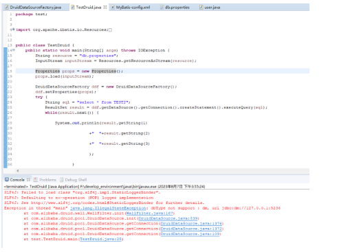


**【问题分析】**

Druid 使用的 wallFilter 中的防火墙监控不支持 DM 数据库。

**【问题解决】**

去掉 spring.datasource.filters 的 wall 配置，也就是去掉.propertity 配置文件中 filters 配置项中的 wall 即可。

### DM 如何支持 C3P0 连接池？

**【问题解决】**

参考下面的 SpringBoot 集成 MyBatis 与 C3P0 连接池例子：

1. 添加 JDBC 驱动

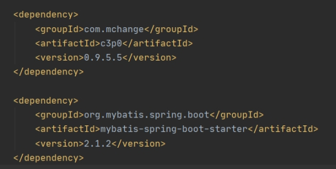

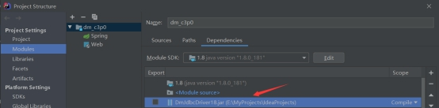

2. 通过 application.properties 配置文件配置数据源

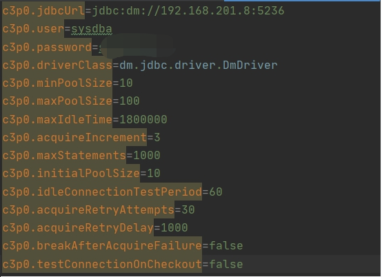

3. 创建 DataSourceConfig 类

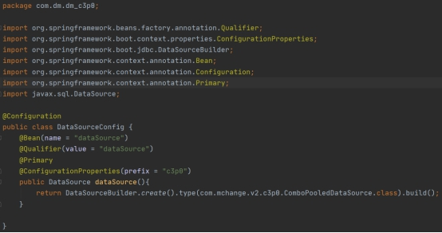

4. 测试代码—实体类

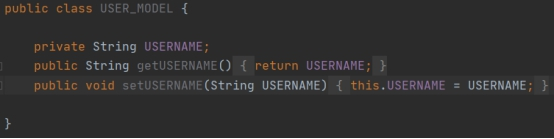

5. XML 映射文件

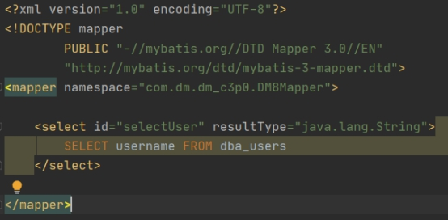

6. Controller

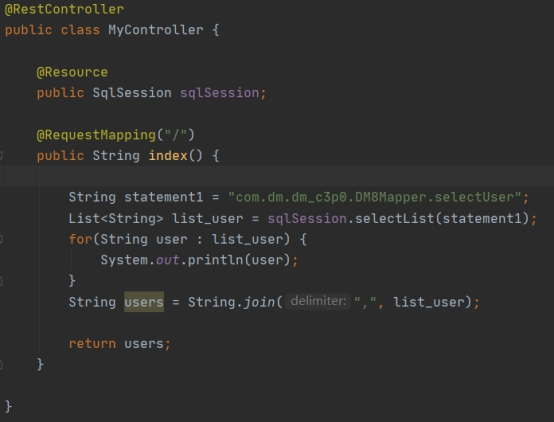

7. 执行结果

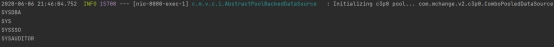

### Druid 报错：unkow jdbc driver

**【问题描述】**

```java
16:16:50,872 ERROR main pool.DruidDataSource:658 - dataSource init error
java.sql.SQLException: unkow jdbc driver : jdbc:dm://localhost:5236
at com.alibaba.druid.util.JdbcUtils.getDriverClassName(JdbcUtils.java:416)
```

**【问题解决】**

因为 Druid 1.0.11 及以前版本，不能省略 driverClassName 参数否则出现 unkow jdbc driver 异常，请升级到最新版，如 Druid 1.1.20（推荐）或 配置 `driverClassName=dm.jdbc.driver.DmDriver` 。

### Druid 报错：dbType not support

**【问题描述】**

```
16:01:02,007 ERROR main pool.DruidDataSource:983 - {dataSource-1} init error
java.lang.IllegalStateException: dbType not support : dm, url jdbc:dm://localhost:5236
at com.alibaba.druid.wall.WallFilter.init(WallFilter.java:167)
```

配置了 wall Filter（防火墙过滤），报异常：dbType not support 。

**【问题解决】**

去掉 wall 配置，在对应的配置文件里把 fitter 的 wall 删掉。

### 如何配置 DruidDataSource 数据源连接 DM 数据库

**【问题解决】**

连接池配置支持 DruidDataSource 数据源的连接，参考通用配置：

```java
<bean id="dataSource" class="com.alibaba.druid.pool.DruidDataSource" init-method="init" destroy-method="close">
<property name="url" value="${jdbc_url}" />
<property name="username" value="${jdbc_user}" />
<property name="password" value="${jdbc_password}" />
<property name="filters" value="stat" />
<property name="maxActive" value="20" />
<property name="initialSize" value="1" />
<property name="maxWait" value="60000" />
<property name="minIdle" value="1" />
<property name="timeBetweenEvictionRunsMillis" value="60000" />
<property name="minEvictableIdleTimeMillis" value="300000" />
<property name="testWhileIdle" value="true" />
<property name="testOnBorrow" value="false" />
<property name="testOnReturn" value="false" />
<property name="poolPreparedStatements" value="true" />
<property name="maxOpenPreparedStatements" value="20" />
<property name="asyncInit" value="true" /></bean>
```

配置说明：

name： 配置这个属性的意义在于，如果存在多个数据源，监控的时候可以通过名字来区分开来。如果没有指明 name ，则会自动生成一个名字，格式是：“DataSource-” + System.identityHashCode(this) 。另外配置此属性至少在 1.0.5 版本中是不起作用的，强行设置 name 会出错。

url：连接数据库的连接串，不同数据库配置不一样，DM 数据库可参考如下配置：

```
jdbc.driver=dm.jdbc.driver.DmDriver（达梦数据库驱动）
jdbc.url=jdbc:dm://192.168.10.1:5236（数据库 IP：端口号）
jdbc.username=SZ_TYSL（用户名）
jdbc.password=*********（用户密码）
```

driverClassName： 默认可根据 URL 自动识别。这一项可配可不配，如果不配置 druid 会根据 URL 自动识别 dbType，然后选择相应的 driverClassName。

initialSize： 初始化时建立物理连接的个数，默认值为 0，初始化发生在显式调用 init 方法，或者第一次 getConnection 时。

maxActive：最大连接池数量，默认值为 8。

maxIdle： 已经不再使用，配置了也没效果，可忽略。该参数是 Druid 为了方便 DBCP 用户迁移而增加的，maxIdle 是一个混乱的概念。连接池只应该有 maxPoolSize 和 minPoolSize，druid 只保留了 maxActive 和 minIdle，分别相当于 maxPoolSize 和 minPoolSize。

minIdle： 最小连接池数量。

maxWait： 获取连接时最大等待时间，单位毫秒。配置了 maxWait 之后，缺省启用公平锁，并发效率会有所下降，如果需要可以通过配置 useUnfairLock 属性为 true 来使用非公平锁。

### 德鲁伊（druids）连接池相关配置推荐

**【问题解决】**

```java
<bean id="dataSource" class="com.alibaba.druid.pool.DruidDataSource"init-method="init" destroy-method="close">
<property name="driverClassName" value="${jdbc.driver}" />
<property name="url" value="${jdbc.url}" />
<property name="username" value="${jdbc.username}" />
<property name="password" value="${jdbc.password}" />
<property name="filters" value="stat,log4j" />
</bean>
```

### Druid 连接达梦报错

**【问题描述】**

```java
com.alibaba.druid.pool.GetConnectionTimeoutException: wait millis 10003, active 326, runningSqlCount 254
```

**【问题解决】**

升级 Druid 到最新版本，修改数据库配置文件 dm.ini 文件里面的 MAX\_SESSIONS 参数，值适当调大并重启数据库。

### Springboot 使用 druid 连接池时报错：testWhileIdle is true, validationQuery not set

**【问题描述】**

报错信息如下图：

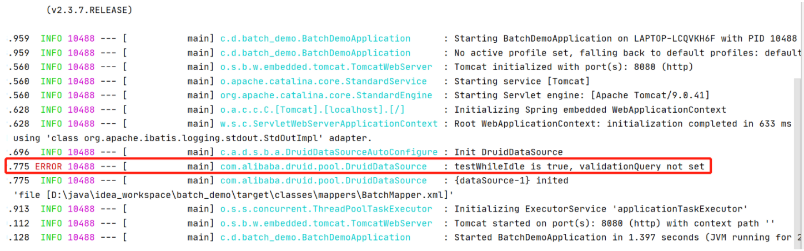

**【问题解决】**

引起该报错的主要原因是没有设置 SQL 语句测试连接数据库的可用性造成的。在配置文件添加如下配置可以解决该问题：

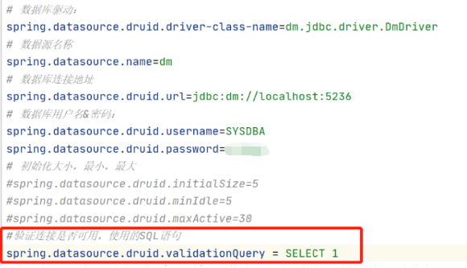

### 在进行连接池测试时，报错 “java.lang.ClassNotFoundException”

**【问题解决】**

排查是否出现以下情况：

1. DM 的 JDBC 驱动没有放置在正确的路径下。
2. DM 的 JDBC 驱动的类名写错了。

### Java springboot 引入数据库的 jar 包，数据源监听到 SQL 已经执行，但没有返回值

**【问题解决】**

注意在执行 SQL 语句后，要执行 commit; 进行提交。举例：

```sql
select "id","u_acount","u_password","u_kind","u_status" from "TEST"."table_user" limit 1;  
commit; 
//需要在 sql 里面提交
```

### springBoot jpa 使用达梦数据库和驱动后程序报错:"Failed to bind properties under...

**【问题描述】**

springBoot jpa 使用达梦数据库和驱动后程序报错：“Failed to bind properties under 'spring.jpa.database' to org.springframework.orm.jpa.vendor.Database”。

**【问题分析】**

orm 框架中源码中不包含识别 DM 的逻辑，需进行源码框架调整。

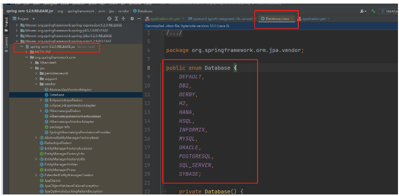


【问题解决】

1. 使用 druid1.2.7 的连接池，该版本有对 DM 兼容。

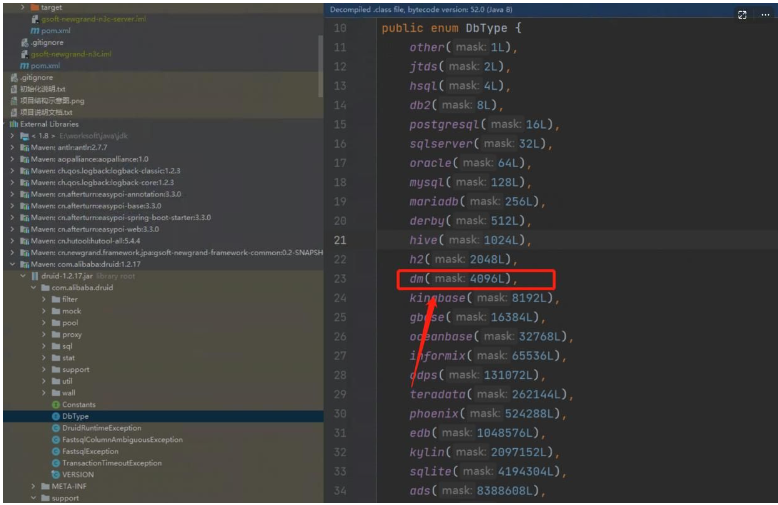  

2. 修改框架源码 org.springframework.orm.jpa.vendor.Database 添加 DM 。
```java
package org.springframework.orm.jpa.vendor;
public enum Database {
DEFAULT,
DB2,
DERBY,
H2,
HANA,
HSQL,
INFORMIX,
MYSQL,
ORACLE,
DM,
POSTGRESQL,
SQL_SERVER,
SYBASE;
private Database() {
}
}
```

### activiti 工作流是否支持达梦数据库

**【问题解决】**

支持，可以参考 [如何让 Activiti 支持 DM7](https://eco.dameng.com/community/article/2510375cab5d1072f39569d379db3d56) 。

### activiti 连接 DM 数据库报错

**【问题描述】**

```
Unknown database: DM DBMS；Error getting default schema
```

**【问题解决】**

activiti 支持连接 DM 数据库，我们需要解决的是如何配置的问题，只需要修改以下两个配置文件：

1. jdbc 的配置：更换驱动、类名、连接串等，下面是配置方式：

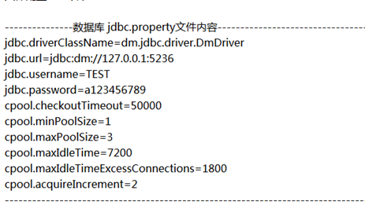

2. activiti 自己的配置（要找到 activiti 的配置文件），强制指定数据库为 Oracle（默认无该项配置）:

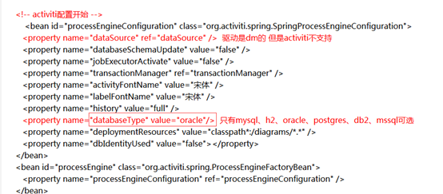

这里的意思是：数据类型设置为 Oracle（在长期使用过程中，没有任何问题，DM 数据库的 Oracle 兼容性做的非常好，很多相关框架，都可以使用类似配置方式）。

如果是使用了方言包，还需要注意修改方言包的类名，以及方言包的引用，配置方式如下：

```
datasource.driver=dm.jdbc.driver.DmDriver
datasource.url=jdbc:dm://localhost:5236
datasource.username=test
datasource.password=testcsdc1
hibernate.dialect=org.hibernate.dialect.DmDialect
```

Java 作为一个最通用的平台框架，其数据库无关性做的比较好，所有和 Java 相关的配置方式，最核心的就是下面这张图：

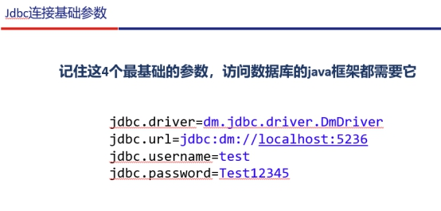

### activiti 工作流因大小写敏感问题导致工作流引擎报错引发异常

**【问题描述】**

activiti 工作流 5.23 在适配达梦数据库时，如果 DM 初始化实例时设置参数大小写敏感，在通过工作流引擎写入 act\_ru\_variable 表的 NAME\_ 字段值时，该字段以大写值 SYS\_ORG\_CODE 插入表中，但在工作流引擎以该字段作为查询条件进行结果集的查询过滤时，以小写值 sys\_org\_code 进行结果集过滤查询，这样会导致查询不到对应结果集而导致工作流引擎报错引发异常。

**【问题解决】**

为解决该问题，需要手动控制工作流引擎在写入该字段时必须以小写值的形式写入，这样在查询的时候以小写的形式查询过滤，便可获得正确的结果集，从而避免写入数据库中的值和查询过滤条件值大小写形式不一致的情况发生。

在 ActivitiController.java 类指定位置增加以下两行代码，把 NAME\_ 字段的值替换为小写的形式，通过手动限定 taskVariables 里面指定变量的值为小写，在执行 `this.taskService.complete(taskid,taskVariables); ` 值写入时，把 NAME\_ 字段的值以小写的形式写入到数据库中。如下图所示：

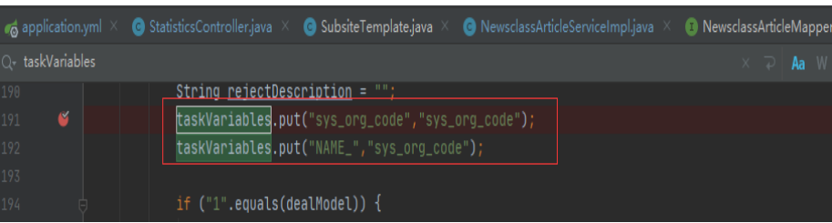

修改后，重新验证工作流程是否可以正常流转，发现工作流引擎写入 NAME\_ 字段的值为小写，整个工作流程可以正常的流转起来。

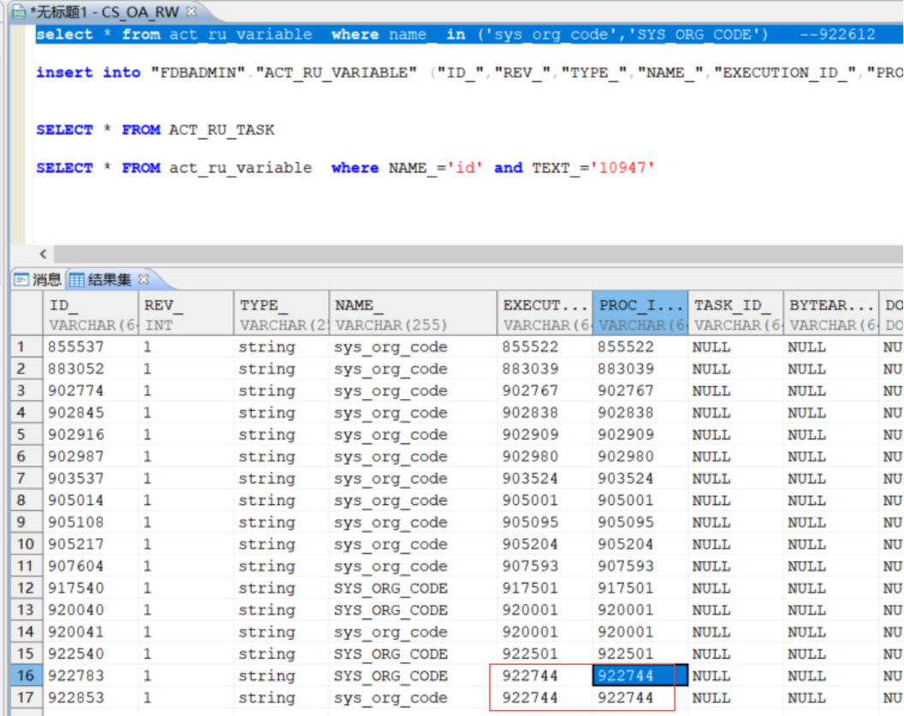

### 报错：Caused by: org.activiti.engine.

**【问题描述】**

```java
ActivitiException: couldn't deduct database type from database product name 'DM DBMS' 。
```

**【问题解决】**

请参考： [activiti 连接 DM 数据库报错](faq-java.md) 。

在驱动 url 里面添加扩展连接属性 comOra=true, 例如：

```
jdbc:dm://localhost:5236?comOra=true
```

### hibernate 连接数据库的方言写法

**【问题解决】**

Hibernate.cfg.xml 配置要求：

驱动名称

```java
<property name="connection.driver_class">dm.jdbc.driver.DmDriver</property>
```

方言包名称

```java
<property name="dialect">org.hibernate.dialect.DmDialect</property>
```

举例： [达梦数据库通过 hibernate 连接的基本程序配置](https://eco.dameng.com/docs/zh-cn/article/article-011.html#%E8%BE%BE%E6%A2%A6%E6%95%B0%E6%8D%AE%E5%BA%93%E9%80%9A%E8%BF%87-hibernate-%E8%BF%9E%E6%8E%A5%E7%9A%84%E5%9F%BA%E6%9C%AC%E7%A8%8B%E5%BA%8F%E9%85%8D%E7%BD%AE) 。

### 用 hibernate 执行 sql，参数为 null 的时候报错 “无效的十六进制数据”

**【问题解决】**

请从达梦云适配中心 [下载试用](https://eco.dameng.com/download/?_blank) 下载最新的达梦数据库，使用最新的驱动。

### hibernate 配置主键默认、序列插入报错：违反非空约束

**【问题解决】**

修改 hibernate 配置以及表主键属性为 identity，可以参考： [hibernate 使用序列作为主键在国产达梦数据库中的配置方法](https://eco.dameng.com/docs/zh-cn/article/article-011.html#hibernate-%E4%BD%BF%E7%94%A8%E5%BA%8F%E5%88%97%E4%BD%9C%E4%B8%BA%E4%B8%BB%E9%94%AE%E5%9C%A8%E5%9B%BD%E4%BA%A7%E8%BE%BE%E6%A2%A6%E6%95%B0%E6%8D%AE%E5%BA%93%E4%B8%AD%E7%9A%84%E9%85%8D%E7%BD%AE%E6%96%B9%E6%B3%95) 。

### DM Hibernate 方言包兼容 Oracle 和 MySQL 的主键生成策略

**【问题解决】**

参考链接： [Hibernate 主键生成策略](https://eco.dameng.com/community/article/62d5559355f60597dc38a397e0fe857b) 。

### hibernate 框架运行时报错："Could not find setter for LOCATION on class com.xx.po.MeetingRoom"

**【问题描述】**

Java 的 hibernate 框架运行时报错如下:

```
“org.hibernate.PropertyNotFoundException: Could not find setter for LOCATION on class com.xx.po.MeetingRoom”
```

**【问题分析】**

1. 顶层堆栈在 org.hibernate.property.ChainedPropertyAccessor.getSetter，说明已经查询到数据，在进行数据赋值时报错。
2. hibernate 框架中数据赋值是通过类的 setter 方法即动态代理方式赋值，需确认该映射类中是否有该属性的 set、get 方法。
3. 可能是 JDBC 驱动 hibernate 的方言包与 hibernate 版本不匹配导致。

**【解决方案】**

可以通过以下方法尝试解决：

1. 检查 jdbc 驱动 hibernate 的方言包与 hibernate 版本是否匹配。
2. 确认该实体类的报错字段是否是数据库关键字，可以在 jdbc 后面加上关键字过滤或者换个其他字段名。

### 应用连接数据库后启动报错：”hibernate.dialect' not set“

**【问题描述】**

应用连接数据库启动报如下错误：

```
Caused by: org.hibernate.HibernateException: Access to DialectResolutionInfo cannot be null when 'hibernate.dialect' not set
at org.hibernate.engine.jdbc.dialect.internal.DialectFactoryImpl.determineDialect(DialectFactoryImpl.java:100)
at org.hibernate.engine.jdbc.dialect.internal.DialectFactoryImpl.buildDialect(DialectFactoryImpl.java:54)
```


**【问题分析】**

分析报错日志发现数据库连接失败、方言包未引用成功，该报错是由于未配置达梦的方言包导致。

**【问题解决】**

添加与当前使用的 hibernata 版本一致的方言包。DM 数据库的 hibernata 方言包保存在数据库安装目录下的 drivers/jdbc/dialect 目录下。

### Error parsing XML: /hibernate.cfg.xml(1) 文档类型声明包含或指向的标记声明格式有误

**【问题描述】**

http://www.hibernate.org/dtd/hibernate-configuration-3.0.dtd 在此 URL 下，获得是一个显示 DTD 的简单 HTML 页面，没有获取 DTD 文件本身。

**【问题解决】**

将该 DTD 保存到本地硬盘，并修改 URL 解决。

### JavaWeb 框架如何连接访问 DM 数据库

**【问题解决】**

通用的写法如下：

```java
// 定义 DM JDBC 驱动串
String jdbcString = "dm.jdbc.driver.DmDriver";
// 定义 DM URL 连接串
String urlString = "jdbc:dm://localhost:5236";
// 定义连接用户名
String userName = "SYSDBA";
// 定义连接用户口令
String password = "*****";
```

不同的 JavaWeb 框架根据不同连接池修改相应的连接字符。例如 C3P0 连接池连接达梦，配置信息如下：

```java
<property name="jdbcUrl" value=" dm.jdbc.driver.DmDriver" />
<property name="driverClass" value=" jdbc:dm://192.168.1.1:5236" />
<property name="user" value="SYSDBA" />
<property name="password" value="*****" />
```

达梦数据库 Java 连接接口以及示例在《程序员手册》中有介绍，JDBC 相关框架: ssh, ssm, spring boot, spring cloud 。

连接池：连接达梦和 Oracle 基本类似，只有 driver 名称和 url 不一样，走 JDBC 的数据库包括 sqlserver 和 MySQL 配置上都比较相似，只有 driver 和 url 存在差异。

### 希望在 mybatis 下对象不用添加双引号

**【问题描述】**

mybatis 下对象需要双引号。

**【问题解决】**

**方法一** ：设置大小写不敏感，此方法会影响查询结果集，因为其对结果集匹配也不区分大小写，需要根据业务自行评估是否可行。

**方法二** ：在 mysql 数据库中，对象名默认是小写，达梦对象名默认是大写，在用达梦 DTS 工具做数据迁移的时候，去掉 “保持对象名大小写” 的勾选，使对象名自动转换成大写，在 mybatis 查询的时候，即不需要加双引号强调小写。

### 使用 mybatis 框架批量插入并自动获取自增主键 ID 时获取不到主键 ID 值

**【问题描述】**

使用 mybatis 框架对接达梦数据库批量插入并自动获取自增主键 ID 时获取不到主键 ID 值。

**【问题解决】**

1. 确保 mybatis 版本在 3.3.1 以上。
2. batchInsert 方法上不能加 @param()，且该方法只能一个参数、 返回值为 Integer、long 或 void，不能是 List 。
3. 如果自增主键数据库字段和实体类属性不一致，需要写成 useGeneratedKeys=“true” keyColumn=“主键字段名” keyProperty=“实体类名”。

### mybatis 框架和 DM8 框架整合时报错：dm.jdbc.driver.DMException

**【问题描述】**

mybatis 框架和 DM8 框架整合时报错：dm.jdbc.driver.DMException 。截图如下：

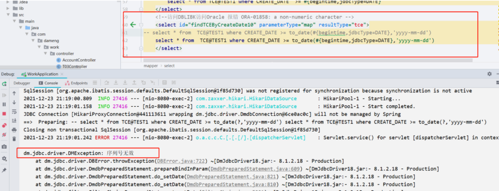

**【问题分析】**

开发人员在 mybatis 框架的 xml 文件的 select、update、detele 标签中编写 sql 语句时使用 ”--“ 注释 sql 语句，导致 jdbc 驱动执行 sql 会报序列号无效。

**【问题解决】**

删掉无效的注释语句即可。

### mybatis-plus 整合达梦时，自动生成的 sql 语句报错

**【问题描述】**

mybatis-plus 整合达梦时，应用系统项目的 sql 语句中包含数据库关键字，导致 mybatis-plus 自动生成的 sql 语句会报错，如下图所示：

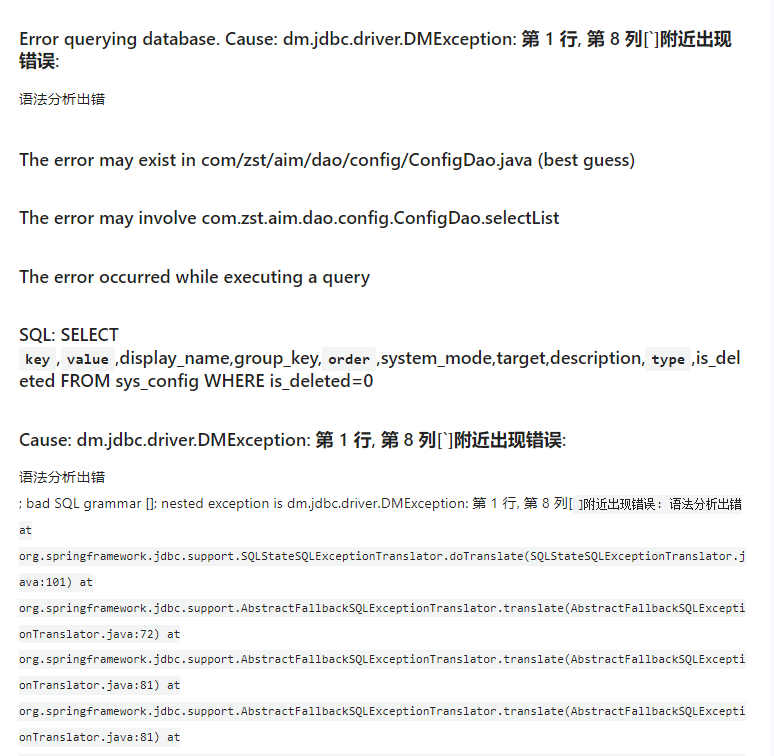

**【问题分析】**

mybatis-plus 生成的 sql 语句字段是小写的，同时还包含数据库关键字。框架会默认加上（\`）符号，该符号在达梦数据库中无法被识别，需要更换为 （"）。

**【问题解决】**

**方法一** ：在实体类中的字段添加 TableField 注解：

```java
@TableField（““type””)
private int type;
```

**方法二** ：修改实体类的字段名称避免使用数据库关键字。

### Spring 框架中应用修改数据时报错：试图在只读事务中修改数据

**【问题描述】**

在同一套 spring 框架的应用从 oracle 迁移到达梦单机库，应用修改数据时报错：nested exception is dm.jdbc.driver.DMException: 试图在只读事务中修改数据。

**【问题分析】**

由于 Spring 框架层在对应的数据修改业务上设置了 setReadOnly(true)，而达梦与 oracle 在接口层对设置 setReadOnly(true) 的表现并不相同，DM8 JDBC 会直接将该会话设置为只读会话，而 Oracle 10g 以后的 JDBC 驱动会直接忽略该设置，继续允许执行修改操作的 sql，导致出现报错。

**【问题解决】**

使用 DM8 JDBC 驱动在连接串中设置 compatibleMode=oracle 可以兼容 oracle ，会忽略 setReadOnly(true) 设置，允许会话读写操作。

> **注意**
> 
> compatibleMode=oracle 该参数与 dm.ini 中的 compatible\_mode=2 并不相同，dm.ini 中的 compatible\_mode 为服务端的兼容参数，并不能解决该问题，需要注意区分。

### 配置 MYCAT 中间件连接达梦数据库报错

**【问题描述】**

Java 版本为 1.8.0\_391，mycat 版本为 1.6，配置 MYCAT 中间件连接达梦数据库，mycat 启动报如下错误：

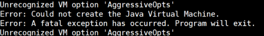


**【问题分析】**

此问题是由于该 VM 不支持参数 AggressiveOpts 导致。

**【问题解决】**

将 startup\_nowrap.sh 文件中的参数 -XX:+AggressiveOpts 去除，再运行可成功启动。

### MyCat 启动报错 1

**【问题描述】**

报错内容如下图：

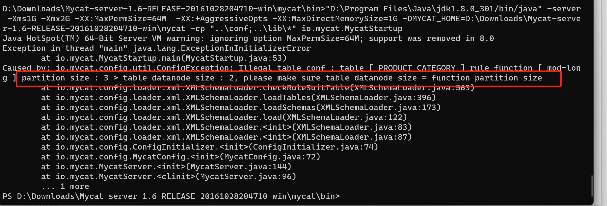

**【问题解决】**

该报错是没有修改 rule.xml 文件导致的，修改 rule.xml 中的 内对应的数字即可，数字为 schema.xml 文件中配置的 dataNode 数量。

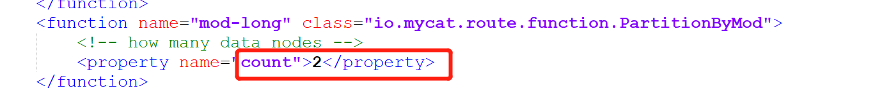

### MyCat 启动报错 2

**【问题描述】**

报错内容如下图：

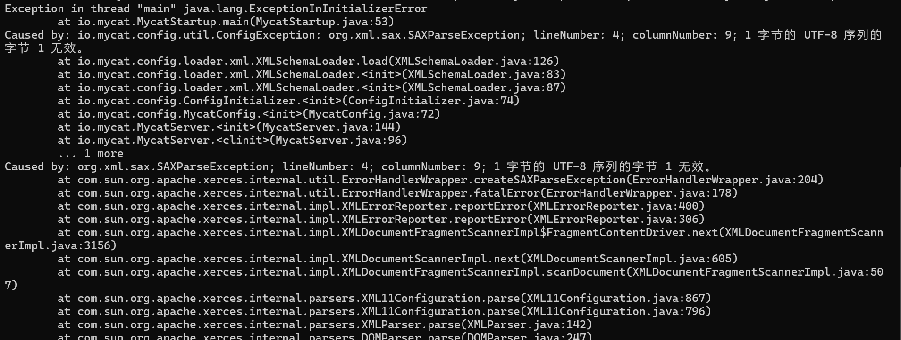

**【问题解决】**

编码格式不一致，删除 xml 文件中文内容，或者转换为操作系统适合的编码。

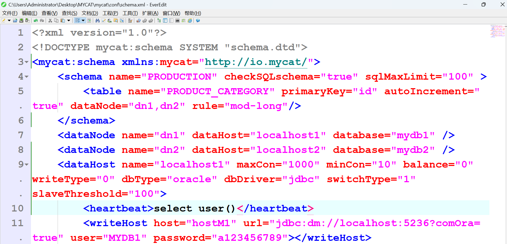

### MyCat 启动报错 3

**【问题描述】**

报错内容如下图：

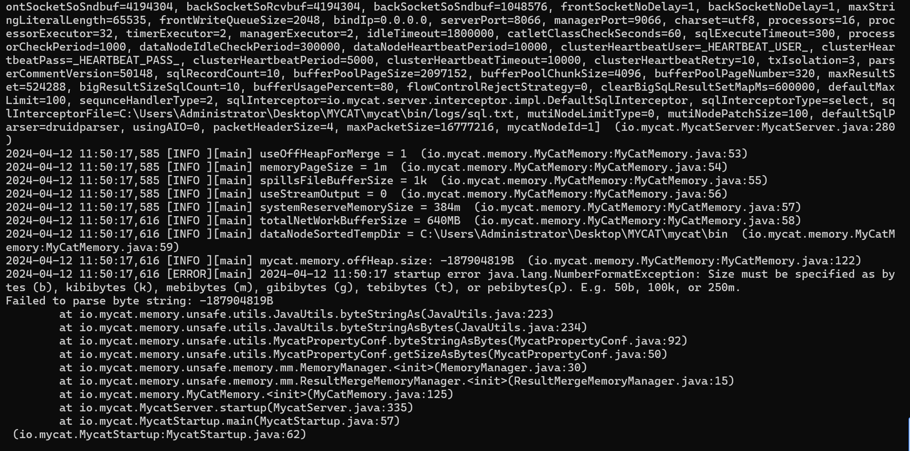

**【问题解决】**

Linux 环境下，需要在 /mycat/bin/startup\_nowrap.sh 中调大 MaxDirectMemorySize 大小。

windows 环境下，需要在 /mycat/bin/startup\_nowrap.bat 中调大 MaxDirectMemorySize 大小，如下图所示，此参数从 1G 调大为 2G。

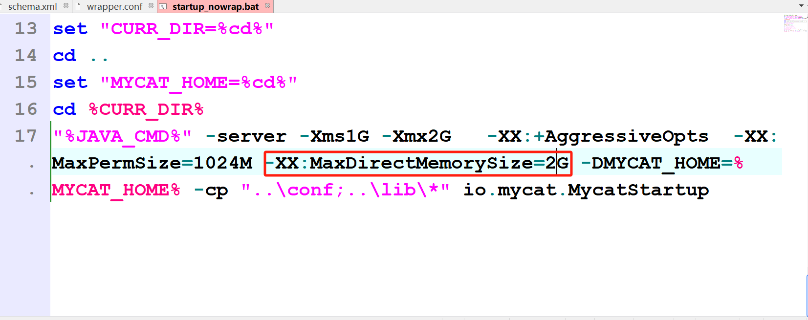

### 代码运行报错 1

**【问题描述】**

报错内容如下图：

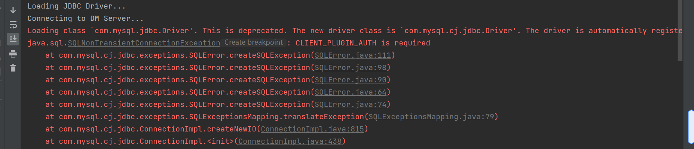

详细描述：

```java
Loading class \`com.mysql.jdbc.Driver'. This is deprecated. The new driver class is \`com.mysql.cj.jdbc.Driver'. The driver is automatically registered via the SPI and manual loading of the driver class is generally unnecessary.
java.sql.SQLNonTransientConnectionException: CLIENT_PLUGIN_AUTH is required
```

**【问题解决】**

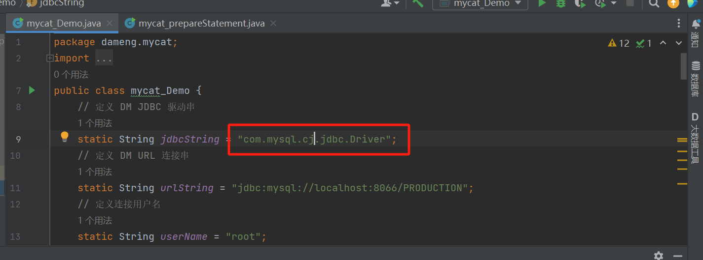

com.mysql.jdbc.Driver 改为 com.mysql.cj.jdbc.Driver 。

### 代码运行报错 2

**【问题描述】**

报错内容如下图：

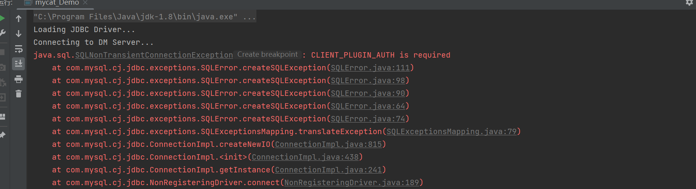

**【问题解决】**

此现象是 mysql 版本和所连接的 mysql 版本不一致导致的。

如果 mysql-connector-java 用的 6.0 以上的，数据库驱动是：com.mysql.cj.jdbc.Driver 。

如果 mysql-connector-java 用的 6.0 以下的，数据库驱动是：com.mysql.jdbc.Driver 。

### 代码运行报错无效模式名

**【问题描述】**

报错截图如下：

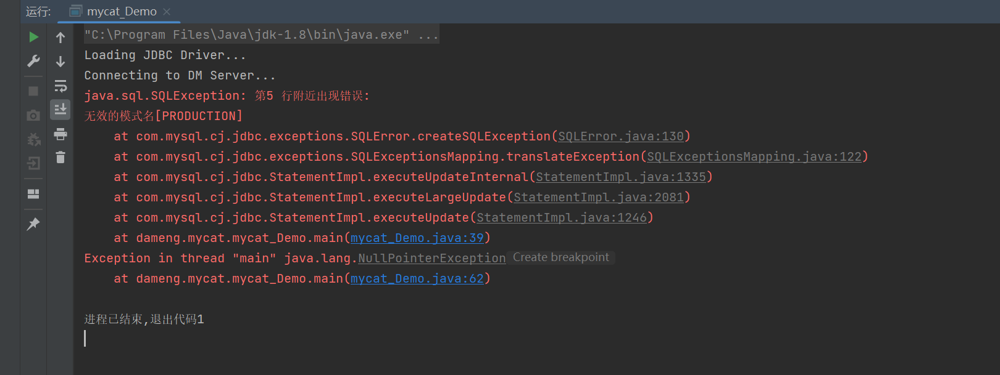

**【问题分析】**

代码里面有模式名时，运行 sql 时直接带模式名的 sql 传入数据库。

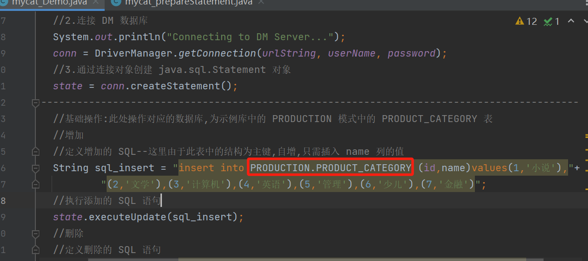

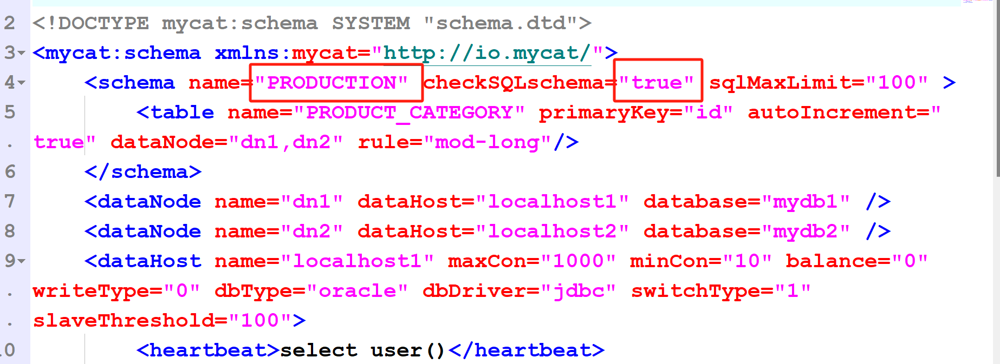

schema.xml 文件中 checkSQLschema 参数当值设置为 true 时，会把模式名删除后执行 sql 。例如，上面的语句会被自动删除模式名 PRODUCTION 变成：

```sql
insert into PRODUCT_CATEGORY (id,name)
values(1,'小说'),"+ "(2,'文学'),(3,'计算机'),(4,'英语'),(5,'管理'),(6,'少儿'),(7,'金融')
```

如果 sql 语句所带的模式名与配置文件中 schema 指定的模式名不一致，例如下面语句中的 db1 模式：

```sql
select * from db1.travelrecord;
```

那么 MyCat 并不会删除 db1 这个字段。如果没有定义该模式的话，运行程序会报错。

当 checkSQLschema 设置为 false 时，不会删除模式名，会按照原 sql 执行。

**【问题解决】**

在 schema.xml 中配置 checkSQLschema 为 true 时，sql 语句不要带模式名；当 checkSQLschema 设置为 false 或不指定 name 时，sql 语句可以带模式名。

### IDEA 配置 DM 的数据库方言

**【问题解决】**

根据自己环境，找到合适的 DM 的方言包，可在数据库安装目录的 drivers 文件夹下获取，将方言包拷贝至项目指定路径下。

点击 File-settings-Languages&Frameworks-SQL Dialects ，如下图所示：

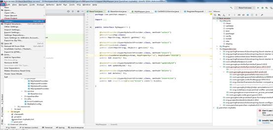

点击【添加】按钮，如下图所示：

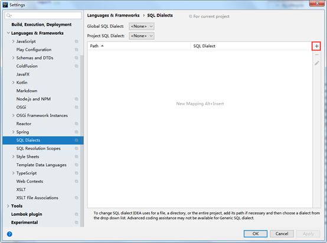

添加刚才复制的方言包，点击【ok】。

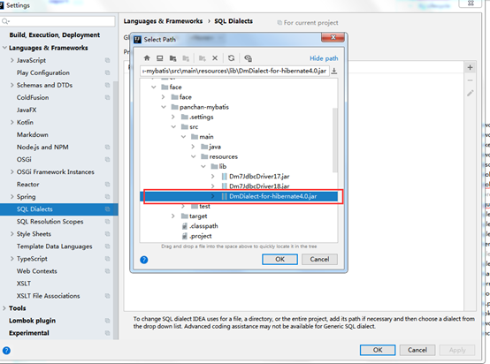

点击【apply】及【ok】完成方言包的添加。

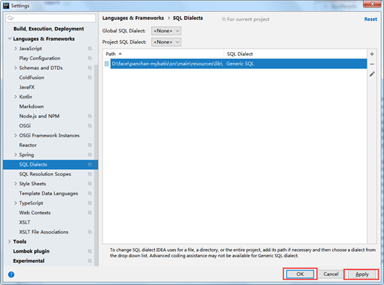

在 console 中执行以下语句，结果如下：

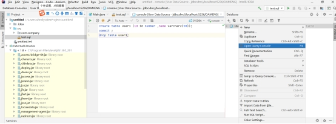

### DM 数据库支持的驱动

**【问题解决】**

可以在 DM 数据库安装目录的 drivers 文件夹中查找相应的驱动版本进行使用。

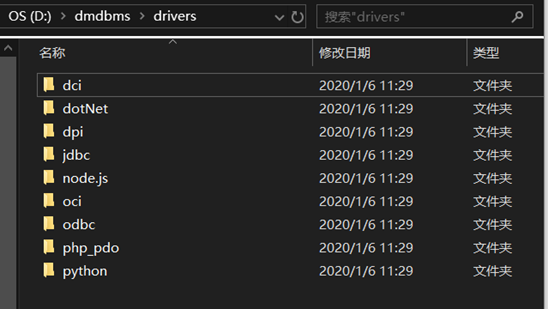

DM 数据库提供了多种数据库访问接口，相应开发环境的配置，以及一些开发用例，详细内容可参考《DM 程序员手册》（手册位于数据库安装路径 doc 文件夹下） 如果没找到原生的驱动，比如 Go/Peal ，可以用 ODBC 驱动来替代。

### JDK 包和驱动不匹配

**【问题描述】**

错误提示：driver dm.jdbc.driver.DmDriver is not sequoia compliant ，如下图：

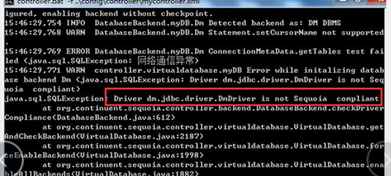

**【问题解决】**

更换驱动包就可以了，要使用 DM 安装数据库后自带的驱动包。可在数据库安装目录的 drivers\\jdbc 目录下获取驱动，分为 DmJdbcDriver16、DmJdbcDriver17，DmJdbcDriver18 分别对应 Jdk1.6、Jdk1.7、 Jdk1.8 环境。

### 通过 dm\_svc.conf 连接主备集群

**【问题解决】**

dm\_svc.conf 配置可参考下面的例子：

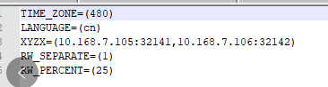

JDBC 连接请查看《DM 程序员手册》（手册位于数据库安装路径 doc 文件夹下），如下图所示：

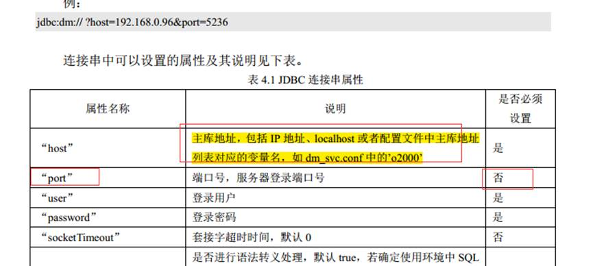

> **注意**
> 
> 读写分离集群，MPP 集群都可以用这样的方法。

### tpc-c 标准测试工具

**【问题解决】**

数据库厂商不提供测试工具，建议使用第三方测试工具。举例最常用的 BenchMarkSql 工具：

DM JDBC 驱动包放到 BenchMarkSql 的 lib 文件夹下，在工具 run 文件夹下复制一个 props 文件命名为 props.dm 并且进行编辑添加 DM 的连接串，举例如下：

```
driver=dm.jdbc.driver.DmDriver
conn=jdbc:dm://localhost:5236
user=benchmarksql
password=******
```

### 报错 ”未经授权的用户“ 的原因有哪些？

**【问题解决】**

使用 druid 做连接池，在连接 DM 数据库时提示 ”未经授权的用户“ 有两种原因：

**原因一** ：在 DM 管理工具中，此用户的资源限制中 ”会话持续期“ 进行了限制，把此限制取消即可。

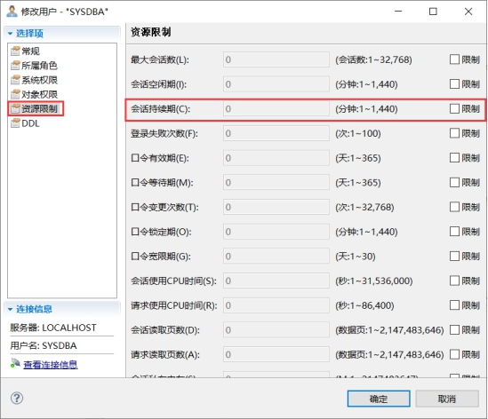 **原因二** ：连接池中的会话满了或者空会话未回收等原因造成用户无法连接。

### 连接尚未建立或者已经关闭

**【问题描述】**

使用的 DmJdbcDriver17 和 DmJdbcDriver18 程序启动后，提示连接尚未建立或者已经关闭。

**【问题解决】**

可按照如下步骤进行排查；

1. 修改 dm.ini 里面的 max\_sessions 参数。
2. 检查是否用户设置了最大空闲时间参数，导致超时断开。
3. 检查数据库服务器到应用服务器的网络波动，从应用服务器 ping 数据库服务器 -t，网络波动也会导致此报错。
4. 检查连接池设置，是否设置了断开后自动连接。

若以上都没问题建议开启 JDBC 日志，出现报错后将生成的日志转发给达梦运维人员分析。

### 语句句柄个数超上限 (1024) 或系统内存不足

**【问题描述】**

报错内容： java.sql.SQLException: 语句句柄个数超上限 (1024) 或系统内存不足。

**【问题分析】**

新的需求建立时不申请新的 session ，而是不停地申请语句句柄，超过了每个 session 可用语句句柄数的上限。

**【问题解决】**

治本之策：修改应用程序，每个语句句柄用完后，将句柄关闭。

治标之法：修改 dm.ini 参数，提高 session 可用语句句柄的上限，比如：max\_session\_statement 由原先 100 改为 1000。

### 将查询结果赋值给变量

**【问题描述】**

`select @aa=xh from XXX ` 像这种将查询结果赋值给变量 @aa 的情况，在达梦数据库中应该怎样写？

**【问题解决】**

select 列名 into 变量名 from 表名 where 条件；

### 存进去的数据与读取出来的数据不同

**【问题描述】**

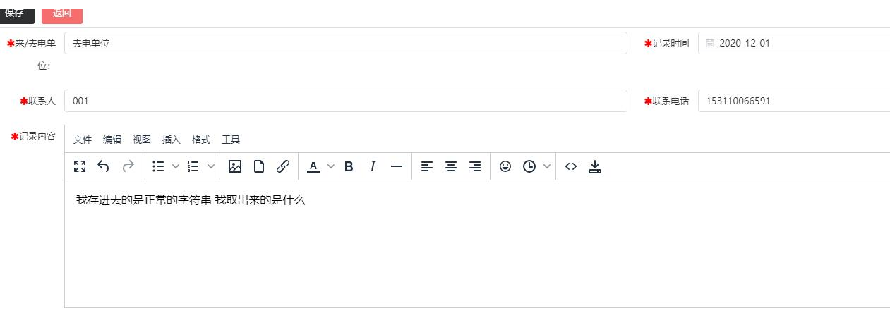

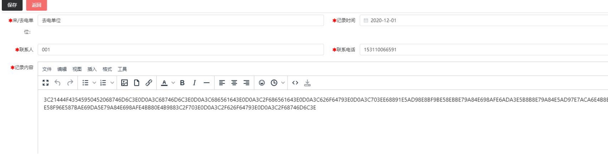

**【问题解决】**

字段类型不同，请考虑使用 text 或者 clob 数据类型。此问题是由于应用代码导致的问题，请检查相关的插入与查询的代码。

### 如何回收空闲会话

**【问题描述】**

连接一直报错：reached the max session limit，调整 MAX\_SESSIONS 参数无效，如何回收空闲会话。

**【问题解决】**

依据不同的编程接口，调用相应的关闭会话的函数。

服务器上关闭会话的函数是 `sp_close_session(sess_id) ` 。原则上禁止开发人员直接在服务器端关闭会话，请开发人员在使用完会话后自觉关闭会话。若有需要在服务器端关闭会话请数据库管理员 DBA 操作。

### 达梦数据库如何防止 SQL 注入？

**【问题解决】**

推荐应用人员在写 SQL 语句时，使用 SQL 语句参数化绑定。

### 开启 ssl 认证后连接数据库报错：网络通讯异常

**【问题描述】**

开启 ssl 认证后，应用无法连接数据库，提示网络通讯不正常报错，用 DM 管理工具可以正常连接，将应用的 jdk 更换为达梦自带 jdk 也可以正常连接。

**【问题解决】**

该问题是由于应用所使用的 jdk 中 jdk\\jre\\lib\\security\\java.security 配置文件差异导致，一般较高版本的 jdk 可能存在该问题。

存在该问题的情况下，可以查看 java.security 配置文件，删除 TLSv1 即可。


### 定时任务中适配 quartz blob 字段不支持的处理方法

**【问题描述】**

```
org.quartz.JobPersistenceException: Couldn't store job: Driver's Blob representation is of an unsupported type: dm.jdbc.driver.DmdbBlob [See nested exception: java.sql.SQLException: Driver's Blob representation is of an unsupported type: dm.jdbc.driver.DmdbBlob]
```

**【问题解决】**

需要将 quartz.properties 配置文件的

```java
org.quartz.jobStore.driverDelegateClass = org.quartz.impl.jdbcjobstore.oracle.OracleDelegate
```

改为

```
org.quartz.jobStore.driverDelegateClass = org.quartz.impl.jdbcjobstore.StdJDBCDelegate
```

> **注意**
> 
> org.quartz.jobStore.driverDelegateClass 中的 driver 代表了解不同数据库系统的特定“方言”。可能的选择包括： org.quartz.impl.jdbcjobstore.StdJDBCDelegate（用于完全符合 JDBC 的驱动程序）； org.quartz.impl.jdbcjobstore.MSSQLDelegate（对于 Microsoft SQL Server 和 Sybase）； org.quartz.impl.jdbcjobstore.WebLogicDelegate（对于 WebLogic 驱动程序）； org.quartz.impl.jdbcjobstore.oracle.WebLogicOracleDelegate（对于 Weblogic 中使用的 Oracle 驱动程序）； org.quartz.impl.jdbcjobstore.oracle.weblogic.WebLogicOracleDelegate（对于在 Weblogic 中使用的 Oracle 驱动程序）； org.quartz.impl.jdbcjobstore.PostgreSQLDelegate ； org.quartz.impl.jdbcjobstore.oracle.OracleDelegate ； org.quartz.impl.jdbcjobstore.CloudscapeDelegate ； org.quartz.impl.jdbcjobstore.DB2v6Delegate ； org.quartz.impl.jdbcjobstore.DB2v7Delegate ； org.quartz.impl.jdbcjobstore.DB2v8Delegate ； org.quartz.impl.jdbcjobstore.HSQLDBDelegate ； org.quartz.impl.jdbcjobstore.PointbaseDelegate ； org.quartz.impl.jdbcjobstore.SybaseDelegate

### 应用 SQL 语句中 select 中别名为小写字母时，如何在查询结果中自动转换为大写字母

**【问题描述】**

应用 sql 语句中 select 中别名为小写字母时，查询结果别名为小写字母，并非和 oracle 一样自动转换为大写字母。如下图所示，DM 数据库中 dict\_code 字段查询结果别名为小写，在 Oracle 中查询结果自动转换为大写。


**【问题解决】**

增加 jdbc 连接参数 `columnNameUpperCase=true` 可实现返回结果为大写字母的需求。columnNameUpperCase 参数含义：列名转换为大写字母，取值 1/0 或 true/false，默认 false。

### 执行 SQL 语句，驱动返回层报错：变量空间溢出

**【问题描述】**

当一条 SQL 涉及批量绑定参数个数较多时，JDBC 驱动层返回报错，“变量空间溢出”。且 SQL 日志里接收到对应的 sql ，没有解析而是直接 rollback 。报错截图如下：


**【问题解决】**

可适当调整数据库 dm.ini 里 VM\_STACK\_SIZE 参数。默认为 256，单位为 KB 。例如当批量绑定参数个数达到 30000 时，可将 VM\_STACK\_SIZE 调整为 5120。

> **注意**
> 
> VM\_STACK\_SIZE：系统执行时虚拟机堆栈大小，单位为 KB，堆栈的空间是从操作系统中申请的，有效值范围（64~256\*1024）。该参数为静态参数，修改后重启数据库生效。

### 应用连接 DM7 数据库报错："Error：JVMCFRE003 bad major version"

**【问题描述】**

在部署应用时，查看应用服务器的 Java 版本为 1.7，使用的 dm 驱动包为 DmJdbcDriver17.jar，但是应用无法连接到 DM 数据库，报错：“对数据源 DM7 执行的测试连接操作由于以下异常 java.sql.SQLException:java.lang.UnsupportedClassVersionError：JVMCFRE003 bad major version;class=dm/jdbc:/driver/DmdbConnectionPoolDataSource,offset=6 而失败”。

**【问题解决】**

此问题可能是由于服务器中存在多个版本的 Java ，应用服务器使用到了其他版本的 Java 导致。

使用 `ps -ef|grep java` 命令查看应用使用的 Java 路径及版本，更换 Java 版本为 1.7 后，即可连接成功。

### dm\_svc.conf 文件是否可以使用普通用户定义并配置自定义路径

**【问题解决】**

可以，普通用户（非 root 用户）也可以创建 dm\_svc.conf 文件和配置自定义路径。使用时添加 dmsvcconf 参数指定路径即可。

例如：当自定义路径在 /opt/dmsvc.conf 时，则用 `jdbc:dsc1://?dmsvcconf=/opt/dm_svc.conf` 连接数据库。


### 执行环境堆栈空间不足

**【问题描述】**

管理系统业务报错：

```
Error updating database. Cause: dm.jdbc.driver.DMException: 执行环境堆栈空间不足。
```

**【问题分析】**

分析应用日志发现引起该错误信息的为一条 insert 语句，Insert 语句示例如下：

```sql
insert into pm_project_plan_revised (?,?......) values (?,?......), (?,?......), (?,?......), (?,?......)......;
```

其中字段值有 35 个，values 值的集合数超过 1300 个，每一个 values 里面的值都是通过传参获取。该 insert 语句不是一种规范的写法，大量的传参值和大量的 values 值集，必然导致系统资源消耗过高和执行时间变长。

**【问题解决】**

可通过以下两种方法解决：

**方法一** ：调整 VM\_STACK\_SIZE 为 1024 或 2048，暂时避免该问题。

VM\_STACK\_SIZE 参数说明：系统执行时虚拟机堆栈大小，以 KB 为单位，堆栈的空间是从操作系统中申请的，有效值范围（64~256\*1024），该参数是静态参数，默认值是 256，需要重启数据库生效。

**方法二** ：从业务方面调整，在业务导入数据过程中，对导入的数据量进行限制，避免这种不合理的数据导入方式。

> **注意**
> 
> 如果不对 values 值集进行限制，即使 VM\_STACK\_SIZE 设置为 2048 或更大值，values 值集达到一定值后，还是会报错，同时会导致系统资源消耗过高。


### 如何让返回的结果集中列的大小写和 SQL 中写的大小写保持一致？

**【问题描述】**

如何让返回的结果集的列大小写和 SQL 中写的大小写保持一致？比如列名本身为 name，但是 SQL 为 SELECT Name from table，要求结果集列名显示为 Name。

**【问题解决】**

可以在 url 连接串中配置参数 genKeyNameCase=0，即可保持用户输入列名大小写不变，如下：

```
jdbc:dm://ip:port_num?genKeyNameCase=0
```

### 应用程序执行 SQL 报错：不支持该数据类型

**【问题描述】**

应用程序执行 SQL 报错 “不支持该数据类型”，管理工具可以正常执行该 SQL。


**【问题分析】**

此问题是应用程序代码直接使用原生的 jdbcTemplate 使用 hashmap 作为参数。

**【问题解决】**

直接使用原生的 jdbcTemplate 时不能使用 hashmap 作为参数,，应使用一个扩展类 NamedParameterJdbcTemplate，如下：


### 字符串转换出错

**【问题描述】**

JDBC 中使用 setNull 方法给 varchar 类型绑定空值报错：字符串转换出错。语句如下所示：

```sql
String sql = "select * from sysobjects where name=?";
PreparedStatement stmt = conn.prepareStatement(sql);
stmt.setNull(1, 0);
stmt.execute();
conn.commit();
```

**【问题解决】**

出现该报错是由于达梦默认 null 和空串不等价，解决方法：

修改 dm.ini，令 COMPATIBLE\_MODE = 2，重启数据库后生效。

### MySQL 迁移到 DM 后 getObject 接口返回值不一致

**【问题描述】**

使用 dts 将如下表迁移到达梦后 tinyint(1) 映射为 tinyint，通过 jdbc 中 getObject 接口获取该列数据时，mysql 返回 boolean 类型值，达梦返回 0/1 数字。

```sql
/*mysql*/create table SimplyTest(id int,name varchar(20),create_time timestamp,flag tinyint(1),other longtext)
/*dm*/create table SimplyTest(id int,name varchar(20),create_time timestamp,flag tinyint,other longtext)
```

**【问题解决】**

将达梦端对应列定义改为 bit 类型后 getObject 接口返回值变为 boolean 类型。

### DmdbResultSet 不支持 LocalDateTime 数据类型

**【问题描述】**

DmdbResultSet 日期类型转化不支持 LocalDateTime


**【问题解决】**

升级到高版本驱动，高版本驱动已解决此问题

### java 中 mybatis 结合后 insert 插入没有返回主键自增 id

**【问题解决】**

方法 1：xml 文件通过 useGeneratedKeys、keyColumn、keyProperty 返回 UID

```
<insert id="insertUser" parameterType="User" useGeneratedKeys="true" keyColumn="UID" keyProperty="uid">
    insert into users2(uname,uage) values (#{uname},#{uage})
</insert>
```

方法 2：xml 文件通过嵌套子查询，插入时查询 UID

```
<insert id="insertUser2" parameterType="User" >
    <selectKey keyColumn="UID" keyProperty="uid" resultType="int" order="AFTER">
   <!-- SELECT LAST_INSERT_ID()-->
    select ident_current('SYSDBA.USERS')
    </selectKey>
    insert into users(uname,uage) values (#{uname},#{uage})
</insert>
```

方法 3：mapper 层通过 Options 注解进行返回

```
@Insert("insert into users(uname,uage) values (#{uname}, #{uage})")
@Options(useGeneratedKeys = true, keyProperty = "uid")
void insertUser3(User user);
```

方法 4：mapper 层通使用 SelectKey 注解，执行查询语句后返回

```
@Insert("insert into users(uname,uage) values (#{uname}, #{uage})")
@SelectKey(statement = " select ident_current('SYSDBA.USERS')", keyProperty = "uid", before = false, resultType = int.class)
void insertUser4(User user);
```

### mybatis 的 mapper 文件中不能在 insert 标签中一次提交多条语句

**【问题描述】**

mybatis 的 mapper 文件中不能在 insert 标签中一次提交多条语句（以 ；隔开）

**【问题解决】**

使用 foreach 标签，代码如下：

```
<insert id="inserts" parameterType="User" useGeneratedKeys="false">
    insert into users(uname,uage) values
    <foreach collection="list" item="item" separator=",">
        (#{item.uname},#{item.uage})
    </foreach>
</insert>
```

### mybatis-plus 批量操作抛出 NegativeArraySizeException 异常

**【问题描述】**

使用 mybatis-plus 的批量处理方法 saveBatch、saveOrUpdateBatch 等相关方法，抛出 java.lang.NegativeArraySizeException 等数组索引相关的异常

**【问题解决】**

可能发生的原因：

1. 在代码中直接使用了负数作为数组的大小。
2. 数组大小是通过计算得到的，但由于逻辑错误导致计算结果为负。
3. 使用变量作为数组大小，但该变量在使用前被错误地赋予了负值。

### springboot+druid+mybatisplus 和 mybatisplus 的多数库源框架 +activiti7+ 达梦 8; activiti7 框架集成达梦时报错

**【问题描述】**

连接池打开后自动关闭初始化 bean 失败

**【问题解决】**

以下三种情况可能导致报错：

1. namespace 对应的名字不对
2. 有些靠 ioc 注入的类没有加 @service 之类生成 bean 的注解
3. mapper.xml 中#{}里没有写参数名

### springboot1.5+mybatis 通用 mapper-1.2.4+dm8

**【问题描述】**


**【问题解决】**

数据从 mysql 迁移到 DM，mybatis 通用 mapper 表映射的实体类对象中，字段加了主键自增的注解 @GeneratedValue(generator = “JDBC”)，而实际 DM 数据库使用的主键是非自增的，应当去掉此注解，通用 mapper 的 insert() 方法可正常使用。

### Mybatis 迁移错误

**【问题描述】**

mybatis 在使用 useGeneratedKeys=“true” keyProperty=“id” 的时候，id 不传值，报违反列 \[id\] 非空约束的错误，id 在数据库不是自增主键

**【问题解决】**

对应列需要设置为自增列，建表语句参考：

```sql
CREATE TABLE TAB1 (ID INT PRIMARY KEY AUTO_INCREMENT, C1 INT);
CREATE TABLE TAB2 (ID INT PRIMARY KEY IDENTITY(1,1), C1 INT);
```

### 使用 mybatis 如何一次执行多条 sql

**【问题描述】**  
使用 mybatis 想一次执行多条 sql，有类似 mysql 的 allowMultiQueries=true 标签吗？


**【问题解决】**

驱动目前仅支持批量执行 dml 语句，不支持批量执行 ddl 语句。

如果需要批量执行 ddl 语句，可以使用存储过程包裹多 ddl 语句的方式，两条 ddl 语句不能放到一个 statment 里面执行，dml 语句可以，可以封装成一个语句块，下面为示例代码：

```
<update id="createTable2">
    BEGIN
    execute immediate 'CREATE TABLE ${tableName} (
    id bigint NOT NULL identity(1,1),
    field_001 int DEFAULT NULL,
    field_002 varchar(255) DEFAULT NULL,
    process_instance_id varchar(64) DEFAULT NULL,
    user_id varchar(32) DEFAULT NULL,
    user_name varchar(32) DEFAULT NULL,
    real_name varchar(32) DEFAULT NULL,
    last_update_user_id varchar(32) DEFAULT NULL,
    last_update_user_name varchar(32) DEFAULT NULL,
    create_time datetime DEFAULT NULL,
    last_update_time datetime DEFAULT NULL,
    PRIMARY KEY (id))';
    execute immediate 'COMMENT ON COLUMN ${tableName}.field_001 IS ''数字(整型)''';
    execute immediate 'COMMENT ON COLUMN ${tableName}.field_002 IS ''网址''';
    execute immediate 'COMMENT ON COLUMN ${tableName}.process_instance_id IS ''流程实例Id''';
    execute immediate 'COMMENT ON COLUMN ${tableName}.user_id IS ''用户Id''';
    execute immediate 'COMMENT ON COLUMN ${tableName}.user_name IS ''用户名''';
    execute immediate 'COMMENT ON COLUMN ${tableName}.real_name IS ''用户真实名''';
    execute immediate 'COMMENT ON COLUMN ${tableName}.last_update_user_id IS ''最后修改用户Id''';
    execute immediate 'COMMENT ON COLUMN ${tableName}.last_update_user_name IS ''最后修改用户名''';
    execute immediate 'COMMENT ON COLUMN ${tableName}.create_time IS ''创建时间''';
    execute immediate 'COMMENT ON COLUMN ${tableName}.last_update_time IS ''最后修改时间''';
    end;
</update>
```

### 在数据库工具查询 geom 数据和 mybatis 查询出来的结果不一致问题

**【问题描述】**

在数据库工具查询 geom 数据和 mybatis 查询出来的结果不一致问题。


**【问题解决】**

目前只建议使用 jdbc 的 statement 来进行查询和插入空间数据，例如 blob 类型的 wkb 数据需要转为字节数组来解析。

### mybatis-plus 查询时报错：不是 group by 表达式

**【问题描述】**

使用 mybatis-plus 的 mapper 查询时报错：不是 gruop by 表达式

执行语句： `select id,status,user_name from app where status=0 group by id`

**【问题解决】**

group by 使用不标准，数据库标准语法中，SELECT 子句中的列名必须为分组列或列函数，列函数对于 GROUP BY 子句定义的每个组各返回一个结果。

对该语句而言 id、status、user\_name 三个字段均为分组列，必须包含在 GROUP BY 子句中。

解决方法有如下几种：

1. 修改 SQL 语句为 `select id,status,user_name from app where status=0 group by id,status,user_name；`
2. 修改为 mysql 兼容模式（需重启数据库），修改参数 COMPATIBLE\_MODE=4；
3. 修改参数 `sp_set_para_value(1,'GROUP_OPT_FLAG',53)；` 非 mysql 兼容模式下支持查询项不是 group by 表达式，不需要重启。

### 使用 mybatis+pagehelper 分页有些会报 Cause: dm.jdbc.driver.DMException: 字符串转换出错

**【问题描述】**

使用 mybatis+pagehelper 分页有些会报 Cause: dm.jdbc.driver.DMException: 字符串转换出错

**【问题解决】**

```java
PageHelper.startPage(1, 2);List
```

使用上面这种方式即可，SQL 会转化为带 limit 子句的形式，例如：

```sql
select * from users where uid != 1 LIMIT 1,2
```

### 使用 Mybatis-Plus 3.3.2，部分查询出现异常

**【问题描述】**

异常日志（org.apache.ibatis.binding.BindingException: Invalid bound statement (not found): ）

**【问题解决】**

从以下方面进行排查：

1. 检查 xml 文件的 namespace 是否对应接口，要是全路径，xml 文件名不需要和接口名一致，namespace 和接口全类名一致。
2. xml 中的函数 id 和接口中的函数名是否对得上，参数类型、返回值类型是否对得上。
3. 查看输出目录中有没有 xml 映射文件，maven 项目默认把资源文件放在 src/main/resources 下，默认只识别 src/main/resources 下的资源文件。

### 达梦数据库使用 mybaits-plus 自带的 inser 插入，报错：无效的列

**【问题描述】**

项目适配达梦数据库，搭建的数据库默认了大小写敏感，当使用 mybatis-plus 自带的 inser 方法插入数据时，报错：无效的列。

**【问题解决】**

大小写敏感的库，实体类参数名注意和列名保持一致，否则会出现 @TableId(value = "ID", type = IdType.AUTO)可以执行成功，而 @TableId(value = "id", type = IdType.AUTO) 执行失败的情况。

### 通过 mybatis 访问达梦数据库，传入的参数为 date 类型，数据库里面这个字段是 timestamp 类型，但运行提示数据库是 string 类型，跟传进去的 date 不能进行对比

**【问题描述】**

详情如下图：


**【问题解决】**

当数据库采用默认兼容性参数时，null 和空字符串不等价，!=' ' 和 not null 不等价，所以查询 timestamp 类型时需要使用 is not null 进行判断。而不是!=' ' 。

### 如何获取列的别名

**【问题解决】**

达梦 2024 年第一季度正式版之前的版本，使用 Java 语言开发过程中，使用 ResultSetMetaData 对象中 getColumnName 函数无法获取原始列名，但会全部返回列别名；达梦 2024 年第一季度正式版开始进行区分，getColumnName 返回列名，getColumnLabel 返回别名。

获取列别名方法：

1. 使用达梦 2024 年第一季度正式版之前的驱动，通过 getColumnName 返回列别名。
2. 使用达梦 2024 年第一季度正式版或之后版本的驱动，通过 getColumnLabel 返回列别名。

### hibernate 使用 hql 语句进行达梦开发报错

**【问题描述】**

hibernate 使用 hql 语句进行达梦开发报错："parameter value \[ 1\] did not match expected type java.lang.string\[n/a\]"。

**【问题解决】**

可参考如下方法尝试解决：

1. 核查方言包配置是否正确，正确配置为：org.hibernate.dialect.DmDialect；
2. 检查报错 hql 语句对应的传参类型和实体类定义的类型是否一致，如传参是 Long 类型，实体类定义的是 String 类型，可能会报参数不匹配错误；
3. 核查 hibernate-core 等依赖包的版本和方言包版本是否匹配，如 hibernate-core 5.0.11.Final，对应方言包版本 DmDialect-for-hibernate5.0.jar。

### java 项目里使用了 @Transactional 注解，事务异常无法回滚

**【问题解决】**

在 java 的 Spring 框架中使用 @Transactional 注解是实现事务管理的常用方式，在使用“东方通中间件”时可能会出现事务失败无法按预期回滚的问题，这是由于中间件配置原因导致。将东方通中间件 bin/external.vmoptions 里面 -DWebModuleOnly=false 改为 true 后，重启东方通即可解决。