## 前言

本章节主要介绍.NET 应用开发常见问题，为用户提供.NET 应用开发常见问题的分析和解决思路。除此之外，用户还可前往 [达梦技术社区](https://eco.dameng.com/community/question/) 参与更多问题讨论。

## 目录

## 正文

### DmException: 试图在只读事务中修改数据

**【问题描述】**

执行 sql 语句时报试图在只读事务中修改数据。

**【问题解决】**

达梦数据库的事务隔离级分为四级，默认是“读提交隔离级”。可以检查一下是否设置了隔离级别为“只读事务”。更多关于达梦数据库的事务隔离级，请参考数据库安装目录的 DOC 目录下的《系统管理员手册》第 19 章节——管理事务。

### .NET 程序中使用 DmBulkCopy 对象执行时报错

**【问题描述】**

.NET 程序中使用 DmBulkCopy 对象执行时报错：

```
Unhandled exception. Dm.DmException (0x80004005): The fastloading dll not loading!
    at Dm.DmFldr.Initilize(DmConnProperty props, String desttable, DmBulkCopyOptions op, Int32 rows, DataTable table)
    at Dm.DmBulkCopy.WriteToServer(DataTable table)
```

**【问题分析】**

DmBulkCopy 对象用于快速批量装载数据，实现 IDisposable 接口，该功能依赖 DM 安装目录 bin 下的 dmfldr\_dll.dll 等动态链接库。

**【问题解决】**

在 Path 环境变量里面加上达梦的 bin 目录：

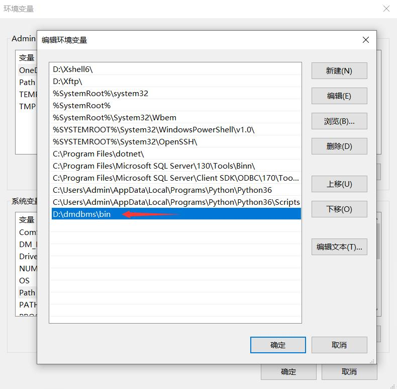


### .NET 程序服务名连接达梦集群，备机异常时，连接异常变慢

**【问题描述】**

.NET 程序服务名连接达梦集群，备机异常时，连接异常变慢。

**【问题解决】**

在 dm\_svc.conf 中配置连接超时参数 connnectTimeout，可配置为 connnectTimeout=(3)，如未配置该参数，可直接新增。

### 在指定的 DSN 中，驱动程序和应用程序之间的体系结构不匹配

**【问题描述】**

DSN 里面创建并使用数据源时，出现报错：在指定的 DSN 中，驱动程序和应用程序之间的体系结构不匹配。

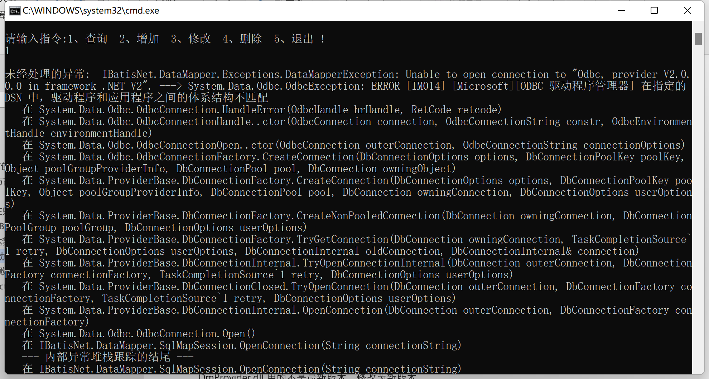


**【问题解决】**

达梦和应用的位数不匹配，检查现场的应用是 32 位还是 64 位，安装的 DM 是 32 位还是 64 位，如果无法确认版本，可以分别对 32 位和 64 位的 odbc 数据源管理程序添加对应的 driver 进行测试。

### 报错 “加密模块加载失败”

**【问题描述】**

libeay32.dll 这个加密动态库找不到。

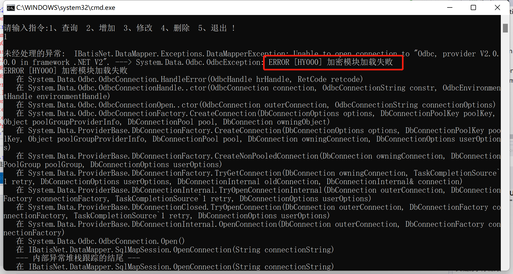


**【问题解决】**

在系统环境变量中添加 DM 数据库的 bin 目录，或者将动态库以及依赖文件拷贝到程序目录下面和 system32（可以拷贝 bin 目录下所有动态库文件）。

### 调用 get\_ProviderFactory 方法后，返回 null

**【问题描述】**

System.Data.Entity.Core.ProviderIncompatibleException:

对类型 Dm.DmConnection 的存储区提供程序实例调用 get\_ProviderFactory 方法后，返回 null，存储区提供程序可能没有正确运行。

**【问题解决】**

DmProvider.dll 用的不是最新版本，替换为新版本即可，下载最新的 DM 数据库，在 drivers\\dotNet\\DmProvider 目录下获取。

### This SQL map does not contain a MappedStatement named xxx

**【问题描述】**

IBatisNet.DataMapper.Exceptions.DataMapperException: This SQL map does not contain a MappedStatement namd abc.List

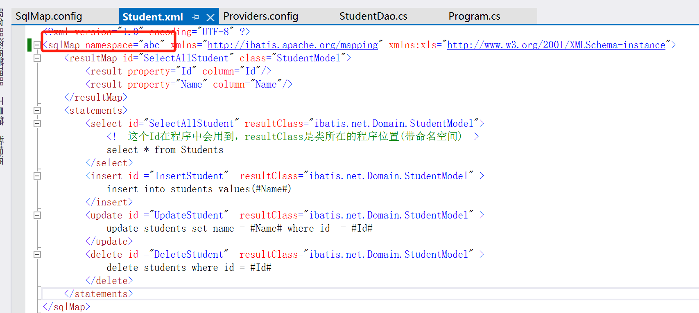


**【问题解决】**

检查配置文件中的命名空间是否有误，sql 的配置文件有个命名空间的参数 useStatementNamespaces，此参数默认是 true，就是说使用了 Satement 命名空间，所以应用的时候必须加上命名空间，运行方法时需要带上命名空间名称 abc，例如：

`Mapper().QueryForList("abc.List", null)` ，而不是 `Mapper().QueryForList("List", null)` 。

### Bad value for ai\_flags 或者是 \[(UNKNOW, UNKNOW)\]Resource temporarily unavailable 或者是网络通讯异常

**【问题描述】**

出现 Bad value for ai\_flags 等报错。

**【问题解决】**

一般都是并发下连接超时，最新驱动修改连接参数，添加 connPooling=true; connectionTimeout=3600000; connPoolSize=1000。

### The provider is not in 'providers.config' or is not enabled.

**【问题描述】**

加载驱动出现 The provider is not in 'providers.config' or is not enabled。

**【问题解决】**

在 Providers.config 文件中将对应的 provider 的 enabled 选项改成 true。

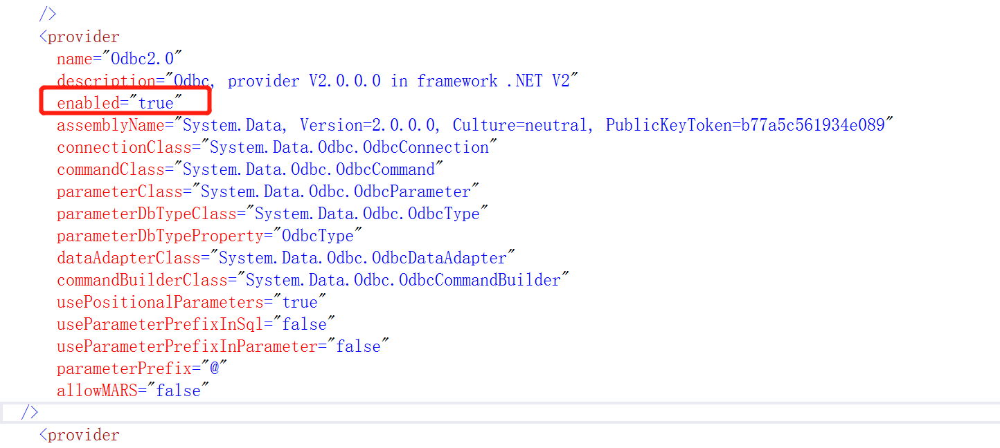


### command.Parameters.Add 方法无法实现参数跟名称绑定

**【问题描述】**

使用.net 框架调用 command.Parameters.Add 方法，把参数放到一个 LIST 里面，每次执行 ExecuteNonQuery 方法都会从 LIST 按顺序取值，而不能根据参数名称绑定。

**【问题解决】**

此问题需要升级驱动版本解决，请联系对应项目服务人员获取相应版本。

### .NET4/5 连接数据库出现 \[(UNKNOW, UNKNOW)\] 无效的客户端版本错误

**【问题描述】**

将旧版本 DmProvider.dll 文件复制到新项目目录 bin 下然后执行报错。

**【问题解决】**

此问题出现原因为老版本客户端连接新版本服务器导致版本不匹配，修改 dm.ini 参数 IFUN\_DATETIME\_MODE=0，后重启数据库即可。

### .NET 程序中使用达梦数据库 @ 符号不能传参

**【问题描述】**

.NET 程序中使用达梦数据库 @ 符号报参数错误。

**【问题解决】**

修改 dm.ini 配置文件中 MS\_PARSE\_PERMIT=2，重启服务生效即可以使用 @ 符号传参。

参数解释：

| 参数名 | 默认值 | 属性 | 说明 |
| --- | --- | --- | --- |
| MS\_PARSE\_PERMIT | 0 | 静态 | 是否支持 MS SQLSERVER 的语法。   0：不支持；   1：支持；   2：在 MS\_PARSE\_PERMIT =1 的基础上，兼容 MS SQLSERVER 的查询项中支持”标识符=列名”或“@ 变量名=列名“用法。   备注：当 COMPATIBLE\_MODE=3 时，MS\_PARSE\_PERMIT 的实际值为 1 |

### 使用 DmProvider 驱动连接达梦数据库报错

**【问题描述】**

.NET 使用 DmProvider 驱动连接达梦数据库报错：“System.TypeInitializationException:“The type initializer for 'Dm.DmConnProperty' threw an exception.”

报错信息如下图所示：

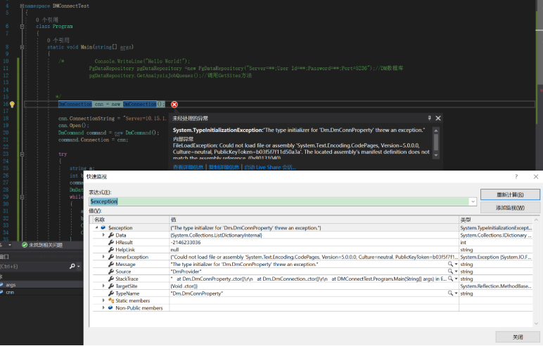


**【问题分析】**

DmProvider 可以在.NET 框架和 NETCore 框架下使用，NETCore 框架下需要用户安装 System.Text.Encoding.CodePages 包或者直接以 NUGET 包的形式安装 DmProvider 可以自动依赖的 System.Text.Encoding.CodePages 包，由于这里采用了直接引用的方式所以报错。

**【问题解决】**

使用 NuGet 包管理器安装 System.Text.Encoding.CodePages 即可。

### 如何将 DmProvider 驱动的 nupkg 包导入项目中

**【问题解决】**

点击项目 -> 管理 NuGet 程序包 。

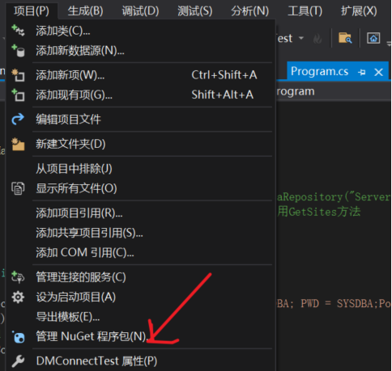


点击设置 -> 输入路径名 -> 输入包名（包含后缀）-> 更新 -> 确定。

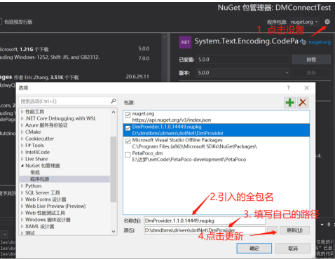


选择包源，就可以看到 DmProvider，点击右侧安装即可。

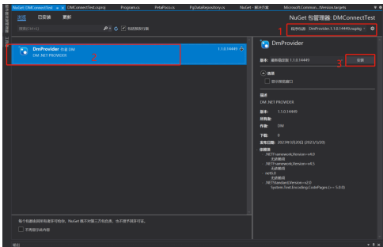


### .NET 使用 dapper 框架查询报错：”Error parsing column 0”

**【问题描述】**

.NET 使用 dapper 框架查询报错：“Error parsing column 0 (F\_COMPANYID=77146e11-17bb-11ed-9d74-8c8caae51613 - Object)”

**【问题分析】**

此报错一般是数据类型转换问题，程序中报错的属性定义为 String 类型，数据库字段为 varchar(36) 且为 guid 类型值。

url 属性 archar36ToGuid 表示是否将数据库 varchar(36) 列类型返回 Guid 类型。TRUE 表示返回 Guid 类型；FALSE 表示返回 string 类型；缺省为 TRUE。

**【问题解决】**

方法一：将应用程序中报错的属性设置为 Guid 类型。

方法二：在 URL 中添加 archar36ToGuid=false，程序中报错的属性保持 String 类型。

### .NET6 使用 Microsoft.EntityFrameworkCore.Dm 查询语句未转换

**【问题描述】**

在.NET6 项目中使用 Microsoft.EntityFrameworkCore.Dm 创建了 DbContext 连接是正常的，在使用查询的时候发现语句还是 sqlserver 的语法最后导致报错了。

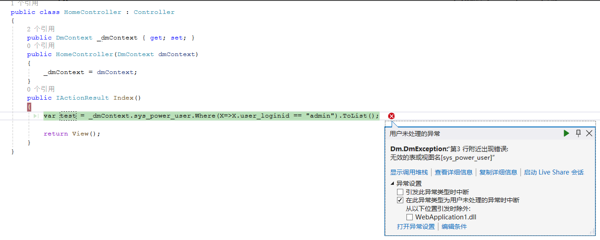

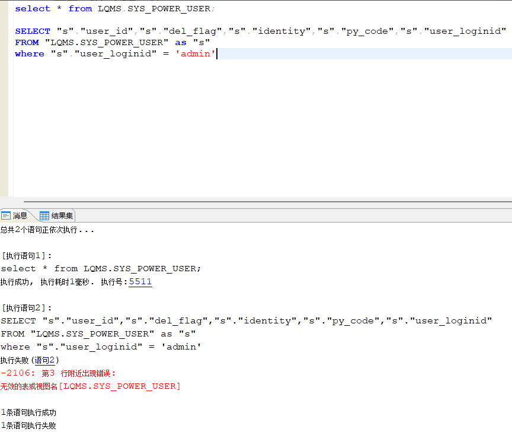

**【问题分析】**

创建的数据库为大小写敏感的库，表名为大写，而查询语句为小写,。

**【问题解决】**

创建达梦数据库时指定大小写不敏感，或手动将数据库中的表名改为大写。

### EFCore 如何生成自增列

**【问题描述】**

EFCore 如何生成自增列？

**【问题解决】**

以.net60 为例，使用 dmdbms\\drivers\\dotNet\\DmProvider\\net60\\DM.DmProvider.dll 和 dmdbms\\drivers\\dotNet\\EFCore.Dm6.0\\net6.0\\DM.Microsoft.EntityFrameworkCore.dll 可以生成自增列，相关代码如下：

```
using Microsoft.EntityFrameworkCore;
using System;
using System.Collections.Generic;
using System.Linq;
using System.Text;
using System.Threading.Tasks;

namespace netcore_demo1.Models
{
    public class EFDBContext : DbContext
    {

        protected override void OnConfiguring(DbContextOptionsBuilder optionsBuilder)
        {
            //需要填写连接字符串和数据库版本
            optionsBuilder.UseDm("server=127.0.0.1;user=SYSDBA;password=*****");
        }

        public DbSet<Student> Students { get; set; }

    }
}

using System;
using System.Collections.Generic;
using System.Linq;
using System.Text;
using System.Threading.Tasks;

namespace netcore_demo1.Models
{
    public class Student
    {
        public uint StudentId { get; set; }
        public string Name { get; set; }
        public string Class { get; set; }
    }
}
```

生成的构建代码如下：

```
using Microsoft.EntityFrameworkCore.Migrations;

#nullable disable

namespace netcore_demo1.Migrations
{
    public partial class Initial : Migration
    {
        protected override void Up(MigrationBuilder migrationBuilder)
        {
            migrationBuilder.CreateTable(
                name: "Students",
                columns: table => new
                {
                    StudentId = table.Column<long>(type: "BIGINT", nullable: false)
                        .Annotation("Dm:Identity", "1, 1"),
                    Name = table.Column<string>(type: "NVARCHAR2(32767)", nullable: false),
                    Class = table.Column<string>(type: "NVARCHAR2(32767)", nullable: false)
                },
                constraints: table =>
                {
                    table.PrimaryKey("PK_Students", x => x.StudentId);
                });
        }

        protected override void Down(MigrationBuilder migrationBuilder)
        {
            migrationBuilder.DropTable(
                name: "Students");
        }
    }
}
```

### .Net Provider-GetSchema with restrictions

**【问题描述】**

使用达梦的.Net 驱动时打开连接，获取 Schema 时，填写 restrictions， 发现 restrictions 的标准与 ado.net 标准不一致

**【问题解决】**

调用 `SELECT SF_GET_SCHEMA_NAME_BY_ID(CURRENT_SCHID)` 这种查询语句可以返回当前对象

部分代码如下：

```
cmd.CommandText = "SELECT SF_GET_SCHEMA_NAME_BY_ID(CURRENT_SCHID)";
cmd.ExecuteNonQuery();
DmDataReader reader = (DmDataReader)cmd.ExecuteReader();
while (reader.Read())
         {
          string name = reader.GetString(0);
          Console.WriteLine("当前模式：" + name);
         }
reader.Close();
```

### net core 客户端驱动 bug

**【问题描述】**

MERGE SQL 语句，多个同名参数绑定有问题，insert 多个同名参数绑定正常

**【问题解决】**

示例如下，分为二步骤，先创建表然后使用 merge 插入

建立相关表：

```
CREATE TABLE "SYSDBA"."TABLE_11"
(
"COLUMN_1" INTEGER,
"COLUMN_2" VARCHAR(10)) STORAGE(ON "MAIN", CLUSTERBTR) ;
```

插入数据：

```
//测试MERGE插入
                cmd.CommandText = "MERGE INTO SYSDBA.TABLE_11 A USING (select count(*) co FROM SYSDBA.TABLE_1 WHERE COLUMN_1 =:COLUMN_1) B ON(B.co<>0) WHEN MATCHED THEN UPDATE SET COLUMN_2 =:COLUMN_2 WHERE COLUMN_1 =:COLUMN_1 WHEN NOT MATCHED THEN INSERT(COLUMN_1, COLUMN_2) VALUES(:COLUMN_1, :COLUMN_2)";
                var para1 = new DmParameter(":COLUMN_1", DmDbType.Int64);
                cmd.Parameters.Add(para1);
                var para2 = new DmParameter(":COLUMN_2", DmDbType.Int64);
                cmd.Parameters.Add(para2);
                para1.Value = 2;
                para2.Value = 2;
                cmd.ExecuteNonQuery();
```

### net ef 生成 ADO.NET 实体数据模型找不到达梦数据库源提供程序

**【问题解决】**

请参考《DM8 程序员手册》第 5.5 章节 EFDmProvider.EF6 方言包。

### net core 连接 DM 报错

**【问题描述】**

net core 连接达梦数据库首次拿数据时报错：System.NullReferenceException，出错后重试就能正常拿到数据，报错信息如下。

```
System.NullReferenceException
HResult=0x80004003
Message=Object reference not set to an instance of an object.
Source=System.Private.CoreLib
StackTrace:
在 System.Collections.Generic.Dictionary2.TryInsert(TKey key, TValue value, InsertionBehavior behavior) 在 System.Collections.Generic.Dictionary2.set_Item(TKey key, TValue value)
在 Dm.filter.log.LogFactory.getLog(Type clazz)
在 Dm.EPGroup…ctor(List\`1 serverList)
在 Dm.DmConnProperty.get_EPGroup()
在 Dm.DmConnection.Connect()
在 Dm.DmConnection.Open()
```

**【问题解决】**

一开始没有创建对象进行查询时会报错，创建对象后，再运行一次进行查询不会报错。

### .NET Core2.2 连接达梦报错 The given key 'Dm.DmConnection' was not present in the dictionary

**【问题解决】**

看报错信息可能是没找到对应的 DmConnection 对象，创建连接对象例子如下：

```
DmConnection conn = new DmConnection();
conn.ConnectionString = "Server=127.0.0.1:5236; UserId=SYSDBA; PWD=*****;";
```

### EFCore.Dm8.0 的驱动应该用哪个

**【问题描述】**

.NET8 环境下，不能使用 EFCore.Dm7.0，会导致 EFCore8 混用报错，急需要适配升级到 EFCore.Dm8.0 版本。

**【问题解决】**

使用 dmdbms\\drivers\\dotNet\\DmProvider\\net80 下的 DM.DmProvider.dll 文件。

### .NET ef savechange() 报错：not support this GUID cast

**【问题描述】**

.net mvc ef 生成数据实体（实体中的 id 值为 guid 类型，但在查询和更新时，已经手工.tostring()）

1 【查询】数据正常 (手动将 guid 值.tostring()）

2 【更新】在更新数据前，已经将 guid.tostring()

net ef savechange() 报错：not support this GUID cast

**【问题解决】**

使用连接串参数 varchar36ToGuid；该参数表示是否将数据库 varchar(36) 类型返回为.net 的 Guid 类型。TRUE 表示返回 Guid 类型；FALSE 表示返回 string 类型；缺省为 TRUE，可以通过此参数避免此问题。

### .NET4.6.1 应当用 DM 数据库的哪个驱动

**【问题描述】**

.NET4.6.1 应当用 DM 数据库的哪个驱动？

**【问题解决】**

EFDmProvider6.1.3-net45 是用于适配基于.net45 的 EntityFramework 6.1.3 版本的适配程序。

.NET Data Provider 是.NET Framework 编程环境下访问数据库的编程接口，对应的是 dmdbms\\drivers\\dotNet\\DmProvider\\net45 下的 DM.DmProvider.dll 。

EFCore.Dm 程序包是基于 EFCore 框架的方言包程序，对应的是 dmdbms\\drivers\\dotNet\\EFDmProvider6.1.3-net45 下的 EFDmProvider.EF6.dll 和 EntityFramework.dll 。

### .Net 下带 AM 和 PM 格式的日期类型 sql 不支持呢？

**【问题描述】**

在使用 EFTools 中执行 Update-Database 时，发生报错：

```java
Dm.DmException (0x80004005): 第19 行附近出现错误:对象[IsDeleted]DEFAULT约束表达式无效。
```

第 19 行脚本为：

```sql
"IsDeleted" BIT DEFAULT FALSE NOT NULL DEFAULT FALSE
```

**【问题解决】**

bit 数据类型只有 0、1 和 null，默认值不能为 false。

### EFCore 在 Windows 环境的达梦数据库上执行 Migration 报错

**【问题描述】**

EFCore 在 Windows 环境的达梦数据库上执行 Migration 报错

版本：DmProvider.1.1.0.11058

Microsoft.EntityFrameworkCore.Dm.dll 3.1.0.7672

**【问题解决】**

可能是数组长度不够，更新下 DmProvider 和 DM.Microsoft.EntityFrameworkCore 对应 dll 文件版本即可。

### EFCore linq 生成 SQL 查询 bool 值不能使用

**【问题描述】**

EFCore linq 生成 SQL 查询 bool 值不能使用。

**【问题解决】**

EFCore.Dm6.0 可以正常创建对应列，默认转为 bit 类型，EFCore.Dm7.0 自动化创建实体中字段类型为 BOOL 需要使用 DM8 2024 年第 2 季度版之后的版本。

### .NET 如何调用带 OUT 参数的存储过程

**【问题描述】**

如何在.NET 程序中调用带 OUT 参数的存储过程？

**【问题解决】**

存储过程定义如下：

```sql
CREATE OR REPLACE PROCEDURE “AUTOTEST”.“GetTableRowCount”(“V_NAME” IN OUT VARCHAR(50),“V_COUNT” OUT BIGINT)
AUTHID DEFINER
AS
BEGIN
V_NAME :=‘abc’;
V_COUNT :=1;
END;
```

.Net 代码如下：

```java
command.CommandType = CommandType.StoredProcedure;
command.CommandTimeout = 0;
command.CommandText = ““AUTOTEST”.“UserTableForUnitTest””;
DmParameter parm1 = new DmParameter(“:V_COUNT”, DmDbType.Int64);
command.Parameters.Add(parm1);
parm1.Direction = System.Data.ParameterDirection.Output;
DmParameter parm2 = new DmParameter(“:V_NAME”, DmDbType.VarChar);
command.Parameters.Add(parm2);
parm2.Value = “aaaa”;
parm2.Direction = System.Data.ParameterDirection.InputOutput;
command.ExecuteNonQuery();
```

调用存储过程时带上模式名，对应到代码中就是 `cmd.CommandText = ""AUTOTEST"."GetTableRowCount"";`。

### .NET 开发下用到事务处理应当如何写代码

**【问题描述】**

在使用.net 开发中，需要使用到事务处理，采用类似 oracle 的写法：提示缺少引用，应如何解决。

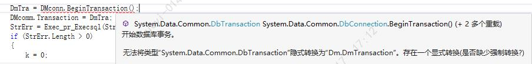


**【问题解决】**

参考如下示例：

```java
DbTransaction a= (DmTransaction)conn.BeginTransaction();
```

### ef Core3.1 下迁移数据发生错误：convert zero datetime does not exist

**【问题描述】**

报错详情如下图：

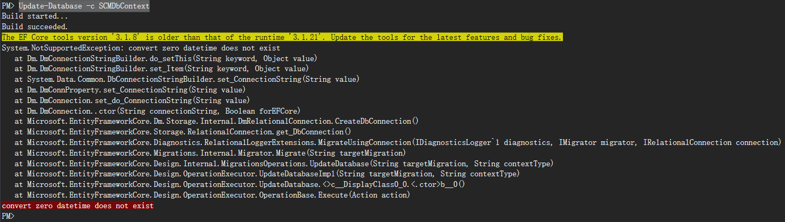

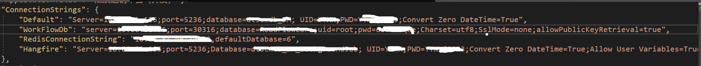

**【问题解决】**

把连接字符串最后那个参数去掉即可。