## 前言

本章节主要介绍 PHP 应用开发常见问题，为用户提供 PHP 应用开发常见问题的分析和解决思路。除此之外，用户还可前往 [达梦技术社区](https://eco.dameng.com/community/question/) 参与更多问题讨论。

## 目录

## 正文

### PHP Fatal error: Unable to start DM module in Unknown on line 0

**【问题描述】**

```
PHP Fatal error: Unable to start DM module in Unknown on line 0
```

**【问题解决】**

运行缺少达梦的动态加载库。

尝试将数据库安装目录 bin 下的以下 dll 文件拷贝至 C:\\Windows\\SysWOW64 和 C:\\Windows\\System32 (替换时会提示是否替换原有文件，这里选择“否”)。

```
dmdpi.dll
dmcalc.dll
dmelog.dll
dmmem.dll
dmos.dll
dmcomm.dll
dmcpr.dll
dmcyt.dll
dmstrt.dll
dmclientlex.dll
dmdta.dll
dmcfg.dll
dmdcr.dll
dmmout.dll
dmcvt.dll
dmmsg.dll
```

> **注意**
> 
> 如果上述方法不成功，则尝试把bin所有的dll文件拷贝过去。

### PHP Warning: PHP Startup: DM: Unable to initialize module

**【问题描述】**

```
PHP Warning: PHP Startup: DM: Unable to initialize module
```

**【问题解决】**

VC 或者 (ts/nts) 版本不匹配，下载和达梦的 VC / (ts/nts) 版本匹配的 PHP 安装文件。可查看 php 配置信息（Thread Safety），如果是 enable 即为 ts 版本（Thread Safety）。

### PHP Fatal error: Unable to start PDO\_DM module in Unknown on line 0

**【问题描述】**

```
PHP Fatal error: Unable to start PDO_DM module in Unknown on line 0
```

**【问题分析】**

此问题为读取到了 php\_pdo 驱动但是无法加载模块导致，一般是由于 PHP 版本与 DM 数据库版本不一致、环境变量未设置或未生效导致。

**【问题解决】**

需要下载对应达梦版本，更改 dm 驱动与 php 版本一致，并把下载对应版本 DM 数据库的 bin 文件加入环境变量，并检查 php.ini 配置是否正确。如果版本一致，确认达梦 bin 目录加入了环境变量，如果环境变量不生效，则重启操作系统。

若达梦数据库和 web 应用不在一台机器上，需保证 PHP 版本与 DM 驱动版本一致。

window 下：

需要指定达梦 bin 目录和 so 文件，修改 php.ini 文件指定 dll 具体位置或者都放在 ext 下面，指定 dll 文件。


Linux 下：

需要将 linux 中同一版本达梦数据库的 bin 目录和 driver 目录传输到远程 web 应用服务器，并加入环境变量。

> **注意**
> 
> 1\. php\_pdo 目录是否正确，如果安装有多个版本的达梦数据库，需要指定的达梦 bin 目录和达梦驱动版本一致；
> 
> 2\. php74\_pdo\_dm.so 版本和 php 版本是否对应，主要 php NTS 版本指定 so 文件为无 ts 版本，php ZTS 指定 so 文件为有 ts 版本，libphp74\_dm.so 对应 DM 模块，php74\_pdo\_dm.so 对应 PDO\_DM 模块；
> 
> 3\. 达梦版本需要和 php 版本一致，使用 php32 位版本需要对应 DM32 位版本，php64 位版本需要对应 DM64 位版本。例如：以下如果使用 php74NTS 版本需要使用 libphp74\_dm.so 和 php74\_pdo\_dm.so，如果使用 php74ZTS 版本则需要使用 libphp74ts\_dm.so 和 php74ts\_pdo\_dm.so。

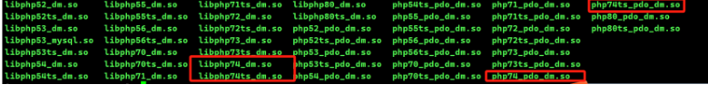


### PHP 连接数据库提示“加密模块加载失败”

**【问题描述】**

PHP 连接数据库提示“加密模块加载失败”。

**【问题解决】**

确认 Apache 服务正常，通过访问 phpinfo 测试界面确认，Apache 和 php 均正常。

配置 extension\_dir 指向达梦安装目录 dirvers 目录的 php\_pdo 驱动目录；

举例：配置 extension\_dir = /home/dmdba/dmdbms/drivers/php\_pdo 。

配置环境变量指向安装目录的 bin 目录。

检查/usr/lib64 下是否缺失 libcrypto.so 动态链接库：

```
[root@localhost ~]# cd /usr/lib64/
[root@localhost lib64]# ls -l libcrypto.so 
ls: cannot access libcrypto.so: No such file or directory
```

如果 /usr/lib64 下缺失 libcrypto.so 库文件，可以使用 DM 数据库 bin 目录下的 libcrypto.so 文件，手动在 /usr/lib64 下创建 libcrypto.so 软链接。或者直接将 libcrypto.so 文件拷贝到 /usr/lib64 目录。

```
[root@localhost lib64]# ln -s /opt/dmdbms/bin/libcrypto.so libcrypto.so
[root@localhost lib64]# ls -l libcrypto.so
lrwxrwxrwx. 1 root root 28 Aug 4 13:34 libcrypto.so -> /opt/dmdbms/bin/libcrypto.so
```

重启服务器后正常。

### Ubuntu 系统 php 连不上达梦数据库

**【问题描述】**

Ubuntu 系统 php 连不上达梦数据库

**【问题解决】**

1. 首先通过./php -info 查看模块加载是否成功，其次检查 php 的配置文件 php.ini，检查扩展是否设置正确，如：extension\_dir = "/opt/php/lib" ，可以将达梦的 php 驱动包拷贝到 /opt/php/lib 下；extension = php71\_pdo\_dm.so ，注意这里是 php7.1.33 NTS（非线程安全版），需要选对驱动版本。
2. 最后要检查用户环境变量，要设置正确。比如：
```
vim /home/dmdba/.bash_profile
export LD_LIBRARY_PATH="$LD_LIBRARY_PATH:/home/dmdba/dmdbms/bin"
```

### PHP Fatal error: Uncaught Error: Call to undefined function dm\_query()

**【问题描述】**

PHP 高版本使用 dm\_query 报错。

**【问题解决】**

PHP 版本更新导致此报错。

PHP5.x 版本前 不会报这个错，PHP7.x 后会报这个错。

PhP7.x 用 dm\_exec 代替本扩展，dm\_query 方法自 PHP5.5.0 起已废弃，并在自 PHP7.0.0 开始被移除。详见 DM 数据库安装路径的 doc 目录下 《DM8 程序员手册》 6.1.1 章节。

### php 使用 PDO 连接达梦出现中文乱码

**【问题描述】**

数据库初始化为 UTF8 编码，在达梦所在服务器 dm\_svc.conf 配置文件设置了 utf8 编码，PDO 也设置了 UTF8 编码，但仍然在 UTF8 编码下出现乱码。

**【问题解决】**

通过设置应用端的 dm\_svc.conf 文件，设置 CHAR\_CODE 的值：(PG\_UTF8)，修改完后重启 fpm 即可。

如果应用端没有安装 DM 数据库，可以从数据库所在服务器如下目录去拷贝 dm\_svc.conf 文件，或者可以在应用端自行创建 dm\_svc.conf 文件放在如下目录。

安装 DM 数据库所在服务器 dm\_svc.conf 文件默认路径：

32 位的 DM 安装在 Win32 操作平台下，此文件位于 %SystemRoot%\\system32 目录。

64 位的 DM 安装在 Win64 操作平台下，此文件位于 %SystemRoot%\\system32 目录。

32 位的 DM 安装在 Win64 操作平台下，此文件位于 %SystemRoot%\\SysWOW64 目录。

在 Linux 平台下，此文件位于 /etc 目录下。

### PHP 连接达梦访问模式对象异常

**【问题描述】**

使用 PHP 连接达梦，环境为一个用户多个模式，使用 a 用户连接数据库，但应用程序访问的具体对象为 b 模式下的对象，如果想要访问 a 模式下的对象此时如何解决。

**【问题解决】**

可在连接数据库成功后先执行下 set schema 模式名语句，改语法为会话级生效。

```sql
dm_exec($link,"set SCHEMA a");
```

详见 DM 安装路径 doc 下 《DM8 程序员手册》 6.1.2 章节。

### windows server 64 位服务器中 PHP 适配 DM 出现乱码

**【问题描述】**

windows server 64 位服务器中应用运行 php 代码无问题，但显示的数据内容为乱码。

**【问题解决】**

Windows 32 位：将 dm\_svc.cof 文件放在应用服务器 system32 目录下。

Windows 64 位：将 dm\_svc.cof 文件放在应用服务器 system32 和 syswow64 目录下。

如果 php 版本为 64 位，修改 C:\\Windows\\System32 下 dm\_svc.conf 文件，根据数据库编码添加 CHAR\_CODE 参数。如果无法解决，复制 dm\_svc.conf 文件到 C:\\Windows\\SysWOW64 下，并根据数据库编码添加 CHAR\_CODE 参数。

如果 php 版本为 32 位复制 dm\_svc.conf 文件到 C:\\Windows\\SysWOW64 下，并根据数据库编码添加 CHAR\_CODE 参数。

默认情况下 dm\_svc.conf 内容如下：

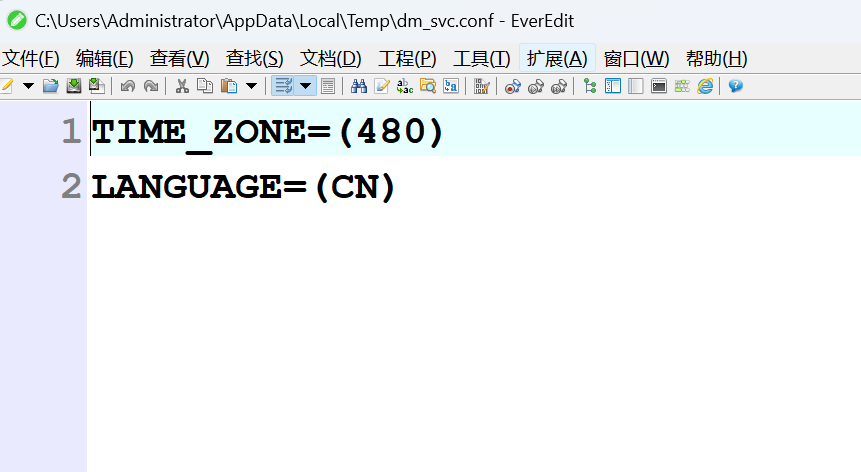


### PHP Warning: PHP Startup: DM: Unable to initialize module

**【问题分析】**

原因 1：达梦的 php 驱动文件没有拷贝进 PHP 的 ext 文件夹里。

原因 2：写进 php.ini 里面的驱动名称，和从达梦拷贝进 ext 文件的驱动名称不一致。

原因 3：下载的 PHP 版本 TS/NTS 和达梦数据库版本不匹配，TS 的依赖库和 NTS 的依赖库是不一样的，于是显示找不到.dll 或.so 文件。将 extension\_dir = "ext" 前面的; 去掉，这个路径根据自己的 PHP 文件的路径配置修改。

原因 4：未设置依赖文件 libdmdpi.so 的环境变量。

**【问题解决】**

Windows 下：

1. 解压 PHP 程序，复制和配置 php.ini 。

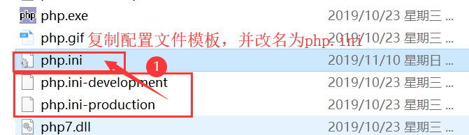


2. 拷贝驱动到对应的扩展目录下。

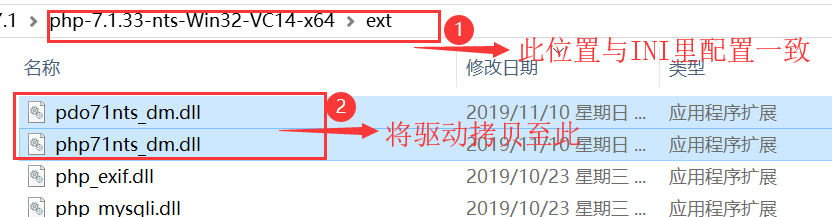


3. 配置扩展目录，配置数据库扩展模块。

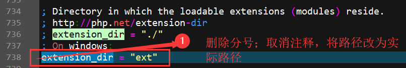


Linux 下：

拷贝驱动至目录 /usr/lib64/php/modules ，添加达梦数据库安装目录到环境变量 LD\_LIBRARY\_PATH，配置具体的 dm 数据库 pdo 扩展。

方法一：  
pdo 扩展配置文件在 /etc/php.d/pdo.ini ，将 dm、php、pdo 驱动添加到 pdo.ini 文件中，内容如下：

```
extension=pdo.so

extension=php54_pdo_dm.so

extension=libphp54_dm.so
```

> **注意**
> 
> extension=pdo.so 要放到最上面。

方法二：  
在 /etc/php.d 目录下，创建两个达梦驱动配置文件 dm8.ini 和 pdo\_dm8.ini ，分别配置达梦 php 驱动扩展和 pdo 驱动扩展。内容如下：

```
[root@localhost php.d]# pwd

/etc/php.d

[root@localhost php.d]# cat dm8.ini

extension=libphp54_dm.so

[root@localhost php.d]# cat pdo_dm8.ini

extension=php54_pdo_dm.so
```

### php -m 命令报段错误

**【问题描述】**

php -m 报无效段错误。

**【问题解决】**

ibcrypto.so 文件可能冲突，重命名即可。

### PHP fatal error: Python.h: No such file or directory

**【问题描述】**

报错如下：

```
PHP fatal error: Python.h: No such file or directory 。
```

**【问题解决】**

这是因为缺少 python-devel 包导致的，可以使用 yum 进行安装解决，yum 源的配置，请参考 [Linux 平台下 yum 源配置](https://eco.dameng.com/docs/zh-cn/article/article-004.html) 。

### php 连接达梦，查询时间不对

**【问题描述】**

select FROM\_UNIXTIME ('1620693231','YYYY-MM-DD %h:%i:%s') 查询时，时间对不上。

**【问题解决】**

检查 dm\_svc.conf 是否添加了时区 TIME\_ZONE=(480) 的配置，检查服务器时间是否正确。

### bindValue 报错 Error occurred when binding parameters ':ThinkBind\_1\_2054953456\_'

**【问题描述】**

使用 PHP 版本为 7.2，数据库版本为 2020 年 9 月之前版本 ，报错如下：

```
Error occurred when binding parameters ':ThinkBind_1_2054953456_'
```

**【问题解决】**

替换 libphp72\_dm.so、php72\_pdo\_dm.so 为 2020 年 10 月之后的版本。

### PHP 页面访问数据库报错 Could not connect: Create SOCKET connection failure

**【问题描述】**

Centos7 上配置好 Apache+php+DM 数据库的环境，测试页面地址浏览器访问报以下错误：

情况 1：

```
Could not connect : Create SOCKET connection failure 。
```

情况 2：

```
Error: SQLSTATE[HY000] dpi_login: -70028 Create SOCKET connection failure 。
```

**【问题解决】**

1. 确认 Apache 服务正常。
2. 通过访问 phpinfo 测试界面确认，Apache 和 php 均正常，能访问则表示端口服务均正常。

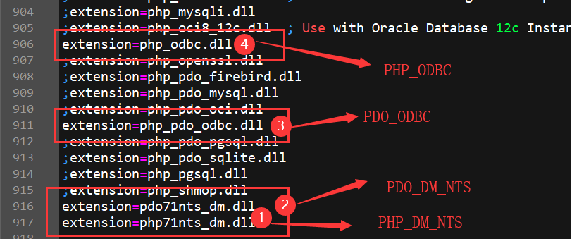


3. 查看 Apache error\_log 。

发现有如下输出：

```
[core:notice] [pid 2122] SELinux policy enabled; httpd running as context system_u:system_r:httpd_t:s0
```

初步判断可能是由于 selinux 开启导致。

（1）检查 selinux 状态。

```
[root@localhost ~]# getenforce
```

（2）执行 setenforce 0 设置为 Permissive 模式，永久生效需要修改 /etc/selinux/config 文件并重启。

```
[root@localhost ~]# setenforce 0

[root@localhost ~]# getenforce
```

（3）也可以设置为 disabled 完全禁用 SELINUX。

修改/etc/selinux/config ，将 SELINUX 设置为 disabled，重启生效，再此访问地址，可以正常访问数据库。

> **注意**
> 
> 目前 SELinux 支持三种模式，分别如下： 1. enforcing：强制模式，代表 SELinux 运作中，且已经正确的开始限制 domain/type 了；2. permissive：宽容模式，代表 SELinux 运作中，不过仅会有警告讯息并不会实际限制 domain/type 的存取，这种模式可以运来作为 SELinux 的 debug 之用；3. disabled：关闭，SELinux 并没有实际运作。

### php-fpm 重启报错："Unable to start DM module in Unknown on line 0"

**【问题描述】**

php-fpm 重启后报错：

```
PHP message: PHP Fatal error: Unable to start DM module in Unknown on line 0
```

报错信息如下图：

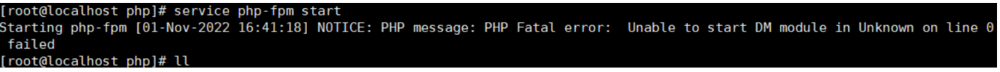


**【问题解决】**

达梦数据库安装的目录 bin 文件夹下的 libdmdpi.so 文件放入 /usr/lib 或者 /usr/lib64/ 目录里即可解决。

### 使用 PHP 连接达梦时报错："无法初始化模块"

**【问题描述】**

PHP 连接达梦，使用命令验证加载 DM PHP 驱动模块时报错："无法初始化模块"。

报错信息如下图：

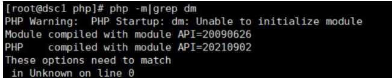


**【问题解决】**

php.ini 文件中引用的.so 文件版本需要和 php 版本保持一致。

使用命令：php -v 查看 PHP 版本。

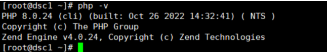


php 的版本是 8.0， php.ini 文件中选择 php 版本对应的.so 文件。

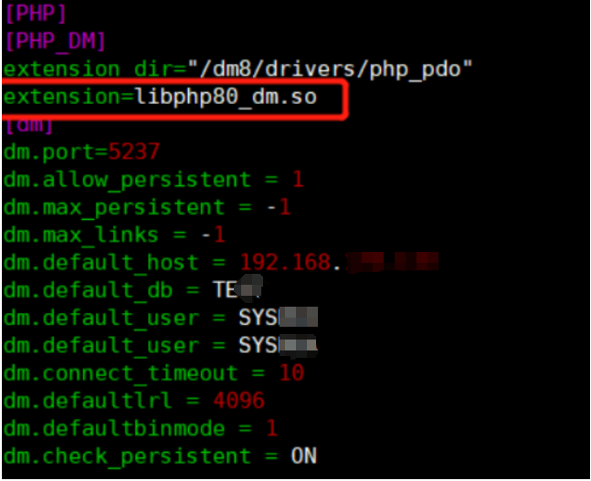

### php 如果字段类型为 blob 时，如何插入和显示？

**【问题描述】**

达梦数据库的 blob 二进制数据如何添加和读取？如果是 $sql = "INSERT INTO BYNE\_EDU.MY (字段 1char，字段 2blob) value('字段 1 数据','字段 2 数据')" ，插入后，字段 1 可正常插入并显示，字段 2 显示 null

如果是 $sql = "INSERT INTO BYNE\_EDU.MY (字段 1char，字段 2varchar) value('字段 1 数据','字段 2 数据')" ，插入后，字段 1 可正常插入并显示，字段 2 可正常插入并显示

**【问题解决】**

使用 dm\_binmode 函数处理结果集，使用方法在 DM8 程序员手册，dm\_binmode($result,DM\_BINMODE\_CONVERT)把结果集转换为字符串类型，然后用 m\_fetch\_array 遍历读取。

### PHP 加载数据库扩展后报错：relocation error: /usr/lib64/libcurl.so.4

**【问题描述】**

systemctl status php-fpm.service 启动服务报错如下：

```
10月 09 15:38:04 hicom.com php-fpm[2714744]: <b>Fatal error</b>: Unable to start DM module in <b>Unknown</b> on line <b>0</b><br />                            报错如下：
10月 09 15:58:31 hicom.com php-fpm[2717494]: /usr/sbin/php-fpm: relocation error: /usr/lib64/libcurl.so.4: symbol SSLv3_client_meth>
```

**【问题解决】**

（1）在/etc/ld.so.conf.d 目录下创建 dm8.conf 配置文件：

\[root@localhost ld.so.conf.d\]# cat dm8.conf

/opt/dmdbms/bin

（2）root 执行 ldconfig 命令生效

\[root@localhost ld.so.conf.d\]# ldconfig

ldconfig: /opt/dmdbms/bin/libxerces-c-3.1.so is not a symbolic link ##这个报错可以忽略

（3）然后启动 httpd 服务

### 在 PHP7.4 中读取 CLOB 字段只返回了 4096 长度的数据，怎么读取全部

**【问题描述】**

在 PHP7.4 中读取 CLOB 字段只返回了 4096 长度的数据，怎么才能读取全部的数据？

使用了函数：

dm\_exec

dm\_fetch\_array

**【问题解决】**

php 内存默认分配 134217726 字节长度，因此需要加入代码 ini\_set('memory\_limit', '1024M');后面这个值为当前使用内存，可以尽量调大，然后 php.ini 里面添加参数 dm.defaultlrl=134217725 这个值要比 clob 长度大一点，还有一种方法是 dm\_longreadlen 设置变长类型读取的最大长度。

### php7.1.33 pdo 驱动执行多条 SQL 提示语法分析出错

**【问题解决】**

execute immediate 这种方法进行封装一下。

### 【php】pdo 连接提示“could not find driver”

**【问题解决】**

php.ini 加入适合 php 版本的 dll 文件，例如

```
extension_dir="C:\php\php\php-7.4.33-Win32-vc15-x86\ext"

extension=pdo74_dm.dll

extension=php74_dm.dll
```

### 关于 PHP 使用 PDO 写入 BLOB 字段的问题

**【问题描述】**

在 PHP 中使用 PDO 连接到数据库，但是对于 BLOB 字段的写入有这么几个问题。

1.如果直接将 16 进制数值写入 SQL 然后直接执行是可以的，但是当长度超过一定程度的时候，会报错

2.如果使用 PDO 的绑定，无论将数值怎样绑定，都会提示无效的十六进制数字。

**【问题解决】**

php 内存默认分配 134217726 字节长度，因此需要加入代码 ini\_set('memory\_limit', '1024M');后面这个值为当前使用内存，可以尽量调大，然后 php.ini 里面添加参数 dm.defaultlrl=134217725 这个值要比 clob 长度大一点。

### dmphp 不兼容 alpine 操作系统，php 扩展 dm 报 Fatalerror:UnabletostartDMmoduleinUnknownonline0

**【问题解决】**

需要在 alpine 上重新编译 dmphp 需要的动态库（dpi、utl、dta、dmclientlex），并且通过 apk 安装需要的环境（libstdc++ 和 libgcc）后才可使用 dmphp。

### php8.0，text 类型查询时被自动截断为 255 字节

**【问题解决】**

2022 年之后新版本已解决。

### php 官方提供的 7.4 版本 vc 是 15，驱动看起来编译环境 vc 版本太高了，不兼容，无法加载驱动

**【问题描述】**

1.php5.4 适配完成的情况下尝试使用我们达梦的 7.4 版本做适配

2.下载官方 php-7.4.27-Win32-vc15-x86 解压配置安装

3.运行 php -m 报错

PHP Warning: PHP Startup: Can't load module 'ext\\php74\_dm.dll' as it's linked with 14.28, but the core is linked with 14.16 in Unknown on line 0

是否存在符号文件堆栈

**【问题解决】**

php7 用 vs2015 编译。

使用 PHP 7.3.3 连接达梦数据库，查询 int、bigint、tinyint 等字段类型返回的查询结果为字符串类型，查询结果的字段类型与数据库表中字段类型不相符合。

### 使用 PHP 7.3.3 连接达梦数据库，查询 int、bigint、tinyint 等字段类型返回的查询结果为字符串类型，查询结果的字段类型与数据库表中字段类型不相符合

**【问题描述】**

使用 PHP7.3.3 通过达梦驱动连接达梦数据库，查询 int、bigint、tinyint 等字段类型返回的查询结果为字符串类型，查询结果的字段类型与数据库表中的字段类型不相符；而使用 PHP7.3.3 连接 MYSQL 数据库，通过配置属性后，查询 int、bigint、tinyint 等字段类型返回的查询结果为 int、bigint、tinyint 等字段类型，查询结果的字段类型与数据库表中的字段类型相符。Mysql 的配置方法如下在连接串后添加

```
$pdo->setAttribute(PDO::ATTR_STRINGIFY_FETCHES,false);$pdo->setAttribute(PDO::ATTR_EMULATE_PREPARES,false);
```

开发商的需求为，达梦也需要提供类似放大，避免代码的大范围调整。

**【问题解决】**

2022 年 7 月份之后的版本已解决。

### php 里面 dm\_escape\_string 函数功能单一，无法直接替换 mysqli\_real\_escape\_string 函数的功能

**【问题描述】**

问题分析：dm\_escape\_string 生成转义字符只是处理了单引号和忽略了 \`，没处理\\r\\n（应该拆开），双引号也没加\\。

**【问题解决】**

1、现将函数中\\r 生成带转义的字符：两个字节\\和 r（\\n 也是）。

2、双引号加上转义符。

2022 年 7 月份新版本已解决。

### php7.2.10 在 ky10.aarch64 和 FT-2000+/64 环境中连接 dm8 版本 php72\_pdo\_dm.so 依赖文件无法识别，导致 PDO 模块加载失败

**【问题解决】**

pdo\_dm 依赖于 pdo 模块，php 没有开启 pdo 模块或者当前 php 版本没有 pdo 模块，需要开启 pdo 或更换版本。

### PHP 连接 DM 当添加的 PDO::ATTR\_PERSISTENT=＞true 时无法实现自动重连

**【问题描述】**

服务器重启后，当前持久性连接的连接句柄已经失效，但由于没有检查当前连接的有效性，PDO 会认为该连接依然有效，继续执行后续的 query 函数，在 prepare 时用失效的连接句柄分配语句句柄时产生错误，导致报错。

**【问题解决】**

修改代码。增加实现检测当前连接是否有效的相关函数，若当前连接已失效，重新用 dpi 登录连接句柄，登录成功则返回 SUCCESS；登录失败则返回 FAILURE。登录失败时 PDO 重新分配连接句柄进行重连。2023 年之后新版本已解决。

### 申请 php 依赖的 dmdbms/bin 目录下的 dll 组件清单

**【问题解决】**

pdo/php 都需要动态库，共有 18 个库。

（动态加载 dpi，dpi 动态加载的库也要加载）

windows：配置 path 环境变量或放在 php.exe 同级目录下；linux 也类似。dll 列表如下：

```
dmdpi.dll
dmclientlex.dll
dmutl.dll
dmstrt.dll
dmshm.dll
dmos.dll
dmmsg.dll
dmmout.dll
dmmem.dll
dmelog.dll
dmdta.dll
dmdcr.dll
dmcyt.dll
dmcvt.dll
dmcpr.dll
dmcomm.dll
dmcfg.dll
dmcalc.dll
```


### dmphp 不兼容 alpine 操作系统，php 扩展 dm 报 Fatalerror:UnabletostartDMmoduleinUnknownonline0

**【问题描述】**

dmphp 的现有 linux 版本的动态库不兼容 alpine 系统，在 alpine 上缺少某些需要的头文件。另外镜像如果缺少环境，还需要通过 apk 命令来安装 libstdc++ 和 libgcc 之后才能够将 dmphp 加入到 php 中并使用。

**【问题解决】**

补充并修改了 alpine 上缺少的头文件以及代码部分，使用预定义来进行区分。修改后需要在 alpine 上重新编译 dmphp 需要的动态库（dpi、utl、dta、dmclientlex），并且通过 apk 安装需要的环境（libstdc++ 和 libgcc）后才可使用 dmphp。2023 年 3 月之后版本已解决。

### php 不支持指定模式名

**【问题解决】**

2023 年 3 月月度版已解决。

```
修改后php设置模式名“PHPTEST”：
$link=dm_connect("localhost:5236:PHPTEST","SYS***","SYS***")ordie("Couldnotconnect");
修改后pdo设置模式名“PHPTEST”：
$pdo=newPDO("dm:host=localhost;port=5236;schema=PHPTEST","SYS***","SYS***");
```

### 【php\_pdo】使用 pcntl fork 子进程使用 exit 无法停止进程

**【问题解决】**

旧版本 dpi 子进程错误释放主进程的资源导致异常，需要升级 dpi 版本到新版本或者在 dm\_svc.conf 中设置 DPI\_TCP\_DETECT=(0)。

### php 连接有 compatibleMode 参数吗？

**【问题描述】**

php 连接有 compatibleMode 参数吗？如果有的话怎么设置，目前官方手册中关于 php 章节，没有这个参数的设置。

**【问题解决】**

可以通过配置数据库 dm.ini 里面 COMPATIBLE\_MODE 参数。

### php7.3.33 适配 dm8 出现 cannot open shared object file: No such file or directory 错误

**【问题解决】**

在 web 服务器安装 dm 客户端，再配置路径就可以了。

### php-fpm 无法启动，报错“Unable to start PDO\_DM module in Unknown on line 0”

**【问题描述】**

systemctl restart php-fpm 无法启动

**【问题解决】**

1、编辑 php-fpm.service 文件

vi /usr/lib/systemd/system/php-fpm.service

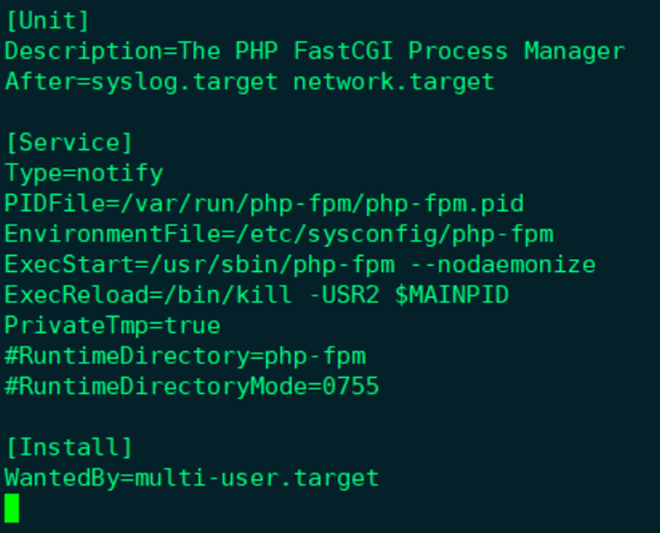

2、修改 /etc/sysconfig/php-fpm （若文件不存在，需添加文件）

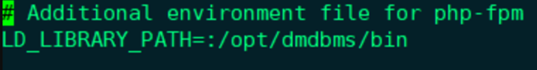

3、重启 php-fpm 成功

systemctl restart php-fpm.service

### php7.3 使用 PDO\_DM 扩展连接 DM8 中文乱码

**【问题描述】**

PHP 7.4.16 (cli) (built: Mar 31 2021 10:30:01) ( NTS ) 安装配置了 DM、PDO\_DM 扩展并且运行正常，使用 PDO 函数连接 dm8 select 查询中文乱码，针对乱码问题进行过以下尝试不起作用：

修改/etc/dm\_svc.conf

cat /etc/dm\_svc.conf

CHAR\_CODE=(PG\_UTF8)

DM 数据库编码设置为 UTF-8；php 编辑器 UTF-8； PDO 连接设置为 UTF8

重启 php-fpm，重启 dmServer,重启电脑，中文乱码扔未解决

使用 DM 扩展函数 dm\_setoption($link,1,12345,1); 可以解决中文乱码但是 PDO 该怎么与之对应的修改这个设置项？

**【问题解决】**

dm 官网的 demo 一直都是将数据库跟 php 环境装在一个节点上，这样在设置 dm\_svc.conf 重启 fpm 进程就解决乱码了。

如果分开装服务，dm\_svc.conf 配置要写在 fpm 节点上，而不是 dm 节点上，重启 fpm 后乱码解决。

### PHP 通过连接达梦集群

**【问题描述】**

应用通过达梦 pdo 驱动(驱动和数据库是匹配的)连的数据库主备集群库，主备切换时候总应用后台会一直报连接未打开，除非重启应用才会好，已明确会话已经切换到新的主库上。目前没有配置连接池，或者给一个 php 连接达梦的 php 连接池的 demo 也行。

**【问题解决】**

检查下使用 PHP 连接达梦的配置，这里如果数据库是主备，建议在 /etc/dm\_svc.conf 中配置 使用主备服务名 DM 进行连接（如下），并设置好相关的连接方式，一般设置只连接主机，这样当主备切换时，可进行主机重连，不至于连接到备机上。

DM8 配置参考： cat /etc/dm\_svc.conf

```
TIME_ZONE=(480)
LANGUAGE=(en)
DM=(数据库服务器A:5237,数据库服务器B:5237)
LOGIN_MODE =(1)
SWITCH_TIME=(3)
SWITCH_INTERVAL=(1000)
```