本章节主要介绍第三方工具适配常见问题，为用户提供第三方工具适配常见问题的分析和解决思路。除此之外，用户还可前往 [达梦技术社区](https://eco.dameng.com/community/question/) 参与更多问题讨论。

## 目录

## 正文

## Logstash 连接达梦数据库配置

Logstash 作为 Elasicsearch 常用的实时数据采集引擎，可以采集来自不同数据源的数据。

下面介绍如何使用 Logstash 从达梦数据库同步数据到 CSV 文件。

- 解压安装 Logstash，将达梦数据库的 jdbc 驱动复制到 logstash-7.13.4/lib 目录下

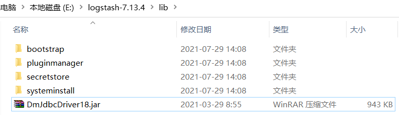

- 在 logstash-7.13.4/config 目录下新建 Logstash 配置文件 dm.conf

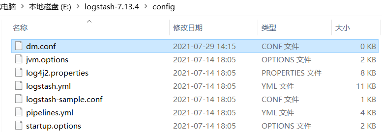

文件内容如下：

```java
input {
  jdbc {
    jdbc_driver_library => "E:\logstash-7.13.4\lib\DmJdbcDriver18.jar"
    jdbc_driver_class => "Java::dm.jdbc.driver.DmDriver"
    jdbc_connection_string => "jdbc:dm://192.168.201.118:5236"
    jdbc_user => "SYSDBA"
    jdbc_password => " * * * * * *"
    schedule => "* * * * *"
    statement => "select user_name,clnt_ip,clnt_ver from v$sessions"
  }
}

output {
  csv {
   fields => ["user_name","clnt_ip","clnt_ver"] 
    path => "E:\logstash-7.13.4\csv-export.csv"
  }
}
```

> **注意**
> 
> 此处的配置文件需注意jdbc\_driver\_class的值加上"Java::"

- 启动 Logstash 进行测试
```shell
cd E:\logstash-7.13.4\bin
logstash.bat -f E:\logstash-7.13.4\config\dm.conf
```

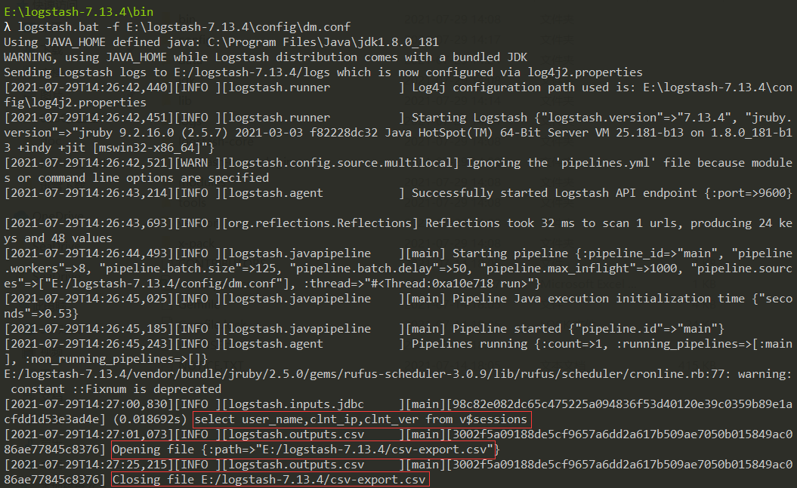

查看输出文件

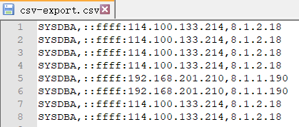

## 超图桌面连接达梦数据库

- 安装 DM 数据库客户端

第一步：在超图软件所在服务器需要安装 DM7 客户端。如果是测试环境的话，直接在服务器上安装 DM7 的数据库。安装数据库并初始化实例。

> **注意**
> 
> 必须先安装DM7的客户端或者DM7数据库，这样超图软件在新建数据库型数据源的时候组件DMPlus才可以正常使用，如果直接安装DM8则DMPlus为灰色，无法启用。

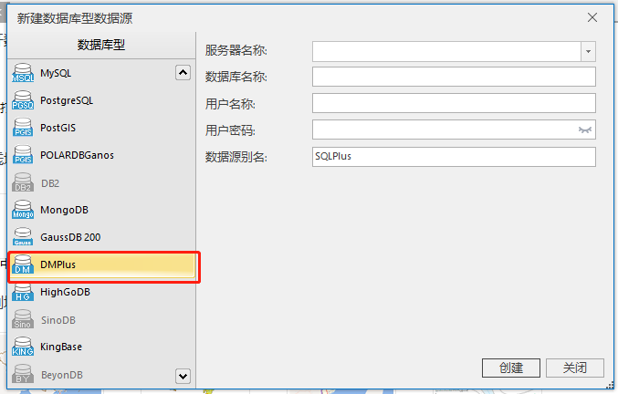

- 配置 path 环境变量

安装好客户端或数据库后，需要把安装路径下的 bin 目录路径加入到环境变量 path 中，如下图。

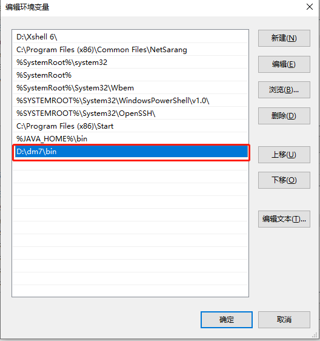

- 配置 ODBC 数据源

打开控制面板——管理工具

根据操作系统位数选择数据源，我的操作系统为 64 位的，因此这里我选择 ODBC 数据源 64 位。如下图。

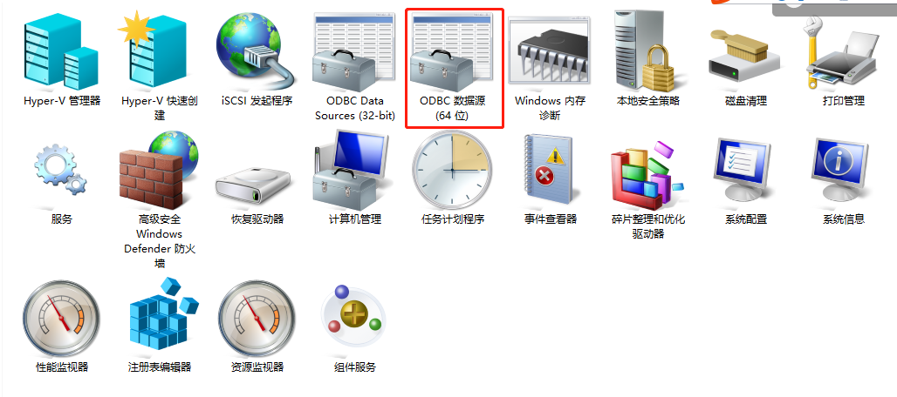

选择系统 DSN，点击添加。

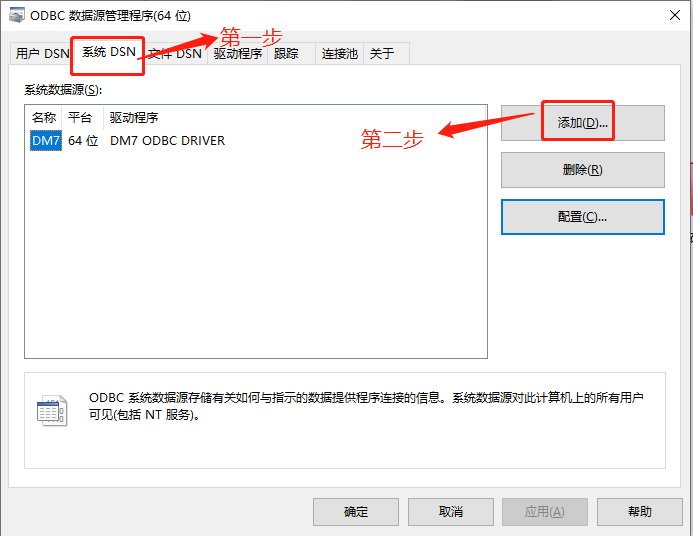

根据实际情况填写数据源名称，服务器 IP 地址、端口号、用户名和密码等连接信息。如下图。

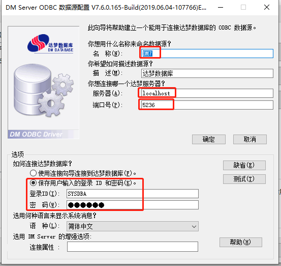

点击测试，测试数据源配置是否正确。

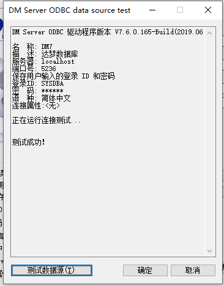

- 通过超图桌面软件新建数据源

第一步，打开超图桌面软件

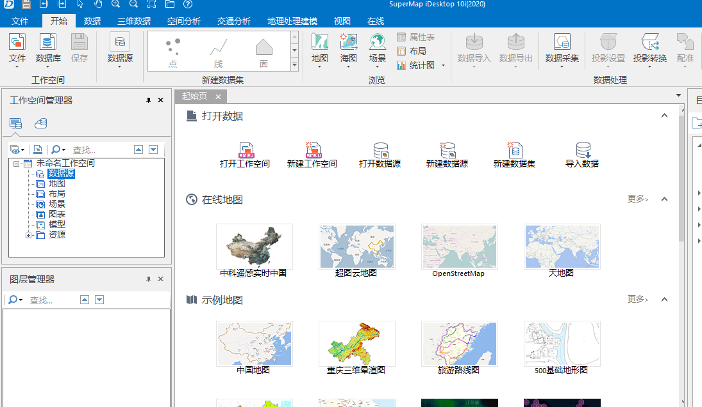

第二步，选中数据源右键，选择“新建数据库型数据源”

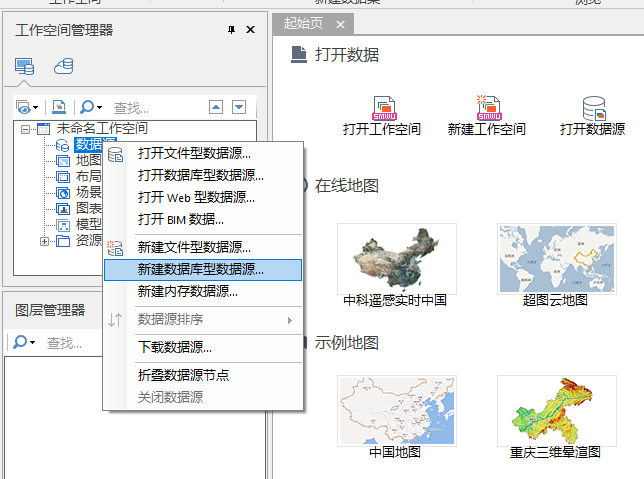

第三步、填写数据库服务器连接信息，这里有几个点需要注意一下。

> **注意**
> 
> 服务器名称填写IP地址，如果是本机的话直接填写localhost即可，默认端口号为5236，可以不写端口号。数据库名称必须为空,如果数据库名称项不为空，则程序会报错，无法创建数据源。填好用户名和密码后点击新建。

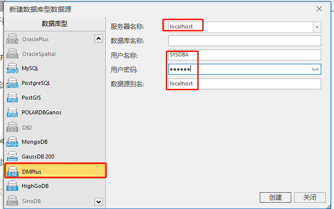

新建的数据源，如下图。

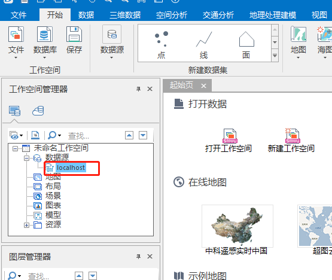

## ZABBIX 界面配置监控项报错：can't open lib'/opt/dmdbms/bin/libxqilla.so

**【问题描述】** ：

ZABBIX 通过 odbc 和 agent 在服务器上连接达梦数据库正常，但是在 ZABBIX 界面中配置监控项时连接失败，报错找不到文件：can't open lib’/opt/dmdbms/bin/libxqilla.so，但相关文件存在并已正常配置系统环境变量。

**【问题解决】** ：

在/etc/sysconfig 下添加 zabbix-server(odbc 连接)或 zabbix-agent(agent 连接)配置，具体为添加 zabbix-server 或 zabbix-agent 文件，文件内容如下：

```
LD_LIBRARY_PATH=/opt/dmdbms/bin:/usr/lib64
PATH=/usr/local/sbin:/usr/local/bin:/usr/sbin:/usr/bin:/opt/dmdbms/bin
export LD_LIBRARY_PATH
export PATH
```

## 装入器 java.net.URLClassLoader 与 com.ibm.ws.bootstrap.ExtClassLoader 参数不符

**【问题描述】** ：

WebSphere 测试 DM 数据源连接时，报装入约束违例：装入器 java.net.URLClassLoader 与 com.ibm.ws.bootstrap.ExtClassLoader 参数不符。

**【问题解决】** ：

在使用 WebSphere 创建数据源时，在添加了 dm 的 jdbc 驱动后，需要重启 WebSphere 再进行数据源的创建。这时定制属性可以自动读出 DM jdbc 的参数（如 url、user、password 等），而不需要手动进行输入。  
说明：目前 DM8 驱动配置 WebSphere 需要配置的驱动类为 dm.jdbc.driver.DmdbConnectionPoolDataSource；DM7 所配置驱动类为 dm.jdbc.pool.DmdbConnectionPoolDataSource。

## 东方通 7.0.X 部署 DEM 异常

**【问题描述】：**

通过东方通 7.0.4 部署 DEM 时异常，部署时始终失败，错误信息如下：

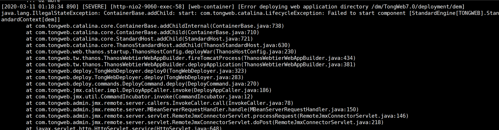

【 **问题分析】：**

排除前台 UI 相关类异常导致问题，首先绕过 UI 类调用，通过命令行进行手动解部署和部署测试

1. 解部署测试。

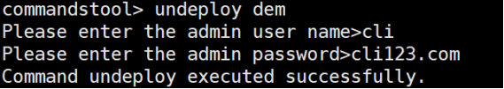

2. 部署测试

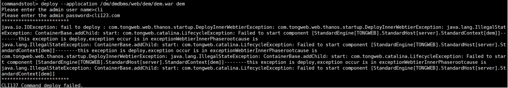

确认问题稳定复现，排查东方通 server.log 日志错误回溯报错栈信息，其中包含关键信息如下

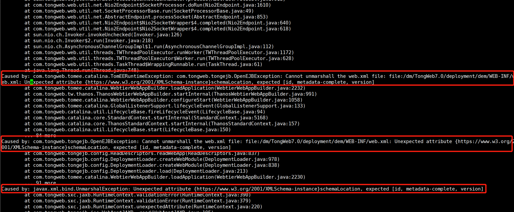

在解析 web.xml 文件时出现明显异常，异常参数位于 schemaLoation 之前的一个标签中。

**【问题解决】：**

检查 dem 自带的 web.xml 格式如下，其中问题标签内容为 https://www.w3.org/2001/XMLSchema-instance。

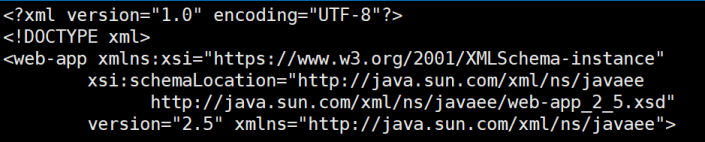

对比东方通自带的 default-web.xml 格式如下, 除了 servlet 版本不同的固有所差异外， xmlschema 中的 XML Schema namespace 也有所不同，相应标签内容为 http://www.w3.org/2001/XMLSchema-instance。

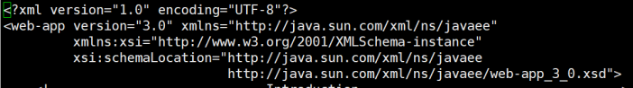

将 dem 自带的 web.xml 调整为下图所示：

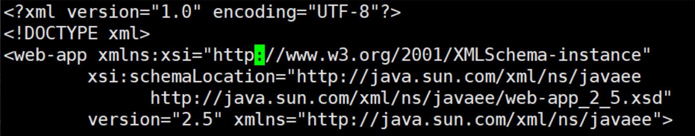

重新进行手动部署正常。

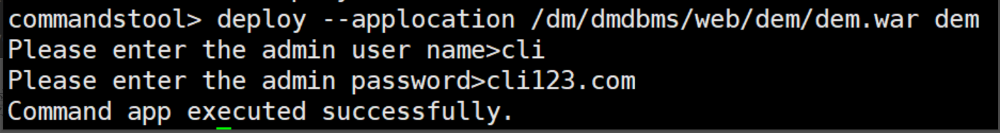

前端页面应用管理信息正常。

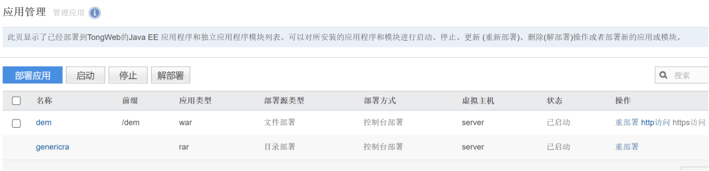

DEM 页面正常访问。

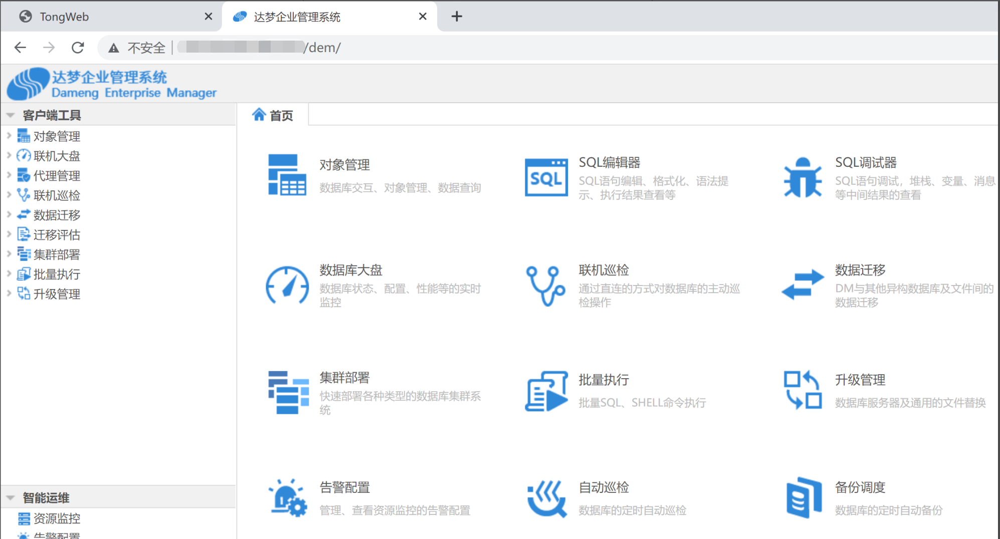

## windows 环境，arcgis server 中注册达梦数据库报错

**【问题描述】：**

windows 环境，已按 arcgis 官网文档要求安装了达梦 64 位客户端，但在 arcgis server 中注册达梦数据库报错：Machine:DESKTOP-XXX\[DAMENG:Cannot connect to database because the databse client software failed to load.Be sure the database client software is installed and configured correctly\]，应如何解决？

**【问题解决】：**

arcgis server 为 64 位软件，需要安装 64 位的达梦数据库客户端，同时将/dmdbms/bin 目录添加到 path 的环境变量中，如果同时安装了 32 位的达梦客户端，需要确保 64 位的变量在 32 位变量之前。由于 arcgis server 软件运行是独立的用户，一般默认为 arcgis 账户，为确保 arcgis server 能够调用达梦客户端相关组件，请确保添加 arcgis 账户权限到达梦客户端目录中。参考如下：

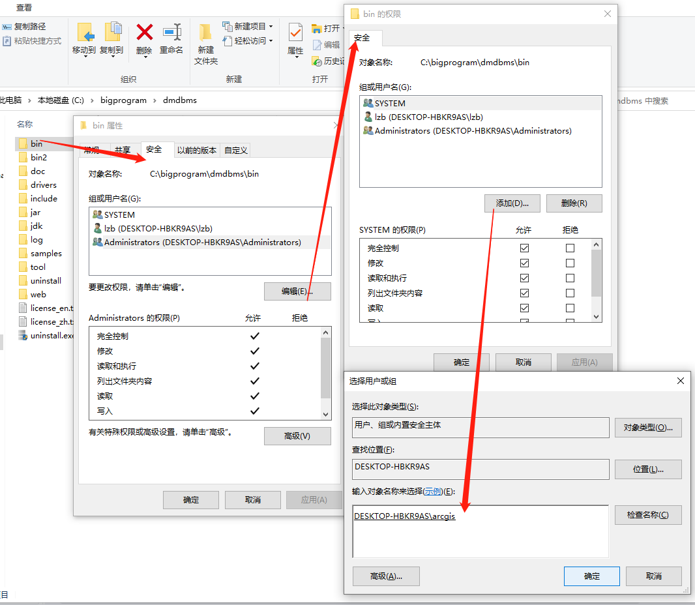

## ArcGIS 适配达梦报错：“连接到数据库失败”

**【问题描述】**

windows 环境安装了 32 位的达梦数据库客户端，但在使用 arcgis 连接达梦数据库时报错："连接到数据库失败"，应如何解决？

**【问题解决】**

可尝试通过将达梦数据库 32 位的 /dmdbms/bin 里面的.dll 文件复制到 ArcGIS/Desktop 的 bin 路径内(冲突的文件可以跳过）来解决该问题。