## 前言

本章节主要介绍 Python 应用开发常见问题，为用户提供 Python 应用开发常见问题的分析和解决思路。除此之外，用户还可前往 [达梦技术社区](https://eco.dameng.com/community/question/) 参与更多问题讨论。

## 目录

## 正文

### 如何关闭 autoCommit 及事务控制相关内容

**【问题描述】**

如何关闭 autocommit 及事务控制相关内容。

**【问题解决】**

以下为代码解决方案。

1. 建表语句。
```sql
create table tab1 (
                id   varchar2(32)   ,
                col1 varchar(32)    ,
                col2 varchar(32)    ,
                col3 varchar(32)    ,
                col4 varchar(32)    ,
                col5 varchar(32)    ,
                col6 varchar(32)    ,
                createtime timestamp,
                modifytime timestamp
        );
insert into tab1
select
        rownum as id               ,
        dbms_random.string('x', 20),
        dbms_random.string('x', 20),
        dbms_random.string('x', 20),
        dbms_random.string('x', 20),
        dbms_random.string('x', 20),
        dbms_random.string('x', 20),
        sysdate                    ,
        sysdate
from
        dual connect by level <= 100;
commit;
```
2. 示例代码。
```python
# -*- coding:utf-8 -*-
import dmPython

def demo():
    # 关闭自动提交
    conn = dmPython.connect(user='SYSDBA', password='*****', server='localhost', port=5236, autoCommit=True)
    cursor = conn.cursor()

    # 模拟循环处理过程中分步提交控制事务体积
    for i in range(1, 100000):
        str_i = str(i)
        insert_sql = "insert into tab1(col1,col2,col3,col4,col5,col6) values ('%s','%s','%s','%s','%s','%s')" % (
            "colA" + str_i, "colB" + str_i, "colC" + str_i, "colD" + str_i, "colE" + str_i, "colF" + str_i)
        update_sql = "update tab1 set col1='%s' where id=%s" % ("update" + str_i, i)
        delete_sql = "delete from tab1 where id=%s" % (i)
        try:
            cursor.execute(insert_sql)

            # 每10000行提交一次
            if (i % 10000) == 0:
                conn.commit()
        except Exception as err:
            print("error", err)
            conn.rollback()

    conn.commit()
    cursor.close()
    conn.close()

if __name__ == '__main__':
    demo()
```

### Linux 下安装 dmPython 时报错：permission denied

**【问题描述】**

安装 dmPython 时，报错如下：

```
[dmdba@dm8 dmPython]$ python setup.py install
running install
error: can't create or remove files in install directory

The following error occurred while trying to add or remove files in the
installation directory:

    [Errno 13] Permission denied: '/usr/lib64/python2.7/site-packages/test-easy-install-3032.write-test'

The installation directory you specified (via --install-dir, --prefix, or
the distutils default setting) was:

    /usr/lib64/python2.7/site-packages/

Perhaps your account does not have write access to this directory?  If the
installation directory is a system-owned directory, you may need to sign in
as the administrator or "root" account.  If you do not have administrative
access to this machine, you may wish to choose a different installation
directory, preferably one that is listed in your PYTHONPATH environment
variable.

For information on other options, you may wish to consult the
documentation at:

  https://pythonhosted.org/setuptools/easy_install.html

Please make the appropriate changes for your system and try again.

[dmdba@dm8 dmPython]$
```

**【问题解决】**

由报错信息 '/usr/lib64/python2.7/site-packages/test-easy-install-3032.write-test' 可知：在安装 dmPython 过程中权限不足导致出现报错，不能使用 dmdba 用户执行 setup.py 脚本，需要切换为 root 用户操作。

### Linux 下安装 dmPython 时报错：cannot locate an Dameng software installation

**【问题描述】**

使用如下命令报错：

```
[root@dm8 ~]# cd /dm/dmdbms/drivers/python/dmPython
[root@dm8 dmPython]# python setup.py install
Traceback (most recent call last):
 File "setup.py", line 103, in <module>
   raise DistutilsSetupError("cannot locate an Dameng software " /
distutils.errors.DistutilsSetupError: cannot locate an Dameng software installation
```

**【问题解决】**

这是 DPI 环境问题，因为 dmPython 的运行需要使用 dpi 动态库，应该将 dpi 所在目录（通常是数据库安装目录的 bin 目录）加入系统的环境变量，如图所示：

```
[root@dm8 dmPython]# cat ~/.bash_profile 
# .bash_profile

# Get the aliases and functions
if [ -f ~/.bashrc ]; then
    . ~/.bashrc
fi

# User specific environment and startup programs

PATH=$PATH:$HOME/bin

export PATH

export PATH="/dm/dmdbms/bin:$PATH"

export LD_LIBRARY_PATH="$LD_LIBRARY_PATH:/dm/dmdbms/bin"
export DM_HOME="/dm/dmdbms"
export LD_LIBRARY_PATH=$LD_LIBRARY_PATH:/dm/dmdbms/drivers/dpi/

[root@dm8 dmPython]# source ~/.bash_profile
```

### Linux 下安装 dmPython 时报错：unable to execute gcc

**【问题描述】**

使用如下命令报错：

```
[root@dm8 dmPython]# gcc -pthread -fno-strict-aliasing -O2 -g -pipe -Wall -Wp,-D_FORTIFY_SOURCE=2 -fexceptions -fstack-protector-strong --param=ssp-buffer-size=4 -grecord-gcc-switches -m64 -mtune=generic -D_GNU_SOURCE -fPIC -fwrapv -DNDEBUG -O2 -g -pipe -Wall -Wp,-D_FORTIFY_SOURCE=2 -fexceptions -fstack-protector-strong --param=ssp-buffer-size=4 -grecord-gcc-switches -m64 -mtune=generic -D_GNU_SOURCE -fPIC -fwrapv -fPIC -DDM64 -I/dm/dmdbms/include -I/usr/include/python2.7 -c py_Dameng.c -o build/temp.linux-x86_64-2.7/py_Dameng.o -DBUILD_VERSION=2.3

unable to execute gcc: No such file or directory
error: command 'gcc' failed with exit status 1
```

**【问题解决】**

根据报错信息：command 'gcc' failed with exit status 1 可知，缺少 gcc 依赖包，所以直接通过 yum 安装。

```shell
[root@dm8 dmPython]# yum install gcc* -y
```

### Liunx 下安装 dmPython 时报错："Python.h 没有那个文件或目录"

**【问题描述】**

使用如下命令报错：

```shell
[root@RS1821 dmPython]# python setup.py install
running install
running bdist_egg
running egg_info
writing dmPython.egg-info/PKG-INFO
writing top-level names to dmPython.egg-info/top_level.txt
writing dependency_links to dmPython.egg-info/dependency_links.txt
reading manifest file 'dmPython.egg-info/SOURCES.txt'
writing manifest file 'dmPython.egg-info/SOURCES.txt'
installing library code to build/bdist.linux-x86_64/egg
running install_lib
running build_ext
building 'dmPython' extension
gcc -pthread -fno-strict-aliasing -O2 -g -pipe -Wall -Wp,-D_FORTIFY_SOURCE=2 -fexceptions -fstack-protector-strong --param=ssp-buffer-size=4 -grecord-gcc-switches -m64 -mtune=generic -D_GNU_SOURCE -fPIC -fwrapv -DNDEBUG -O2 -g -pipe -Wall -Wp,-D_FORTIFY_SOURCE=2 -fexceptions -fstack-protector-strong --param=ssp-buffer-size=4 -grecord-gcc-switches -m64 -mtune=generic -D_GNU_SOURCE -fPIC -fwrapv -fPIC -DDM64 -I/dm8/include -I/dm8/drivers/python/dmPython -I/usr/include/python2.7 -c py_Dameng.c -o build/temp.linux-x86_64-2.7/py_Dameng.o -DBUILD_VERSION=2.4.4
In file included from py_Dameng.c:3:0:
py_Dameng.h:8:20: 致命错误：Python.h：没有那个文件或目录
 #include <Python.h>
                    ^
编译中断。
error: command 'gcc' failed with exit status 1
```

**【问题解决】**

此问题是由于缺少 python-devel 包导致，使用命令 `yum install python-devel` 安装 devel 包后即可成功安装 dmPython。

### Windows 下导入时找不到指定的 dmPython 模块

**【问题描述】**

使用如下命令报错：

```shell
C:\Users\Administrator>python
Python 3.9.6 (tags/v3.9.6:db3ff76, Jun 28 2021, 15:26:21) [MSC v.1929 64 bit (AMD64)] on win32
Type "help", "copyright", "credits" or "license" for more information.
>>> import dmPython
Traceback (most recent call last):
File "<stdin>", line 1, in <module>
ImportError: DLL load failed while importing dmPython: 找不到指定的模块。
```

**【问题解决】**

Python 3.8 变更了 Windows 下动态链接库（DLL）的加载规则，新的规则提高了安全性，默认情况下仅能从可信的位置（Trusted Locations）加载 DLL 依赖，一定程度上避免诸如 DLL 劫持之类的安全风险。因此需要搜索路径并把 dpi 文件复制到指定目录下。

### Non-ASCII character 'xe5' in file

**【问题描述】**

编译 Python 程序时，出现错误如下：

```
SyntaxError: Non-ASCII character '\xe5' in file kNN.py on line 24, but no encoding declared; see http://python.org/dev/peps/pep-0263/ for details
```

**【问题解决】**

Python 默认是以 ASCII 作为编码方式的，如果在自己的 Python 源码中包含了中文（或者其他非英语系的语言），此时即使你把自己编写的 Python 源文件以 UTF-8 格式保存了，这依然是不行的，需要在报错源码的第一行加上以下代码，则指定文件的编码格式是 utf-8。

```
# -*- coding: UTF-8 -*-
```

### 无法解析的外部符号错误

**【问题描述】**

报错信息如下图：


**【问题解决】**

考虑环境变量是否配置正确，以及 python 源码的位数和数据库软件的位数（32 或 64 位）是否一致。

### windows 10/11 及 server 2016 版本安装 dmPython 报错

**【问题描述】**

windows 10/11 及 server 2016 版本测试中安装 dmPython 驱动时会报错：

```
error: Microsoft Visual C++ 14.0 is required. Get it with "Build Tools for Visual Studio":https://visualstudio.microsoft.com/downloads/Tools
```

**【问题解决】**

通过 [http://go.microsoft.com/fwlink/?LinkId=691126](http://go.microsoft.com/fwlink/?LinkId=691126) ，下载 vc++ build tools 工具，选择默认安装：

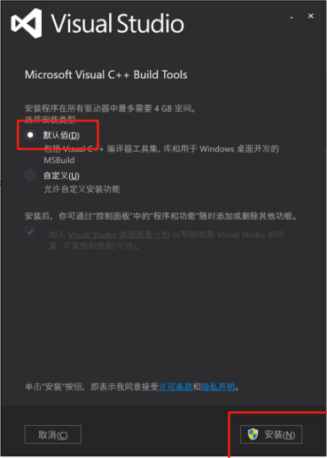


### 无法识别 django-admin 命令

**【问题描述】**

报错信息如下图：

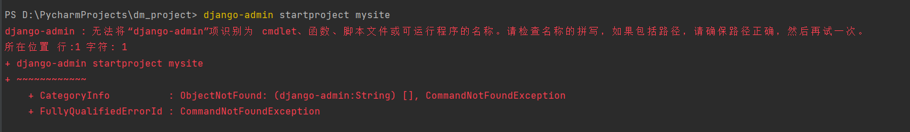


**【问题解决】**

需要包含 django-admin 的全路径，通常在 python 目录的 scripts 下有 django-admin.exe。

### SyntaxError: (unicode error) 'utf-8' codec can't decode byte 0xb2 in position 0: invalid start byte

**【问题描述】**

报错信息如下图：

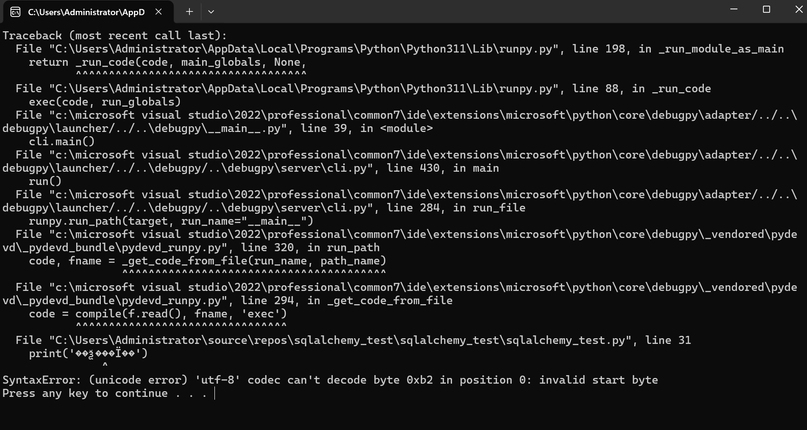


**【问题解决】**

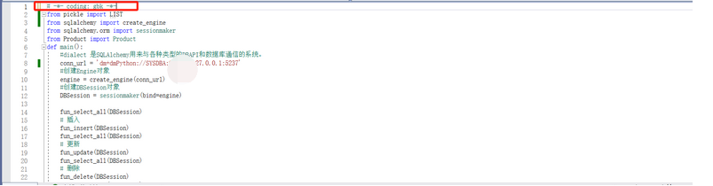

代码中文编码和操作系统编码不一致，如上图所示，把编码由 utf-8 修改为 gbk。

### 'int' object is not subscriptable

**【问题描述】**

如下图所示：

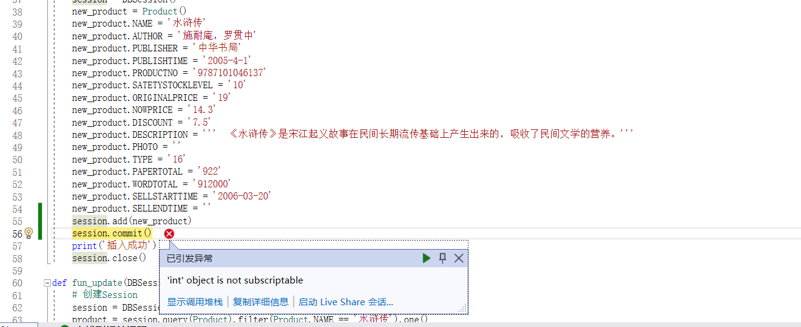


**【问题解决】**

Dmpython 版本和 SQLAlchemy、sqlalchemy-dm 版本不匹配，更新到合适版本，例如 dmPython2.4.5、sqlalchemy2.0.29、sqlalchemy-dm2.0.0。

### error：Unable to find vcvarsall.bat

**【问题解决】**

进入 python 安装目录的 lib/distutils，找到文件 msvc9compiler.py，在文件中找到 `vc_env = query_vcvarsall(VSERSION,plat_spec) ` ，根据使用本机的 VS 版本号进行修改，如：对应安装目录 C:\\Program Files\\Microsoft Visual Studio 10.0，改为： `vc_env = query_vcvarsall(10,plat_spec) ` 。

可参考 [Python 连接达梦数据库](https://eco.dameng.com/community/article/45246b17939be87311deaac7e4de8b23) 。

### 导入 dmpython 模块时报错找不到指定的模块

**【问题描述】**

导入 dmpython 模块时报错，代码及报错信息如下：

```
import dmPython

Traceback (most recent call last):

File "<stdin>", line 1, in <module>

ImportError: DLL load failed: 找不到指定的模块
```

**【问题分析】**

因为 dmPython 找不到 DPI 动态库，需要到 DPI 所在目录执行或者配置环境变量指向 DPI 所在目录。

**【问题解决】**

右键【我的电脑】-【属性】，打开的界面中点击【高级系统设置】，添加环境变量。

变量名：PATH 变量值：DPI 所在路径。

如下图所示：

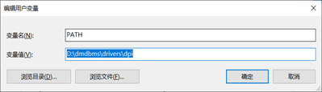


然后重新启动 python，输入 import dmPython 就可以了。

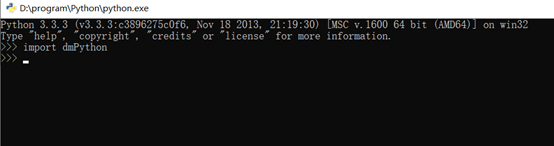


### DMPython 驱动在哪里可以找到

**【问题解决】**

进入 [Python 数据库接口](https://eco.dameng.com/document/dm/zh-cn/app-dev/python-python) 下载。

### DMPython 的安装教程

**【问题解决】**

请参考 Python 数据库接口 。

### DMPython 连接 DM，报错 ImportError: No module named dmPython

**【问题解决】**

若用户已经找到对应的 dmPython 驱动，可以将 Python 路径添加到环境变量，把 dmPython.pyd 文件路径添加到环境变量，在环境变量中添加变量名：

```
PYTHONPATH:  F:\dmdbms\drivers\python\dmPython\build\lib.win-amd64-2.7
```

若没有对应驱动，可以进入 [Python 数据库接口](https://eco.dameng.com/document/dm/zh-cn/app-dev/python-python) 下载。

### DMPython 安装报错：不是有效的 Win32 应用程序

**【问题描述】**

报错信息如下：

```
importError: DLL load failed: %1 不是有效的 Win32 应用程序。
```

**【问题解决】**

本机的达梦数据库是 32 位的，需重新要安装 64 位的数据库。

### DMPython 安装报错：依赖 VC++14.0

**【问题解决】**

C++ 相关组件不完善导致的报错，安装相应依赖即可。

### cannot locate an Dameng software

**【问题描述】**

Python 连接达梦数据库，根据安装提示，切换到 root 用户，报错：

```
raise DistutilsSetupError("cannot locate an Dameng software " /distutils.errors.DistutilsSetupError: cannot locate an Dameng software installation
```

**【问题解决】**

需要依赖 DM 的环境，在 root 用户下配置 DM 的环境变量。

```
'# User specific environment and startup programs'

PATH=$PATH:$HOME/bin
export PATH
export PATH="/dm/dmdbms/bin:$PATH"

export LD_LIBRARY_PATH="$LD_LIBRARY_PATH:/dm/dmdbms/bin"
```

### ImportError: DLL load failed

**【问题解决】**

检查环境变量配置，加上 dmdbms\\bin、dmdbms、dmdbms\\drives\\dpi 的环境变量。确认生效后，然后进入 dmPython 目录下执行 python setup.py install ，然后再导入驱动。

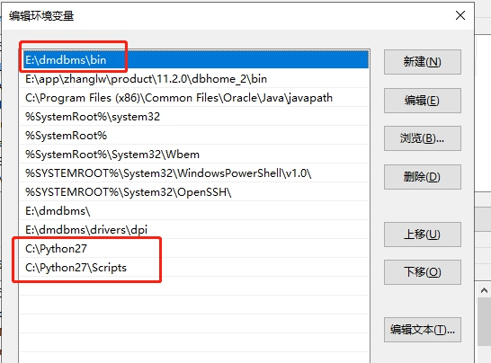


导入驱动成功：

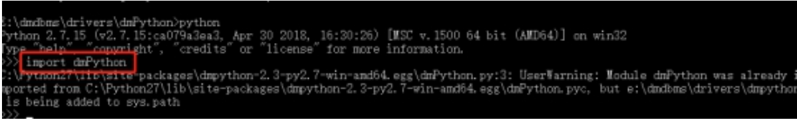


### Python 数据 insert 进 DM，报错：codec can't encode character

**【问题描述】**

Python 达梦数据库插入特殊字符报错，提示：

```
'gbk' codec can't encode character '\ue622' in position 0: illegal multibyte sequence。
```

**【问题解决】**

设置连接参数 local\_code。

### ImportError: libdmdpi.so: cannot open shared object file: No such file or directory

**【问题描述】**

导入 dmpython 驱动时，报错如下：

```
ImportError: libdmdpi.so: cannot open shared object file: No such file or directory
```

**【问题解决】**

将数据库的 bin 目录添加进环境变量即可。

### 匹配没有可登陆的服务器

**【问题描述】**

达梦数据库里有建立两个用户，这两个用户都能正常登陆数据库。在 python 里面用这两个用户去连接达梦数据库，一个用户可以，一个用户连接的时候报错：“匹配没有可登陆的服务器”。

**【问题解决】**

这种情况，请检查用户名是否和关键字冲突了。

### 同一个应用向 DM7.1 和 DM7.6 中插入数据，DM7.1 的库中数据正常，DM7.6 的库中中文出现乱码

**【问题解决】**

查看应用连接串：

```python
conn = dmPython.connect(user='###', password='###', server='10.221.144.80', port=5236, autoCommit=True)
```

增加 local\_code 参数后改写为：

```python
properties = { 'user' : 'SYSDBA', 'password' : '*****', 'server' : '127.0.0.1', 'port' : 5236, 'autoCommit' : True,'local_code' : 1, }
conn = dmPython.connect(**properties)
```

### Python 使用连接池 PooledDB 连接达梦数据库

**【问题解决】**

DBUtils 是一套用于管理数据库连接池的 Python 包，为高频高并发的数据库访问提供更好的性能，可以自动管理连接对象的创建和释放，并允许对非线程安全的数据库接口进行线程安全包装。DBUtils.PooledDB 实现了稳定、线程安全的缓存连接池。连接步骤如下：

1. 安装 DBUtils 包。
```
pip install DBUtils==1.3
```
2. 使用 DBUtils 的连接池 PooledDB 连接达梦数据库示例代码。
```python
import dmPython
from DBUtils.PooledDB import PooledDB

pool = PooledDB(creator=dmPython, mincached=50,maxcached=100, server='192.168.201.118',  port=5236, user='SYSDBA', password='*******')

conn = pool.connection()
cur = conn.cursor()
SQL = "select username from dba_users"
r = cur.execute(SQL)
r = cur.fetchall()
cur.close()
conn.close()
```

如下图所示：

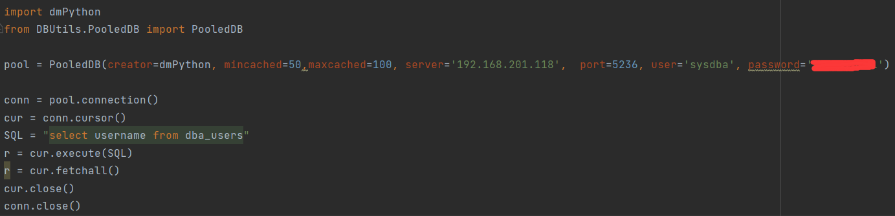 

### Python 运行时报错：load fun EVP\_sm3\_fun fail!

**【问题描述】**

Python 运行过程中，执行 python manager.py runserver 出现报错，如下所示：

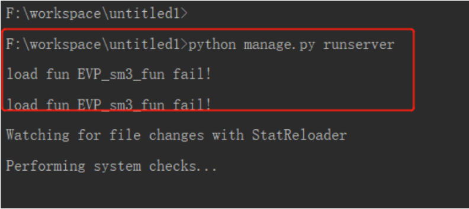 

**【问题解决】**

将 dmdbms/drivers/dpi 目录下的 libeay32.dll 和 ssleay32.dll 文件拷贝到 python 所在目录即可。如下所示：

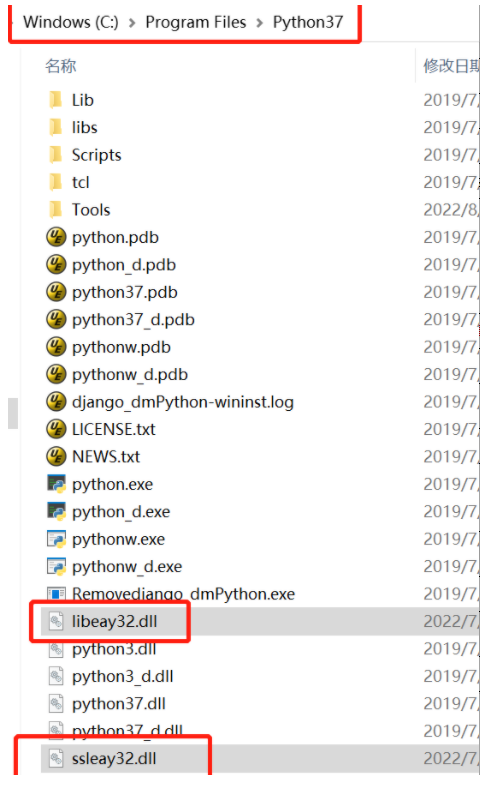  

### 导入 dmpython 报错 ：PyUnicodeUCS2\_Format

**【问题描述】**

使用服务器自带的 python 环境编译 dm 驱动后报错：PyUnicodeUCS2\_Format 。

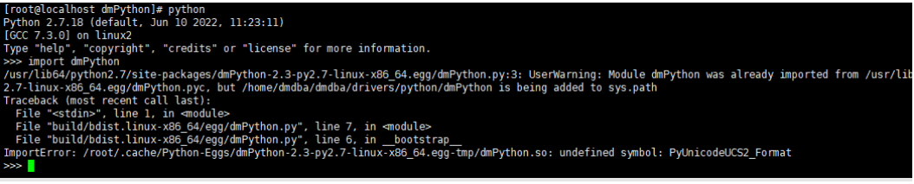


**【问题分析】**

通过错误信息分析，unicode 编译环境和运行环境不一致导致报错：

```php
undefiend symbol: PyUnicodeUCS2_Format/PyUnicodeUCS4_Format。
```

**【问题解决】**

前提：确保 python 和 dmpython 的 unicode 字符集一致。

使用 unicode 为 ucs4 的 python 环境重新编译 dmPython 驱动。

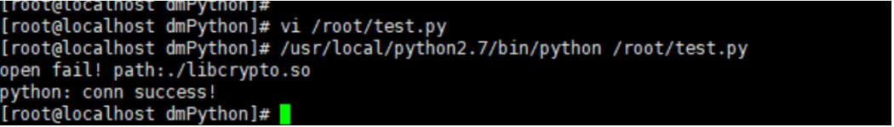


将 python 的 unicode 重新编译为 ucs2 。

```shell
./configure --enable-shared --enable-unicode=ucs2
make && make install
```

如果报错："undefiend symbol: PyUnicodeUCS4\_Format" 可以重新将 unicode 为 ucs2 的 python 环境编译成 unicode 为 ucs4 的 python 环境。

```shell
./configure --enable-shared --enable-unicode=ucs4
make && make install
```

### SqlAlchemy\_dm 插入数据报错：TypeError: 'NoneType' object is not subscriptable

**【问题描述】**

SqlAlchemy\_dm 插入数据时报错：

```
TypeError: 'NoneType' object is not subscriptable
或者 
ValueError: invalid literal for int() with base 10: 'AAAAAAAAAAAAAAAAAD'？
```

**【问题分析】**

新版本数据库的 rowid 是非纯整数，在 SqlAlchemy\_dm 源码中可以看到调用 \_setup\_ins\_pk\_from\_lastrowid 函数时 self.get\_lastrowid() 已经是非整数类型，而后 \_DMInteger 函数将该 lastrowid 强转为 int ，所以导致报错。

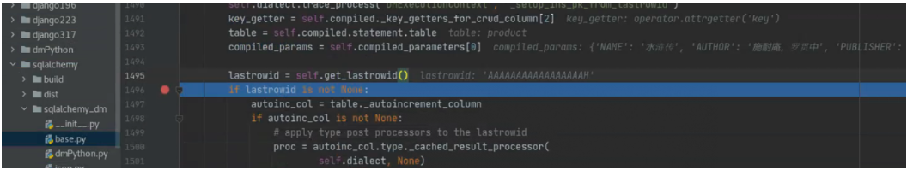

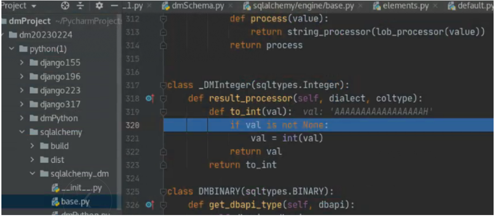

**【问题解决】**

将 dmPython 更新到 2.4.5 版本，并将 SqlAlchemy\_dm 驱动更新到最新版本。

### 安装 dmPython rpm 包成功，但程序使用 import dmPython 报错

**【问题描述】**

安装 dmPython rpm 包成功，但是程序使用 import dmPython 时报如下错误：

```
Traceback (most recent call last)
file"<stdin>",line 1 ,in<module>
ImportError :/lib64/libc.so.6:version \`GLIBC_2.14\` not found (required by /usr/local/lib/python3.7/site-packages/dmPython=2.4.5-py3.7-linux-x86_64.egg)
```

**【问题分析】**

该问题主要是由于打包 dmPython 环境的 glibc 版本与安装环境的 glibc 版本不匹配导致。

**【问题解决】**

使用同版本的 glibc 版本重新打包 dmPython 环境即可解决。

### R 语言连接 DM 的主备集群如何以服务名的形式配置高可用？

**【问题描述】**

R 语言连接 DM 的主备集群如何以服务名的形式配置高可用？

**【问题解决】**

R 语言连接 DM 数据库有以下两种写法，如果想要连接高可用只能使用第二种写法。

第一种写法：

```php
drv <- dbDriver("Dm")

connect.string <- paste("(DESCRIPTION=(ADDRESS=(PROTOCOL=tcp)(HOST=", dbHost, ")(PORT= 5236))(CONNECT_DATA=(SERVICE_NAME=", dbServerName, ")))", sep = "")

dm8Con <- dbConnect(drv,username = dbUserName, password = dbPassword,dbname = connect.string)
```

第二种写法（注：dbname 属性为 dm\_svc.conf 中的服务名）:

```python
dmCon <- dbConnect(drv,username = "SYSDBA", password = "*******",dbname = "DM")

#在 /etc/dm_svc.conf 中填写主备的 IP 及端口信息：

TIME_ZONE=(480)
LANGUAGE=(cn)

DM=(10.130.250.9:5236, 10.130.250.10:5236)
[DM]
LOGIN_MODE=(1)
SWITCH_TIME=(300)
SWITCH_INTERVAL=(200)
```

### 使用 django 框架项目启动报错： mportError: cannot import name 'force\_text' from 'django.utils.encoding'

**【问题描述】**

django 框架引入 dmpython+django-dmpython 后项目启动，报错如下：

```
ImportError: cannot import name 'force_text' from 'django.utils.encoding'。
```

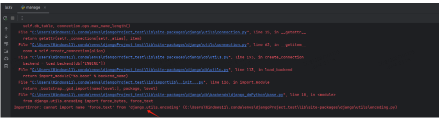


**【问题分析】**

该问题可能是由于以下两种原因导致：

（1）django.utils.encoding 模块导入 force\_text 函数，而 DM 的 dmpython 驱动使用的 Django 版本中找不到该函数。

（2）在 Django 3.0 及更高版本中，force\_text 函数被移除，并用 force\_str 和 force\_bytes 函数替代。

**【问题解决】**

修改 DM 驱动中的 django\_dmPython 驱动的 base.py、operations.py、utils.py 文件头部引用。

修改前 from django.utils.encoding import force\_bytes, force\_text 。

修改后 from django.utils.encoding import force\_bytes, force\_str 。

### 使用 django 框架项目启动报错：'django\_dmPython' isn't an available database backend xxx

**【问题描述】**

django 框架引入 dmpython+django-dmpython 后项目启动，报错如下:

```
"django.core.exceptions.ImproperlyConfigured: 'django_dmPython' isn't an available database backend or 
couldn't be imported. Check the above exception. To use one of the built-in backends, use 
'django.db.backends.XXX', where XXX is one of:'mysql', 'oracle', 'postgresql', 'sqlite3'"。
```

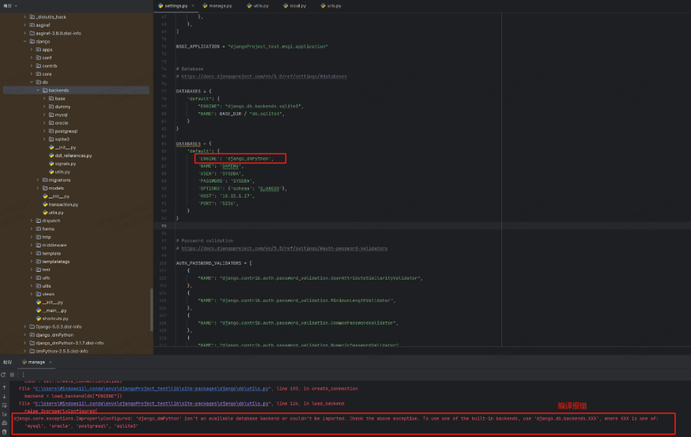


**【问题分析】**

使用 pip install 方式安装的 DM 驱动，驱动包会默认放到与 django 框架的同级目录，而项目启动后扫描的是 django.db.backends 的目录，所以会报错。

**【问题解决】**

可以通过以下方法尝试解决：

将安装包下的 django\_dmPython 目录放到 django.db.backends 目录下。

修改 settings.py 文件中 DATABASES 的 ENGINE 属性为 django.db.backends.django\_dmPython。

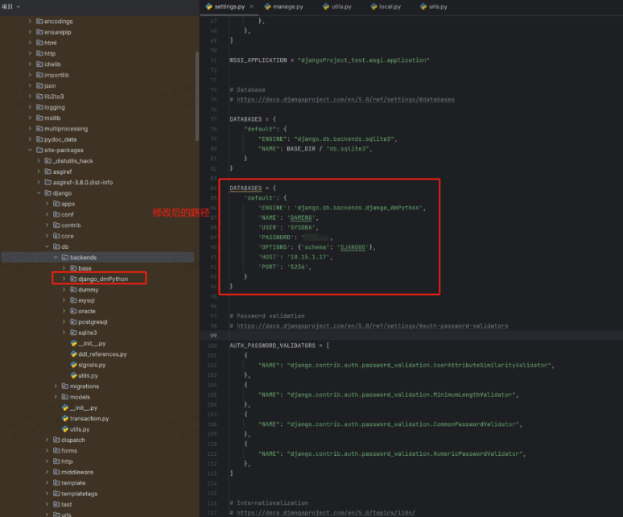


### django 框架连接 DM 的主备集群如何以服务名的形式配置高可用？

**【问题解决】**

配置步骤如下：

修改 django 框架 settings.py 中 DATABASES 对象 HOST 属性即可。（这里不必纠结 HOST 以及 PORT 的指向，数据库启动时会自动扫描并替换掉端口）

```php
DATABASES = {
'default': {
   'ENGINE': 'django.db.backends.dm8',
   'NAME': 'DAMENG',
   'USER': 'SYSDBA',
   'PASSWORD': '*****',
   'OPTIONS': {'schema': 'SYSDBA'},
   'HOST': 'DM',
   # 'HOST': '10.15.1.17',
   'PORT': '5237',
}
}
```

在 /etc/dm\_svc.conf 中填写主备的 IP 及端口信息。

```
TIME_ZONE=(480)
LANGUAGE=(cn)

DM=(10.130.250.9:5236, 10.130.250.10:5236)
[DM]
LOGIN_MODE=(1)
SWITCH_TIME=(300)
SWITCH_INTERVAL=(200)
```

### dmpython 如何使用 sqlalchemy 指定具体的某一个库?

**【问题解决】**

1. 首先需要保证需要 SQLAlchemy 版本和 SQLAlchemy\_dm 版本对应，可以参考下表：

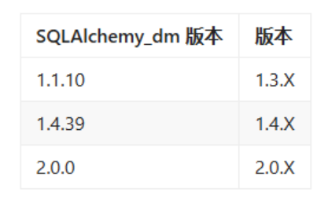

例如以下测试环境：

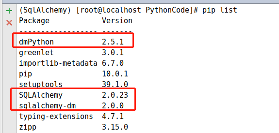

2. 在创建连接时使用如下语句：
```sql
engine = create_engine('dm://SYSDBA:*****@localhost:5245',connect_args={'schema':'PRODUCTION','connection_timeout':15})
```

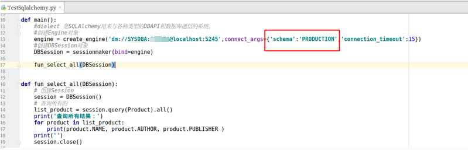

### 使用 pyinstaller 打包 Python 代码为单个 exe 文件报错

**【问题描述】**

使用 pyinstaller 打包 Python 代码为单个 exe 文件，执行 exe 后报错：“ImportError:DLL load failed while importing dmPython:找不到指定模块。\[9800\]Failed to execute script 'bayes' due to unhandled exception”。

**【问题解决】**

1. 验证打包的输出信息是否完全提示成功，是否存在告警信息。
2. 通过 find 命令找到的 build 目录下的 dmPyhon.so 复制到自己的打包虚拟环境下的 site-packages。

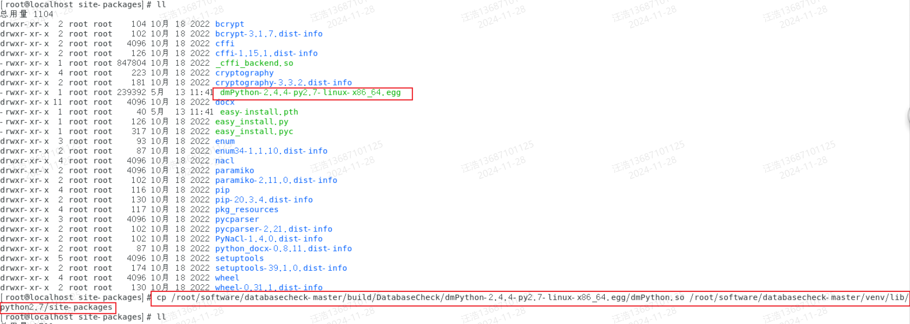

### dmPython 使用 cursor.var(dmPython.CURSOR) 设置游标报错

**【问题描述】**

dmPython 调用包的存储过程使用 cursor.var(dmPython.CURSOR) 设置游标时报错：unhandled data type dmPython.CURSOR。

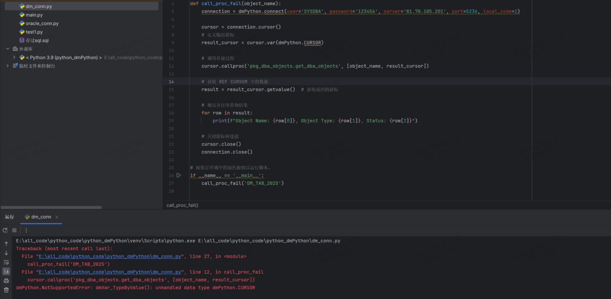

**【问题分析】**

dmPython 驱动中目前暂不支持 cursor.var(dmPython.CURSOR) 设置存储过程中的 out 出参游标。

**【问题解决】**

使用执行 cursor.callproc 函数后返回的变量，然后根据游标的下标值去取值，并手动释放创建的 cursor 变量，示例如下：

```python
def call_proc_t1(object_name):
    conn = dmPython.connect(user='SYSDBA', password='123456', server='81.70.105.201', port=5236, local_code=1)
    cursor = conn.cursor()
    # 定义输出游标
    data_cursor = conn.cursor()
    # 调用包中的函数
    rets = cursor.callproc('pkg_dba_objects.get_dba_objects', [object_name,data_cursor])
    result_cursor = rets[1].fetchall() 
    print('')
    for row in result_cursor:
        print(f"Object Name: {row[0]}, Object Type: {row[1]}, Status: {row[2]}")
    data_cursor.close()
    conn.close()
```

### 达梦 sqlalchem 框架使用 inspect 方法无法获取表名等信息

【问题解决】

如果是低于 sqlalchemy2.0.5 版本，则需要升级到 sqlalchemy2.0.5，达梦安装包 2025 第一季度之后的版本开始使用 sqlalchemy2.0.5 及之后的版本。

以下是相关用例：

```python
from sqlalchemy import create_engine, inspect
import configparser

# 读取配置文件
config = configparser.ConfigParser()
config.read('D:\\dmSQLALchemy_autotest\\config.ini')

# 获取数据库连接参数
user = config.get('database', 'user')
password = config.get('database', 'password')
server = config.get('database', 'server')
port = config.getint('database', 'port')

# 创建数据库引擎
engine = create_engine(f'dm+dmPython://{user}:{password}@{server}:{port}')

# 使用 inspect 函数获取数据库检查器
inspector = inspect(engine)

# 获取数据库中所有表的名称
table_names = inspector.get_table_names()
print("数据库中的所有表名：")
for table_name in table_names:
    print(table_name)

# 选择一个表，例如 'test_intersect'
table_name = 'test_intersect'

if table_name in table_names:
    # 获取指定表的列信息
    columns = inspector.get_columns(table_name)
    print(f"\n表 {table_name} 的列信息：")
    for column in columns:
        # 检查 'primary_key' 键是否存在
        is_primary_key = column.get('primary_key', False)
        print(f"列名: {column['name']}, 类型: {column['type']}, 是否为主键: {is_primary_key}")

    # 获取指定表的外键信息
    foreign_keys = inspector.get_foreign_keys(table_name)
    if foreign_keys:
        print(f"\n表 {table_name} 的外键信息：")
        for foreign_key in foreign_keys:
            print(f"外键名: {foreign_key['name']}, 参考表: {foreign_key['referred_table']}, 参考列: {foreign_key['referred_columns']}")
    else:
        print(f"\n表 {table_name} 没有外键。")

    # 获取指定表的索引信息
    indexes = inspector.get_indexes(table_name)
    if indexes:
        print(f"\n表 {table_name} 的索引信息：")
        for index in indexes:
            print(f"索引名: {index['name']}, 列: {index['column_names']}, 是否唯一: {index['unique']}")
    else:
        print(f"\n表 {table_name} 没有索引。")
else:
    print(f"表 {table_name} 不存在于数据库中。")
    # 获取表注释
    table_comment = inspector.get_table_comment(table_name)['text']
    print(f"表 {table_name} 的注释: {table_comment}")
else:
    print(f"表 {table_name} 不存在注释于数据库中。")
```

### dmpython 如何配置高可用连接串

**【问题解决】**

1. 配置 dm\_svc.conf 文件，参考内容如下：
```shell
TIME_ZONE=(480)
LANGUAGE=(en)
DM=(IP1:5236, IP2:5236)
[DM]
LOGIN_MODE=(1)
SWITCH_TIME=(300)
SWITCH_INTERVAL=(200)
```

说明：

- DM 表示服务名，格式：服务名=(IP\[:PORT\],IP\[:PORT\],......)；
- IP1 和 IP2 需修改为实际数据库 IP；
- loginMode=1 表示链接只连主库；
- loginMode=2 表示链接只连备库；
- loginMode=3 表示优先连接备库，备库异常情况下连接主库；
- SWITCH\_TIME=300 表示为了寻找主库会尝试连接 300 次；（主备模式有效）
- SWITCH\_INTERVAL=200 表示连接间隔为 200 毫秒（主备模式有效）
- LANGUAGE 可选值：cn 驱动日志报错显示中文，en 驱动日志报错显示英文；该参数对使用无影响

详细 dm\_svc.conf 文件配置和使用方法可参考 [巧用服务名 | 达梦技术文档](https://eco.dameng.com/document/dm/zh-cn/pm/skill-servicename.html#13.1%20%E9%85%8D%E7%BD%AE%E6%9C%8D%E5%8A%A1%E5%90%8D) 。

2. 配置环境变量 DM\_SVC\_PATH 指向 dm\_svc.conf 所在目录
```shell
export DM_SVC_PATH=/home/dmdba
```

根据实际存放目录进行修改。

3. 配置 dmPython.connect 属性

（1）将连接属性中 host/server 的值修改为 dm\_svc.conf 文件中的服务名，本示例中的服务名为 DM；

（2）增加连接属性 dmsvc\_path 指向 dm\_svc.conf 所在目录，本示例中 dmsvc\_path 的值应配置为 `/home/dmdba`

连接配置修改前后示例如下：

```python
--修改前
dmPython.connect(user='用户名',password='密码',server='127.0.0.1',port=5236)
--修改后
dmPython.connect(user='用户名',password='密码',server='DM',dmsvc_path='/home/dmdba')
```

如果使用到了 django 或 sqlalchemy 则需要在相应的数据库连接参数处增加 dmsvc\_path 参数。