本章节主要介绍 DMDEM 常见问题，为用户提供数据库监控工具 DEM 常见问题的分析和解决思路。除此之外，用户还可前往 [达梦技术社区](https://eco.dameng.com/community/question/) 参与更多问题讨论。

## 目录

## 正文

## DEM 工具及使用方法示例

DEM 工具存放在数据库安装目录 dmdbms 下的 web 文件夹中。

DEM 配置示例（以 Windows 为例）

Jdk 目录：

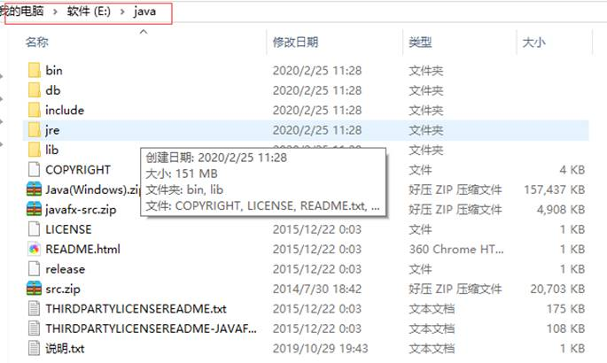

Tomact 目录：

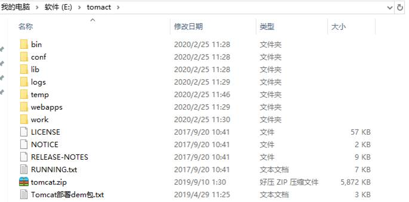

DEM 目录：

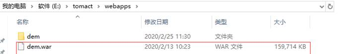

Dmagent 目录：

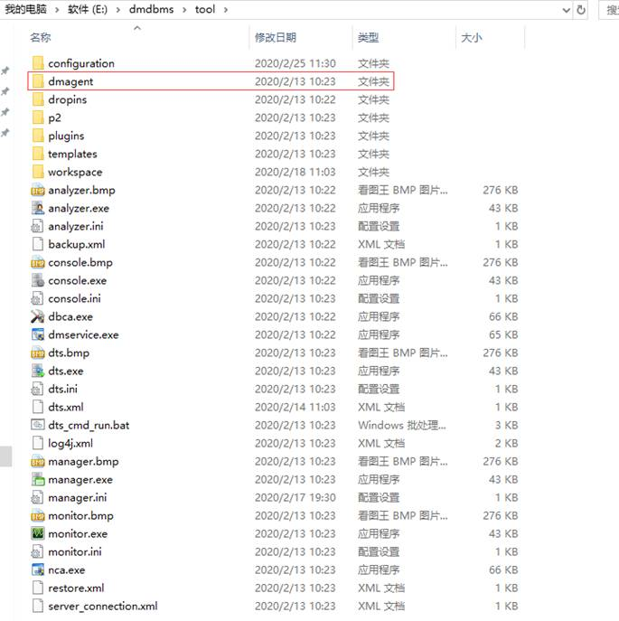

配置环境变量：

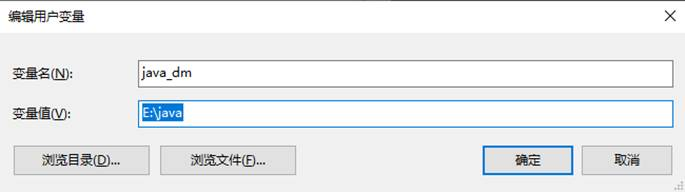

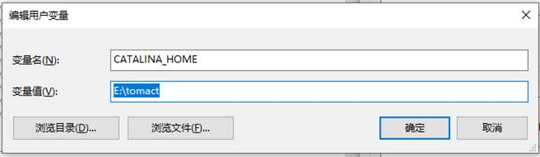

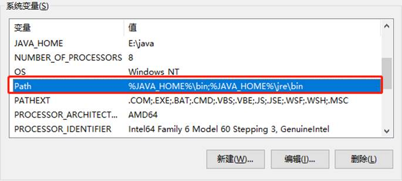

cmd 启动 tomcat(E:\\tomcat\\bin\\startup.bat)，会自动将 dem 解压到相同目录下：

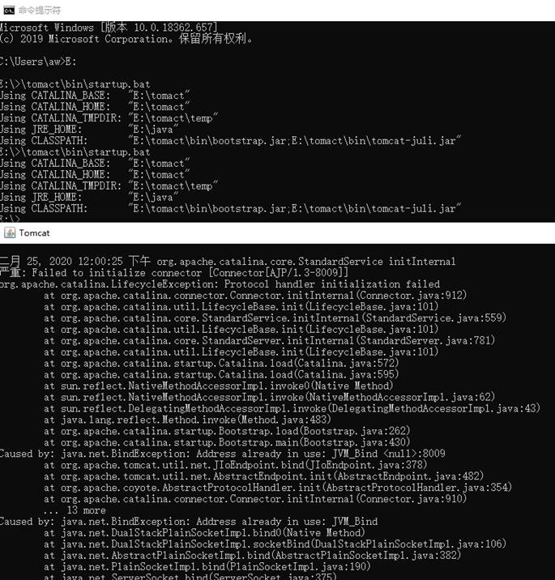

在数据库中新建 DEM 用户，并用 DEM 用户执行 dem\_init.sql 脚本 (E:\\dmdbms\\web\\dem\_init.sql)。

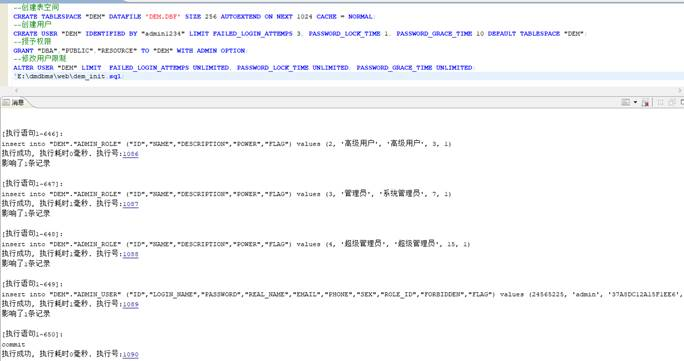

更改 db.xml (E:\\tomcat\\webapps\\dem\\WEB-INF\\db.xml) 中 dem 监控连接后台数据库的 ip/账号/密码/端口号：

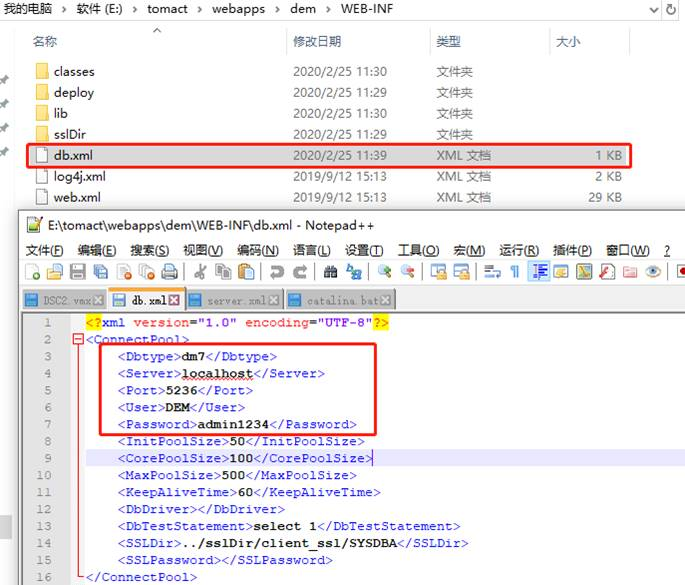

在 server.xml(E:\\tomcat\\conf\\server.xml)的 host 节点中补全以下内容：

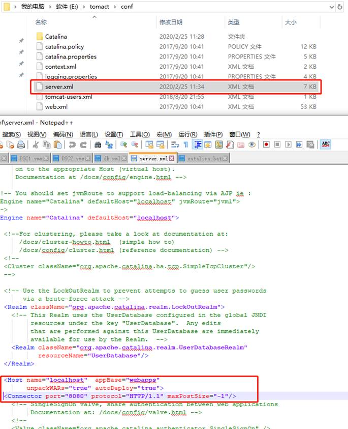

在 catalina.bat(E:\\tomcat\\bin\\catalina.bat) 的最后添加以下内容：

```shell
set java_opts= -server -Xms40m -Xmx1024m -XX:MaxPermSize=512m -Djava.library.path=d:\dmdbms\bin;
```

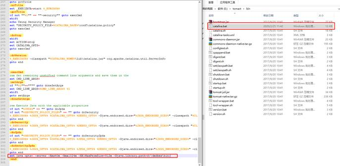

启动 tomcat 服务，并启动 DEM ([http://127.0.0.1:8080/dem](http://127.0.0.1:8080/dem))，账号/密码：admin/\*\*\*\*\*\*

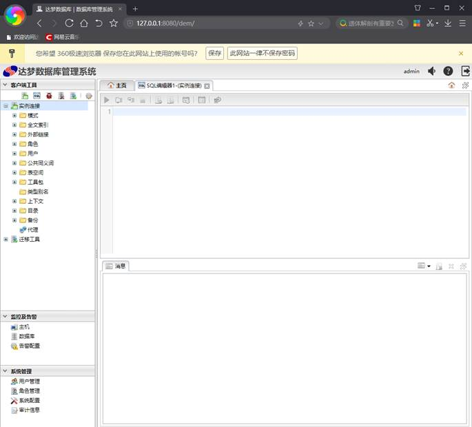

## dem 安装集群报错：没有创建服务权限

**【问题解决】** ：

原因是 dmagent 是用 dmdba 用户权限启动的，使用 root 权限重新启动 agent 程序即可。

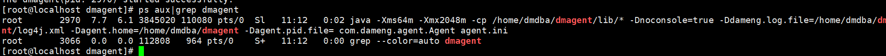

## 启动 dmagent 报错：permission denied

**【问题描述】** ：

搭建 DEM 时，启动 dmagent 时出现如下报错：

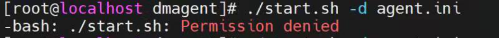

**【问题解决】** ：

该情况一般出现在 dmagent 是从其他数据库拷贝过来的情况，拷贝过来后文件权限改变，导致报错，修改 dmagent 文件权限即可。

```
chown -R dmdba:dinstall /home/dmdba/dmagent
chmod -R 755 /home/dmdba/dmagent
```

## DEM 监控不到主机信息

**【问题描述】** ：

A 主机 Dmagent 正常启动，B 主机部署的 DEM 检测不到对应的主机信息。DEM 主机部署和 dmagent 均按照规范部署。

**【问题解决】** ：

查看两台主机的时间，发现 A、B 主机间的时间不一致，如下图：

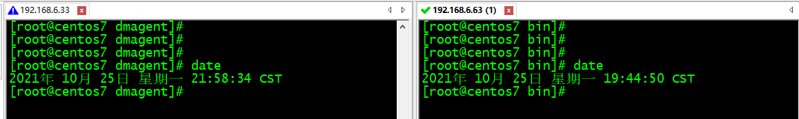

DEM 监控 5 分钟为消息有效时间，即如果收到 dmagent 发送的消息的时间与 DEM 运行机器当前时间相差 5 分钟，则认为该消息无效，不处理该消息。  
因此需要重新同步时间，并重启 dmagent。之后查看 DEM 主机监控信息，可以查看到监控的主机信息。

## dmagent 使用 service.sh start 以服务方式启动时报错：The service DmAgentService is not install

**【问题解决】** ：

出现该问题是由于 DmAgentService 服务未注册导致。可通过如下方法解决：

以 root 用户登陆后，进入到 dmagent 安装目录，执行：./service.sh install 注册服务，然后输入 dmagent 的路径，dmagent.ini 的路径进行注册即可。如下图所示：


注册完成后，就可以使用./service.sh start 或者 systemctl start DmAgentService.service 进行启动。

## 在服务器没有 JDK 的环境下，应如何启动 dmagent 服务

**【问题解决】** ：

在此种情况下，用户未安装 JDK 环境，可以使用 DM 数据库自带的 JDK 环境，位于数据库安装目录 $DM\_HOME/jdk 下，具体步骤如下：  
1.配置 Java 环境变量：

```
export JAVA_HOME=$DM_HOME/jdk --此变量替换为达梦数据库安装目录绝对路径
export PATH=$JAVA_HOME/bin:$PATH
export CLASSPATH=.:$JAVA_HOME/lib/dt.jar:$JAVA_HOME/lib/tools.jar
```

如下图所示：  
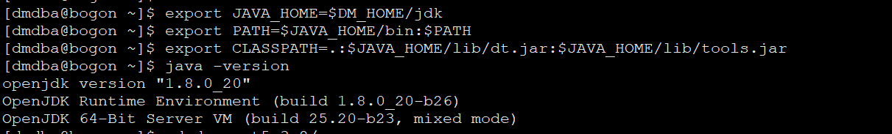

2.启动 dmagent。当前提供了两种方式启动 dmagent，具体如下：  
（1）使用 dmdba 以进程启动。直接进入 dmagent 目录执行：./startup agent.ini 即可正常启动。

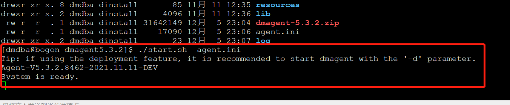

（2）以服务方式启动。需要在 root 用户中先载入数据库的 JDK 环境变量，参考第 1 步（未执行此步骤将无法注册服务）。然后进入 dmagent 的目录中执行：./service.sh install 进行注册。

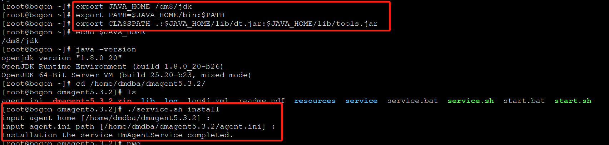

最后，注册完成后，在 dmagent/service/DmAgentService 中添加第（1）步的 JDK 环境变量保存后即可使用服务方式启动。注意，JDK 的路径一定要使用达梦数据库 JDK 的绝对路径，否则还是无法正常启动 dmagent。

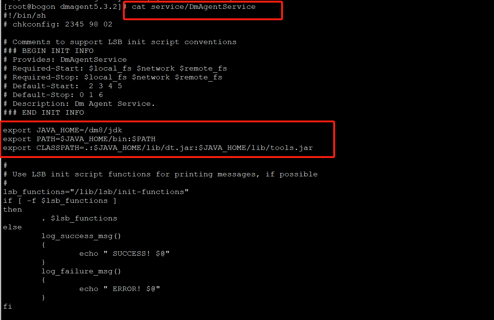

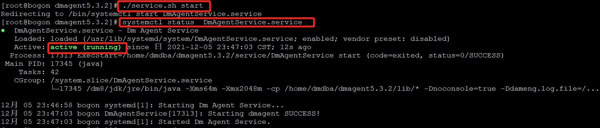

## DEM 监控 linux 多台主机的时候只能显示一台

**【问题解决】** ：

配置 agent 时，修改 center\_url，还需要配置 id\_policy = 1 使用 ip 的方式监控（默认 0 采用 mac 地址），配置完成之后重启正常。

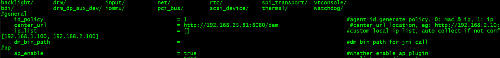

## DEM 添加 DSC 集群问题

DEM 添加 DSC 集群时，主要包含以下两类问题：

**问题一：** DEM 监控 DSC 集群无法通过扫描站点添加成功

**【问题描述】** ：

DEM 监控 DSC 集群通过扫描站点测试连接成功，但点击确定后，报错：站点扫描失败。

**【问题解决】** ：

通过新增站点来添加 DSC 集群，点击下图中的“+”号，填写 DSC 集群信息，新增即可（DSC 每个节点都要新增一次）。

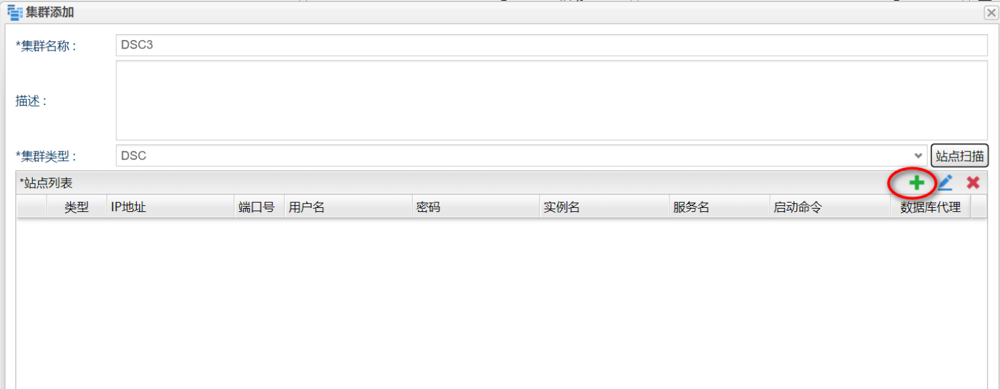

**问题二** ：添加站点时候无法直接修改保存

**【问题描述】** ：

当需要修改下图中服务名和启动命令时报错，并提示以下信息：主机和对应端口已存在。

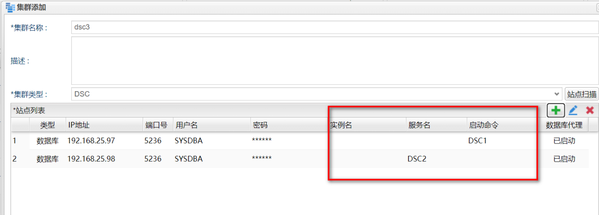

**【问题解决】** ：

点击标记的倒三角形图标，如下图，选择“编辑”，进行修改即可。

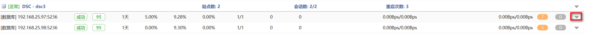

## DEM 后台数据库数据总量过大怎么办？能定期清理吗？

**【问题描述】** ：

DEM 在长期使用后，后台数据库中会保存很多历史数据信息，后台数据总数据量会变的很大，占用磁盘空间。同时，部分记录详细信息表的数据量会变的很大，导致前台部分功能点涉及到大表的关联查询时，会出现缓慢卡顿的问题。

**【问题解决】** ：

可通过以下两种方法解决问题：

**方法一：** 使用 DEM 管理平台的历史数据管理功能，设置历史数据保留时间上限。进行该设置后，系统会自动删除指定天数之前的历史数据。

1.选择系统配置模块。

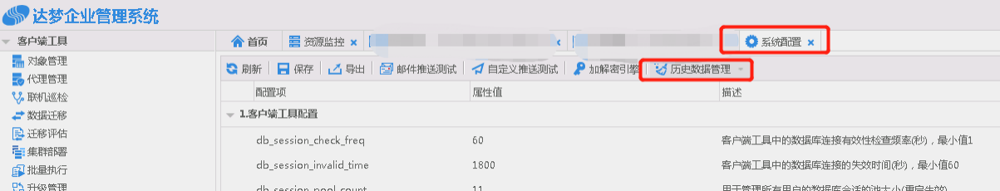

2.历史数据管理选项，选择数据保留时间，勾选对应表，点击应用。

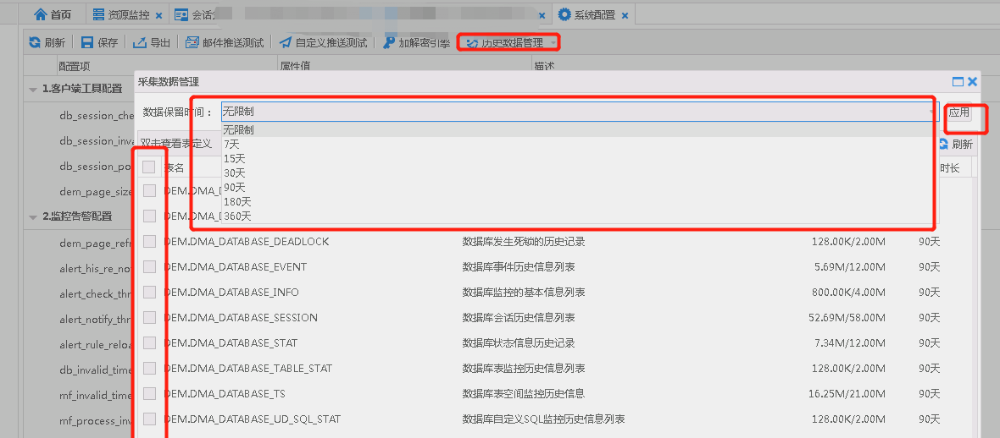

**方法二：** 在相应表上设置索引和定时作业，解决查询慢和占用磁盘空间大的问题。

1.在大表上添加索引。

```sql
CREATE INDEX IDX_DMA_DATABASE_SQL_COUNT_TS ON DEM.DMA_DATABASE_SQL_LOG_FILE_INFO(TS);
CREATE INDEX IDX_DMA_DATABASE_SESSION_TS ON DEM.DMA_DATABASE_SESSION(TS);
CREATE INDEX IDX_DMA_DATABASE_SQL_SLOW_TS ON DEM.DMA_DATABASE_SQL_LOG_VIEW_INFO(TS);
CREATE INDEX IDX_DMA_MAINFRAME_DISK_TS ON DEM.DMA_MAINFRAME_DISK(TS);
CREATE INDEX IDX_DMA_DATABASE_TS_TS ON DEM.DMA_DATABASE_TS(TS);
```

2.创建存储过程，更新大表统计信息和清理大表数据。

```sql
CREATE PROCEDURE CLEAR_HISTORY_DAYS(DAYS INT) AS
BEGIN
DELETE FROM DEM.DMA_DATABASE_SQL_LOG_FILE_INFO WHERE TS < TIMESTAMPDIFF(MS,'1970-01-01',SYSDATE - DAYS); 
DELETE FROM DEM.DMA_DATABASE_SESSION WHERE TS < TIMESTAMPDIFF(MS,'1970-01-01',SYSDATE - DAYS);
DELETE FROM DEM.DMA_DATABASE_STAT WHERE TS < TIMESTAMPDIFF(MS,'1970-01-01',SYSDATE - DAYS);
DELETE FROM DEM.DMA_MAINFRAME_STAT WHERE TS < TIMESTAMPDIFF(MS,'1970-01-01',SYSDATE - DAYS);
DELETE FROM DEM.DMA_DATABASE_SQL_LOG_VIEW_INFO WHERE TS < TIMESTAMPDIFF(MS,'1970-01-01',SYSDATE - DAYS);
DELETE FROM DEM.DMA_MAINFRAME_DISK WHERE TS < TIMESTAMPDIFF(MS,'1970-01-01',SYSDATE - DAYS);
DELETE FROM DEM.DMA_DATABASE_EVENT WHERE TS < TIMESTAMPDIFF(MS,'1970-01-01',SYSDATE - DAYS);
DELETE FROM DEM.DMA_DATABASE_TS WHERE TS < TIMESTAMPDIFF(MS,'1970-01-01',SYSDATE - DAYS);
COMMIT;

--更新统计信息
EXECUTE IMMEDIATE 'STAT 100 ON INDEX DEM.DMA_DATABASE_SQL_LOG_FILE_INFO';
EXECUTE IMMEDIATE 'STAT 100 ON INDEX DEM.IDX_DMA_DATABASE_SESSION_TS';
EXECUTE IMMEDIATE 'STAT 100 ON INDEX DEM.INDEX_DMA_DB_STAT_TS';
EXECUTE IMMEDIATE 'STAT 100 ON INDEX DEM.INDEX_DMA_MF_STAT_TS';
EXECUTE IMMEDIATE 'STAT 100 ON INDEX DEM.DMA_DATABASE_SQL_LOG_VIEW_INFO';
EXECUTE IMMEDIATE 'STAT 100 ON INDEX DEM.IDX_DMA_MAINFRAME_DISK_TS';
EXECUTE IMMEDIATE 'STAT 100 ON INDEX DEM.INDEX_DMA_DB_EVENT_TS';
EXECUTE IMMEDIATE 'STAT 100 ON INDEX DEM.IDX_DMA_DATABASE_TS_TS';
END;
```

3.创建定时作业，定时执行存储过程。

```sql
SP_INIT_JOB_SYS(1);
call SP_CREATE_JOB('HIS_CLEAR',1,0,'',0,0,'',0,'');
call SP_JOB_CONFIG_START('HIS_CLEAR');
call SP_ADD_JOB_STEP('HIS_CLEAR', 'STEP1', 0, 'CALL CLEAR_HISTORY_DAYS(30);', 1, 2, 0, 0, NULL, 0);--清除30天前历史数据
call SP_ADD_JOB_SCHEDULE('HIS_CLEAR', 'DAY1', 1, 1, 1, 0, 0, '02:00:00', NULL, '2021-01-11 16:24:10', NULL, '');
call SP_JOB_CONFIG_COMMIT('HIS_CLEAR');
```

## 使用 Tomcat 10 版本部署 DEM 时，浏览器打开管理界面报错：HHTP 状态 404-未找到

**【问题描述】：**

当部署 DEM 时，使用 Tomcat 10 版本，不管使用 JDK 1.8.0\_333(JDK8 最新版本)，还是使用 JDK 11.0.9(JDK11 最新版本)，浏览器打开 http://xx.xx.xx.xx:8080/dem 都提示：HHTP 状态 404-未找到。

**【问题解决】：**

达梦 DEM 目前暂不支持 Tomcat 10 的版本。

处理办法：替换 Tomcat 10 版本至 Tomcat 7-9 之间的版本即可。

## DEM 部署后，导入导出报错："java\_library.path 路径不存在 dexp 执行程序"

**【问题描述】：**

dem 在部署完毕后，使用管理工具导入导出功能时出现报错："java\_library.path 路径不存在 dexp 执行程序"

**【问题解决】：**

主要排查以下两方面内容：

1. 检查环境变量配置是否有问题。
2. 检查 `catalina.sh` 中的配置项 `JAVA_OPTS` 是否配置完整。添加 `JAVA_OPTS` 配置方法如下所示：

在 tomcat 安装目录下的 bin 目录下打开配置文件 `catalina.sh` 添加以下配置信息：

```shell
JAVA_OPTS="-server -Xms256m -Xmx1024m -Djava.library.path=/dm8/dmdbms/bin"
```

参数 `-Djava.library.path` 的值为数据库安装目录的 bin 目录地址。

## 同一台机器部署多个 DEM 在访问时异常

**【问题描述】**

在同一台服务器上部署两个 tomcat，每个 tomcat 中都部署一个 DEM，并同时启动。在一台电脑上同一个浏览器下，分别访问两个 DEM，在第一个登陆成功之后，访问第二个项目，第一个项目就会自动退出。

**【问题分析】**

由于 IP 相同的两个 session 对应的 cookie 是一样的，其中 sessionID 就保存在 cookie 中，两个项目共用一个 cookie，但是只能存储一个 sessionID，所以导致出现了在第一个登陆成功之后，访问第二个项目，第一个项目自动退出。

**【问题解决】**

在两个 tomcat 的配置文件中修改 content.xml 文件，在 Context 节点上添加 sessionCookieName 属性给其赋与不同的值后即可同时访问两个项目。

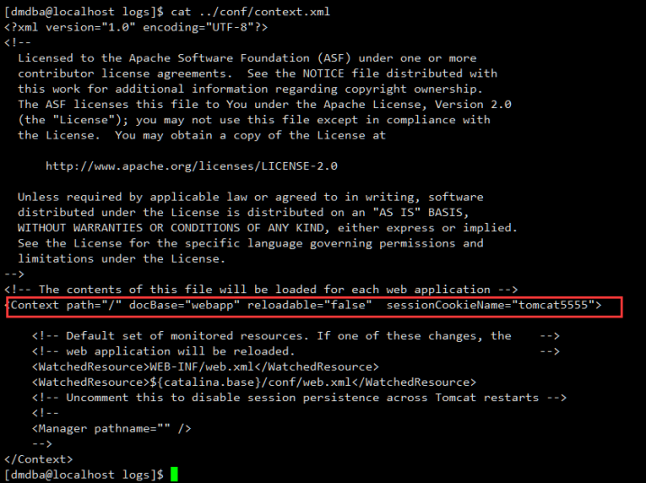

## DEM 中批量执行功能选择 ssh 类型时执行报错：无法解决密钥交换算法

**【问题描述】**

在 DEM 中新建批量执行，当选择 ssh 类型执行批量执行任务时，执行日志返回异常报错:"unable to reach a settlment of keyexchangalgorithms"。

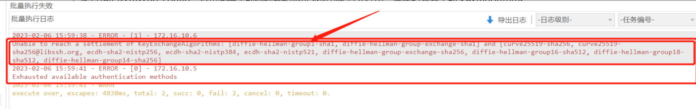

**【问题解决】**

1. 配置 `/etc/ssh/sshd_config` 文件，将页面提示的交换秘钥协议添加到配置文件中，根据实际情况屏蔽掉不安全的 KexAlgorithms；

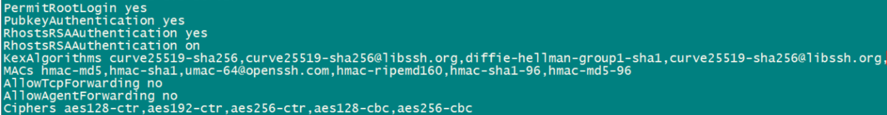

2. 修改完成后重启服务。
```shell
systemctl restart sshd.service
```

可能会出现无法启动情况，使用 journalctl -xe 查看详细信息，将 Unsupported 的信息删除即可，步骤如下：

（1）执行 journalctl -xe 查看 ssh 不支持 diffie-hellman-group13-sha1；

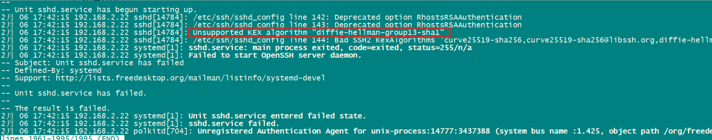 （2）在 `/etc/ssh/sshd_config` 配置文件中去掉 diffie-hellman-group13-sha1。

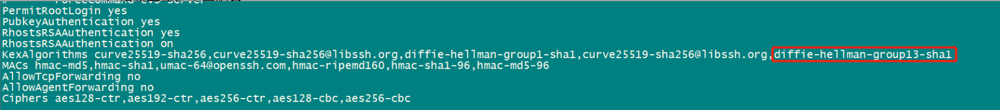

## DEM 中批量执行功能选择 ssh 类型时执行报错：更换有效认证方式

**【问题描述】**

DEM 中新建批量执行，当选择 ssh 类型执行批量执行任务时，执行日志返回异常报错:"exhausted available authentication methods"。

**【问题解决】**

1. 排查 `/etc/ssh/sshd_config` 配置文件中中是否存在以下参数：
```shell
PasswordAuthentication  no，
PermitRootLogin  no
AllowUsers
DenyUsers
```

AllowUsers 表示允许 ssh 连接的用户，DenyUsers 表示禁止 ssh 连接的用户。

2. 如果 DEM 执行 ssh 使用的是 root 账号密码， `/etc/ssh/sshd_config` 配置文件中需要如下设置；
```shell
PermitRootLogin yes,

PasswordAuthentication yes,
```

其中 PasswordAuthentication 参数在 `/etc/ssh/ssh_config` 配置文件中也存在，需要将注释去掉。

3. 如果使用的是非 root 账号密码；

例如：使用 U1 用户。

需要在 `/etc/ssh/sshd_config` 文件中配置 ；

```shell
PasswordAuthentication yes 

AllowUsers  U1
```

PasswordAuthentication 参数在 `/etc/ssh/ssh_config` 配置文件中也存在，需要将注释去掉。

## dmagent 启动报错： dmagent may be runnin,but PID file could not be found!

**【问题描述】**

dmagent 在启动时报错： “dmagent may be runnin,but PID file could not be found!”

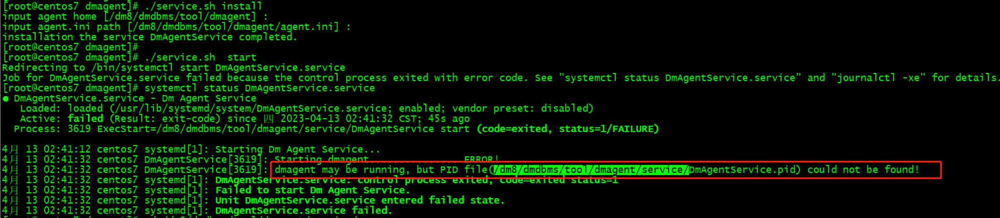

**【问题分析】**

通过分析发现产生此问题的原因与 PID\_FILE\_PATH 环境变量未生效有关。

**【问题解决】**

在 /dmagent/service/DmAgentService 文件中将原来的 PID\_FILE\_PATH 复制一份，然后在开头增加 export ，形成如下图的效果，保证 PID\_FILE\_PATH 配置生效。

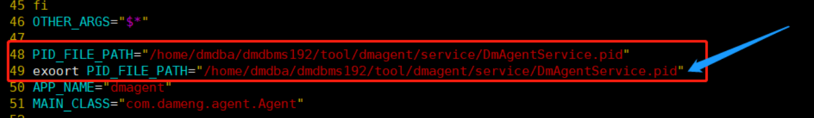

修改完成后重新启动 dmagent。

## 部署 dem 时 agent 日志报错：“Failed to upgrade fail”

**【问题描述】**

在部署 dem 时，dem 未监控到主机，排查网络无问题，agent 日志报错：“Failed to upgrade fail”

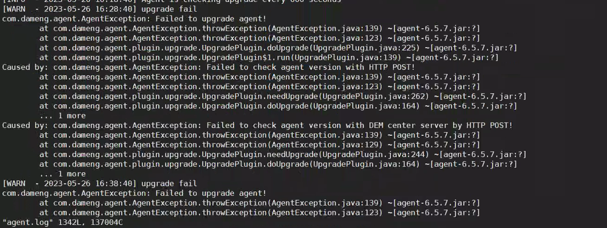

**【问题分析】**

出现该问题是 agent 所在机器和部署 dem 的机器时间不一致导致。

**【问题解决】**

将 agent 所在机器和部署 dem 的机器时间调整一致。

## DEM 监控数据库实例失败

**【问题描述】**

当 DEM 监控数据库实例失败时，如何排查原因。

**【问题解决】**

1. 在 web 界面通过【资源监控】 -->【主机】，查看主机位置是否有感叹号，提示配置内外网信息，按照提示进行配置；
2. 检查 DEM 服务器与数据库服务器之间网络是否存在问题；
3. 检查数据库服务器 agent 服务是否启动， 日志是否有报错；
4. 检查数据库服务器和 DEM 服务器是否配置时钟同步；
5. 检查 dmagent 版本是否和 dem 匹配，如不匹配建议尝试从 DEM 资源包下载 dmagent 安装包进行部署。

## DEM 管理平台告警信息提示：连接状态-失败

**【问题描述】**

DEM 管理平台相关数据库服务器发出告警信息提示：连接状态-失败，一分钟后自动恢复正常。

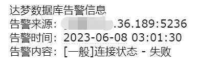

**【问题分析】**

通过 nmon 日志分析故障时间段服务器网络、日志信息、磁盘监控等信息，发现该告警原因主要是服务器在 3:00 时进行数据增量备份时瞬间文件读速度高，导致 DEM 在这一分钟左右时间无法获取到数据库的状态而发出告警。

**【问题解决】**

在数据备份时进行读速度限制，可通过在备份语法中添加 LIMIT READ SPEED 来设置数据备份时的读取速度，单位为 MB/S，默认值为 0 表示无限制。在备份作业任务中也可以进行设置，推荐限速使用 200-300MB/s。在备份限速 300MB/s 时，文件瞬间读速度可以控制在 500MB/s 以下（该速度值仅供参考，实际值与服务器的 CPU、内存、磁盘读写速度和网络带宽有关）。

例如：

```sql
BACKUP DATABASE '/home/dmdba/DAMENG/dm.ini' FULL BACKUPSET '/home/dmdba/dmbackup/DB_FULL_DAMENG_2023061601' limit read speed 300 compressed level 1 parallel 2;
```

## 使用 DEM 默认加解密引擎对密码进行加密报错

**【问题描述】**

使用 DEM 默认加解密引擎对密码进行加密：

```java
java -cp demsdk.jar com.dameng.dem.server.util.DefaultEncryptEngine encrypt "xxxxx"
```

报错：”错误: 找不到或无法加载主类 com.dameng.dem.server.util.DefaultEncryptEngine“。

**【问题分析】**

该问题可能是由于相应的文件不存在，或者权限不足导致。

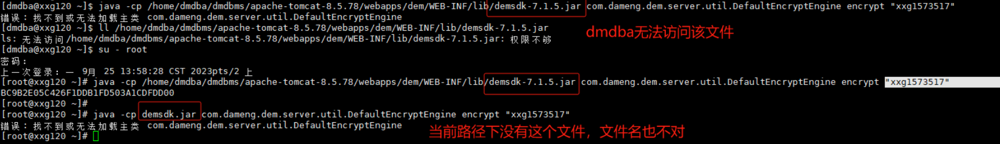

DEM 版本对应的 demsdk 文件名字不一定是 demsdk.jar ，可能带了版本号，比如：demsdk-7.1.5.jar ，一般位于 tomcat 下的 webapps/dem/WEB\_INF/lib

**【问题解决】**

保证对应文件的权限足够，将对应的文件拷贝到当前目录或者加密命令里并使用绝对路径，执行如下命令：

```java
java -cp /home/dmdba/dmdbms/apache-tomcat-8.5.78/webapps/dem/WEB-INF/lib/demsdk-7.1.5.jar com.dameng.dem.server.util.DefaultEncryptEngine encrypt "xxxxx"
```

## DEM 监控 DSC 集群，调用 dmcssm 监视器服务报错

**【问题描述】**

DEM 调用 dmcssm 监控查看 DSC 集群状态报错：

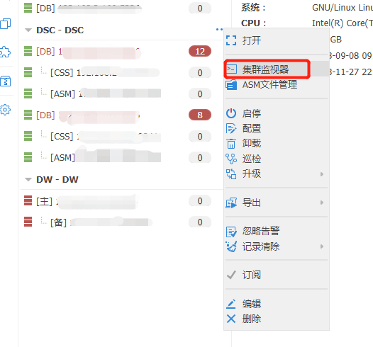

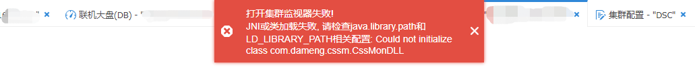

**【问题分析】**

该报错是由于环境变量配置错误导致无法加载本地 dmcssm 服务导致。

**【问题解决】**

正确配置本地数据库的环境变量，包括 DM\_HOME 以及 LD\_LIBRARY\_PATH 中的 bin 依赖路径。如下截图示例，用户需根据实际环境情况配置。

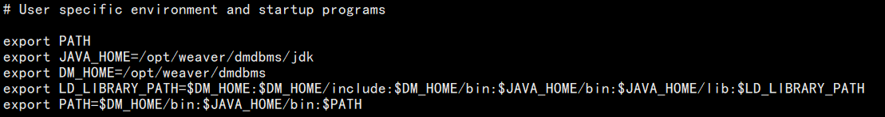

修改成功后验证连接成功。

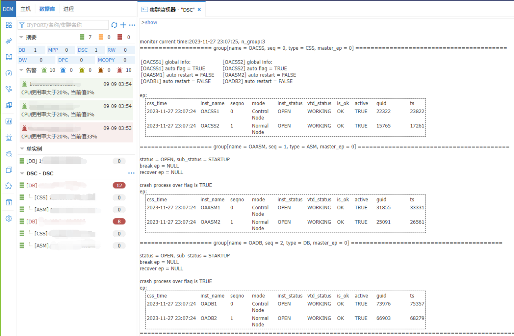

## DEM 管理平台告警端口不通

**【问题描述】**

DEM 管理平台发出告警信息，报错信息：\[ERROR\]Can't connect to DM server on '127.0.0.1' port(4236) errno(111) 。

**【问题分析】**

通过分析数据库日志信息和达梦数据库管理员手册，并检查 dm.ini 配置文件，确认 4236 端口是数据库 dmap 服务进程使用，如下图所示：

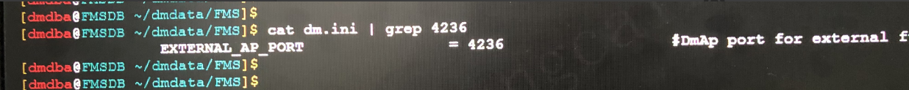

排查发现 dmap 服务未启动。

**【问题解决】**

启动 DMAP 服务。

dmap 服务启动后，可以通过 netstat 和 ps 命令检查服务进程名称，如下图所示：

```shell
netstat -ltplu | grep 4236
```

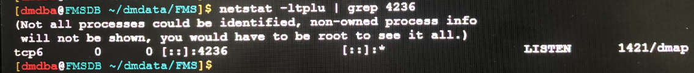

```shell
ps -ef | grep 1421
```

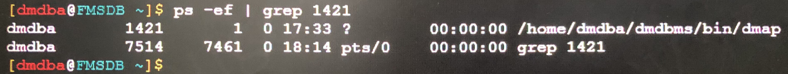

补充说明：dmap 进程是达梦数据库非常重要的备份还原进程，大幅提升了备份还原的效率，特别是加密、压缩的处理效率。在数据库滚动升级或重启数据库服务器时，容易出现这类问题。其他相似报错信息，可以使用相似的方法进行分析，先通过 port 信息进行排查。

## DEM 主机监控连接状态未知

**【问题描述】**

新部署的主机启动 dmagent 后，监控-主机监控/数据库监控中展示的主机，当鼠标放到此主机或者数据库上【连接状态】展示【未知】的橙色字样，如下图所示：

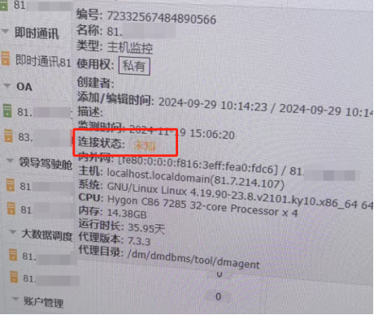

**【问题解决】**

1. 检查 dmagent 代理所在主机和 dem 所在主机的系统是否存在较大时间差。如果时间差较大，可尝试修改 dem 代理服务器时间与 DEM 服务器时间一致来解决；
2. 如修改时间一致后任未得到解决，可登录 dem 的 web 页面修改【系统配置】--【监控告警配置】下的【mf\_invalid\_time】、【db\_invalid\_time】、【message\_token\_validity】参数配置，然后保存再次查看 dem 的监控主机或数据库的连接状态【成功】。

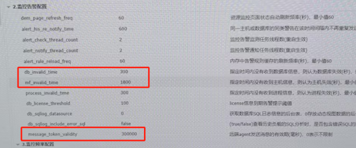

## dmagent 启动报错：Agent service key invalid, agent start fail

**【问题描述】**

启动 dmagent 时报错：“”Agent service key invalid, agent start fail, use INSTALL\_SERVICE\_KEY to install service key first!“”，查看日志信息提示：Agent service key invalid，报错信息如下图所示。


**【问题分析】**

DEM 从 V7.6.0 版本后，为了提高安全性，agent 默认移除了 service.key 文件，agent 启动需要本地的 service.key，默认 dmagent 没有该文件，所以启动 dmagent 失败。

**【问题解决】**

1. 通过手动生成和安装 service.key 参考命令如下：
```shell
/opt/dmagent/start.sh INSTALL_SERVICE_KEY 999999
```

service.key 生成和安装完成后 dmagent 即可重新启动。

2. 启动 dmagent 命令参考如下：
```shell
/opt/dmagent/service.sh start
```