本章节主要介绍 DMDRS 常见问题，为用户提供达梦数据复制软件 DMDRS 常见问题的分析和解决思路。除此之外，用户还可前往 [达梦技术社区](https://eco.dameng.com/community/question/) 参与更多问题讨论。

## 目录

## 正文

## DMDFM 配置 MySQL8.0.41 数据源时连接失败

**【问题描述】**

DMDFM 配置 MySQL8.0.41 数据源时报错，连接失败：“java.sql.SQLException: Unable to load authentication plugin 'caching\_sha2\_password'”，如下所示：

**【问题分析】**

MySQL 5.7 及以上版本中引入的新的默认认证插件 caching\_sha2\_password，如果遇到该报错一般是内置驱动兼容性问题导致，可通过将 MySQL 用户的认证插件改回旧的 mysql\_native\_password 来解决。

**【问题解决】**

1. 检查用户认证插件。
```sql
use mysql;
select host,user,plugin from mysql.user;
```

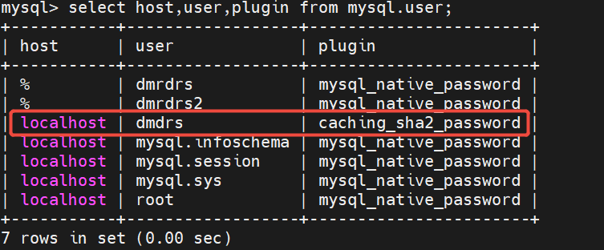

2. 将用户认证插件改回旧的 mysql\_native\_password，例如 DMDRS 用户：
```sql
ALTER USER 'dmdrs'@'localhost' IDENTIFIED WITH mysql_native_password BY 'Dameng@123';
FLUSH PRIVILEGES;
```

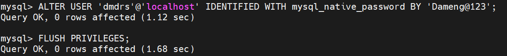

3. 检查用户认证插件是否修改完成。
```sql
select host,user,plugin from mysql.user;
```

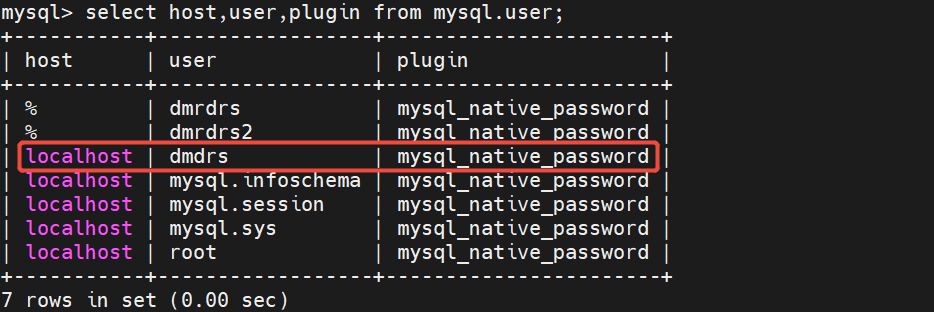

4. 修改登录 IP 限制，允许所有 IP 登录。
```sql
update user set host = '%' where user = 'dmdrs';
FLUSH PRIVILEGES;
```

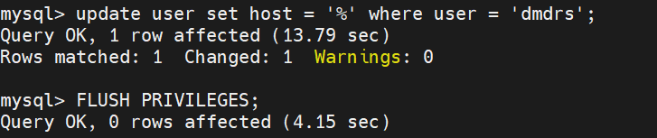

5. 授予 mysql.user 表的查询权限，授予待同步数据库 dmdrs 所有权限。
```sql
GRANT SELECT ON mysql.user TO 'dmdrs'@'%';
GRANT ALL PRIVILEGES ON dmdrs.* TO 'dmdrs'@'%';
FLUSH PRIVILEGES;
```

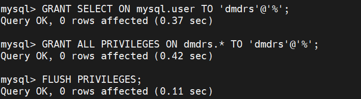

6. DMDFM 测试连接

数据库已经可以下拉选择，选择 dmdrs 进行连接。

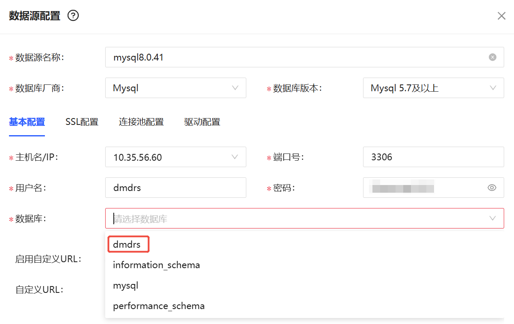

连接测试成功。

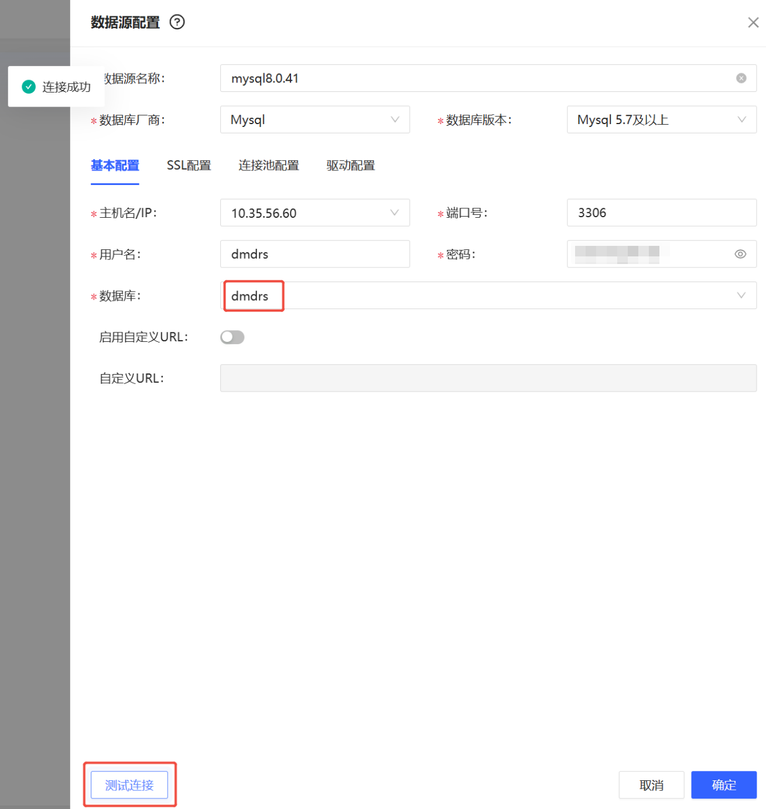

## Oracle19c 到 DM8 通过 DMDVS 进行数据校验时报错：动态库文件加载失败

**【问题描述】**

DMDRS 数据同步 Oracle19c 到 DM8 通过 DMDVS 进行数据校验时报错“\[ERROR\]: DRS-3009 动态库文件加载失败 file: libdvora.so or libdvdm.so,code: 0”

**【问题分析】**

在部署 DMDVS 时需配置动态库依赖路径，该报错一般都是需要的数据库驱动路径没加到环境变量里面导致，通过 ldd 检查动态库文件 libdvora.so 和 libdvdm.so 发现存在缺失。

**【问题解决】**

1. 使用 DMDVS 启动用户在动态库依赖路径下通过 ldd 命令检查动态库文件 libdvora.so 和 libdvdm.so 是否存在缺失。
```shell
[oracle@hellodba ~]$ cd /data/dmdrs5/INST_DRS/node1/
[oracle@hellodba node1]$ ldd libdvora.so
```

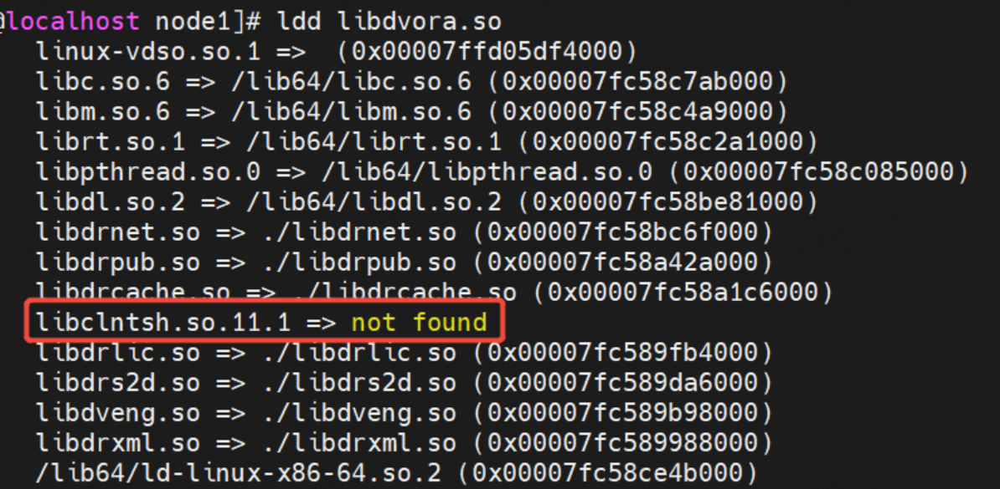

```
[oracle@hellodba node1]$ ldd libdvdm.so
```

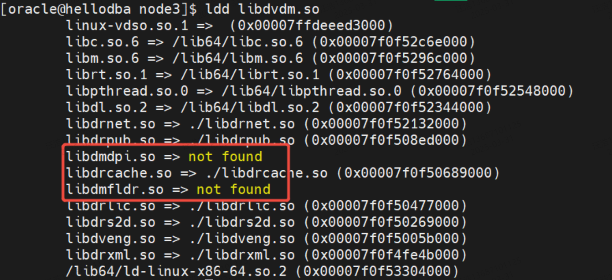

2. 查找缺失的依赖路径。
```shell
[root@hellodba ~]# find / -name libclntsh.so.11.1
/u01/app/oracle/product/19.0.0/dbhome_1/lib/libclntsh.so.11.1
[root@localhost ~]# find / -name libdmdpi.so
/home/oracle/oracledbms/drivers/dpi/libdmdpi.so
[root@localhost ~]# find / -name libdmfldr.so
/home/oracle/oracledbms/drivers/odbc/libdmfldr.so
/home/oracle/oracledbms/bin/libdmfldr.so
```
3. 配置 DMDVS 启动用户环境变量。
```shell
[oracle@localhost ~]$ vi .bash_profile
export LD_LIBRARY_PATH=$LD_LIBRARY_PATH:$ORACLE_HOME/lib:$ORACLE_HOME/bin:/home/oracle/oracledbms/bin/:/home/oracle/oracledbms/drivers/odbc/
##使环境变量生效。
[oracle@localhost ~]$ source ~/.bash_profile
##检查依赖文件是否完整
[oracle@hellodba node1]$ ldd libdvora.so
[oracle@hellodba node1]$ ldd libdvdm.so
```
4. 在服务器端重启 DMDVS。
```shell
[oracle@localhost ~]$ cd /data/dmdvs/dmdvs_V5.0.4.3_rev176693_x86_rh6_64_20241206_sp15/bin
[oracle@localhost bin]$ ./DvsService stop
Stopping DvsService:                                       [ OK ]
[oracle@localhost bin]$ ./DvsService start
Starting DvsService:                                       [ OK ]
```
5. 服务器端重启 DMDVS 后 DMDFM 平台可以正常使用校验功能。

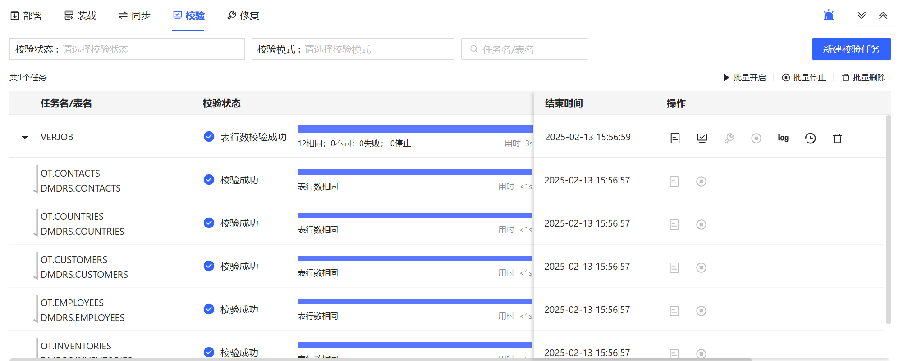

## 使用 DMDRS 装载时目的端报错：字符串截断

**【问题描述】**

使用 DMDRS 进行 DM 到 DM 装载数据时，目的端报错：字符串截断。

**【问题解决】**

修改目的端配置文件 drs.xml 添加参数。

```xml
<char_length_expand>4</char_length_expand>
```

含义：同步表列精度需要扩大的倍数，取值范围为 0～10，默认值为 0。

说明：在同步表 DDL 操作过程中，针对数据库字符集，执行数据入库时，存储的空间需要增加，为保障数据入库的正确性，需要在创建/修改表结构时，扩大字符类型字段的精度。该参数仅影响 CHAR、VARCHAR 和 VARCHAR2 类型字段。

## 使用 DMDRS 进行数据装载时报错：执行端内存不足

**【问题描述】**

配置 Oracle 到 DM 的 DRS，进行数据装载时报错：执行端内存不足。

**【问题解决】**

目的端 drs.xml 配置文件中调整参数 。

```xml
<mem_size>8</mem_size>
```

参数含义：服务程序运行时可以申请的最大内存。取值范围：0～255，单位：GB，默认值为 16。

参数说明：当服务程序运行时申请的内存超过该参数值时，服务程序会报错。

## DMDRS 进行数据同步时，目的端如何打印字段数据类型

**【问题描述】**

使用 DMDRS 进行 dm 到 kafka 的数据同步时，目的端需要打印字段数据类型。

**【问题解决】**

1. 默认 kafka 端 json\_format.ini 配置文件格式记录如下：
```json
//默认格式
JSON_FORMAT_INS = {
                "table":"#SCHEMA.#TABLE",
                "op_type":"#OP_TYPE",
                "op_ts":"#OP_TIME",
                "current_ts":"#TIME",
                "pos":"#POS",
                "primary_keys":[#PRIMARY_KEY],
                "after":{#NEW_VALUES}
}
```

此时，后续数据同步到目的端输出格式只有字段名，无字段类型。

2. 在源端 drs.xml 文件中添加 `<dml_with_coldef>1</dml_with_coldef>` ，目的端 json\_format.ini 中添加 `"COLUMN":[#NAME_TYPE]` 。
```json
//添加"COLUMN":[#NAME_TYPE]后格式
JSON_FORMAT_INS = {
                "table":"#SCHEMA.#TABLE",
                "op_type":"#OP_TYPE",
                "op_ts":"#OP_TIME",
                "current_ts":"#TIME",
                "pos":"#POS",
                "primary_keys":[#PRIMARY_KEY],
                "after":{#NEW_VALUES},
"COLUMN":[#NAME_TYPE]
}
```

在初始数据装载时目的端字段数据类型会统一显示为 char，后续数据同步按照源端对应的数据类型显示。以上以 insert 为例，update、delete 配置相同。

## DMDRS 装载报错：装载未能锁定待装载表

**【问题描述】**

Oracle 到 DM 在 DRS 装载数据过程中报错：DRS-2430 装载未能锁定待装载表。

**【问题分析】**

源端 Oracle 有大量的业务操作 如 update，delete 等，导致装载时无法给表上 S 锁，这种情况下可以使用闪回查询的方式进行装载。

**【问题解决】**

以闪回查询的方式装载，在装载掩码中添加 FLASHBACK。

## 使用 DMDRS 同步时，源端日志报文件写入失败

**【问题描述】**

在 DRS 同步过程中，源端日志报文件写入失败，源端服务宕掉。

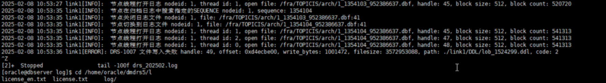

**【问题分析】**

排查发现，源端有查询建表操作导致 DDL 缓存文件过大，且软件安装在根目录，根目录被撑满，导致源端服务宕掉。

**【问题解决】**

在源端配置文件中配置 `<dict_dir> </dict_dir>` 将存在本地的字典、约束、DDL、事务和缓存库等存放至磁盘充足的路径。

参数说明： <dict\_dir>

含义：离线字典的路径。

解释：

1. 默认值为程序的当前工作目录。
2. 此路径指保存在本地的字典、约束、DDL、事务和缓存库的总路径。
3. 当源 DMDRS 配置为离线日志解析时，该参数配置为离线日志解析中字典文件的存储路径。

参数示例：

```xml
<dict_dir>/data/dmdrs/dmdrs5/bin</dict_dir>
```

## DMDRS 源端日志报错：ora-12154

**【问题描述】**

发起 Oracle rac 到 DM 的 DMDRS cp 装载时，源端 DMDRS 日志报错： ora-12154。

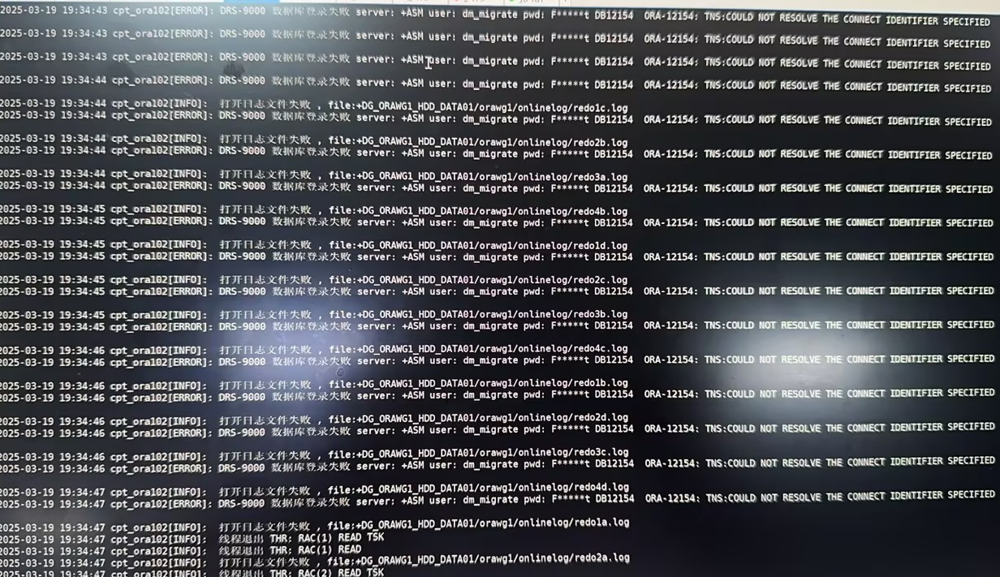

**【问题分析】**

如果源端 Oracle 为 RAC 环境，且装载使用的 DMDRS 客户端代理与源端数据库不处于同一个服务器下，则不只需要在 DMDRS 配置文件中配置源端 Oracle 的 ip、端口、服务名和参数，还需要在 DMDRS 客户端代理机器上安装 oci，并且配置 tns，写清参数中的 asm 服务名的连接方式。

**【问题解决】**

在源端代理 DMDRS 客户端上配置了 tns 后，DMDRS 可以正常连接到源端，例如下面的 ASM1 的配置。

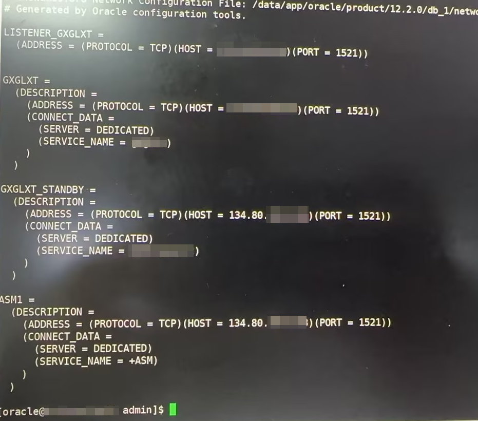

## 装载数据时源端 DMDRS 日志报错：装载获取 lsn 失败

**【问题描述】**

Oracle 到 DM 使用 cp 命令装载数据库时，源端 oracle 的 DMDRS 日志报错：装载获取 lsn 失败。且导致较多的表装载失败需要重装。

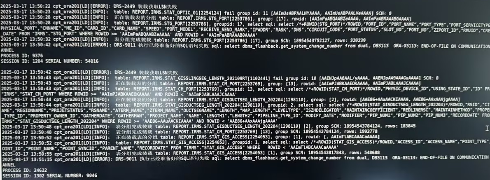

**【问题分析】**

排查源端的数据库配置，发现源端在 sqlnet 配置了 sqlnet.expire\_time=30，导致 DMDRS 的 oci 连接会频繁断开，导致装载失败。

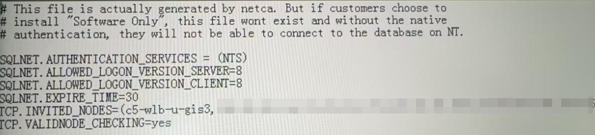

**【问题解决】**

1. 如果源端可以修改 sqlnet 配置，可以去掉此 sqlnet.expire\_time 参数，不需要重启 oracle 生效。
2. 如果源端不可以修改 sqlnet 配置，则推荐装载命令后加上 FAST 掩码，此掩码的作用为在 drs 中开启了 fldr 功能，提升装载性能，可以避免上述问题再次发生。

## 如何在 DRS 同步时只同步 INSERT 和 UPDATE 操作

**【问题解决】**

1. 在源端编辑配置 cvt 过滤 DML 操作。
```shell
TABLE 同步用户名称."*"
BEGIN
    DRS_SYS.PUT_LINE('OP is:    ' || op.#OP);
    IF op.#OP = 'INSERT' OR op.#OP = 'UPDATE' THEN
     op.exec();
    ELSE 
     DRS_SYS.PUT_LINE('Filtered out operation: ' || op.#OP || ' on table ' || op.#SCH || '.' || op.#TAB);
    END IF;
END;
```
2. 在源端 drs.xml 配置文件 cpt 标签增加 cvt\_dir 参数，用来指定 CVT 脚本所在的目录。
```xml
<cpt>
    ...
    <cvt_dir>/data/dmdrs/INST_DRS/instance2/cpt_cvt</cvt_dir>
    ...
</cpt>
```

## 源端 DMDRS 服务在装载含有大字段表时异常宕机如何排查

**【问题描述】**

源端 DRS 服务在装载含有大字段表时异常宕机，日志中无报错信息，如何排查。

**【问题解决】**

如果通过日志排查未发现报错信息，可通过 gdb 调试模式启动 drs 服务进行排查。

1. 切换 DMDRS 安装用户进入 drsvr 执行目录。
```shell
##切换 DMDRS 安装用户
su - dmdba
##切换到 drsvr 执行程序目录 
cd /data/dmdrs/INST_DRS/instance1
```
2. 使用 gdb 工具启动 drs 服务。
```shell
gdb drsvr drs.xml
```
3. 执行装载命令。
```
alter link1 add "sch.name='用户名'"
```

在数据装载过程中出现宕机可查看到宕机原因为内存不足导致，可通过适当扩大源端 mem\_szie 参数值解决。

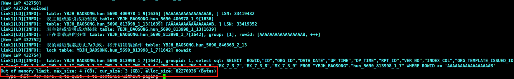

## 源端 Oracle19c 通过 DRS 同步至 DM 报错：获取容器数据库 ID 错误

**【问题描述】**

源端 Oracle19c (带容器) 通过 DRS 同步至 DM，源端配置文件使用创建的公共用户 C##DMDRS 登录，启动 DRS 服务时报错：

```sql
[ERROR]: DRS-9011 执行已经准备好的SQL语句失败 sql: select con.con_id, con.con_uid from v$containers con, v$database db where db.con_dbid=con.dbid and con.name = 'ORCL1PDB', DB942  ORA-00942: table or view does not exist
[ERROR]: DRS-5320 获取容器数据库ID错误 pdb_name: ORCL1PDB
```

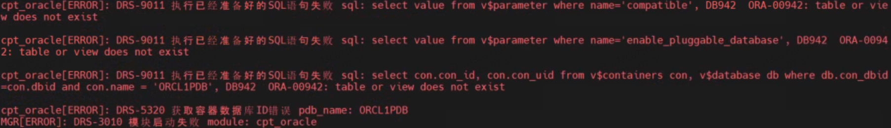

**【问题分析】**

该问题是由于 C##DMDRS 用户对 `v$containers` 和 `v$database` 视图无查询权限导致。

**【问题解决】**

使用 sysdba 登录到 Oracle 数据库，切换到 ORCL1PDB 容器进行授权，SQL 命令参考如下：

```sql
sqlplus / as sysdba
alter session set container=orcl1pdb;
GRANT SELECT ON V_$DATABASE TO C##DMDRS;
GRANT SELECT ON V_$CONTAINERS TO C##DMDRS;
```

## DRS-3009 动态库文件加载失败 library\_path: libz.so

**【问题描述】**

配置 DM 到 DM 的 DRS 数据同步，源端启动 DRS 服务时报错：DRS-3009 动态库文件加载失败 library\_path: libz.so。

**【问题分析】**

不同 DM 版本的 libz.so 依赖库路径可能不一样，早期版本一般在 `$DM_HOME/bin` 目录，最新版本目录是 `$DM_HOME/bin/dependencies` 可以使用以下 find 命令查找：

```shell
[root@db1 ~]# find / -name libz.so
/home/dmdba/dmdbms/bin/dependencies/libz.so
```

**【问题解决】**

在 DMDFM 中链路的源端 “源配置/服务配置”项中，将查找到的 libz.so 文件路径加入到数据库动态库路径，如有多个动态库路径，多个路径间用操作系统环境变量分隔符（如 LINUX 系统用英文半角冒号），然后重启 DRS 服务生效。

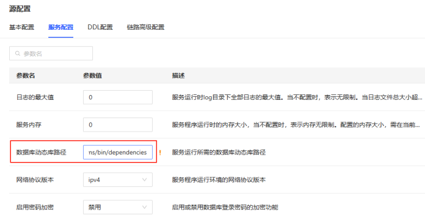

## oracle 到 DM 数据同步报错：【违反唯一性约束】

**【问题描述】**

使用 DMDRS 由 Oracle 到 DM 装载数据时，目标端 DMDRS 报错：违反唯一性约束。

**【问题分析】**

Oracle 主键列数据某些场景下会出现重复，达梦主键列任何场景不支持主键数据重复。

**【问题解决】**

对 Oracle 重复数据行进行数据处理。

## DM 向 Oracle 装载 LOB 大字段失败

**【问题描述】**

使用 DMDRS 进行 DM 到 Oracle 装载数据时，Oracle 端报错：ORA-12552:TNS:OPERATION WAS INTERTUPTED。

**【问题解决】**

装载大字段表时，先使用 NOLOB 掩码进行装载，后续使用 UPDATE|LOB 掩码更新大字段数据，同步命令示例如下：

```sql
alter cpt_dm8 add table "sch.name='RESOURCES'" CREATE|INSERT|GROUP|NOLOB
alter cpt_dm8 add table "sch.name='RESOURCES'" UPDATE|LOB
```

## DMDRS 同步用户报错：权限不足

**【问题描述】**

使用 DMDRS 由 Oracle（容器数据库）到 DM 装载数据时，DMDRS 同步用户已赋权 DBA 权限，但装载数据报权限不足。

【问题分析】

同步用户可能权限缺少相关系统表权限，如 SYS.USER$ 表权限。

**【问题解决】**

根据实际报错情况授予 DMDRS 同步用户缺少的权限。

## DMDRS 源库为 Oracle 容器库时报 DMDRS 同步用户：权限不足

**【问题描述】**

使用 DMDRS 由 Oracle（容器数据库）到 DM 装载数据时，Oracle 端 DMDRS 报错：权限不足无法切换到 PDB 库中，日志如下所示。

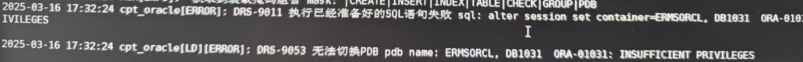

**【问题解决】**

若使用 oracle 的 PDB 用户缺少相关权限无法进行数据同步，可尝试使用 Oracle 公共用户 （C## 开头的用户），并赋予同步相关权限进行同步。以下示例，在 Oracle 库中创建 C##DMDRS 用户作为 DMDRS 同步用户。

```sql
CREATE USER "C##DMDRS" IDENTIFIED BY "**********";
```

## DMDRS 同步线程卡死

**【问题描述】**

DMDRS 同步期间 DMDRS 同步线程卡死。

**【问题分析】**

登录到 DMDRS 目标端执行 `s thr` 命令查看 DMDRS 线程状态，发现影响速率（行/秒）为 0。

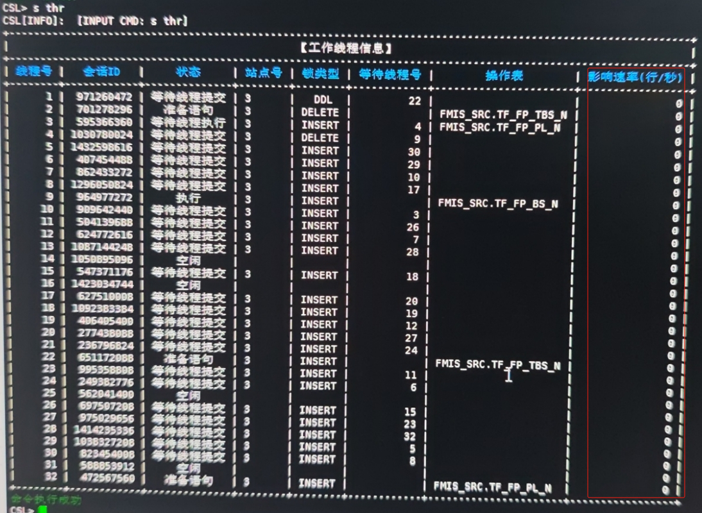

原因是目标端 drs.xml 中 线程数参数值配置较大时（默认 32 个），存在一定触发死锁概率，导致 DMDRS 同步线程卡死。

**【问题解决】**

降低 DMDRS 目标端 参数线程数，例如由 32 调整为 8 并重启 DMDRS 同步链路，可减少触发线程卡死问题。

```xml
<threads>8</threads>
```

参数解释：

| 参数 | 含义 | 说明 |
| --- | --- | --- |
| threads | 执行入库的同步工作线程数 | 当配置的分组数较多，分组间并行度较高，且分组内执行策略配置为并行执行，提高该参数的值可提高同步性能。 |

## DMDRS 目的端装载时日志报错：无效的日期字符串

**【问题描述】**

配置 ORACLE RAC 到 DM 的数据同步，目的端装载时 DMDRS 日志报错："error：DB-70015 无效的日期字符串\[COLID:3\]"。

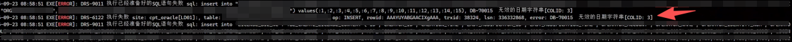

**【问题分析】**

由于在源端环境变量中没有配置日期格式，导致同步到目标端，执行插入日期格式语句报错，在源端查询日期如下所示：

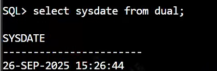

**【问题解决】**

1、在 dmdrs 启动脚本里面增加一个日期格式参数 `NLS_TIMESTAMP_FORMAT='yyyy-mm-dd hh24:mi:ss'` ，修改 dmdrs 启动脚本操作如下：

```shell
vi DmdrsService
```

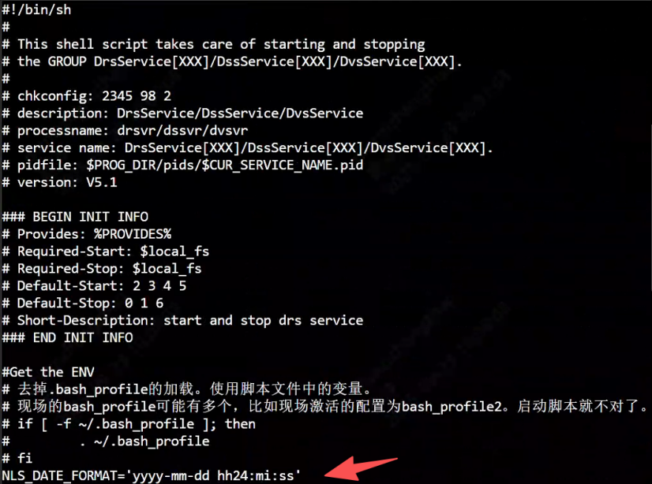

2、重启 DMDSR 服务后，重新进行装载。

## 使用 DSS 转发器时执行端如何配置最新 LSN

**【问题描述】**

使用 DSS 转发器时执行端如何配置最新 LSN。如果不进行配置，EXEC 初次连接 DSS 时将默认从主题的起始位置开始读取日志流，可能会刷大量之前的操作日志。

**【问题解决】**

最新 LSN 可以在 DSS 控制台中使用命令 `s savelist` 查询，如下：

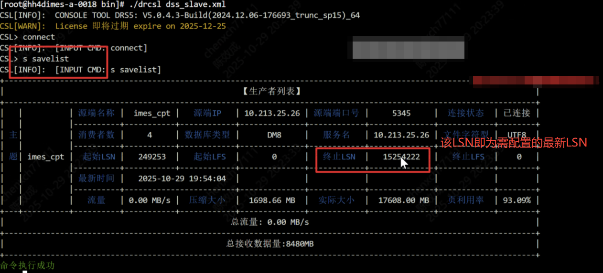

查询到的“终止 LSN”值即为需要配置的最新 LSN 值，在执行端配置文件中添加 `<start_lsn>15254222</start_lsn>` ，示例如下：

```xml
<dss>
        <name>exec_dss</name>
            <ip>192.168.xx.xx</ip>
            <port>xxxx</port>
            <topic>cpt_xxxx</topic>
            <start_lsn>15254222</start_lsn><!-- 配置最新 LSN 。指定开始消费dss文件，默认为0，从第一个文件开始消费dss文件-->
            <map>
                <item>TEST.*==TEST.*</item>
            </map>
        </dss>
```

## DMDRS 初始化装载涉及 timestamp 字段时装载失败

**【问题描述】**

MySQL 同步 DM 库，初始装载涉及到 timestamp 字段且默认时间为 DEFAULT '0000-00-00 00:00:00' 时，初始装载失败，报错：

```sql
2026-03-14 01:46:48 EXE[ERROR]: DRS-9010 直接执行SQL语句失败 sql: -- drs ddl, siteid list[1]
CREATE TABLE "TEST"."sys_dept"("dept_id" BIGINT IDENTITY(1, 1),"create_time" TIMESTAMP(0) DEFAULT CURRENT_TIMESTAMP
NOT NULL ON UPDATE NOW(0),"update_time" TIMESTAMP(0) DEFAULT '0000-00-00 00:00:00' NOT NULL,"del_flag" INT DEFAULT 0 NOT NULL..., DB-2670  对象[update_time]DEFAULT约束表达式无效
2026-03-14 01:46:48 cpt_mysql[LD01][ERROR]: DRS-6027 表创建失败 siteid: 1-1, lsn: 26, trxid: 3, err: DB-2670  对象[update_time]DEFAULT约束表达
式无效, sql: -- drs ddl, siteid list[1]
```

**【问题分析】**

该问题一般是由非法的时间类型数据导致。

**【问题解决】**

启用 DMDRS 日期时间类型合法性的校验功能。

dmdrs 的 cpt 模块提供参数 enable\_check\_date，标识是否启用日期时间类型合法性的校验功能，默认 0 不启用，1 表示启用即校验源 DMDRS 发送的数据中日期时间值的合法性，如果日期时间值不合法，即小于 1900-01-01 00:00:00 或者大于 9999-12-31 23:59:59，都会被替换为 1900-01-01 00:00:00。同时在装载时需要配合 TIME 掩码，重新装载即可解决。

在 drs.xml 中配置参数 enable\_check\_date 值为 1。

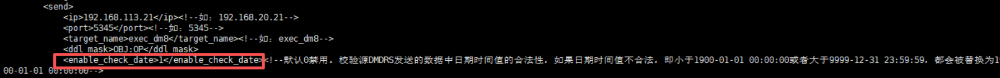

装载命令参考：

```sql
alter cpt_mysql add TABLE "SCH.NAME='test' or SCH.NAME='test2'" DROP|CREATE|INSERT|INDEX|TABLE|CHECK|GROUP|TIME
```

## DMDRS 装载数据报错连接断开导致获取装载失败，事务提交失败及装载未能释放锁

**【问题描述】**

DMDRS 装载 MySQL 源端数据，频繁报错连接断开导致获取装载失败，事务提交失败及装载未能释放锁的报错，报错如下：

```sql
cpt_mysql[LD][ERROR]: DRS-9023 行集数据获取失败 Lost connection to MySQL server during query
cpt_mysql[LD][ERROR]: DRS-2419 装载数据提取失败 table: test.train_seminar[5]
cpt_mysql[LD][ERROR]: DRS-9006 事务提交失败 MySQL server has gone away
cpt_mysql[LD][INFO]: unlock tables
cpt_mysql[LD][ERROR]: DRS-9010 直接执行SQL语句失败 sql: unlock tables, MySQL server has gone away
cpt_mysql[LD][ERROR]: DRS-2474 装载未能释放锁 table: test.train_seminar[5]
```

**【问题解决】**

MySQL 中有 2 个关于网络超时配置策略的参数 net\_read\_timeout 和 net\_write\_timeout，单位 s。这两个参数控制网络读取和写入超时，如果网络连接不稳定或查询数据量较大，可能会导致连接丢失，修改方法如下：

1. 查看当前设置：
```sql
mysql> SHOW VARIABLES LIKE 'net_read_timeout';
ERROR 2006 (HY000): MySQL server has gone away
No connection. Trying to reconnect...
Connection id:    326
Current database: *** NONE ***

+------------------+-------+
| Variable_name    | Value |
+------------------+-------+
| net_read_timeout | 3     |
+------------------+-------+
1 row in set (0.02 sec)

mysql> SHOW VARIABLES LIKE 'net_write_timeout';
+-------------------+-------+
| Variable_name     | Value |
+-------------------+-------+
| net_write_timeout | 6     |
+-------------------+-------+
1 row in set (0.00 sec)

mysql>
```
2. 如果网络不稳定，异常断开几率更大，调整增加配置时间，命令如下：
```sql
mysql> SET GLOBAL net_read_timeout = 60;
Query OK, 0 rows affected (0.00 sec)

mysql> SET GLOBAL net_write_timeout = 60;
Query OK, 0 rows affected (0.00 sec)

mysql>
```

## DMDRS 初始装载报错：文件打开失败

**【问题描述】**

源端 MySQL，dmdrs 使用非 mysql 用户安装，初始装载期间报错： DRS-1005&&DRS-5323

```sql
2026-03-17 01:42:19 cpt_mysql[ERROR]: DRS-1005 文件打开失败 path: /soft/mysql/binlog/mysql57_3306/mysql-bin.000010 code: 13
2026-03-17 01:42:19 cpt_mysql[ERROR]: DRS-5323 打开Binlog日志文件失败 file: /soft/mysql/binlog/mysql57_3306/mysql-bin.000010
```

**【问题分析】**

该问题是由于 dmdrs 安装用户权限不足，无 binlog 日志打开权限导致。

**【问题解决】**

增加 dmdrs 的操作系统用户 dmdrs 到 mysql 的用户组中。

1. 查看用户 mysql 所属的所有组
```sql
[root@~]# groups mysql
[root@localhost ~]# groups mysql
mysql : mysql
```
2. 将用户 dmdrs 添加到 mysql 组
```shell
[root@~]# usermod -aG mysql dmdrs
```
3. 查看用户 dmdrs 所属的所有组，确保添加成功
```sql
[root@localhost ~]# groups dmdrs
dmdrs : dmdrs mysql
[root@localhost ~]#
```

## DMDRS 服务日志显示乱码

**【问题描述】**

DMDRS 安装完成后，终端工具字符集是 UTF-8，登录控制台日志显示正常，查看 DMDRS 服务日志显示乱码。

**【问题解决】**

1. 临时解决办法：将终端工具的字符集调整为 GBK 或 GB18030 后，drs 服务日志可正常显示；
2. 最终解决办法：在 drs.xml 文件的 中添加 ch-utf8 参数。

参数含义：服务器、控制台及日志文件的输出语言和字符集，该参数配置需与窗口字符集配置保持一致。

参数值：ch：GB18030 编码简体中文，默认值为 ch；ch-utf8：UTF-8 编码简体中文；en：英文。

## 启动 oracle 目的端 dmdrs 报错 NO LISTENER

**【问题描述】**

在部署从 DM 数据库到 Oracle 数据库的 dmdrs 数据同步时，使用非 Oracle 操作系统用户进行安装和部署，在启动 Oracle 目标端的 dmdrs 进程时报错“NO LISTENER”，如下图所示：

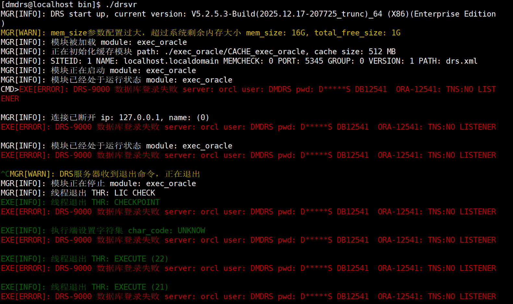

**【问题分析】**

使用非 Oracle 用户安装部署 dmdrs 并将数据同步至目标 Oracle 数据库时，需要配置客户端所需的 tnsnames.ora 文件，才能正常连接到 Oracle 数据库。

**【问题解决】**

编辑 tnsnames.ora 文件，示例如下：

```shell
[oracle@localhost admin]$ cd $ORACLE_HOME/network/admin
[oracle@localhost admin]$ cat tnsnames.ora 
orcl =
  (DESCRIPTION =
    (ADDRESS = (PROTOCOL = TCP)(HOST = 192.168.2.103)(PORT = 1521))
    (CONNECT_DATA =
      (SERVER = DEDICATED)
      (SERVICE_NAME = orcl)
    )
  )
[oracle@localhost admin]$
```

DMDRS 启动成功

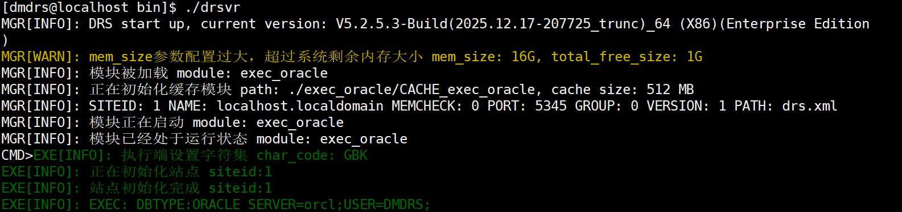