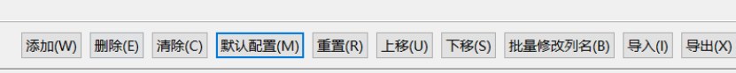
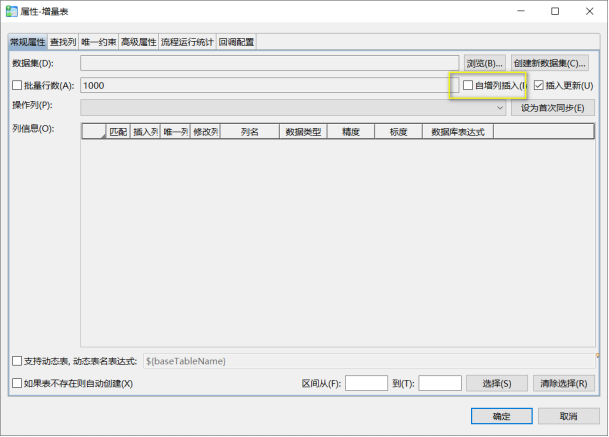
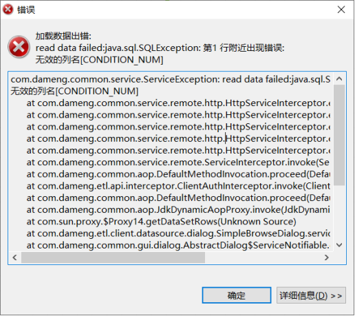
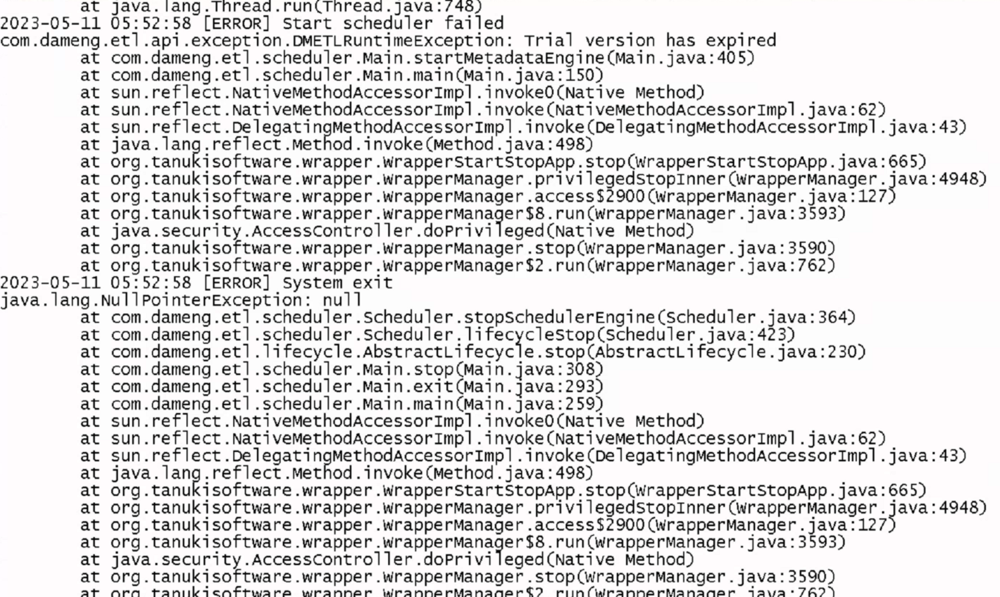
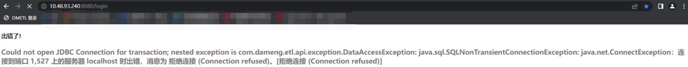

本章节主要介绍 DMETL 常见问题，为用户提供 DMETL 常见问题的分析和解决思路。除此之外，用户还可前往 [达梦技术社区](https://eco.dameng.com/community/question/) 参与更多问题讨论。

## 目录

## 正文

## DMETL4 添加表或者查看表数据时报错：“标记不匹配”

**【问题描述】**

DMETL V4.0 在添加表或者查看表数据时报错：“标记不匹配”

**【问题分析】**

该问题一般是由于连接的数据源类型配置的是 dm7，但是实际库是 dm8 导致。

**【问题解决】**

将 dm8 最新驱动 Dm8JdbcDriver18.jar 改名 Dm7JdbcDriver.jar 覆盖 ETL 自带驱动，路径为 `/dmetl/server/drivers/Dm7JdbcDriver.jar`

## 执行增量表同步时出现报错：“执行失败：数据装载\[增量表\]：-1”

**【问题描述】**

在执行增量表同步时出现报错：“执行失败：数据装载\[增量表\]：-1”，请问是什么原因，怎么解决？

**【问题分析】**

该问题一般是由于增量列 CDC\_OPT 被删除导致。

**【问题解决】**

在“默认输出”线中修改配置，点击“默认配置(M)”按键即可恢复，如下图：



除此之外，建议使用增量同步组件时，不要修改或删除 CDC\_ID 和 CDC\_OPT 列，否则会导致增量异常。

## 目的增量表组件中的【自增列插入功能】的使用时机及用法是什么？

**【问题描述】**

目的增量表组件中的自增列插入功能，它的使用时机及用法是什么？



**【问题解决】**

目的表存在自增列时，要勾选“自增列插入”，否则会破坏目的表的插入更新功能，导致插入主键 id 不同的重复数据。另外如果 ETL 数据源添加表时该表存在自增列，后续数据库中将自增列去掉，那么 ETL 需要重新添加该表，否则会出现目的表报错违反主键的非空约束。

## DMETL4 表数据源报错：“无效的列名 xxx”

**【问题描述】**

DMETL4 表数据源报错：“无效的列名 xxx”，右击表名-查看表数据也报相同错误，请问是什么原因，怎么解决？



**【问题分析】**

该报错是 DMETL4 经典常见报错，原因是在 ETL 数据源中添加表之后，再在数据库中修改了该表的结构导致。

**【问题解决】**

解决办法是在 ETL 数据源中右击删除该表，然后右击重新添加该表。

> **注意**
> 
> 在使用 DMETL 同步时，不要修改数据源的表结构。

更多内容可参考专栏文章： [《DMETL 根据时间字段增量抽取》](https://eco.dameng.com/community/article/b614dd1dbebec8933f862379c69f9916) 和 [《DMETL 使用 SQL 向下传递变量》](https://eco.dameng.com/community/article/6087558f35edcfba187e61dbca32daa9) 。

## DMETL 启动报错：“Tria version has expired”

**【问题描述】**

DMETL 启动报如下错误:

```shell
2023-05-1105:52:58[ERROR] start scheduler failed
com .dameng.etl.api.exception.DMETLRuntimeException: Tria version has expired
```



**【问题分析】**

该报错是由于 DMETL 自带的授权 key 命名为 Tria.key 授权过期导致。

**【问题解决】**

1. 联系达梦商务重新申请 key；
2. 在 dmetl5/scheduler/config 目录下删除 trial.key 将正式 key 拷贝到该目录下重命名为 dmetl.key 替换原来的 key；
3. 重启 DMETL 服务。
```shell
./dmetl5/scheduler/scheduler_service_restart.sh
./dmetl5/manager/manager_service_restart.sh
./dmetl5/controller/controller_service_restart.sh
```

## DMETL 启动报错："连接到端口 1527 上的服务器 localhost 时出错"。

**【问题描述】**

启动 DMETL 是报错：“ java.sql.SQLNonTransientConnectionException: 连接到端口 1527 上的服务器 localhost 时出错”。



**【问题分析】**

根据报错信息提示分析是由于 mannger 进程报错，连不上内置的数据库。

**【问题解决】**

1. 在 mannger/config/ 目录下查看 mannger.xml 文件配置的数据是否正常，如果有问题则修改为正确的配置。
2. 如果使用的是达梦数据库则直接查看达梦数据库状态是否正常，如果数据库状态异常则排查数据库异常原因并恢复数据库服务。
3. 如果使用的是 derby 开源库，则应检查 mannger 调用的相关进程是否正常，如果相关进程异常则排查进程异常的原因并修复。
4. 在 log 目录下排查报错的 error 日志，检查是否为授权或其他问题导致并根据故障描述具体修复故障。
5. 如果通过以上步骤未排查出问题则需要检查所有组件的进程日志，进一步分析排查问题原因。