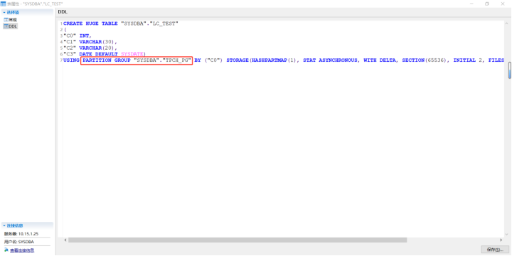
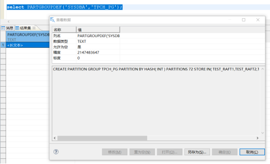
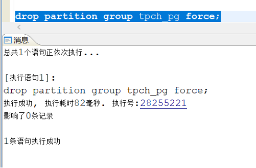
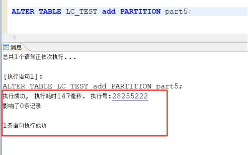
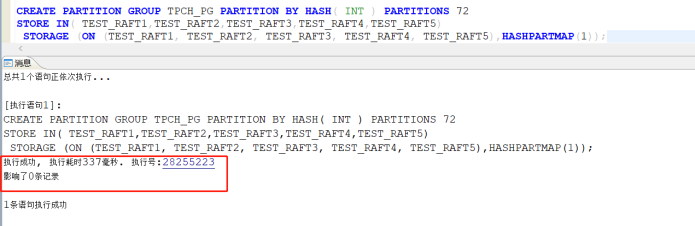
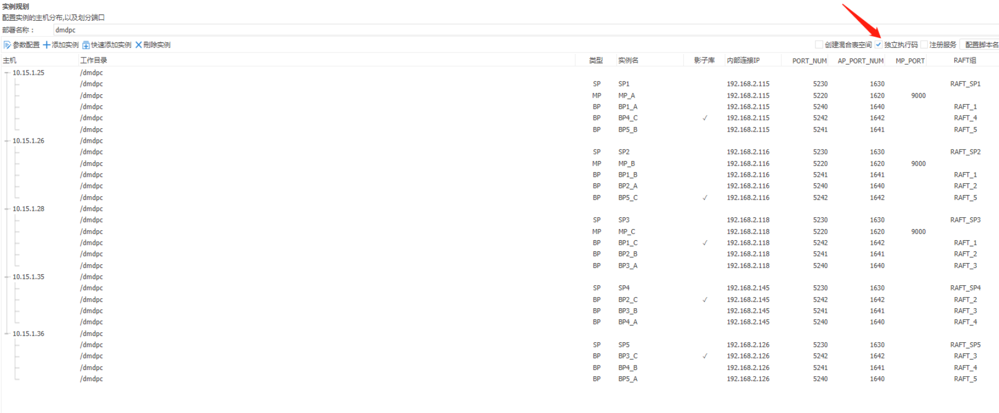
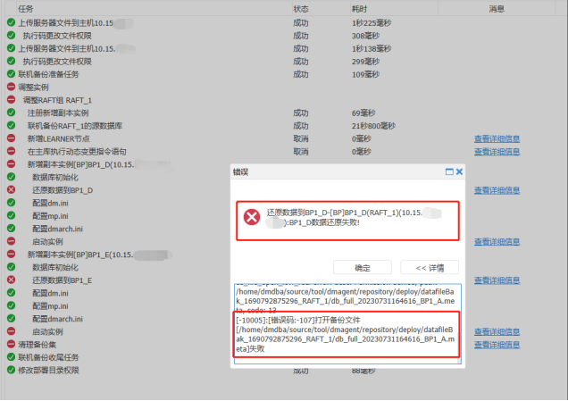
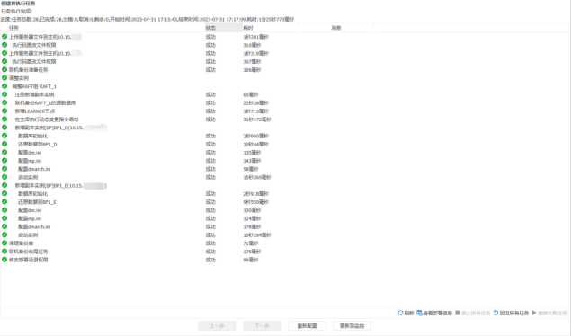

本章节主要介绍新一代分布式集群 DMDPC 常见问题，为用户提供 DMDPC 集群常见问题的分析和解决思路。除此之外，用户还可前往 [达梦技术社区](https://eco.dameng.com/community/question/) 参与更多问题讨论。

## 目录

## 正文

## DPC 如何查询正在对外提供服务节点的会话数

**【问题解决】**

通过以下命令可以查询到 DPC 正在对外提供服务节点的会话数。

```sql
SELECT sf_get_ep_seqno(a.rowid) raft_id,
                       COUNT(*) ,
                        b.name
               FROM v$sessions a left join dpc_instance b on sf_get_ep_seqno(a.rowid)=b.RAFT_ID
          WHERE b.SYS_MODE !='STANDBY'
       GROUP BY sf_get_ep_seqno(a.rowid) ,
       b.name
       ORDER BY RAFT_ID ;
```

## DPC 集群中添加分区时报错："-3806: 表依赖于分区组，不能做该 ALTER 操作"

**【问题描述】**

在 DPC 集群上基于分区组创建 hash 列存分区表，对 hash 列存分区表进行添加分区时报错："-3806: 表依赖于分区组，不能做该 ALTER 操作"。

**【问题分析】**

根据分区组的限制："基于分区组创建的表，无法增删分区"，由此说明上述报错为正常提示。

**【问题解决】**

根据手册中描述："删除分区组后，基于该分区组创建的表对象不会被删除，但是表的 DDL 属性会发生变化，不再依附于分区组"，因此删除该分区组并不会影响基于分区组创建的表的数据分布和存储位置。可通过以下方法绕过该报错：

1. 删除分区组;
2. 对基于分区组创建的表进行增删分区操作；
3. 重建分区组。

示例：

1. 准备分区组和分区表。
```sql
--创建分区组
create partition group tpch_pg partition by hash(int) partitions 72 
storage (on (TEST_RAFT1,TEST_RAFT2,TEST_RAFT3,TEST_RAFT4,TEST_RAFT5));

--创建分区表
CREATE huge TABLE LC_TEST
(
"C0" INT,
"C1" VARCHAR(30),
"C2" VARCHAR(20),
"C3" date default sysdate) using partition group tpch_pg by (C0);
```
2. 测试对依赖于某个分区组的列存 hash 分区表进行添加分区操作时会报错：“-3806: 表依赖于分区组，不能做该 ALTER 操作”。
```sql
ALTER TABLE LC_TEST add PARTITION part5;
```

3. 绕过该报错。

  3.1 获取分区表依赖的分区组

在 manage 中选中”分区表”，右键”属性”,点击”DDL”选项，可以看到分区表依赖的分区组。



  3.2 获取分区组的创建语句。

```sql
select PARTGROUPDEF('SYSDBA','TPCH_PG');
```



```sql
--分区组的创建语句
CREATE PARTITION GROUP TPCH_PG PARTITION BY HASH( INT ) PARTITIONS 72 STORE IN( TEST_RAFT1,TEST_RAFT2,TEST_RAFT3,TEST_RAFT4,TEST_RAFT5)
```

  3.3 删除分区组。

```sql
drop partition group tpch_pg force;
```



  3.4 对分区表增加分区。

```sql
ALTER TABLE LC_TEST add PARTITION part5;
```



  3.5 进行重建分区组。

```sql
CREATE PARTITION GROUP TPCH_PG PARTITION BY HASH( INT ) PARTITIONS 72 
STORE IN( TEST_RAFT1,TEST_RAFT2,TEST_RAFT3,TEST_RAFT4,TEST_RAFT5)
 STORAGE (ON (TEST_RAFT1, TEST_RAFT2, TEST_RAFT3, TEST_RAFT4, TEST_RAFT5),HASHPARTMAP(1));
```



## 无法对 DPC 集群进行滚动升级

**【问题描述】**

使用 DEM 的默认设置搭建带副本的 DPC 集群时，无法对 DPC 集群进行滚动升级。

**【问题分析】**

使用 DEM 的默认设置搭建带副本的 DPC 集群时，同一台机器会存在多个实例，并使用同一个执行码，而 DPC 集群滚动升级的前提条件为每个实例拥有独立执行码。

**【问题解决】**

只有在使用 DEM 搭建 DPC 集群时，在"实例规划"步骤中，手动选择了"独立执行码"选项，这个选项会使同一台机器上的每个实例单独拥有一个执行码，这样才能够进行 DPC 的滚动升级操作。



## DPC 集群扩展节点报错：“数据还原失败”

**【问题描述】**

在使用 dem 扩容 BP1 RAFT 组时，新节点无法通过 BP1 RAFT 组中主节点的备份进行还原，报错“ BP1\_D 数据还原失败”。



**【问题分析】**

该报错是由于 dmagent 是使用 root 普通用户权限启动导致。

**【问题解决】**

使用 dmdba 用户重新启动 dmagent 程序，再次进行扩容可以扩容成功。



## DMDPC 集群怎么查询哪些列未启用压缩

**【问题描述】**

DMDPC 集群中经常使用 huge 表并启用了压缩，随着业务的上线升级，存在对 huge 添加列的需求，而新增列默认并没有启用压缩，导致空间使用率较高，怎么查询哪些列未启用压缩？

**【问题解决】**

主要涉及数据字典 SYSCOLUMNS，列压缩信息存储其列 info1 中，需要对其解析，其规则为：info1 转换二进制后的倒数第 9 至 13 位为该列的压缩级别。

1. 创建十进制到二进制转换函数。
```sql
CREATE OR REPLACE FUNCTION NUMBER_TO_BIT(V_NUM NUMBER)
RETURN VARCHAR IS V_RTN VARCHAR(800);--注意返回列长度
  V_N1  NUMBER;
  V_N2  NUMBER;
BEGIN
V_N1 := V_NUM;
    LOOP
      V_N2  := MOD(V_N1, 2);
      V_N1  := ABS(TRUNC(V_N1 / 2));
      V_RTN := TO_CHAR(V_N2) || V_RTN;
      EXIT WHEN V_N1 = 0;
    END LOOP;
--返回二进制长度
 SELECT lpad(V_RTN,64,0)
    INTO   V_RTN
    FROM dual;
return V_RTN;
end;
```
2. 创建二进制到十进制转换函数。
```sql
CREATE OR REPLACE FUNCTION binary_to_num (pbin VARCHAR2) 
RETURN BIGINT DETERMINISTIC
IS  
   v_len   INT := LENGTH (pbin);  
   v_num   BIGINT := 0;  
BEGIN  
   FOR i IN 1..v_len LOOP  
      IF SUBSTR(pbin, i, 1) = '1' THEN  
         v_num := v_num + POWER(2, v_len - i);  
      END IF;  
   END LOOP;  
   RETURN v_num;  
END binary_to_num;
```
3. 查询 huge 未启用压缩的列信息。
```sql
select username,
       id,
       name,
       lvl,
       colcnt,
       huge_table_used_space(username, name) used_MB
  from (select tn1.name username,
               tn.*,
               count(*) over(partition by tn.id, tn.name order by tn.id) lvlcnt
          from (select schid, id, name, lvl, count(*) colcnt
                  from (select t.schid,
                               t.id,
                               t.name, --NUMBER_TO_BIT(tc.info1),
                               binary_to_num(substr(NUMBER_TO_BIT(tc.info1),
                                                    -13,
                                                    4)) lvl
                          from SYSCOLUMNS tc, sysobjects t
                         where tc.id = t.id
                           and (t.INFO3 &0X3F) BETWEEN 0X21 AND 0X27
                           AND t.PID = -1)
                 group by schid, id, name, lvl) tn,
               sysobjects tn1
         where tn.schid = tn1.id)
 where lvlcnt > 1
 order by 6 desc;
```
4. 对应已经添加的未启用压缩列的表，建议表重建。
5. 对已启用压缩的 huge 表，正确的添加列语句如下：
```sql
alter table t add column c3 varchar(100) compress level 5;
```

## 在 dmdpc 集群环境中，怎么查看用户默认表空间组？

**【问题分析】**

在 dmdpc 集群环境中，怎么查看用户默认表空间组？dba\_users 视图中没有记录该信息。

**【问题解决】**

可以通过查询用户定义获取，参考命令如下：

```sql
select dbms_metadata.get_ddl('USER','USERNAME');
--其中包含：default tablespace group xxxx
```