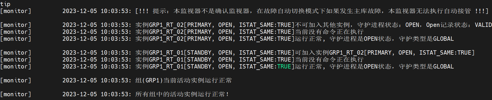
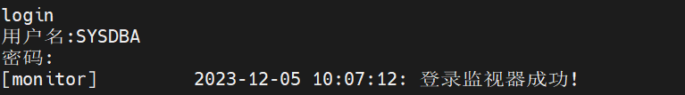
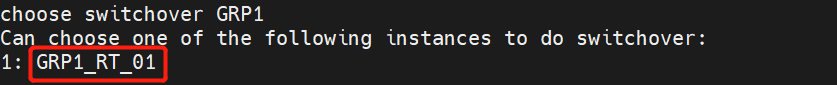
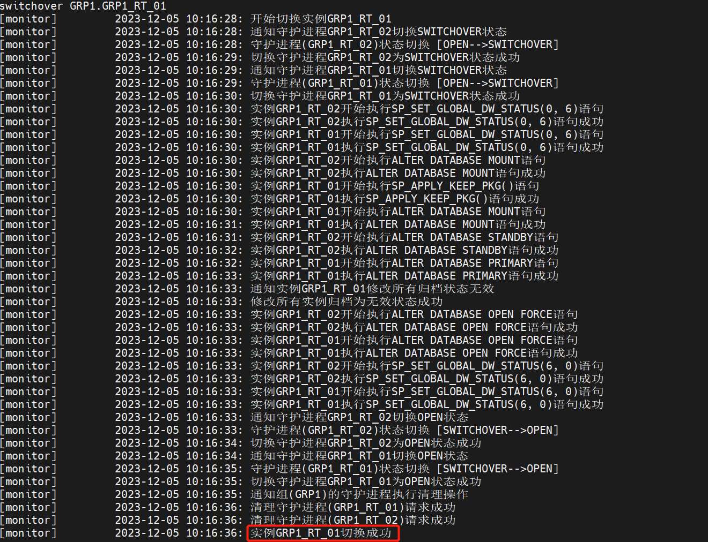
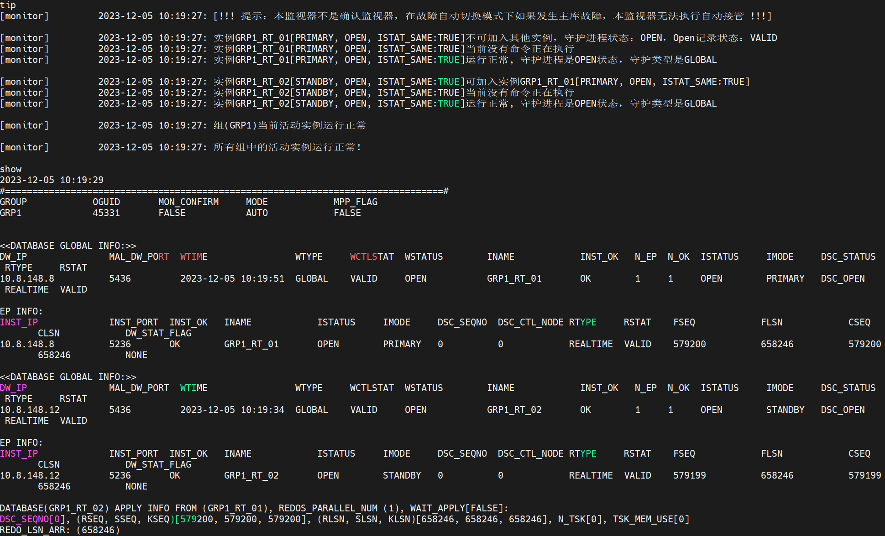
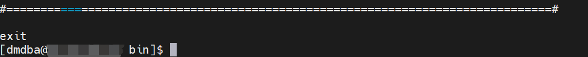
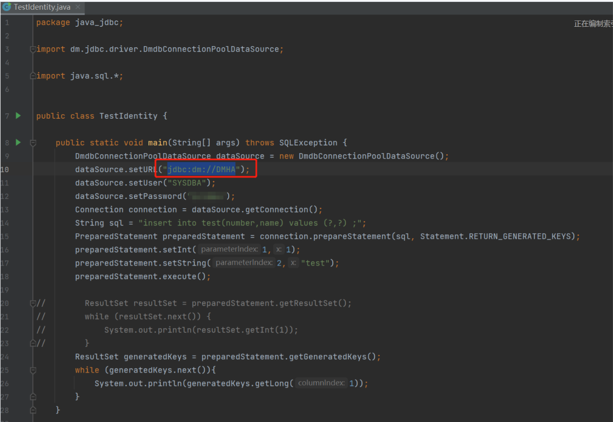
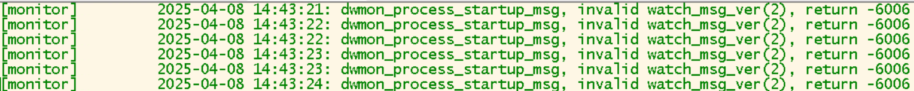

本章节主要介绍 Data Watch 常见问题，为用户提供 Data Watch 常见问题的分析和解决思路。除此之外，用户还可前往 [达梦技术社区](https://eco.dameng.com/community/question/) 参与更多问题讨论。

## 目录

## 正文

## 数据守护启动和关闭顺序

启动数据库举例：

- 启动数据库

以 Mount 方式分别启动主、备数据库：`./dmserver  /DM/data/DAMENG/dm.ini mount` 。

- 修改数据库模式

登录主数据库修改数据库模式为： `PRIMARY` 。

```sql
alter database primary;
```

登录备数据库修改数据库模式为： `STANDBY` 。

```sql
alter database standby;
```
- 启动守护进程

启动主机 DM1 上的守护进程：`./DmWatcherServiceGRP1_RT_01 start` 。

启动备机 DM2 上的守护进程：`./DmWatcherServiceGRP1_RT_02 start` 。

启动监视机 DM\_W 上的监视器：`./dmmonitor /home/dmdba/dmdbms/data/DAMENG/dmmonitor.ini` 。

关闭数据库举例：

- 退出 DM 数据守护
- 退出监视器
- 关闭备机的守护进程
- 关闭主机的守护进程
- 关闭主机实例
- 关闭备机实例

## dmmonitor 进入监视器查看各个节点状态

**【问题描述】** ：

- /dmmonitor 监视器作为服务已经开机启动情况下，如何进入监视器查看各个节点状态。
- 数据守护后台启动监视器后，怎么进入。
- 读写分离集群部署了两套，确认第二套集群启动确认监视器时报错只能启动一个。

**【解决方法】** ：

确认监视器只能配置一个，配一个新的非确认监视器。

## 主备集群魔数不一样，如何解决

**【问题详情】：**

集群搭好了，但是两边的魔数不一样，主库写进去的备库查询不到，查看监控日志是归档出错了/配置主备，两个库安装以及怎么确保魔数一致？

**【问题解答】：**

不同版本的 DM 主备库数据准备的方式不一样。

需要参考安装目录下的 doc 目录下--“DM 数据守护与读写分离集群”-- 7.1 数据准备章节。

以前的版本主备数据准备是可以用数据文件拷贝以及备份还原方式的。最新的版本是必须先通过备份还原方式同步各数据库的数据。

## 主备模式下重命名表空间数据文件报错：don't support on primary mode

主备模式下是处于主机状态，禁止修改数据文件名。

## 延迟启动集群

某些服务器系统在重启以后，网络会等待两分钟才恢复正常，但是在这两分钟内，集群的状态就会由于网络问题不正常，通过以下方法能够实现让集群等网络恢复后再延时启动；

- 禁用开机自启
```shell
systemctl disable DmServiceDMSERVER.service
systemctl disable DmWatcherServiceDM.service
```

在监视器上禁用监视器服务

```shell
systemctl disable DmMonitorServiceDM.service
```

禁用以后重启系统集群服务不会自动启动，所以此时我们需要写一个启动集群的 shell 脚本。

- 编写 startDatabase.sh 脚本

sleep 180 表示等待 3min 再启动实例服务和守护进程  
数据库主和备服务器上如下：

```shell
#！/bin/bash
sleep 180
/home/dmdba/dmdbms/bin/DmServiceDMSERVER start
/home/dmdba/dmdbms/bin/DmWatcherServiceDM start
```

然后赋予这个脚本执行权限

```shell
chmod +x startDatabase.sh
```

ls -l 查看是否有执行权限  
通过./startDatabase.sh 验证脚本正确性，能否在三分钟后启动集群。

监视器服务器上：  
监视器服务等待 5 分钟后启动

```shell
chmod +x startDatabase.sh
#！/bin/bash
sleep 300
/home/dmdba/dmdbms/bin/DmMonitorServiceDM start
```

同样也是执行一遍，看脚本是否正确；

- 将编写好的脚本写入到 linux 的 rc.local 文件里  
	在最后添加
```shell
/root/startDatabase.sh &
```

然后保存，重启验证

## 达梦集群是否可以部署多个确认监视器

**【问题解决】**

一个数据守护系统中，最多只能配置 1 个确认监视器。但是确认监视器可配置成单实例或多实例两种形式。

单实例确认监视器的配置和启动步骤均与普通监视器一样。

多实例确认监视器采用 RAFT 协议实现。在多实例确认监视器中，只有一个实例作为确认监视器提供服务，其它实例作为备库存在而不提供服务。当确认监视器出现故障时，系统会从它的备库中选举一位作为新的确认监视器继续提供服务。多实例确认监视器不支持动态扩展节点。

例如：两节点集群多实例确认监视器配置：

```
MON_LOG_PATH=/opt/dmdbms/data/log
MON_LOG_INTERVAL=60
MON_LOG_FILE_SIZE=32
MON_LOG_SPACE_LIMIT=0
MON_DW_CONFIRM=1
MON_INST_NUM=3#实例总个数
MON_HB_INTERVAL=60#通信心跳校验间隔
MON_BRO_INTERVAL=100#raft协议中实例通信心跳间隔
MON_VOTE_INTERVAL=100#raft协议中基础投票间隔
MON_ID=1#当前监视器在监视器系统中的ID
MON_MID=45614#当前监视器系统的唯一标识
[GDW1]
MON_INST_OGUID=45331#组GDW1的唯一OGUID值
MON_DW_IP=192.168.10.3:5436
MON_DW_IP=192.168.10.4:5436
[MON1]
MON_HOST=192.168.10.3#系统监听TCP连接的IP地址
MON_PORT=8339#系统监听TCP连接的端口号
MON_INST_ID=1#监视器实例在监视器系统中的ID
[MON2]
MON_HOST=192.168.10.4#系统监听TCP连接的IP地址
MON_PORT=8340#系统监听TCP连接的端口号
MON_INST_ID=2#监视器实例在监视器系统中的ID
[MON3]
MON_HOST=192.168.10.5#系统监听TCP连接的IP地址
MON_PORT=8341#系统监听TCP连接的端口号
MON_INST_ID=3#监视器实例在监视器系统中的ID
```

> **注意**
> 
> 为每个实例配置一个dmmonitor.ini，众多dmmonitor.ini中，除MON\_ID参数不同以外，其他参数应完全一致。各实例的 MON\_ID 与 MON\_INST\_ID 应相同。

更多详细使用方法和参数介绍可参考《 DM8 数据守护与读写分离集群 》手册 。

## 读写分离集群搭建成功后，读写不分发，应用无法连接备库

**【问题描述】**

读写分离集群应用通过服务名连接数据库，测试环境和生产环境数据库版本、驱动均一致，网络架构也全部一致，生产环境读写不分发，备库无连接，测试环境读写正常分发。

**【问题分析】**

1. 通过开启 jdbc 日志查看不分发原因发现大量的网络通信异常报错。
```java
[DEBUG - 2023-06-26 16:11:38] tid:1 - [main] try connect loop 0
[DEBUG - 2023-06-26 16:11:43] tid:1 - [main] try connect fail [192.168.xxx.xxx:1111 (UNKNOW, UNKNOW), sessions: 0] 网络通信异常
[WARN  - 2023-06-26 16:11:43] tid:1 - [main] { conn-1 } connStandby();  网络通信异常
```

通过上面的信息可以发现，应用实际对备库发起了请求，但是请求 192.168.xxx.xxx ip 为内网 ip，和应用的网络和端口是不通的。

2. 读写分离分发原理如下：

  ① 用户发起数据库连接请求；

  ② 接口（JDBC、DPI 等）根据服务名配置(在 dm\_svc.conf 中进行配置)登录主库；

  ③ 主库挑选一个有效即时备库或实时备库的 IP/Port 返回给接口。

3. 主库挑选的规则是根据 dmmal.ini 配置文件中的 MAL\_INST\_HOST 参数（对外提供服务 ip，业务 ip），通过上述分析该问题可能和 MAL\_INST\_HOST 配置的网段地址有关系。
4. 排查 dmmal.ini 配置发现内网 ip 和外网 ip 写反。

**【问题解决】**

修改 dmmal.ini 配置文件，将内网 ip 和外网 ip 修改正确解决问题。

## 如何手动切换主备

**【问题描述】**

集群配置有确认监视器，并已经使用服务的方式启动，当集群发生切换时，如何切换回来。

**【问题分析】**

集群在配置监视器时，一般配置好确认监视器后，建议再配置一个非确认监视器的配置文件，在主备发生切换时，可以通过前台的方式启动非确认监视器进行手动切换。非确认监视器是通过将监视器配置文件中 MON\_DW\_CONFIRM 参数值修改为 0 来实现，非确认监视器配置文件示例如下：

```shell
dmdba@~]$ vi /opt/dmdbms/bin/dmmonitor_manual.ini

MON_DW_CONFIRM             = 0  #0：非确认（故障手切） 1：确认（故障自切）
MON_LOG_PATH               = ../log  #监视器日志文件存放路径
MON_LOG_INTERVAL           = 60  #每隔 60s 定时记录系统信息到日志文件
MON_LOG_FILE_SIZE          = 512  #单个日志大小，单位 MB
MON_LOG_SPACE_LIMIT        = 2048  #日志上限，单位 MB

[GRP1]
MON_INST_OGUID           = 45331  #组 GRP1 的唯一 OGUID 值
MON_DW_IP                = 192.168.1.1:5436  #IP 对应 MAL_HOST，PORT 对应 MAL_DW_PORT
MON_DW_IP                = 192.168.1.2:5436
```

**【问题解决】**

在集群环境中配置有确认监视器时，主备只是发生了切换的情况下，在将主备切换回去时，只需要启动非确认监视器执行切换命令即可。例如，有主库 GRP1\_RT\_01 与备库 GRP1\_RT\_02 发生切换，恢复方法如下：

1. 通过前台方式启动非确认监视器。
```shell
./dmmonitor dmmonitor_manual.ini
```

从监视器中可以看到 GRP1\_RT\_02 变成了主库，GRP1\_RT\_01 变成了备库。

2. 检查集群状态。

可通过监视器命令"tip"或"show"来检查集群状态是否正常。



通过 "tip" 命令可以看到集群状态正常。

3. 登录非确认监视器。

在非确认监视器中输入"login"再输入用户名和密码登录监视器。



4. 查看满足切换条件的实例。

输入命令"choose switchover 组名"查看可切换为主机的实例列表。

```shell
choose switchover GRP1
```



可以看到 GRP1\_RT\_01 可以进行切换。

5. 主备切换。

执行命令"switchover GRP1.实例名"进行切换。

```sql
switchover GRP1.GRP1_RT_01
```



切换成功，GRP1\_RT\_01 恢复到主库对外提供服务。

6. 退出非确认监视器。

先通过监视器命令"tip"和"show"检查当前集群状态。



集群状态正常，执行“exit”命令退出监视器。



**补充：**

生产环境中建议应用使用服务名的方式进行连接，在配置文件 dm\_svc.conf 中配置只连主库，这样连接的好处在于当主备发生切换后应用会自动连接到当前的主库，不会影响应用的正常使用。

初始 dm\_svc.conf 文件由达梦安装时自动生成。不同的平台生成目录有所不同，注意相应访问用户需要对该文件有读取权限。

- 32 位的 DM 安装在 Win32 操作平台下，此文件位于 %SystemRoot%\\system32 目录；
- 64 位的 DM 安装在 Win64 操作平台下，此文件位于 %SystemRoot%\\system32 目录；
- 32 位的 DM 安装在 Win64 操作平台下，此文件位于 %SystemRoot%\\SysWOW64 目录；
- 在 Linux 平台下，此文件位于 /etc 目录。

主备集群 dm\_svc.conf 配置文件参考如下：

```shell
##以#开头的行表示是注释#
##全局配置区
TIME_ZONE=(480)
LANGUAGE=(cn)
DMHA=(192.168.100.100:5236,192.168.100.101:5236)
##服务配置
[DMHA]
SWITCH_TIMES=(3)
SWITCH_INTERVAL=(100)
LOGIN_MODE=(1)
```

JDBC 连接串参考如下：jdbc:dm://DMHA



更多 dm\_svc.conf 说明及使用方法参考数据库安装目录下 doc 目录中《DM8 数据守护与读写分离集群》手册-5.8 章节。

## 主备集群新启动的监视器执行 takeover 切换失败

**【问题描述】**

主备集群，手动切换模式，当主库宕机，新启动的监视器执行 takeover 切换失败，提示获取主库信息失败。

**【问题分析】**

切换失败原因为新启动监视器未收到过主库信息，无法判断，所以无法切换。

**【问题解决】**

1. 使用 get primary info \[group\_name\] 命令可从备库获取到主库信息；
2. 获取到信息后，再使用 takeover 命令可进行切换。

## 确认监视器无法监控集群信息

**【问题描述】**

主备集群重新部署确认监视器，在新的监视器服务器配置好 dmmonitor.ini 文件启动监视器后，无法监控到各个节点信息，日志报错：dwmon\_process\_startup\_msg, invalid watch msg\_ver(2), return -6006 ，报错日志如下：



**【问题分析】**

错误代码 -6006 通常与达梦数据库的监控组件 dwmon 相关，msg\_ver(2) 表示消息版本不匹配，可能是由于配置文件或数据库软件版本不兼容导致的。

排查主数据库节点监视器版本和当前新确认监视器版本是否一致，查询方法如下：

1. 使用 dmdba 用户在主数据库安装目录的 bin 目录下执行./dmmonitor help ，确认 monitor 的版本信息：
```shell
[dmdba@oms-12c02jqp bin]<20250408 14:05:53>$ ./dmmonitor help
version: 03134284094-20231103-207374-20067 Pack7
格式: ./dmmonitor [ini_path] [path=ini_path] | help
```
2. 使用 dmdba 用户在当前新确认监视器节点的数据库安装目录的 bin 目录下执行./dmmonitor help ，确认当前 monitor 的版本信息：
```shell
[dmdba@oms-12c02jqp bin]<20250408 14:06:04>$ ./dmmonitor help
version: 03134284336-20250331-266909-20132 Pack14
格式: ./dmmonitor [ini_path] [path=ini_path] | help | [raft_file_path=file_path raft_file_size=file_size mon_magic=mon_magic mon_name=mon_name overwrite=overwrite]
```

通过对比监视器版本信息发现当前新监视器版本与主库监视器版本不一致。

**【问题解决】**

在新监视器节点安装与主备节点版本相同的数据库软件，保证数据库版本一致，再部署确认监视器既可正常运行。