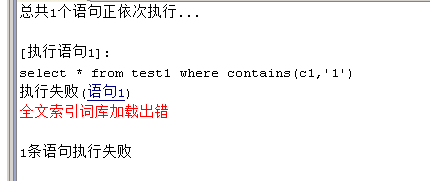
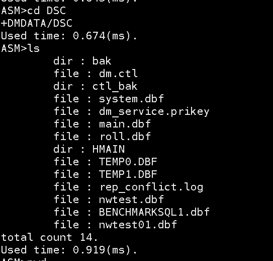
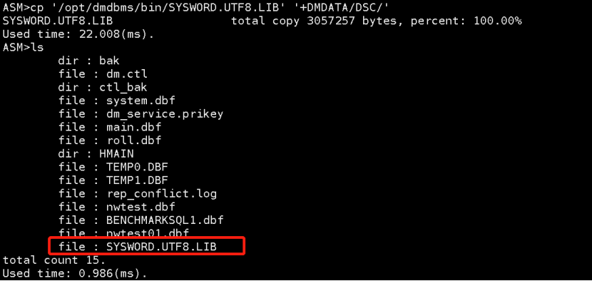
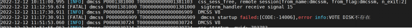
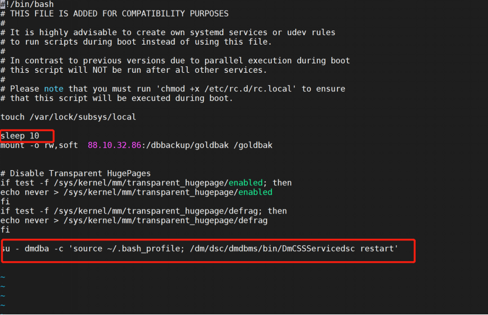

本章节主要介绍 DSC 集群常见问题，为用户提供 DSC 集群常见问题的分析和解决思路。除此之外，用户还可前往 [达梦技术社区](https://eco.dameng.com/community/question/) 参与更多问题讨论。

## 目录

## 正文

## ASMCMD import DCRDISK failed,code:-11034,desc:磁盘正在使用中

如果有任何一个节点的 ASM 或 CSS 集群相关进程没有关闭，导入操作会失败。

## ASMCMD import DCRDISK failed,code:-802,desc:非法 INT 配置参数

因为 DSC 集群启动完成后，必须要执行 export，才能再 import，否则就会出现这个报错。

## sys\_status: AFTER REDO, vtd\_status: SYSHALT

**【报错信息】** ：  
DSC 升级时报错：  
sigterm\_handler receive sigal 11  
hpc\_heart\_beat\_dsk\_thread halt, sys\_status: AFTER REDO, vtd\_status: SYSHALT

**【解决办法】** ：

手动在数据目录编辑 sqllog.ini 文件

```
BUF_TOTAL_SIZE = 10240
BUF_SIZE = 1024
BUF_KEEP_CNT = 6
[SLOG_ALL]
   FILE_PATH = ．．＼log
   PART_STOR = 0
   SWITCH_MODE = 0
   SWITCH_LIMIT = 0
   ASYNC_FLUSH = 0
   FILE_NUM = 50
   ITEMS = 0
   SQL_TRACE_MASK = 0
   MIN_EXEC_TIME = 0
   USER_MODE = 0
   USERS =
```

## 使用 dmasmcmd 工具初始化，报错: code: -4546, desc: 打开文件失败

**【报错信息】** ：

搭建 DSC 集群时使用 dmasmcmd 工具初始化，报错

```shell
“2021-07-13 02:57:01.570 [ERROR] dmasmcmd P0000001500 T0000000000000001500  os_file_open_low_real at (/home/test/jq/trunk8_rel_2104/asmcmd/asmcmd.c: 1385) error! desc: Permission denied, path: /dev/raw/raw1, code: 13
2021-07-13 02:57:01.570 [ERROR] dmasmcmd P0000001500 T0000000000000001500  The ASMCMD executed: "create dcrdisk '/dev/raw/raw1' 'dcr'
", code: -4546, desc: 打开文件失败”
```

**【问题分析】**

该问题可能由两种情况导致：

1. DSC 集群各节点添加共享磁盘后，存在节点未绑定裸设备。
2. 磁盘绑定用户组的权限错误；

**【解决办法】** ：

1. 在数据库安装目录的 bin 目录下通过命令 `./dmasmtool dcr_ini=/soft/dsc/config/dmdcr.ini` 启动 dmasmtool 工具 ，通过命令 `lsdsk` 检查裸设备是否绑定，如果未绑定，请先绑定裸设备；

例如：

```shell
[dmdba@localhost bin]$ ./dmasmtool dcr_ini=/soft/dsc/config/dmdcr.ini
DMASMTOOL V8
ASM>lsdsk
group DMLOG include 1 disks......
NO.1 disk :
name: DMASMLOG0
path: /dev/raw/asm-redo
size: 10.00 GB
create_time: 2022-09-20 22:16:33
modify_time: 2022-09-20 22:16:33
belong group: DMLOG
group DMDATA include 1 disks......
NO.1 disk :
name: DMASMDATA0
path: /dev/raw/asm-data01
size: 20.00 GB
create_time: 2022-09-20 22:16:40
modify_time: 2022-09-20 22:16:40
belong group: DMDATA
group VOTE include 1 disks......
NO.1 disk :
name: DMASMvote
path: /dev/raw/asm-vote
size: 1.00 GB
create_time: 2022-09-20 21:58:46
modify_time: 2022-09-20 21:58:46
belong group: VOTE
group DCR include 1 disks......
NO.1 disk :
name: DMASMdcr
path: /dev/raw/asm-dcr
size: 1.00 GB
create_time: 2022-09-20 21:58:02
modify_time: 2022-09-20 21:58:02
belong group: DCR

total 1 disks unused......
NO.1 :  name: DMASMDMASMDATA1, path: /dev/raw/asm-data02, size: 5.00 GB
Used time: 9.189(ms).
```

可以看到待添加的 '/dev/raw/asm-data02' 磁盘是未使用状态，说明该磁盘未绑定。具体绑定方法请参考达梦数据库安装目录下的 doc 目录中的《DM8 共享存储集群》手册。

2.检查磁盘绑定用户组的权限，建议与 ASM 运行的用户保持一致，尽量不要用 root 用户绑定修改 `/etc/udev/rules.d/60-raw.rules` 。

```shell
ACTION=="add", KERNEL=="raw[1-4]", OWNER="dmdba", GROUP="dinstall", MODE="660"
```

## 启动 dmasmsvr 服务报错: self instance (\*\*\*) not found in /.../.../dmdcr.ini

dmdcr.ini 中配置的 ASM 节点名称（MAL\_INST\_NAME ）和 dmdcr\_cfg.ini 中配置的 ASM 节点名称（DCR\_EP\_NAME ）应保持一致；

## 如何将 ASM 磁盘中的文件拷贝出来

**【问题解决】** ：

```
---A、B 机器启动 CSS 和 ASM 服务：
[dmdba@ ~]$ /opt/dsc/dmdbms/bin/dmcss DCR_INI=/opt/dsc/config/dmdcr.ini
[dmdba@ ~]$ /opt/dsc/dmdbms/bin/dmasmsvr DCR_INI=/opt/dsc/config/dmdcr.ini

---在A机器上创建data目录：
[dmdba@dmdsc01 ~]$ mkdir /opt/ASMdata

---在A机器上拷贝ASM中文件到操作系统，在ASM磁盘中拷贝文件需要加绝对路径或加单引号：
[dmdba@dmdsc01 ~]$ /opt/dsc/dmdbms/bin/dmasmtool DCR_INI=/opt/dsc/config/dmdcr.ini
 ASM> cp -r '*' '/opt/ASMdata'
ASM>cp 'ARCHIVE_LOCAL1_0x71BFA289[0]_2021-08-26_08-00-05.log' '/opt/ASMdata'
ASM>cp -r +DMDATA/data/dsc1/arch/ARCHIVE_LOCAL1_0x71BFA289[0]_2021-08-26_08-00-05.log /opt/ASMdata
```

## DSC 集群联机备份时报错：\[-731\]:归档日志重叠

**【问题描述】：**

DSC 集群联机备份时报错：\[-731\]:归档日志重叠。案例如下：

```sql
SQL> backup database full;
backup database full;
[-731]:归档日志重叠.
已用时间: 230.065(毫秒). 执行号:0.
```

**【问题解决】：**

分析：此问题是由于 DSC 共享集群的本地及远程归档在 ASM 或共享存储中，各节点远程归档路径（ARCH\_INCOMING\_PATH）和其他节点的本地归档路径一致，但是归档中未配置全局参数 ARCH\_LOCAL\_SHARE=1（DMDSC 集群本地归档共享给远程节点作为远程归档），此时如果联机备份就会报错：\[-731\]:归档日志重叠。

解决：本地及远程归档在 ASM 或共享存储中，如果各节点远程归档路径（ARCH\_INCOMING\_PATH）和其他节点的本地归档路径一致，需要在归档中配置全局参数 ARCH\_LOCAL\_SHARE=1 或者调整各节点远程归档路径（ARCH\_INCOMING\_PATH）不要和其他节点的本地归档路径一致，单独创建目录存放远程归档。

## 使用 multipath 服务挂载大量磁盘时，导致 CSS 自启失败。

**【问题描述】**

DSC 集群使用 multipath 服务挂载大量磁盘时，可能导致 CSS 自启失败。

**【问题分析】**

在 multipath 服务器反馈操作系统启动成功后，可能会出现磁盘实际并没有挂载完成的情况，这一问题主要出现在挂载的磁盘数量较多的场景，在 multipath 启动完成后 1-2 秒磁盘才能真正挂载完成。但是 DMCSS 服务在 multipath 启动后会立即启动，这样就可能导致没有识别到共享磁盘，引发 DMCSS 服务启动失败。

**【问题解决】**

为了规避这个问题，可以手工修改 CSS 服务的启动脚本，在脚本开头增加相应的判断和等待时间。

```shell
vi /home/dmdbms/bin/DmCSSServiceCSS_XXX
##脚本开头增加以下内容
i=1
while ( [ lsblk|tail -1|awk '{print $6}' == 'disk' ] && [ $i -le 10 ] )
do
sleep 5
i=$((i+1))
done
```

以上脚本判断 multipath 磁盘是否挂载，如果没挂载等待 5 秒，最多循环等待 10 次。

## DSC 如何既配置本地归档，又配置 ASM 本地归档的双路径归档？

**【问题解决】**

本地归档是将 REDO 日志写入数据库实例所在节点的磁盘，而远程归档则是将 REDO 日志写入到其他数据库实例所在节点的指定归档目录。本地归档写入失败（比如磁盘空间不足），系统将会挂起；而远程归档失败则会直接将远程归档失效，不再发送 REDO 日志到指定数据库实例。当节点间网络恢复、或者远程节点重启成功后，系统会自动检测并恢复远程归档，继续发送新写入的 REDO 日志，但不会主动补齐故障期间的 REDO 日志。因此，在出现节点故障等情况下，通过 MAL 发送的远程归档的内容有可能是不完整的。

共享本地归档（即 ASM 本地归档）的远程归档就是双向配置的两个节点都不再发送 REDO 日志到对方机器上生成远程归档日志文件，而是将对方的本地归档作为自己的远程归档。通过这种共享本地归档的方式，可以在任意一个节点上，访问到 DMDSC 集群所有节点产生的、完整的归档日志文件。若节点出现故障，故障恢复后，因为该节点配置的远程归档为其他节点的本地归档，该节点的远程归档内容仍然是完整的，因此无需进行手动修复。

可参照以下归档配置开启双路径归档，DSC0 节点 dmarch.ini 配置文件信息如下。

```shell
##本地归档配置
[ARCHIVE_LOCAL]
ARCH_TYPE = LOCAL
ARCH_DEST = /opt/dsc/arch_0
ARCH_FILE_SIZE = 512
ARCH_SPACE_LIMIT = 10240

##ASM本地归档配置
ARCH_LOCAL_SHARE = 1
ARCH_LOCAL_SHARE_CHECK=0 
[ARCHIVE_LOCAL1]
ARCH_TYPE = LOCAL
ARCH_DEST = +DMDATA/DSC0
ARCH_FILE_SIZE = 512
ARCH_SPACE_LIMIT = 10240

##ASM远程归档配置
[ARCHIVE_REMOTE1]
ARCH_TYPE = REMOTE
ARCH_DEST = DSC1
ARCH_INCOMING_PATH = +DMDATA/DSC1
ARCH_FILE_SIZE = 512
ARCH_SPACE_LIMIT = 10240
```

DSC1 节点 dmarch.ini 配置文件信息如下。

```shell
##本地归档配置
[ARCHIVE_LOCAL]
ARCH_TYPE = LOCAL
ARCH_DEST = /opt/dsc/arch_1
ARCH_FILE_SIZE = 512
ARCH_SPACE_LIMIT = 10240

##ASM本地归档配置
ARCH_LOCAL_SHARE = 1
ARCH_LOCAL_SHARE_CHECK=0 
[ARCHIVE_LOCAL1]
ARCH_TYPE = LOCAL
ARCH_DEST = +DMDATA/DSC1
ARCH_FILE_SIZE = 512
ARCH_SPACE_LIMIT = 10240

##ASM远程归档配置
[ARCHIVE_REMOTE1]
ARCH_TYPE = REMOTE
ARCH_DEST = DSC0
ARCH_INCOMING_PATH = +DMDATA/DSC0
ARCH_FILE_SIZE = 512
ARCH_SPACE_LIMIT = 10240
```

> **注意**
> 
> ARCH\_LOCAL\_SHARE\_CHECK 参数配置根据实际情况判断，其默认值和 ARCH\_LOCAL\_SHARE 参数一致。 ARCH\_LOCAL\_SHARE 一般配置为 1，本地归档和远程归档都需要配置在共享存储或者是 ASM 文件系统上，否则会因为找不到远程节点的归档日志报错。remote 归档路径与对应节点 local 归档路径指向共享存储的同一个目录。

更多详细说明请参考《DM8 系统管理员手册》和《DM8 共享存储集群手册》。

## 还原 DSC 备机时数据文件目录结构存储异常

**【问题描述】**

在还原 DSC 的备库时，虽然设置了参数 REDOS\_FILE\_PATH\_POLICY=1，但是在还原时发现数据文件没有按照主库 ASM 的目录结构进行还原，数据文件直接还原到了备库的 SYSTEM\_PATH 目录下，没有按照源端 ASM 目录结构进行存储。

**【问题解决】**

可以通过还原时指定 MAPPED FILE 参数的办法解决。

还原时支持数据文件路径映射，可以通过 MAPPED FILE 功能将备库的数据文件路径，调整为对应备库的目录，详细如下：

1. 生成数据文件 MAP 映射。

在数据库安装目录的 bin 目录下执行以下命令，生成数据文件 MAP 映射。

```shell
./dmrman 
dmrman>DUMP BACKUPSET /dmls/backup/FULL_20220823’ MAPPED FILE ‘/dm/map_file.txt’;
```

生成的 map\_file.txt 文件内容：

```shell
/*[DAMENG_SYSTEM_FIL_0]*/
fil_id                   =  0
ts _id                  =  0
ts_name             =  SYSTEM
data_path          =  +DMDATA/data/SYSTEM.dbf
mirror_path       =

/**======================================================**/
/*[DAMENG_ROLL_FIL_0]*/
fil_id                   =  0
ts _id                  =  1
ts_name             =  ROLL
data_path          =  +DMDATA/data/ROLL.dbf
mirror_path       =
```
2. 将生成的文件 /dm/map\_file.txt 中的 data\_path 磁盘组路径，替换为备库上对应的路径。替换后的文件如下：
```shell
/*[DAMENG_SYSTEM_FIL_0]*/
fil_id                   =  0
ts _id                  =  0
ts_name             =  SYSTEM
data_path          =  /dmdata/DMDATA/data/SYSTEM.dbf
mirror_path       =

/**======================================================**/
/*[DAMENG_ROLL_FIL_0]*/
fil_id                   =  0
ts _id                  =  1
ts_name             =  ROLL
data_path          =  /dmdata/DMDATA/data/ROLL.dbf
mirror_path       =
```
3. DSC 备库数据库安装目录 bin 目录下执行以下命令指定 MAPPED FILE 参数进行还原。
```shell
nohup ./dmrman ctlstmt=”restore database ‘/dm/dmdbms/DSC_CRJ_DW/dm.ini’ from backupset ‘/dmls/backup/FULL_20220823’ mapped file ‘/dm/map_file.txt’” &
```
4. DSC 备库数据库安装目录 bin 目录下执行以下命令进行恢复。
```shell
RMAN>recover database ‘/dm/dmdbms/DSC_CRJ_DW/dm.ini’ from backupset ‘/dmls/backup/FULL_20220823’
RMAN> RECOVER DATABASE ‘/dm/dmdbms/DSC_CRJ_DW/dm.ini’ UPDATE DB_MAGIC
```

## 全文索引在进行 rebuild 或者使用时报错：“全文索引词库加载出错”

**【问题描述】**

DSC 集群中当对全文索引进行 rebuild 或者使用时报错：“全文索引词库加载出错”。

```sql
alter context index ind_test on test1 rebuild;
```

```sql
select * from test1 where contains(c1,'1')
```



**【问题分析】**

通过查看数据库 dmserver 日志，可以看到该问题是由于 SYSWORD.UTF8.LIB 不存在导致。

```
2022-12-14 10:22:45.186 [ERROR] database P0000099660 T0000000000000213111  Can't connect to DM server on '127.0.0.1' port(4236) errno(111)
2022-12-14 10:23:39.713 [ERROR] database P0000099660 T0000000000000212764  os_file_open_normal->os_asm_file_open: [path: +DMDATA/DSC/SYSWORD.UTF8.LIB]:
 [CODE:-2405] File or Directory [+DMDATA/DSC/SYSWORD.UTF8.LIB] does not exist
2022-12-14 10:23:45.725 [ERROR] database P0000099660 T0000000000000213243  Can't connect to DM server on '127.0.0.1' port(4236) errno(111)
```

【问题解决】

将数据库安装目录 bin 下的 SYSWORD.UTF8.LIB 拷贝到日志提示的路径下，对全文索引 rebuild 后即可使用，如果不进行 rebuild 会导致使用全文索引查到的数据不准确。若拷贝 SYSWORD.UTF8.LIB 文件后还是出现“全文索引词库加载出错”，可重启数据库解决。

拷贝方法：

1. 进入 asm。
```shell
cd /opt/dmdbms/bin
./dmasmtool dcr_ini=/opt/dsc_config/dmdcr.ini
```



此时看不到 SYSWORD.UTF8.LIB 文件。

2. 拷贝本地文件至 asm。
```shell
cp '/opt/dmdbms/bin/SYSWORD.UTF8.LIB' '+DMDATA/DSC/'
```



此时可以看到 SYSWORD.UTF8.LIB 文件已存在。

## 数据库连接异常，报错：”ASM 连接异常“

**【问题描述】**

在服务器重启之前，将 DSC 集群按照 server，ASM，CSS 的顺序停止了集群，重启服务器之后，通过 PS 命令查看三个服务都已启动，但数据库连接异常，查看 CSS 监视器显示此节点 server 服务处于 ERROR 状态。检查 dmasmtool 日志，发现报错："ASM 连接异常"。

**【问题分析】**

共享磁盘通过 multipath 多路径绑定，服务器重启时集群的 ASM 服务早于 udev 服务启动，ASM 服务读取不到共享磁盘，导致 server 无法连接。

**【问题解决】**

1. 关闭 ASM 服务和 Server 服务的系统自启动。
```shell
[root@]# systemctl disable DmASMSvrServiceASM
[root@]# systemctl disable DmServiceDSC
```
2. 修改 CSS 服务脚本，使其延时判断共享磁盘加载完成后启动。
```
[dmdba@]# cd /dmdba/dmdbms/bin
[dmdba@]# vi DmCSSServiceCSS
```

脚本开头增加相应的判断和等待时间，判断 multipath 磁盘是否挂载，如果没挂载等待 5 秒，最多循环等待 10 次。

```shell
#文件头部添加以下内容
i=1
while ( [ lsblk|tail -1|awk '{print $6}' == 'disk' ] && [ $i -le 10 ] )
do
sleep 5
i=$((i+1))
done
```
3. 配置文件 dmdcr.ini 中添加以下参数，自动拉起 asm 和 server 服务。
```shell
[dmdba@~]# vi /dm/dmdbms/dsc_config/dmdcr.ini
#ASM 重启参数，命令行方式启动
DMDCR_ASM_RESTART_INTERVAL = 30   
DMDCR_ASM_STARTUP_CMD =/dmdba/bin/dmasmsvr dcr_ini=/dmdsc/config/dmdcr.ini
#DB 重启参数，命令行方式启动
DMDCR_DB_RESTART_INTERVAL = 60
DMDCR_DB_STARTUP_CMD =/dmdba/bin/dmserver path=/dmdsc/config/dsc0_config/dm.ini dcr_ini=/dmdsc/config/dmdcr.ini
```

编辑完成重启集群生效。

## DMCSS 服务启动报错：“VOTE DISK 不存在“

**【问题描述】**

正常部署 DSC 集群后，启动使用正常，关闭服务器后 DMCSS 服务启动报错：”dmcss startup failed:\[code:-14006\] error info:VOTE DISK 不存在“。



**【问题分析】**

麒麟 v10 系统重启之后，ASM 服务早于 udev 服务启动，ASM 服务读取不到共享磁盘。

**【问题解决】**

在 /etc/rc.loca 文件中加入以下命令设置启动机制，延迟 10s 启动。

```shell
sleep 10
su - dmdba -c 'source ~/.bash_profile; /dm/dsc/dmdbms/bin/DmCSSServicedsc restart'
```



## DSC 集群出现锁超时如何解决？

**【问题描述】**

DSC 集群中除单条 DDL 或事务中存在 DDL 未提交的情况会出现锁超时，还有哪些情况会出现锁超时？DSC 集群出现锁超时如何解决？

**【问题解决】**

DSC 集群中除单条 DDL 或事务中存在 DDL 未提交的情况时会出现锁超外，with 语句也会出现锁超时。出现锁超时可以通过以下方法处理：

1. 执行以下 SQL 查找相关锁会话。
```sql
select
       tw.trx_id          as "等待的事务ID"               ,
       tw.wait_trx_id as "正在运行的事务ID"             ,
       s.sess_id      as "等待的会话"                 ,
       ws.sess_id     as "正在执行的会话"               ,
       s.sql_text     as "等待的sql"                ,
       ws.sql_text    as "正在执行的sql"  
from
       v$dsc_trxwait tw
left join v$sessions s
on
       tw.trx_id=s.trx_id
left join v$sessions ws
on
       tw.wait_trx_id=ws.trx_id;
```
2. 将相关锁会话发送给应用方，确认是否可以关闭该会话。
3. 通过以下命令关闭该锁会话。
```sql
SP_CLOSE_SESSION( 'ws.sess_id');
```
4. 若杀掉该会话后该会话中导致死锁的 SQL 又重新连接进来并再次造成死锁，应通知应用将对应的功能或调度关闭，再将数据库中相关的会话杀掉。

## 如何关闭和恢复达梦 DSC 集群数据库服务的自启

**【问题描述】**

运维时可能要多次重启服务器，此时需要临时关闭达梦 DSC 集群数据库服务的自启，如何操作并如何恢复？

**【问题解决】**

1. 关闭数据库服务器自启

（1）先将达梦的服务列出。

```shell
[root@dsc1 ~]# systemctl list-units --type=service|grep Dm
DmAPService.service                loaded active running Dameng Assistant Plug-In Service(DmAPService).
DmASMSvrServiceASM.service         loaded active running Dameng ASM Server Service(DmASMSvrServiceASM).
DmCSSServiceCSS.service            loaded active running Dameng CSS Service(DmCSSServiceCSS).
DmServiceDSC.service               loaded active running Dameng Database Service(DmServiceDSC).
```

（2）按照列出的服务名称去掉服务自启。

```shell
[root@dsc1 ~]# systemctl disable DmAPService.service
Removed symlink /etc/systemd/system/multi-user.target.wants/DmAPService.service.
[root@dsc1 ~]# systemctl disable DmASMSvrServiceASM.service
Removed symlink /etc/systemd/system/multi-user.target.wants/DmASMSvrServiceASM.service.
[root@dsc1 ~]# systemctl disable DmCSSServiceCSS.service
Removed symlink /etc/systemd/system/multi-user.target.wants/DmCSSServiceCSS.service.
[root@dsc1 ~]# systemctl disable DmServiceDSC.service
Removed symlink /etc/systemd/system/multi-user.target.wants/DmServiceDSC.service.
```

（3）看服务是否已经变成 disable。

```shell
[root@dsc1 ~]# systemctl list-unit-files|grep Dm
DmAPService.service                           disable 
DmASMSvrServiceASM.service                    disable 
DmCSSServiceCSS.service                       disable 
DmServiceDSC.service                          disable
```

此时 DSC 集群服务自启已关闭。

2. 开启数据库服务器自启

（1）按照服务名称开启服务自启。

```shell
[root@dsc1 ~]# systemctl enable DmAPService.service
Created symlink from /etc/systemd/system/multi-user.target.wants/DmAPService.service to /usr/lib/systemd/system/DmAPService.service.
[root@dsc1 ~]# systemctl enable DmASMSvrServiceASM.service
Created symlink from /etc/systemd/system/multi-user.target.wants/DmASMSvrServiceASM.service to /usr/lib/systemd/system/DmASMSvrServiceASM.service.
[root@dsc1 ~]# systemctl enable DmCSSServiceCSS.service
Created symlink from /etc/systemd/system/multi-user.target.wants/DmCSSServiceCSS.service to /usr/lib/systemd/system/DmCSSServiceCSS.service.
[root@dsc1 ~]# systemctl enable DmServiceDSC.service
Created symlink from /etc/systemd/system/multi-user.target.wants/DmServiceDSC.service to /usr/lib/systemd/system/DmServiceDSC.service.
```

（2）查看服务是否已经变成 enabled。

```shell
[root@dsc1 ~]# systemctl list-unit-files|grep Dm
DmAPService.service                           enabled 
DmASMSvrServiceASM.service                    enabled 
DmCSSServiceCSS.service                       enabled 
DmServiceDSC.service                          enabled
```

此时 DSC 集群服务自启已开启。

> **注意**
> 
> 关闭和开启达梦数据库服务自启的命令需要使用 root 用户执行。