本章节主要介绍从 MySQL 迁移到 DM 的常见问题，为用户提供从 MySQL 迁移到 DM 常见问题的分析和解决思路。除此之外，用户还可前往 [达梦技术社区](https://eco.dameng.com/community/question/) 参与更多问题讨论。

## 目录

## 正文

原有的系统或开发习惯为 MySQL 的用户，可以参考文档 [《DM DBA 手记之 MySQL 移植到 DM》](https://eco.dameng.com/eco-file-server/file/eco/download/2022081614103389JN7U46DVP8TURGBF) 。

## 有 MySQL 语法直接转 DM 语法的工具吗

可以使用 DM 数据迁移工具 (DTS)，进行 MySQL 到 DM 的迁移，MySQL 和 DM 数据库的语法兼容性不高。关于语法，对于表、视图或游标等对象的创建语法存在不同，需要基于 DM 数据库的语法进行改写；部分 MySQL 数据库自带的系统包、函数、存储过程在 DM 数据库中也不支持，同样需要手动改写或重建相同功能的对应对象。关于数据，MySQL 中的某些数据，在 DM 中可能会被判定为不合法，需要进行修改。

在迁移数据之前，需要修改 DM 数据库参数，修改兼容参数为兼容 MySQL 数据库 COMPATIBLE\_MODE=4 ，重启数据库服务使其生效即可。

- 选择迁移方式时，选择【MySQL-->DM】，如下图所示：

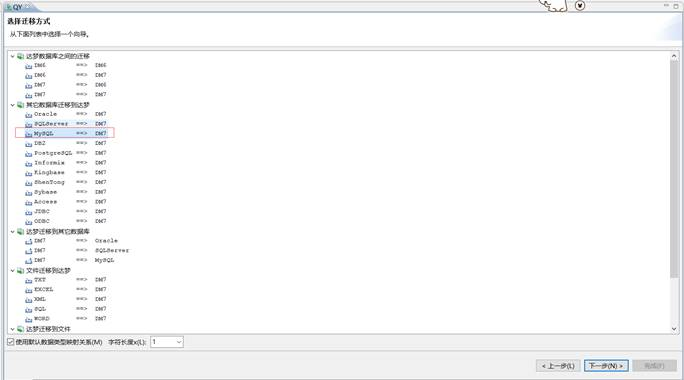

- 填写源端及目的端数据库信息（源端 MySQL，目的端 DM），保证数据库都能正常连接，如下图所示：

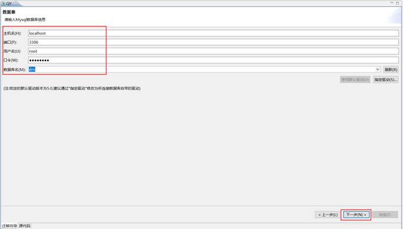

- 指定需要迁移的对象，MySQL 数据库到 DM 数据库的迁移，只能迁移表和视图，如下图所示：

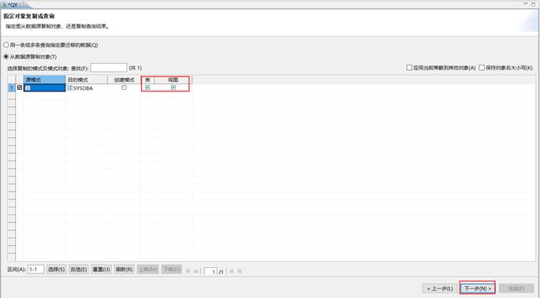

- 选择迁移对象，可迁移的对象包括表和视图，如下图所示：

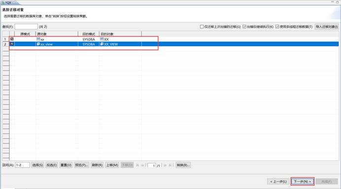

- 点击【完成】，即可完成迁移，可在完成迁移向导中看到迁移的详细信息，如下图所示：

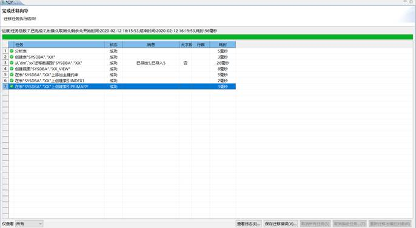

至此，MySQL 到 DM 的数据迁移完成，但在迁移时只能迁移 MySQL 的表和视图，其他对象无法进行迁移，需要手动改写或者重新创建来完成数据对象的正常使用。

- MySQL 中时间类型 `TIMESTAMP` 默认 default 设置为 `0000-00-00 00:00:00` 。
- DM 中 `TIMESTAMP` 类型数据不能为 `0000-00-0000:00:00` ，在 DM 中是不合法的，必须在 `0001-01-01 00:00:00.000000` 到 `9999-12-31 23:59:59.999999` 之间，所以可通过直接修改 MySQL 中的业务表数据后进行数据迁移。

> **注意**
> 
> 在迁移过程中可能会遇到一些语法不兼容的问题，如多表的联合查询语法、含有特殊函数的 SQL 语句等，需根据实际情况进行解决，MySQL 对于外键等对象的处理逻辑同 DM 存在诸多不同，需因地制宜。

## 迁移 MySQL 是否需要下载驱动

可利用 DM 数据库自带的数据迁移工具迁移 MySQL，工具如下所示：

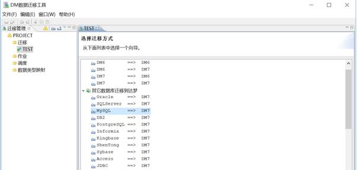

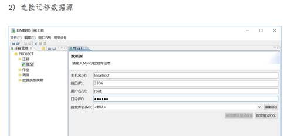

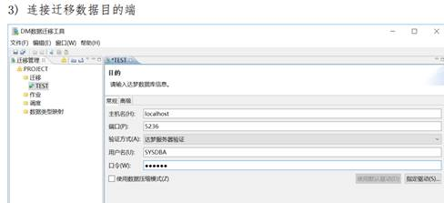

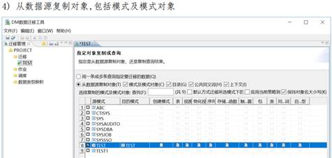

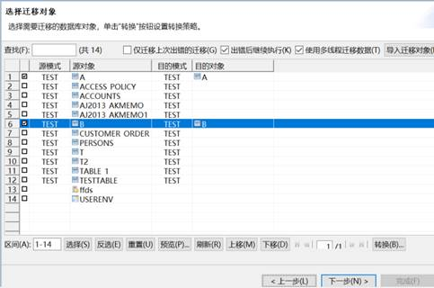

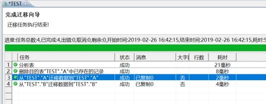

## 快速设置使得在 mybatis 下对象不用添加双引号

有两种方法，一是修改数据库大小写敏感，二是用 DTS 工具迁移过程中，去掉“保持对象名大小写”的勾选  
具体如下：  
**【解决方法】**

- 设置大小写不敏感，此方法会影响查询结果集，因为其对结果集匹配也不区分大小写，需要根据业务自行评估是否可行。
- 在 mysql 数据库中，对象名默认是小写，达梦对象名默认是大写，在用达梦 DTS 工具迁移的时候，去掉“保持对象名大小写”的勾选，使对象名自动转换成大写，在 mybatis 查询的时候，即不需要加双引号强调小写。

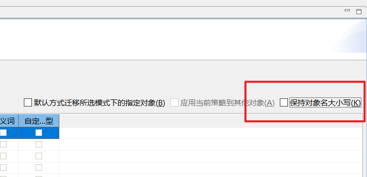

## 数据迁移出现乱码

可能的原因是原数据的字符集和现在的 DM 数据初始化的字符集不一致，例如：MySQL 用的是 UTF8MB4 字符集，迁移到 DM 数据库后中文乱码， **DM 数据库目前不支持 UTF8MB4** 。

## DTS 从 MySQL 迁移到 DM，char 长度是原来的 3 倍

**【问题原因 1】** ：

老版本 DTS 工具为保证数据成功迁移，会为不同字符集的目标库中 char 字段自动扩大 3 倍。

**【解决方法 1】** ：

新版本已经优化该问题，请升级更新 DM 数据库版本。

查看 DTS 版本，如下图所示：

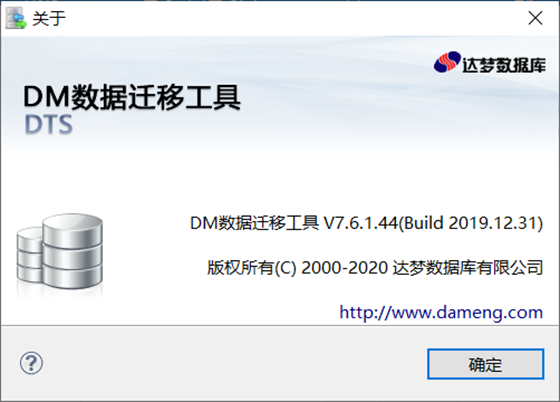

MySQL 中表结构，如下图所示：

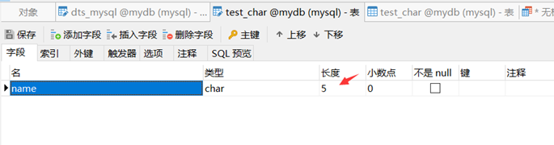

迁移过程，如下图所示：

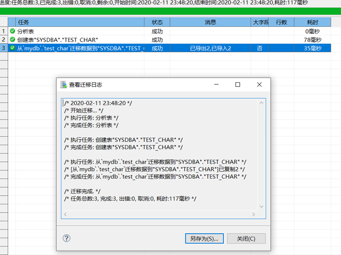

迁移后 DM 数据库表结构，如下图所示：

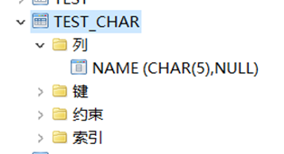

**【问题原因 2】** ：

MySQL 中 varchar(1) 可以存一个汉字，DM 数据库是以字节为单位。gb18030 字符集，varchar(2) 才可以存一个汉字；UTF-8 字符集，varchar(3) 才可以存一个汉字。此种情况下，为了保证汉字可以完整的被存储，扩大字段是合理的。

## UNSUPPORTED MAJOR.MINOR VERSION 52.0

**【问题描述】** ：

DTS 连接 MySQL 错误： `COM/MYSQL/CJ/JDBC/DRIVER:UNSUPPORTED MAJOR.MINOR VERSION 52.0` 。

**【解决方法】** ：

JDK 版本不匹配，把启动 DTS 的 JDK 版本调整一下，调整参数位置： `数据库安装路径下 Tool 目录 dts.ini../jdk/bin`

## MySQL 存储过程改为 DM

**【问题描述】** ：

DM 数据库存储过程创建临时表，如下所示：

```sql
begin
set @x=1;
EXECUTE IMMEDIATE 'set @x=10;';
select @x;
end;
```

在 MySQL 中，可以使用 `@` 定义 `session` 级别变量，然后在动态 SQL 中对变量进行赋值。DM 数据库是否支持这种方式。

**【解决方法】** ：

设置 `MS_PARSE_PERMIT=1` ，然后重启数据库生效后，可以通过 @ 定义 session 级别变量。

```sql
begin
set @x=1;
EXECUTE IMMEDIATE 'select 10' into @x;
select @x;
end;
```

动态 SQL 中对变量进行赋值需要修改。

## MySQL 的二进制数据怎么导入

可以用 DM 数据迁移工具 DTS，DTS 在数据库安装路径 Tool 目录下。

## 数据迁移工具显示界面不完整，无法勾选“自定义 url”框

**【问题描述】** ：

从 MYSQL 迁移到 DM 数据库，数据迁移工具显示界面不完整，无法勾选“自定义 url”框：

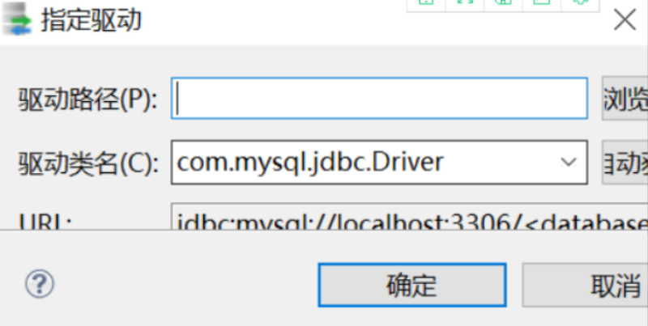

**【解决方法】** ：

- 方法一：调正分辨率--缩放与布局--调正稍微比现在出现问题的值小一些，然后重启 DTS 工具。
- 方法二：如果尝试方法一还是无法解决，请从达梦云适配中心 [下载试用](https://eco.dameng.com/download/?_blank) 下载最新的达梦数据库。

## MySQL 的 FIND\_IN\_SET 在达梦中如何转换

请参考： [MySQL 的 FIND\_IN\_SET 在达梦中如何转换](http://eco.dameng.com/community/article/a92bc26bbf73142116a7ec0d3daadcdc)

## 如何让迁移到 DM 的表名大小写和 MySQL 保持一致

**【问题描述】** ：

从 MySQL 迁移到 DM 数据库后，表名都变成大写了，怎么能保持表名和 MySQL 中的大小写一致？

**【解决方法】** ：

如果达梦数据库初始化的时候设置的是大小写敏感就会自动转大写，如果想保持小写，可以在迁移过程中勾选“保持对象名大小写”

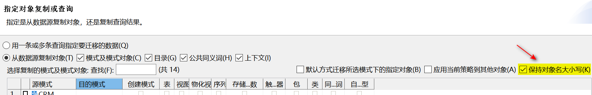

## DTS 工具点击“刷新”按钮不报错但是选不到数据库

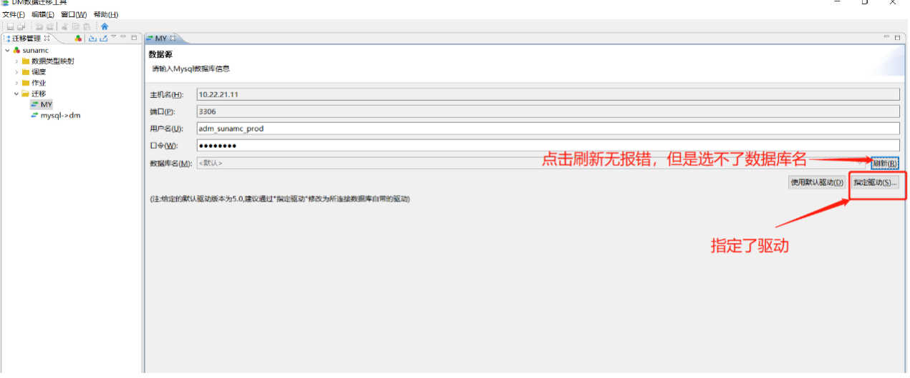

**【问题解答】：**

指定驱动，自定义 URL  
例如：

```java
驱动路径：mysql-connector-java-8.0.11.jar
驱动类名：com.mysql.cj.jdbc.Driver
URL：jdbc:mysql://localhost:3306/<database_name>?characterEncoding=utf8&useSSL=false&serverTimezone=UTC&rewriteBatchedStatements=true
```

## 从 MyQL 迁移到达梦报错：约束表达式无效

1.在 MySQL 中时间类型 TIMESTAMP 默认 default 设置为“0000-00-00 00:00:00”，而在 DM 中 TIMESTAMP 类型数据必须在 '0001-01-01 00:00:00.000000' 到 '9999-12-31 23:59:59.999999'之间，“0000-00-0000:00:00”在 DM 中是不合法的。

若源表表定义中存在 TIMESTAMP(0) DEFAULT 'CURRENT\_TIMESTAMP()'，则采用如下解决办法：  
复制表定义，将 DEFAULT 'CURRENT\_TIMESTAMP()'修改为 DEFAULT SYSDATE，手动创建表。  
之后重新使用 DTS 迁移数据，注意要选中该类表，点击【转换】，取消勾选【表定义】，即可正常进行迁移。

更多详细信息请参考文档 [《DM DBA 手记之 MySQL 移植到 DM》](https://download.dameng.com/eco/docs/DM_DBA%E6%89%8B%E8%AE%B0%E4%B9%8BMySQL%E7%A7%BB%E6%A4%8D%E5%88%B0DM.pdf) 。

2.可能是驱动不对，在指定的驱动确定是否和 MySQL 版本一致。

## MySQL 迁移至达梦如何指定迁移至达梦保持表名、列名都大写

DTS 迁移工具中把 “保持对象大小写” 取消勾选。

## mysql 迁移到达梦报错：unknown initial character

从错误的提示信息中发现字符集设置出现问题，连接 mysql 数据库时报此错误：

**【问题说明】**:

```java
//String url = "jdbc:mysql://localhost:3306/db_cjky" //如果使用这句就会报错。
Unknown initial character set index '255' received from server. Initial client character set can be forced via the 'characterEncoding' property.
```

或者报错如下：

```java
unknown initial character set index'45'received from server. initial client character set can be foreced via the 'characterencoding' property
```

**【解决方法】**:

更换为合适的驱动版本，自定义 url 连接串，在 url 连接串中添加参数：

```java
String url = "jdbc:mysql://localhost:3306/db_cjky?useUnicode=true&characterEncoding=utf8";//改成这句，就可以了
```

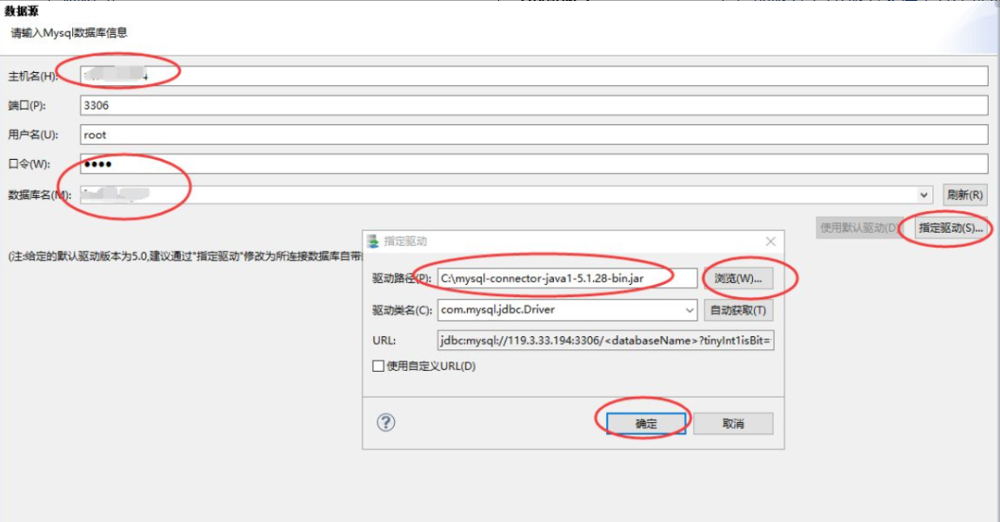

## DTS 迁移时设置数据类型映射

DTS 在某些情况下需设置数据类型映射，以 mysql 的 char 转成 varchar2 为例  
1.添加自定义映射类型  
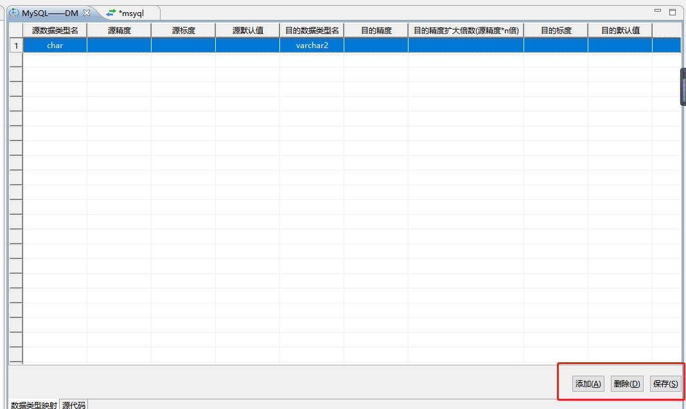  
2.创建迁移任务时不勾选默认数据类型映射  
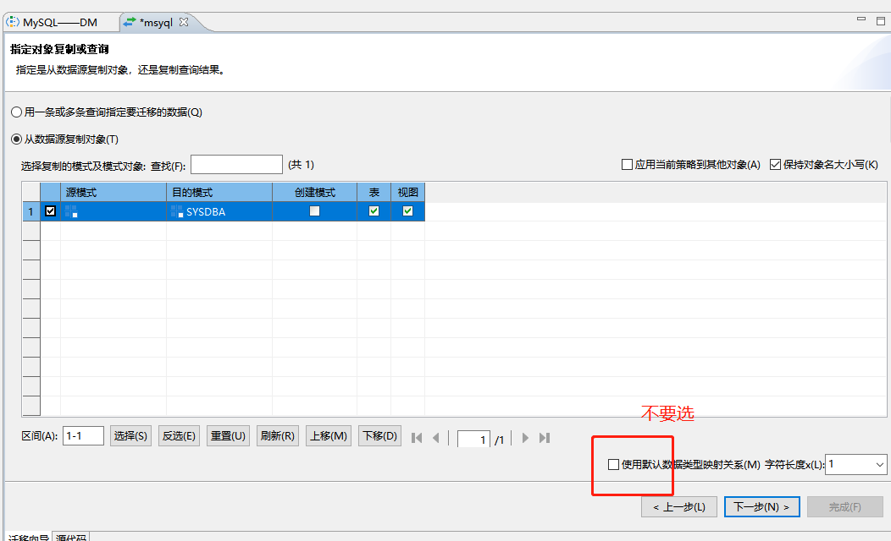  
3.选择需要迁移的表，使用预览表功能查看列映射选项，发现数据类型发生了映射  
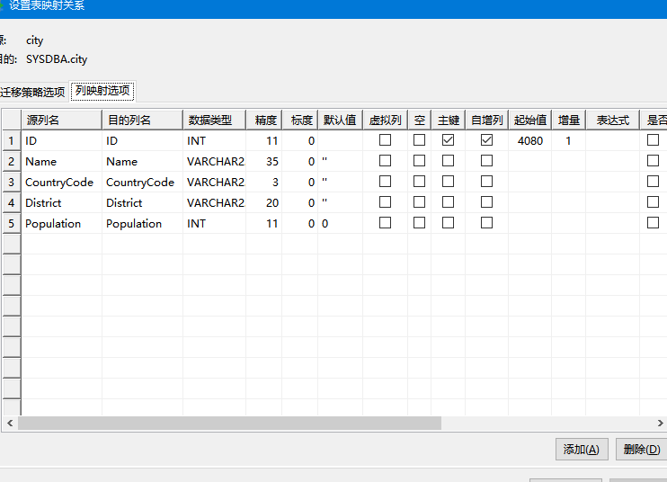

## DTS 迁移时，报错：“非法 IDENTITY 列类型”

**【问题说明】** ：  
DTS 迁移 MYSQL 数据库到达梦数据库，在迁移表结构时，出现"ORIGIN\_URL\_ID" SMALLINT IDENTITY(2,1) NOT NULL, 非法 IDENTITY 列类型

**【解决方法】** ：  
达梦数据库也有自增函数 IDENTITY(2,1)，但是只支持 INT ，BIGINT 两种字段类型，需手动修改映射关系为字段 int 或者手动修改 SMALLINT 为 INT 类型再进行建表。

## 从 MySQL 移植达梦，char 类型达梦会自动空格补齐

**【问题说明】** ：  
从 MySQL 移植达梦，char 类型在 MySQL 不会自动空格补齐，达梦会自动空格补齐。可能会导致 hibernate 不会自动过滤 char 类型中的空格，查询不到数据；

**【解决方法】** ：  
如下三种方法修改 char 类型为 varchar2 类型。

- 在 DTS 迁移时，映射 char 类型为 varchar2 类型；
- 生成批量修改 char 为 varchar2
```sql
select 'alter table '||a.TABLE_NAME||' modify '||a.COLUMN_NAME||' VARCHAR2('||data_length||');' from all_tab_columns a where a.data_type='CHAR' AND OWNER='用户名';
```
- 通过 rtrim 函数把数据右边的空格清除掉
```sql
update 表名 set 列名1=rtrim(列名1);
```

## mysql 迁移 DM 错误提示：非法 IDENTITY 列类型

**【问题说明】** ：

利用 DTS 从 MySQL 迁移 DM 出现报错：非法 IDENTITY 列类型。

**【问题解决】** ：

查看相关创建表 SQL 语句：

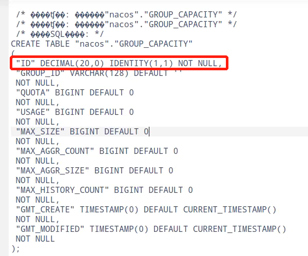

发现 IDENTITY 自增列类型错误，IDENTITY 自增列的数据类型只能为 INT 或 BIGINT。  
将自增列类型 DECIMAL(20,0) 修改为 BIGINT 即可。

## 达梦的 md5 函数加密后的值和 mysql 数据库 md5 函数加密后的值不同，该如何解决

**【问题描述】** ：

在 Mysql 数据库中，密码是调用数据库的 md5 函数加密后存储到数据库中，迁移到达梦数据库后，发现达梦的 md5 函数加密后的值和 mysql 数据库 md5 函数加密后的值不同。例如：

```sql
select md5('abc');  ---DM 数据库中 MD5 函数对 abc 加密后的值查询结果为 0x900150983CD24FB0D6963F7D28E17F72
select md5('abc');  ---mysql 数据库中 MD5 函数对 abc 加密后的值查询结果为 900150983CD24FB0D6963F7D28E17F72
```

**【问题解决】** ：

可利用 to\_char() 函数进行转换，例如：

```sql
select to_char(md5('abc')); --DM 数据库中转换后的 abc 加密后的值为 900150983CD24FB0D6963F7D28E17F72
```

## mysql 迁移至达梦，提示 streaming result set 报错

**【问题描述】** ：

具体报错信息如下：

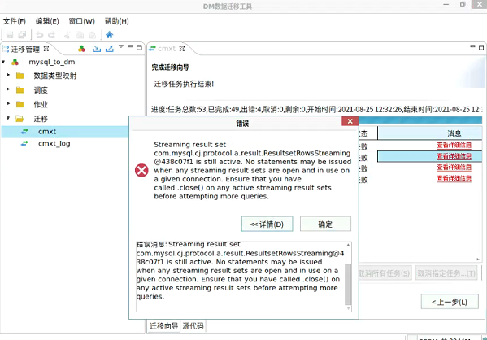

**【问题解决】** ：

报错原因是 JDBC 还没有处理完 resultSet 结果集，又使用同一个 connection 提交了新的 query。  
ResultSet 的 JDBC 实现过程：默认情况下，ResultSet 会一次性返回结果集并保存在内存中。这也是最有效率且最容易实现的一种方式。但是当 ResultSet 含有大量数据（很多行、或者包含大对象的情况下）时，JVM 可能无法分配 ResultSet 要求的内存。  
因此尝试调整读取行数：


重新迁移成功。

## 使用 dts 迁移 mysql 数据至 dm 中，源端报错：连接数据库失败

**【问题描述】** ：

具体报错信息如下：

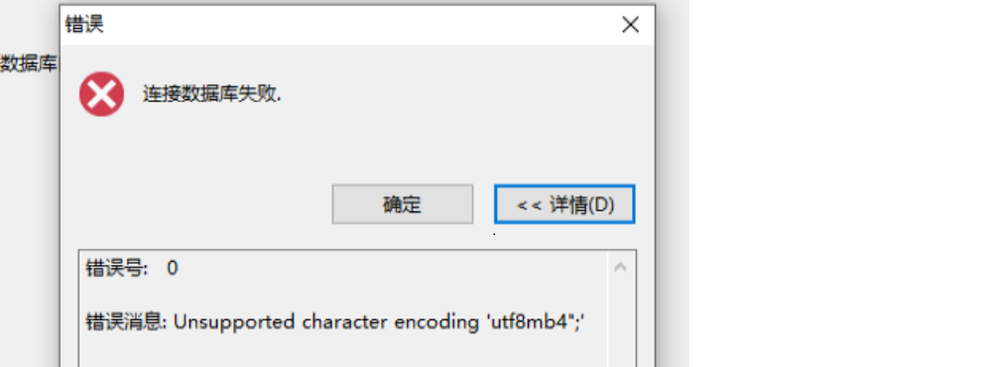

**【问题解决】** ：

查看源端 URL 配置：

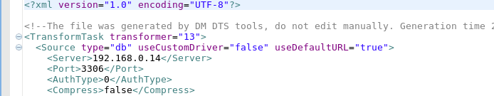

修改 URL：jdbc:mysql://localhost:3306/db\_cjky?useUnicode=true&characterEncoding=utf8"

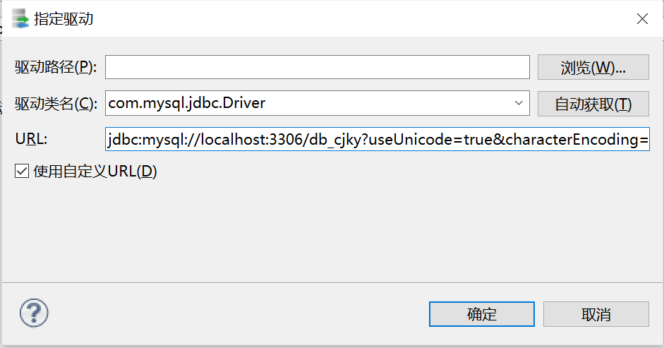

## MySQL 迁移到 DM 报错：错误的日期时间类型格式

**【问题解决】** ：

检查 MySQL 中的数据，如下：

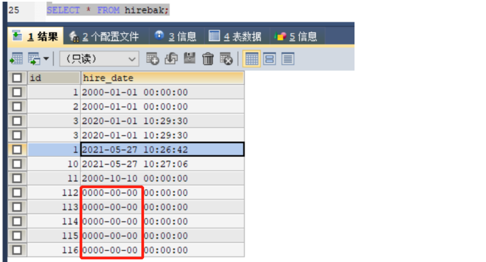

原因是 DM 数据库中不允许日期和月份为 0，所以迁移过来会出现报错。有两种解决办法：

- 在目标端将改类型修改为 varchar 类型的字段，可以迁移成功；
- 在源端将数据为 0000-00-00 的日期改为 0000-01-01 或者 0001-01-01 也可以迁移成功。

## MySQL 迁移到 DM 报错：列\[NAMES\]长度超出定义

**【问题解决】** ：

经排查，该表的 NAMES 字段存放的是中文，UTF8 编码。  
报错原因：MySQL 中 varchar(1) 可以存一个汉字，DM 数据库是以字节为单位。若是 gb18030 字符集，varchar(2) 才可以存一个汉字；若是 UTF-8 字符集，varchar(3) 才可以存一个汉字。该 NAMES 在 MYSQL 的长度为 10，在迁移过程中，达梦数据库建表的 NAMES 字段长度也是 10，那么就会导致当该字段中文字符超过 4 个的时候，就会出现无法存下的问题。  
解决方法：在此种情况下，为了保证汉字可以完整的被存储，可通过如下方法解决：  
扩大字段长度。如 MySQL 表中的 NAMES 字段长度为 10，那么建议在达梦建表的时候该 NAMES 字段长度为 30。

## MySQL 迁移到 DM8，VARCHAR 类型字段内容不完整，且结尾有乱码

**【问题解决】** ：

该问题是由于字符串截断造成的乱码或数据不完整。MySQL 中 VARCHAR 类型长度计算规则：  
5.0.3 版本以下，varchar 按照字节存储，存一个汉字需要三个字节，varchar(10)可存储 3 个汉字。  
5.0.3 版本及以上，varchar 按照字符存储，varchar(10)可存储 10 个汉字。  
DM 默认为以字节为单位，varchar(10) 可存储 3 个中文字符，这样 MYSQL5.0.3 版本及以上版本迁移到 DM 中，可能会发生字符截断的问题。  
有两种解决办法：

- 直接修改字段长度。
- 将对应的字段类型修改为 varchar(10 char)（10 为实际 mysql 字段长度）。这样 DM 中实际存储的中文字符长度与 MYSQL 是一致的。

## DTS 做 MYSQL 到 DM 的表结构迁移时，报错 AUTO\_INCREMENT

**【问题描述】** ：

通过 DTS 做 MYSQL 到 DM 表结构迁移，在 MYSQL 表结构默认值使用 AUTO\_INCREMENT 函数来做自增长，会报错 AUTO\_INCREMENT。

**【问题解决】** ：

达梦数据库当前通过 IDENTITY（1,1）函数设置自增长，等效于 mysql 的 AUTO\_INCREMENT。  
在进行等价改写的时候，需要先通过如下 SQL 确定 mysql 数据库的自增设置：

```sql
show variables like 'auto_inc%'; -- 查看当前数据库的自增长设置
```

查询出两个参数 auto\_increment\_increment(每次自增的值)，auto\_increment\_offset（初始值）。以下图查询结果为例，初始值为 1，自增长值也为 1：  
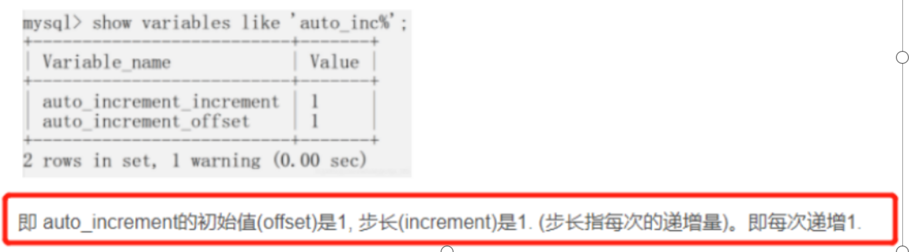

然后，对表结构中的当前值 AUTO\_INCREMENT 进行改写。以下图为例，该表结构的字段 work\_record\_id 应该等价改写为 work\_record\_id int(11) NOT NULL IDENTITY(51801,1)：

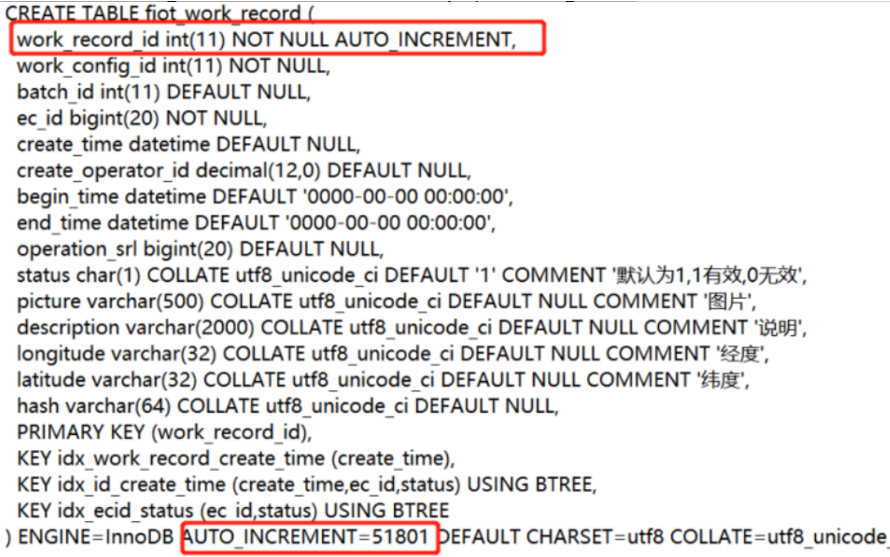

## MySQL 迁移到 DM 报错：Access denied for user 'root'@'localhost' (using password: YES)

**【问题描述】** ：

迁移环境：麒麟 V10 系统，DM8 数据库，宝塔面板下的 Mysql 数据库。  
在使用 DTS 达梦迁移工具时，登陆 Mysql 数据库进行数据迁移到 DM 过程中，在有驱动，登陆 Mysql 数据库账户为 root（一般情况下 root 账户具有最高权限），且密码正确的情况下，报错\[1045\]：Access denied for user 'root'@'localhost' (using password: YES)。

**【问题解决】** ：

出现拒绝访问的情况是因为 mysql 权限问题导致的。  
可进入宝塔面板 mysql 设置里修改 my.ini 文件配置，windows 环境 可进入 MySQL 的安装路径（以默认安装路径为例）C:\\Program Files\\MySQL\\MySQL Server 5.1\\，找到 my.ini 配置文件（此文件为 MySQL 的常规参数，每次启动服务都会先加载此文件），在 my.ini 配置文件的最后一行加入 skip\_grant\_tables，此语句可以忽略登录检查。配置完成后重启数据库，点击 DTS 迁移工具刷新即可刷新出数据库列表。

## Mysql 迁移到 DM，报错：不支持该数据类型

**【问题描述】** ：

Mysql 迁移到 DM，报错：不支持的数据类型，时间列内容多了一个 T，如'2021-04-08T16:44:40'。报错信息如下图所示：

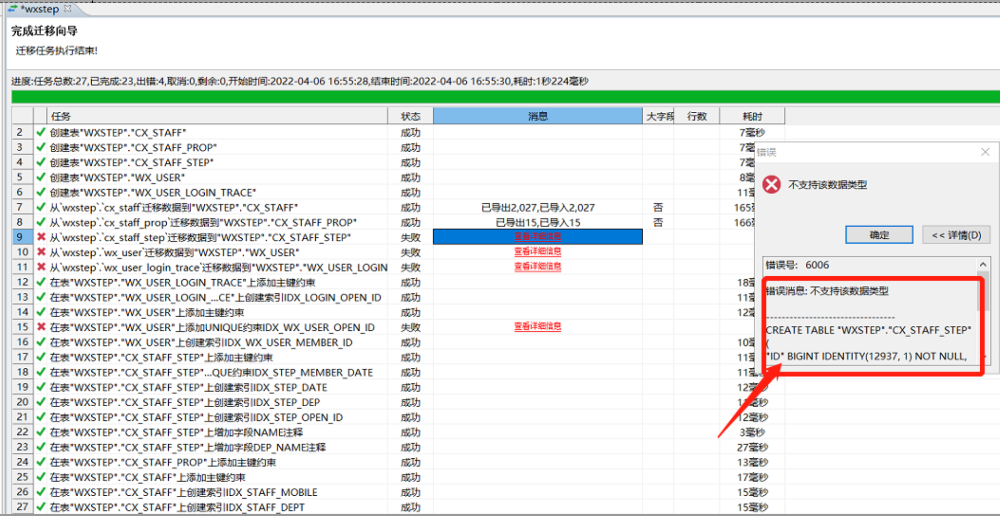

**【问题解决】** ：

选择正确的驱动包和驱动类名，如下图所示：

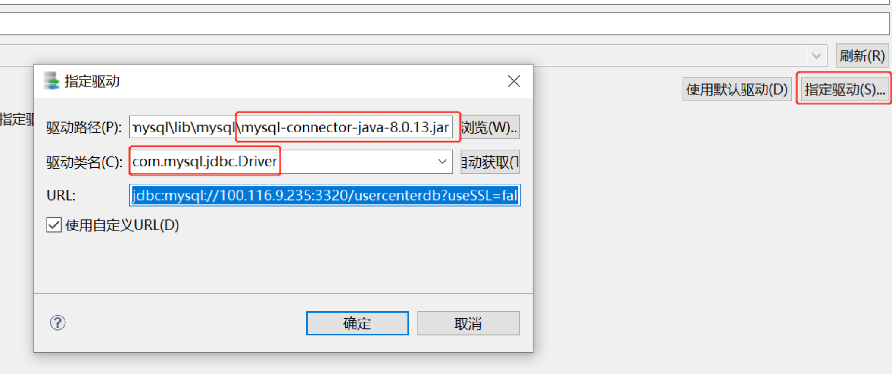

## VARCHAR 类型数据以字符为单位且兼容 mysql 的库，varchar 类型的数据结尾部分有乱码

**【问题解决】** ：

问题原因：导致乱码的原因是插入的数据超出了定义的长度，但是并未报“-6169: 列\[.......\]长度超出定义”。  
处理办法：  
1）查看参数是否有 MY\_STRICT\_TABLES： `SELECT *FROM  V$DM_INI WHERE PARA_NAME ='MY_STRICT_TABLES';`  
2）如果存在 MY\_STRICT\_TABLES 参数，则将其值修改为 1，然后重启数据库： `SP_SET_PARA_VALUE(2,'MY_STRICT_TABLES',1);`  
3）更新有乱码的数据。  
4）如果不存在则需要升级数据库版本，再执行上述操作。

## Mysql 迁移 user 表到达梦后，发现无法查询表内容和插入数据

**【问题描述】：**

Mysql 迁移 user 表到达梦数据库成功，迁移过程无报错。通过管理工具可看到 user 表：

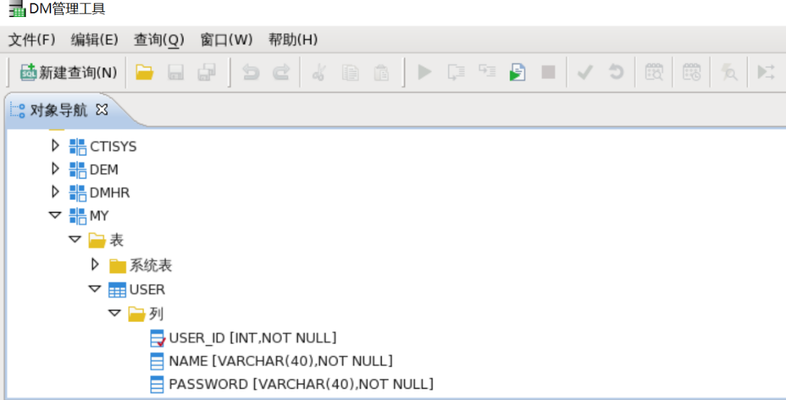

但执行以下 SQL 语句无法查询表内容和插入数据，报错：语法分析出错。

```sql
select * from MY.USER;

INSERT INTO MY.USER(USER_ID,NAME,PASSWORD) VALUES ('1000008'，'大奔'，"hj12345678');
```

**【问题解决】：**

1. USER 在 DM 数据库中属于关键字，在进行 SQL 查询时，需要用双引号括起来。
2. 在插入语句失败时，需要检查表结构，了解是否含有自增列等特殊定义的字段。

根据以上分析，发现 USER 表中含有自增列，因此修改查询和插入语句如下：

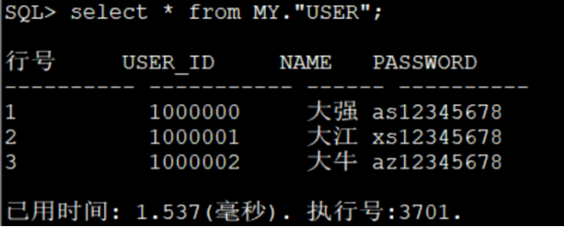

> **注意**
> 
> 1.因为存在自增列，所以需要设置参数SET IDENTITY\_INSERT为ON。  
> 2.当一个连接结束，IDENTITY\_INSERT 属性将被自动还原为 OFF。

## Mysql 迁移表到 DM 数据库报错：此列列表已索引

**【问题描述】：**

Mysql 迁移表到 DM 数据库报错：此列列表已索引，报错截图如下：

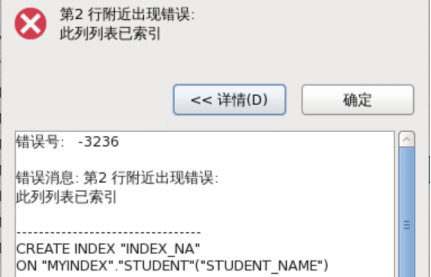

**【问题分析】：**

在 DM 数据库中查询该表，发现除了报错的索引迁移失败，其他的都迁移成功了。

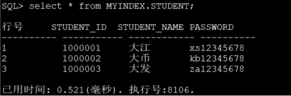

**【问题解决】：**

Mysql 支持对同一字段建多个单列索引，而达梦不支持。根据上述问题分析和报错信息可知，STUDENT\_NAME 列有两个单列索引 INDEX\_N 和 INDEX\_NA，因此在达梦下针对字段再建一个索引则会报错。

避免报错可在 mysql 下执行 `drop index index_na on student;` 删除索引，或者用其他字段索引或者联合索引代替，对于同一字段建单列索引和联合索引则不受影响，可以正常迁移。

## year 字段类型迁移后数据丢失

**【问题描述】：**

Mysql 迁移 time 表到达梦数据库时，原 year 字段类型迁移后变成 char 字段类型，且原数据丢失。

MySQL 中表信息如下：

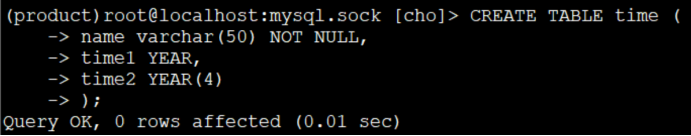

使用达梦数据迁移工具 dts 将 MySQL 数据库中的数据迁移到达梦数据库：

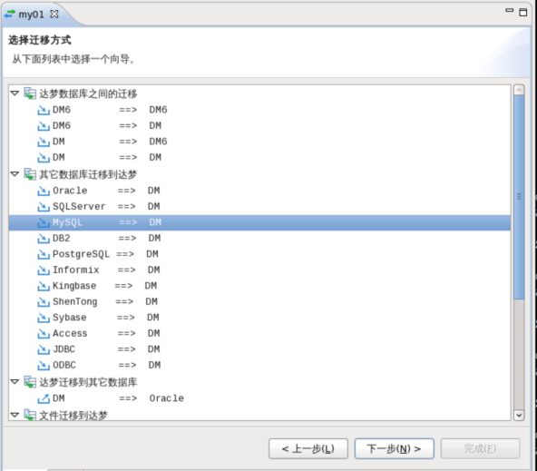

数据对比：

MySQL 数据库中原始数据如下：

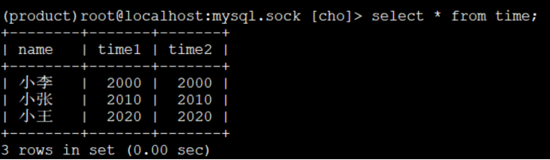

迁移完成后达梦数据库中显示 time 表数据如下：

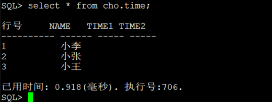

原 year 数据类型数据丢失，且在达梦数据库中原 year 数据类型变成 char 数据类型。

**【问题分析】：**

达梦数据库不支持 year 字段类型，在迁移过程中自动将 year 数据类型替换成为 char 字段类型。

**【问题解决】：**

在 mysql 下直接修改原字段类型之后再重新迁移。

步骤一：在 MySQL 中修改原字段类型。

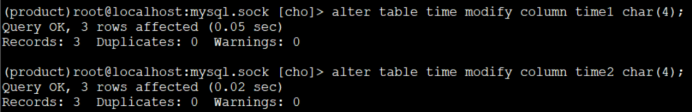

步骤二：利用 DTS 迁移 time 表。

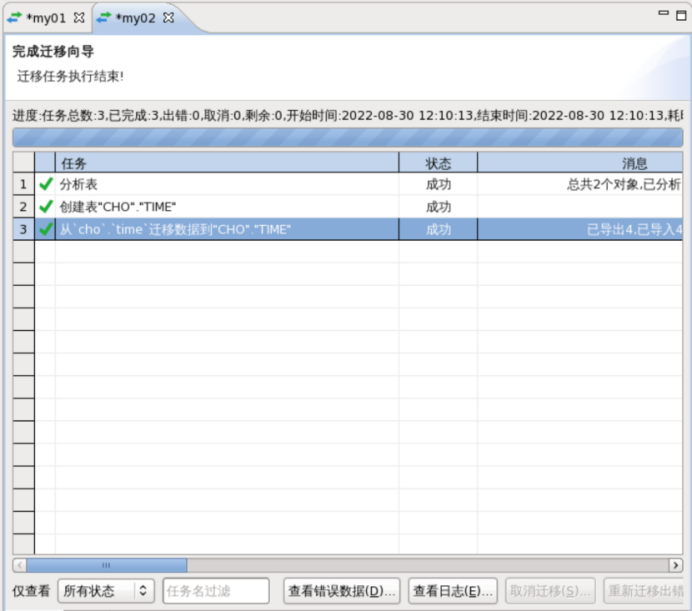

步骤三：迁移结果对比。

- MySQL 数据库中数据显示如下：

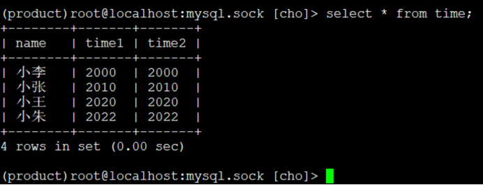

- 迁移完成后，达梦数据库中查找 time 表数据如下：

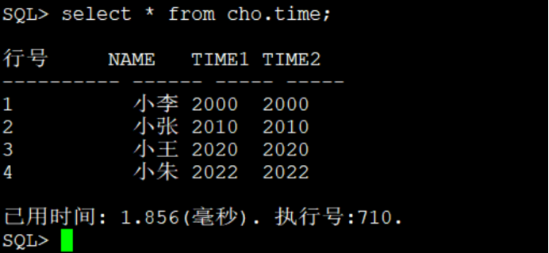

即修改 mysql 下 time 表原字段为 char 数据类型，再重新迁移到达梦数据库后，time 表数据迁移成功。

## mysql8.0.27 迁移到 DM8 DTS 连接源端时报错：Communications link failure

**【问题解决】**

1. 检查迁移时是否已指定 MySQL8.0.27 的对应驱动；
2. 查看网络通信是否正常，通过 `ping IP` 地址的方法测试网络连通性；
3. 查看 mysql 端口是否开放，通过 telnet IP 3306（MySQL 端口号）测试端口是否开放；
4. 查看 MySQL 是否达到最大连接数。

登录 MySQL 查看可以承受的最大连接数。

```sql
show variables like '%max_connections%';
```

查看 MySQL 当前连接数。

```sql
show status like 'Threads%';
```

## MySQL 到达梦的迁移，timestamp 时间类型报错。

**【问题分析】**

在进行 MySQL 到达梦的迁移过程中，经常遇到 timestamp 类型报错，原因在于 MySQL 中的列值为“0000-00-00 00：00：00”。而在达梦数据库中 timestamp 类型包括年、月、日、时、分、秒信息，定义了一个在 '-4712-01-0100:00:00.000000000' 和 '9999-12-31 23:59:59.999999999' 之间的有效格里高利日期时间。timestamp 类型的小数秒精度规定了字段中小数点后面的位数，取值范围为 0～9，如果未定义，缺省精度为 6。与 DATE 类型相同，DM 不计算 '1582-10-05' 到 '1582-10-14'之间的 10 天。

**【问题解决】**

处理方式：将该值 “0000-00-00 00：00：00” 改成有效的格里高利日期类型。

举例说明：

1. 时间不存在（以非闰年的 02-29 为例）
```sql
[执行语句1]:
create table  Timedate  (c1  timestamp  default '2017-02-29 00:00:00' );
执行失败(语句1)
-2670: 对象[C1]DEFAULT约束表达式无效

1条语句执行失败
```
2. 其他不存在的时间
```sql
[执行语句1]:
create table  Timedate  (c1  timestamp  default '1900-00-00 00:00:00' );
执行失败(语句1)
-2670: 对象[C1]DEFAULT约束表达式无效1条语句执行失败
```
3. 正确时间
```sql
[执行语句1]:
create table  Timedate  (c1  timestamp  default '1900-01-01 00:00:00' );
执行成功, 影响行数0, 执行耗时3毫秒. 执行号:615

1条语句执行成功
```

## MYSQL 到 DM 单向同步报错：“Invalid date string 导致数据装载失败”

**【问题分析】**

源端 mysql 中 date 数据类型时间戳为 0000-00-00，DM 数据库中不允许年份和月份为 0。达梦数据库 DATE 类型包括年、月、日信息，定义了 '-4712-01-01' 和 '9999-12-31' 之间任何一个有效的格里高利日期。DM 支持儒略历，并考虑了历史上从儒略历转换至格里高利日期时的异常，不计算 '1582-10-05' 到 '1582-10-14' 之间的 10 天。

DATE 值的书写方式有两种：一是 DATE '年月日' ；二是 '年月日'。其中，年月日之间可以使用分隔符或者没有分隔符。分隔符是指除大小写字母、数字以及双引号之外的所有单字节字符且是可打印的。例如: 空格、回车键、tab 键、- /,.: \*等标点符号。年月日中第一个非 0 数值前的 0 亦可省略，例如 '0001-01-01' 等价于 '1-1-1'

**【问题解决】**

修改源端 dmhs.hs 配置文件添加参数 <check\_date>1</check\_date>，默认值为： 1900-01-01

参数解释：

check\_date：该参数针对数据源为 DM7、ORACLE、MYSQL 的日期时间列做校验，当启用功能后，若日期时间校验失败，则会将其修改为一个默认值。

## 达梦迁移工具连接 mysql 数据库错误

**【问题描述】**

使用达梦迁移工具连接 mysql 5.7 时报错：“Communications link failure The last packet successfully received from the server was 20 milliseconds ago. The last packet sent successfully to the server was 20 milliseconds ago.”。

**【问题解决】**

1. 排查是否为网络问题导致连接不上 mysql 数据库，检查网络端口是否开放；
2. 排查 mysql 数据库最大连接数设置或者连接超时问题；
3. 如果以上两条排查没有问题，考虑是否由 SSL 协议导致，可进行如下操作：
- 在达梦迁移工具连接 mysql 数据库界面选择【指定驱动】；
	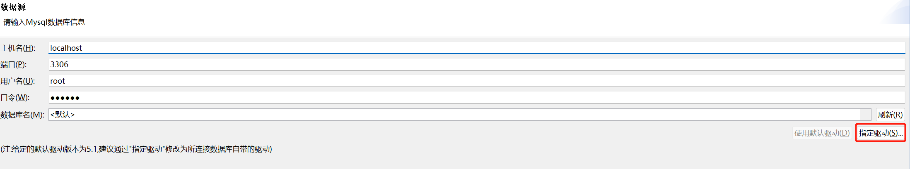
- 勾选【使用自定义 URL 】；
	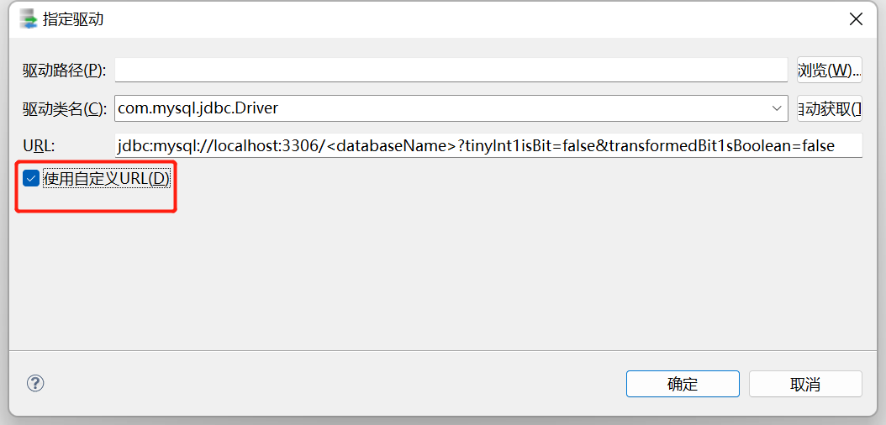
- 在 URL 里面添加： `&useSSL=false&` ，不进行 SSL 连接，而通过账号密码进行连接。
	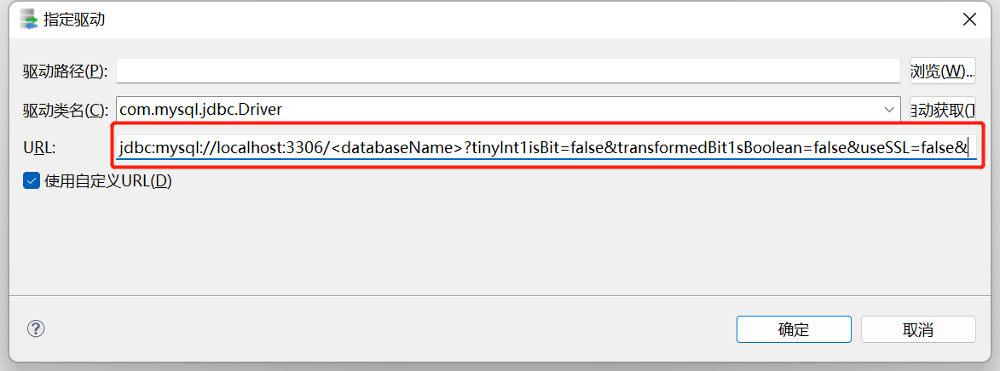

## 从 MySQL 迁移到 DM 完成后执行 SQL 报错："时间日期类型数据溢出"

**【问题描述】**

数据从 MYSQL 数据库迁移到达梦以后，执行 SQL 语句时报错：“时间日期类型数据溢出”，但在 MYSQL 数据库中可以正常执行，报错截图如下：

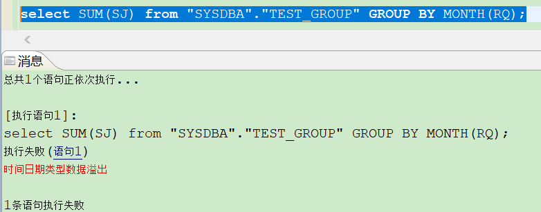

**【问题分析】**

从截图的 SQL 语句可以看出，该语句主要是实现根据日期按月将数据进行求和计算，由于达梦数据库的校验比 MYSQL 更为严格，所以会报该错误。

**【问题解决】**

在 DM 中可通过 to\_date() 对日期字段进行类型转换解决该报错问题，具体如下：

```sql
select SUM(SJ) from "SYSDBA"."TEST_GROUP" GROUP BY MONTH(TO_DATE(RQ,'YYYYMMDD'));
```

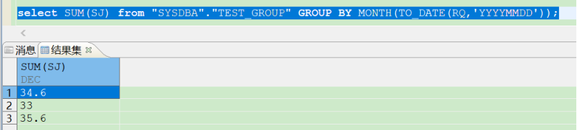

## DTS 连接 MySQL 数据库时报错：时区值无法识别

**【问题描述】**

在进行 MySQL 迁移到 DM 数据库时，使用 DTS 连接 MySQL 数据库出现如下报错：

```shell
错误号：0
错误消息：The server time zone value '�й���׼ɦ��'is unrecognized or represents more than one 
time zone. You must configure either the server or JDBC driver (via the 'serverTimezone' configuration 
property) to use a more specifc time zone value if you want to utilize time zone support。
```

**【问题解决】**

在连接 MySQL 时使用指定驱动，并使用自定义 url，添加参数 serverTimezone=GMT%2B8

例如指定 url：jdbc:mysql://192.168.30.242:3306/bid\_common?serverTimezone=GMT%2B8


## 从 MySQL 迁移到 DM 时 ON UPDATE 时间字段属性如何改造

**【问题解决】**

例如：

MySQL 中的建表语句：

```sql
CREATE TABLE TEST (
id int(11) NOT NULL,
name varchar(20),
modifytime timestamp NOT NULL default CURRENT_TIMESTAMP on update CURRENT_TIMESTAMP
);
```

在达梦数据库中的改造：

```sql
CREATE TABLE TEST (
id int NOT NULL,
name varchar(20),
modifytime timestamp NOT NULL default CURRENT_TIMESTAMP
);
```

配合触发器使用：

```sql
create or replace trigger update_time
before update on HR.TEST for each row
begin
new.modifytime:=sysdate;
end;
/
```

## 在 dm 数据库中如何将 mysql 累加写法改写

**【问题解决】**

例如：在 mysql 中累加写法如下：

```sql
SELECT id , name , age ,
(@age:=@age + age ) as  age_sum
FROM user , ( SELECT @age := 0  ) s
ORDER BY id
```

dm 数据库中通过分析函数实现改写。

```sql
SELECT id , name , age ,
sum(age) OVER (ORDER BY id asc) AS ageRank
FROM user;
```

## mysql 迁移到 dm 后，表中 ID 列数据迁移前后数据内容不一致

**【问题描述】**

通过 DTS 将 mysql 迁移到 dm 后，表中 ID 列数据迁移前后数据内容不一致。

迁移前：


迁移后：


**【问题分析】**

源端表 ID 字段为自增，迁移时未选择“启动标志列插入”和“使用 auto\_increment 自增列”导致

**【问题解决】**

迁移时选择“启动标志列插入”和“使用 auto\_increment 自增列”。


补充：mysql 迁移后常见报错：“## Error updating database， Cause: dmjdbc,driver,DMException: 仅当指定列列表，且 SE IDENTITY-INSERT 为 ON 时，才能对自增列赋值“。

遇到该问题可通过将 identity 自增列语法批量改为 auto\_increment 语法来解决，可参考如下 SQL：

1. SYSDBA 模式中删除 identity 自增列属性；
```sql
select 'alter table '||b.name||' drop identity;'
 from SYSCOLUMNS a,sysobjects b where a.id=b.id and b.type$='SCHOBJ' and b.SUBTYPE$='UTAB' and a.info2=1
and b.schid=(select id from sysobjects where name='SYSDBA' and type$='SCH'
```
2. SYSDBA 模式中添加 auto\_increment 自增列属性。
```sql
select 'alter table '||b.name||' add column '||a.name||' auto_increment;'
 from SYSCOLUMNS a,sysobjects b where a.id=b.id and b.type$='SCHOBJ' and b.SUBTYPE$='UTAB' and a.info2=1
and b.schid=(select id from sysobjects where name='SYSDBA' and type$='SCH')
```

## 通过 DTS 将 MYSQL 迁移到 DM 时间类型迁移报错或两端时间数据不一致

**【问题描述】**

问题一：Mysql8 迁移到 DM 报错：”HOUR\_OF\_DAY:2->3“。


问题二：MySQL datetime 时间类型数据迁移到 DM timestamp 时间类型差 13 个小时。

MySQL 时间数据：


迁移到 dm 的时间数据：


**【问题解决】**

可通过 DTS 在连接源端 MySQL 指定驱动时在 url 上面加上”&serverTimezone=Asia/Shanghai“来解决这两个问题。

## mysql 函数 yearweek 如何改写到达梦

**【问题描述】**

MySQL 函数 yearweek 迁移到 DM 如何改写？

**【问题解决】**

yearweek 在 mysql 中的执行效果：

```sql
mysql>
mysql> select YEARWEEK('2019-07-11',1);
+--------------------------+
| YEARWEEK('2019-07-11',1) |
+--------------------------+
|                   201928 |
+--------------------------+
1 row in set (0.08 sec)

mysql>
```

yearweek 改写到达梦：

```sql
SQL> select year('2019-07-11')||WEEK('2019-07-11',1);

LINEID     YEAR('2019-07-11')||WEEK('2019-07-11',1)
---------- ----------------------------------------
1          201928
```

## MySQL 中 PERIOD\_DIFF 函数如何改写到达梦

**【问题描述】**

MySQL 函数 PERIOD\_DIFF 迁移到 DM 如何改写？

**【问题解决】**

PERIOD\_DIFF 在 mysql 中的执行效果：

```sql
mysql> sELECT PERIOD_DIFF(202101,202001);
+----------------------------+
| PERIOD_DIFF(202101,202001) |
+----------------------------+
|                         12 |
+----------------------------+
1 row in set (0.00 sec)
```

PERIOD\_DIFF 改写到达梦：

方式一：

```sql
SQL> SELECT months_between(to_date(202101,'yyyymm'),to_date(202001,'yyyymm'));

LINEID     MONTHS_BETWEEN(TO_DATE(202101,'yyyymm'),TO_DATE(202001,'yyyymm'))
---------- -----------------------------------------------------------------
1          12

used time: 0.220(ms). Execute id is 704.
```

方式二：

```sql
SQL> SELECT DATEDIFF(month,to_date(202101,'yyyymm'),to_date(202001,'yyyymm'));

LINEID     DATEDIFF(MONTH,TO_DATE(202101,'yyyymm'),TO_DATE(202001,'yyyymm'))
---------- -----------------------------------------------------------------
1          -12

used time: 0.197(ms). Execute id is 705.
SQL> SELECT DATEDIFF(month,to_date(202001,'yyyymm'),to_date(202101,'yyyymm'));

LINEID     DATEDIFF(MONTH,TO_DATE(202001,'yyyymm'),TO_DATE(202101,'yyyymm'))
---------- -----------------------------------------------------------------
1          12

used time: 0.732(ms). Execute id is 706.

-- 达梦需要转换为时间类型来进行运算
```

## MySQL 迁移到达梦后 SUM 求和报错： DMException: fail cast string

**【问题描述】**

MySQL 迁移到达梦后，有如下数据 SUM 求和报错： DMException: fail cast string。


**【问题解决】**

在达梦中使用函数 regexp\_substr 将数据过滤成正确的数值再进行计算。

```sql
select sum(regexp_substr(zt_rs, '\d+')) FROM ATMP;
```


函数 regexp\_substr 详细使用方法可参考数据库安装目录下 doc 目录中《DM8\_SQL 语言使用手册》。

## mysql 中允许分母为 0 ，DM 如何实现这样效果

**【问题描述】**

mysql 5.7 或 MySQL 8.0 允许分母为 0 ，当 MySQL 中分母为 0 时查询结果如下：

```sql
mysql> select 2/0;
+------+
| 2/0  |
+------+
| NULL |
+------+
1 row in set (0.01 sec)
```

dm 不允许分母为 0 ，如何实现和 mysql 一样的效果。

**【问题解决】**

DM 中使用 case when 语句进行判断分母是否为 0 如果为 0 转换为 null 进行运算，达到返回值为 null 的效果。示例如下：

```sql
SQL> select 2/case when 0=0 then null end;

LINEID     2/CASEWHEN0=0THENNULLEND
---------- ------------------------
1          NULL
```

## MySQL 迁移到 DM 报错："超出列长度"

**【问题描述】**

Mysql 迁移达梦的时候，varchar 字段如果有中文内容容易出现超出列长度问题，如果扩展列字段长度的话，会导致英文字符无法达到限制长度的目的。

**【问题分析】**

Mysql 数据库中 varchar 默认是以字符为单位，而达梦中 varchar 默认是以字节为单位。

**【问题解决】**

在 DM 建表的时候可以通过 varchar(x char) 的形式显示声明该字段长度是以字符为单位，如果 Mysql 迁移过程存在大量 varchar 字段，可以通过达梦迁移工具（DTS）来批量进行以字符为单位的显示声明转换。

1. 在迁移工具中，找到数据类型映射功能项，展开后找到 MYSQL 子项，展开双击 DM 菜单，进入数据类型配置界面


2. 点击右下角的添加按钮，添加一行数据类型转换，源数据类型名为 VARCHAR，目的数据类型名为 VARCHAR，强制为字符存储选择是，最后点击右下角保存。


3. 然后在 Mysql 迁移达梦的配置迁移选项中，取消勾选使用默认数据类型映射关系，正常进入下一步选择迁移对象，最后进行迁移。


4. 迁移完成后，检查数据。

Mysql:


DM：


DM 中的数据与 MySQL 中的数据一致。

## mysql 迁移到 DM AES\_DECRYPT 和 AES\_ENCRYPT 加解密函数不适配

**【问题描述】**

mysql 迁移到 DM 后 AES\_DECRYPT 和 AES\_ENCRYPT 加解密函数不适配，达梦中没有这 2 个函数。

**【问题解决】**

通过 DBMS\_CRYPTO 包提供的加密和解密数据接口，创建自定义函数在达梦中实现相同功能。

具体的函数创建方法如下：

1. 创建加密函数 AES\_ENCRYPT。
```sql
CREATE OR REPLACE FUNCTION AES_ENCRYPT (V_STR VARCHAR2, 
                                             V_KEY VARCHAR2)
    RETURN VARCHAR2 AS V_KEY_RAW RAW (24);
    V_STR_RAW RAW (2000);
    V_RETURN_STR VARCHAR2 (2000);
    V_TYPE PLS_INTEGER;
    BEGIN
        V_KEY_RAW := UTL_I18N.STRING_TO_RAW (V_KEY, 'UTF8');
        V_STR_RAW := UTL_I18N.STRING_TO_RAW (V_STR, 'UTF8');
        V_TYPE    := DBMS_CRYPTO.ENCRYPT_AES128 + DBMS_CRYPTO.CHAIN_ECB + DBMS_CRYPTO.PAD_PKCS5;
        V_STR_RAW := DBMS_CRYPTO.ENCRYPT (SRC => V_STR_RAW, 
                                          TYP => V_TYPE, 
                                          KEY => V_KEY_RAW);
        V_RETURN_STR := RAWTOHEX (V_STR_RAW);
        RETURN V_RETURN_STR;
    END;
/
```
2. 创建解密函数 AES\_DECRYPT。
```sql
CREATE OR REPLACE FUNCTION AES_DECRYPT (V_STR VARCHAR2, 
                                             V_KEY VARCHAR2)
    RETURN VARCHAR2 AS V_KEY_RAW RAW (24);
    V_STR_RAW RAW (2000);
    V_RETURN_STR VARCHAR2 (2000);
    V_TYPE PLS_INTEGER;
    BEGIN
        V_KEY_RAW := UTL_I18N.STRING_TO_RAW (V_KEY, 'UTF8');
        V_STR_RAW := HEXTORAW (V_STR);
        V_TYPE    := DBMS_CRYPTO.ENCRYPT_AES128 + DBMS_CRYPTO.CHAIN_ECB + DBMS_CRYPTO.PAD_PKCS5;
        V_STR_RAW := DBMS_CRYPTO.DECRYPT (SRC => V_STR_RAW, 
                                          TYP => V_TYPE, 
                                          KEY => V_KEY_RAW);
        V_RETURN_STR := UTL_I18N.RAW_TO_CHAR (V_STR_RAW, 'UTF8');
        RETURN V_RETURN_STR;
    END;
/
```
3. 测试。
```sql
--加密
  SELECT AES_ENCRYPT('测试内容','PASSWD_KEY123456');   
--解密
  SELECT AES_DECRYPT('C7E1CD2856450044CA65D358D569D6B2','PASSWD_KEY123456');
```

达梦对 varchar 以及 clob 加解密处理存在差异，以上自定义函数只能处理字符串长度在 32767 以内的字符串，无法处理超长字符串针。对超过 32767 长度的字符串处理方法如下：

```sql
--1、创建加密函数 AES_ENCRYPT_CLOB
CREATE OR REPLACE FUNCTION AES_ENCRYPT_CLOB (V_STR CLOB,
                                             V_KEY VARCHAR2)
    RETURN BLOB AS V_KEY_RAW RAW (32);
    V_RETURN_STR BLOB;
    V_TYPE PLS_INTEGER;
    BEGIN
        V_KEY_RAW := UTL_I18N.STRING_TO_RAW (V_KEY, 'UTF8');
        V_TYPE    := DBMS_CRYPTO.ENCRYPT_AES128 + DBMS_CRYPTO.CHAIN_ECB + DBMS_CRYPTO.PAD_PKCS5;
        DBMS_CRYPTO.ENCRYPT (V_RETURN_STR,V_STR,V_TYPE,V_KEY_RAW,NULL);
        RETURN V_RETURN_STR;
    END;

--2、创建解密函数 AES_DECRYPT_CLOB
CREATE OR REPLACE FUNCTION AES_DECRYPT_CLOB (V_STR BLOB, 
                                             V_KEY VARCHAR2)
    RETURN CLOB AS V_KEY_RAW RAW (32);
    V_RETURN_STR CLOB;
    V_TYPE PLS_INTEGER;
    BEGIN
        V_KEY_RAW := UTL_I18N.STRING_TO_RAW (V_KEY, 'UTF8');
        V_TYPE    := DBMS_CRYPTO.ENCRYPT_AES128 + DBMS_CRYPTO.CHAIN_ECB + DBMS_CRYPTO.PAD_PKCS5;
        DBMS_CRYPTO.DECRYPT (V_RETURN_STR,V_STR,V_TYPE,V_KEY_RAW,NULL);
        RETURN V_RETURN_STR;
    END;
--注意事项：密钥长度必须大于等于16字节，如果超过16字节按照16字节处理。
```

## 使用 DMDTS 迁移 mysql 到 DM 设置 varchar 转 varchar( N char)

**【问题解决】**

说明：

DMDTS 迁移 mysql 到 DM 时设置 varchar 转 varchar( N char) 的原因在于如果 mysql 字符串的长度是以字符为单位，而达梦是以字节为单位，达梦需要改为 varchar( char) 来兼容 mysql。

下面以 mysql 迁移 DM8 为例，设置 varchar 和 char 类型映射为 varchar( char) 类型为例进行说明。

示例的 DMDTS 版本为：


1. 设置数据类型映射

1）选择 mysql-dm 数据类型映射；

2）添加自定义数据类型映射规则；

3）将源端数据类型设置为 varchar 目的数据类型为 varchar，并将强制为字符存储选项设置为“是”。


2. 创建迁移作业

新建 mysql->dm 的迁移作业。


3. 填写源端库和目的端库连接信息

1）填写源端 mysql 的连接信息

注：刷新功能需要访问 mysql 库，若使用的 mysql 用户没有 mysql 库的访问权限请使用指定驱动中指定 URL 的方式。


2）填写 dm8 的连接信息


4. 使用自定义数据类型映射关系

1）选择源模式与目的模式的映射关系。mysql 的源模式中显示为空，表示为 mysql 的库名；

2）使用自定义的数据类型映射关系；

3）查看自定义的类型映射关系是否生效。若不生效请关闭 DTS 从第一步重新再来。


注意：达梦 2023 年 DTS 迁移映射关系转移到如下入所示位置。


5. 选择需要迁移的表查看表的映射关系

查看 mysql 的建表语句。


1）选择需要迁移的表；

2）点击转换查看表的映射关系；

3）点击编辑 SQL 查看表的映射 SQL；

4）可以看到 mysql 的 varchar 类型被映射为 varchar(N char)。


## MySQL 迁移到 DM 后 MD5 函数如何返回 varchar 类型数据

**【问题描述】**

在 Mysql 中使用 MD5 函数时默认返回 varchar 类型数据，迁移到 DM8 后，DM8 默认返回的是 varbinary 类型数据，如何返回 varchar 类型数据。

**【问题分析】**

DM8 由参数 MD5\_TYPE 控制 MD5 函数返回值类型，如果需要返回值为 varchar 类型数据，调整该参数为 1 即可。

**【问题解决】**

1. 调整参数 MD5\_TYPE 为 1。
```sql
sp_set_para_value(2,'MD5_TYPE',1);
select * from v$dm_ini where para_name = 'MD5_TYPE';
```
2. MD5\_TYPE 为静态参数，需要重启数据库实例让参数生效。
3. 再次查询验证，MD5 函数返回值为 varchar 类型了。


## 如何实现 mysql 的 COLLATE utf8mb4\_bin 来对指定字段区分大小写

**【问题描述】**

如何在 DM 数据库的 MySQL 兼容模式（COMPATIBLE\_MODE=4） 下，且大小写不敏感中实现 mysql 的 COLLATE utf8mb4\_bin 来对指定字段区分大小写。

**【问题解决】**

示例如下：

1. 查询当前数据库大小写是否敏感。
```sql
SELECT SF_GET_CASE_SENSITIVE_FLAG();
```

返回 0，大小写不敏感。

2. 创建测试用例：
```sql
CREATE TABLE sys_dict (
id INT PRIMARY KEY,
region_code VARCHAR(10), -- 地区编码，需要区分大小写
region_name VARCHAR(50)  -- 地区名称
);

INSERT INTO sys_dict (id, region_code, region_name) VALUES (1, 'm', '香港');
INSERT INTO sys_dict (id, region_code, region_name) VALUES (2, 'M', '澳门');
INSERT INTO sys_dict (id, region_code, region_name) VALUES (3, 'SH', '上海');
```
3. 查询编码为 'm' 的地区。
```sql
SELECT * FROM sys_dict  WHERE NLSSORT(region_code, 'NLS_SORT = BINARY') = NLSSORT('m', 'NLS_SORT = BINARY');
```
4. 创建函数索引，直接索引 binary(region\_code)。
```sql
CREATE INDEX idx_sys_dict_region_code ON sys_dict (BINARY(region_code));
```