本章节主要介绍从 Oracle 迁移到 DM 的常见问题，为用户提供从 Oracle 迁移到 DM 常见问题的分析和解决思路。除此之外，用户还可前往 [达梦技术社区](https://eco.dameng.com/community/question/) 参与更多问题讨论。

## 目录

## 正文

原有的系统或开发习惯为 Oracle 的用户，可以参考文档 [《DM DBA 手记之 ORACLE 移植到 DM》](https://eco.dameng.com/eco-file-server/file/eco/download/20220816140933HEYWAISNVYNVCDZI1C) 。

## DTS 迁移前应注意检查的相关事项

- 迁移前根据实际需求确定好相关的数据库版本；
- 选择合适的 jdk 版本。涉及到更换 jdk 或者 jdbc 包等情况，可能会出现 unsupported major.minor version 52.0 的错误提示，这个是由于使用的 jar 编译环境版本更高，而当前 jdk 版本低导致的；
- 注意迁移的顺序。迁移时应先迁移序列、再迁移表、最后迁移视图、自定义类型、类、函数、存储过程、包等；
- 对于数据量大的表单独迁移；
- 对于大字段较多的表，需要修改批量迁移的行数，以免造成迁移工具内存溢出；
- 迁移完成后，一定要进行验证。

## 如何修改兼容性参数，使达梦对 ORACLE 语法的兼容性更高

**【问题解答】** ：

DM 提供了 COMPATIBLE\_MODE 参数来设置数据库的兼容性模式，0：不兼容，1：兼容 SQL92 标准，2：部分兼容 ORACLE，3：部分兼容 MS SQL SERVER，4：部分兼容 MYSQL， 5：兼容 DM6，6：部分兼容 TERADATA。该参数默认为 0，修改方式有两种：

- 在 dm.ini 文件中修改 COMPATIBLE\_MODE 参数的值。  
	\+ 利用 SQL 语句修改 COMPATIBLE\_MODE 参数的值。
```sql
SP_SET_PARA_VALUE(2,'COMPATIBLE_MODE',2);
或
ALTER SYSTEM SET 'COMPATIBLE_MODE'=2 SPFILE;
```

该参数为静态参数，需要重启数据库后生效。

## 只选择迁移表，多出其他对象

如下图所示：

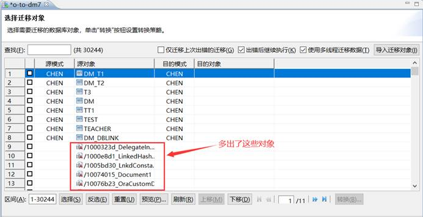

**【问题原因】** ：

勾选了目录、公共同义词和上下文。

**【解决方法】** ：

返回上一步，取消勾选则正常。

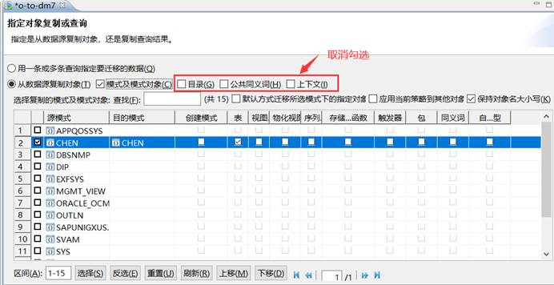

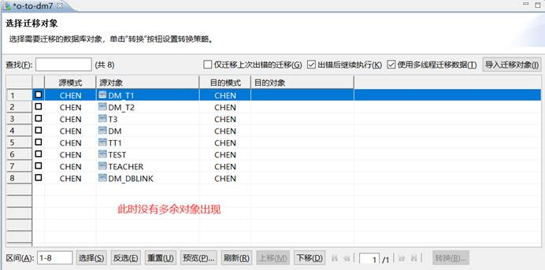

## varchar2 (4000) 迁移后变成 (3900)

DM 数据库根据页大小，varchar 字段最大长度有限制。具体限制如下：

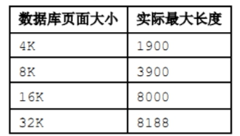

DTS 内部有字段类型映射，同时也会根据差异情况判断，在 8 kB 页大小情况下，将 Oracle 的 varchar2 (4000) 迁移成 varchar2 (3900)。

## Oracle 迁移到 DM 有关数据类型/语法的注意事项

需要注意 Oracle 的 `date` ， `datetime` 和 `timestamp` 都转换成 DM 的 `timestamp` 。

由于 Oracledate 既可以只存日期，也可以存放日期时间，DTS 迁移表结构过程中无法识别具体字段中内容再确定目的端数据类型，所以统一迁移成了 timestamp，迁移后的数据时间信息为 00:00:00.000，不影响时间字段比较和计算，如果部分字段的确只需要 date 类型则需要在 DM 中将对应字段调整为 date 类型。

DM 数据库和 Oracle 的语法大致相同，大部分都不需要修改，可以把 Oracle 中的语法到 DM 中执行，如果有报错的部分，需要查看系统管理员手册和程序员手册来查看相应的需要修改的语法部分。

## 违反引用约束

这种问题主要是由外键约束造成的，父表的数据没有迁移，先迁移了子表的数据，错误如下图所示：

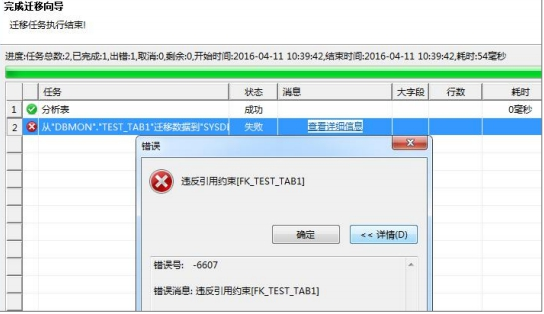

**【解决方法】** ：

迁移的时候先不迁移外键等约束，在选择好要迁移的表时，点击【转换】，按照以下步骤进行迁移。

1. 第一次只选择表定义，不选择约束等，如下图所示：

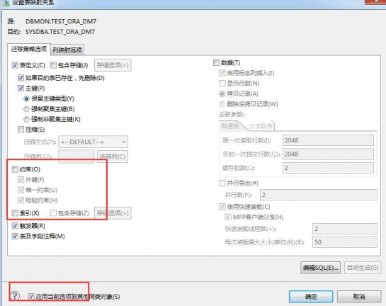

2. 第一次迁移完成后（确保没有错误），第二次只选择数据，如下图所示：

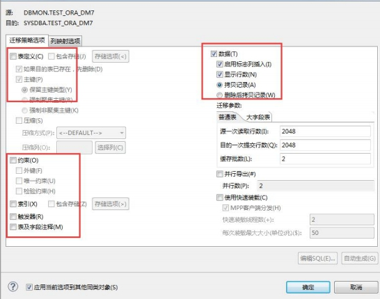

3. 第三步选择约束、索引等，如下图所示：

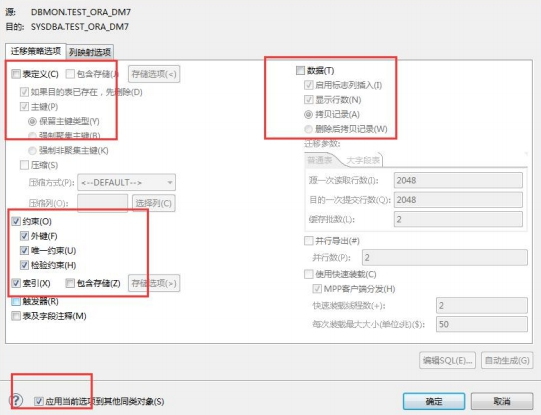

按照上面三步迁移，基本上都可以顺利迁移成功。

## 违反唯一性约束

这种情况是因为表中设置了唯一性约束或者主键约束，但是数据中有重复记录。有可能是原始库的约束被禁用了，或者数据重复迁移造成的。

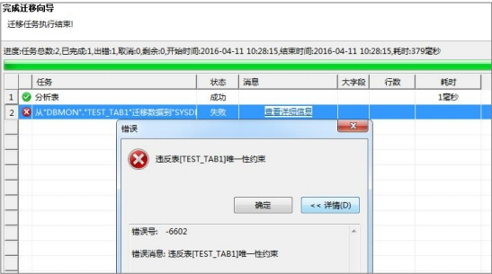

**【解决方法】** ：

在确定源数据没有问题的情况下，迁移的时候选择删除后再拷贝，如下图所示：

在迁移界面中，选中要迁移的表，然后点击【转换】。

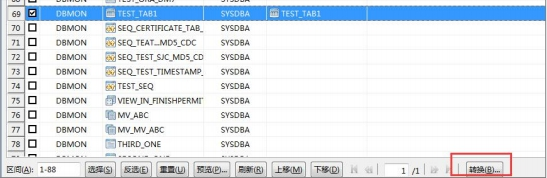

在弹出的窗口中选择删除后拷贝，如下图所示：

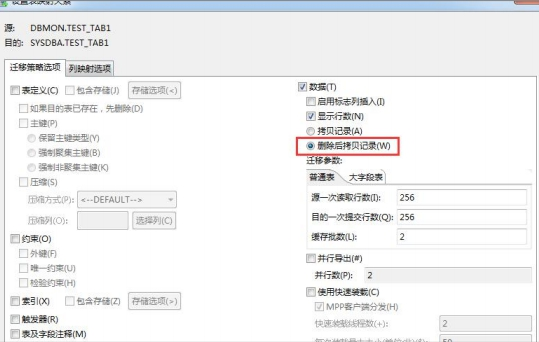

按照上述操作即可迁移成功。

## 迁移视图提示：无效的用户对象

这个问题一般是因为在迁移视图之前，没有将视图依赖的表迁移过去，如下图所示：

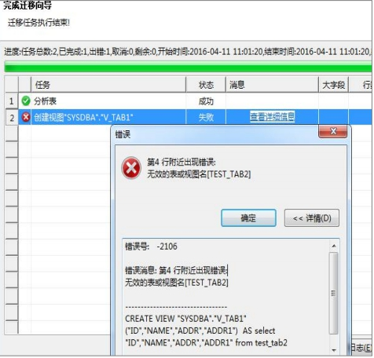

**【解决方法】** ：

严格按照迁移的顺序，先迁移表，然后再迁移视图、存储过程、函数的顺序迁移即可。

## 连接尚未建立或已经关闭

**【问题描述】** ：

从 Oracle 迁移数据到 DM 数据库，数据迁移时提示连接尚未建立或已经关闭。

**【解决方法】** ：

- 原因一：这个问题有可能是因为 Oracle 库中存在非法的数据，例如： `-5486-12-31 00:00:00` 这样的非法的时间，在批量绑定插入的时候 JDBC 未作校验，服务器端检测到就会把这个连接剔  
	除，就会报这个错误。新版的 JDBC 驱动（2019 年 7 月以后）已经对此类问题进行了处理，增加了校验，碰到非法的数据会直接报错。碰到这种问题建议使用最新的 JDBC 驱动，替换掉迁移工具使用的 JDBC 驱动即可。
- 原因二：迁移连接用户设置了会话时间限制，放开会话连接限制即可，数据库 `参数 max_sessions` 设置。
- 原因三：迁移过程中数据库连接断开了重新迁移。

## 报错：精度必须大于标度

**【问题描述】** ：

从 Oracle 迁移到 DM 的时候有一个报错：精度必须大于标度。

**【解决方法】** ：

Oracle 中 number (m,n) 允许 n>m，但是在 DM 中是不允许的，DM 中 m>=n，m 表示精度，n 表示标度。精度是一个无符号整数，定义了总的数字数；标度定义了小数点右边的数字位数。

碰到这种问题一方面要思考一下 Oracle 里面列定义是否弄错了，如果是特意这样设计的，要搞清楚这个列到底需要存放什么样的数据，单独迁移这张表，对 DM 数据类型进行修改。

## Oracle 中 raw 类型在 DM 中可以用哪种类型

Oracle 中 raw 类型在 DM 中可以使用 varbinary 代替。

## Oracle 的 date 类型是对应 DM 哪种类型

**【问题描述】** ：

DM 的 DATE 类型不能存放时分秒吗？Oracle 的 date 日期类型是对应 DM 的 datetime 类型吗？

**【解决方法】** ：

如果设置兼容参数 COMPATIBLE\_MODE = 2，date 类型默认会建成 `timestamp` 类型。

> **说明**
> 
> Oracle 的 DATE 类型中包括年、月、日、时、分、秒，DM 中 \`DATE\` 类型只包括年、月、日，而时、分、秒在 \`TIME\` 类型中。DM 中包含年、月、日、时、分、秒的数据类型是 \`TIMESTAMP\` 类型。从 Oracle 迁移到 DM 时要注意 DATE 类型引起的日期比较问题，可以\*\*将 DATE 换成 TIMESTAMP 类型\*\*。

## Oracle 的 dmp 文件导入 DM 报错：终止导入请使用更高级别的工具

Oracle 数据库的 dmp 文件不能导入到达梦数据库，每种数据库导出的 dmp 文件，都具备自身数据库特有的加密格式，其它架构的数据库肯定是无法识别的。

Oracle 数据库的数据信息可以通过达梦数据库自带的数据库迁移工具 DTS 迁移到 DM 数据库。

## DTS 报错：JAVA HEAP SPACE

**【问题描述】**

使用 dts 迁移工具进行 oracle 到 dm 的迁移时，迁移表只有一个大字段表，迁移时报错："java heap space"。

**【问题分析】**

dts 所在机器内存不足导致迁移过程中内存溢出。

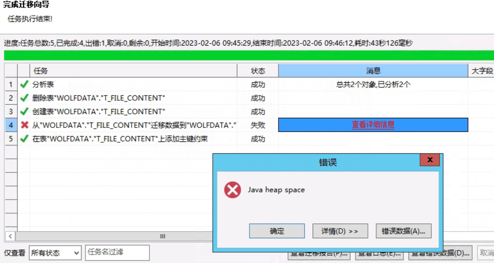

**【问题解决】**

1. 修改 dts.ini 配置文件，添加内存参数-Xmx2048m，重新迁移即可。
2. 如果当前环境不支持调整内存参数，可以通过修改 dts 转换功能中“源一次读取行数和目的一次提交行数（调整成合适的值）”，比如调整为一次读取和提交 4096 行。
	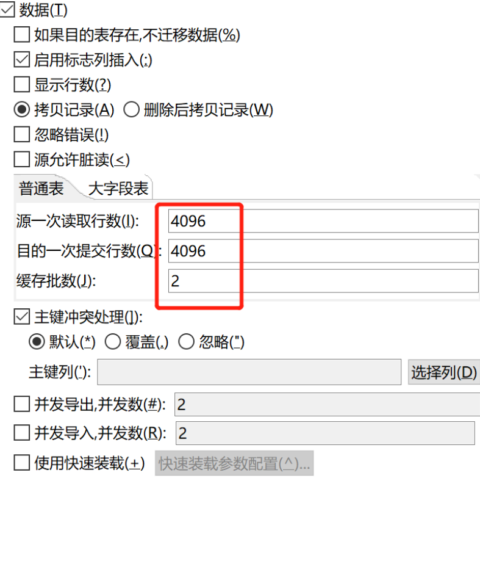

## 迁移过程中出现的错误：违反协议

一般是 Oracle 的 jdbc 驱动问题导致，尝试更换驱动包。

## 报错：序列最大值超出达梦范围

分析一：< 最大值 > 指定序列能生成的最大值，如果忽略 MAXVALUE 子句，则降序序列的最大值缺省为-1 ，升序序列的最大值为 9223372036854775807(0x7FFFFFFFFFFFFFFF) 。

非循环序列在到达最大值之后，将不能继续生成序列数；但是 Oracle 中最大值 28 个 9，迁移到 DM7 时报序列最大值超出达梦范围的错误（最新的 dts 版本已经将超过 DM7 最大值的序列的最大值直接转换成 9223372036854775807）

分析二：对于这类报错，需要分析源库序列用途，目的库范围是否能够满足使用情境。如可以满足，则按照目的 DM 的可定义范围设置，如存在风险，则考虑在应用层面修改或者采取其他措施规避风险。

## Oracle 迁移到 DM 报错：精度超出范围

- Oracle 迁移到 DM 数据库，数据类型的映射关系，可以参考 DTS 迁移工具的帮助菜单-帮助主题--数据类型映射--默认数据类型映射关系。
- 可能是由于 Oracle 和 DM 数据库字符集不一样的原因：比如 gbk 和 utf-8 中文占用的字节数不一样。 在迁移的时候，可以将字符长度映射调正大。

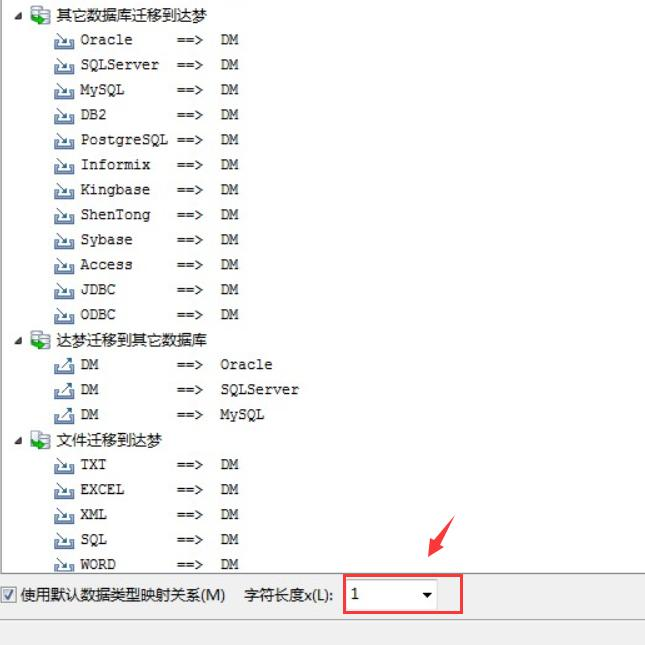

- 如果碰到中文对应到 DM 都需要三倍长度，可以检查初始化数据库的时候，达梦数据库选择字符串是否以字符为单位。（length\_in\_char=1 试试）

## Oracle 迁移过程中出现的错误:试图在 blob 或者 clob 列上排序或比较

达梦数据库中是不允许对大字段（clob blob）类型的列进行排序操作的，部分新版本可以修改配置 ini 参数 ENABLE\_BLOB\_CMP\_FLAG=1。

## 包含 blob 类型的数据表都迁移不动

需要调小 dts 里面大字段表每次读取跟提交行数。

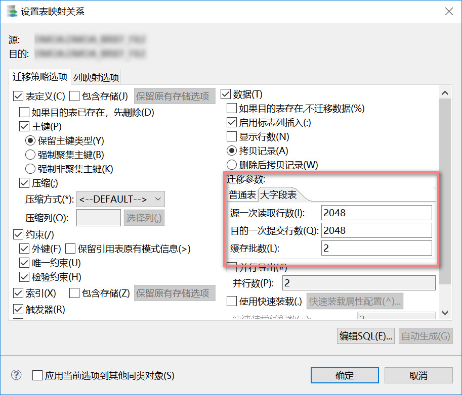

## DTS 使用时候选择删除后再拷贝记录，是否会删除源库的数据

不会，删除的是目的端的数据。

## 使用 DTS 迁移时报错：ORA-00942

**【问题分析】**

该报错是由于 Oracle 迁移账户权限不够，缺少查询字典权限导致。

**【问题解决】**

使用 SYSDBA 用户授予迁移账户 select any dictionary 权限，授权语句如下：

```sql
grant select any dictionary to username;
```

## DTS 迁移工具未响应/卡住

1. 可能与客户端机器性能有关
2. 建议一次少选一些表；在进行重新迁移时，迁移时勾选清空数据库迁移，避免数据重复
3. 数据库迁移的顺序，参考达梦云适配中心的 [迁移手记](http://eco.dameng.com/docs/zh-cn/start/migrate-oracle-dm.html)
4. 低版本的客户端将低版本的数据库中的数据迁移到高版本中，比如：使用 DM7 迁移工具，迁移 DM7 至 DM8，迁移卡住。这时请更换成 DM8 的 DTS 工具进行迁移。

## 迁移报错，提示“-3236 此列列表已索引”

出现这个提示，证明列表已经有索引了，可以到目标数据库查一下，有的话就忽略这个报错。

## 当前对象被占用

**【问题描述】** ：

oracle 迁移 dm 之后，想把迁移的模式删了，重新迁移一份，删除不了，一直提示错误号: -6509 错误消息: 第 1 行附近出现错误: 当前对象被占用。

**【问题解答】** ：

查看是否开了多个窗口的管理工具，把无用的界面关闭了。是否有未结束的应用连接在操作。

删除模式时加上级联删除选项，例如：

```sql
DROP SCHEMA <模式名> CASCADE;
```

## 迁移过程中出现的错误：被引用列未添加索引

一般出现在添加外键，建议先添加唯一约束然后添加外键约束。

## 迁移过程中出现的错误：对象不再存在

一般是导入的表是临时表，重新导入即可。

## 修改兼容性参数 COMPATIBLE\_MODE=2 后，SQL 走索引查询 is null 无法查询出空字符串数据

**【问题说明】**:

在修改兼容性参数 COMPATIBLE\_MODE=2 后，SQL 查询 where 条件 X is null，执行计划走 X 列单列索引或者以 X 列为前导列的组合索引无法查询出空字符串数据，且重建索引也没有作用，禁用或者删除对应索引可以正常查询出包含空字符串的数据。

原因是由于在修改兼容性参数 COMPATIBLE\_MODE=2 之前，数据表中已有空字符串数据，修改 COMPATIBLE\_MODE=2 之后新插入的空字符串数据自动转换为 NULL 存入表中。

COMPATIBLE\_MODE 参数相当于初始化参数，需要在创建数据库实例之后或者创建业务用户表之前设置好。

**【解决方法】**:

新建实例在创建业务用户表之前修改兼容性参数 COMPATIBLE\_MODE=2，然后使用迁移工具重新迁移数据。或者手动 update 空字符串数据为 null。

## DTS 工具从 oracle 迁移到 dm 库，提示迁移完成，但实际数据量与源库不匹配，缺失数据

明确迁移源库 oracle 数据库的具体版本信息，一定要在 DTS 迁移工具中指定源 oracle 数据库的驱动为自动义的且是与 oracle 版本适配的 jdk 版本，因为默认 dts 工具在选择源端驱动时时默认的一个驱动版本，不一定和真实的库完全匹配。

oracle 数据库版本与 JDK 的版本选择，参考如下：

```shell
Oracle Database versionJDBC Jar files specific to the release
21.1—— ojdbc11.jar with JDK11, JDK12, JDK13, JDK14 and JDK15；ojdbc8.jar with JDK8, JDK11, JDK12, JDK13, JDK14 and JDK15
19.x——ojdbc10.jar with JDK10, JDK11；ojdbc8.jar with JDK8, JDK9, JDK11
18.3——ojdbc8.jar with JDK8, JDK9, JDK10, JDK11
12.2 or 12cR2——ojdbc8.jar with JDK 8
12.1 or 12cR1——ojdbc7.jar with JDK 7 and JDK 8；ojdbc6.jar with JDK 6
11.2 or 11gR2——ojdbc6.jar with JDK 6, JDK 7, and JDK 8(Note: JDK7 and JDK8 are supported in 11.2.0.3 and 11.2.0.4 only)；ojdbc5.jar with JDK 5
```

## oracle 迁移到 DM，表结构一致，迁移数据报错：数据溢出

**【问题说明】** ：  
有两种可能的情况：

1. Oracle 的 int 类型自动转换成 number(38)；
2. Oracle 的 number 类型存放精度超过 38 位；

情况一：  
Oracle 创建 int 类型，默认自动转换成 number(38)  
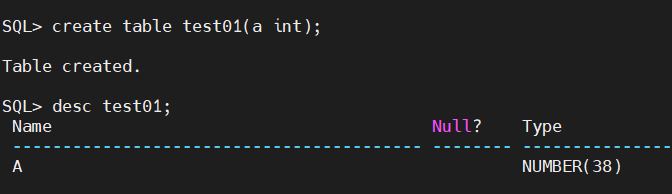  
实际上在做插入的时候，精度超过 38 位，插入也是可以成功的  
以下显示插入 40 位数字是成功的：  
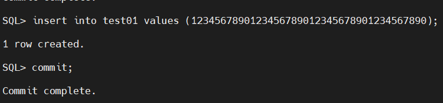  
迁移到 DM 时，也会创建相同的表结构：  
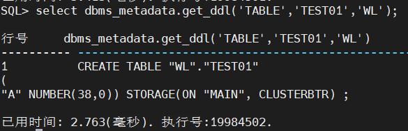  
但 DM 的 number(38)类型，严格限制最大仅能存 38 位，超过这个精度在迁移的时候就会报：数字溢出  
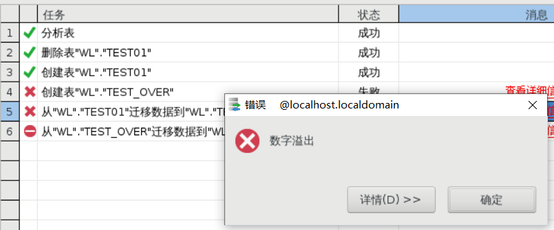

情况二：  
Oracle 创建 number 类型，实际插入超过 38 位：  
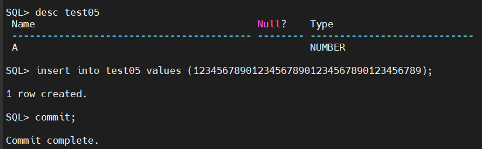  
迁移到 DM，也是 number 类型，但超过 38 位，DM 会报数字溢出  
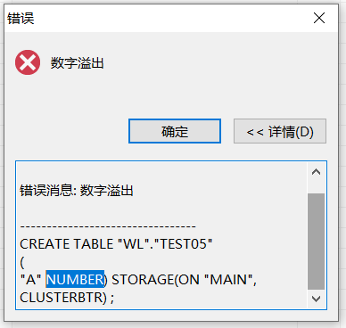

**【解决方法】** ：

1. 确认数据本身有没有错误，在 Oracle 中存储这种超长的数值，理论上也是不支持；
2. DM 超过 38 位的 number 类型，建议改成 varchar 类型；

## 数据库迁移，在执行任务迁移表的时候长时间卡住不动

**【原因及解答】** ：

1. 表的数量较多，查询源端元数据时间较长；
2. 快速装载的问题，建议在表--》转换中，把大字段的每次读取的行数改成 1，关掉快速装载；
3. 目的端表被锁住，此时再用 DTS 向目的端的表做插入会被阻塞造成长时间卡顿，将目的端的表 drop 掉或者解锁重新迁移；

## 迁移后创建唯一约束报错，但数据无重复

**【问题说明】** ：  
这种情况可能是由于字段某些值的末尾存在空格。  
若数据库需要兼容 oracle，则在初始化数据库时需要将空格填充模式设为与 oracle 一致。

**【解决方法】** ：  
方法一：利用 dminit 初始化实例时，添加参数 BLANK\_PAD\_MODE=1。  
方法二：使用“DM 数据库配置助手”图形化界面初始化库时，勾选“空格填充模式”。

## 迁移 forall 脚本报错：语法分析出错

**【问题描述】** ：

迁移 forall 脚本报错。Oracle 中的 forall 脚本如下图所示：

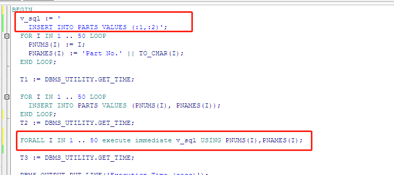

报错信息如下图所示：

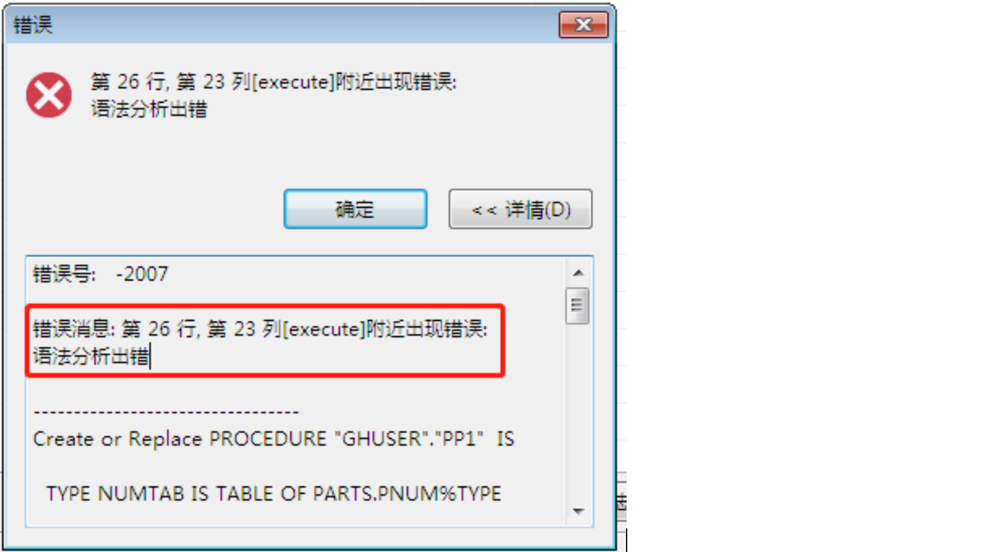

**【问题解决】** ：

由于 DM 目前不支持 execute immediate 动态语句，因此直接改为非动态 sql 即可，如下图所示：

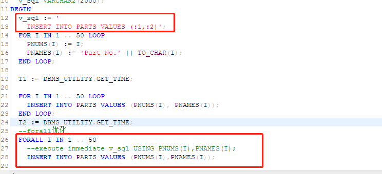

## 在迁移 Oracle 的存储过程、包时报错：试图更新只读视图

**【解决办法】** ：

对于复杂的视图（包含 UNION、多条连接等），Oracle、达梦默认都是不允许更新的。但是若存储过程脚本中包含更新视图语句，在 Oracle 中编译能通过，而达梦由于对语法校验更加严谨，编译会不通过。此问题解决办法如下：  
步骤 1：首要确认 oracle 是否真的可以更新复杂视图，一般情况是不允许的。如果 oracle 上不允许，则需要在 oracle 上修改，再迁移到达梦。  
步骤 2：如果 oracle 允许修改复杂视图（打开了隐含参数\_complex\_view\_merging），达梦则需要把修改视图的语句拆分为多个语句，单独修改视图的基表。  
例如：

```sql
---创建表 T1 和 T2
create table T1(ID INTEGER,NAME VARCHAR2(200),FU NUMBER);   
create table T2(ID INTEGER,NAME VARCHAR2(200),FU NUMBER);

---创建含 union 的视图
CREATE OR REPLACE VIEW V_T1_T2 AS
SELECT "ID","NAME","FU" FROM t1
UNION ALL
SELECT "ID","NAME","FU" FROM t2;

--原sql
CREATE PROCEDURE p5 IS
BEGIN
  UPDATE v_t1_t2 SET NAME = 'aaaa' WHERE ID = 99; 
END;

--达梦把视图拆分，单独修改
CREATE PROCEDURE p5 IS
BEGIN
  UPDATE t1 SET NAME = 'aaaa' WHERE ID = 99;
  UPDATE t2 SET NAME = 'aaaa' WHERE ID = 99;
END;
```

## 兼容 oracle sys\_extract\_utc 函数实现时区类型数据转换为 utc 的 timestamp 值

**【问题解决】** ：

```sql
CREATE or REPLACE
        FUNCTION sys_extract_utc FOR CALCULATE
                (
                v_time in datetime(6)
                with time zone)
                RETURN timestamp
        is
        begin
                return
                case substr(v_time, 28, 1)
                when '+' then
                        to_date(substr(v_time, 0, 27))-to_number(substr(v_time, 29, 2))/24-to_number(substr(v_time, 32, 2))/24/60
                when '-' then
                        to_date(substr(v_time, 0, 27))+to_number(substr(v_time, 29, 2))/24+to_number(substr(v_time, 32, 2))/24/60
                end;
        end;
```

## ORACLE 12C 使用默认方式连接不到需要迁移的库

**【问题描述】** ：

ORACLE 12C 后多出一个新特性多容器，此时迁移数据时使用默认的方式迁移会导致连接不到需要迁移的库。

**【问题解决】** ：

在迁移时不再使用默认方式，需要指定驱动和 URL  
驱动路径：选择与数据库版本相对应的驱动  
URL:使用服务名的方式登录 @ip 地址：端口号/服务名

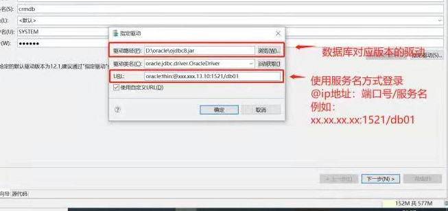

## Oracle 12c 及以上版本使用达梦迁移工具不识别 SID

**【问题描述】** ：

Oracle 12c 及以上版本使用达梦迁移工具不识别 SID,报错如下：  
错误号: 12505  
错误消息: Listener refused the connection with the following error:ORA-12505, TNS:listener does not currently know of SID given in connect descriptor

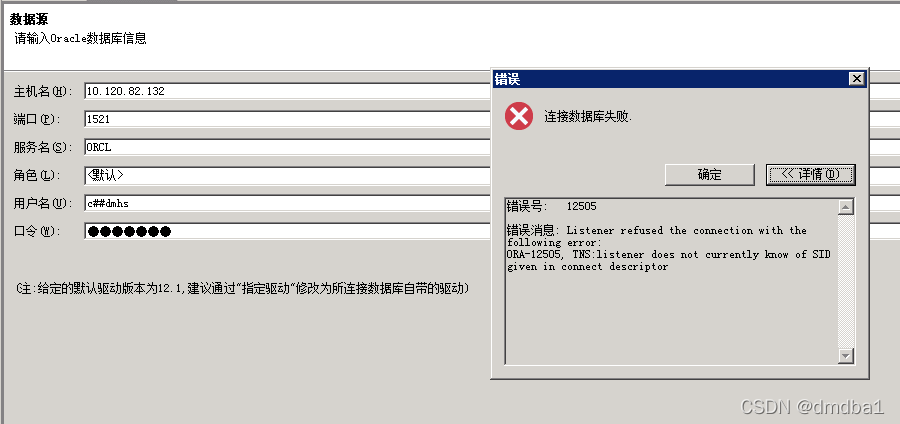

**【问题解决】** ：

通过指定驱动进行连接：指定驱动--> 使用 Oracle12c 驱动包--> 填写 URL。  
URL 内容如下：

```java
jdbc:oracle:thin:@(DESCRIPTION=(ADDRESS=(PROTOCOL = TCP)(HOST = 10.120.82.132)(PORT = 1521))(CONNECT_DATA=(SERVER = DEDICATED)(SERVICE_NAME = ORCL)))
```

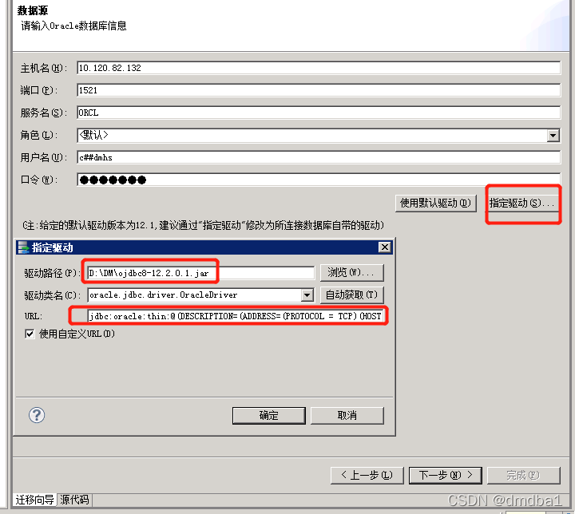

## DTS 工具迁移表结构时列长度修改不生效

**【问题描述】：**

DTS 工具迁移表结构时直接改变列长度，设置列长度修改不生效。

**【问题解决】：**

Oracle 迁移到 dm 时，在不使用自定义类型时设置扩展列长度不生效，需要在数据类型映射目录下面的 oracle 选项中进行自定义映射配置，使用自定义列映射的方法进行映射。

例如：从 Oracle 迁移到 DM 时，源端建表语句为 `Create table test2(id int,name varchar2(20));` 现在需要将 varchar2 类型的列长度扩展为原来的 2 倍，扩展为 varchar2(40)。具体可参考以下步骤：

1. 使用自定义映射类型，在 DTS 中新建工程以后，首先设置数据类型映射，在数据类型映射中找到对应的源端库，这里以 oracle 为例，双击 DM 对象，然后点击数据类型名可选则要扩展的数据类型类型，输入要扩展的倍数。

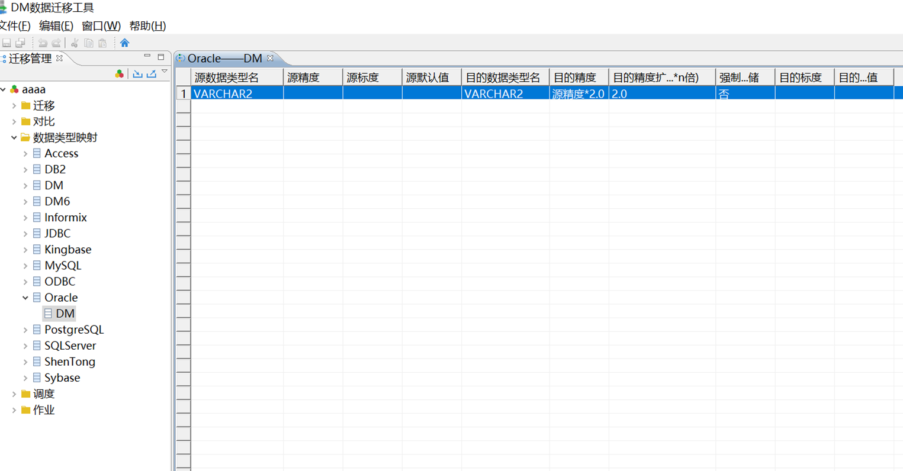

2. 在设置了自定义列映射以后，新建迁移，然后正常执行 dts 迁移步骤，到对象复制页面，取消勾选“使用默认数据类型映射关系”，点开“查看默认类型映射关系”，可以直接看到映射关系出现在最上方，已生效，继续后面的迁移步骤；

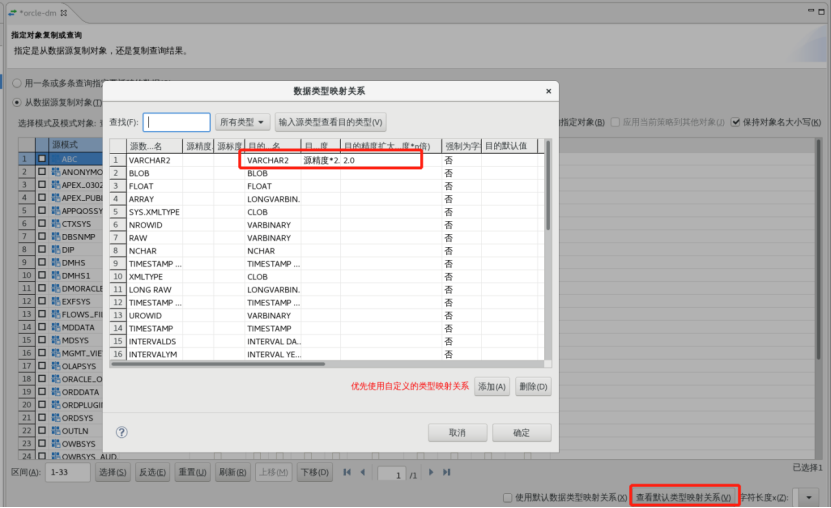

3. 迁移结束后，在结束面版点击查看建表语句，可以看到目的端 varchar2 类型的列长度已经扩展为原来的 2 倍；

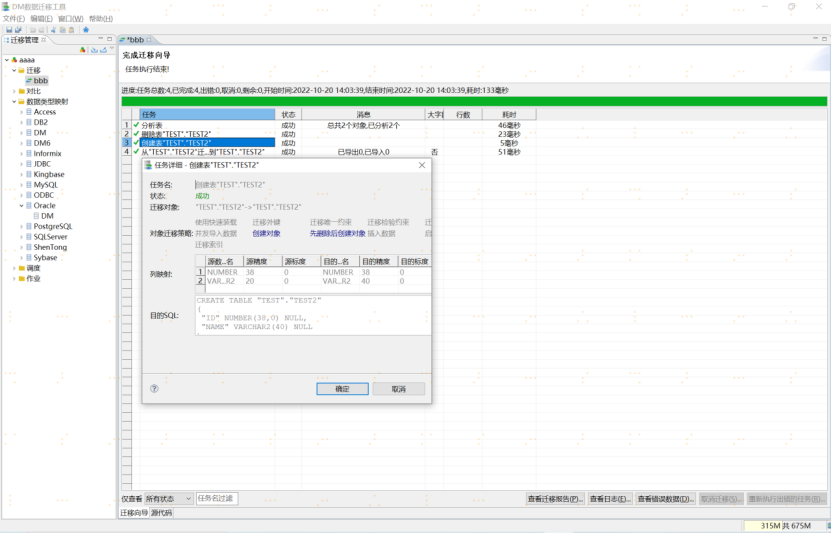

## 在迁移过程中分区表迁移速度较慢，如何提高迁移到目的端的效率？

**【问题解决】**

可以通过分区置换的方法提高迁移到目的端的效率，前提需要创建的普通表和分区表的表结构以及索引且索引顺序全部保持一致。以下有两种迁移方式可供参考。

1. 通过分区置换的方法，置换为普通表后，DTS 开启多个窗口并行迁移到目的端，迁移完成后，目的端通过分区置换方法，再置换为分区表；
2. 通过分区置换的方法，置换为普通表后，通过表备份还原的方法，将备份还原到目的端后，通过分区置换方法，再置换为分区表。

下面对分区置换方法进行举例说明：

1. 统计分区表的分区数量：
```sql
select count(*) from "TEST"."TT_上海";
select count(*) from "TEST"."TT_云南";
select count(*) from "TEST"."TT_内蒙";
```
2. 创建和分区表相同表结构的普通表以及索引：
```sql
CREATE TABLE "TEST"."TT_上海_1" ("area_code" VARCHAR(255),"TTsn" VARCHAR(80),"org_code" VARCHAR(64),"file_url" VARCHAR(50),"entity" TEXT,"created" DATETIME(6)) STORAGE(ON "TEST_DATA", CLUSTERBTR) ;
CREATE TABLE "TEST"."TT_云南_2" ("area_code" VARCHAR(255),"TTsn" VARCHAR(80),"org_code" VARCHAR(64),"file_url" VARCHAR(50),"entity" TEXT,"created" DATETIME(6)) STORAGE(ON "TEST_DATA", CLUSTERBTR) ;
CREATE TABLE "TEST"."TT_内蒙_3" ("area_code" VARCHAR(255),"TTsn" VARCHAR(80),"org_code" VARCHAR(64),"file_url" VARCHAR(50),"entity" TEXT,"created"

CREATE  INDEX "index-TT_1" ON "TEST"."TT_上海_1"("org_code" ASC) STORAGE(ON "TEST_DATA", CLUSTERBTR) ;
CREATE  INDEX "index-TT_2" ON "TEST"."TT_云南_2"("org_code" ASC) STORAGE(ON "TEST_DATA", CLUSTERBTR) ;
CREATE  INDEX "index-TT_3" ON "TEST"."TT_内蒙_3"("org_code" ASC) STORAGE(ON "TEST_DATA", CLUSTERBTR) ;
```
3. 将分区表的各个分区转换为普通表：
```sql
alter table "TEST".TT exchange PARTITION  "上海"  with table "TEST"."TT_上海_1";
alter table "TEST".TT exchange PARTITION  "云南"  with table "TEST"."TT_云南_2";
alter table "TEST".TT exchange PARTITION  "内蒙"  with table "TEST"."TT_内蒙_3";
```
4. 备份表普通表：
```sql
BACKUP TABLE "TEST"."TT_上海_1" BACKUPSET '/data2/dmdata/dbbak/TT_1';
BACKUP TABLE "TEST"."TT_云南_2" BACKUPSET '/data2/dmdata/dbbak/TT_2';
BACKUP TABLE "TEST"."TT_内蒙_3" BACKUPSET '/data2/dmdata/dbbak/TT_3';
```
5. 将所有的表备份发送到目标机器 10.xx.xx.12 上：
```shell
scp -r /data2/dmdata/dbbak dmdba@10.xx.xx.12:/dev/shm/dbbak
```
6. 还原表结构：
```shell
RESTORE TABLE struct FROM BACKUPSET '/dev/shm/dbbak/dbbak/TT_1';
RESTORE TABLE struct FROM BACKUPSET '/dev/shm/dbbak/dbbak/TT_2';
RESTORE TABLE struct FROM BACKUPSET '/dev/shm/dbbak/dbbak/TT_3';
```
7. 还原表数据：
```sql
RESTORE TABLE FROM BACKUPSET '/dev/shm/dbbak/dbbak/TT_1';
RESTORE TABLE FROM BACKUPSET '/dev/shm/dbbak/dbbak/TT_2';
RESTORE TABLE FROM BACKUPSET '/dev/shm/dbbak/dbbak/TT_3';
```
8. 在 10.xx.xx.12 上新建一张分区表：
```sql
CREATE TABLE "TEST"."TT10"
(
"area_code" VARCHAR(255),
"TTsn" VARCHAR(80),
"org_code" VARCHAR(64),
"file_url" VARCHAR(50),
"entity" TEXT,
"created" DATETIME(6))
PARTITION BY LIST("area_code")

(
PARTITION  "内蒙"  VALUES('150000')  ,
PARTITION  "云南"  VALUES('530000')  ,
PARTITION  "上海"  VALUES('310000')  ,
)

CREATE  INDEX "index-orgCode10" ON "TEST"."TT10"("org_code" ASC) STORAGE(ON "TEST_DATA", CLUSTERBTR) ;
```
9. 将 10.xx.xx.12 上的普通表转换为分区表：
```sql
alter table "TEST".TT exchange PARTITION  "上海"  with table "TEST"."TT_上海_1";
alter table "TEST".TT exchange PARTITION  "云南"  with table "TEST"."TT_云南_2";
alter table "TEST".TT exchange PARTITION  "内蒙"  with table "TEST"."TT_内蒙_3";
```

至此分区置换完成。

## Oracle 集群迁移到 DM 连接 Oracle 端时报错：“xxxORA-12505xxx”

**【问题描述】**

Oracle 11G RAC 集群迁移到 DM 连接 Oracle 端时报错：Listener refused the connection whth the following error:ORA-12505, Thn:listener does not currently know of SID Giver in connect descriptor。

**【问题解决】**

出现此报错需要指定 Oracle 驱动，自定义 url：jdbc:oracle:thin:@(DESCRIPTION=(ADDRESS\_LIST=(ADDRESS=(PROTOCOL=TCP)(HOST=IP)(PORT= 端口)))(CONNECT\_DATA=(SERVICE\_NAME= 服务名 )))。

参数说明：  
DESCRIPTION：描述  
ADDRESS\_LIST：地址列表  
ADDRESS：地址  
PROTOCOL：使用的网络协议  
HOST：Oracle 数据库地址  
PORT：Oracle 端口  
CONNECT\_DATA：连接数据库名称  
SERVICE\_NAME：Oracle 服务名

## 存储过程执行报错：对象定义被修改

**【问题描述】**

从 ORACLE 中迁移存储过程到 DM 中，存储过程编译可通过，但在存储过程执行时报错：对象定义被修改。

**【问题分析】**

出现该问题，一般是存储过程中，对一张表先进行了 DDL 操作（如删除索引，添加主键），而后又对该表进行了 DML 操作（ INSERT|DELETE ），就会报错：对象定义被修改。由于达梦数据库会获取 SQL 所有执行计划，再去执行 SQL， 如果在一个过程里先修改分区表定义，就会修改字典信息，所以在执行后续 DML 的时候和之前获取的计划不一致，所以就会报错。可以将 DML 改为动态方式去执行，因为动态执行时才会生成计划，就不会有影响。

**【问题解决】**

将存储过程中的 DML（INSERT|DELETE）语句使用动态语句执行，即可解决该问题。

例如：

```sql
EXECUTE IMMEDIATE 'insert into t1 select * from t10 where rownum=1 ';
```

ISNERT 未使用动态语句：

```sql
CREATE or REPLACE  PROCEDURE "PP_2"   ( MM  IN  NUMBER) AS MM1      VARCHAR2(1000);  
BEGIN
EXECUTE IMMEDIATE 'drop index idx_t1';
insert into t1 select * from t10 where rownum=1 ;
commit;
EXECUTE IMMEDIATE 'create INDEX idx_t1 on t1(c1)';
END PP_2;
CALL PP_2(1)；  --报错：对象定义被修改
```

INSERT 使用动态语句：

```sql
CREATE or REPLACE  PROCEDURE "PP_1"   ( MM  IN  NUMBER) AS MM1      VARCHAR2(1000);  
BEGIN
EXECUTE IMMEDIATE 'drop index idx_t1';
EXECUTE IMMEDIATE 'insert into t1 select * from t10 where rownum=1 ';
commit;
EXECUTE IMMEDIATE 'create INDEX idx_t1 on t1(c1)';
END PP_1;
call PP_1(1);    --执行成功
```

## 记录超长

**【问题描述】**

从 oracle 迁移到 dm，迁移表 WORKFLOW\_TRACK 数据时报错：“记录超长”。

**【问题分析】**

通过分析发现此报错是由于该行记录的大小超过了页大小的一半导致。如果定义的数据类型是 varchar 类型，该行记录的大小不能超过页大小的一半。

**【问题解决】**

对这个表启用超长列，SQL 命令如下：

```sql
alter table Workflow_track enable using long row;
```

重新迁移表即可成功。

## DTS 迁移连接 Oracle 数据库报错：“错误号：17002 IO 错误：Connection reset”

**【问题描述】**

麒麟 V10 系统部署达梦数据库，使用 DTS 迁移工具迁移时在连接 Oracle 数据库时报错：“错误号：17002 IO 错误：Connection reset”。

**【问题分析】**

检查达梦数据库服务器与 Oracle 数据库服务器之间的通信正常，检查 Oracle 数据库端口正常。猜测是由于网络问题导致，打开 Oracle 数据库服务器下的 `/etc/resolv.conf` 文件发现存在 `search openstacklocal` 将其注释掉后可以正常连接。

**【问题解决】**

将 Oracle 数据库服务器下的 `/etc/resolv.conf` 文件 `search openstacklocal` 注释掉。

search 作用说明：

当访问的域名不能被 DNS 解析时，resolver 会将该域名加上 search 指定的参数，重新请求 DNS，直到被正确解析或试完 search 指定的列表为止。

oracle 到 dm 的 hs 单项同步报错：error during execution of trigger 'SYS.DMHS TRIGGER”

## 使用 DTS 将 Oracle 间隔分区表迁移到达梦时报错：‘新增间隔分区失败’

**【问题描述】**

使用 DTS 迁移工具，将 Oracle 间隔分区表迁移到达梦时报错：‘新增间隔分区失败’。迁移中断后，重新迁移报错数据仍报相同错误。

**【问题解决】**

设置系统参数 DEL\_HP\_OPT\_FLAG 值为 4 可支持新增间隔分区。

修改方法：

使用 SYSDBA 用户登录管理工具，执行以下 SQL 命令：

```sql
SP_SET_PARA_VALUE(1,‘DEL_HP_OPT_FLAG’,4);
```

参数说明：

| 参数名 | 默认值 | 属性 | 说明 |
| --- | --- | --- | --- |
| DEL\_HP\_OPT\_FLAG | 0 | 动态，会话级 | 控制分区表的操作优化，   0：不优化；   1：打开分区表 DELETE 优化；   2：控制范围分区表创建的优化处理，转换为数据流方式实现；   4：允许语句块中的间隔分区表自动扩展；   8：开启对 TRUNCATE 分区表的优化处理；   16：完全刷新时删除老数据使用 DELETE 方式.   支持使用上述有效值的组合值，如 7 表示同时进行 1、2、4 的优化 |

## 从 oracle 迁移到达梦，触发器如何寻找依赖关系？

**【问题描述】**

从 oracle 迁移到达梦，发现达梦的触发器数量多于 oracle,达梦比 oracle 多的触发器命名规则为 REF\_CON\_TRIGXXXXXX、SREF\_CON\_TRIGXXXXX\_AS、SREF\_CON\_TRIGXXXXX\_BS、SREF\_CON\_TRIGXXXXX\_AR(XXXX 为数字)，不知道如何寻找依赖关系。

**【问题分析】**

以上触发器为外键相关触发器其中 xxxxxx 表示外键约束的对象 id。

REF\_CON\_TRIGXXXXXX 表示外键级联删除 更新触发器 。

**【问题解决】**

查询依赖关系：

```sql
select
        aa.owner           ,
        aa.triggering_type ,
        aa.triggering_event,
        ab.*               ,
        aa.trigger_body
from
        dba_triggers aa
join
        (
                select
                        (
                                select name from sysobjects c where c.id=a.id
                        )
                        constraint_name,
                        (
                                select name from sysobjects c where c.id=a.tableid
                        )
                        table_name,
                        a.type$   ,
                        a.valid   ,
                        a.trigid  ,
                        (
                                select name from sysobjects c where c.id=a.trigid
                        )
                        trig_name
                from
                        SYSCONS a
                where
                        trigid>0
        )
        ab
on
        aa.trigger_name=ab.trig_name;

SREF_CON_TRIGXXXXX_AS、SREF_CON_TRIGXXXXX_BS、SREF_CON_TRIGXXXXX_AR --表示 外键引用自身字段
select
        *
from
        dba_triggers
where
        table_name in
        (
                select
                        c.name
                from
                        sysobjects c
                join SYSCONS a
                on
                        trigid=-1
                    and c.id  =a.tableid
        )
    and trigger_name like 'SREF_CON_TRIG%';
```

## PL/SQL 语句块中对间隔分区插入数据时分区无法自动扩展

**【问题描述】**

PL/SQL 语句块中对间隔分区插入数据时分区无法自动扩展，报错："-2903: 语句块/包/存储函数中的间隔分区不支持自动扩展"。

**【问题解决】**

调整参数值 DEL\_HP\_OPT\_FLAG = 4

```sql
sp_set_para_value(1,'DEL_HP_OPT_FLAG',4);
```

参数说明：

| 参数 | 默认值 | 属性 | 说明 |
| --- | --- | --- | --- |
| DEL\_HP\_OPT\_FLAG | 0 | 动态，会话级 | 控制分区表的操作优化，0：不优化；   1：打开分区表 DELETE 优化；   2：控制范围分区表创建的优化处理，转换为数据流方式实现；   4：允许语句块中的间隔分区表自动扩展；   8：开启对 TRUNCATE 分区表的优化处理；   16：完全刷新时删除老数据使用 DELETE 方式。   支持使用上述有效值的组合值，如 7 表示同时进行 1、2、4 的优化 |
|  |  |  |  |

## 如何将 Oracle CONVERT 函数字符串从原串编码格式转换成目的编码格式

**【问题描述】**

从 Oracle 迁移到 DM 如何将 Oracle CONVERT 函数字符串从原串编码格式转换成目的编码格式。

**【问题解决】**

可参考如下方法解决：

1. 将 DM 数据库中 ENABLE\_CS\_CVT 参数值设置为 1；
2. 重启 DM 数据库。

参数说明：

| 参数 | 默认值 | 属性 | 说明 |
| --- | --- | --- | --- |
| ENABLE\_CS\_CVT | 0 | 静态 | 是否使用用户自定义的 CONVERT 方法替换系统默认 CONVERT 方法。0：不替换；1：替换 |

当 ENABLE\_CS\_CVT=1 时，支持将字符串 char 从原串编码格式转换成目的编码格式。

如果原字符串没指定，默认为数据库服务器编码格式，目前只支持 ZHS16GBK、AL32UTF8、UTF8 和 ZHS32GB18030 四种编码格式。

## DM 如何兼容 Oracle 中 ODCIVARCHAR2LIST 行转列查询功能

**【问题描述】**

从 Oracle 迁移到 DM 如何兼容 Oracle 中 ODCIVARCHAR2LIST 行转列查询功能。

**【问题分析】**

ODCIVARCHAR2LIST 在 Oracle 中是 SYS 用户下的一个 TYPE，其作用主要是：

1. 实现字符串的切割操作，配合 table() 函数返回数组中的数据集；
2. 在 10G 及以上版本支持 SYS.ODCIVARCHAR2LIST 实现行列转换；
3. 适用于字符集合，不适用单个字符串。

**【问题解决】**

在 DM 中直接创建即可，如下：

```sql
CREATE OR REPLACE TYPE ODCIVARCHAR2LIST AS VARRAY(32767) OF VARCHAR2(4000);
```

在调用时去掉 "SYS."，如下：

```sql
SELECT COLUMN_VALUE FROM TABLE(ODCIVARCHAR2LIST('1','2','3','4','5'));
```

## DTS 连接 oracle 数据库报错：IO 错误：Connection reset by peer，Authentication lapse 1 ms.

**【问题描述】**

使用达梦 DTS 工具，在做 oracle 迁移到达梦数据库的迁移过程中，连接 oracle 数据库报错：“数据库连接失败，错误号【17002】 错误消息：IO 错误：Connection reset by peer，Authentication lapse 1 ms.”。

**【问题解决】**

可参考以下两种方式来解决该问题。

方式一：注释掉 DNS 域名解析配置文件 /etc/resolv.conf 所有内容。

```shell
sh-5.0# cat resolv.conf
#Generated by NetworkManager
#search openstacklocal novalocal
#nameserver XX.XX.XX.10
#nameserver XX.XX.XX.11
```

注意：此方法需要保证该服务器上无其他应用，只做 DTS 迁移，注掉 DNS 域名解析配置文件中的内容不会产生影响。

方式二：在 IPv4/IPv6 双环境中，建议在 dts.ini 中添加 jvm 配置 `-Djava.net.preferIPv4Stack=true` 。

在 IPv4/IPv6 双环境中，对于使用 Java 开发的网络应用，比较值得注意的是以下两个 IPv6 相关的 Java 虚拟机系统属性。

1. preferIPv4Stack（默 认 false）表示如果存在 IPv4 和 IPv6 双栈，Java 程序是否优先使用 IPv4 套接字。默认值是优先使用 IPv6 套接字，因为 IPv6 套接字可以与对应的 IPv4 或 IPv6 主机进行对话；相反如果优先使用 IPv4，则只不能与 IPv6 主机进行通信。
2. preferIPv6Addresses（默认 false）表示在查询本地或远端 IP 地址时，如果存在 IPv4 和 IPv6 双地址，Java 程序是否优先返回 IPv6 地址。Java 默认返回 IPv4 地址主要是为了向后兼容，以支持旧有的 IPv4 验证逻辑，以及旧有的仅支持 IPv4 地址的服务。

所以建议在 dts.ini 中添加 jvm 配置 `-Djava.net.preferIPv4Stack=true` 来处理该问题。

## 使用 DTS 将 ORACLE 迁移到 DM 报错：非法的基类名\[SYSGEO\]

**【问题描述】**

迁移 ORACLE 的空间数据类型为 MDSYS.SDO\_GEOMETRY 与 MDSYS.SDO\_GEOGRAPHY 的数据到 DM，报错“非法的基类名 \[SYSGEO\]”。

**【问题解决】**

迁移前在 DM 数据库创建相应的空间数据系统包，并在使用 DTS 迁移工具迁移时配置数据类型映射关系。示例如下：将 ORACLE 的 MDSYS.SDO\_GEOMETRY 与 MDSYS.SDO\_GEOGRAPHY 数据类型迁移为 DM 的 SYSGEO2.ST\_GEOMETRY 与 SYSGEO2.ST\_GEOGRAPHY 数据类型。

1. 在 DM 数据库中创建 DMGEO2 包
```sql
SP_INIT_GEO2_SYS(1);
```
2. 确认 DMGEO2 系统包为启用状态。
```sql
SELECT SF_CHECK_GEO2_SYS;
```
3. DTS 迁移时配置数据类型映射关系。
```sql
MDSYS.SDO_GEOMETRY   -->  SYSGEO2.ST_GEOMETRY
MDSYS.SDO_GEOGRAPHY  -->  SYSGEO2.ST_GEOGRAPHY
```

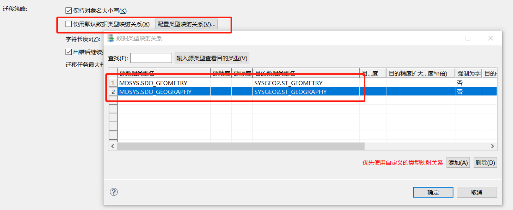

DMGEO2 包说明：DMGEO2 系统包以 DM8 的对象数据类型为基础，构造空间数据对象类型，以第三方开源几何处理函数库 geos，proj，sfcgal 为运算基础，将其封装为 liblwgeom 数据库，实现对空间数据类型的几何计算。

DMGEO2 包的详细说明及使用方法可参考数据库安装目录下 doc 目录中的《DM8 系统包使用手册》。

## DM 数据库在执行 sql 命令时报错：“-6130: 文字与格式字符串不匹配”

**【问题描述】**

DM 数据库在执行 sql 命令时报错：“-6130: 文字与格式字符串不匹配”。如下图所示：

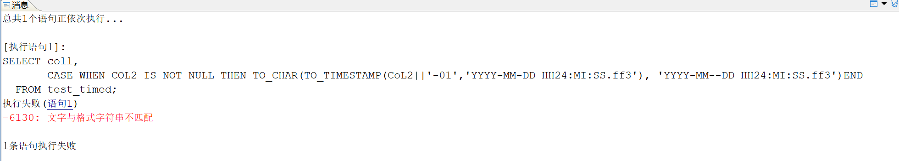

**【问题分析】**

Oracle 与 DM 数据库的 to\_timestamp 函数对数据的处理方式存在差异，oracle 数据库默认是不对此数据进行补全操作的，需要在 SQL 中添加 “||-01” 进行补全操作。而达梦数据库则不需要进行此补全操作，默认就已经补全了，所以在 SQL 中添加了 “||-01” 进行补全操作会报错。

**【问题解决】**

在 DM 数据库中使用此函数时去掉 “||-01” 的补全操作。

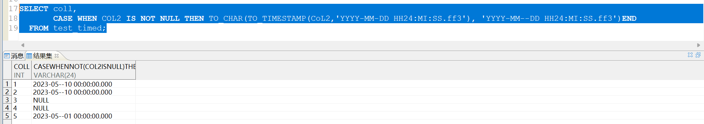

## Oracle 迁移到 DM 后应用报错：\[String\] 数据类型与数据元素\[xx 列\]的数据类型\[INT\]不符

**【问题描述】**

应用移植中，通过达梦迁移工具将 Oracle 数据迁移到 DM 后 integer 变为 NUMBER 类型，应用程序日志报错：“\[String\]数据类型与数据元素\[xx 列\]的数据类型\[INT\]不符”。

**【问题分析】**

在 Oracle 中 INTEGER 类型属于 NUMBER 的子类型，它等同于 NUMBER(38,0)，用来存储整数。 若插入、更新的数值有小数，则会被四舍五入。而在达梦数据库中，为了兼容更多类型数据库，INTEGER 和 NUMBER 属于两种不同类型数据，其中 INTEGER 类型为整型数据最大精度为 10，而 NUMBER 类型为浮点型数据最大精度为 38。为保证 Oracle 数据迁移到 DM 后不“失真”，迁移工具会将 Oracle 的 INTEGER 转换为达梦的 NUMBER(38,0) 类型。

java 中对数据的获取有两种方式，一种是通过 getObject() 自动获取，但返回类型可能是 Integer 或者 BigDecimal，原因是 Oracle 与 java 类型对应于 NUMBER 的长度有关。第二种方式，采用 getString() 方法获取值，统一先转为 string 类判断。因此应用可能会出现此类报错问题。

**【问题解决】**

对于以上特殊情况，DM 也考虑到了相关兼容性问题，如遇到此类问题，可以通过在 JDBC 的 URL 中增加一个扩展属性 compatibleMode 来进行兼容，URL 参考例如下：

```java
jdbc:dm://192.168.0.96:5236?compatibleMode=oracle
```

**补充：**

如果应用从其他数据库移植过来，建议考虑配置以下参数，提高兼容性。

JDBC 参数：

| 参数 | 说明 | 是否必须设置 |
| --- | --- | --- |
| compatible\_mode 或 compatibleMode | 兼容其他数据库。取值为数据库名称：oracle 表示兼容 Oracle，oracle19 表示兼容 oracle 19c，mysql 表示兼容 Mysql。本参数和，DM.INI 中的 COMPATIBLE\_MODE 同名，但用途不同 | 否 |

更多 JDBC 参数使用及说明可参考数据库安装目录下 doc 目录中《程序员手册》。

dm.ini 参数：

| 参数 | 属性 | 默认值 | 说明 |
| --- | --- | --- | --- |
| COMPATIBLE\_MODE | 静态 | 0 | 是否兼容其他数据库模式。0：不兼容，1：兼容 SQL92 标准，2：部分兼容 ORACLE，3：部分兼容 MS SQL SERVER，4：部分兼容 MYSQL，5：兼容 DM6，6：部分兼容 TERADATA，7：部分兼容 POSTGRES |

该参数在 dm.ini 中可以配置，配置完成后重启数据库生效。

## 如何使 DM 中返回的数值类型结果格式与 oracle 保持一致

**【问题描述】**

对于 number(9,2) 类型值为 13273.20 使用 sql developer 和达梦管理工具查询结果不一致，达梦存在末尾的无效 0，Oracle 执行的结果查询出来的数值是 13273.2，达梦数据库执行的结果查询出来的数值是 13273.20。有什么方式可以将查询的结果数据转成 13273.2，即与 oracle 返回结果格式一致吗？

**【问题分析】**

DM 对于使用精确数值类型会保留末尾无效的 0。在 DM 中精确数值类型有：NUMERIC、DECIMAL、BYTE、INTEGER、SMALLINT。

**【问题解决】**

可参考如下两种方法解决：

1. 开启驱动层的 oracle 兼容模式，可以不保留精确数值类型的末尾的无效 0。jdbc 连接配置参考如下：
```java
jdbc:dm://test?test=(127.0.0.1:5236) & compatibleMode=oracle
```
2. 使用 to\_char(精确数值类型列) 可以不保留末尾无效零。

## Oracle 迁移数据到 DM8 报错：“对象已存在”

**【问题描述】**

Oracle 迁移数据到 DM8 报错：“对象已存在”，如下图所示：

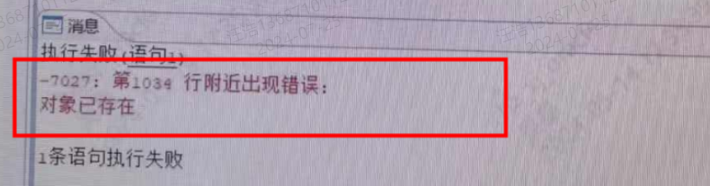

**【问题分析】**

Oracle 支持在同一个模式下，可以存在同名的存储过程和触发器（即一个触发器名 namea，则存储过程名也可以是 namea），而 DM8 的对象名必须唯一，因此如果存在该情况，在迁移到 DM8 时，需要把其中一个对象重命名。

**【问题解决】**

在 Oracle 侧，可以通过语句查询确认同名对象：

```sql
select * from dba_objects where object_name='报错的对象名';
```

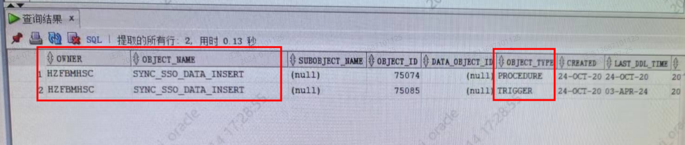

查询出同名对象后，在 DM 端创建对象时重命名其中一个对象。

## 通过 DTS 迁移 Oracle 数据到 DM8 报错："数字溢出"

**【问题描述】**

通过 DTS 迁移 Oracle 数据到 DM8，任务报错提示"数字溢出"，点击报错详情，无任何详细报错内容。

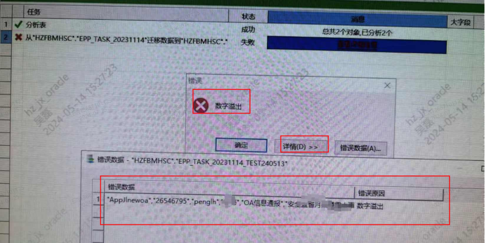

**【问题分析】**

该报错主要需要看报错的表的字段，特别是时间日期格式的数据，是否存在异常；一般该报错是存在异常数据导致，例如数值类型字段，可以查询该字段 max 值是否超过设置最大长度等；时间类型字段，是否有异常数据，比如时间前面加了"-"符号，或者可以通过 `select * from 表 where v$时间类型字段名 <'1970-01-01 00:00:00'` 查询是否存在异常数据；文本等类型字段，则可以通过 lengthb() 函数查询字段长度是否超过限制。

**【问题解决】**

通过分析发信发现源端 Oracle 数据，存在“-9812-04-9 07:56:04”这样的异常数据，针对该类型数据，建议在 Oracle 源端进行清理，若无法清理，则可以把表的数据导出 SQL 文件，再 SQL 迁移至 DM，根据报错在 SQL 文件里逐个注释掉异常数据行解决。


## Oracle 触发器在 DM 中编译报错：” 无效的变量名 ORA\_LOGIN\_USER“

**【问题解决】**

例如如下 Oracle 中触发器在 DM 中报错：

```sql
declare
a1 varchar(30);
begin

select ora_login_user into a1 from dual;
dbms_output.put_line(a1);
end;
```

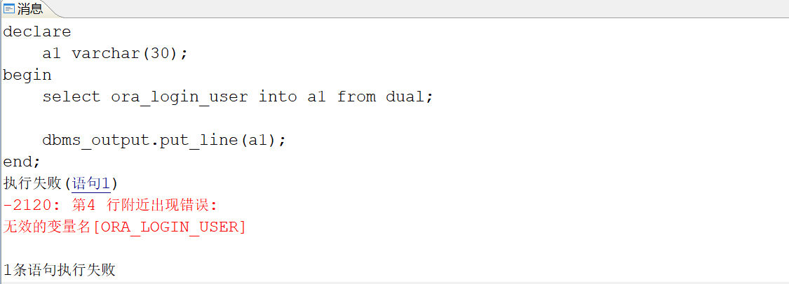

将触发器中的 ora\_login\_user 改为 user() 即可。

```sql
declare
a1 varchar(30);
begin
 
select user into a1 from dual;
dbms_output.put_line(a1);
print(a1);

end;
```

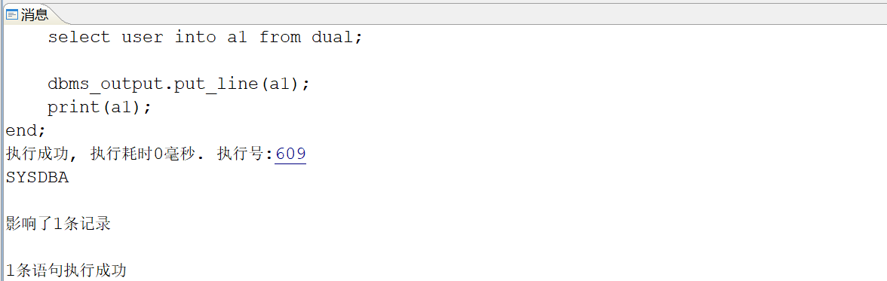

## 数据迁移后多出 BM$ 和 CTI$ 开头的表是什么表

**【问题描述】**

数据迁移后比对数据对象信息时， `select * from all_tables` 语句查出来的表数量与实际的表数量不一致，多出来的为 `BM$` 和 `CTI$` 开头的表是什么表？

**【问题分析】**

在达梦中 BM$ 开头的表名为创建位图索引的辅助表。

命名方式：BM$\_+ 位图索引对象 id。

同时创建位图索引时也会创建一个触发器：BM$ *TRG* + 位图索引对象 id。

> **注意**
> 
> 达梦位图索引优化效果有限，创建后需校验效果，如果没有提升请删除，位图索引本身会对增删改的 dml 操作造成性能影响，请根据实际情况综合评估是否创建。

CTI$ 开头的表为全文索引创建后生成的辅助表，创建的辅助表共有 4 个，命名方式如下：

```
CTI$表名$D
CTI$表名$I
CTI$表名$N
CTI$表名$P
```

## DTS 工具如何使用命令行方式进行数据迁移？

**【问题描述】**

服务器环境不支持图形化界面，DTS 工具如何使用命令行方式进行数据迁移？

**【问题解决】**

若服务器不支持图形化界面，或支持图形化的终端硬件资源有限，为保证迁移效率，可以使用 dts 命令行方式，在服务器执行迁移，充分利用服务器资源，提高迁移效率。

在支持图形化的终端中打开 dts 迁移工具并配置迁移规则，而后将迁移规则导出为 xml 文件，将 xml 文件导入服务器，使用 dmdbms\\tool\\ 目录下的 dts\_cmd\_run.sh 脚本进行命令行方式数据迁移，步骤如下：

1. 图形化配置数据迁移规则。

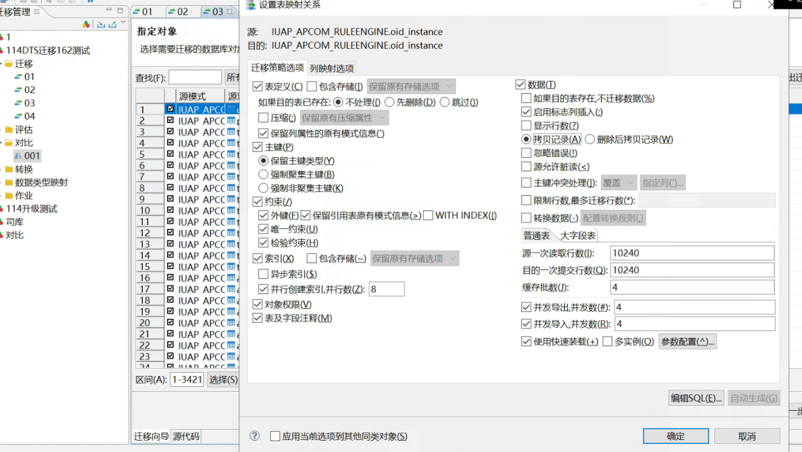

2. 迁移规则配置完成后，导出 xml 配置文件。

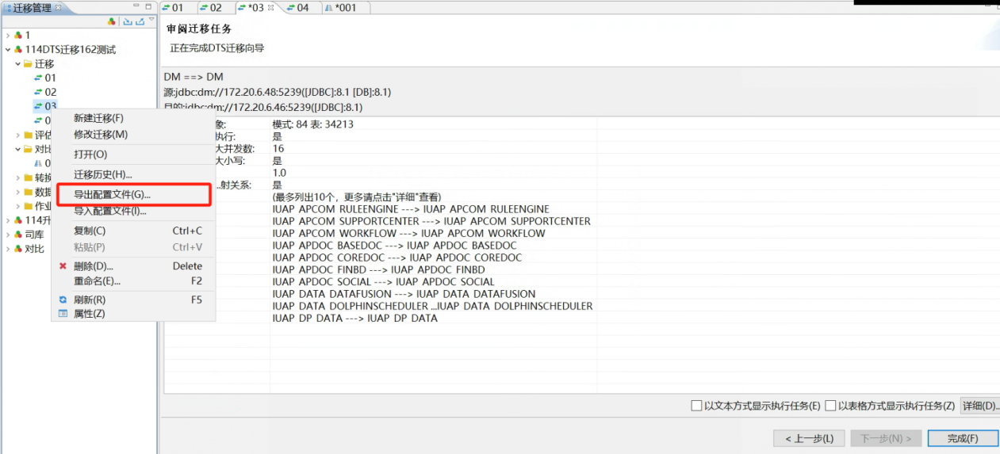

3. 将 xml 文件放入服务器 dmdms\\tool\\ 目录下，并使用 dts\_cmd\_run.sh 执行。


可根据配置生成的 LOG 日志，ERR\_LOG 日志查看迁移执行情况。

## Oracle 大数据量迁移前各个用户下表的数据量及数据行数调研

**【问题解决】**

针对每个用户占用的空间不同，进行表的调研，比如占用大的用户表数据量进行排序，是否存在分区表，分区表的类型，是否有 BLOB 类型等等，针对这些表在进行迁移前制定单独的迁移策略。

```sql
--查询各张表数据行数和占用空间大小
SELECT 'SELECT '''||OWNER||''','''||SEGMENT_NAME||''','''||SUM(BYTES)/1024/1024||''||'MB'||''',COUNT(*) FROM '||OWNER||'.'||SEGMENT_NAME||' UNION ALL'
FROM DBA_SEGMENTS
WHERE SEGMENT_TYPE IN ('TABLE','TABLE PARTITION','TABLE SUBPARTITION')
AND OWNER IN ('用户1','用户2')
GROUP BY OWNER,SEGMENT_NAME ORDER BY OWNER,SEGMENT_NAME;
--查询用户下包含大字段的表
SELECT DISTINCT OWNER,TABLE_NAME FROM DBA_LOBS WHERE OWNER IN ('用户1','用户2') ORDER BY OWNER,TABLE_NAME;
--查询用户下的分区表
SELECT DISTINCT TABLE_OWNER,TABLE_NAME FROM DBA_TAB_PARTITIONS
WHERE TABLE_OWNER IN ('用户1','用户2') ORDER BY TABLE_OWNER,TABLE_NAME;
--查询分区表各个子分区的数据行数
SELECT TABLE_NAME,PARTITION_NAME,NUM_ROWS
FROM ALL_TAB_PARTITIONS
WHERE TABLE_NAME = '分区表名';
```

## oracle 大数据量迁移前用户数据量调研

**【问题解决】**

在正式进行迁移之前需要对迁移的用户进行评估，包括数据量和存储过程等，以评判迁移的耗时和修改存储过程的耗时。

```sql
--查询各个用户占用空间
SELECT OWNER,
SUM(BYTES) / 1024 / 1024 AS SIZE_IN_MB
FROM DBA_SEGMENTS
GROUP BY OWNER ORDER BY 1;
--查询各个用户下对象数量
SELECT A.USERNAME "用户", (SELECT COUNT(1) FROM DBA_TABLES B WHERE B.OWNER=A.USERNAME) "表数量", ( SELECT COUNT(1) 
          FROM DBA_INDEXES I 
         WHERE UNIQUENESS = 'UNIQUE' 
           AND OWNER=A.USERNAME 
            OR INDEX_NAME NOT LIKE 'SYS_%' 
           AND OWNER=A.USERNAME) "索引数量", (SELECT COUNT(DISTINCT C.TABLE_NAME)
          FROM DBA_TAB_PARTITIONS C
         WHERE C.TABLE_OWNER=A.USERNAME) "分区表数量", (SELECT COUNT(1)
          FROM DBA_TAB_COLS D
         WHERE D.OWNER = A.USERNAME
           AND D.DATA_TYPE LIKE '%LOB%') "包含LOB表数量", (SELECT SUM(E.BYTES) / 1024 / 1024 / 1024
          FROM DBA_EXTENTS E
         WHERE EXISTS (SELECT 1
                  FROM DBA_LOBS F
                 WHERE F.OWNER = A.USERNAME
                   AND F.SEGMENT_NAME = E.SEGMENT_NAME)) "LOB占用空间", (SELECT COUNT(1) FROM DBA_VIEWS G WHERE G.OWNER = A.USERNAME) "视图数量", (SELECT COUNT(1) FROM DBA_TRIGGERS H WHERE H.OWNER = A.USERNAME) "触发器数量", (SELECT COUNT(DISTINCT I.NAME)
          FROM DBA_SOURCE I
         WHERE I.OWNER=A.USERNAME
           AND I.TYPE ='FUNCTION') "函数数量", (SELECT COUNT(1) FROM DBA_SEQUENCES J WHERE J.SEQUENCE_OWNER = A.USERNAME) "序列数量", (SELECT COUNT(1) FROM DBA_SYNONYMS WHERE OWNER= A.USERNAME) "同义词", (SELECT COUNT(1) FROM DBA_MVIEWS K WHERE K.OWNER = A.USERNAME) "物化视图数量", (SELECT COUNT(DISTINCT L.NAME)
          FROM DBA_SOURCE L
         WHERE L.OWNER=A.USERNAME
           AND L.TYPE ='PROCEDURE') "存储过程数量", (SELECT COUNT(1) FROM DBA_DB_LINKS M WHERE M.OWNER = A.USERNAME) "DBLINK数量", (SELECT MAX(N.DATA_LENGTH) FROM DBA_TAB_COLS N WHERE N.OWNER=A.USERNAME) "最大单字段宽度", (SELECT SUM(O.DATA_LENGTH)
          FROM DBA_TAB_COLS O
         WHERE O.OWNER=A.USERNAME
           AND O.DATA_TYPE NOT LIKE '%LOB%') "最大行宽度"
  FROM DBA_USERS A WHERE USERNAME IN ('用户1','用户2')
 GROUP BY USERNAME;
```

## oracle 通过 dblink 访问达梦插入数据报错

**【问题描述】**

oracle 通过 dblink 访问达梦，达梦表里包含 blob 字段，通过 insert select 到插入 oracle 上相同结构的表报错“非法使用 LONG 数据类型”插入失败。

**【问题分析】**

该问题是由于跨数据库访问，数据字典不一致，数据传输过程中字段标识识别出现问题导致。

**【问题解决】**

通过以下 SQL 可以成功插入数据：

```sql
begin
    for tab1_rows in
    (
        select * from tab1@dblink_dameng
    ) loop
        insert into tab2 values(tab1_rows.a);
    end loop;
end;
/
```

## 从 Oracle 迁移到达梦报错非法的基类名 \[XMLDOM\] 、\[XMLPARSER\]

**【问题描述】**

从 Oracle 迁移到达梦编译存储过程报错非法的基类名 \[XMLDOM\] 、\[XMLPARSER\]。

**【问题解决】**

在数据库里面创建系统包 DBMS\_XMLDOM、DBMS\_XMLPARSER，然后将 XMLDOM 替换为 DBMS\_XMLDOM，XMLPARSER 替换为 DBMS\_XMLPARSER 即可。

创建系统包 DBMS\_XMLDOM 和 DBMS\_XMLPARSE 的命令如下：

```sql
SP_CREATE_SYSTEM_PACKAGES (1,'DBMS_XMLDOM');
SP_CREATE_SYSTEM_PACKAGES (1,'DBMS_XMLPARSER');
```

## 使用 dts 连接 oracle 失败，报错：Property is 'v$session.osuser' and value is 'xxx'

**【问题描述】**

windows 电脑操作系统用户带有括号等特殊字符时，使用 dts 连接 oracle 失败，报错：Property is 'v$session.osuser' and value is 'xxx'。

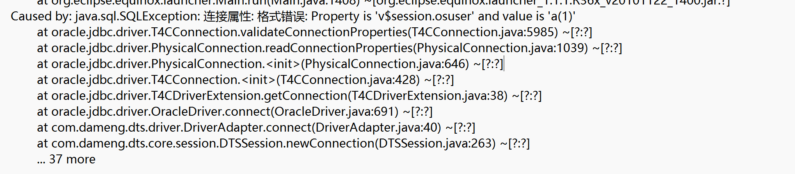

**【问题分析】**

此问题是由于 ORACLE 驱动中获取操作系统用户名时，当出现系统用户带有括号等特殊字符、用户名长度超过 30 或机器名长度大于 64 时等情形时，会报此错误。

ORACLE 驱动对于操作系统用户名的处理逻辑是，如果传递为空取操作系统用户名，再为空赋予其为 jdbcuser。

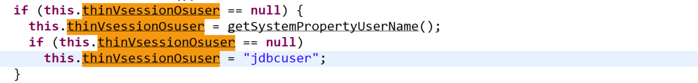

**【问题解决】**

方法一：新建 windows 操作系统不包含特殊字符的用户，如：TEST、TEST1 等，再次使用 DTS 工具配置相同参数链接即可。

方式二：在使用 dts 时，修改配置文件 dts.ini ( 该配置文件在 dts 同级目录下)，添加属性： `-Doracle.jdbc.v$session.osuser=a1cuser` 再重新启动 dts，就可以正常连接 oracle。

`-Doracle.jdbc.v$session.osuser` 设置的值用户可自定义，与操作系统用户名无关，只要是合法的命名即可。

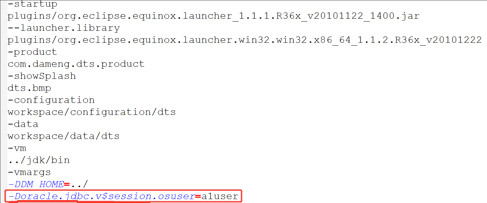

## dts 迁移 oracle 超大表到 DM 时未迁移完成自动结束

**【问题描述】**

使用 dts 从 oracle 迁移超过 21 亿条数据的大表到 DM 时，目标端写入超过 21 亿行数据时迁移便自动结束，但实际数据未完全迁移完。

**【问题分析】**

该问题的产生是由 ojdbc 驱动引起的，并非 dts 方面的问题。ojdbc8 之前的驱动，其结果集最多只能读取与 integer.maxvalue 相等的行数，即 int32 类型的最大值 21 亿行。所以，当读取到 21 亿行之后，就无法再继续读取，迁移会自动停止。

**【问题解决】**

较新的 DTS 版本在进行 Oracle 数据迁移时，默认连接 ojdbc8 驱动，因此使用默认驱动即可解决相关问题。若使用的是较早版本的 DTS，在预估需要迁移超过 21 亿行数据的大表时，可在连接 Oracle 的配置界面指定驱动版本，选择使用 ojdbc8 或其后续版本的驱动。

## DTS 采用 ipv6 连接数据库报错“网络通讯异常”

**【问题描述】**

DTS 使用 IPV6 地址连接报错“网络通讯异常”。

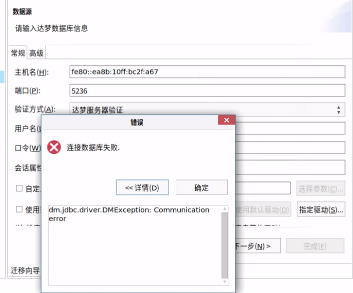

**【问题解决】**

windows 环境：修改 dts.ini 配文件，找到配置项 -Djava.net.preferIPv4Stack=true ，将 true 改为 false，重启 dts。

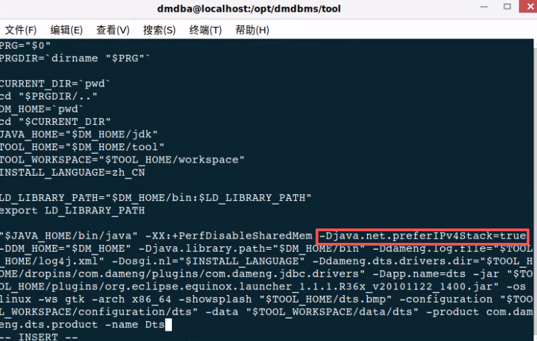

linux 环境：修改 dts 执行文件，在 java 配置项中找到 -Djava.net.preferIPv4Stack=true ，将 true 改为 false，重启 dts。

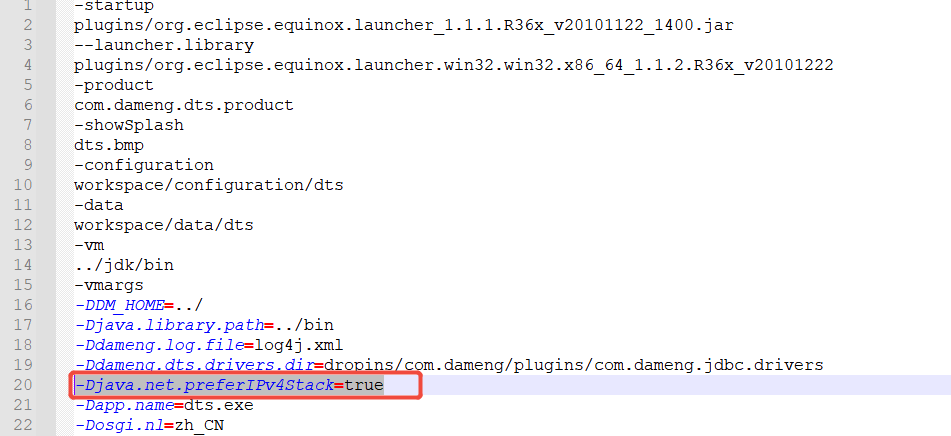

## 包含 CURRENT\_DATE 字段类型的表迁移报错

**【问题描述】**

使用 dts 工具迁移表结构失败，提示为：对象 \[xxx\] DEFAULT 约束表达式无效。

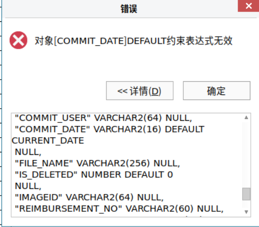

**【问题分析】**

达梦数据库 COMPATIBLE\_MODE 兼容参数设置为 2 时，CURRENT\_DATE 字段值包含时分秒，长度为 19，创建表的字段长度指定为 16（VARCHAR2(16) DEFAULT CURRENT\_DATE），长度不足会导致创建表结构失败。

**【问题解决】**

当从 oracle 迁移到 DM 且开启兼容 COMPATIBLE\_MODE=2 时，调整对应字段的长度至少为 19。

## 包含 TO\_DATE 字段类型的表迁移报错

**【问题描述】**

使用 dts 工具迁移表结构失败，提示为：对象 \[xxx\] DEFAULT 约束表达式无效。

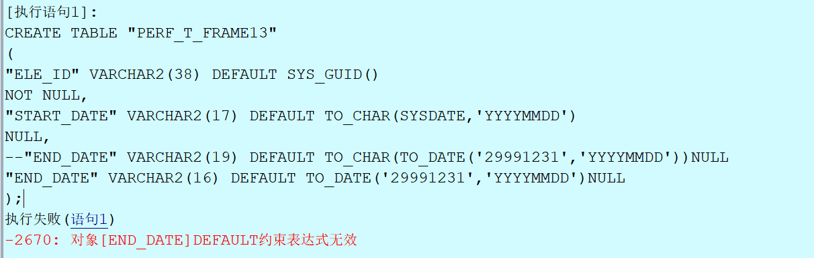

**【问题分析】**

ORA\_DATE\_FMT 参数默认为 0，CURRENT\_DATE 字段值包含时分秒，TO\_DATE 函数返回类型为 TIMESTAMP 数据类型，长度为 19，创建表的字段长度指定为 16（VARCHAR2(16) DEFAULT TO\_DATE('29991231','YYYYMMDD')NULL，长度不足导致创建表结构失败。

**【问题解决】**

1. 调整字段长度，至少为 19。
2. 如果设置了 COMPATIBLE\_MODE=2 且不需要时分秒，可将 ORA\_DATE\_FMT 设置为 1，执行以下语句后重启数据库服务即可生效。
```sql
SP_SET_PARA_VALUE(2,'ORA_DATE_FMT',1);
```

## 使用 dts 从 oralce 迁移触发器至 DM 报错：无效的表或视图

**【问题描述】**

从 oralce 迁移数据至 DM，使用 dts 工具迁移触发器失败，报错：无效的表或视图。

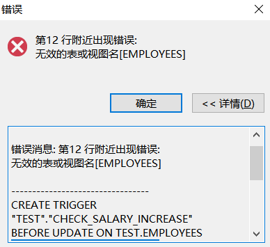

**【问题分析】**

该问题是由于迁移的触发器中调用的表或视图属于其他用户，使用 DTS 迁移时模式名被替换为当前模式，导致在当前模式下找不到调用的对象。

**【问题解决】**

优先将调用的对象迁移至 DM，然后手动调整模式名为原始的模式名进行迁移。

## 使用 dts 工具迁移触发器失败，报错：FOR 附近出现错误

**【问题描述】**

从 oralce 迁移数据至 DM，使用 dts 工具迁移触发器失败，报错：FOR 附近出现错误。


**【问题分析】**

由于 DM 与 Oracle 在创建触发器的语法上存在差异，DM 中需按照 OLD AS "OLD"、NEW AS "NEW" 的方式编写。


**【问题解决】**

将 SQL 中 `NEW AS "NEW"  OLD AS "OLD"` 调整为 `OLD AS "OLD" NEW AS "NEW"`

## DTS 工具迁移包失败

从 oralce 迁移数据至 DM，使用 dts 工具迁移包失败。


**【问题分析】**

包体进行锁表时，达梦只支持单表的锁定。

**【问题解决】**

将多表拆分为单表，执行多条语句。