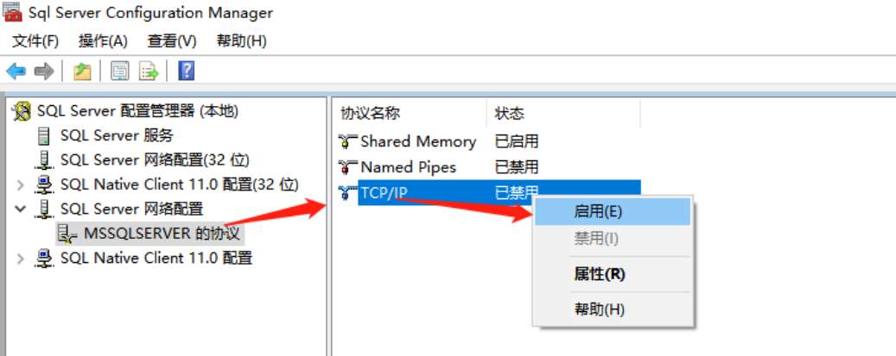
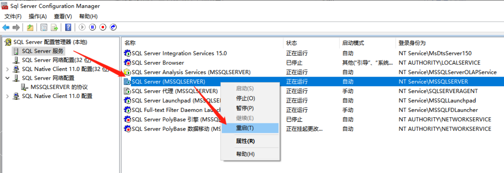
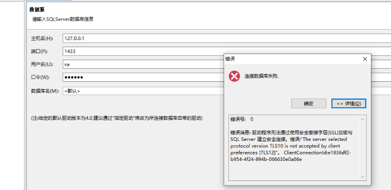
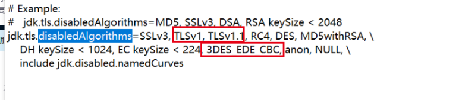
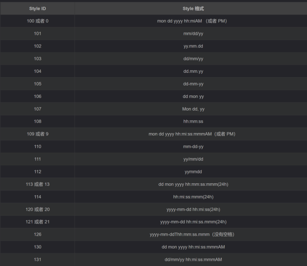
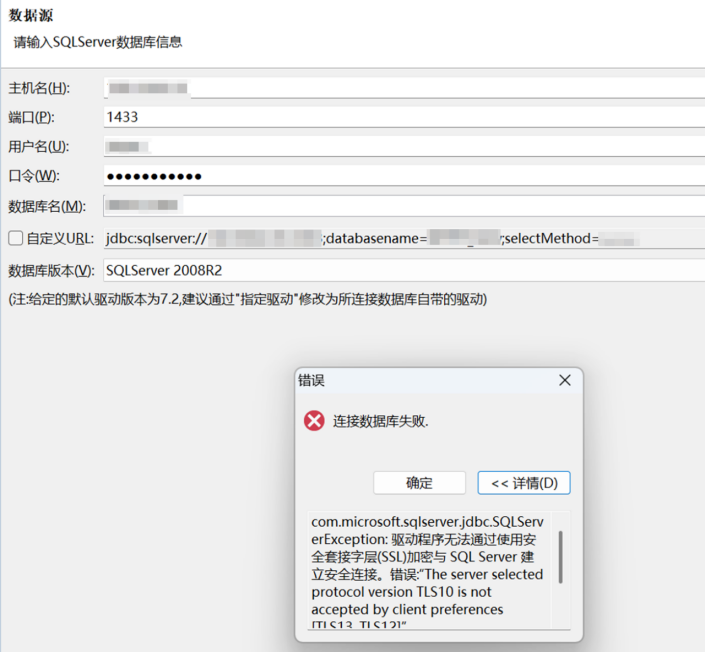
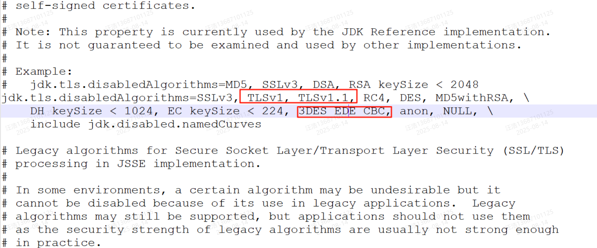
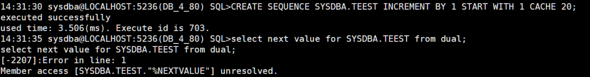
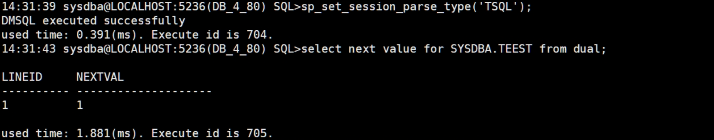

本章节主要介绍从 SQL Server 迁移到 DM 常见问题，为用户提供从 SQL Server 迁移到 DM 常见问题的分析和解决思路。除此之外，用户还可前往 [达梦技术社区](https://eco.dameng.com/community/question/) 参与更多问题讨论。

## 目录

## 正文

原有的系统或开发习惯为 SQL Server 的用户，可以参考文档 [《DM DBA 手记之 SQLServer 移植到 DM》](https://eco.dameng.com/eco-file-server/file/eco/download/20220816141120BHE25KK7KHKUQFD55K) 。

## 数据迁移过程中,自增列已有的数据不变方法

- 测试过程中，先将待迁移表 TABLE3 重命名成 TABLE2
```sql
ALTER TABLE TABLE_3 rename TO TABLE_2;
```
- 导出建表语句，将创表 SQL 粘贴到新 SQL 编辑器后，将表名修改成重命名前的表名，将 id 列的类型修改成 int 或者 bigint 类型，再加上自增列的当前值和增长值
```sql
CREATE TABLE "SYSDBA"."TABLE_3"
(
"id" int NOT NULL IDENTITY(1, 1),
"name" VARCHAR2(50),
NOT CLUSTER PRIMARY KEY("id")) STORAGE(ON "MAIN", CLUSTERBTR) ;
```
- 执行以下 SQL，允许将显式值插入表的自增列中
```sql
SET IDENTITY_INSERT "SYSDBA"."TABLE_3"  ON;
```
- 数据插入到新表中
```sql
insert into "SYSDBA"."TABLE_3"("id","name") select * from TABLE_2;
```
- 关闭显示插入
```sql
SET IDENTITY_INSERT "SYSDBA"."TABLE_3"  OFF;
```

## 字段类型 varbinary(max) 迁移报错：数据大小已超过可支持范围

**【问题解决】** ：

按照提示修改字段类型 varbinary 为 blob，增大数据可支持大小，重新迁移即可。

## 使用 DTS 将表数据从 SQL Server 迁移到 DM 报错：无效的日期或时间类型

**【问题解决】** ：

DTS 迁移工具从 SQL Server 迁移数据时，对于表的定义，会将 DATETIME 时间类型的字段定义，转换成 TIMESTAMP 类型；但是对于表的数据，会将 DATETIME 类型的字段数据，转换成 TIMESTAMP WITH TIME ZONE，格式变成’2021-10-24 12:00:00.000 +08:00’。使得实际数据和字段定义不相匹配，导入失败报错。  
这种情况下，可以将迁移的目标库迁移用户下的所有 TIMESTAMP 类型字段转换为 TIMESTAMP WITH TIME ZONE 类型，待表数据迁移完后再改回。

## 在 sqlserver 建外部链接的时候报错：指定驱动程序无法加载

**【问题描述】** ：

在 sqlserver 建外部链接的时候报错：通过访问接口"Microsoft OLE DB Provider for ODBC Drivers" 建立，sqlserver 报错 7303，无法初始化连接服务器 的 OLE DB 访问接口"MSDASQL"的数据源对象；由于系统错误 5：拒绝访问(DM8 ODBC DRIVER,C:dmdbms\\bin\\dodbc.dll),指定驱动程序无法加载。

**【问题解决】**:

方法 1：检查系统变量，是否有达梦客户端的安装目录，没有的话，添加达梦的系统变量；  
方法 2：把 bin 下面的文件拷贝到对应操作系统的系统变量目录(注意：windows 有 32、64 之分) ，拷贝的时候看下运行的 sqlserver 客户端是多少位的。  
注： winserver 2012 要看下 bin 下面的权限是否正常，不能是只读，有些客户为了系统安全性设置的比较高。  
配置完成后，重启客户端即可。

## DTS 迁移 SqlServer2019 数据库时连接失败

**【问题描述】**

DTS 迁移 SqlServer2019 数据库，在与 SqlServer 数据库建立连接时报错：通过端口 1433 连接到主机 192.168.1.2 的 TCP/IP 连接失败。错误:“connect timed out。请验证连接属性。确保 SQL Server 的实例正在主机上运行，且在此端口接受 TCP/IP 连接，还要确保防火墙没有阻止到此端口的 TCP 连接。”。报错截图如下：

**【问题解决】**

1. 检查防火墙策略，确保防火墙对应的 SqlServer 端口 1433 开放。
2. 同时确保开启 SqlServer 的 TCP/IP 协议，默认为禁用状态。

SqlServer 的 TCP/IP 协议开启方法：

打开 Sql Server Configuration manage 配置工具，依次找到“Sql server 网络配置”→“MSSQLSERVER 的协议”→“TCP/IP”，默认 TCP/IP 协议为禁用状态，右击启用 TCP/IP 协议。



重启 SqlServer 数据库服务使修改生效。



## DTS 迁移工具连接 SQL SERVER 失败

**【问题描述】**

DTS 迁移工具连接 SQL SERVER 时报错：”The server selected protocol version TLS10 is not accepted by client preferences \[TLS13, TLS12\]“。



**【问题分析】**

历史版本的 SQL SERVER 服务端默认使用 TLS1.0 版本协议对外提供服务，因安全问题 DTS 迁移工具部分版本默认已关闭该协议。

**【问题解决】**

1. 修改 java.security 文件。

在达梦数据库安装目录下的 jdk\\jre\\lib\\security\\ 路径下找到 java.security 文件，备份后直接打开编辑，找到 jdk.tls.disabledAlgorithms 配置项，如果存在 TLSv1，TLSv1.1，3DES\_EDE\_CBC 等配置，直接删掉，然后保存 java.security 文件。



2. 重启 DTS 迁移工具后，再次进入连接界面即可以正常连接 SQL SERVER 。

## 迁移 SQL server 到 DM 时报错：“此列列表已索引”

**【问题描述】**

从 SQL server 迁移到 DM 时报错：“此列列表已索引”。

**【问题分析】**

在 SQL server 中，由于对创建索引的列存在索引未校验，所以在 SQL server 中可存在两个索引属于同一列的索引，但在达梦中不允许同时存在属于同一列的两个索引。

**【问题解决】**

例如：以下语法，在 SQL server 中可执行通过，但在达梦执行到第三条语句时执行失败，报错“此列列表已索引”。

```sql
CREATE TABLE "TABLE_1"
(
"COLUMN_1" CHAR(10),
"COLUMN_2" CHAR(10))  ;
CREATE  INDEX "a" ON "TABLE_1"("COLUMN_1" )  ;
CREATE  INDEX "b" ON "TABLE_1"("COLUMN_1" )  ;
```

该问题报错可以忽略。

## SqlServer 迁移到 DM 涉及到 SqlServer 中的 convert 函数需要改写

**【问题描述】**

SqlServer 迁移到 DM 时在存储过程、函数及视图中大量引用了 convert 函数该函数，例如：

```sql
select CONVERT(varchar(10),getdate(),110)
```

当使用该 SQL 在达梦数据库中执行时会报错。

```sql
-2007: 第 1 行, 第 63 列[,]附近出现错误:
语法分析出错
```

**【问题分析】**

从 convert 函数实现语法来看

sqlserver convert 函数实现语法：

```sql
CONVERT ( data_type [ ( length ) ] , expression [ , style ] )
```

达梦中的 convert 实现语法：

```sql
CONVERT(type,value)
```

sqlserver 的 convert 函数多了 expression \[, style \] 参数，此参数含义是指日期时间格式，对于日期或时间数据类型的 expression，style 可以具有下表所示的某个值。 其他值作为 0 进行处理。 从 SQL Server 2012 (11.x) 开始，在从日期和时间类型转换为 datetimeoffset 时支持的唯一样式是 0 或 1。 所有其他转换样式均返回错误 9809。



**【问题解决】**

在 DM 中可以通过 to\_char 对 SqlServer 中的 convert 函数进行改写.

例如：  
sqlserver 中 SQL：

```sql
select convert(char(19),GETDATE(),120);
```

120 的意思是时间格式化为 24 小时时间格式

在达梦数据库中改写：

```sql
select to_char(CONVERT(char(19),getdate()),'yyyy-mm-dd hh24:MM:ss');
```

## sqlserver 迁移到达梦数据库时达梦数据库如何支持 with (nolock) 语法

**【问题描述】**

sqlserver 迁移到达梦数据库时达梦数据库如何支持 with (nolock) 语法。

例如：

```sql
select id from employee e with (nolock);
```

**【问题分析】**

sqlserver 中 with (nolock) 除了本身不锁表，也不会受其他的已存在的锁影响， 锁住的行数据也照样读，就是脏读的意思。达梦存在相应的功能 with ur，DM 允许用户在 SELECT 语句的末尾加上 WITH UR 以指定当前查询语句的隔离级为读未提交，即允许脏读，并在该语句结束时自动恢复为原来的隔离级。

**【问题解决】**

SqlServer 中的 SQL

```sql
select id from employee e with (nolock);
```

在达梦数据库中可改写为：

```sql
select id from employee e with ur;
```

sqlserver 中关联查询在达梦数据库中也可以改写，只需要在 select 语句的最后面添加 with ur 即可，不需要单独每张表进行标记。

例如：

SqlServer 中的 SQL：

```sql
select e.employee_id ,
          e.employee_name,
          department_name  
     from employee e with (nolock)
left join DEPARTMENT d with (nolock)
       on e.DEPARTMENT_ID=d.DEPARTMENT_ID;
```

在达梦数据库中可改写为：

```sql
select e.employee_id ,
          e.employee_name,
          department_name  
     from employee e
left join DEPARTMENT d
       on e.DEPARTMENT_ID=d.DEPARTMENT_ID with ur;
```

## sqlserver 的 for xml path 语法迁移到达梦无法执行，如何进行改写？

**【问题描述】**

sqlserver 的 for xml path 语法用于字符串拼接，迁移到达梦无法执行，如何进行改写呢？

**【问题分析】**

sqlserver 的 for xml path 语法和达梦的 listagg 以及 xmlagg 输出形式一致，可直接进行改写。

**【问题解决】**

例如：

创建测试表 student 。

```sql
create table student(stuID int,sName varchar(10),hobby varchar(10));
insert into student values(1,'张三','爬山');
insert into student values(1,'张三','游泳');
insert into student values(2,'李四','美食');
insert into student values(2,'李四','美食');
insert into student values(3,'王五','爬山');
insert into student values(4,'王五','游泳');
commit;
```

在 SqlServer 中使用 FOR XML PATH 语法。

```sql
--
SELECT B.sName,
      LEFT(StuList,LEN(StuList)-1) as hobby
 FROM (   SELECT sName, (SELECT hobby+',' FROM student
 WHERE sName=A.sName
 FOR XML PATH('')) AS StuList
   FROM student A
GROUP BY sName) B
```

在达梦数据库中可采用如下两种方式进行改写。

1. 因为 sqlserver 的拼接结果最后会带有逗号，而 listagg 默认最后不会拼接逗号，所以最终解决办法为 listagg 后面直接手动拼接逗号解决，返回的数据类型为 varchar，如下：
```sql
select sname,listagg(hobby,',') within group (order by hobby)||',' from student group by sname;
```
2. xmlagg 可解决上面 1 的问题，xmlagg 最后返回的数据类型为 text。
```sql
select sname,xmlagg(xmlparse(content hobby ||','wellformed)order by hobby).getclobval() from student group by sname;
```

## SqlServer 到 DM 进行装载数据时报错：“EXE\[ERROR\]：建表失败，执行挂起”

**【问题描述】**

源端 SqlServer 目的端 DM 在进行装载数据时报错：“EXE\[ERROR\]：建表失败，执行挂起”

**【问题解决】**

可以通过在目的端 exec 的配置文件 dmhs.hs 中添加参数 `<ddl_continue>1</ddl_continue>` 来解决。

**ddl\_continue 参数说明：**

含义：DDL 出错时是否允许继续同步，可选 0（挂起）或 1（继续），默认值 0。

说明：EXEC 模块在执行 DDL 时，比如修改表等操作，可能会执行失败，当 DDL 失败时同步流程是否继续，需要通过该参数来指定。

## sqlserver 的 @@ROWCOUNT 获取影响行数功能在达梦是否有替代方案。

**【问题解决】**

可考虑将 sql 语句放到程序块里，用隐式游标 SQL 的 ROWCOUNT 属性获取影响行数，如下：

```sql
drop table if exists trow;
create table trow (c1 int,c2 varchar(100));
begin
print ('执行前打印影响行数：' || SQL%ROWCOUNT);
insert into trow values(1,'Hello world!'); --SQL1
print ('commit前打印SQL1 影响行数：' || SQL%ROWCOUNT);

insert into trow values(3,'Hello world!'),(4,'Hello world!'); --SQL2
print ('commit前打印SQL2影响行数：' || SQL%ROWCOUNT);
commit;
print ('commit后打印SQL2影响行数：' || SQL%ROWCOUNT);
end;
/
```

## 从 sqlserver 迁移至 dm 常见触发器语法改造方法

**【问题描述】**

使用 DTS 工具从 sqlserver 迁移至 dm 时，部分触发器无法通过 DTS 自动编写完成达梦语法的转化，有常见的几种语法改造情况，详见下文。

**【问题解决】**

1. inserted 与 deleted

inserted 与 deleted 一般提取其中的表在修改或删除前后的值，在达梦中使用 new.字段和 old.字段的方式实现。例如：

```sql
--sqlserver 中

INSERT INTO table1(id ) SELECT id FROM inserted

--等同于达梦数据库中

INSERT INTO table1(id) SELECT new.id

--同理，sqlserver 中

INSERT INTO table1(id ) SELECT id FROM deleted

--等同于达梦数据库中

INSERT INTO table1(id) SELECT old.id

--if 判断中 sqlserver 中

IF EXISTS(SELECT 1 FROM inserted) AND NOT EXISTS(SELECT 1 FROM deleted)

--等同于达梦数据库中(假设涉及触发器的表有 id 字段)

IF EXISTS(SELECT new.id) AND NOT EXISTS(SELECT old.id)
```
2. 创建触发器格式
```sql
--sqlserver 格式为
CREATE TRIGGER [TRIGGER001]
ON [table001]
AFTER INSERT, UPDATE, DELETE
AS
--对应的达梦的格式为
CREATE OR REPLACE TRIGGER "TRIGGER001"
AFTER INSERT  ON "table001" 
FOR EACH ROW
```
3. 设置变量

达梦中的设置变量不使用特殊字符。

```sql
--sqlser 中

@IsInsert bit,

--等同与达梦的

IsInsert bit,
```
4. 变量赋值
```sql
--sqlserver 中
set id = '1'
--等同于达梦数据库中
id := '1'
--sqlserver 中
select @status = status from inserted
--等同于达梦数据库中
status :=new.status
```

示例：

以下为一个 sqlserver 的触发器：

```sql
CREATE  TRIGGER [pah_insert]
   ON  [pah]
   AFTER INSERT
AS
BEGIN
     DECLARE @status int
        select @status = status from inserted
BEGIN
    SET NOCOUNT ON;
if (@status = 1)
     INSERT INTO pahsync(guid ,fileguid )
    SELECT
       guid ,fileguid 
    FROM inserted
END
END
GO
ALTER TABLE [dbo].[pah] ENABLE TRIGGER [pah_insert]
GO
ALTER DATABASE [sdoa_person] SET  READ_WRITE 
GO
```

改造到 DM 后的语句。

```sql
CREATE OR REPLACE TRIGGER pah_insert
AFTER INSERT  ON pah
FOR EACH ROW
DECLARE
 status int;
BEGIN
 status :=new.status;
 if (status=1)then
     INSERT INTO pahsync(guid ,fileguid )
    SELECT
        new.guid ,new.fileguid ;
        end if;
END;
```

示例说明：

创建触发器格式 sqlserver 为:

```sql
CREATE  TRIGGER [pah_insert]

ON  [pah]

AFTER INSERT

AS
```

对应的达梦的格式为:

```sql
CREATE OR REPLACE TRIGGER "pah_insert"

AFTER INSERT  ON "pah"

FOR EACH ROW
```

调用修改前数值 sqlserver 使用 inserted。

```sql
--例如：select @status = status from inserted

--对应达梦的格式为

status :=new.status;

--如果是在 declare 中定义变量并同时赋予初始值则为

status int :=new.status;
```

> **注意**
> 
> 1、在创建触发器时要注意对应的模式名，如果使用 SYSDBA 用户创建触发器，强烈建议为触发器名与表名前加上模式名。  
> 2、Sqlserver 中的语句中某些情况下可以不在语句后加分号，在达梦中，除非特殊的结构，所有的语句结尾都需要加分号，常见的包括 end、ddl 语句、dml 语句。  
> 3、declare 下为声明部分，主要用于声明变量，赋值语句不能放在这部分，但是可以声明时进行赋予初始值。

## DTS 迁移 SQLServer2008 数据至 DM 源端连接报错

**【问题描述】**

将 SQL Server2008 的数据迁移至 DM 时，在对数据源进行配置以连接 SQL Server 的过程中，当确保连接的三要素均无问题且已替换对应驱动的情形下，系统报错：“com.microsoft.salserver.jdbcSQlSeryerException: 驱动程序无法通过使用安全套接字层(SSL)加密与 SQL Server 建立安全连接”。



**【问题解决】**

1. 进入数据库安装路径，如：/home/dmdba/dmdbms/jdk/lib/security/；
2. 修改文件 java.security，搜索 TLSv1，删除 TLSv1, TLSv1.1，3DES\_EDE\_CBC，如下：



3. 保存文件，重启 DTS。

## SqlServer 中 NEXT VALUE FOR 语法功能在达梦如何实现

**【问题描述】**

SqlServer 中 NEXT VALUE FOR 获取序列下一个值语法在达梦如何实现，如下执行报错：

```sql
CREATE SEQUENCE SYSDBA.TEEST INCREMENT BY 1 START WITH 1 CACHE 20;
select next value for SYSDBA.TEEST from dual; -- 使用sqlserver 语法获取序列值执行报错
```



**【问题解决】**

设置 TSQL 兼容解析器。

```sql
sp_set_session_parse_type('TSQL');
```

再次执行查询，不再报错。

```sql
select next value for SYSDBA.TEEST from dual; -- 执行不报错
```

