本章节主要介绍达梦数据库配置相关常见问题，为用户提供数据库配置相关问题的分析和解决思路。除此之外，用户还可前往 [达梦技术社区](https://eco.dameng.com/community/question/) 参与更多问题讨论。

## 目录

## 正文

## 动态级参数在 dm.ini 里修改后重启应用不生效吗

数据库的配置文件 dm.ini 中参数属性分为三种：静态、动态和手动。

- 静态，可以被动态修改，修改后重启服务器才能生效;
- 动态，可以被动态修改，修改后即时生效;
- 手动，不能被动态修改，必须手动修改 dm.ini 参数文件，然后重启才能生效。

动态参数又分为会话级和系统级两种。会话级参数被修改后，新参数值只会影响新创建的会话，之前创建的会话不受影响；系统级参数的修改则会影响所有的会话。

## 如何查看数据库初始化信息，如页大小，簇大小，字符集和大小写敏感等

达梦数据库提供了多种方法查看数据库实例的初始化信息，以下给出详细使用方式：

**【方法 1】** ：

进入数据库实例初始化路径，查看初始化日志 dminit\*\*\*.log 文件

**【方法 2】** ：

打开 DM 管理工具，右键选择数据库---管理服务器---查看系统概览

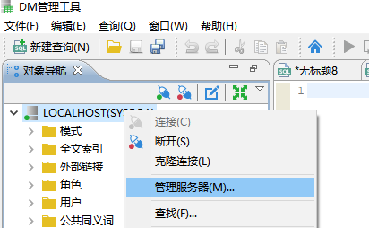

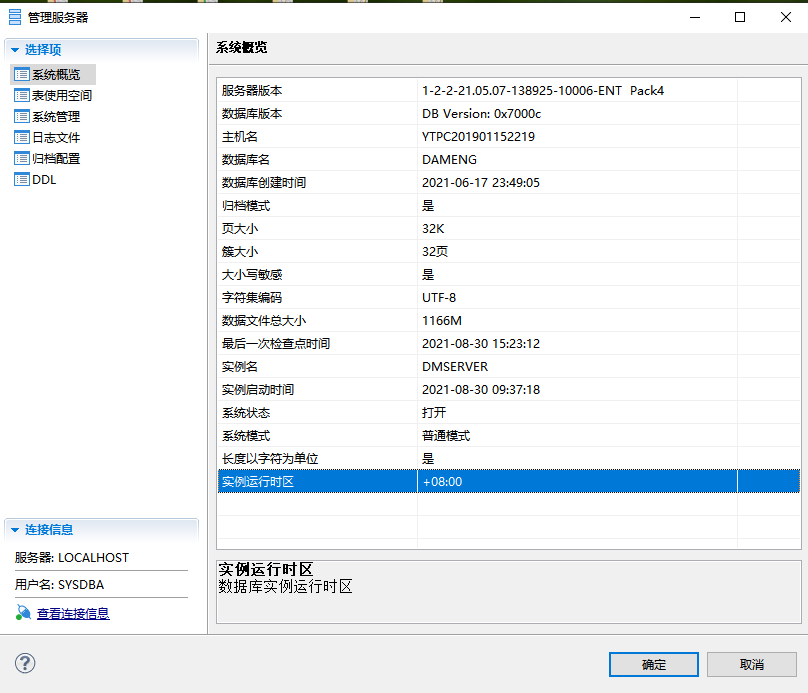

**【方法 3】** ：

利用 SQL 语句进行查询，语句参考如下：

查询大小写是否敏感：

```sql
SELECT SF_GET_CASE_SENSITIVE_FLAG();
或
SELECT CASE_SENSITIVE();
```

查询页大小：

```sql
SELECT SF_GET_PAGE_SIZE();  /* 32768/1024=32KB */
或
SELECT CAST(PAGE()/1024 AS VARCHAR);
```

查询簇大小：

```sql
SELECT SF_GET_EXTENT_SIZE();
```

查询字符集：

```sql
SELECT SF_GET_UNICODE_FLAG();
或
SELECT unicode();
或
SELECT (CASE SF_GET_UNICODE_FLAG() WHEN '0' THEN 'GBK18030' WHEN '1' THEN 'UTF-8' WHEN '2' THEN 'EUC-KR' END);
```

## 报错：多版本操作冲突过多 或 Too many mvcc conflict

**【问题描述】：**

MVCC 多版本并发控制是指维持一个数据的多个版本，在保证事务隔离级的情况下，使得读写操作没有冲突，

提高了数据库并发读写的性能。因此可以解决在并发读写数据库时，做到在读操作时不用阻塞写操作，写操作

也不用阻塞读操作。当对一张表批量修改且并发量较大时，可能会报 MVCC 多版本操作冲突过多的错误。

多会话同时修改表数据时报错：Too many mvcc conflict。

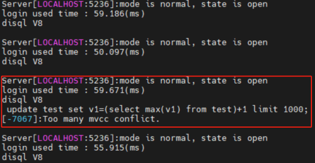 **【问题解决】：**

修改数据库 dm.ini 文件中静态参数 MVCC\_RETRY\_TIMES 和 BDTA\_SIZE，重启数据库。

修改 MVCC\_RETRY\_TIMES 参数值为 100，重启数据库。

```sql
alter system set 'MVCC_RETRY_TIMES'=100 spfile;
```

重启后按同样语句进行测试，观察每个会话下的运行结果均正常，未发生 MVCC 多版本并发冲突错误。

当将 MVCC\_RETRY\_TIMES 参数值恢复为默认值 5，BDTA\_SIZE 的值修改为 10000 时，重启数据库后再执行同样的语句会发现部分会话再次报错。 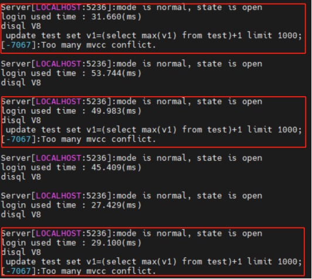 在实际情形中需要根据实际情况进行适当调整参数 MVCC\_RETRY\_TIMES 和 BDTA\_SIZE 的大小。

参数说明：

MVCC\_RETRY\_TIMES 参数越大，发生 MVCC 冲突时的最大重试次数越多，报错可能性越低；

BDTA\_SIZE 参数越大，批量数据处理大小（ BDTA 的大小）越大，报错可能性越大。

| 参数名 | 默认值 | 属性 | 说明 |
| --- | --- | --- | --- |
| MVCC\_RETRY\_TIMES | 5 | 静态 | 指定发生 MVCC 冲突时的最大重试次数。   有效值范围(1~4294967294)   注：MPP 下此参数无效，发生 MVCC 冲突时将直接报错 |
| BDTA\_SIZE | 1000 | 静态 | BDTA 缓存的记录数。有效值范围（1~10000） |

> **注意**
> 
> 在实际业务场景中，同一时刻并发执行修改同一条数据会导致此报错，建议分析确认应用中同一时刻不同事务修改同一条数的业务合理性。达梦中控制并发冲突次数的参数为 “MVCC\_RETRY\_TIMES”，默认为 5，该参数可从一定程度上缓解冲突的概率，但该错误信息不是并发操作触发锁机制控制锁等待，而是同一时刻不同的事务修改同一条数据导致，故要综合评估业务逻辑的合理性来进行解决。

## \[-2148\]:标记不匹配

1. 将配置文件 dm.ini 里面的参数 ENABLE\_ENCRYPT=1 改成 0
2. 检查数据库服务器版本/客户端版本 /dm.key 版本。若企业版数据库使用了安全版的 key 文件或者相反，也会报这个错误。

## 达梦数据库开启日志

- 开启 SQL 日志： `SP_SET_PARA_VALUE(1, ‘SVR_LOG’, 1);`
- 关闭 SQL 日志： `SP_SET_PARA_VALUE(1, ‘SVR_LOG’, 0);`

需要配置文件：sqllog.ini

可参考《DM 数据库管理手册》，手册位于 **数据库安装路径** `/dmdbms/doc` 文件夹。

> **注意**
> 
> 记得关闭或者配置日志文件大小限制，不然磁盘会撑爆。

## 修改数据库实例的字符集

字符集设置是在初始化实例的时候设置的，一旦设置完成就不能修改，只能重新初始化实例。

## 修改数据库实例的端口号

修改 dm.ini 中的 port\_num，需要重启数据库。

## 执行查询返回错误\[-7120\]:回滚记录版本太旧无法获取用户记录

**【解决方法】：**

- 方法一：修改 dm.ini 中的 undo\_retention=1800 ，然后重启数据库；
- 方法二：动态调整参数 UNDO\_RETENTION 值为 1800，该参数为 double 类型使用如下函数动态修改：
	```sql
	SP_SET_PARA_DOUBLE_VALUE(1,'UNDO_RETENTION',1800);
	```
- 方法三：SQL 执行时，涉及到的数据被其他人修改了，所以会这样，建议停应用或者找个没人用的时候再迁移。

备注: UNDO\_RETENTION 单位为秒，建议后续改回默认参数。

## 如何使用 dminit 自动优化参数

**【问题解决】**

在使用 dminit 初始化数据库时，默认对数据库进行参数优化。

dminit 自动优化参数功能受初始化参数 AUTO\_ADJ\_PARA 控制，0: 否，不开启 INI 参数自动调优 ；1: 是，开启 INI 参数自动调优。AUTO\_ADJ\_PARA 值默认为 1 开启自动优化参数。

在初始化数据库阶段自动优化 dm.ini 参数，也可通过指定参数 AUTO\_ADJ\_CPUS 和 AUTO\_ADJ\_MEM 来控制优化内存和 CPU 相关参数（需保证 AUTO\_ADJ\_PARA 开启）。

AUTO\_ADJ\_CPUS 可选值：0~64，0: 默认使用当前机器所有核。

AUTO\_ADJ\_MEM 单位：MB，0: 默认使用当前机器 80% 的内存。

> **注意**
> 
> 只能在数据库初始化时配置参数自动优化，初始化完成后无法使用 dminit 进行参数优化。dminit 初始化实例时参数 AUTO\_ADJ\_PARA 默认为 1 开启参数自动优化；AUTO\_ADJ\_CPUS 默认使用当前机器所有核；AUTO\_ADJ\_MEM 默认使用当前机器80%的内存。

自动优化涉及的参数如下：

| 参数名 | 默认值 | 参数说明 |
| --- | --- | --- |
| WORKER\_THREADS | 16 | 并发处理会话连接的线程数量；当打开 SESS 线程池（即 STHD\_FLAG=2 或 3 时）时，该值为初始化的 SESS 线程池的组数量。取值范围 1~64。当建库参数 AUTO\_ADJ\_PARA 为 1 时，本参数实际默认值由系统根据 AUTO\_ADJ\_CPUS 自动调整，用户也可根据实际需要手动调整。具体可参考《DM8\_dminit 使用手册》。 |
| TASK\_THREADS | 16 | 任务线程个数。非 DMDSC 环境取值范围 1 ~ 1000；DMDSC 环境取值范围 16~1000。当建库参数 AUTO\_ADJ\_PARA 为 1 时，本参数实际默认值由系统根据 AUTO\_ADJ\_CPUS 自动调整，用户也可根据实际需要手动调整。具体可参考《DM8\_DMINIT 使用手册》。 |
| IO\_THR\_GROUPS | 8 | 非 WINDOWS 下有效，表示 IO 线程组个数。取值范围 1 ~ 512。每个 IO 线程组包含一个读线程和一个写线程，即系统会创建 IO\_THR\_GROUPS 个读线程和 IO\_THR\_GROUPS 个写线程，IO 线程总数量为 IO\_THR\_GROUPS\*2。当建库参数 AUTO\_ADJ\_PARA 为 1 时，本参数实际默认值由系统根据 AUTO\_ADJ\_CPUS 自动调整，用户也可根据实际需要手动调整。具体可参考《DM8\_DMINIT 使用手册》。 |
| MEMORY\_POOL | 500 | 共享内存池大小，单位 MB。共享内存池是由 DM 管理的内存。取值范围：32 位平台为 64 ~ 2000，64 位平台为 64~67108864。当建库参数 AUTO\_ADJ\_PARA 为 1 时，本参数实际默认值由系统根据 AUTO\_ADJ\_MEM 自动调整，用户也可根据实际需要手动调整。具体可参考《DM8\_dminit 使用手册》 |
| MEMORY\_N\_POOLS | 1 | 共享内存池个数，取值范围 0 ~ 2048，0 与 1 等价，即共享池不分片。分片时，每池的初始容量为 MEMORY\_POOL / MEMORY\_N\_POOLS，但受最小初始容量为 30M 限制，因此实际分片数可能会小于 MEMORY\_N\_POOLS，每个池的 TARGET 也按此方式由 MEMORY\_TARGET 导出。当建库参数 AUTO\_ADJ\_PARA 为 1 时，本参数实际默认值由系统根据 AUTO\_ADJ\_MEM 自动调整，用户也可根据实际需要手动调整。具体可参考《DM8\_DMINIT 使用手册》。 |
| MEMORY\_TARGET | 15000 | 共享内存池在扩充到此大小以上后，空闲时收缩回此指定大小，单位 MB，取值范围：32 位平台为 0 ~ 2000，64 位平台为 0~67108864，0 表示不限制。当建库参数 AUTO\_ADJ\_PARA 为 1 时，本参数实际默认值由系统根据 AUTO\_ADJ\_MEM 自动调整，用户也可根据实际需要手动调整。具体可参考《DM8\_dminit 使用手册》。 |
| BUFFER | 8000 | 系统缓冲区大小，单位 MB。推荐值：系统缓冲区大小为可用物理内存的 60%～80%。取值范围 8~16777216。在 PAGE\_SIZE 为 4K 的库中，BUFFER 最大值为 15728640。64 位系统的缺省值为 8000，32 位系统的缺省值为 64。当建库参数 AUTO\_ADJ\_PARA 为 1 时，本参数实际默认值由系统根据 AUTO\_ADJ\_MEM 自动调整，用户也可根据实际需要手动调整。具体可参考《DM8\_dminit 使用手册》。 |
| BUFFER\_POOLS | 19 | BUFFER 系统分区数，每个 BUFFER 分区的大小为 BUFFER/BUFFER\_POOLS。取值范围 1~10000。当建库参数 AUTO\_ADJ\_PARA 为 1 时，本参数实际默认值由系统根据 AUTO\_ADJ\_MEM 自动调整，用户也可根据实际需要手动调整。具体可参考《DM8\_dminit 使用手册》。 |
| RECYCLE | 300 | RECYCLE 缓冲区大小，单位 MB。取值范围 8~16777216。当建库参数 AUTO\_ADJ\_PARA 为 1 时，本参数实际默认值由系统根据 AUTO\_ADJ\_MEM 自动调整，用户也可根据实际需要手动调整。具体可参考《DM8\_dminit 使用手册》。 |
| RECYCLE\_POOLS | 19 | RECYCLE 缓冲区分区数。取值范围 1~512。一般情况下，每个 RECYCLE 分区的大小为 RECYCLE/RECYCLE\_POOLS，但系统也会自动校正 RECYCLE 缓冲区分区数，以保证每个分区中数据页不少于 3000 页。当建库参数 AUTO\_ADJ\_PARA 为 1 时，本参数实际默认值由系统根据 AUTO\_ADJ\_MEM 自动调整，用户也可根据实际需要手动调整。具体可参考《DM8\_dminit 使用手册》。 |
| SORT\_BUF\_SIZE | 20 | 原排序机制下，排序缓存区最大值，单位 MB。取值范围 1~2048。当建库参数 AUTO\_ADJ\_PARA 为 1 时，本参数实际默认值由系统根据 AUTO\_ADJ\_MEM 自动调整，用户也可根据实际需要手动调整。具体可参考《DM8\_DMINIT 使用手册》。 |
| SORT\_BUF\_GLOBAL\_SIZE | 1000 | 新排序机制下，排序全局内存使用上限，单位 MB。取值范围 10~4294967294。该值须大于 SORT\_BUF\_SIZE 的值，否则会在重启时被重置为 SORT\_BUF\_SIZE 两倍和 100 之间的最大值。当建库参数 AUTO\_ADJ\_PARA 为 1 时，本参数实际默认值由系统根据 AUTO\_ADJ\_MEM 自动调整，用户也可根据实际需要手动调整。具体可参考《DM8\_DMINIT 使用手册》。 |
| SORT\_FLAG | 1 | 排序机制。0：原排序机制，普通排序方式，按照排序缓冲区 SORT\_BUF\_SIZE 大小获取数据，并进行排序；1：新排序机制，大内存排序方式，将大内存排序缓冲区 SORT\_BUF\_GLOBAL\_SIZE 按照内存片大小 SORT\_BLK\_SIZE 进行分片，并对每个内存片进行排序，再对整个大内存排序缓冲区的数据进行排序；2：采用 SORT\_FLAG 为 0 的排序方式的同时，增加递增列，当排序列存在相同值时按递增列进行排序；3：采用 SORT\_FLAG 为 1 的排序方式的同时，增加递增列，当排序列存在相同值时按递增列进行排序当建库参数 AUTO\_ADJ\_PARA 为 1 时，本参数实际默认值由系统根据 AUTO\_ADJ\_MEM 自动调整，用户也可根据实际需要手动调整。具体可参考《DM8\_DMINIT 使用手册》。 |
| SORT\_BLK\_SIZE | 1 | 新排序机制下对数据进行排序的排序缓冲区分片大小，单位 MB。取值范围 1~50。SORT\_BLK\_SIZE 一般不需要设置太大，该内存片大小能容纳 1 万至 5 万行待排序的数据即可。该值须小于等于 SORT\_BUF\_SIZE，否则会在重启时被重置为 SORT\_BUF\_SIZE。为了保证归并排序的效率，对于大内存排序缓冲区的总的分片个数系统上限为 10000 个，因此，当 SORT\_BUF\_GLOBAL\_SIZE 足够大的时候，为了保证大内存排序缓冲区能容纳足够多的数据，需要适当调大 SORT\_BLK\_SIZE。例如，当 SORT\_BLK\_SIZE 为 1 时，SORT\_BUF\_GLOBAL\_SIZE 的最大可用值为 10000。如果 SORT\_BUF\_GLOBAL\_SIZE 需要 20000M 可用空间排序时，需要设置 SORT\_BLK\_SIZE 最小为 2。当建库参数 AUTO\_ADJ\_PARA 为 1 时，本参数实际默认值由系统根据 AUTO\_ADJ\_MEM 自动调整，用户也可根据实际需要手动调整。具体可参考《DM8\_DMINIT 使用手册》。 |
| SORT\_BUF\_GLOBAL\_SIZE | 1000 | 新排序机制下，排序全局内存使用上限，单位 MB。取值范围 10~4294967294。该值须大于 SORT\_BUF\_SIZE 的值，否则会在重启时被重置为 SORT\_BUF\_SIZE 两倍和 100 之间的最大值。当建库参数 AUTO\_ADJ\_PARA 为 1 时，本参数实际默认值由系统根据 AUTO\_ADJ\_MEM 自动调整，用户也可根据实际需要手动调整。具体可参考《DM8\_DMINIT 使用手册》。 |
| HJ\_BUF\_GLOBAL\_SIZE | 5000 | HASH 连接操作符的数据总缓存大小，单位 MB。取值范围 10~500000。该值须大于 HJ\_BUF\_SIZE 的值，否则会在尝试使用系统函数修改为非法值或在 DM.INI 中指定为非法值后，被重置为 HJ\_BUF\_SIZE 两倍和 500 之间的最大值。当建库参数 AUTO\_ADJ\_PARA 为 1 时，本参数实际默认值由系统根据 AUTO\_ADJ\_MEM 自动调整，用户也可根据实际需要手动调整。具体可参考《DM8\_DMINIT 使用手册》。 |
| HJ\_BUF\_SIZE | 500 | 单个 HASH 连接操作符的数据总缓存大小，单位 MB。取值范围 2~100000。该值须小于 HJ\_BUF\_GLOBAL\_SIZE 的值，否则会在尝试使用系统函数修改为非法值时，被重置为 HJ\_BUF\_GLOBAL\_SIZE/2 与 100000 之间的最小值。当建库参数 AUTO\_ADJ\_PARA 为 1 时，本参数实际默认值由系统根据 AUTO\_ADJ\_MEM 自动调整，用户也可根据实际需要手动调整。具体可参考《DM8\_DMINIT 使用手册》。 |
| HAGR\_BUF\_GLOBAL\_SIZE | 5000 | 分组、嵌套连接、集合运算、分析函数运算、统计信息、DISTINCT、临时表、TOP、ESEND 操作符的数据总缓存大小，单位 MB。取值范围 10~1000000。该值须大于等于 HAGR\_BUF\_SIZE，否则会在尝试使用系统函数修改为非法值或在 DM.INI 中指定为非法值后，被重置为两倍 HAGR\_BUF\_SIZE 和 500 之间的最大值。当建库参数 AUTO\_ADJ\_PARA 为 1 时，本参数实际默认值由系统根据 AUTO\_ADJ\_MEM 自动调整，用户也可根据实际需要手动调整。具体可参考《DM8\_DMINIT 使用手册》。 |
| HAGR\_BUF\_SIZE | 500 | 单个分组、嵌套连接、集合运算、分析函数运算、统计信息、DISTINCT、临时表、TOP、ESEND 操作符的数据总缓存大小，单位 MB。取值范围 2~500000。该值须小于 HAGR\_BUF\_GLOBAL\_SIZE 的值，否则会在尝试使用系统函数修改为非法值时，被重置为 HAGR\_BUF\_GLOBAL\_SIZE/2 与 500000 之间的最小值。当建库参数 AUTO\_ADJ\_PARA 为 1 时，本参数实际默认值由系统根据 AUTO\_ADJ\_MEM 自动调整，用户也可根据实际需要手动调整。具体可参考《DM8\_DMINIT 使用手册》。 |
| DICT\_BUF\_SIZE | 50 | 字典缓冲区大小，单位 MB，取值范围 1~67108864。当建库参数 AUTO\_ADJ\_PARA 为 1 时，本参数实际默认值由系统根据 AUTO\_ADJ\_MEM 自动调整，用户也可根据实际需要手动调整。具体可参考《DM8\_DMINIT 使用手册》。 |
| VM\_POOL\_TARGET | 16384 | 虚拟机内存池能扩充到的最大大小，单位 KB，取值范围 0 ~ 10 \*1024 \* 1024，0 表示不限制。当建库参数 AUTO\_ADJ\_PARA 为 1 时，本参数实际默认值由系统根据 AUTO\_ADJ\_MEM 自动调整，用户也可根据实际需要手动调整。具体可参考《DM8\_DMINIT 使用手册》。 |
| SESS\_POOL\_TARGET | 16384 | 会话缓冲区能扩充到的最大大小，单位 KB，取值范围 0 ~ 10 \*1024 \* 1024，0 表示不限制。当建库参数 AUTO\_ADJ\_PARA 为 1 时，本参数实际默认值由系统根据 AUTO\_ADJ\_MEM 自动调整，用户也可根据实际需要手动调整。具体可参考《DM8\_DMINIT 使用手册》。 |
| MAX\_SESSIONS | 10000 | 系统允许同时连接的最大会话数。取值范围 1~150000。该参数还受到 LICENSE 的限制，取二者中较小者。当会话数达到 MAX\_SESSIONS 值后，为了保证管理员可继续管理数据库，允许 SYSDBA 额外开启 10 个会话连接。当建库参数 AUTO\_ADJ\_PARA 为 1 时，本参数实际默认值由系统根据 AUTO\_ADJ\_MEM 自动调整，用户也可根据实际需要手动调整。具体可参考《DM8\_DMINIT 使用手册》。 |
| CACHE\_POOL\_SIZE | 100 | SQL 缓冲池大小，单位 MB。取值范围：32 位平台下为 1 ~ 2048；64 位平台下为 1~67108864。当建库参数 AUTO\_ADJ\_PARA 为 1 时，本参数实际默认值由系统根据 AUTO\_ADJ\_MEM 自动调整，用户也可根据实际需要手动调整。具体可参考《DM8\_DMINIT 使用手册》。 |
| RLOG\_POOL\_SIZE | 256 | 最大日志缓冲区大小，单位 MB。取值范围 1 ~ 4096。当建库参数 AUTO\_ADJ\_PARA 为 1 时，本参数实际默认值由系统根据 AUTO\_ADJ\_MEM 自动调整，用户也可根据实际需要手动调整。具体可参考《DM8\_DMINIT 使用手册》。 |

## page\_size/页大小在初始化数据库后是否可以更改

簇，页，日志文件大小，字符集，大小写敏感，这些是需要在数据库创建之前就确定好的，不可以修改。

## 如何修改 dm.ini 配置文件的参数

达梦的配置参数参数属性分为三种：静态、动态和手动。  
静态，可以被动态修改，修改后重启服务器才能生效。  
动态，可以被动态修改，修改后即时生效。参数详情参考安装目录 DOC 目录下的“ DM 系统管理员手册”-第 2.1 章节。  
在 DM 数据库中，很多参数都是动态的，会自动响应各种负载，但是 DBA 仍然可以调用系统过程来改变 DM 实例的运行参数，从而获得更佳的性能体验。  
DBA 可以在 DM 数据库运行过程中执行：SF\_GET\_PARA\_VALUE 、 SF\_GET\_PARA\_DOUBLE\_VALUE 和 SF\_GET\_PARA\_STRING\_VALUE 这三个函数来获取系统的当前配置参数，并且可以使用 SP\_SET\_PARA\_VALUE 和 SP\_SET\_PARA\_DOUBLE\_VALUE 过程来修改静态/动态配置参数。  
详细函数修改方式参数详情参考安装目录 DOC 目录下的“ DM 系统管理员手册”-第 20 章节- 20.5 调整配置参数。

## 如何调整配置参数/调整 dm.ini 参数/调整兼容性（COMPATIBLE\_MODE）参数/…

可以参考安装目录下 doc 目录下 DM 系统管理员手册 第 20 章节 —20.5 小节调整配置参数。

## 审计日志文件如何指定自定义路径

**【问题解决】** ：

审计日志文件缺省使用 SYSTEM\_PATH 路径，若要把审计日志文件单独指定到自定义的路径下，dm.ini 文件中提供了 AUD\_PATH 参数，可以指定自定义路径，该参数为静态参数，修改后重启数据库生效。

## 如何将两台主备集群更改为 nomal 模式

**【问题解决】** ：  
先启动到 mount 状态，执行如下命令，修改 ALTER\_MODE\_STATUS 参数

```sql
SQL> sp_set_para_value(1,'ALTER_MODE_STATUS',1);  
SQL> alter database normal;
SQL> sp_set_para_value(1,'ALTER_MODE_STATUS',0);
SQL> alter database open;
```

然后，修改启动服务内容

```
vi DmServiceSERVER
---修改服务启动方式为 open
start_mode=open
```

最后，将配置文件做备份，并修改回原本的参数：  
1、修改 dmarch.ini，只保留 local 本地归档；  
2、dm.ini 关闭 MAL\_INI；  
3、重启数据服务。

## SQL 日志未按照 sqllog 配置文件大小生成

**【问题描述】**

配置好 sqllog.ini，打开日志功能后，发现生成的 log 文件并未按照 sqllog 配置文件大小生成，总是在文件达到 11M 后自动切换下一个 log 文件，并未按照配置生成 2G 的文件，即 SWITCH\_LIMIT = 2048 未生效，重新将 SVR\_LOG 关闭重新开启，也未生效。

sqllog.ini 配置文件如下：

```shell
BUF_TOTAL_SIZE          = 10240         #SQLs Log Buffer Total Size(K)(1024~1024000)
BUF_SIZE                = 1024          #SQLs Log Buffer Size(K)(50~409600)
BUF_KEEP_CNT            = 6             #SQLs Log buffer keeped count(1~100)
[SLOG_ALL]
   FILE_PATH    = /dmlog/logcommit/     #sqllog存放位置
   PART_STOR    = 0
   SWITCH_MODE  = 2  
   SWITCH_LIMIT   = 2048   
   ASYNC_FLUSH   = 1   
   FILE_NUM = 30  
   ITEMS    = 0
   SQL_TRACE_MASK  = 1   
   MIN_EXEC_TIME = 0
   USER_MODE   = 0   
   USERS =
```

**【问题分析】**

当 SWITCH\_LIMIT 参数在按照文件大小切换时，有效值范围是（1~2000），设置成 2048，超出有效范围，自动生成默认大小 11M。

**【问题解决】**

将 SWITCH\_LIMIT 参数值修改在 1~2000 之间后，生成的 log 文件大小达到限制后会自动切换。

参数说明：

| 参数 | 默认值 | 说明 | 属性 |
| --- | --- | --- | --- |
| BUF\_TOTAL\_SIZE | 10240 | SQL 日志 BUFFER 占用空间的上限，单位为 KB，取值范围（1024~1024000）。 | 动态，系统级 |
| BUF\_SIZE | 1024 | 一块 SQL 日志 BUFFER 的空间大小，单位为 KB，取值范围（50~409600）。 | 动态，系统级 |
| FILE\_PATH | ../log | SQL 日志文件所在的文件夹路径。 | 动态，系统级 |
| SWITCH\_MODE | 2 | 表示 SQL 日志文件切换的模式:0：不切换；1：按文件中记录数量切换；2：按文件大小切换；3：按时间间隔切换 | 手动 |
| SWITCH\_LIMIT | 128 | 同切换模式 SWITCH\_MODE 下，意义不同：1、按数量切换时，一个日志文件中的 SQL 记录条数达到多少条之后系统会自动将日志切换到另一个文件中。一个日志文件中的 SQL 记录条数达到多少条之后系统会自动将日志切换到另一个文件中。有效值范围（1000~ 10000000）；2、按文件大小切换时，一个日志文件达到该大小后，系统自动将日志切换到另一个文件中，单位为 M。有效值范围（1~ 2000）；3、按时间间隔切换时，每个指定的时间间隔，按文件新建时间进行文件切换，单位为分钟。有效值范围（1~ 30000）。 | 动态，系统级 |
| ASYNC\_FLUSH | 1 | 是否打开异步 SQL 日志功能。0：表示关闭；1：表示打开。 | 动态，系统级 |
| FILE\_NUM | 5 | 总共记录多少个日志文件，当日志文件达到这个设定值以后，再生成新的文件时，会删除最早的那个日志文件，日志文件的命令格式为 dmsql\_实例名\_日期\_时间.log。当这个参数配置成 0 时，只会生成两个日志相互切换着记录。有效值范围   （0~1024）。 | 动态，系统级 |

## 如何配置秒级调度作业

**【问题解决】**

1. TIMER\_TRIG\_CHECK\_INTERVAL 参数修改为 1。
2. 创建秒级调度作业。
```sql
CREATE TABLE TEST_TI(ID INT IDENTITY(1,1),CREATETIME TIMESTAMP(6));

BEGIN
DBMS_JOB.SUBMIT ( 1, 'INSERT INTO SYSDBA.TEST_TI(CREATETIME) VALUES(NOW);', '2023-06-26 14:23:55', 'sysdate + 1/86400', true, 0 );
END;
```

参数说明：

| 参数 | 属性 | 默认值 | 说明 |
| --- | --- | --- | --- |
| TIMER\_TRIG\_CHECK\_INTERVAL | 动态，系统级 | 60 | 服务器端检查触发器是否触发的时间间隔，单   位为秒，即每过设置的秒数检查触发器是否需   要触发，取值范围 1~60。 |

## 如何设置命令行的前缀标识为用户名，IP，端口以及实例名

**【问题描述】**

Disql 登录时如何设置命令行的前缀标识为用户名，IP，端口以及实例名。

**【问题解决】**

在 dmdbms/bin/disql\_conf 目录下配置 glogin.sql 文件，配置内容参考如下：

```bash
column instance_name new_value instance_name
select instance_name from v$instance;
set sqlprompt "_user'@'_connect_identifier(&instance_name)>"
```

测试验证:

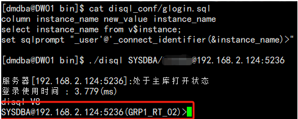

## 扩容临时表空间报错：“超出数据库表空间数量限制，请检查 TS\_MAX\_ID 参数”

**【问题描述】**

使用如下 sql 扩容临时表空间时报错：“超出数据库表空间数量限制，请检查 TS\_MAX\_ID 参数”。

```sql
alter tablespace temp resize datafile 'TEMP.DBF' to 2048;
```

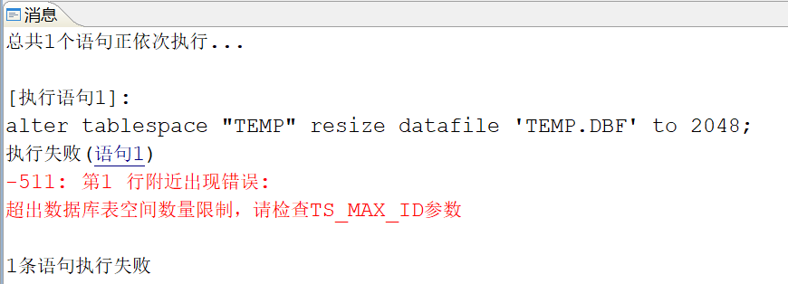

**【问题分析】**

根据报错信息“超出数据库表空间数量限制”可以推测是由于扩展上限达到了设置的临时表空间上限导致。

**【问题解决】**

根据实际需求适当放大临时表空间上限。

1. 查询当前临时表空间上限设置大小。
```sql
select PARA_NAME,PARA_VALUE from v$dm_ini where para_name='TEMP_SPACE_LIMIT'
```

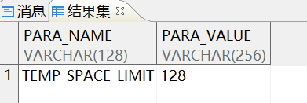

2. 根据实际需求增加临时表空间上限大小。
```sql
sp_set_para_value（2,'TEMP_SPACE_LIMIT',4096);
```

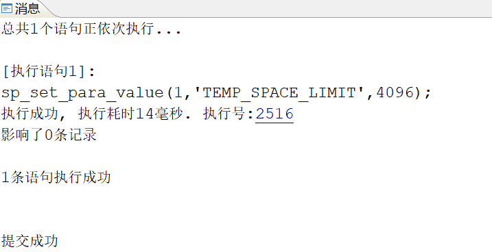

3. 重新执行 sql 扩大临时表空间大小。
```sql
alter tablespace "TEMP" resize datafile 'TEMP.DBF' to 2048;
```

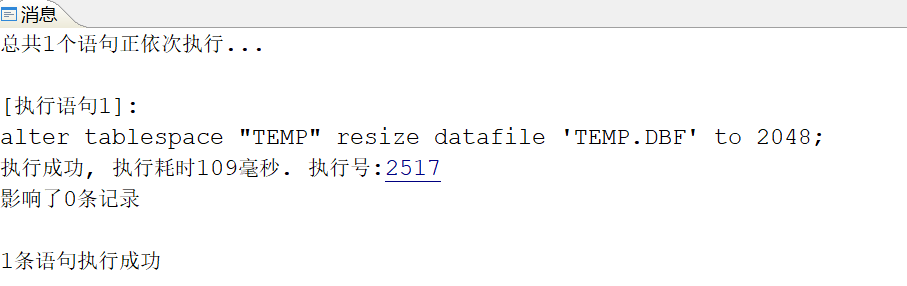

## 归档路径的已用大小超出了归档配置的 arch\_space\_limit 大小

**【问题描述】**

查看数据库服务器存储使用情况发现归档路径的已用大小超出了归档配置的 arch\_space\_limit 大小，或归档日志并未达到 arch\_space\_limit 大小但数据库异常。

**【问题分析】**

如果归档路径中有其他非归档文件，数据库并不能管理这些文件。

归档路径空间如果足够大，由于有其它文件存在，通过命令检查归档路径空间大小会大于 arch\_space\_limit 限制的大小。

如果归档路径空间大小是按照 arch\_space\_limit 限制的大小严格配置的，此时如果有其它文件在该路径下，则会导致归档保存空间不足，数据库异常。

## 如何配置可在任意目录下执行 disql 等命令

**【问题描述】**

在运维过程中，执行达梦命令，在默认情况下，我们环境变量会写入 LD\_LIBRARY\_PATH 和 DM\_HOME 的达梦环境变量，但是我们在执行命令时，需要绝对路径或者进入到 DM\_HOME/bin 目录下执行，运维相对不便捷，无法任意目录执行 disql 以及 dmrman，DmServer，DmWater 等脚本。

**【问题解决】**

成功添加环境变量即可在任意目录执行达梦命令，参考如下：

```sql
su - dmdba
vi  ~/.bash_profile
export LD_LIBRARY_PATH="$LD_LIBRARY_PATH:/home/dmdba/dmdbms/bin"
export DM_HOME="/home/dmdba/dmdbms"
export PATH=$PATH:$DM_HOME/bin:$DM_HOME/tool:$LD_LIBRARY_PATH
source   ~/.bash_profile
```

## 如何修改作业拥有者

**【问题描述】**

将作业创建在普通用户下时，如果因特殊情况，暂时无法登录到普通用户，且此时作业出现故障，尝试使用 SYSDBA 执行作业测试时，会报错，提示“只允许作业拥有者运行”，如下图：

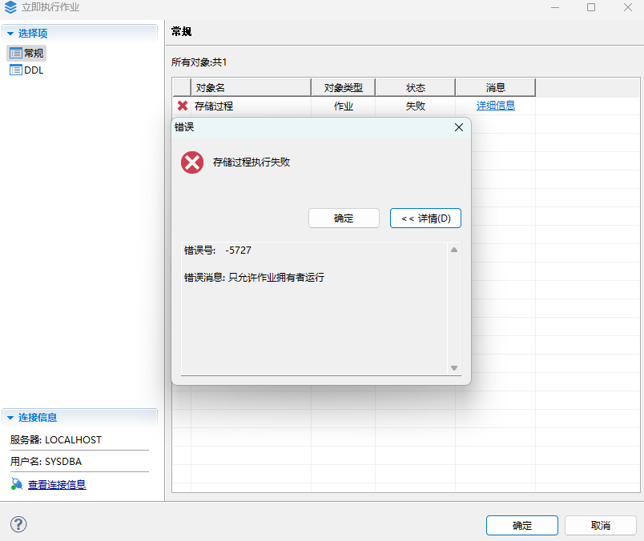

**【问题解决】**

可以使用 SYSDBA 用户执行如下语句，临时修改对应作业所属模式：

```sql
call SP_JOB_SET_SCHEMA('JOBNAME', 'USERNAME');
```

参数说明：

JOB\_NAME：作业名称。必须是有效的标识符，同时不能是 DM 关键字。作业必须存在，否则报错。

SCHEMA\_NAME：模式名称。必须是有效的模式，否则报错。

修改过后，需右键代理-作业进行刷新，即可看到作业拥有者已变更。

此时即可使用相应的用户正常测试作业。后续可使用上诉语句将作业拥有者改回去。更改拥有者不会清空作业历史执行记录。

## 如何保证新插入的数据在查询时不展示含有的反斜杠

**【问题描述】**

varchar 类型的数据，insert 插入的数据内容中存在反斜杠，在 select 查询的时候如何保证不展示含有的反斜杠。

**【问题解决】**

可通过设置参数 BACKSLASH\_ESCAPE=1 来解决，该参数是静态参数，需要重启数据库生效。

> **注意**
> 
> 修改参数 BACKSLASH\_ESCAPE=1 后只对新插入的数据中含有反斜杠生效。

示例：

1. 设置 BACKSLASH\_ESCAPE=1 ，并重启数据库。
2. 创建表并插入数据。
```sql
drop table test2;
create table test2 (name char(200) );
insert into test2 values('[{\"type\": \"USERINPUT\"}] ');
commit;
```
3. 查询数据。
```sql
select  * from  test2;
```

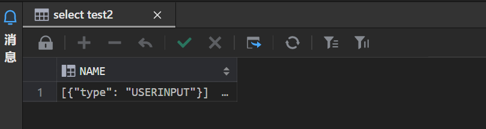

## 如何允许较多的定时任务或异步任务同时执行

**【问题描述】**

如何处理同时间较多的定时任务或异步任务需要执行时，个别任务不执行情况。

**【问题分析】**

定时任务和异步任务与 task\_threads 参数有关，该参数设置过小时，同时执行的任务有限制。例如设置 task\_threads=8，同时执行的任务超过 8 个时，个别任务可能会出现不执行情况。

**【问题解决】**

可通过适当调大该参数 task\_threads 解决该问题。

task\_threads 参数解释： 任务线程个数。静态，默认值 16；非 DMDSC 环境取值范围 1~1000；

DMDSC 环境取值范围 16~1000。

## 大小写敏感数据库中如何屏蔽关键字

**【问题描述】**

大小写敏感数据库中，通过以下命令屏蔽关键字 DOMAIN 和 domain，重启数据库生效。

```sql
sp_set_para_string_value(2,'EXCLUDE_RESERVED_WORDS','DOMAIN,domain');
```

创建如下表进行查询仍会报错“无效得列名\[DOMAIN\]”。

```sql
CREATE TABLE "SYSDBA"."T24" ("domain" INT) STORAGE(ON "MAIN", CLUSTERBTR) ;
select domain from "SYSDBA"."T24"; 
select DOMAIN from "SYSDBA"."T24";
---无效得列名[DOMAIN]
```

**【问题解决】**

方法一：可通过将表中字段修改为大写 DOMAIN 来解决；

方法二：对查询字段加双引号解决如： `select "domain" from "SYSDBA"."T24";`