本章节主要介绍达梦数据库 DBLINK 相关常见问题，为用户提供 DBLINK 相关问题的分析和解决思路。除此之外，用户还可前往 [达梦技术社区](https://eco.dameng.com/community/question/) 参与更多问题讨论。

## 目录

## 正文

## 创建 dm8-oracle11G 的 dblink，进行查询时报错：\[-6010\]:Error in line:1 Connection lost.

**【问题描述】**

dm8 通过 oci 接口创建到 oracle 的 dblink 连接，已配置 oracle\_client 客户端及环境变量，已配置 tnsnames.ora 文件，tnsnames.ora 参考配置如下：

```shell
[dmdba@dmdsc01 log]$ cat /soft/dsc/dmdbms/bin/instantclient_19_18/network/admin/tnsnames.ora
ORCL =
 (DESCRIPTION =
   (ADDRESS = (PROTOCOL = TCP)(HOST = xxx.xxx.xxx.xxx)(PORT = 1522))
   (CONNECT_DATA =
     (SERVER = DEDICATED)
     (SERVICE_NAME = ORCLPDB)
   )
 )
```

在通过网络服务名创建 dblink 后进行 dblink 链接查询时提示报错："-6010：连接丢失"。

**【问题分析】**

通过查看数据库 log 日志文件发现报错如下：

```sql
2023-03-13 14:06:20.894 [ERROR] database P0000055023 T0000000000000078148  Oracle connect error:[12154]ORA-12154: TNS:could not resolve the connect identifier specified
```

根据该日志报错可以推断主要原因为 tnsnames.ora 未被识别，定位在环境变量存在问题。

**【问题解决】**

1. 排查 dmdba 环境变量中是否配置了 TNS\_ADMIN，若未配置需要先配置该变量，具体配置方法如下：
```sql
[dmdba@dmdsc01 log]$ cat ~/.bash_profile  | grep TNS_ADMIN
export TNS_ADMIN=/soft/dsc/dmdbms/bin/instantclient_19_18/
```
2. 重启数据库服务，确保数据库服务能够识别该新配置的环境变量，再次发送 dblink 请求。
3. 用户名和密码需要正确，如果查看到 dm\_DMSERVER\_202109.log 日志有如下报错，则说明用户名和密码错误：

注意检查大小写，如果密码为小写，请注意用双引号引起来。

## DBLINK 报错信息在实例日志中不显示

**【问题解决】**

若需在实例日志中打印 DBLINK 报错信息，则要提前修改 DBLINK 打印日志参数 ELOG\_REPORT\_LINK\_SQL。方法如下：

1. 执行以下命令开启 DBLINK 打印日志；
```sql
alter system set 'ELOG_REPORT_LINK_SQL' = 1;
```
2. 同样的窗口运行报错的 DBLINK 语句；
3. 数据库实例日志查看报错。

参数解释：

| 参数名 | 默认值 | 属性 | 说明 |
| --- | --- | --- | --- |
| ELOG\_REPORT\_LINK\_SQL | 0 | 动态，会话级 | 是否记录 DBLINK 执行的 SQL 到服务器日志文件中。   0：不记录；1：记录 |

## dm8-dm7 的 odbc 方式 dblink 连接报错：“\[-2245\]:DBLINK 加载库文件失败”

**【问题描述】**

配置 dm8-dm7 的 odbc 方式 dblink 连接，测试时报错：\[-2245\]:DBLINK 加载库文件失败。

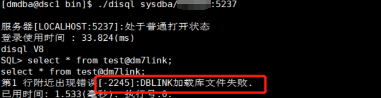

**【问题解决】**

将解压后的 ODBC 目录下的所有.so 文件复制到数据库安装目录 bin 下，然后再修改属主和属组。

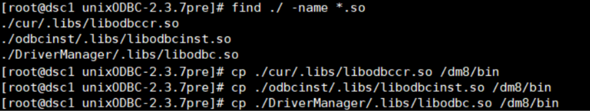

```shell
[root@dsc1 bin]# chown dmdba:dinstall libodbccr.so libodbcinst.so libodbc.so
```

再次通过 dblink 查看 dm7 数据库中的表，可以成功查看。

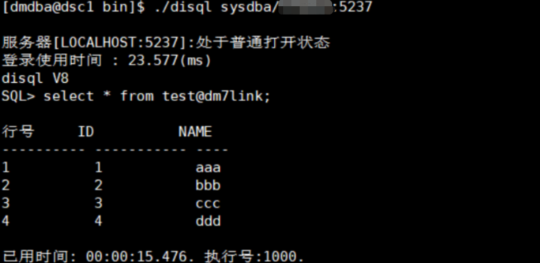

## DM 到 DM 的 DBLINK 报错问题

**问题一：**

**【问题描述】**

DBLINK 连接时报错：“self instance(DMSERVER) not found in d:\\dmdbms\\data\\DAMENG\\dmmal.ini  
dmserver startup failed, code = -9501 \[MAL sys has not configured or serveris not enterprise version\]."。

**【问题解决】**

1. 通过以下 SQL 检查数据库是否为企业版：
```sql
select SERVER_SERIES from v$license；  --E代表企业版
```
2. 检查 dmmal.ini 是否配置正确，注意文件扩展名要正确：

**问题二：**

**【问题描述】**

DBLINK 连接时报错：

```shell
nsvr_ini_file_read failed, [code: -9501]
MAL_INST_NAME:[DMSERVER] is duplicated in [d:\dmdbms\data\DAMENG\dmmal.ini]!
dmserver startup failed, code = -801 [Duplicate ini config option]
nsvr_ini_file_read failed, [code: -801]
```

**【问题解决】**

该问题是 dmmal.ini 配置文件中存在两个相同实例名的数据库导致，需修改其中一个数据库的实例名，即两个 MAL\_INST\_NAME = DMSERVER 名字不能一样。

```shell
[MAL_INST1]
MAL_INST_NAME = DMWIN
MAL_HOST = 10.10.10.3
MAL_PORT = 5251
MAL_INST_HOST = 10.10.10.3
MAL_INST_PORT = 5236
[MAL_INST2]
MAL_INST_NAME = DMSERVER
MAL_HOST = 10.10.10.4
MAL_PORT = 5250
MAL_INST_HOST = 10.10.10.14
MAL_INST_PORT = 5236
```

补充 DM 到 DM 的 DBLINK 的三种创建方式如下：

```sql
--方式1 —mal_inst_host/mal_inst_port
create link “链接名” connect ‘DAMENG’ with “用户名” identified by “密码” using ‘实例IP地址/实例端口号’;
--方式2 —mal_host/mal_port
create link “链接名” connect ‘DAMENG’ with “用户名” identified by “密码” using ‘MAL IP地址/MAL 端口号’;
--方式3 —mal_inst_name
create link “链接名” connect ‘DAMENG’ with “用户名” identified by “密码” using ‘实例名’;
```

## 通过 dblink 向 oracle 端表插入 BLOB 字段数据时报错："字符不完整“

**【问题描述】**

源端为 DM(DSC+DW)，目的端为 ORACEL，创建从 DM 到 ORACLE 的 dblink，通过 dblink 向 oracle 端表插入 BLOB 字段数据时报错"字符不完整”该如何解决。 

**【问题解决】**

可通过创建 dblink 时添加 local\_code 参数绕过此问题。

例如：如下使用如下创建的 dblink 向 oracle 端表插入 BLOB 字段数据时报错"字符不完整”。

```sql
create or replace link dm_ora connect 'ORACLE' with stu identified by 123456789 using '10.15.1.20:1521/orcl' ;
```

通过创建 dblink 时添加 local\_code 参数绕过此问题。

```sql
create or replace link dm_ora connect 'ORACLE' with stu identified by 123456789 using '10.15.1.20:1521/orcl' option (local_code='GBK');
```

参数说明：

local\_code：接口(DPI、OCI、JDBC 等接口)的字符集。若与服务器的字符集不一致，则需要进行转换。可取值为 UTF-8，GBK 或 GB18030。

## oracle 到 dm 的 dblink 使用报错：ORA-28500

**【问题描述】**

创建 oracle 到 dm 的 dblink，配置透明网管、监听、tnsname 后，使用时报错：ORA-28500。

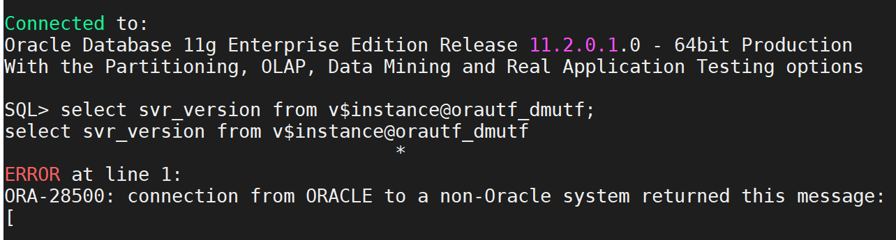

**【问题分析】**

排查发现透明网管配置不正确，缺少配置 HS\_NLS\_NCHAR=UCS2。

**【问题解决】**

检查透明网管配置，增加 HS\_NLS\_NCHAR=UCS2。

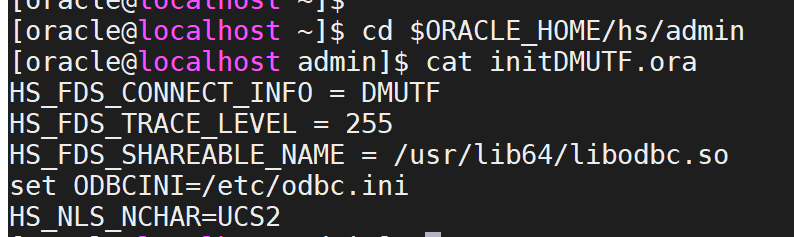

修改配置后重启监听，dblink 恢复正常。

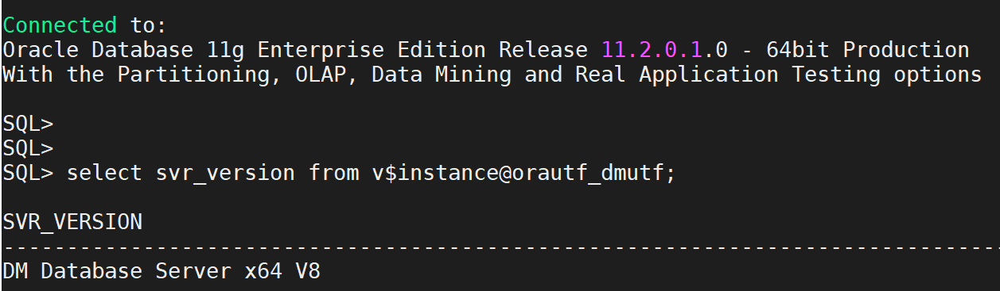

## dm 到 oracle 的 dblink 环境中，在 dm 上调用 oracle 包中的存储过程提示：获取对象失败

**【问题描述】** ：

在 DM 上调用 oracle 数据库中的 ceshi\_pkg 包的 showMessage 存储过程，出现如下报错：

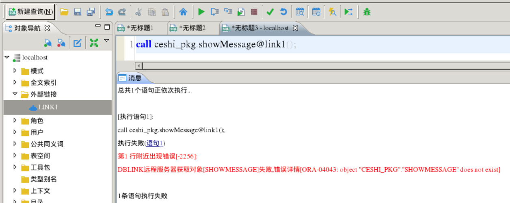

**【问题解决】** ：  
远程调用 oracle 包里的存储过程需要加上用户名，将 SQL 语句改为如下即可：

```sql
call scott.ceshi_pkg.showMessage@link1();
```

## dblink 访问远程库中的大字段表数据时报错：字符串截断

**【问题描述】**

本地库通过 dpi 方式访问远程库中的大字段表数据时报错：字符串截断

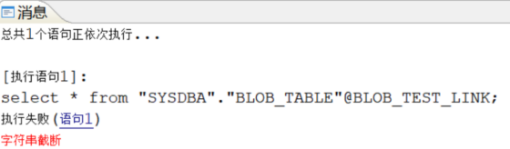

**【问题解决】**

调整参数 DBLINK\_LOB\_LEN 的值大于表中 BLOB 大字段数据长度，例如：

1. 修改库 1 和库 2 ：DBLINK\_LOB\_LEN=512。
```sql
SP_SET_PARA_VALUE(1,DBLINK_LOB_LEN,512);
```

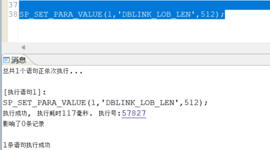

2. 库 1 创建 BLOB 表，并插入 6 张大小为 276K 的图片（512>276）。

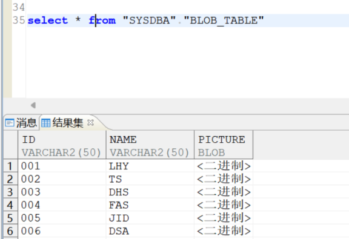

3. 库 2 通过 dblink 成功查询库 1 大字段表。

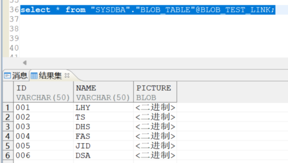

## 使用 dblink 批量插入远程表时报错：“超出保存点上限”

**【问题描述】**

通过 DPI 方式创建的 DBLINK，在使用 dblink 批量插入远程表时报错：“超出保存点上限”。

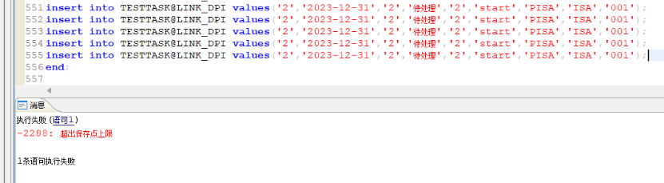

**【问题分析】**

DPI 方式创建 dblink 插入远程表批量提交受到参数 SAVEPOINT\_LIMIT 限制，最高 10000。

SAVEPOINT\_LIMIT 参数含义：单个事务中最大可创建的保存点个数。取值范围 0~10000，默认值 512。

**【问题解决】**

一下提供两种解决方法：

1. 降低同一事务内的批量提交语句数量。
2. 使用 odbc 方式创建 DBLINK。

示例如下：

1. DPI 方式创建 dblink。
```sql
create or replace link "SYSDBA"."LINK_DPI" connect 'DPI' with "SYSDBA" identified by " *****" using '10.15.1.25:5236';
```

降低批量提交语句，由 555 行减少到 512 行，批量提交成功。

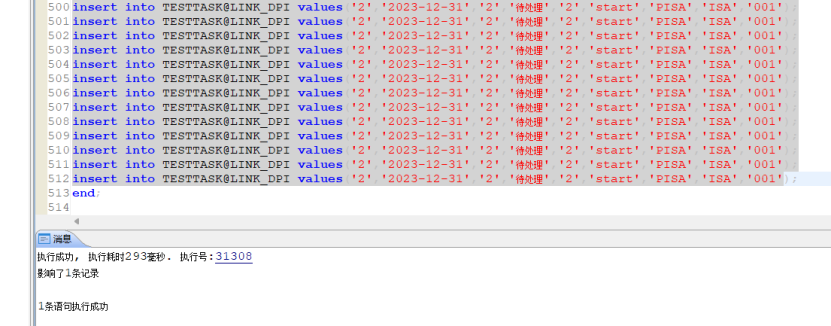

2. ODBC 方式创建 DBLINK。
```sql
create or replace link "SYSDBA"."LINK_ODBC" connect 'ODBC' with "SYSDBA" identified by "*****" using 'dm8';
```

批量提交不减少，批量提交成功。

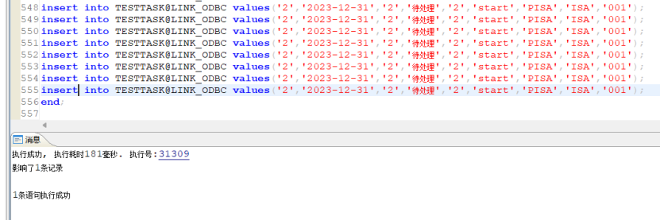

## DBLINK 查询报错：“DBLINK 大字段缓存空间不足”

**【问题描述】**

使用 DBLINK 查询远端大字段类型数据时报错：DBLINK 大字段缓存空间不足。

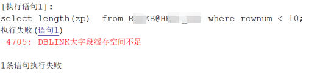

**【问题分析】**

使用 DBLINK 访问大字段类型时，大字段的长度存在限制。

**【问题解决】**

1. 通过如下语句查询当前版本支持的最大长度。
```sql
select * from v$dm_ini where para_name='DBLINK_LOB_LEN';
```

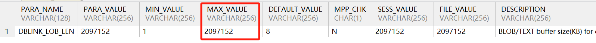

2. 可以看到当前版本支持大字段长度最大为 2G，可以根据需要，执行如下语句，将此参数调大。该参数为动态参数，执行后即可生效，不需要重启数据库。
```sql
sp_set_para_value(1,'DBLINK_LOB_LEN',2097152);
```

## DM 到 ORACLE 的 dblink 查询报错："远程操作符执行失败"

**【问题描述】**

**问题 1** ：DM 到 ORACLE 的 dblink，dblink 创建正常，通过 dblink 可以查询 ORACLE 的系统视图、系统表等，但是查询用户的表报错："远程操作符执行失败"。

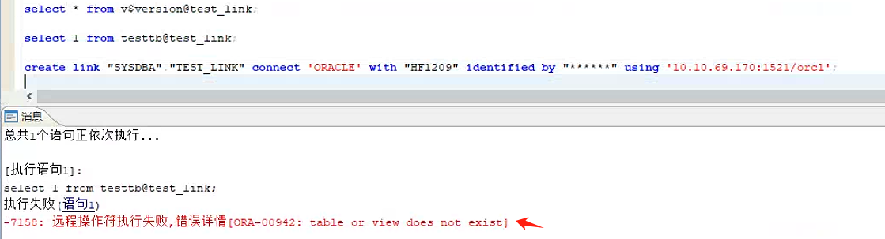

**问题 2** ：DM 通过外部链接查询 ORACLE 数据库表失败，报错：“\[-7158\]:远程操作符执行失败,错误详情\[oracle column-level return code \[1406\]\]”，案例如下：

（1）ORACLE 数据库操作

```sql
SQL> create table t1(c1 int,c2 varchar(10));
insert into t1 values(1,'字符集差异');
commit;
SQL> select length(c2),lengthb(c2),t1.c2 from t1;
LENGTH(C2) LENGTHB(C2) C2
---------- ----------- ----------
         5          10 字符集差异
```

（2）达梦数据库操作

```sql
SQL> create or replace public link DM_TO_ORA connect 'ORACLE' with TEST identified by ****** using '192.168.xxx.x:1521/ORADB1';
操作已执行
已用时间: 16.563(毫秒). 执行号:67812.

SQL> select * from T1@DM_TO_ORA;
select * from T1@DM_TO_ORA;
[-7158]:远程操作符执行失败,错误详情[oracle column-level return code [1406]].
已用时间: 48.690(毫秒). 执行号:0.
```

**【问题分析】**

**问题 1** ：通过排查 DM 日志发现，使用 DBLINK 查询的 sql 中用户名后面又多加了一个表名，导致报表或视图不存在。

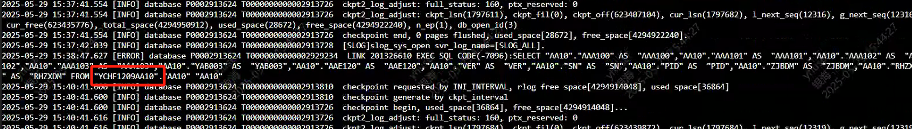

由于 oci 接口返回的数据为 GBK 编码，所以需要在 dblink 中添加选项声明，通知 dblink 调用 oci 时进行必要的编码转换。

**问题 2** ：oracle column-level return code \[1406\] 表示数据截断错误，通常是 DBLINK 源和目标库的字符集不一致导致，本例中 ORACLE 数据库字符集为 ZHS16GBK，一个中文占 2 个字节，DM 库数据库字符集为 UTF-8，一个中文占 3 个字节；针对本场景，在达梦数据库创建外部链接时应增加 OPTION 参数（指定 LOCAL\_CODE、DATA\_CHARSET）支持配置字符集转换。

参数说明：

LOCAL\_CODE：接口（DPI、OCI、JDBC 等接口）的字符集。若与服务器的字符集不一致，则需要进行转换。可取值为 UTF-8，GBK 或 GB18030。

DATA\_CHARSET：设置接口返回给达梦服务器数据的实际字符集。取值为 UTF-8，GBK 或 GB18030。

**【问题解决】**

**问题 1** ：创建 dblink 时在后面加上：option (local\_code='gbk')，如下：


**问题 2** ：重建 DBLINK，增加以下 OPTION 选项解决： `OPTION( LOCAL_CODE='GBK',DATA_CHARSET='UTF-8', CONVERT_MODE=0 )`;

```sql
SQL> create or replace public link DM_TO_ORA connect 'ORACLE' with TEST identified by ****** using '192.168.xxx.x:1521/ORADB1' OPTION( LOCAL_CODE='GBK',DATA_CHARSET='UTF-8', CONVERT_MODE=0 );
操作已执行
已用时间: 13.849(毫秒). 执行号:67806.
SQL> select * from T1@DM_TO_ORA;
行号     C1 C2   
---------- -- ---------------
1          1  字符集差异

已用时间: 31.333(毫秒). 执行号:67811.
```

## 创建 SqlServer 到 DM 的 DBLINK 无法连接

**【问题解决】**

1. 检查 tsql 是否可以正常连接 SqlServer ，若无法连接，请排查 FreeTDs 相关配置是否正确，若配置无误可尝试更换其他版本的 FreeTDs，再进行 tsql 连接。
2. 检查 ODBC 连接，确保 ODBC 可正常连接到 SqlServer。
3. 若 DBLINK 连接后，查询发现中文乱码，请检查 SQL server 数据库和 DM 数据库字符集是否一致。若字符集不一致。可在 ODBC 配置文件 odbc.ini 中添加 `ClientCharset = 字符集` ，用来指定在与 SqlServer 连接时使用的字符集。如：SQLserver 数据库字符集为 GBK，DM 数据库字符集为 UTF\_8，则在 odbc.ini 中添加 `ClientCharset = UTF-8` ，如下：
```
[SQLSERVER]
Driver = /usr/local/freetds-1.3/lib/libtdsodbc.so  
Description = My Second Test DSN
Trace = No
Server = IP                  
Database =  数据库名                       
Port =    数据库端口                         
TDS_Version = 7.0
ClientCharset = UTF-8
```

## dm 通过 DBLINK 连接 sqlserver 乱码

**【问题描述】**

DM 端与 SQL server2022 端字符集编码不一致导致 dm 通过 dblink 访问 sqlserver 出现乱码。

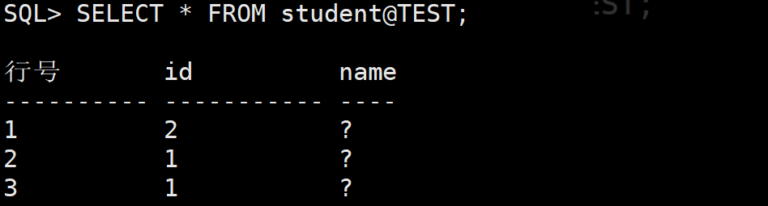

**【问题分析】**

本质原因为 FreeTDS 客户端字符集、操作系统编码、SQL Server 端字符集三者不统一导致。通过配置固定 FreeTDS 字符集（UTF-8 或 GBK），让其与 SQL Server 端兼容即可解决。

**【问题解决】**

1. 当操作系统编码为 UTF-8 时，需修改 odbc.ini 文件，添加参数 ClientCharset = UTF-8；或修改 freetds.conf 文件，添加参数 client charset = UTF-8。完成上述配置后，重启达梦数据库服务，即可确保通过 dblink 正常访问中文数据。
2. 当操作系统编码为 GBK 时，由于达梦数据库与 SQL Server 的字符集均兼容 GBK，因此无需在 odbc.ini 和 freetds.conf 中添加强制编码参数便可正常访问数据库。具体操作为：不添加或注释掉 odbc.ini 中的 ClientCharset = UTF-8 参数，以及 freetds.conf 中的 client charset = UTF-8 参数。修改完成后，重启达梦数据库服务即可生效。