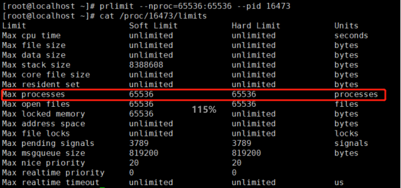
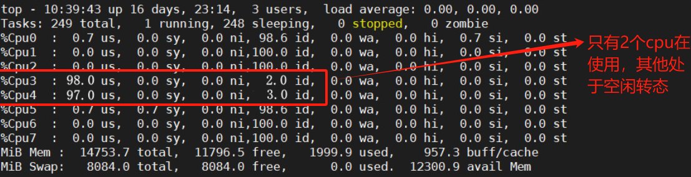
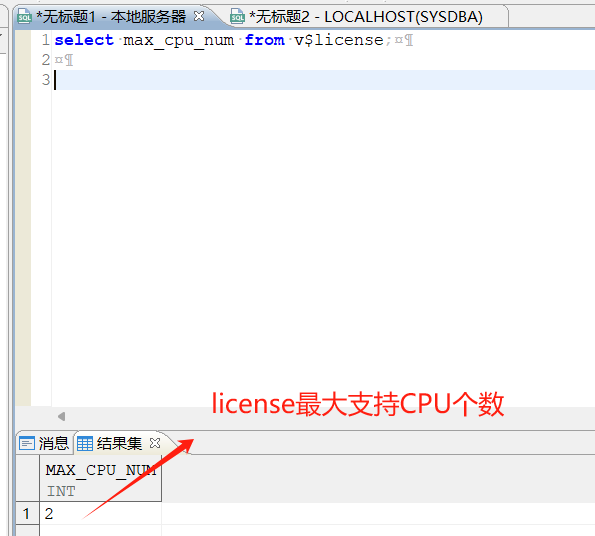
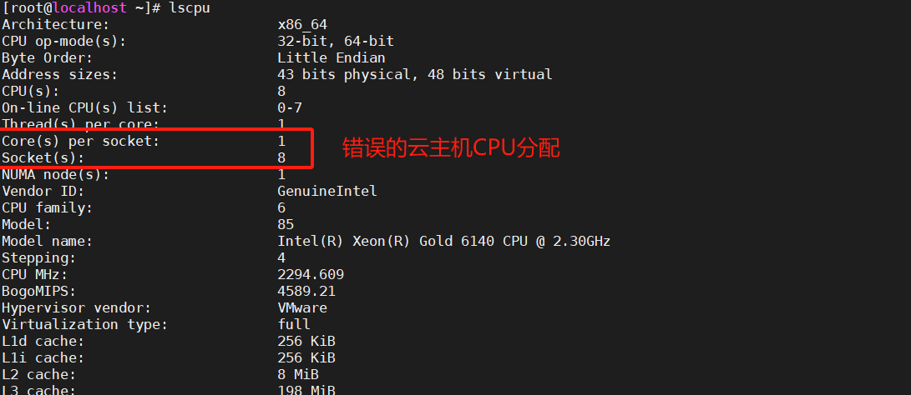
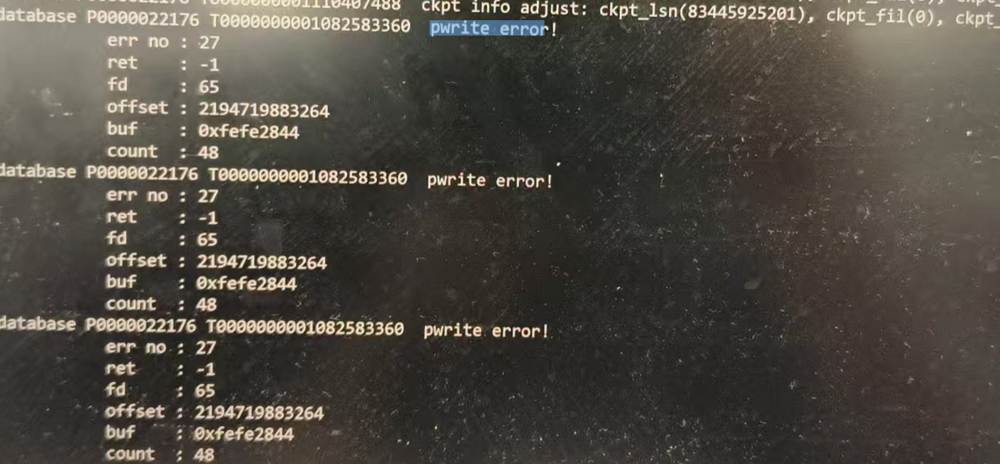
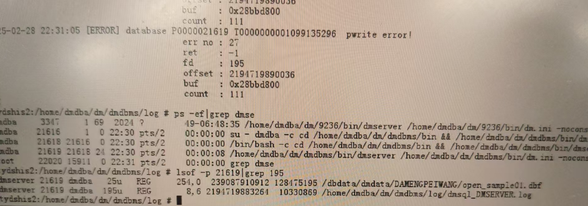

本章节主要介绍达梦数据库系统资源相关常见问题，为用户提供系统资源相关问题的分析和解决思路。除此之外，用户还可前往 [达梦技术社区](https://eco.dameng.com/community/question/) 参与更多问题讨论。

## 目录

## 正文

## DM 内存泄漏/异常的检查

DM 运行过程中，如果发现内存突然飙升，或者占用过大， 或者操作系统反复 OOM 时，需要考虑是否是服务器存在内存泄漏问题，按照目前 DM7 的动态视图所能提供的信息，需要获取以下内容：

1. 数据库的内存使用情况；
2. 是否存在扩展到非常大的内存池；
3. 确认该内存的详细使用情况。

### 数据库的内存使用情况

操作系统级别的命令判断：TOP、WINDOWS 资源管理器等，查看数据占用多少内存

数据库级别的判断：数据库使用的内存大致等于 BUFFER\_SIZE + POOL\_SIZE，对应的 SQL 语句如下：

```sql
select (select sum(n_pages * page_size) from v$bufferpool) + (select sum(total_size) from v$mem_pool) from dual;
```

一般来说，发生内存泄漏的都在 mem\_pool 上，比如操作系统上看到内存占用 60G，但 BUFFER 已经占用到 50 GB，实际上发生泄漏的概率较小，应该适当调小 BUF，空出内存给内存池使用。

### 是否存在使用内存过多的 SQL

较新版本的 DM7 服务器提供会话及语句资源监控视图（ENABLE\_MONITOR=1) 生效 v$SESSION\_STAT，V$SQL\_STAT 视图上字段比较丰富，我们这里主要关注 MAX\_MEM\_USED 字段。 一般来讲，如果是某条或者特定的几条 SQL 导致内存增长过多，可以通过这两个视图查询出来。

通过执行以下语句：

```sql
SELECT MAX_MEM_USED,SQL_TXT FROM V$SQL_STAT order by MAX_MEM_USED DESC;
```

可以确定使用内存较大的 SQL，可以针对行的优化（消除 HASH,SORT,DISTINCT 等) 注意：该查询只能查询当前活动 STMT 上的语句消耗情况，历史情况需要查询 V$SQL\_STAT\_HISTORY，该视图上保留 1 万行 SQLSTAT 历史信息。

以上 MAX\_MEM\_USED 列的单位均为 KB。

### 是否存在扩展过大的内存池

前面介绍过，正常使用过程中，内存池的大小一般会维持在 TARGET\_SIZE 左右，不会发生太大的差距，如果发生非常多次计划外的扩展，需要考虑该池是否发生内存泄漏，与之相关的系统视图和系统视图字段为：v$mem\_pool 上的 N\_EXTEND\_EXCLUSIVE 字段。

相应的查询语句为如下：

```sql
Select * from v$mem_pool where n_extend_exclusive = 0;
```

确认池后，通过 MEM\_POOL 的 CREATOR 也就是创建这个池的线程号，去 V$SESSIONS 或者 V$SESSIONS\_HISTORY 里面确认会话号，然后再去 V$SQL\_STAT\_HISTORY 或者 V$SESSION\_STAT\_HISTORY 中寻找内存消耗大的 SQL 即可。

查看存在超出计划大小扩展的内存池的计划外扩展次数以及大小，如果池大小为可 以通过 INI 调整的（如 VM\_POOL\_TARGET、SESS\_POOL\_TARGET，但这两个参数慎用，调整过大对并发影响较大），可以适当放大计划大小，再运行观察计划外扩展情况是否有改善，如果仍然存在大量的计划外扩展则需要继续跟进内存使用实况。

### 确认内存的详细使用情况

详细的内存使用情况需要视图 v$mem\_reginfo，该视图在 INI 参数 MEM\_LEAK\_CHECK 为 1 时有效，可动态开启，开启后登记数据库中所有内存的申请释放信息。

相应的查询语句如下：

```sql
Select sum(reserved_size),fname,lineno from v$mem_reginfo group by fname,lineno order by sum(reserved_size) desc;
```

按照大小降序，或者根据文件名、行号分组，查看是否存在大量某文件某行使用内存未释放的情况，转交研发处理。

### 内存异常的检查

DM 提供自动的内存异常检查，检查参数为 INI 中的 MEMORY\_MAGIC\_CHECK，默认值为 2 大致的检查原理如下：

在每次申请内存时，返回的内存块中包含，返回内存的管理结构大小 + 申请长度 + 一个 ULINT\_SIZE 大小的内存块 其中首部用于存放管理这块内存结构的结构，实际使用的内存为第二段，最后一段填入一个校验码。

校验码为一个固定魔术和该内存管理结构的首地址计算出来的一个常数。每当需要释放内存时，如果 MEMORY\_MAGIC\_CHECK 为 1 则会根据需要释放内存的地址计算出一个校验码，与该内存结构尾部的校验码比较，若不相等，则说明该片内存可能出现过写溢出，数据库会 HALT 掉。

如果 MEMORY\_MAGIC\_CHECK 配置为 2 则会在 1 的检查基础上，由于申请内存长度可能是大于需求长度的（因为申请时要求申请大小为 2 的 N 次幂，会在大于需求长度后面的每一位上都添加上特殊校验码，释放时每一位都回检查，检查失败也会 HALT。

如果实际生产中发现 CHECK 为 2 比较慢，则可以将 MAGIC\_CHECK 改为 1。

## 应用插入数据到达梦数据库报磁盘空间不足

1. 表空间是不是没开自动扩展；
2. df -h 查看下操作系统空间，另外查看下是哪个表空间满了。

## DM 数据库在麒麟 10 操作系统上关闭 numa，透明大页和修改磁盘调度算法未生效

**【问题解决】** ：

1.检查操作系统内核版本。  
操作系统内核版本为 27 之前和 27 之后的修改方法有所不同，如果是 27 版本之后的用通用方法关闭，如果是 27 版本之前的用下面的方法关 numa ，透明大页和磁盘调度；

2.关闭 numa 和透明大页。  
修改/boot/efi/EFI/kylin/grub.cfg 文件，查找关键字：menuentry，在相对位置添加 numa 和透明大页命令：

```
numa=off transparent_hugepage=never
```

重启生效，如用命令查看 numa 没有生效，请联系友商，从 BIOS 上进行关闭 numa 。

3.修改磁盘调度算法。修改/usr/lib/udev/rules.d/60-block-scheduler.rules 文件，改磁盘调度算法，重启生效。

## 数据库连接资源释放

**【问题解决】** ：

如果用户的资源一直没有释放，可以从应用层和数据库两个方面来做设置。  
注意需要考虑实际业务场景：如果从数据库层面断开，应用层面再次连接数据库会报错，那么最好从应用层面来设置资源限制。  
从应用层面设置会话空闲期，请联系应用负责人进行相应设置，以下主要介绍从数据库层面进行资源限制。

- 管理工具设置：设置用户会话空闲时间，管理工具–管理用户–修改用户—资源设置项—会话空闲期。
- 命令行设置：比如设置会话空闲时间为 10 分钟，采用如下 SQL 语法：  
	alter user 用户名 limit CONNECT\_IDLE\_TIME 10;
- 通过 V$SESSIONS 查出空闲会话，然后使用 sp\_close\_session(会话 ID) 关闭会话。
```sql
select * from V$SESSIONS where  STATE='IDLE' ;
sp_close_session(会话ID)
```

## 测试环境中经常有一些长时间运行的会话，如何批量 kill 这些会话，释放连接

**【问题解决】** ：

结束会话一般使用 sp\_close\_session() 命令。如果想批量执行的话，可以根据条件在 v$sessions 中查询，并使用游标去执行。  
批量结束会话操作要小心，可以先根据条件查看相关的 SQL\_TEXT，确定后再去执行。  
以下例子是结束 60 秒以上的活动会话。

1.首先查看一下符合条件的相关会话：

```sql
select * from
(SELECT
       DATEDIFF(SS, LAST_RECV_TIME, SYSDATE) SS    ,
       DBMS_LOB.SUBSTR(SF_GET_SESSION_SQL(SESS_ID)),
       *
FROM
       V$SESSIONS
WHERE
       STATE = 'ACTIVE'
order by
       ss desc) where SS >60;
```

2.使用游标去执行：

```sql
DECLARE
CURSOR c_sessions
is
select * from
(SELECT
       DATEDIFF(SS, LAST_RECV_TIME, SYSDATE) SS    ,
       DBMS_LOB.SUBSTR(SF_GET_SESSION_SQL(SESS_ID)),
       *
FROM
       V$SESSIONS
WHERE
       STATE = 'ACTIVE'
order by
       ss desc) where SS >60;
c_raw c_sessions%rowtype;
begin
for c_row in c_sessions
loop
execute immediate 'sp_close_session('''||c_row.sess_id||''')';
end loop;
end;
```

## 操作系统报错：“No space left on device”

**【问题描述】**

在创建表空间文件的时，操作系统报错：“No space left on device”。使用 `df -h` 命令查看磁盘空间，发现磁盘空间有足够剩余。使用 mkdir 命令无法创建新文件。检查 SQL 语法并没有错误，表空间文件始终无法创建成功。

**【问题解决】**

操作系统不能创建新的目录和文件，但是磁盘空间却有空闲，一般是因为 inodes 文件数量被占满导致，可以使用 `df -i` 命令查看 Inodes 使用率。最直接有效的解决方法是查找到大文件并进行删除， linux 查找命令如下：

```shell
for i in 需要查找的目录; do echo $i; find $i |wc -l; done
```

## 磁盘实际使用空间大小和显示空间大小不一致

**【问题描述】**

/dmarch 实际磁盘使用空间 1T，但是 df -h 显示却已使用 1.8T。

**【问题解决】**

利用 lsof 命令排查，获取到占用文件的进程，对该进程进行处理，释放被占用文件，命令如下：

```shell
lsof +D /dmarch
```

> **注意**
> 
> 使用 lsof 命令要用 root 用户，其他用户可能权限不够大从而找不全进程。

## 数据库日志报错：“pthread create error in os\_thread create with 11”

**【问题描述】**

数据库日志报错：“pthread create error in os\_thread create with 11”，数据库无法登录。

**【问题分析】**

排查发现安装部署数据库时未对资源限制进行正确设置，其中 processes 资源设置太小导致线程被用完后无法创建线程。

**【问题解决】**

可以临时通过 prlimit 动态修改 processes 资源。例如数据库进程号为 16473，通过以下命令动态修改 processes 资源设置。

```shell
prlimit --nproc=65536:65536 --pid 16473
```



动态修改 processes 资源完成后，还需要在 /etc/security/limits.conf 中永久修改，以便后续重启生效。

补充命令：

```shell
top -H -p <pid>  --查看特定进程下的线程运行情况
ps -T -p <pid>  --查看特定进程下的线程运行情况
ps -T -p <pid> |wc –l  --查看进程运行情况是否很多线程占用
```

## 数据库日志报错：“No space left on device”

**【问题描述】**

数据库运行正常但日志报如下错误信息：

```sql
2023-08-14 14:43:10.031 [ERROR] database P0000006615 T0000000000000006681  pwrite error! err no: 28, ret: -1, fd: 47, offset: 28893184, buf: 0x89ad1306, count: 1045081
2023-08-14 14:43:10.031 [ERROR] database P0000006615 T0000000000000006681  os_file_write_by_offset_normal [pwrite] error! handle: 47, offset: 28890426, bytes_to_write: 1047839, bytes_written: -1, code: 28, desc: No space left on device
```

**【问题分析】**

该报错为 sqllog.ini 文件中配置的 SQL 日志保存目录空间不足导致报错，不影响数据库服务正常运行和进行数据提交。

**【问题解决】**

排查对应的 sqllog.ini 文件中配置的 SQL 日志保存目录磁盘空间是否可满足切换和生成日志信息的条件，如果 SQL 日志保存目录磁盘空间不满足 SQL 日志的生成和切换需尽快清理磁盘空间或扩盘。

## CPU 使用异常，个别 CPU 使用率较高时，任有其他的 cpu 处于空闲状态

**【问题描述】**

通过 top 命令查看发现 CPU 只有 2 颗 CPU 在使用，其他的 CPU 处于空闲状态。



**【问题分析】**

产生这种情况，主要是因为 CPU 划分不正确，导致 CPU 利用率上不来。

**【解决办法】**

1. 登录数据库通过 v$license 视图查看 MAX\_CPU\_NUM 的值是多少，如果 MAX\_CPU\_NUM 的值为 2，那么数据库只能使用 2 个物理 cup；



2. 使用 lscpu 命令查看 Socket(s) 和 Core(s) per socket。可以看到物理 cpu 配置为 8，每颗 cpu 的核心数配置为 1，但实际数据库支持的 cpu 个数为 2，那么 cpu 配置为 8 座 是不合理的。



3. 参考数据库中查询到的 MAX\_CPU\_NUM 的值修改云主机的 CPU 座数为 2 和每个座的核数为 4。

## docker 环境修改数据库参数报错：“磁盘空间不足”

**【问题描述】**

达梦数据库运行在 docker 环境，修改数据库参数时报错：“磁盘空间不足”，如下图所示： 

**【问题分析】**

排查发现，实例所在路径的用户及所属组为 root，在 docker 环境下，会导致修改数据库参数报错。

**【问题解决】**

可通过修改实例所在路径用户组权限（chown dmdba:dinstall 实例所在路径）解决该问题。

## 单个文件过大，超出操作系统文件大小限制报错：“pwrite error err no:27”

**【问题描述】**

数据库运行过程中因单个文件过大，超出操作系统文件大小限制报错：“pwrite error err no:27”。



**【问题分析】**

在 Linux 系统中，Err no 27 通常表示 “File too large”（文件太大）。这是一个错误代码，用于指示在执行文件操作时，尝试创建或写入的文件超过了系统或文件系统所允许的最大大小限制。其中 ext3 文件系统单个文件的理论最大限制为 2TB，ext4 文件系统单个文件大小一般限制为 16TB。

可以通过 lsof -p | grep fd 查看 dmserver 打开的文件描述符（File Descriptor）相关信息，查看数据库正在写入的报错文件情况。下图中数据库 pid 为 21619，文件描述符（fd）为 195。

```shell
[dmdba@x86_1_59 bin]$ lsof -p 21619 | grep 195
```



**【问题解决】**

查找到数据库正在运行写入的文件后，对文件进行处理。

（1）sqllog 日志文件过大，可通过设置 sqllog.ini 配置进行处理。

（2）单个表空间数据文件过大可通过增加表空间数据文件进行处理。

（3）其他文件按实际情况进行设置。