本章节主要介绍达梦数据库工具常见问题，为用户提供达梦数据库工具常见问题的分析和解决思路。除此之外，用户还可前往 [达梦技术社区](https://eco.dameng.com/community/question/) 参与更多问题讨论。

## 目录

## 正文

## MANAGER 如何查看数据库配置信息

DM 管理工具 MANAGER，在登录以后，可以选中导航菜单中的顶层连接，右键-管理服务器打开管理服务器窗口，系统概览里面展示的是数据库配置信息。

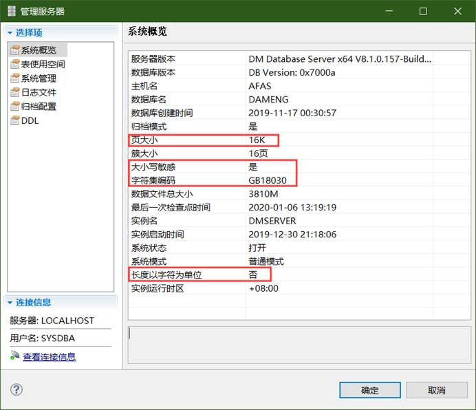

## MANAGER 查看外键

在模式中找到对应的模式，点开表，找到你想要查看的表，点开【键】。

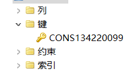

如图片所示就是需要查看的外键信息，如果想要继续查看具体的信息，右键点击【外键】，选择自己需要查看的选项。

## 控制台工具查看试用截止日期

下图是 DM 控制台工具查看不到试用截止日期。

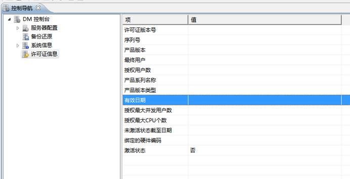

**【解决方法】** ：

通过管理工具登陆数据库执行 `select * from SYS."V$LICENSE";` 语句即可查找出有效时间。

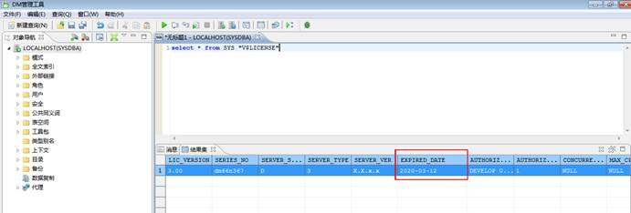

V$license 字段信息可在《DM 系统管理员手册》中查找，手册位于 **数据库安装路径** `/dmdbms/doc` 文件夹。

## 数据库完整性校验

达梦数据库提供了 dmdbchk 工具用于检查数据库完整性、正确性的命令行工具。在服务器正常关闭后的脱机情况下，用户可以使用 dmdbchk 对数据库进行校验，包括校验 DM 数据库内部的物理存储结构是否正常，对象信息是否合法等。

检验的内容具体包括三方面：

1. 数据文件合法性检验  
	数据文件校验只校验数据文件大小。如果数据库文件实际大小大于或等于文件头中记录的大小，则合法。
2. 索引正确性校验  
	索引检验包括：普通表 B 树索引校验、LIST 表扁平 B 树索引校验、列存储表索引校验。校验内容具体包括：B 树的层次、层次关系，每层的内部页、叶子页以及页之间的前后链接关系，每个页的页头信息（如页类型等)等。
3. 对象 ID 合法性校验  
	对象 ID 校验包括数据库内的所有对象的 ID 检验。对象包括：索引、表、约束、存储过程、模式、同义词、用户等。如果从系统表中查出的对象 ID 小于库的 ID 预留页中记录的该类型对象的下一分配 ID，则合法。因为库的 ID 预留页中记录的是各类型对象下一个新分配对象将使用的 ID，因此若系统表中的对象 ID 大于或等于该 ID，说明库已损坏。

以下提供数据库完整性校验方法。

具体步骤：

1. 数据库服务正常关闭
2. 在数据库软件安装目录 bin 下执行以下命令进行完整性检查：
```shell
./dmdbchk path=/dm8/bin/TEST/dm.ini
```

校验后的报告存在 dmdbchk 工具所在的目录中，名称为 dbchk\_err.txt，检查报告如下：

```shell
/**一 dmdbchk  版本信息**/
[2022-12-01 16:28:46] dmdbchk V8

[2022-12-01 16:28:46] file dm.key not found, use default license!
/**二 开始标志 **/
[2022-12-01 16:28:47] DM DB CHECK START......

/**三 数据文件校验结果 **/
[2022-12-01 16:28:47] --------check dbf file size start---------

[2022-12-01 16:28:47] FILE=(ts_id=0, fil_id=0, path=/dm8/bin/TEST/SYSTEM.DBF)
[2022-12-01 16:28:47] FILE=(ts_id=1, fil_id=0, path=/dm8/bin/TEST/ROLL.DBF)
[2022-12-01 16:28:47] FILE=(ts_id=4, fil_id=0, path=/dm8/bin/TEST/MAIN.DBF)
[2022-12-01 16:28:47] FILE=(ts_id=6, fil_id=0, path=/dm8/bin/TEST/DEM.DBF)
[2022-12-01 16:28:47] --------check dbf file size end-----------

/**四 索引校验结果 **/
[2022-12-01 16:28:47] --------check indexes start---------------

[2022-12-01 16:28:47] INDEX=(id=33554433, name=SYSINDEXCOLUMNS, table_name=SYSCOLUMNS)
[2022-12-01 16:28:47] INDEX=(id=33554434, name=SYSINDEXINDEXES, table_name=SYSINDEXES)
[2022-12-01 16:28:47] INDEX=(id=33554440, name=SYSINDEXTUSERS, table_name=SYSUSER$)
[2022-12-01 16:28:47] INDEX=(id=33554442, name=SYSINDEXSYSGRANTS, table_name=SYSGRANTS)
[2022-12-01 16:28:47] INDEX=(id=33554452, name=SYSINDEXCONSTRAINTS, table_name=SYSCONS)
[2022-12-01 16:28:47] INDEX=(id=33554458, name=SYSINDEXSYSAUDIT, table_name=SYSAUDIT)
[2022-12-01 16:28:47] INDEX=(id=33554459, name=SYSINDEXSYSAUDITSQLSEQ, table_name=SYSAUDITSQLSEQ)
[2022-12-01 16:28:47] INDEX=(id=33554464, name=SYSINDEXCONTEXTINDEXES, table_name=SYSCONTEXTINDEXES)
[2022-12-01 16:28:47] INDEX=(id=33554468, name=SYSINDEXSTATS, table_name=SYSSTATS)
.........
[2022-12-01 16:28:47] INDEX=(id=33556897, name=INDEX33556897, table_name=DBTOOL_DTE_ESTIMATE_RESULT)
[2022-12-01 16:28:47] INDEX=(id=33556899, name=INDEX33556899, table_name=DMA_MAINFRAME_CORE)
[2022-12-01 16:28:47] INDEX=(id=33556900, name=INDEX33556900, table_name=DMA_MAINFRAME_CORE)
[2022-12-01 16:28:47] INDEX=(id=33556901, name=INDEX_DMA_MF_CORE, table_name=DMA_MAINFRAME_CORE)
[2022-12-01 16:28:47] INDEX=(id=33556902, name=INDEX33556902, table_name=DMA_MAINFRAME_CORE_HISTORY)
[2022-12-01 16:28:47] INDEX=(id=33556903, name=INDEX33556903, table_name=DMA_MAINFRAME_CORE_HISTORY)
[2022-12-01 16:28:47] INDEX=(id=33556904, name=INDEX_DMA_MF_CORE_HISTORY, table_name=DMA_MAINFRAME_CORE_HISTORY)
[2022-12-01 16:28:47] --------check indexes end-----------------

/**五 对象ID校验结果 **/
[2022-12-01 16:28:47] --------check iid start-------------------

[2022-12-01 16:28:47] check cons id ...
[2022-12-01 16:28:47] check index id ...
[2022-12-01 16:28:47] check table id ...
[2022-12-01 16:28:47] check proc id ...
[2022-12-01 16:28:47] check schema id ...
[2022-12-01 16:28:47] check synonym id ...
[2022-12-01 16:28:47] check user id ...
[2022-12-01 16:28:47] --------check iid end---------------------

/**六 结束标志 **/
[2022-12-01 16:28:47] DM DB CHECK END......
/**七 错误总数 **/
[2022-12-01 16:28:47] error count is 0
```

还可以通过 CHECK\_INDEX() 和 CHECK\_DB\_INDEX()两个系统函数检查索引的合法性。

1. CHECK\_INDEX()：检查一个索引的合法性。检查过程中，会使用 S+IX 锁来封锁索引对应的表对象。
2. CHECK\_DB\_INDEX()：检查数据库中所有索引的合法性。检查过程中，会使用 S+IX 锁来封锁索引对应的表对象。
3. 返回值：0：表示不合法；1：表示合法；2：表示存在未校验的索引。

例如：

通过 CHECK\_INDEX() 检查单个索引合法性：

1. 查询系统表获取索引 ID
```sql
select name,id from sysobjects where name='TEST_IDX' and subtype$='INDEX';
```

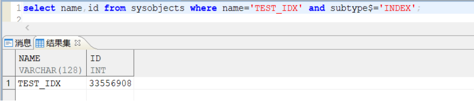

2. 检查此索引合法性：
```sql
select CHECK_INDEX ('SYSDBA',33556908);
```

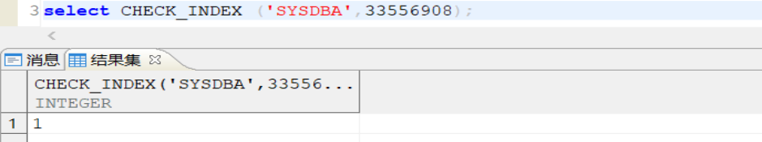

通过 CHECK\_DB\_INDEX() 检查所有索引合法性：

```sql
SELECT CHECK_DB_INDEX ();
```

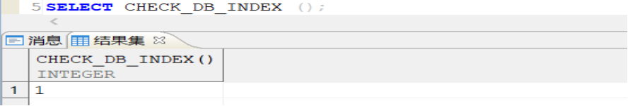

> **注意**
> 
> dmdbchk 并不能检查出用户实际数据的正确性，如果数据文件被手动人为修改，正好修改到的是用户数据部分，是检查不出来的。

## 达梦数据库校验工具的使用

达梦数据库校验需要在数据库服务正常关闭后进行，进入数据库程序目录 bin 下，输入./dmdbchk path=dm.ini 路径，例如数据文件目录为 /opt/dmdbms/data，则应该输入 `./dmdbchk path=/opt/dmdbms/data/DAMENG/dm.ini` ，校验完毕后，dmdbchk 会在当前目录下（dmdbchk 所在目录）生成一个名为 dbchk\_err.txt 的检查报告，供用户查看。

具体使用和解析请查看《DM\_dmdbchk 使用手册》，手册位于 **数据库安装路径** `/dmdbms/doc/special` 文件夹。

## 管理工具黑屏

【问题详情】：  
达梦 7 数据库，在达梦管理工具中，新建管理用户后，给其分配“系统权限”，点击“系统权限”按钮，出现黑屏然后自动跳转到用户登录界面。在其他相同系统的服务器上使用相同的工具链接相同的数据库就没问题。  
【问题解答】：

1. 可以重启一下管理工具客户端
2. 检查客户端和服务器版本是否一致,如果客户端版本比较低，可以升级一下客户端版本

> **备注**
> 
> 检查数据库版本的命令： dm7:select \* from v$version; Dm8:select id\_code();

## 用达梦管理工具，创建表空间报错：创建数据文件失败

**【问题描述】** ：

利用 DM 管理工具，创建表空间报错，具体报错信息如下：

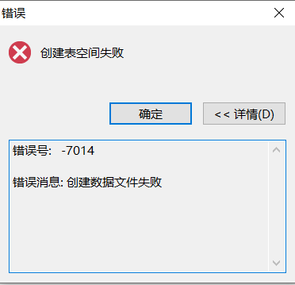

**【问题解决】** ：

达梦管理工具创建表空间在输入文件路径时，不需要手动新建.dbf 文件，只需要在确认文件路径后，输入文件名即可。具体步骤如下：  
步骤 1：新建表空间；

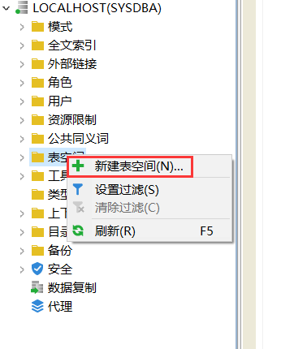

步骤 2：输入表空间名(TEST)；

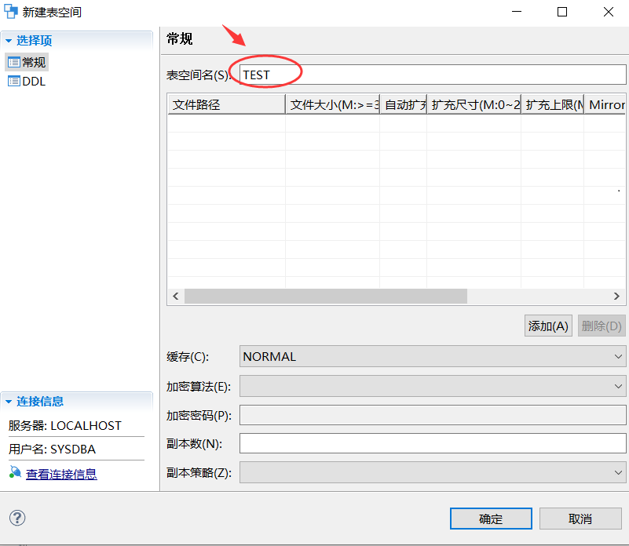

步骤 3：点击添加数据文件，设置文件大小，自动扩展等；

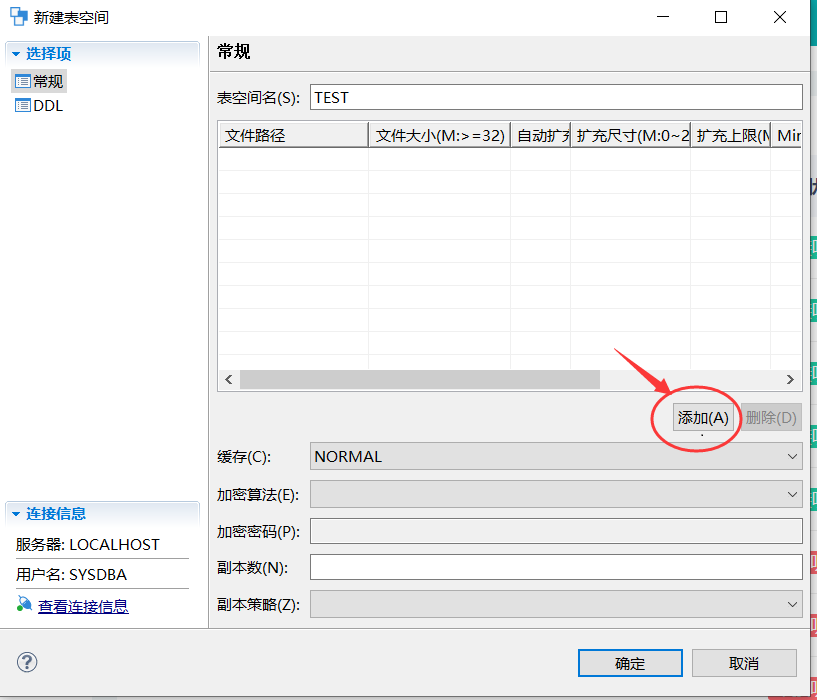

步骤 4：输入文件路径，选择需要存放的路径；

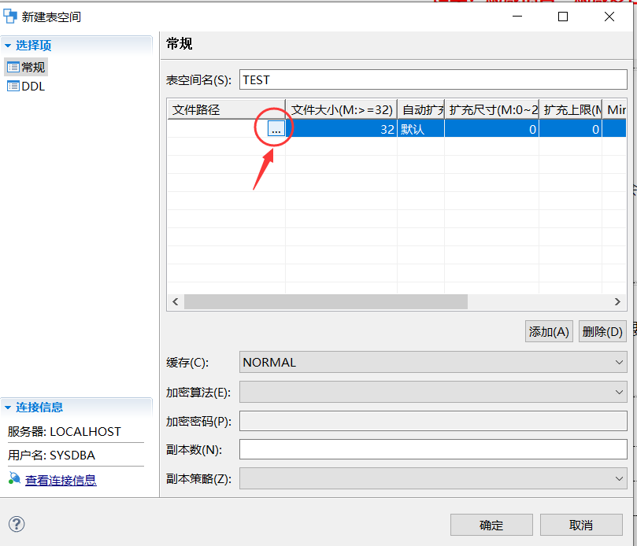

步骤 5：在选择好文件存放路径后，直接输入想要创建的文件名，不需要自己手动新建.dbf 文件。

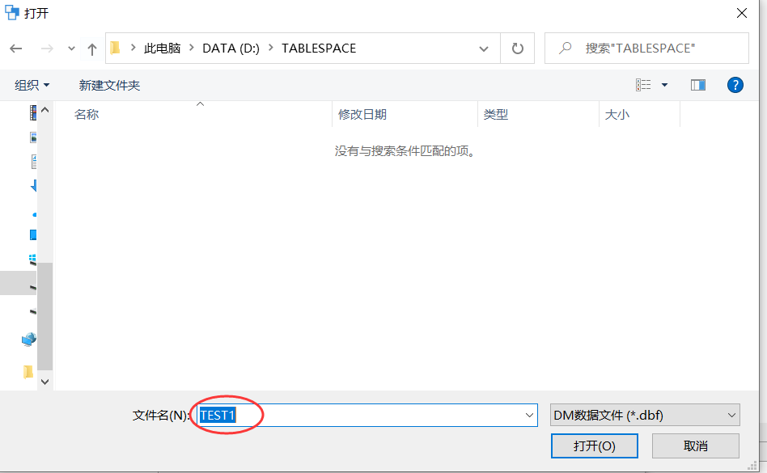

## 达梦工具（manager、dts、dbca 和 console 等）详细报错可以在哪里获取

**【问题解决】** ：

在数据库的安装目录下的../log 文件夹中的 tool.log 文件获取，该日志文件中有详细的错误信息。

## DM8 客户端管理工具上修改普通用户报错“无效的表或视图名\[SYSUSERPROFILES\]"

**【问题解决】** ：

1、通过 select \* from sysuserprofiles 查询报错，确实不存在相关的表；  
2、通过 select id\_code 查询服务器端版本为 2021.06.07 号的，再查看 manager 客户端为 2021.10.21 号的版本，客户端版本超过服务端版本；  
3、更换客户端为 2021.06 月份左右的版本后，修改普通用户，正常执行；

总结：建议在 DM8 的数据库上，客户端版本尽量和服务端版本保持一致。

## 达梦数据库管理工具使用“连接组”功能

**【问题描述】**

DBA 运维 N 套达梦数据库时，通过 IP 辨别易错，那么如何解决此问题呢？如下图所示，当数据库过多时难免会造成混乱，通过 IP 不方便运维人员识别。

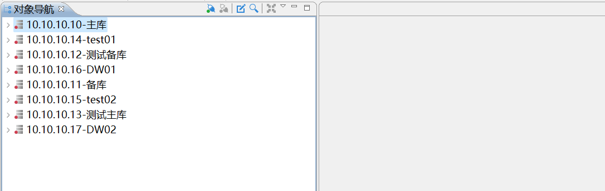

**【问题解决】**

可以采用达梦数据库管理工具的“连接组”功能，来对数据库进行分类管理，具体方法如下：

1. 点击管理工具对象导航栏右上角的【下三角】可以看到【配置连接组】选项，点击【配置连接组】。

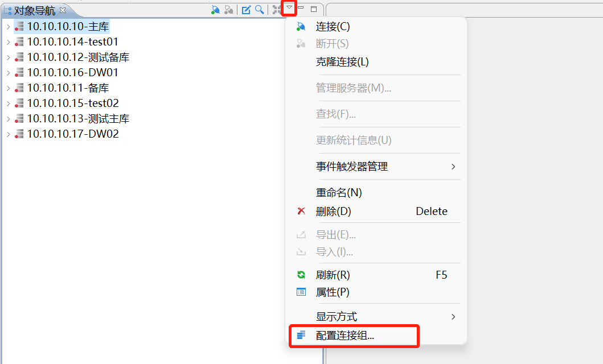

2. 点击【新建】进入【创建连接组】，选择想要配置到同一个组的数据库点击【增加】添加到【连接组内容】中，在【连接组名称】中自定义连接组名，配置完成后点击【确定】。其它数据库通过相同方法来配置连接组。

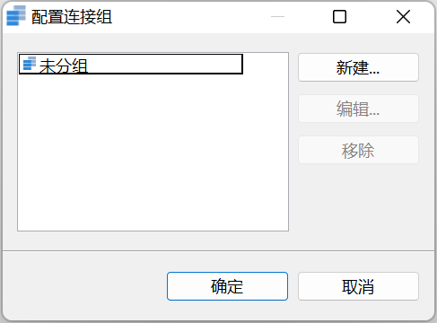

3. 数据库连接组配置完成后点击【确定】。

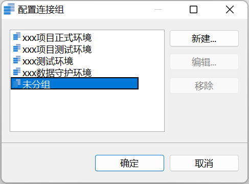

4. 再次点击管理工具对象导航栏右上角的【下三角】点击【显示方式】选择【连接组】，至此数据库连接组配置完成。

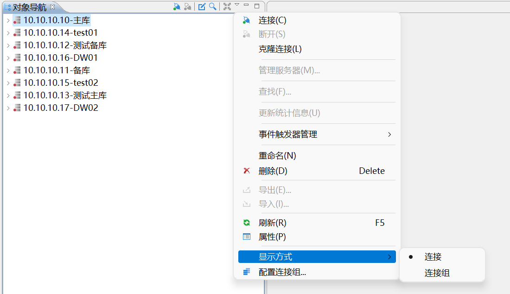

配置完连接组，【显示方式】选择为【连接组】后可以看到数据库被划分到了不同的组中，这样更加便于运维人员管理数据库。

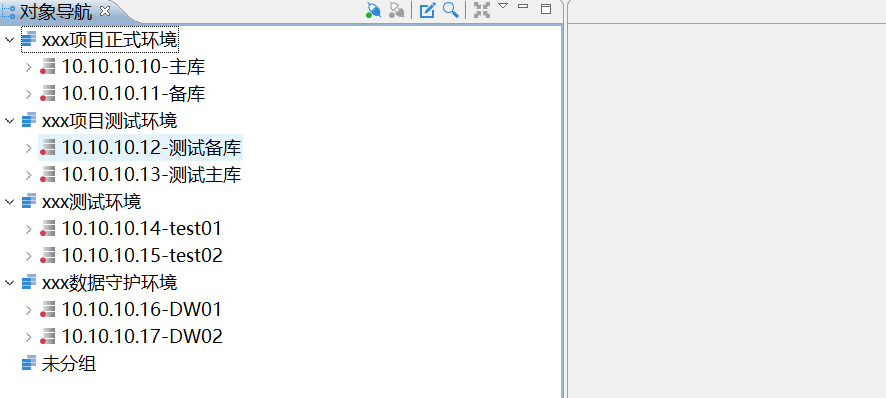

除此之外，用户在注册新的数据库连接时，也可以将数据库指定添加到已有的连接组中。

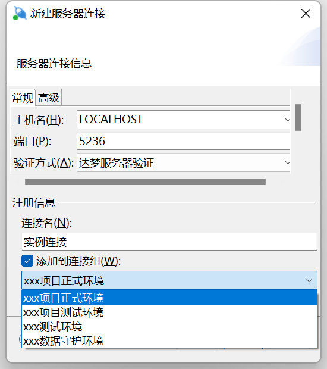

## manager 工具使用 root 用户打开过后，dmdba 用户无法正常打开

**【问题描述】**

在部分 Linux 环境下：manager 工具先使用 root 用户打开后，再使用 dmdba 用户打开会报错：

```shell
<title>Invalid Configuration Location</title>
Locking is not possible in the directory "/home/dmdba/dmdbms/tool/configuration/org.eclipse.osgi".
 A common reason is that the file system or Runtime Environment does not support file locking for that location. 
Please choose a different location, or disable file locking passing "-Dosgi.locking=none" as a VM argument.
/home/dmdba/dmdbms/tool/configuration/org.eclipse.osgi/.manager/.fileTableLock (权限不够)
```

**【问题分析】**

使用 root 用户启动后： `/home/dmdba/dmdbms/tool/configuration/org.eclipse.osgi/.manager/ ` 该路径属主属组被改为 root。再使用 dmdba 用户启动时，由于需要依赖上述文件，会提示权限不够。

**【问题解决】**

以下提供两种方法解决该问题，选取其中一种方法解决即可。

1. 使用 root 用户执行以下命令修改属主和属组后即可使用 dmdba 用户启动 manager 管理工具。
```shell
chown -R dmdba.dinstall  /home/dmdba/dmdbms/tool/configuration/org.eclipse.osgi/.manager/
```
2. 删除该临时目录： `/home/dmdba/dmdbms/tool/configuration/org.eclipse.osgi/.manager` 再使用 dmdba 用户也可启动 manager 管理工具。

## DM 管理工具编辑错误

**【问题描述】**

在 DM 管理工具查询编辑框中，输入的字体变大，间距变长了，执行语句提示语法分析错误。

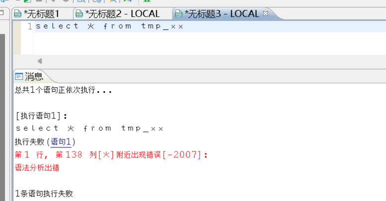

**【问题分析】**

该问题是由于操作系统输入法切换为全角输入导致。

**【问题解决】**

检查操作系统输入法，在设置中切换全角为半角即可恢复正常输入。

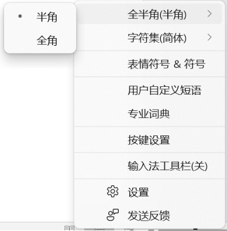

## window 环境下通过管理工具添加 IP 限定只允许本机登录时报错

**【问题描述】**

数据库及管理工具都在 window 环境下，在连接限制的 IP 中，添加本机 IP localhost 时，报错："无效的 IP 地址"。

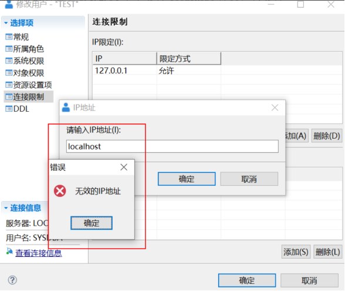

**【问题解决】**

1. 可将 localhost 改为 127.0.0.1 进行添加。
2. 可以尝试升级数据库版本来添加 localhost，但 localhost 添加成功后会显示为 127.0.0.1。

## 管理工具中批量执行 SQL 时遇到报错如何继续执行

**【问题描述】**

在 DM 管理工具中批量执行一些 sql 时，中途有些 sql 执行报错，即停止，无法继续执行后面的 sql。如何在批量执行 SQL 时遇到报错不停止执行。

**【问题解决】**

可通过设置 DM 管理工具“出错后继续执行”来解决，设置方法如下：

在 DM 管理工具中点击【窗口】选择【选项】点击【查询分析器】勾选【出错后继续执行】保存设置。

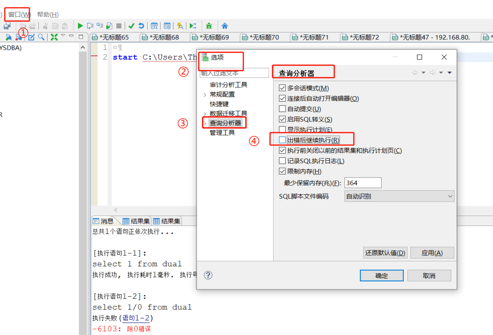

## 使用管理工具“编辑数据”功能按钮报错

**【问题描述】**

使用管理工具“编辑数据”功能按钮，提示:“结果集不可更新，请确认查询列是否出自同一张表，并且包含值唯一的列”，报错截图如下:

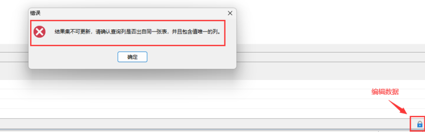

**【问题解决】**

以下提供 4 种解决办法：

创建测试表：

```sql
create table tablel (
                c1 int,
                c2 varchar(10), 
                c3 varchar(10)
                ); 
  
insert into tablel values(1,'A','aa');
insert into tablel values(2,'B','bb');
insert into tablel values(3,'C','cc');
insert into tablel values(4,'D','dd');
commit;
```

方法一：添加主键约束；

```sql
alter table "SYSDBA"."TABLEl" add constraint PK_C1 primary key("c1")
```

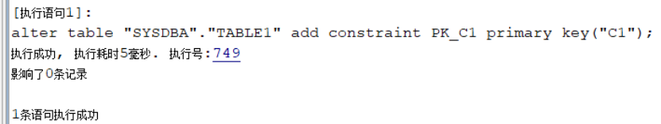

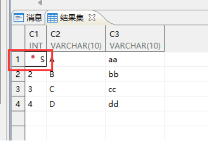

可在结果集进行编辑。

方法二：添加唯一约束；

```sql
alter table "SYSDBA"."TABLEl" add constraint "CONS_UNO_C2" unique("C2")
```

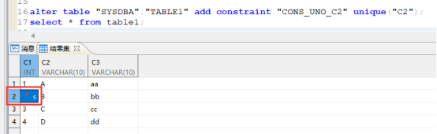

可在结果集进行编辑。

方法三：创建唯一索引；

```sql
create unique index "IDX_UNQ_C1" on "SYSDBA"."TABLEL"("C1");
```

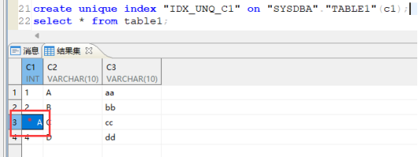

可在结果集进行编辑。

方法四：查询语句附带对 rowid 的查询

```sql
select rowid,* from tablename；
```

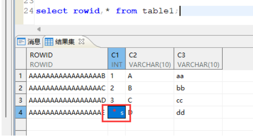

可在结果集进行编辑。

## 客户端管理工具如何在消息框打印所有执行的内容

**【问题描述】**

客户端管理工具调整存储过程时，需要打印执行的内容，当打印的内容过长则无法输出到界面。如下图打印的结果并没有输出到窗口。

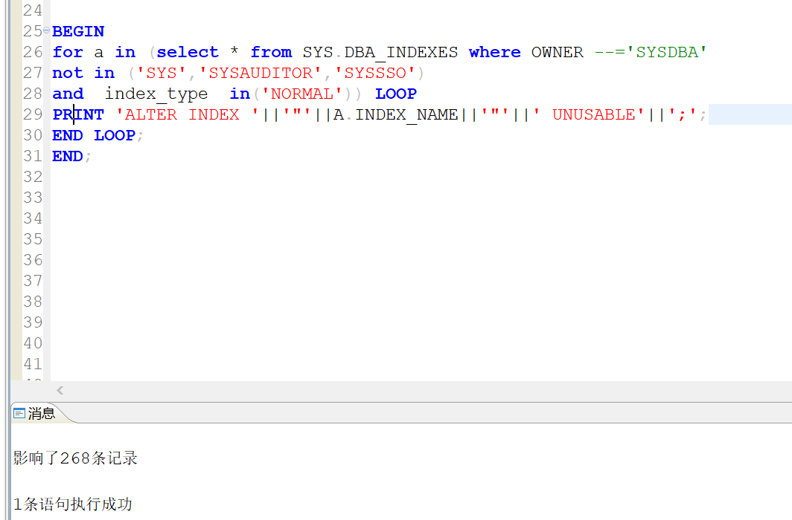

**【问题解决】**

通过在管理工具【窗口】-【选项】-【查询分析器】-【spool】中设置将打印的结果输出到文件中来输出所有执行的内容。 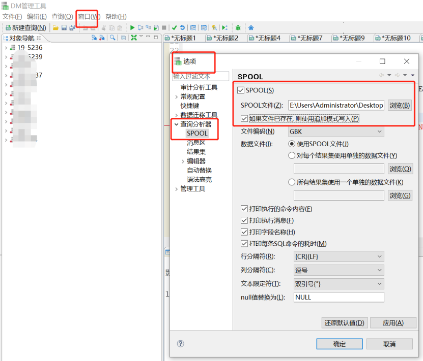 再次执行。 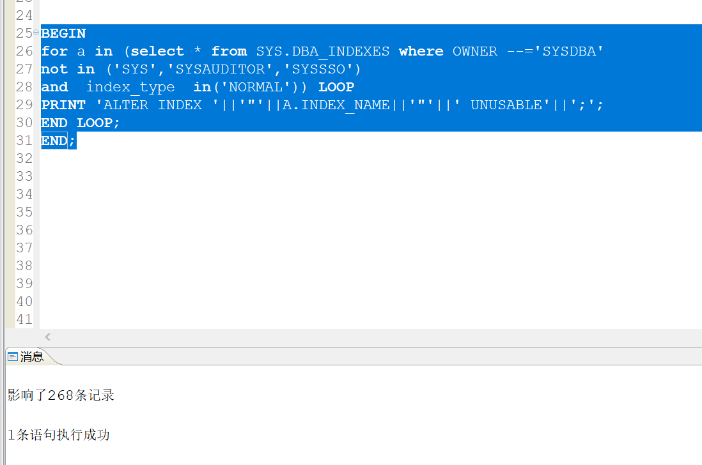 打开上面设置的 spool 文件，可以得到打印的全部内容。 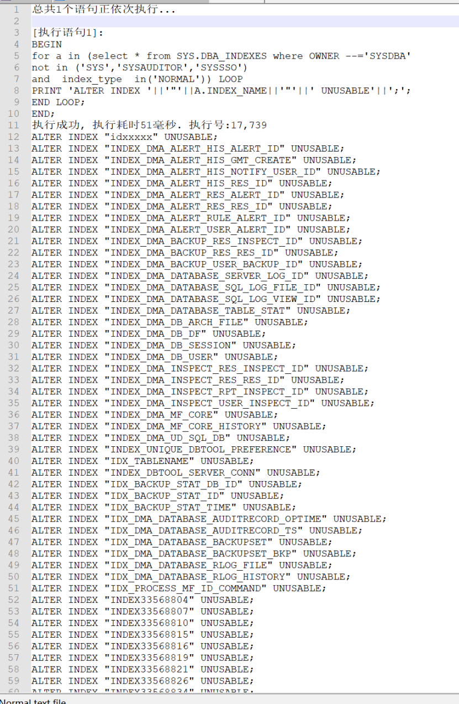

## 如何使图形化工具查询出来的数据不全是明文

**【问题描述】**

使用图形化管理工具运维时，所有表数据都明文显示，是否可以通过设置，设置部分表的数据不要显示出来，增加隐私性？

**【问题解决】**

可通过使用 DBMS\_RLS 设置相关策略来实现，示例如下：

1. 登录管理用户执行以下语句设置参数 ENABLE\_RLS 的值为 1，执行完成后重启数据库实例生效。
```sql
ALTER SYSTEM SET 'ENABLE_RLS' =1 SPFILE;
commit;
```
2. 使用 SYSDBA 创建测试用户 TEST，并赋予角色。
```sql
CREATE USER "TEST" IDENTIFIED BY "123456789";
GRANT "DBA" TO "TEST";
GRANT "PUBLIC" TO "TEST";
GRANT "RESOURCE" TO "TEST";
GRANT "SOI" TO "TEST";
GRANT "VTI" TO "TEST"; 
COMMIT;
```
3. 登录 TEST 用户，创建测试表,插入测试数据。
```sql
CREATE TABLE TEST.TABLE_1(C1 VARCHAR2(10) ,C2 NUMBER(10));
INSERT INTO TEST.TABLE_1 VALUES('A',10);
INSERT INTO TEST.TABLE_1 VALUES('B',20);
INSERT INTO TEST.TABLE_1 VALUES('C',30);
commit;
create index idx_text on TEST.TABLE_1(C1);
```
4. 登录 TEST 用户创建策略函数。
```sql
create OR REPLACE function TEST.RLS_FUN_CHAR(p_owner in varchar2, p_obj   in varchar2)
  return varchar(8188) is
  l_ret varchar(8188);
  app varchar(8188);
begin
SELECT substr(APPNAME,0,7) into app FROM V$SESSIONS WHERE SESS_ID=SESSID ;
 return  app != 'manager';
end;
```
5. 登录 TEST 用户创建掩码函数。
```sql
create or replace function TEST.MF(c1 varchar) return varchar as
begin
return 'xxxxxx';
end;
```
6. 登录 TEST 用户创建策略。
```sql
begin
    dbms_rls.add_policy(object_schema         => 'TEST',         --模式名
                        object_name           => 'TABLE_1',      --表名
                        policy_name           => 'TABLE_1_C1',   --策略名
                        function_schema       => 'TEST',         --函数所属模式
                        policy_function       => 'RLS_FUN_CHAR', --函数名
                        statement_types       => 'select',       --语句
                        sec_relevant_cols     => 'C1',           --列名
                        sec_relevant_cols_opt => dbms_rls.all_rows);
end;
```
7. 登录 TEST 用户添加掩码策略。
```sql
DBMS_RLS.ADD_MASK('TEST', 'TABLE_1', 'C1', 'TEST', NULL, 'MF');
```
8. 使用测试用户 TEST 查询测试表（CI 列已非明文显示）。
```sql
select * from TABLE_1;
```

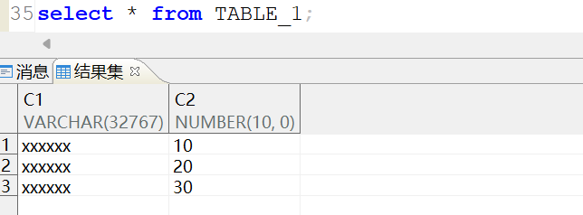

> **注意**
> 
> 2023 年第三季度及以后的版本才支持此功能。

## 如何更换图形化工具 Mganger-DM 管理工具连接数据库的驱动

**【问题解决】**

图形化工具 Mganger-DM 管理工具连接数据库驱动的路径为：数据库软件安装目录：\\tool\\dropins\\com.dameng\\plugins\\com.dameng.jdbc.drivers，在目录下找到 DmJdbcDriver.jar 文件将其更换后，重新打开 DM 管理工具即可。

## 达梦管理工具如何禁用 IPV6 登录数据库

**【问题描述】**

数据库服务器只分配了 IPV4，在 windows 上使用 DM 管理工具连接不上数据库，报错网络通信异常，但是同一机器上的 disql 命令和 dts 可以连通。

**【问题分析】**

由于数据库服务器只分配了 IPV4， windows 上 dts 默认安装时指定参数 Djava.net.preferIPv4Stack=true，此参数为优先使用 IPV4 连接，而管理工具默认没有，所以会发生 dts 连接成功，但管理工具连接不上。

**【问题解决】**

通过在 DM 管理工具目录下的 manager.ini 中添加 -Djava.net.preferIPv4Stack=true 参数来解决，此参数为优先使用 ipv4 连接。

参数说明：

在 java 中 java.net.preferIPv4Stack 默认为 false，在支持 IPv6 的双栈系统上，使用 Java 的 Socket 会默认通过底层 native 方法创建一个 IPv6 Socket，这个 IPv6 Socket 可以同时支持和 IPv4 或 IPv6 主机通信。如果设置为 true，Java 程序将无法使用 IPv6 进行网络通信，也就是仅支持 IPv4。

类似参数还有 java.net.preferIPv6Addresses，当 java.net.preferIPv6Addresses 为默认值 false 时，IPv4 地址会优先使用，例如在 DNS 通过域名查询 IP 地址时，会优先使用 IPv4 地址，反之设为 true，则会优先使用 IPv6 地址。

## 在不支持图形化界面的情况下，如何使用 dts 工具连接源数据库生成评估报告？

**【问题解决】**

若服务器不支持图形化界面，可以使用 dts 命令行方式进行评估并生成 html 形式评估报告。

提前在支持图形化的终端中打开 dts 工具并配置评估规则，将规则导出为 xml 文件并导入不支持图形化的服务器，使用命令行工具交互式进行评估工作并生成评估报告。

具体方法参考如下：

1. 评估配置结束后，右键该评估选择“导出配置文件”，导出为 xml 文件。

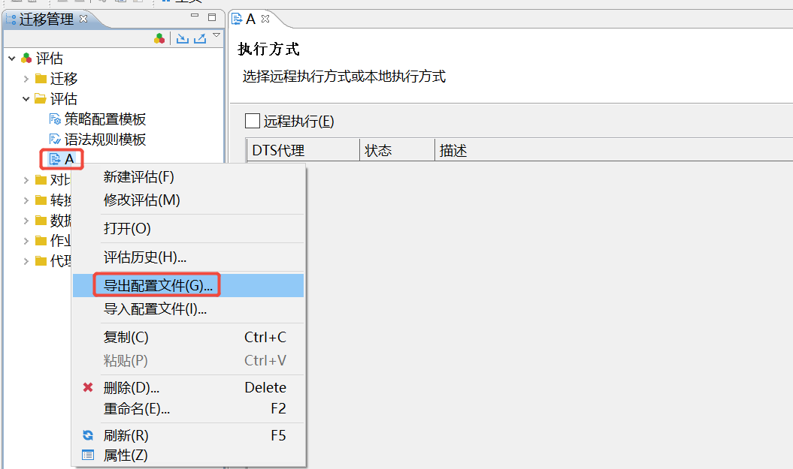

2. 将导出的 xml 配置文件上传到不支持图形化的服务器。
3. 交互式使用命令行。

示例为 Windows 平台。

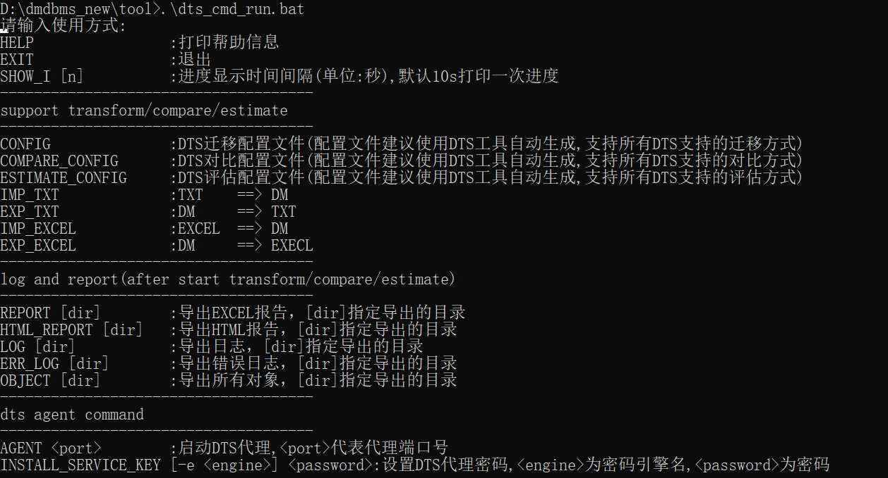

输入 ESTIMATE\_CONFIG、FILE 和 HTML\_REPORT。

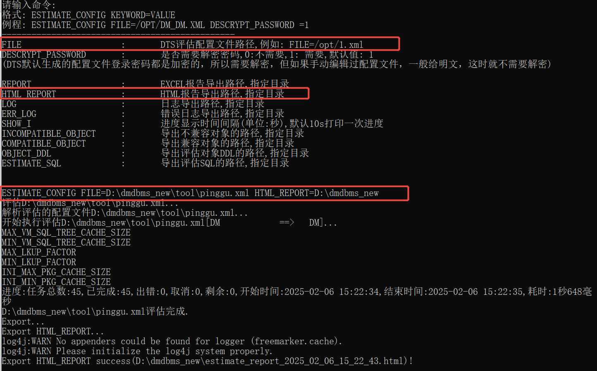

评估报告生成后即可查看。

## DM 管理工具如何支持查询结果显示大字段内容

**【问题描述】**

DM 管理工具直接查询大字段类型 text 时，不会直接显示为可读的字符串 varchar 类型，需要双击该大字段后进入单独窗口显示字符串内容，如果需要查看多行数据则不方便，如何支持查询结果显示大字段内容。

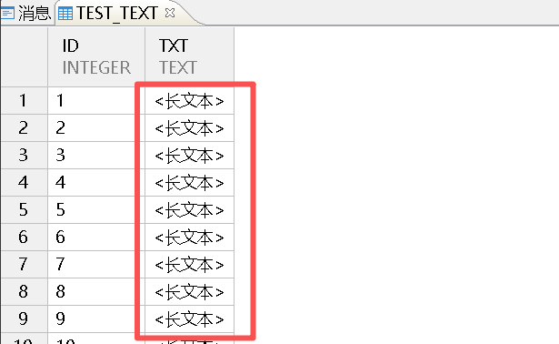

**【问题分析】**

TEXT 为变长字符串类型，其字符串的长度最大为 100G-1 字节，而 varchar 类型长度最长为 32767，直接转换为 varchar 类型时如果超长会出现截断现象，为了避免出现此现象，所以 DM 管理工具默认不做转换，需要通过单独窗口阅读。

**【问题解决】**

可以在 DM 管理工具连接数据库的连接属性中加入参数 clobAsString=1，管理工具在查询过程会自动进行 varchar 类型转换，查询结果中可以直接查看到 text 类型的文本内容，但记录超长时会自动截断。

配置过程如下：新建数据库连接-高级选项-新增按钮-配置 clobAsString=1

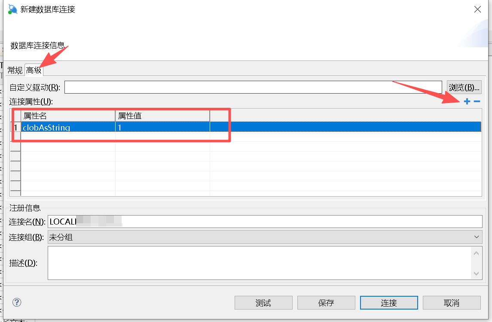

再次查询 text 类型，可以直接看到文本内容，但是该文本内容会被截断，最长字节不超过 32767。

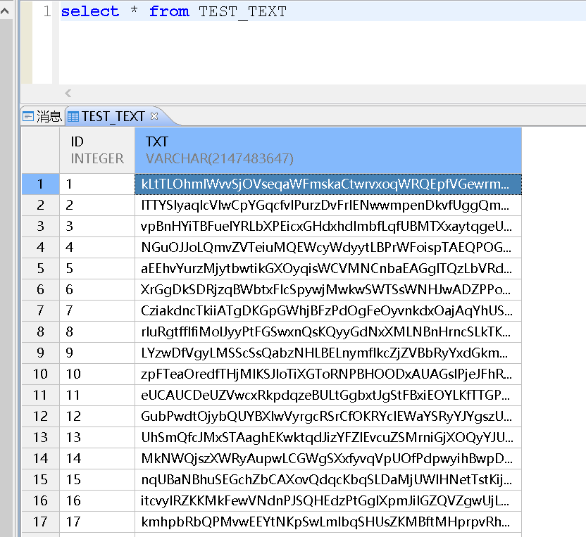