本章节主要介绍达梦数据库检查常见问题，为用户提供数据库检查常见问题的分析和解决思路。除此之外，用户还可前往 [达梦技术社区](https://eco.dameng.com/community/question/) 参与更多问题讨论。

## 目录

## 正文

可参考以下文章：

[DM 对 Oracle 兼容之 SQL 运维实战攻略上](http://eco.dameng.com/community/article/038c0aaa74f5745042374d8f66f2f196)

[DM 对 Oracle 兼容之 SQL 运维实战攻略下](http://eco.dameng.com/community/article/06da7dea733afece0275ef2ad8db7550)

## dmsql\_数据库实例名.log，这个日志怎么关掉

以 dmsql\_数据库实例名.log 类型命名的文件为跟踪日志文件，跟踪日志内容包含系统各会话执行的 SQL 语句、参数信息、错误信息等。跟踪日志主要用于分析错误和分析性能问题，比如，可以挑出系统现在执行速度较慢的 SQL 语句，进而对其进行优化。

打开跟踪日志对系统的性能有较大影响，一般用于查错和调优的时候才会打开，默认情况下系统是关闭跟踪日志的。当把 dm.ini 参数 SVR\_LOG 设置为 1，才会打开 SQL 日志，若需要跟踪日志但对日志的实时性没有严格的要求，又希望系统有较高的效率，可以设置参数 SQL\_TRACE\_MASK 和 SVR\_LOG\_MIN\_EXEC\_TIME 只记录关注的相关记录。

在记录完成后，可执行: SP\_SET\_PARA\_VALUE(1, 'SVR\_LOG', 0); 进行关闭跟踪日志。

更多配置文件 dm.ini 中各参数的含义可查看《DM 系统管理员手册》第二章 2.1 节内容，手册位于 **数据库安装路径** `/dmdbms/doc` 文件夹。

## DM 数据库管理常用 SQL 命令

```sql
--查询数据库版本
select * from  v$version;--DM7
select id_code();--DM8

--查询授权信息
select * from  v$license;

--查询服务器信息
select * from  V$SYSTEMINFO;

--查询会话连接信息
select * from  v$sessions;

select  count(*),state from v$sessions group by state;
select  count(*),clnt_ip from v$sessions group by clnt_ip;

--查看数据库服务器配置参数

select * from  v$dm_ini;

--查询最近的 sql 执行记录
select * from  v$sql_history;

--查询某个用户下所有的表
select * from  user_tables; --查询当前用户下所有的表

select * from  all_tables where owner='TEST'; --dba 用户查询某个模式下的所有表

--查询某个用户下所有表字段
select * from  all_tab_cols where owner='TEST';

--查看表注释
select * from  ALL_TAB_COMMENTS where owner='TEST';

--查看字段注释
select * from  ALL_COL_COMMENTS where owner='TEST';

select '实例名称' 数据库选项,INSTANCE_NAME 数据库集群相关参数值 FROM v$instance union all

select '数据库版本',substr(svr_version,instr(svr_version,'(')) FROM v$instance union all   SELECT '字符集',CASE SF_GET_UNICODE_FLAG() WHEN '0' THEN 'GBK18030' WHEN '1' then 'UTF-8' when '2' then 'EUC-KR' end union all

SELECT '页大小',cast(PAGE()/1024 as varchar) union all   SELECT '簇大小',cast(SF_GET_EXTENT_SIZE() as varchar) union all

SELECT '大小写敏感',cast(SF_GET_CASE_SENSITIVE_FLAG() as varchar) union all

select '数据库模式',MODE$ from v$instance union all

select '唯一魔数',cast(permanent_magic as varchar) union all

select 'LSN',cast(cur_lsn as varchar) from v$rlog;
```

## 报错日志、系统日志

达梦数据库有相应的错误日志，存放在达梦数据库安装目录的 log 文件目录下，会有相应对应的实例名日期.log 文件，打开相应的文件，如果里面有 ERROR 的错误信息，则可以查看具体的报错来进行修改。

## 扩展数据库的 REDO 日志

调整数据库 REDO 日志的大小，如将 2 个 REDO 日志都扩展到 2G （注意 REDO 日志的实际路径）。

使用 SYSDBA 用户登录，然后执行如下脚本：

```sql
alter database resize logfile 'D:\dmdbms\data\DAMENG\DAMENG01.log' to 2048;
alter database resize logfile 'D:\dmdbms\data\DAMENG\DAMENG02.log' to 2048;
```

## 字符串比较大小写敏感

关于字符串比较大小写敏感主要涉及到两个方面的内容：

### 对字段的值比较而言

假如表 Test 中有如下两条记录  
c1 c2  
1 a  
2 A

同样的查询语句：

```sql
select * from Test where c2 = 'a';
```

在大小写不敏感的库中会查出如下的两条记录  
c1 c2  
1 a  
2 A

而在大小写敏感的库中则只会查出如下的一条记录  
C1 C2  
1 a

### 对于表名、字段名而言

在设置为大小写敏感的库中进行查询的时候，可能经常会遇到无效的表名或列名的问题，

下面针对这种情况进行说明。

- 如果使用 DM 管理工具图形界面建表的话建议表名和字段名都使用大写。因为使用图形界面建表相当于使用语句建表的时候加了双引号的，会固定住大小写。如果写成小写，那么就是小写了，在查询的时候也需要加双引号，否则就有可能报无效的表名或列名的问题，比较麻烦；
- 如果使用脚本建表的话，如果表名和字段名没有加双引号的话都会被系统自动转换成大写。

如： `create table test(a int)；` 系统会自动把表名 test，字段名 a 转换成大写，处理方式与 Oracle 数据库一致。所以针对大小写敏感的库，在使用建表脚本或者通过查询脚本进行查询的时候建议统一不要写双引号，让系统统一自动都转化为大写；

- 以上两点主要针对大小写敏感的库而言，大小写不敏感的库则不存在上述问题。

总结：基于以上两点，在初始化数据库的过程中就可以对字符串比较大小写敏感这个参数做出合理的选择了。参考链接： [详解 DM 数据库字符串大小写敏感](http://eco.dameng.com/community/article/df11811a02de8e923c2e57ef6597bc62)

## 查询达梦关键字列表/保留字

**【问题描述】：**

如何达梦关键字列表/保留字？如何屏蔽保留字/关键字？

**【解决方法】：**

达梦的关键字/保留字可以在《DM SQL 语言使用手册》附录 1 中查询，手册位于 **数据库安装路径** `/dmdbms/doc` 文件夹。

下面是处理表语句和关键字或者保留字冲突的方法：

### 双引号法

这个一般可以用来处理建表语句中的保留字冲突，如表名或者字段名是 DM 的保留字。这种方法一般可以快速地绕过问题，但是对于大小写敏感的库，这种用双引号的方法会固定死字段大小写，对于小写的字段，可能会带来无效的表名或者列名的问题。

### dm.ini 中的参数设置

在 dm.ini 中有个参数 EXCLUDE\_RESERVED\_WORDS，这个参数可以用来屏蔽你想要屏蔽的保留字，将需要屏蔽的保留字写在 = 号后面，然后以逗号分隔。设置在 dm.ini 中的好处就是一旦设置，永久生效而且对所有客户端都有效，这样就不需要在所有客户端系统中进行专门配置。但是设置在 dm.ini 中之后，这个保留字就永久性失效了，哪怕你想通过 Manager 客户端工具在本地连接也没用了。而且该方式还存在一个隐患就是由于屏蔽掉了一些系统的保留字，所以可能会导致系统的一些功能无法正常使用。

不建议用这个参数，会有严重的副作用，并且比较隐蔽；在不改表的字段的情况下，最好的方案是改名字，次之给对象名加双引号。

> **建议**
> 
> 在移植过程中遇到 DM 的保留字，最好的处理方式还是对这些保留字进行修改，尽量不要使用 DM 的保留字。

## \[-5567\]授权者没有此授权权限

**【问题描述】：**

创建用户后，给用户赋予系统权限 Any 的时候报错：错误号: -5567  
错误消息: 第 1 行附近出现错误:  
授权者没有此授权权限

**【解决方法】：**

方法 1：在 dm.ini 文件中修改参数 ENABLE\_DDL\_ANY\_PRIV 为 1。  
方法 2： 通过以下语句修改参数 ENABLE\_DDL\_ANY\_PRIV。

```sql
sp_set_para_value(1,'ENABLE_DDL_ANY_PRIV',1);
或者
alter SYSTEM set 'ENABLE_DDL_ANY_PRIV'=1 both;
```

> **注意**
> 
> 考虑到参数的特殊性，在部分版本数据库的 dm.ini 文件中，没有放入参数 ENABLE\_DDL\_ANY\_PRIV，但用户可通过调用系统过程（方法 2）进行参数值的设置。

## 删除模式报错

删除模式的时候报错：试图删除用户\[\*\*\*\*\]的默认模式

通常一个用户对应一个模式；要删除用户的同名模式，需要级联删除，或者直接删除对应用户。

## 达梦错误码汇总

可以使用以下语句进行查询

```sql
select * from v$err_info;
```

也可以查看《DM 程序员手册》附录 1 错误码汇编，手册位于 **数据库安装路径** `/dmdbms/doc` 文件夹。

## 空间数据类型

**【问题描述】：**

达梦数据库之间支持空间数据库的迁移/空间/地理空间 /GEOMETRY/ 几何类型 查询吗？

**【解决方法】：**

支持，请参考《DM 系统包使用手册》DMGEO 包章节”，手册位于 **数据库安装路径** `/dmdbms/doc/special` 文件夹下。

## 如何查询数据库版本

**【问题描述】：**

如何查询当前使用的达梦数据库版本。

**【解决方法】：**

可以执行一下命令获取信息：

```sql
select * from v$version;
```

## 设置插入空字符串，在数据库里存 NULL

修改设置 dm.ini 的参数 compatible\_mode=2，Oracle 没有空串这个概念，所以‘’和 null 都是显示 null 。

注意修改完之后需要重启数据库。

> **建议**
> 
> 建议写个触发器，把空串转成 NULL 再插入，compatible\_mode 设成 2 可能产生其它影响。

## 无法比较的数据类型

**【问题描述】：**

在使用 Union 连接的时候，报错 error:无法比较的数据类型

**【解决方法】：**

检查是否有 clob/blob/TEXT 类型，如果有是要去重，对 clob/blob/text 类型不能去重。

> **建议**
> 
> 如果数据用 varchar 能存储的话，就重建表，将数据类型改成 varchar。

如果因为多个数据库组合，一定要用 Union 来合并的话，可以试试 union all，但是不去重。在其它操作符，例如 order by 时，也可能报相同错误，解决方法类似。

## 查询所有表的字段，注释、类型、类型长度等

**【问题描述】：**

如何查询在达梦某个库中存在某个字段的所有表？字段，注释、类型、类型长度？达梦怎么通过字段注释找到表？

**【解决方法】：**

查询 user\_tab\_columns、dba\_tab\_columns 视图。相应视图的字段，可以在“DM 系统管理员手册“附录里面查看。

## DMSBT 接口版本号与数据库服务器不匹配

**【问题描述】：**

- 执行下面语句
```sql
SQL> backup database full backupset '/home/dmdba/baktest/DMSERVER_BAK_09_10_2020_FULL' device type tape;
backup database full backupset '/home/dmdba/baktest/DMSERVER_BAK_09_10_2020_FULL' device type tape;
```

报错：\[-10033\]:DMSBT 接口版本号与数据库服务器不匹配.

- 设置跟踪日志文件,查看追踪日志里面内容是空的
```sql
服务器[LOCALHOST:5236]:处于普通打开状态
登录使用时间: 10.717(毫秒)
SQL> backup database full backupset '/home/dmdba/baktest/DMSERVER_BAK_09_10_2020_FULL' device type tape TRACE FILE '/home/dmdba/baktest/DMSERVER_BAK_trace.log' TRACE LEVEL 2;
backup database full backupset '/home/dmdba/baktest/DMSERVER_BAK_09_10_2020_FULL' device type tape TRACE FILE '/home/dmdba/baktest/DMSERVER_BAK_trace.log' TRACE LEVEL 2;
[-10033]:DMSBT接口版本号与数据库服务器不匹配.
已用时间: 00:00:01.004. 执行号:0.
```

**【解决方法】：**

检查服务器上是否安装了多套不同版本的 DM 数据库。检查目前启动的 dmap 服务和当前的 dmserver 服务的版本是否相同，是否使用同样的用户启动的。

## 查看数据库的到期时间

可以执行以下 SQL 语句:

```sql
select　*　from　v$license;
```

查看 expired\_date 列的信息。

## 自增列不允许修改

自增列一旦生成，无法更新，也不允许用 UPDATE 语句进行修改。

可以参考《DM SQL 语言使用手册》--5.6 DM 自增列的使用，手册位于 **数据库安装路径** `/dmdbms/doc` 文件夹。

## 如何收集统计信息

```sql
/* 收集整个库的统计信息 */
CALL SP_DB_STAT_INIT ();
DBMS_STATS.GATHER_SCHEMA_STATS('用户名',100,TRUE,'FOR ALL COLUMNS SIZE AUTO');

/* 统计用户下所有索引 */
DBMS_STATS.GATHER_SCHEMA_STATS('用户名',1.0,TRUE,'FOR ALL INDEXED SIZE AUTO');

/* 统计用户下所有字段 */
DBMS_STATS.GATHER_SCHEMA_STATS('用户名',100,TRUE,'FOR ALL COLUMNS SIZE AUTO');

/* 统计用户下某表 */
DBMS_STATS.GATHER_TABLE_STATS('用户名','表名',NULL,100,TRUE,'FOR ALL COLUMNS SIZE AUTO');
```

## 获取某个模式下某表的存储大小

有两种方式：

- 使用管理工具，选择表右键属性；
- 可以使用下列语句查询，TEST 为表名。
```sql
SELECT TABLE_USED_SPACE('SYSDBA','TEST')*page()/1024/1024.0  FROM dual;
SELECT segment_name AS TABLENAME,
       BYTES B,
       BYTES / 1024 KB,
       BYTES / 1024 / 1024 MB
  FROM user_segments
WHERE segment_name = upper('TEST');
```

## 扩展数据库的重做日志

调整数据库 REDO 日志的大小，比如将 2 个 REDO 日志都扩展到 2 GB，注意 REDO 日志的实际路径。  
使用 SYSDBA 用户登录，然后执行如下脚本：

```sql
alter database resize logfile 'D:\dmdbms\data\DAMENG\DAMENG01.log' to 2048;
alter database resize logfile 'D:\dmdbms\data\DAMENG\DAMENG02.log' to 2048;
```

## 达梦数据库怎么开启审计功能

在 DM 系统中，专门为审计设置了开关，要使用审计功能首先要打开审计开关。审计开关由过程 VOID SP\_SET\_ENABLE\_AUDIT（param int）; 控制，过程执行完后会立即生效，param 有三种取值：

- 0：关闭审计
- 1：打开普通审计
- 2：打开普通审计和实时审计

缺省值为 0。

例，打开普通审计开关，需要使用 SYSAUDITOR 用户登录，执行：SP\_SET\_ENABLE\_AUDIT (1);

## logmnr\_contents 视图中，哪些字段表示用户的主机名和用户的 IP

如果想要查看用户的主机名和用户的 IP 等信息，可以查看 V$SESSION 动态视图：

```sql
SELECT CLNT_HOST,CLNT_IP,OSNAME FROM V$SESSIONS;
```

## 查询 SQL 执行记录

可以执行下面语句进行查询：

```sql
SELECT * FROM V$SQL_HISTORY;
```

SQL 执行历史存放数据有限，若有需要，可以开启 DEM 监控，具体部署方法请参考 [DEM 部署](https://eco.dameng.com/document/dm/zh-cn/ops/tool-monitor.html#2.4%20DEM%20%E9%83%A8%E7%BD%B2) 。

## 报错：reached the max session limit

需要调整 max\_session 参数，数值调大一点，可以参考以下设置：

```sql
SP_SET_PARA_VALUE(2,'MAX_SESSIONS', 1000);
SP_SET_PARA_VALUE(2,'MAX_SESSION_STATEMENT', 20000);
```

## 查询当前模式下有那些表的 SQL 语句

```sql
SELECT TABLE_NAME FROM DBA_TABLES WHERE OWNER='模式名';
```

> **建议**
> 
> 可以参考《DM 系统管理员手册》附录-兼容 Oracle 视图章节，查看更多动态视图信息，手册位于\*\*数据库安装路径\*\* \`/dmdbms/doc\` 文件夹。

## 如何查出某个用户下的某个数据库的所有表名

```sql
select NAME from sysobjects where "SUBTYPE$"='UTAB'
AND SCHID=(SELECT ID FROM sysobjects WHERE NAME='USER01' AND TYPE$='SCH');
--查询用户为 USER01 的 USER01模式下所有表名
```

> **建议**
> 
> 可以参考《DM 系统管理员手册》，查看更多动态视图信息，手册位于数据库安装路径下 doc 文件夹。

## 如何查看建库时的字符集

执行以下语句：

```sql
select unicode();
--根据返回值进行判断
--0 表示 GB18030，1 表示 UTF-8，2 表示 EUC-KR
```

## 是否有 show parameter/show variables 之类的功能参数

执行下面语句进行参数查询：

```sql
select * from v$dm_ini;
```

> **建议**
> 
> 可以参考《DM 系统管理员手册》附录章节，查看更多动态视图信息，手册位于\*\*数据库安装路径\*\* \`/dmdbms/doc\` 文件夹。

## 达梦的页大小，怎么设置以及获取

页大小的设置：达梦数据库的页大小是初始化参数，只能在初始化数据库实例的时候设置，修改只能重新初始化实例。

页大小的获取：可以通过语句获取 select page/1024; 单位为 KB。

## 如何切换模式

单机切换模式：set schema 模式名;

实时主备的集群如何切换模式：确认监视器输入 login，然后输入用户名 SYSDBA 密码 \*\*\*\*\*，最后输入执行 switchover。

## 如何切换数据库

使用不同用户登录即可访问各自数据库用户下的表。

## 如何查询和修改数据库实例名

查询：

```sql
SELECT * FROM V$INSTANCE;
```

修改：

可以修改 dm.ini 配置文件的 INSTANCE\_NAME 参数值。

## 如何收缩数据库大小

不能收缩

## 如何把 varchar 类型变成 clob/TEXT 类型

不能直接把 varchar 转换成大字段。可以用如下方式：

在表中创建大字段，首先把 varchar 字段内容 insert 或者 update 到大字段，然后把字段名称互相调换更改，最后删除 varchar 字段。

## 如何获取达梦当前模式名

运行下面语句获取：

```sql
SELECT SF_GET_SCHEMA_NAME_BY_ID(CURRENT_SCHID());
```

## 列长度超出定义如何处理

1. 找到报错列，将精度调大；
2. 可以加大类型：比如 varchar 内容太长，改成 text 类；
3. 调整数据库页大小，建议调整成 16 KB 以上。

## 达梦数据库的 boolean 类型是用什么表示

达梦数据库的 boolean 类型可以用 bit 类型。

## 创建表的 blob 类型字段如何指定精度

blob 类型不能修改精度，大字段类型的精度都不能修改。

## timestamp 类型为什么不可以修改精度

不可以修改精度，可以修改标度。

## 字符类型 TEXT 的精度是否可以调高

不能调，TEXT 为变长字符串类型。其字符串的长度最大为 2G-1。

## 如何判定当前库中某一个表是否存在

可以通过查询 DBA\_TABLES 或 ALL\_TABLES，如果要查询某个用户下某个表是否存在，可以通过 OWNER 列进行限定。

如：查询用户 TEST 下是否存在表 TAB，SQL 脚本如下：

```sql
select * from DBA_TABLES where owner = 'TEST' and table_name = 'TAB';
```

> **注意**
> 
> 1.关于 DBA\_TABLES 中每个字段的具体含义，可以参考《DM 系统管理员手册》附录-兼容 Oracle 视图章节，查看更多动态视图信息，手册位于数据库安装路径 doc 文件夹。  
> 2.为了提高 DM 与 Oracle 的兼容性，DM 提供了较为丰富的与 Oracle 兼容的视图。

## 对 blob 字段进行 like 查询性能较慢

可以使用全文索引。DM 的全文索引现只支持简体中文、英文语言。较为详细的语法介绍可参考《DM\_SQL 语言使用手册》，手册位于 **数据库安装路径** `/dmdbms/doc` 文件夹。

## 给 TEXT 类型创建索引失败：试图在 BLOB/ClOB/ 用户自定义数据类型上建索引

TEXT 类型在达梦里面是大字段，是不允许创建索引的。

## V$database 视图里 total\_size 的单位是什么

单位是页，total\_size\*页大小(K)/1024 单位才是 MB。

## 如何查看实例是否是空格自动填充

```sql
select  * from v$dm_ini where para_name = 'BLANK_PAD_MODE';
```

BLANK\_PAD\_MODE：字符串比较时，结尾空格填充模式是否兼容 Oracle。取值：1 兼容；0 不兼容。 默认为 0。可选参数。

该参数设置后不能修改，需要重新初始化数据库。

## 删除用户报错：当前对象被占用

可以使用语句进行级联删除：

```sql
drop user 用户名 cascade;
```

> **警告**
> 
> 级联删除用户，将删除该用户所拥有的所有表、视图等资源，为保证数据不丢失，请务必确认无误后进行删除。

## 字符串转换出错一般出现在怎样的使用场景中

1. 字符串混合转换。
```sql
select cast('123' as int); --可以正常执行
select cast('123a' as int); --报错字符串转换出错
```

数据类型最好一致，不同数据类型转换可能会报该错误。

具体的类型转换相容矩阵，可以参考《DM SQL 语言使用手册》函数章节--类型转换函数，手册位于 **数据库安装路径** `/dmdbms/doc` 文件夹。

2. 在使用函数 DECODE()时,例如：
```sql
select DECODE('688.46673946623', null,null,0,null,'VERIFY', 0, '688.46673946623') from dual;
```

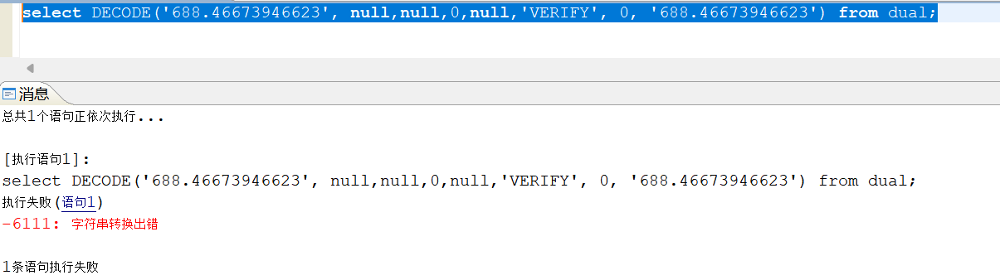

**解决办法** ：

方式一：修改 sql

```sql
select DECODE('688.46673946623', null,null,'0',null,'VERIFY', 0, '688.46673946623') from dual;
```

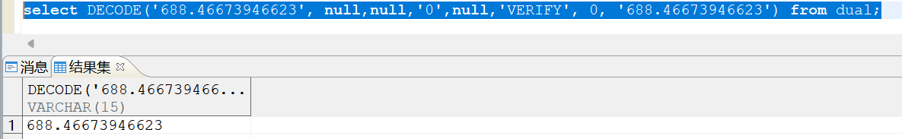

方式二：通过以下命令修改参数 CASE\_COMPATIBLE\_MODE 值为 2，并重启数据库生效。

```sql
SP_SET_PARA_VALUE(2,'CASE_COMPATIBLE_MODE',2);
```

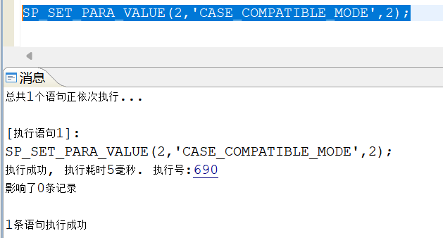

数据库重启后检查是否修改成功,值为 2 表示修改成功。

```sql
select * from v$dm_ini where para_name = 'CASE_COMPATIBLE_MODE';
```

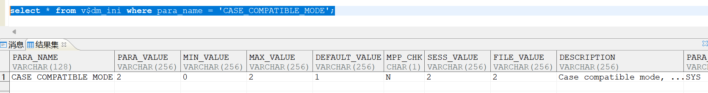

再次使用函数 DECODE() 查询即可成功。

```sql
select DECODE('688.46673946623', null,null,0,null,'VERIFY', 0, '688.46673946623') from dual;
```

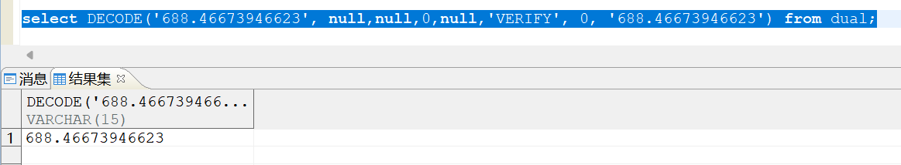

**函数 DECODE() 解释** ：

语法： `DECODE(exp, search1, result1, … searchn, resultn[,default])`

功能：查表译码，DECODE 函数将 exp 与 search1,search2, … searchn 相比较，如果等于 searchx，则返回 resultx，如果没有找到匹配项，则返回 default, 如果未定义 default，返回 NULL。

**参数 CASE\_COMPATIBLE\_MODE 解释** ：

| 参数名 | 默认值 | 属性 | 说明 |
| --- | --- | --- | --- |
| CASE\_COMPATIBLE\_MODE | 1 | 动态，系统级 | 涉及不同数据类型的 CASE 运算，是否需要兼容   ORACLE 的处理策略。   0：不兼容；   1：兼容，本模式下，当函数 DECODE() 中的多个   CASE 类型不一致时，DECODE 会从其中选择一   个类型进行匹配；   2：兼容，本模式下，当函数 DECODE() 中的多个   CASE 类型不一致时，DECODE 根据第一个 CASE   的类型来决定匹配类型。 |

## 试图删除已经使用的表空间

可以尝试先把表空间里的表删掉，如果删除表空间里面的数据还是报错：

1. 可以尝试先 offline 表空间，表空间脱机处理后进行删除操作。
2. 查询 sysobjects 或者 dba\_objects，查看表空间里是否还存放了其它对象。

## 无效的数组查询对象

添加 hint: / *\+ ENABLE\_TABLE\_EXP\_REF\_FLAG(1)* / 解决。

## 数据插入后但是归档日志分析结果没内容

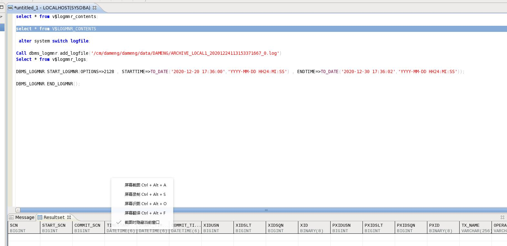

需要修改 dm.ini 中以下两个参数值

- ARCH\_INI = 1
- RLOG\_APPEND\_LOGIC = 1

重启数据库服务器生效

```sql
SELECT NAME , FIRST_TIME , NEXT_TIME , FIRST_CHANGE# , NEXT_CHANGE# FROM V$ARCHIVED_LOG;

DECLARE
BEGIN
FOR LOGPATH IN (SELECT PATH FROM V$ARCH_FILE) LOOP
DBMS_LOGMNR.ADD_LOGFILE(LOGPATH.PATH);
--DBMS_LOGMNR.ADD_LOGFILE('F:\arch\ARCHIVE_LOCAL1_0x10F0D1B2[0]_2020-12-25_11-55-05.log');
END LOOP;
END;
SELECT LOW_SCN, NEXT_SCN, LOW_TIME, HIGH_TIME, LOG_ID, FILENAME FROM V$LOGMNR_LOGS;

DBMS_LOGMNR.START_LOGMNR(OPTIONS=>2130 , STARTTIME=>TO_DATE('2020-11-20 01:05:44','YYYY-MM-DD HH24:MI:SS') , ENDTIME=>TO_DATE('2020-12-25 23:04:55','YYYY-MM-DD HH24:MI:SS'));
SELECT * FROM V$LOGMNR_CONTENTS;
```

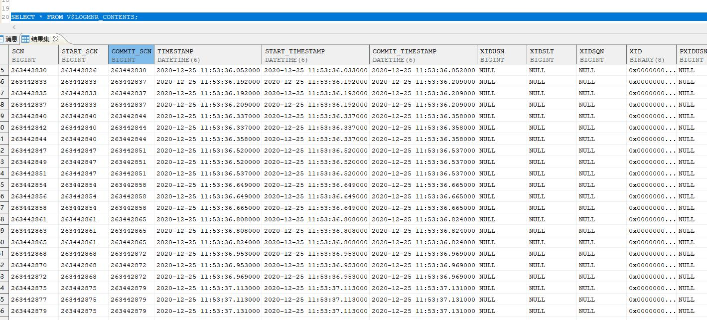

DBMS\_LOGMNR.END\_LOGMNR();

## VARCHAR、TEXT 字段类型存储内容长度受分页限制吗？

VARCHAR 存储内容受分页限制，TEXT 最大内容可以存 2G-1 不受分页限制。  
VARCHAR 数据类型指定变长字符串，用法类似 CHAR 数据类型，可以指定一个 不超过 8188 的正整数作为字符长度，例如：VARCHAR (100)。如果未指定长度，缺省为 8188。 在基表中，当没有指定 USING LONG ROW 存储选项时，插入 VARCHAR 数据类型的实际最大存储长度由数据库页面大小决定，具体最大长度算法如下表：

| 数据库页面大小 | 实际最大长度 |
| --- | --- |
| 4K | 1900 |
| 8K | 3900 |
| 16K | 8000 |
| 32K | 8188 |

如果指定了 USING LONG ROW 存储选项，则插入 VARCHAR 数据类型的长度不受数据库页面大小限制。VARCHAR 类型在表达式计算中的长度上限不受页面大小限制，为 32767。

## Oracle 中 raw 类型在达梦中可以用哪种类型代替

在 DM 中可以使用 varbinary 代替。

## 表空间的大小，对于数据库模式的性能会不会有影响

表空间打开自动扩充，其大小不会有什么数据库性能有影响。  
详细的性能参考资料，可以参考： [数据库性能诊断](http://eco.dameng.com/docs/zh-cn/ops/performance-db.html)

## 收集统计信息是什么机制，是隔多长时间会执行一次，必须要手动执行？

默认需要手动执行，如果有需求，可以配置定时作业，定期收集。  
详细请参考： [统计信息](https://eco.dameng.com/document/dm/zh-cn/ops/performance-optimization.html#%E4%BA%94%E3%80%81%E7%BB%9F%E8%AE%A1%E4%BF%A1%E6%81%AF)

## Key/授权过期后，用新的授权加载进数据库，之前数据库数据是会保留还是会被自动删除

数据库里面的数据不会删除，将新的授权替换旧的授权后，数据库可以正常启动。

## 表字段实际占用的长度与 VARCHAR() 精度不一致

如果数据库的 LENGTH\_IN\_CHAR 初始化是设置为 1，那么 VARCHAR 表示以字符为长度，中文数据实际长度会比 VARCHAR 精度大。

> **备注**
> 
> LENGTH\_IN\_CHAR 这个参数是确定：VARCHAR 类型对象的长度是否以字符为单位。 1：是，设置为以字符为单位时，定义长度并非真正按照字符长度调整，而是将存储长度值按照理论字符长度进行放大。所以会出现实际可插入字符数超过定义长度的情况，这种情况也是允许的。同时，存储的字节长度 8188 上限仍然不变，也就是说，即使定义列长度为8188 字符，其实际能插入的字符串占用总字节长度仍然不能超过 8188； 0：否，所有 VARCHAR 类型对象的长度以字节为单位  
> 2024 年 Q2 季度及以后的数据库版本该参数已废弃。

## 如何在达梦数据库中获取表的创建时间

```sql
select * from dba_objects where OBJECT_TYPE='TABLE';
--查询的结果集中 created 列就是对象的创建时间。
```

## 达梦数据库创建函数时，如何捕获异常信息

可以参考安装目录 doc 目录下的 DM SQL 程序设计手册—第 6 章节 DMSQL 程序异常处理。

## 达梦里有 v$sql\_stat\_history 获取 sql 的视图机制吗

开启 SQL 跟踪日志，可以看到开启之后的执行过的 sql 操作：

开启语句： `SP_SET_PARA_VALUE(1,‘SVR_LOG’,1);`

日志文件在安装目录的 log 目录下，有个 dm\_sql 这种开头的 log 文件。

用完记得关闭：执行 SP\_SET\_PARA\_VALUE(1,‘SVR\_LOG’,0);

## 是否可以通过不重启数据库服务的方式将临时授权替换正式授权？

可以，具体步骤如下：

- 至数据库安装目录 bin 下将临时授权 dm.key 重命名
```sql
例：mv dm.key dm.key_bak
```
- 将正式授权 dmxxxx.key 修改为 dm.key 文件拷贝至 bin 目录下
- 登录客户端  
	执行 SQL：
```sql
sp_load_lic_info();
```

## 如何查看数据库里的所有外键关联表

SQL 语句查询如下：

```sql
select
 t1.owner 原始表用户名,
  t1.table_name 原始表,
  t2.owner as 被依赖表用户名,
      t2.table_name as  被依赖的表,
      t1.constraint_name 外键名称,
      a1.column_name 列,
      a2.column_name as  被依赖的列
  
from dba_constraints t1, dba_constraints t2, dba_cons_columns a1, dba_cons_columns a2
where
     t1.r_constraint_name = t2.constraint_name and
     t1.constraint_name = a1.constraint_name and
     t1.r_constraint_name = a2.constraint_name
     order by t1.owner;
```

## 如何查询数据库实例的初始化参数？

```sql
select '实例名称' 数据库选项,INSTANCE_NAME  数据库集群相关参数值 FROM v$instance union all
select top 1 '数据库版本', banner ||'.'||id_code from v$version
union all
SELECT '字符集',CASE SF_GET_UNICODE_FLAG() WHEN '0' THEN 'GBK18030' WHEN '1' then 'UTF-8' when '2' then 'EUC-KR' end union all
SELECT '页大小',cast(PAGE()/1024 as varchar) union all
SELECT '簇大小',cast(SF_GET_EXTENT_SIZE() as varchar) union all
SELECT '大小写敏感',cast(SF_GET_CASE_SENSITIVE_FLAG() as varchar) union all
select '数据库模式',MODE$ from v$instance;
```

## 达梦数据库如何查询那些表使用了自增列？

```sql
select
       b.table_name,
       a.name COL_NAME
from
       SYS.SYSCOLUMNS a,
       all_tables b    ,
       sys.sysobjects c
where
       a.INFO2=1
   and a.id           =c.id
   and c.name         = b.table_name；
```

## 统计用户下的表和数据量

```sql
--创建表存储信息
create table test(table_name varchar,cnt bigint);

--将以下SYSDBA替换成需要统计的用户名
declare
sql varchar ;
cnt bigint ;
begin
for rec in (select table_name from dba_tables where owner = 'SYSDBA') loop
 sql = 'select count(*) from SYSDBA."'||rec.table_name||'"';
 execute immediate sql into cnt;
 insert into test values (rec.table_name,cnt);
 commit;
end loop;
end;

--查询
select * from test order by cnt desc;
```

## 如何查询用户拥有哪些角色权限？

- 使用管理员权限用户执行：
```sql
select * from dba_role_privs where grantee = '用户名';
```
- 右键用户查看属性，在会话框点击权限即可；  
	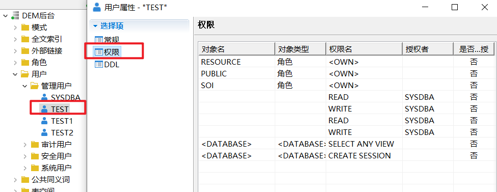

## 数据库查询时间与服务器本身时间不一致

**【问题描述】** ：

服务器本身时区及时间均正确，但数据库中查询 select sysdate; 比实际时间早 8 小时。

**【问题解答】** ：

需要配置 dm\_svc.conf 文件，其中指定 TIME\_ZONE=(480)，即指明客户端的时区为东八区。  
dm\_svc.conf 文件是 DM 安装时生成一个配置文件，不同平台的目录有所不同：

- 32 位的 DM 安装在 Win32 操作平台下，此文件位于 %SystemRoot%\\system32 目录；
- 64 位的 DM 安装在 Win64 操作平台下，此文件位于 %SystemRoot%\\system32 目录；
- 32 位的 DM 安装在 Win64 操作平台下，此文件位于 %SystemRoot%\\SysWOW64 目录；
- 在 Linux 平台下，此文件位于/etc 目录。

## 数据库中执行 DML 语句长时间无响应

**【问题分析】** ：

主要通过以下两点进行排查：

- 首先排查数据库中是否产生了锁；如果存在，则可以等待或使用 call sp\_close\_session 杀掉相关阻塞会话。
- 其次查看磁盘空间是否正常，比如归档满了，数据盘满了等问题也会导致数据库无法写入。

## 在 DSC 环境中修改 DCR 配置信息时报错：Disk\[/dev/raw/raw1\] is in using

**【问题描述】** ：

导入 DCR 配置文件时，报如下错误：

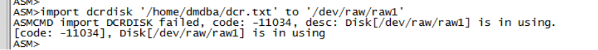

**【问题解决】** ：

出现该报错是由于导入 dcr 文件时，dcr 配置信息被 css 进程占用。需要把 css 服务关闭才可以导入修改 dcr 信息。

## 如何查看数据库所有表空间大小及其使用情况

**【问题解决】** ：

可利用如下语句查询表空间大小及其使用情况：

```sql
SELECT F.TABLESPACE_NAME,
(T.TOTAL_SPACE - F.FREE_SPACE) / 1024 "USED (GB)",
F.FREE_SPACE / 1024 "FREE (GB)",
T.TOTAL_SPACE / 1024 "TOTAL(GB)",
(ROUND((F.FREE_SPACE / T.TOTAL_SPACE) * 100)) || '% '
PER_FREE
FROM (SELECT TABLESPACE_NAME,
ROUND(SUM(BLOCKS *
(SELECT PARA_VALUE / 1024
FROM V$DM_INI
WHERE PARA_NAME =
'GLOBAL_PAGE_SIZE') / 1024)) FREE_SPACE
FROM DBA_FREE_SPACE
GROUP BY TABLESPACE_NAME) F,
(SELECT TABLESPACE_NAME, ROUND(SUM(BYTES /
1048576)) TOTAL_SPACE
FROM DBA_DATA_FILES
GROUP BY TABLESPACE_NAME) T
WHERE F.TABLESPACE_NAME = T.TABLESPACE_NAME;
```

## 更改后的 key 文件不生效，授权的日期时间没变，应如何正确更换 DM 的 key 文件

**【问题解决】** ：

- 替换 key 文件
1. 移出原有的 dm.key 文件到其他目录或重名为其他名称；
2. 将授权文件 dm.key 拷贝到安装目录的 bin 目录下，以下以数据库软件安装在/home/dmdba/dmdbms 目录，授权文件是 dm.key 上传到了/home/dmdba 目录为例。
```
su - dmdba
cd /home/dmdba/dmdbms/bin
cp /home/dmdba/dm.key /home/dmdba/dmdbms/bin     #将授权文件 dm.key 拷贝到bin目录下
chown -R dmdba:dinstall dm.key      #修改 dm.key 文件权限
chmod 755 dm.key
```
- 让 key 文件信息生效

方法一：等待数据库自动检测并更新。  
默认每天凌晨数据库会自动检测 key 信息，如果 key 被替换，会自动更新，建议第三天查询授权是否生效。  
方法二：不重启数据库，执行函数生效。  
该方法非所有版本都有，需要查看手册进行确认。打开数据库工具，新建查询：

```sql
call sp_load_lic_info();
```

方法三：重启数据库使 key 文件生效。  
若为单机库，在/home/dmdba/dmdbms/bin 目录执行：./DmS(按 tab 键补全)空格 restart  
若为集群，请和工程师确定重启方式。

- 查询授权是否生效
```sql
select expired_date from  v$license;  #查询 key 的到期时间
```

若查询返回结果是否为'NULL'，则表示已更新为永久授权，否则返回到期时间。

> **注意**
> 
> 1\. 切勿在生产环境下，随意替换 key 文件；  
> 2\. key 文件名称一定要改成 dm.key，如果不修改直接放到服务器上是不生效的；  
> 3\. 如果之前的旧授权也在，可以先移走或者删除；  
> 4\. 替换 key 文件前，请确保与服务器架构匹配，否则有可能造成服务启动失败；  
> 5\. 若 key 替换完后，查询结果未达到预期，请确保 key 文件的权限属组正常。

## 本地 disql 登录正常，应用连接网络偶尔断开

**【问题解决】** ：

检查服务器进程：

```
ps -ef|grep port
```

Kill 该进程，并将 ports.sh 修改为 ports.sh\_bak，重新连接即可。

## 如何查看统计信息收集情况

**【问题解决】**

1、利用如下 SQL 语句，可以查看某用户下的统计信息收集情况：

```sql
select a.object_name,a.owner,a.object_type,b.last_gathered 
from dba_objects a,SYSSTATS b 
where a.object_id = b.id --and a.OWNER = '用户名'
order by b.last_gathered limit 10;
```

查询结果如下图：

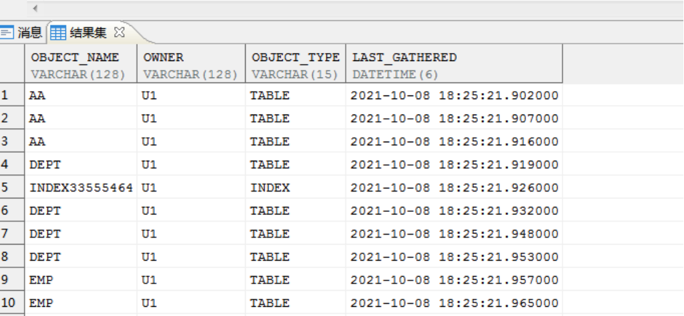

2、利用 SYSSTATS 表的 LAST\_GATHERED 字段和 SYSOBJECTS 表进行组合查询，可查询某表统计信息最后更新时间。

```sql
select ID, 
       LAST_GATHERED 
  from SYSSTATS 
 where ID in(SELECT distinct(ID) FROM SYSOBJECTS where name in ('表名')) ;
```

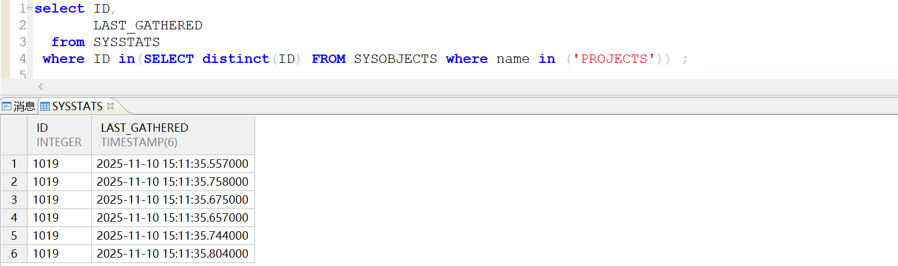

## 扩展表空间失败：\[-3410\]:表空间上有事务未提交

**【问题解决】** ：

可通过以下步骤进行检查：

1. 检查是否有查询表空间类视图未提交，例如 dba\_data\_files 等；
2. 检查是否有查询表类视图未提交，例如 user\_tables 等；
3. 检查是否存在一些其他涉及表空间查询的事务未提交，可以通过查询视图 v$trxwait 查看具体等待事务及 sql。查询语句如下：
```sql
select tw.*,ss.clnt_ip,ss.SQL_TEXT from V$TRXWAIT tw join v$sessions ss on ss.trx_id=tw.wait_for_id order by wait_time desc;
```

## 如何查询统计表的各种约束

**【问题解决】** ：

```sql
---查询主键
SELECT a.OWNER as "模式名",a.TABLE_NAME as "表名",b.COLUMN_NAME as "列名", a.CONSTRAINT_NAME as "约束名"
from DBA_CONSTRAINTS a, ALL_CONS_COLUMNS b where a.CONSTRAINT_NAME=b.CONSTRAINT_NAME and CONSTRAINT_TYPE='P';

---查询外键
SELECT a.OWNER as "模式名",a.TABLE_NAME as "表名",b.COLUMN_NAME as "列名", a.CONSTRAINT_NAME as "约束名"
from DBA_CONSTRAINTS a, ALL_CONS_COLUMNS b where a.CONSTRAINT_NAME=b.CONSTRAINT_NAME and CONSTRAINT_TYPE='R';

---查询唯一约束
SELECT a.OWNER as "模式名",a.TABLE_NAME as "表名",b.COLUMN_NAME as "列名", a.CONSTRAINT_NAME as "约束名"
from DBA_CONSTRAINTS a, ALL_CONS_COLUMNS b where a.CONSTRAINT_NAME=b.CONSTRAINT_NAME and CONSTRAINT_TYPE='U';

---查询check约束
SELECT a.OWNER as "模式名",a.TABLE_NAME as "表名",b.COLUMN_NAME as "列名", a.CONSTRAINT_NAME as "约束名",SEARCH_CONDITION as "CHECK约束的条件"
from DBA_CONSTRAINTS a, ALL_CONS_COLUMNS b where a.CONSTRAINT_NAME=b.CONSTRAINT_NAME and CONSTRAINT_TYPE='C';

---查询默认列
SELECT OWNER as "模式名",TABLE_NAME as "表名",COLUMN_NAME as "列名",DATA_TYPE as "列类型",DATA_DEFAULT as "默认值" FROM DBA_TAB_COLUMNS WHERE DATA_DEFAULT IS NOT NULL;

---查询非空列
SELECT OWNER as "模式名",TABLE_NAME as "表名",COLUMN_NAME as "列名",DATA_TYPE as "列类型" FROM DBA_TAB_COLUMNS WHERE NULLABLE ='Y';
```

## 存储过程中对自动扩展的分区表执行插入未定义的分区数据报错："语句块/包/存储函数中的间隔分区不支持自动扩展"

**【问题描述】** ：

问题重现过程如下：

```sql
---创建表
create table  dmtest(
c1 datetime(6) default sysdate not null,
c2 varchar2(10))partition by range(c1)
interval(numtodsinterval(1,'DAY'))
(
partition p1 values less than (datetime'2018-04-01 00:00:00')
);

---创建存储过程，执行分区表插入
create or replace procedure insert_interval(v_update datetime, v_paravalue varchar(10))
as
begin
 insert into dmtest values(v_update,v_paravalue);
 commit;
end;
/

---调用存储过程，出现报错：执行失败，语句块/包/存储函数中的间隔分区不支持自动扩展
call insert_interval(datetime'2021-10-13 19:33:41','aswq');
```

**【问题解决】** ：

dm.ini 提供了 DEL\_HP\_OPT\_FLAG 参数来控制分区表的操作优化，该参数为动态会话级参数。出现如上问题，需要修改 DEL\_HP\_OPT\_FLAG 的取值，使其包含 4：允许语句块中的间隔分区表自动扩展。

DEL\_HP\_OPT\_FLAG 参数说明：控制分区表的操作优化。  
0：不优化；  
1：打开分区表 DELETE 优化；  
2：控制范围分区表创建的优化处理，转换为数据流方式实现；  
4：允许语句块中的间隔分区表自动扩展；  
8：开启对 truncate 分区表的优化处理；  
16：完全刷新时删除老数据使用 delete 方式。  
DEL\_HP\_OPT\_FLAG 参数取值支持使用上述有效值的组合值，如 7 表示同时进行 1、2、4 的优化。

## 新建用户创建作业失败：没有 JOB 权限

**【问题解决】** ：

可以通过单独授权或者授权 dba 角色进行解决。

**方法一：** 通过管理工具授予用户 admin job 权限。

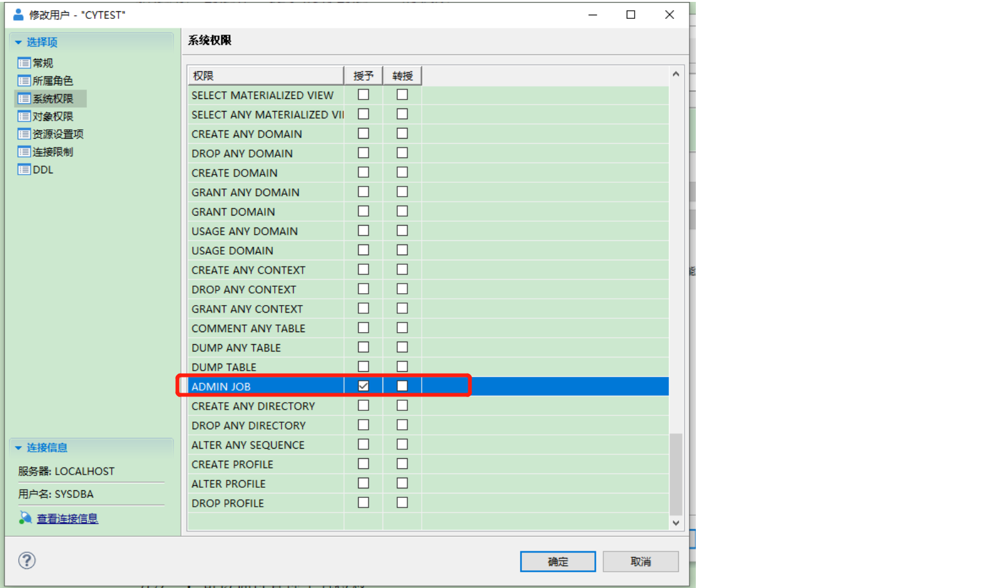

**方法二：** 通过命令的方式进行授权。

```sql
grant ADMIN JOB to "CYTEST";
```

说明：也可通过授予用户 dba 权限解决该问题，但生产环境中不推荐使用该方法。

## 使用系统包 DBMS\_STATS.GATHER\_SCHEMA\_STATS 收集统计信息时，如何查看收集进度？

**【问题描述】** ：

使用系统包：DBMS\_STATS.GATHER\_SCHEMA\_STATS()，收集一个模式下的表的统计信息时，应如何查看收集进度。  
例如：

```sql
--收集SYSDBA模式下所有对象的统计信息
DBMS_STATS.GATHER_SCHEMA_STATS('SYSDBA',100,FALSE,'FOR ALL COLUMNS SIZE AUTO');
```

**【问题解决】** ：

系统表 dba\_tables 中的 last\_analyzed 字段可以看到调用系统包收集统计信息的最后收集时间，所以一般可以使用下面的 SQL 以表个数为单位查看收集进度（可根据实际情况调整 OWNER）:

```sql
SELECT wm_concat(progess) from (
select COUNT(*)  progess from dba_tables where 
OWNER='SYSDBA' AND to_char(last_analyzed,'yyyymmdd') =to_char(sysdate,'yyyymmdd') --目前收集的个数
UNION
SELECT COUNT(*) progess  from dba_tables where OWNER='SYSDBA' --总的表个数
);
```

## 在 DM 达梦数据库的运行日志中出现大量 Failure occurs in data\_recv\_inet\_once 警告信息

**【问题描述】** ：

在 DM 达梦数据库的运行日志中出现大量 Failure occurs in data\_recv\_inet\_once 警告信息，如下图：

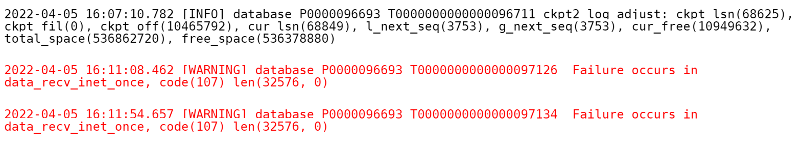

**【问题解决】** ：

如果 WARNING 非常频繁，可能会导致告警日志文件特别大。这里的 Failure occurs in data\_recv\_inet\_once 是消息检验的告警，与网络环境有一定的关系，网络不稳定的情况下触发此告警的可能性较大，可以直接修改 dm.ini 的 COMM\_VALIDATE 参数来关闭该功能。该参数可以动态或系统级修改，用来控制是否对消息进行校验。0 表示不检验；1 表示检验，默认值为 1。  
关闭消息校验的警告操作如下：

```sql
---查看 COMM_VALIDATE 参数
select para_name,para_value,description,para_type from v$dm_ini where para_name='COMM_VALIDATE';

---修改参数 COMM_VALIDATE 为 0
SP_SET_PARA_VALUE(1, 'COMM_VALIDATE', 0);
```

修改完成后在 dm.ini 中检查是否参数是否已修改。

```shell
cat dm.ini |grep COMM_VALIDATE
```

## 数据库中缺少 DBA\_TABLES、USER\_TABLES、DBA\_FREE\_SPACE 等系统视图

**【问题解决】** ：

可通过如下步骤解决：

1.创建系统视图 `SP_CREATE_SYSTEM_VIEWS(1);`

2.如果报语法错误或其它错误，检查是否屏蔽了关键字；

```sql
select * from v$dm_ini where para_name='EXCLUDE_RESERVED_WORDS';
```

如果存在关键字屏蔽，修改 dm.ini 中 EXCLUDE\_RESERVED\_WORDS 参数，去掉关键字屏蔽后重启数据库。并执行 `SP_CREATE_SYSTEM_VIEWS(1);`

## 如何查看某个表被哪些视图引用了？

**【问题解决】：**

可通过以下语句查询某个表被哪些视图引用：

```sql
select * from DBA_dependencies T WHERE  t.REFERENCED_NAME = ‘表名’；
```

例如，查询 “DEPARTMENT” 这张表被那些视图引用，可执行以下命令：

```sql
select * from DBA_dependencies T WHERE  t.REFERENCED_NAME = 'DEPARTMENT';
```

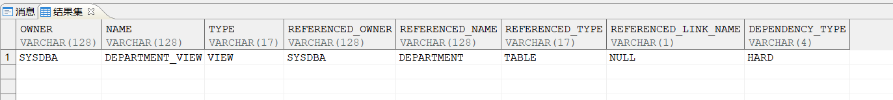

在查询结果中显示的前面 3 字段 OWENRR、NAME、TYPE 分别表示所有者、名称和类型， “REFERENCED\_XXX" 的字段为被引用的对象所有者，被引用对象名称以及被引用象类型等信息。

## SQL 监控查询语句汇总

**1.查询慢 SQL 及阻塞**

```sql
--检查当前数据库中包含的慢 SQL 及阻塞语句
SELECT
        DS.SESS_ID "被阻塞的会话ID",
        DS.SQL_TEXT "被阻塞的SQL",
        DS.TRX_ID "被阻塞的事务ID",
        (CASE L.LTYPE WHEN 'OBJECT' THEN '对象锁' WHEN 'TID' THEN '事务锁' END CASE ) "被阻塞的锁类型",
        DS.CREATE_TIME "开始阻塞时间",
        SS.SESS_ID "占用锁的会话ID",
        SS.SQL_TEXT "占用锁的SQL",
        SS.CLNT_IP "占用锁的IP",
        L.TID "占用锁的事务ID"
FROM
        V$LOCK L
LEFT JOIN V$SESSIONS DS
ON
        DS.TRX_ID = L.TRX_ID
LEFT JOIN V$SESSIONS SS
ON
        SS.TRX_ID = L.TID
WHERE
        L.BLOCKED = 1;
```

**2\. 查询死锁历史事务信息**

```sql
select
        dh.trx_id ,
        sh.sess_id,
        wm_concat(top_sql_text)
from
        V$DEADLOCK_HISTORY dh,
        V$SQL_HISTORY sh
where
        dh.trx_id =sh.trx_id
    and dh.sess_id=sh.sess_id
group by
        dh.trx_id, sh.sess_id;
```

**3\. 查询有事务未提交的表**

```sql
SELECT b.object_name, c.sess_id, a.*
FROM v$lock a, dba_objects b, v$sessions c
 WHERE a.table_id = b.object_id AND a.ltype = 'OBJECT' AND a.trx_id = c.trx_id;
```

**4\. 查询已执行超过 2 秒的活动 SQL**

```sql
select  *  from
        (
                SELECT
                        user_name,
                        clnt_ip,
                        sess_id,
                        sql_text,
                        datediff(ss, last_send_time, sysdate) ss,
                        SF_GET_SESSION_SQL(SESS_ID) fullsql   
                FROM
                        V$SESSIONS
                WHERE
                        STATE='ACTIVE' and user_name!='SYSDBA'
        )
where ss>=2 order by 5 desc;
```

**5\. 查询实例中已执行未提交的 SQL**

```sql
SELECT t1.sql_text, t1.state, t1.trx_id
 FROM v$sessions t1, v$trx t2
 WHERE t1.trx_id = t2.id AND t1.state = 'IDLE' AND t2.status = 'ACTIVE';
```

**6\. 查询占用内存最多的 sql**

```sql
--查询执行在 1 秒以上的SQL语句使用的内存
SELECT "SESSID", MAX_MEM_USED||'KB',SQL_TXT FROM V$SQL_STAT order by MAX_MEM_USED DESC;
```

通过此 SQL 语句确定使用内存较大的 SQL，进行针对性的优化，如消除 HASH,SORT,DISTINCT 等操作。该查询只能查询当前活动 STMT 上的语句消耗情况，历史情况需要查询 V$SQL\_STAT\_HISTORY，详细内容请参考数据库安装 doc 目录下《系统管理员手册》。

**7\. 查询占用 io 较大的 sql**

```sql
--查询物理读次数较大的 sql
select
        s.sess_id,
        s.sql_text,
        s.user_name,
        s.state,
        st.PHY_READ_CNT,
        st.iO_WAIT_TIME
from
        v$sessions s, v$session_stat st
where
        s.sess_id=st.sessid and s.state  ='ACTIVE'
ORDER BY  5 DESC;
```

**8\. 查找性能相对较差的 sql** 。 即磁盘读取次数较多，按照硬解析读取次数倒叙排序。

```sql
select
        SQL_TXT,
    EXEC_TIME,
    PARSE_CNT,
        PARSE_TIME,
    HARD_PARSE_CNT,
    HARD_PARSE_TIME
FROM
        v$sql_stat
ORDER BY
        HARD_PARSE_CNT DESC,
        EXEC_TIME DESC;
```

## 如何验证通信是否已经加密？

**【问题描述】**

开启通信加密后，如何验证通信已经加密了？

**【问题解决】**

可以通过抓包测试来验证通信是否加密。主要有以下两种方式：

方式一：Linux 环境，通过 tcpdump 命令，进行抓包测试，如果是连接的本机，直接在服务器上进行前台抓包测试，命令如下： `tcpdump -XX -vvv -nn -i lo dst port 数据库端口号` 以上端口号根据实际情况修改，输入完以上命令之后，可以用命令行或者管理工具，创建个测试表进行测试， `create table t1(a int,b int,c int);` 可以在没有打开通信加密的时候，先用该方式测试，会发现，打印出来的网络包可以看到 create 完整语句，打开通信加密之后，再去执行抓包，看不到相应完整的 sql 语句。

方式二：用 Windows 的 wireshark 工具进行分析，如果是在 Linux 上先抓包，拿到 Windows 去分析，可以用以下 tcpdump 命令进行抓包后保存到 pcap 文件中，然后 Windows 上用 wireshark 工具打开该文件，看到的信息基本和 Linux 前台打印类似。pcap 文件打开方式 `tcpdump -i 网口名 -w xxx.pcap` 。

例如采用方式一进行抓包测试。详细步骤如下：

1. 在未开启通信加密情况下，进行 tcpdump 抓包测试。

（1）登录数据库检查未开启通信加密：

```sql
SELECT * FROM V$DM_INI WHERE PARA_NAME= 'COMM ENCRYPT_NAME';
```

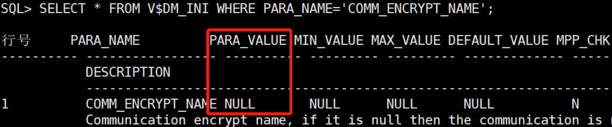 （2）服务器上前台执行抓包命令：

```shell
tcpdump -XX -vvv -nn -i lo dst port 1313
```

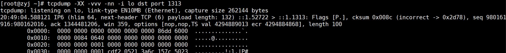

（3）登录数据库创建表：

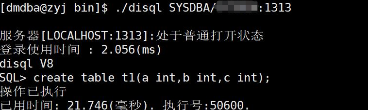

（4）检查抓包命令是否以抓取到创建表的命令。在前台抓包命令打印的信息中可以看到已经抓取到之前的建表命令通过明文显示。

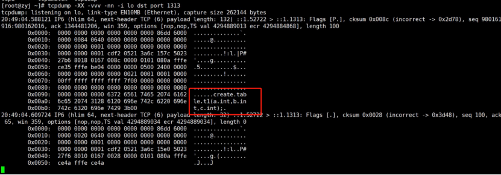

2. 在开启通信加密情况下，进行 tcpdump 抓包测试。

（1）登录数据库检查未开启通信加密：

```sql
SELECT * FROM V$DM_INI WHERE PARA_NAME= 'COMM ENCRYPT_NAME';
```

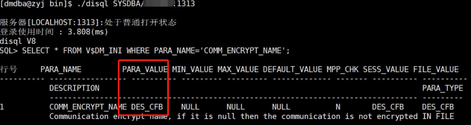

（2）服务器上进行前台执行抓包命令：

```shell
tcpdump -XX -vvv -nn -i lo dst port 1313
```

 （3）登录数据库创建表：

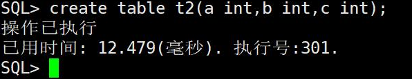

（4）检查抓包命令是否以抓取到创建表的命令。在前台抓包命令打印的信息中可以看到抓取到之前的建表命令通过密文显示，说明通信已加密。

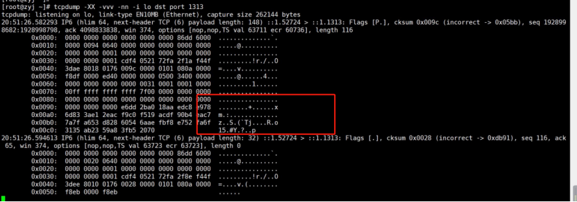

## 如何更新某个用户所有列的统计信息，并记录更新统计信息时长？

**【问题解决】**

1. 创建用来记录更新统计信息时长的表。
```sql
create table stat_history (beg_time TIMESTAMP,end_time timestamp,sql_str varchar2(500),table_name varchar2(200),col_name VARCHAR2(200));
```
2. 更新所有列的统计信息，并将更新统计信息的时长写入创建的表中。
```sql
--更新所有列的统计信息
declare
v_sql varchar(4000);
v_begtime VARCHAR2(200);
v_endtime varchar2(200);
CURSOR c1 IS SELECT
       TAB.NAME                                             AS TABLE_NAME ,
       SYSCOL.NAME                                          AS COLUMN_NAME--,
FROM
       SYSOBJECTS AS TAB,
       SYSOBJECTS AS SCH,
       SYSCOLUMNS AS SYSCOL
WHERE
       SCH.ID =TAB.SCHID
   AND TAB.ID =SYSCOL.ID
   AND SCH.NAME = 'SYSDBA'
   AND SYSCOL.TYPE$ NOT IN ('BLOB','CLOB','TEXT')
   and TAB.NAME  IN(select  TABLE_NAME  from   ALL_TABLES WHERE OWNER = 'SYSDBA');
begin
 for i in c1
 loop
     v_sql :='stat 100 on "'|| i.TABLE_NAME ||'"("' ||i.COLUMN_NAME ||'");';
     --v_sql='stat 100 on SP_TS_BAKSET_REMOVE_BATCH(DEVICE_TYPE);';
 --print v_sql;
 v_begtime := sysdate();
 execute immediate v_sql;
 v_endtime :=sysdate();
--更新统计信息的时长写入创建的表中
 insert into stat_history VALUES (v_begtime,v_endtime,v_sql,i.TABLE_NAME,i.COLUMN_NAME);
 commit;
 end loop;
end;
```

3.查看统计信息更新时长。

```sql
select * from  stat_history;
```

## SQL 语句存在不可见字符导致语句执行失败

**【问题描述】：**

SQL 语句存在不可见字符 “M-oM-;M-?” 导致 sql 语句执行失败。

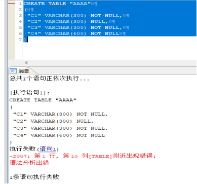

【问题分析】：

这种情况，一般就要检查是否存在不可见字符，对于普通的文本编辑器一般无法直接看到不可见字符，但是通过一些高级的编辑器或者是 Linux 系统上的 cat 等命令相关选项可以发现。如果只是直接 cat 文件是无法看到不可见的字符，需要将文件保存为 txt 文件再进行查看。

这里直接将文本内容保存到 txt 文件，然后拷贝到 Linux 系统中，使用 `cat -v xxx.txt | more ` 进行查看，就可以看到多出一串字符 “M-oM-;M-?”，如下：

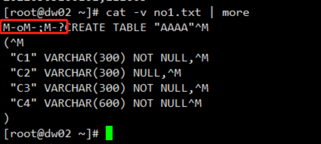

这个字符串是由于使用 UTF-8 带有 BOM 编码格式导致。

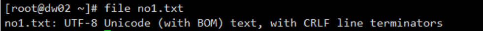

**【解决办法】**

将文件编码格式转成 UTF8 无 BOM 编码格式，即可解决。可通过如下方式解决：

方法一：使用 IDE 工具或者高级编辑器工具将文件编码格式转换成无 BOM 格式。

例如：使用 editplus 工具进行格式调整，将文件编码格式转成 UTF8 无 BOM 编码格式。点击文本选择【文本编码】---> 选择【特殊文本编码】---> 选择格式转换为 UTF-8。

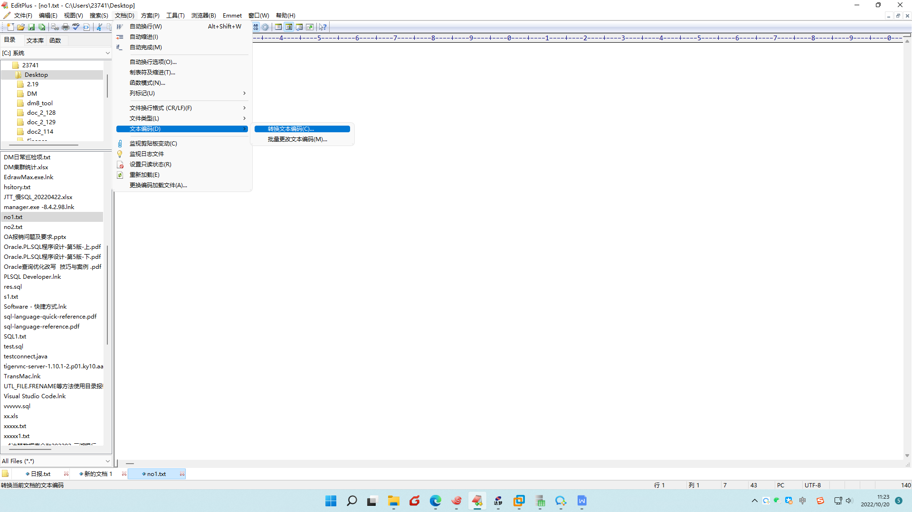

方法二：单个文件可以使用 vim 打开对应文件进行修改，执行 `shift+:` 然后 写入 `set nobomb` ，然后保存退出。

修改后，再次查看该文件，字符 “M-oM-;M-?” 已消失。

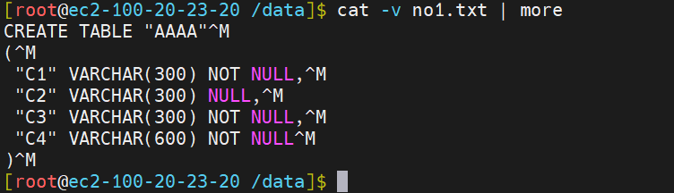

方法三：多个文件可以在 shell 脚本中使用 sed 命令将 “M-oM-;M-?” 换成对应的 16 进制字符。

例如： `sed -i '1s/^\xef\xbb\xbf//' no1.txt`

以下提供 16 进制字符查看方法：执行命令 `od -tx1 no1.txt | more` 可以以十六进制显示文件内容。

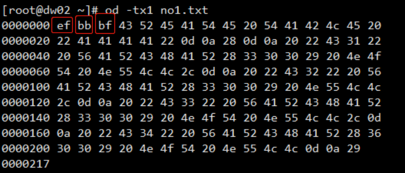 如果无法确定字符位置和个数，也可以通过 od 命令 `od -tc no1.txt | more  ` 以 ASCII 码的形式显示文件内容：

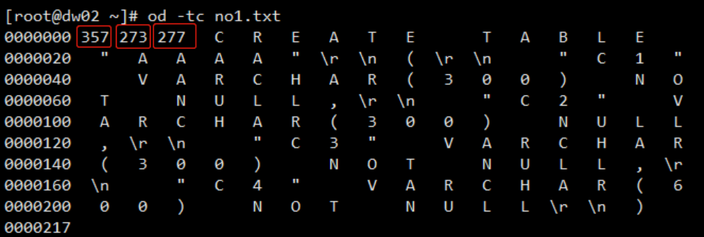

## 如何不停库移动用户表空间对应的数据文件

**【问题解决】：**

需要移动的表空间必须处于脱机状态，并且只可修改用户创建的表空间数据文件的路径（其中：system、roll 表空间不允许脱机）。例如修改 TBS 表空间数据文件路径，具体步骤如下：

1. 查看表空间对应的数据文件。
```sql
SELECT TS.NAME, DF.PATH FROM V$TABLESPACE AS TS, V$DATAFILE AS DF WHERE TS.ID = DF.GROUP_ID;
```
2. 修改 TBS 表空间状态为脱机。
```sql
ALTER TABLESPACE TBS OFFLINE;
```
3. 修改表空间所对应的一个数据文件的路径。
```sql
ALTER TABLESPACE TBS RENAME DATAFILE ‘/dm8/data1/DAMENG/TB01.DBF’ TO ‘/dm8/data1/DAMENG1/TB01.DBF’;
```
4. 修改 TBS 表空间状态为联机。
```sql
ALTER TABLESPACE TBS ONLINE;
```

至此表空间移动完毕。

如果修改 system、roll 表空间，则需要首先停库，拷贝所对应数据文件到新的文件目录，备份控制文件，通过修改控制文件里对应数据文件路径，再启动数据库实现。

> **注意**
> 
> temp 路径不记录在控制文件里，若文件丢失，每次重启数据库会自动生成一个临时数据文件。.

## 如何通过 disql 抓取数据库中的活动会话 sql

**【问题描述】**

因为网络限制无法通过管理工具连接数据库，在只能通过 disql 连接数据库的情况下，如何抓取数据库中的正在运行的活动会话 sql，并分析其执行计划。除了查看 logcommit 还有什么办法？

**【问题解决】**

可以通过 spool 命令将查询结果输出到指定文件。

```sql
./disql SYSDBA/'"密码"'
SQL>spool '/home/dmdba/SQL_TEXT.txt'; ---控制台打印查询结果，并将查询结果输出到指定文件/home/dmdba/SQL_TEXT.txt
SQL>select sql_text,count(*) from v$sessions where state='ACTIVE' group by sql_text order by 2;
SQL>spool off ;----关闭spool
```

> **注意**
> 
> 只有 SPOOL OFF 之后，才能在输出文件中看到完整的输出内容。 最后将想要查看 sql 的执行计划 ，在 sql 前加上 EXPLAIN 再执行即可查看该 sql 的执行计划。

## WARNING: rlog free space reserved failed,add or resize log file please

【问题描述】

数据库日志持续刷告警信息如下：

```shell
database P0000033904 T0000000000000127776 ckpt info adjust: ckpt_lsn(104870593524), ckpt_fil(1), ckpt_off(257687040), cur_lsn(104870595310)
database P0000033904 T0000000000000267396 WARNING: rlog free space reserved failed, add or resize log file please!
database P0000033904 T0000000000000127776 ckpt info adjust: ckpt_lsn(104870595165), ckpt_fil(1), ckpt_off(257974272), cur_lsn(104870596531)
database P0000033904 T0000000000000026956 WARNING: rlog free space reserved failed, add or resize log file please!
```

【问题解决】

redo 日志默认大小为 256M，2 个日志文件循环写。根据告警信息显示 redo 日志频繁切换，应调大或者增加 redo 日志。通过以下 SQL 可以调整 redo 日志大小。

```sql
alter database resize logfile '/dmdata/dmdbms/DAMENG/DAMENG/DAMENG01.log'  to 2048;
alter database resize logfile '/dmdata/dmdbms/DAMENG/DAMENG/DAMENG02.log'  to 2048
```

## 用户 AAA 如何操作用户 BBB 的分区表

**【问题描述】**

用户 AAA 如何操作用户 BBB 的分区表 BBB\_FQ

**【问题解决】**

授予 AAA 用户操作 BBB 用户分区表 BBB\_FQ 的权限即可。

用 SYSDBA 用户登录数据库，使用以下命令将 BBB 模式下的分区表 BBB\_FQ 授予 ALL 权限给 AAA 用户。或者按最小权限原则授予 AAA 用户操作 BBB 模式下的分区表 BBB\_FQ 的权限。

```sql
grant SELECT on "SYSDBA"."BBB_FQ" to "AAA";

grant INSERT on "SYSDBA"."BBB_FQ" to "AAA";

grant DELETE on "SYSDBA"."BBB_FQ" to "AAA";

grant UPDATE on "SYSDBA"."BBB_FQ" to "AAA";

grant REFERENCES on "SYSDBA"."BBB_FQ" to "AAA";

grant SELECT FOR DUMP on "SYSDBA"."BBB_FQ" to "AAA";

grant ALTER on "SYSDBA"."BBB_FQ" to "AAA";

grant INDEX on "SYSDBA"."BBB_FQ" to "AAA";
```

也可以通过管理工具授予对应权限，方法和普通表的授权方式一致。

## 完全刷新物化视图恢复后物化视图原数据查询为空

**【问题描述】**

当物化视图中包括 DBLINK 远端表时,完全刷新物化视图过程中若远端库服务异常，恢复后物化视图原数据没有回滚数据查询为空。

**【问题分析】**

参数 DEL\_HP\_OPT\_FLAG 默认值为 0 ，物化视图完全刷新默认采用 truncate 方式清除原始数据，刷新过程中出现异常无法进行回滚。

**【问题解决】**

可以通过 DEL\_HP\_OPT\_FLAG 参数进行控制，当取值 16 时，完全刷新采用 DELETE 方式，若刷新过程中异常，能够进行回滚，保证物化视图数据不丢失，不影响上层应用查询。

参数说明：

| 参数 | 默认值 | 属性 | 说明 |
| --- | --- | --- | --- |
| DEL\_HP\_OPT\_FLAG | 0 | 动态，会话级 | 控制分区表的操作优化   0：不优化；   1：打开分区表 DELETE 优化；   2：控制范围分区表创建的优化处理，转换为数据流方式实现；   4：允许语句块中的间隔分区表自动扩展；   8：开启对 TRUNCATE 分区表的优化处理；   16：完全刷新时删除老数据使用 DELETE 方式   支持使用上述有效值的组合值，如 7 表示同时进行 1、2、4 的优化 |

## 重启数据库报错：“lic info is different between dm.key and sysinfo”

**【问题描述】**

安全版数据库更换正式 key 之后，重启数据库报错：“lic info is different between dm.key and sysinfo”。

**【问题分析】**

此报错是由于版本的安全类型不匹配导致。

**【问题解决】**

方法一：检查数据库版本和 key 的版本是否一致，如果不一致需更换为一致版本的 key。

方法二：确定版本无问题，可通过以下命令手动升级数据库的安全状态，只需做一次：

```sql
./dmserver <ini.path> upd_lic=1
```

## dm\_BAKERS\_年月.log 日志文件过大

**【问题描述】**

dm\_BAKERS\_年月.log 日志文件大小在 5G 左右，数据库备份作业为每天全备，并且日志中平均 1min 会对 V$BACKUPSET 视图做如下的查询来监控备份。

```sql
select
        backup_name                                   as backup_name,
        to_char(backup_time, 'yyyy-mm-dd hh24:mi:ss') as backup_time,
        1                                             as non
from
        (
                select backup_name, backup_time from v$backupset order by backup_time desc
        )
        t
where
        rownum<11;
```

**【问题分析】**

查询.V$BACKUPSET 视图需要调用备份接口去扫描指定的路径下的备份集，1min 一次，导致日志量过大。

**【问题解决】**

降低 `.V$BACKUPSET` 视图监控备份情况的频率 ，或者使用 `$backup_history` 替换 `$BACKUPSET` 来做监控。

## 建表时报错：“列定义长度超长”

**【问题描述】**

在 create table 创建表时报错：“列定义长度超长”。

**【问题分析】**

DM 数据库在初始化时，默认页大小为 8KB，而一条记录的长度除大字段类型（clob、blob）以外不能超过页大小的一半，也就是说表一条记录的所有字段的总长度之和不能超过 4KB。页大小影响表每行数据的长度，超过则会报错。

可以使用以下 SQL 查询当前数据库页大小：

```sql
select page();
```

**【问题解决】**

重新初始化数据库，设置初始化参数 page\_size=32，即设置页大小为 32K 或者在创建表时控制字段总长度不超过页大小的一半。

## 非 DBA 角色用户如何跨模式创建模式对象

**【问题描述】**

非 DBA 角色用户无法跨模式创建/删除模式对象（如表、视图等）会报错“没有创建表权限”。

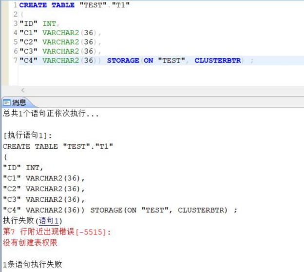

**【问题解决】**

授予用户 ANY 权限，具体步骤如下：

1. 登陆 DBA 权限用户，通过以下命令查看 ENABLE\_DDL\_ANY\_PRIV 值，若为 0，则表示此用户不能给其他  
	用户授予和回收 DDL ANY 权限。
```sql
select * from v$dm_ini where para_name='ENABLE_DDL_ANY_PRIV';
```

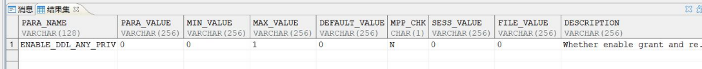

2. 通过以下命令开启 DDL ANY 权限。
```sql
sp_set_para_value(1,'ENABLE_DDL_ANY_PRIV',1);
```

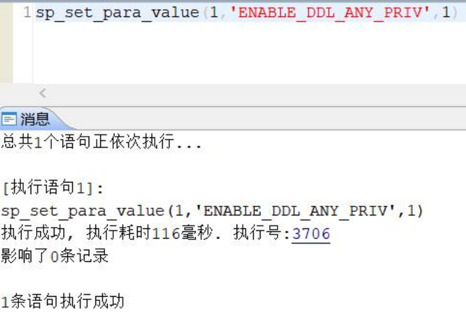

3. 确认 ENABLE\_DDL\_ANY\_PRIV 值修改成功，通过以下命令查出值为 1 表示修改成功。
```sql
select * from v$dm_ini where para_name='ENABLE_DDL_ANY_PRIV';
```

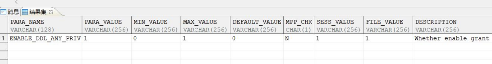

4. 授予普通用户需要的 any 系统权限。比如此普通用户需要在其它模式下创建表，则通过以下命令赋予该用户 create any table 权限。授权成功后该普通用户即可在其他模式下创建表。
```sql
grant CREATE ANY TABLE to "AA";
```
5. 授权完成后 DBA 用户，通过以下命令关闭 DDL ANY 权限。
```sql
sp_set_para_value(1,'ENABLE_DDL_ANY_PRIV',0)；
```
6. 通过以下命令检查 DDL ANY 权限是否关闭成功，值为 0 表示关闭成功。
```sql
select * from v$dm_ini where para_name='ENABLE_DDL_ANY_PRIV';
```

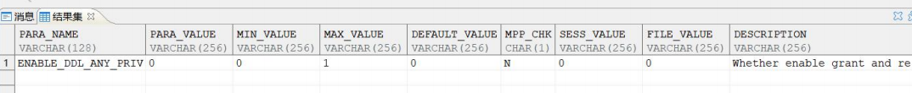

## 如何使表中同时包含聚集 KEY 和大字段

**【问题描述】**

该问题主要发生在默认为聚集索引的情况。

```sql
sp_set_para_value(1,'PK_WITH_CLUSTER',1);
CREATE TABLE TEST
(
id int primary key,
name varchar2(100)
);
--创建大字段列，报错
alter table TEST add column(image clob);
-3243: 第1 行附近出现错误:
表 [XB1] 中不能同时包含聚集 KEY 和大字段
```

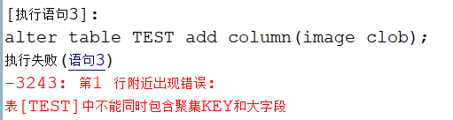

**【问题解决】**

可以通过以下方法解决该问题。

1. 添加一个临时字段；
```sql
alter table TEST add column(cs int);
```
2. 临时字段创建聚集索引,自动将主键的聚集索引变为非聚集索引；
```sql
CREATE cluster INDEX index_test_cs ON TEST(cs);
```
3. 删掉临时聚集索引；
```sql
drop index index_test_cs;
```
4. 删除临时字段；
```sql
alter table TEST drop column cs;
```
5. 添加大字段，成功。
```sql
alter table TEST add column(image clob);
```

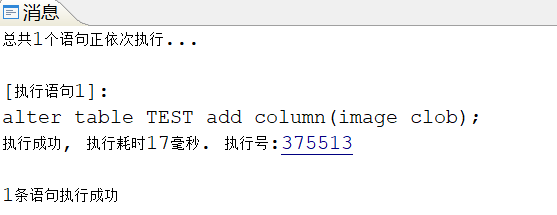

## 系统包执行错误

**【问题描述】**

系统包已经存在，但是执行系统包出现报错。

```sql
SELECT DBMS_METADATA.GET_DDL('TABLE，T1，TEST'执行失败(语句1)
3325:第1352 行附近出现错误[-2207]:无法解析的成员访问表达式[SE_DBMS_METADATA_RETURN_DDL第1 行附近出现错误
[-3325]:包/对象[DBMS_METADATA]解析失败
```

**【问题分析】**

该问题一般出现在数据库版本升级后部分系统包无法使用，需要重建报错的系统包。

**【问题解决】**

方案一：重建报错的系统包：

```sql
SP_CREATE_SYSTEM_PACKAGES (0,'DBMS_METADATA');
SP_CREATE_SYSTEM_PACKAGES (1,'DBMS_METADATA');
```

方案二：重建所有系统包：

```sql
SP_CREATE_SYSTEM_PACKAGES(0);
SP_CREATE_SYSTEM_PACKAGES(1);
```

## 如何查询某用户下某张表上字段的具体统计信息

**【问题描述】**

查询某用户下某张表上字段的具体统计信息

**【问题解决】**

使用如下 SQL 可以查询某张表上所有字段的具体统计信息（若为空说明没收统计信息），便于优化时分析问题，判断某个字段的过滤性、空值个数、统计采样是否精确，以及信息收集时间。

```sql
select * from (
select o.owner,o.object_name,b.column_name,b.column_id,b.data_type,s.t_total,s.n_smaple,s.n_distinct,s.n_null,s.n_buckets,s.last_gathered
from sysstats s
inner join dba_objects o on s.id=o.object_id
inner join dba_tab_columns b on o.owner=b.owner and o.object_name=b.table_name and s.colid+1=b.column_id
where o.owner='用户名'
and o.object_name='表名'
and o.object_type='TABLE')
order by b.column_id;
```

## disql 中如何使用上下左右键

**【问题描述】**

默认情况下，在 Linux 系统中使用 disql 命令时，若使用键盘的上下键查找历史命令复用，会出现乱码，导致在 Linux 上编写 sql 语句不够便利，disql 中如何使用上下左右键？

**【问题解决】**

可以通过安装 rlwrap 的方法解决:

方法一：使用 yum 安装 rlwrap，具体方法如下：

1. 使用 yum 安装 rlwrap。
```shell
yum install rlwrap readline readline-devel
```
2. 配置环境变量并使环境变量生效。
```shell
##配置环境变量
cat >>/home/dmdba/.bash_profile<<-"EOF"
alias disql='rlwrap disql'
EOF

##使环境变量生效
source /home/dmdba/.bash_profile
```

方法二：使用源码安装 rlwrap。

rlwrap 依赖 readline 包，在安装之前需先检查操作系统是否安装有 readline 包，若系统无 readline 包，可使用 `yum -y install readline*` 命令安装 readline。

具体方法如下:

1. 检查是否安装 readline。
```shell
rpm -qa | grep readline
```

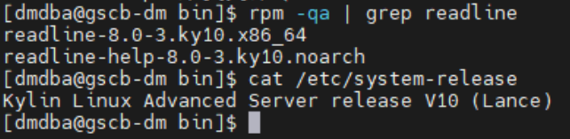

2. 如果未安装 readline 可通过以下命令安装 readline。
```shell
yum -y install readline*
```
3. 将下载好的 tar zxvf rlwrap-0.46.1.tar.gz 解压。下载地址可参考:https://github.com/hanslub42/rlwrap/tree/
```shell
tar zxvf rlwrap-0.46.1.tar.gz
```
4. 进入解压好的目录，进行安装。
```shell
cd rlwrap-0.46.1/
./configure
make
sudo make install
```
5. 配置环境变量并使环境变量生效。
```shell
##配置环境变量
cat >>/home/dmdba/.bash_profile<<-"EOF"
alias disql='rlwrap disql'
EOF

##使环境变量生效
source /home/dmdba/.bash_profile
```

## 如何禁止修改表中指定的数据

**【问题解决】**

可通过创建触发器的方式解决，示例如下：

1. 创建测试表并插入数据：
```sql
CREATE TABLE STU
(
ID INTEGER,
NAME VARCHAR(50))  ;

insert into stu VALUES (999,'aaa');--禁止修改id值为999的值
insert into stu VALUES (111,'bbb');
commit;
```
2. 创建触发器实现自定义错误类型，设置条件禁止修改或删除。
```sql
create or replace trigger tri_stu
after  update or delete of  id  on stu
for each row
begin
    if :old.id=999  then
    raise_application_error(-20002,'该表不允许删除或修改id=999的值');
    elseif   :new.id=999 then
    raise_application_error(-20001,'该表不允许出现第二个id=999的值');end if;
end;
```
3. 测试。
```sql
update stu set id =999 where name ='aaa';---20002: 该表不允许删除或修改id=999的值
```

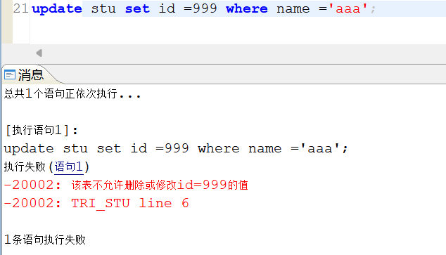

```sql
delete stu where id=999;---20002: 该表不允许删除或修改id=999的值
```

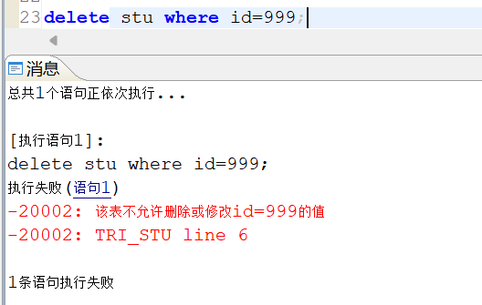

```sql
update stu set id =999 where id =111;---20001: 该表不允许出现第二个id=999的值
```

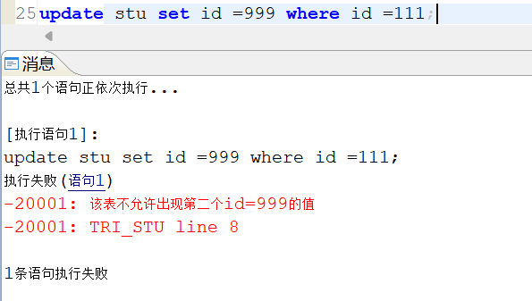

## 如何查询用户中所有表所有列的注释、列类型、列长度、是否允许为空、缺省值

**【问题解决】**

可以参考以下 SQL 进行查询：

```sql
SELECT
       TAB.NAME    AS "表名",
       SYSCOL.NAME AS "列名",
       SYSCOL.TYPE$
       ||'('
       ||SYSCOL.LENGTH$
       ||')'            AS "列类型and列长度",
       SYSCOL.NULLABLE$ as "是否为空"     ,
       SYSCOL.DEFVAL    AS "缺省值",
       COMM.COMMENT$
FROM
       SYSOBJECTS AS TAB,
       SYSOBJECTS AS SCH,
       SYSCOLUMNS AS SYSCOL,
       SYSCOLUMNCOMMENTS as COMM
WHERE
       SCH.ID   =TAB.SCHID
   AND TAB.ID   =SYSCOL.ID
   AND SCH.NAME = 'SYSDBA'
   AND SYSCOL.NAME = COMM.COLNAME
   and TAB.NAME IN
       (
               select TABLE_NAME from ALL_TABLES WHERE OWNER = 'SYSDBA'--用户名
       )
```

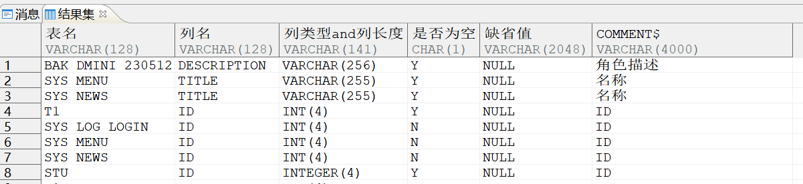

## 普通数据库用户登录报错：“-2106 ：无效的表或视图名【login\_history】”

**【问题描述】**

在新迁移完数据和数据库对象后或者删除过表后，SYSDBA 用户可以正常登录，当普通数据库用户登录时报错：  
“错误号：-2106 错误消息：无效的表或视图名【login\_history】”。

**【问题分析】**

该问题可能与创建了库级触发器 LOGIN 有关，如下;

```sql
CREATE TRIGGER  "LOGIN_AUDIT"
AFTER LOGIN
ON DATABASE
BEGIN
INSERT INTO  login_history SELECT 1;
COMMIT;
END;
```

当创建该触发器后用户在登录时可能会出现如下报错的情况。

```
用户登录报错
错误号:   -7160
错误消息: 对象[LOGIN_AUDIT]处于无效状态
```

**【问题解决】**

1. 检查所有用户下是否创建如上事件 LOGIN 的库级触发器。
2. 使用 SYSDBA 用户登录，禁用或删除所有该类型 (LOGIN) 的触发器。

## 如何查询包、存储过程、函数的具体执行情况？

**【问题解决】**

可通过 V$DMSQL\_EXEC\_TIME 视图来查看包、存储过程、函数的具体执行情况，使用该视图需要开启 ENABLE\_MONITOR\_DMSQL=1，该参数默认开启。具体方法如下：

1. 执行完成包、存储过程、函数后获取到对应的执行号。

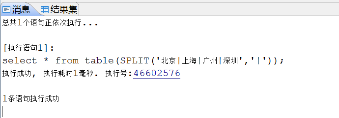

2. 获取到执行号后可通过以下 SQL 查看包、存储过程、函数的具体执行情况。
```sql
select * from V$DMSQL_EXEC_TIME where exec_id=执行号 order by level,TIME_USED DESC;
```

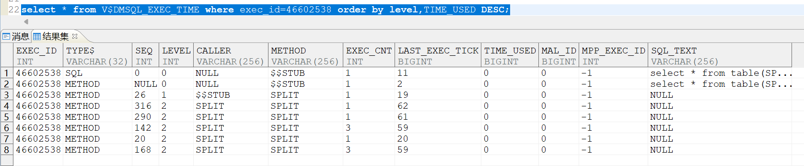

通过该视图 V$DMSQL\_EXEC\_TIME 可以查看到语句类型、调用方法名、包的执行层次、方法循环次数、方法执行时间、SQL 语句等信息。详细参数说明可参考《 DM8 系统管理员手册》中视图 DMSQL\_EXEC\_TIME.

## hash 分区表进行 DDL 和 DML 操作报错:“锁超时”

**【问题描述】**

在 hash 分区表存在较大业务量时，进行 DDL 和 DML 操作会报错：“锁超时”。使用 jmeter 模拟业务压测时，对 hash 分区表添加分区，发现对 hash 分区表存在锁。

**【问题分析】**

由于 hash 分区表在添加分区时会对某个分区中的数据进行数据平衡，因此该锁仅针对于某个数据减少的分区上锁，而并非整个 hash 分区表。

**【问题解决】**

若向存在大量业务的 hash 分区表进行 DDL 和 DML，可通过尽量扩增分区来解决此问题。

> **注意**
> 
> 对列存 hash 分区表添加分区时，数据是从第一个分区开始将数据的一半分到新的分区中。若原始分区数为 N，则当新增分区数为 2N 后，再次增加新分区，分区从第 N+1 个分区开始将数据的一半分到新的分区中。

## 没有 \[DBA\_INDEXES\] 对象的查询权限

**【问题描述】**

SYSDBA 授予普通用户 soi，svi，vti，select any dictionary 权限后仍然没有查询 DBA\_INDEXES 视图的权限。

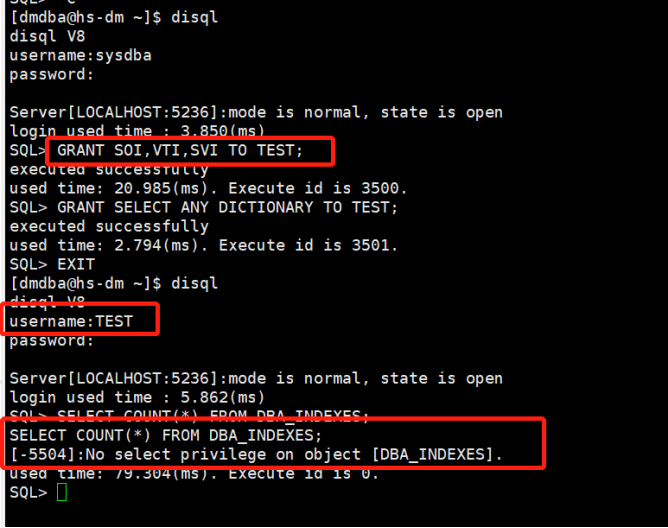

**【问题分析】**

在达梦中 dba\_ 开头的数据集仅为普通视图，授予的权限都是与系统字典和系统动态视图相关的权限，

按照普通视图的权限授予用户查询权限即可。

**【问题解决】**

授予用户 TEST 普通视图 DBA\_INDEXES 的查询权限。

```sql
GRANT SELECT ON SYS.DBA_INDEXES TO TEST;
```

## 创建用户时报错：“无效的用户名 \[TEST1\]”

**【问题描述】**

创建 TEST1 用户时报错：“无效的用户名”。

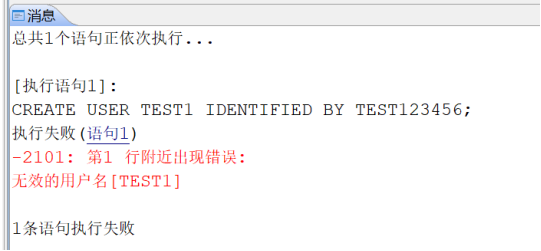

**【问题分析】**

创建用户的语句语法正确，当创建的用户已存在时应该报错：“对象\[TEST\]已存在”，此处报错：“无效的用户名 \[TEST1\]”，可能是有同名的 TEST1 模式存在的缘故。

**【问题解决】**

通过以下语句查看是否存在名为 TEST1 的模式：

```sql
select
        SCH_OBJ.NAME SCH_NMAE,
        USER_OBJ.NAME OWNER  ,
        SCH_OBJ.CRTDATE
from
        (
                select NAME, PID, CRTDATE from SYSOBJECTS where TYPE$='SCH'
        )
        SCH_OBJ,
        (
                select NAME, ID from SYSOBJECTS where TYPE$='UR' and SUBTYPE$='USER'
        )
        USER_OBJ
where
        SCH_OBJ.PID=USER_OBJ.ID
ORDER BY
        SCH_OBJ.NAME;
```

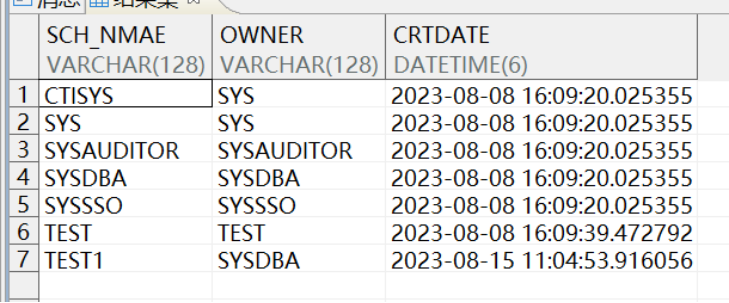

发现 TEST1 模式存在，属于 SYSDBA 用户，可以选择换用户名或者备份该模式后清除该模式再重新创建用户。

## 普通用户如何拥有关闭自己会话的权限

**【问题描述】**

普通用户没有权限执行 sp\_close\_session 关掉会话，并且该操作无法单独授权给普通用户。普通用户在不授予 DBA 权限时如何才能关闭自己的会话。

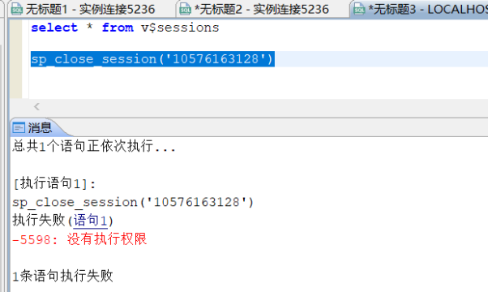

**【问题解决】**

可以使用具有 DBA 权限的用户创建一个自定义的存储过程来实现普通用户杀会话的需求，同时在存储过程中限制只能关闭用户自己执行的会话，避免错误关闭其他会话。示例如下：

1. 普通用户无法关闭自己打开的会话。

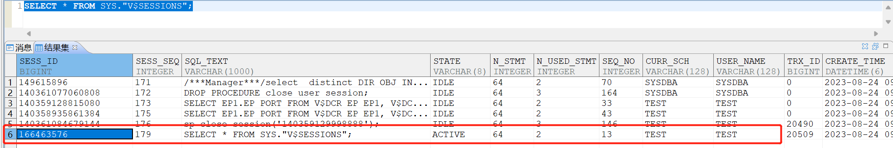

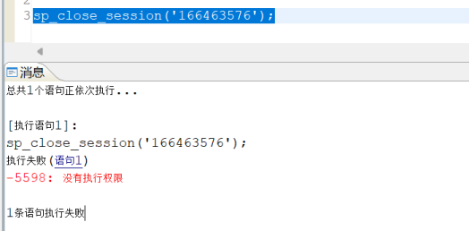

2. 使用具有 DBA 权限的用户创建存储过程，普通用户调用该存储过程可以杀掉自己打开的会话。
```sql
create or replace PROCEDURE close_user_session(session_id bigint) as
curr_name varchar(32);
sess_name varchar(32);
BEGIN
--校验用户，只能杀自己执行的
select user into curr_name;
select user_name into sess_name from v$sessions where sess_id=session_id;
if curr_name==sess_name then
sp_close_session(session_id);
else  
print ' ';
print '执行失败,只能关闭当前用户连接的会话!!!' ;
end if;
EXCEPTION
WHEN NO_DATA_FOUND THEN
print ' ';
print '执行失败,没有找到对应的会话 !!!';
WHEN others THEN
print ' ';
print  SQLCODE||' '||SQLERRM;  
end;
```
3. 将存储过程的执行权限授权给普通用户。
```sql
grant exec on close_user_session to test;
```
4. 测试普通用户 TEST 调用该存储过程关闭会话。
```sql
sysdba.close_user_session('166463576');
```

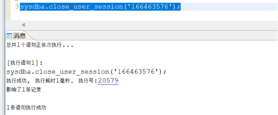

会话已断开

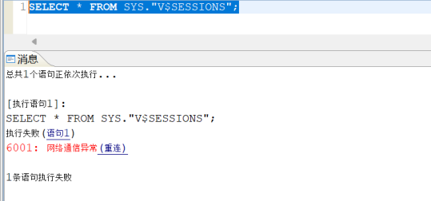

5. 测试普通用户关闭非自己打开的会话。
```sql
sysdba.close_user_session('140361077060808');
```


关闭会话失败。


普通用户通过调用该存储过程可以杀掉自己打开的会话，不可以杀掉非自己打开的会话。

## 将表及其索引移动到其它表空间时报错

**【问题描述】**

业务表数据存储在 MAIN 表空间中，在将业务表移动到指定的表空间时报错，如下所示：

```sql
ALTER TABLE DEM.DMA_DATABASE_SQL_LOG_FILE MOVE TABLESPACE DMDEM;
执行失败(语句1)
-2723: 仅当指定列列表，且SET IDENTITY_INSERT为ON时，才能对自增列赋值
```

**【问题分析】**

通过查看表建构发现需要移动的表中某个字段存在自增长的列，当直接移动带有自增列字段的表时，会报上述错误，无法移动表。


**【问题解决】**

可通过设置“允许将显式值插入表的自增列”来实现移动带有自增长列的表，设置 SET IDENTITY\_INSERT 为 ON 即为“允许将显式值插入表的自增列”，具体语法如下所示：

```sql
/*设置 DEM 模式下表 DMA_DATABASE_SQL_LOG_FILE 允许将显式值插入表的自增列*/
SET IDENTITY_INSERT DEM.DMA_DATABASE_SQL_LOG_FILE ON;
/*移动 DEM 模式下表 DMA_DATABASE_SQL_LOG_FILE */
ALTER TABLE DEM.DMA_DATABASE_SQL_LOG_FILE MOVE TABLESPACE DMDEM;
```


## 达梦数据库如何排查阻塞

**【问题描述】**

达梦数据库如何快速排查是否存在阻塞并关闭造成阻塞的会话。

**【问题解决】**

1. 通过 v$trxwait 视图查询阻塞者事务 ID；
```sql
select id,wait_for_id,wait_time,thrd_id from v$trxwait;
```
2. 将得到的造成阻塞的事务 ID wait\_for\_id 代入 v$sessions 进行查询；
```sql
select sess_id,sql_text,state,trx_id from v$sessions where trx_id='wait_for_id';
```
3. 通过得到的会话信息确认是否可以关闭阻塞者会话，如果可以关闭可通过执行下面语句关闭该会话。
```sql
sp_close_session(sess_id);
```

## 如何仅收集新增分区的统计信息

**【问题描述】**

有的分区表很大，每天或者每个月新增一个分区，全表收集统计信息耗时较长，是否支持仅收集新增分区的统计信息？

**【问题解决】**

可以使用 DBMS\_STATS 包中的 GATHER\_TABLE\_STATS 过程来收集指定分区的统计信息。

使用方法示例如下：

1. 创建分区表：
```sql
DROP TABLE IF EXISTS T_PART;   --删除T_PART 测试分区表
-- 创建测试用的分区表T_PART,使用CUR_DATE字段进行范围分区
CREATE TABLE T_PART
(ID INT,
CUR_DATE DATE,
COL_A VARCHAR(10)
)
PARTITION BY LIST (CUR_DATE)
(
 PARTITION T_PART_1 VALUES (DATE'2023-08-01'),
 PARTITION T_PART_2 VALUES (DATE'2023-08-02'),
 PARTITION T_PART_3 VALUES (DATE'2023-08-03')
);  
-- 插入数据
INSERT INTO T_PART SELECT ROWNUM,DATE'2023-08-01','A' FROM DUAL CONNECT BY ROWNUM < 101;
INSERT INTO T_PART SELECT ROWNUM,DATE'2023-08-02','A' FROM DUAL CONNECT BY ROWNUM < 201;
INSERT INTO T_PART SELECT ROWNUM,DATE'2023-08-03','A' FROM DUAL CONNECT BY ROWNUM < 301;
-- 收集统计信息
BEGIN
  DBMS_STATS.GATHER_TABLE_STATS(OWNNAME          => 'SYSDBA',       -- 方案名
                                TABNAME          => 'T_PART',       -- 表名
                                ESTIMATE_PERCENT => 100,            -- 采样率
                                DEGREE           => 2);             -- 并行度
END;
```
2. 查看统计信息
```sql
SELECT B.OBJECT_NAME,SUBOBJECT_NAME,OBJECT_TYPE,A.* 
  FROM SYSSTATS A, 
       ALL_OBJECTS B 
 WHERE A.ID = B.OBJECT_ID
   AND B.OBJECT_NAME ='T_PART' ORDER BY ID,COLID;
```


3. 新增分区并插入数据
```sql
-- 新增分区
ALTER TABLE T_PART ADD PARTITION T_PART_4 values(DATE'2023-08-04');
ALTER TABLE T_PART ADD PARTITION T_PART_5 values(DATE'2023-08-05');
ALTER TABLE T_PART ADD PARTITION T_PART_6 values(DATE'2023-08-06');

-- 插入数据 
INSERT INTO T_PART SELECT ROWNUM,DATE'2023-08-04','X' FROM DUAL CONNECT BY ROWNUM < 401;
INSERT INTO T_PART SELECT ROWNUM,DATE'2023-08-05','D' FROM DUAL CONNECT BY ROWNUM < 301;
INSERT INTO T_PART SELECT ROWNUM,DATE'2023-08-06','E' FROM DUAL CONNECT BY ROWNUM < 201;

-- 收集T_PART_6分区的统计信息
BEGIN
  DBMS_STATS.GATHER_TABLE_STATS(OWNNAME          => 'SYSDBA',       -- 用户名
                                TABNAME          => 'T_PART',       -- 表名
                                PARTNAME         => 'T_PART_6',     -- 分区名
                                ESTIMATE_PERCENT => 100             ); -- 采样率
END;
```
4. 查看统计信息
```sql
SELECT B.OBJECT_NAME,SUBOBJECT_NAME,OBJECT_TYPE,A.* 
  FROM SYSSTATS A, 
       ALL_OBJECTS B 
 WHERE A.ID = B.OBJECT_ID
   AND B.OBJECT_NAME ='T_PART' ORDER BY ID,COLID;
```

T\_PART\_6 的统计信息已收集。


## 如何查出所有存储过程的依赖关系？

**【问题解决】**

方法一：可以通过达梦管理工具进行查询。  方法二：可以通过如下 SQL 查询。

```sql
--将SQL语句中的SYSDBA替换成要查询的模式即可
   SELECT DOBJS.SCHEMA_NAME "模式名", 
          DOBJS.NAME "对象名称", 
          SOBJS.NAME "被依赖对象所属模式", 
          DOBJS.REFED_TYPE$ "被依赖对象类型", 
          OBJS.NAME "被依赖对象名", 
          TEXTS.TXT "对象定义"
     FROM (SELECT OBJPROC.NAME, 
                     OBJPROC.SCHEMA_NAME, 
                     SDEP.REFED_TYPE$, 
                     SDEP.REFED_ID 
                FROM SYSDEPENDENCIES SDEP 
          INNER JOIN (SELECT 
                              /*+ OPTIMIZER_OR_NBEXP(2) ORDER(PROC_OBJ_INNER, SCH_OBJ_INNER, USER_OBJ_INNER)*/ 
                              PROC_OBJ.ID, 
                              PROC_OBJ.NAME, 
                              SCH_OBJ.NAME "SCHEMA_NAME" 
                         FROM (SELECT ID, 
                                      NAME 
                                 FROM SYSOBJECTS 
                                WHERE TYPE$='SCH' 
                                  AND ID = (SELECT ID FROM SYSOBJECTS WHERE TYPE$='SCH' AND NAME ='SYSDBA')) SCH_OBJ, (SELECT PROC_OBJ_INNER.ID, 
                                      PROC_OBJ_INNER.NAME, 
                                      PROC_OBJ_INNER.CRTDATE, 
                                      PROC_OBJ_INNER.INFO1, 
                                      PROC_OBJ_INNER.SCHID, 
                                      PROC_OBJ_INNER.VALID 
                                 FROM SYSOBJECTS PROC_OBJ_INNER, 
                                      SYSOBJECTS SCH_OBJ_INNER, 
                                      SYSOBJECTS USER_OBJ_INNER
                                WHERE PROC_OBJ_INNER.SUBTYPE$='PROC'
                                  AND PROC_OBJ_INNER.TYPE$='SCHOBJ'
                                  AND PROC_OBJ_INNER.INFO1&0X01 = 0X01
                                  AND (PROC_OBJ_INNER.INFO1/4) 
                                      &0X01=0
                                  AND PROC_OBJ_INNER.SCHID = (SELECT ID FROM SYSOBJECTS WHERE TYPE$='SCH' AND NAME ='SYSDBA')
                                  AND USER_OBJ_INNER.SUBTYPE$ = 'USER'
                                  AND SCH_OBJ_INNER.ID = PROC_OBJ_INNER.SCHID
                                  AND SCH_OBJ_INNER.PID = USER_OBJ_INNER.ID
                                  AND SF_CHECK_PRIV_OPT(UID(), CURRENT_USERTYPE(), PROC_OBJ_INNER.ID, USER_OBJ_INNER.ID, USER_OBJ_INNER.INFO1, PROC_OBJ_INNER.ID) = 1) PROC_OBJ
                        WHERE PROC_OBJ.SCHID=SCH_OBJ.ID 
                     ORDER BY PROC_OBJ.NAME) OBJPROC 
                  ON SDEP.ID=OBJPROC.ID) DOBJS
LEFT JOIN SYSOBJECTS OBJS 
       ON DOBJS.REFED_ID = OBJS.ID
LEFT JOIN SYSOBJECTS SOBJS 
       ON OBJS.SCHID = SOBJS.ID 
      AND OBJS.SCHID != 0
LEFT JOIN SYSTEXTS TEXTS 
       ON OBJS.ID = TEXTS.ID;
```

## 如何清除 object\_usage 视图中所有监控的索引信息

**【问题描述】**

索引监控一旦打开，v$object\_usage 中将保存所有监控的索引信息。如果想清除该表数据以重新监控索引要如何操作？

**【问题解决】**

可以使用 SP\_DYNAMIC\_VIEW\_DATA\_CLEAR 函数来清除该动态视图数据。

```sql
call sp_dynamic_view_data_clear('V$OBJECT_USAGE');
```

## 表中大字段占用的空间如何回收

**【问题描述】**

数据库中，某表大字段占用过多，当将大字段数据全部 update 为 null 或空串时，不会自动回收空闲空间。

**【问题解决】**

方法一：可以在管理工具中使用【表】->【存储选项】->【清理大字段空闲页】功能，可以快速回收已释放的存储空间。


方法二：将大字段数据全部 update 为 null 或空串后执行 `call SP_TABLE_LOB_RECLAIM('模式','表')` 语句，回收空闲空间。

```sql
call SP_TABLE_LOB_RECLAIM('SYSTH_PAY','SWAP_RECEIVED_ZMW1107');
```


## 如何查询某个表的大字段空间占用大小

**【问题解决】**

```sql
select obj.name, 
          seg.n_extent*sf_get_page_size()*sf_get_extent_size()/1024/1024 MB 
     from sysobjects obj 
left join v$lob_seg seg 
       on obj.id=seg.tab_id
    where obj.name ='表名';
```

## 如何通过 SQL 查看当前库中的作业状态是否启用

**【问题解决】**

```sql
select name, 
       CASE ENABLE WHEN '1'THEN '已启用' when '0' THEN '已禁用' end as enable 
  from USER_JOBS_VIEW;
```

## 如何查询分区子表的对象大小和占用空间

**【问题解决】**

可参考如下 SQL 查询分区表的每个分区的对象大小和占用空间，便于评估分区表数据量。

```sql
select schname,ptab,subtabname,
TABLE_USED_PAGES(schname,subtabname)*page()/1024/1024.0 as "子表对象大小_MB",
TABLE_USED_SPACE(schname,subtabname)*page()/1024/1024.0 as "子表占用空间_MB"
from
(select SF_GET_SCHEMA_NAME_BY_ID(b.schid) as schname,b.name as subtabname,a.name as ptab
from sysobjects a,sysobjects b
where a.id=b.pid
and b.subtype$='UTAB' and a.name='<分区表名>')
order by 3;
```


## 如何查看当前 DML 事务执行进度

**【问题解决】**

当存在活动事务时，可以查询事务当前进度（执行时间、插入行数、删除行数、更新行数、是否正在回滚）便于判断事务当前状态。可以参考如下 SQL 进行查询：

```sql
SELECT DATEDIFF(SS,LAST_RECV_TIME,SYSDATE) SS,
      S.LAST_RECV_TIME,
      S.SESS_ID,
      T.THRD_ID,
      T.ID,
      S.SQL_TEXT,
      SF_GET_SESSION_SQL(S.SESS_ID) AS SQL_FULL_TEXT,
      T.STATUS,
      T.INS_CNT,
      T.DEL_CNT,
      T.UPD_CNT,
      T.UPD_INS_CNT,
      T.WAITING,
      T.START_LSN,
      T.ROLLBACK_FLAG,
      T.LOCK_CNT,
      S.AUTO_CMT,
      S.CONNECTED,
      S.CLNT_IP,
      S.USER_NAME
FROM V$SESSIONS S,V$TRX T
WHERE S.TRX_ID=T.ID
AND S.STATE='ACTIVE'
AND S.SESS_ID<>SESSID;
```


## 表空间文件达到上限后如何继续添加

**【问题描述】**

新增表空间文件，抛出“超出表空间文件数量限制，请检查 TS\_FIL\_MAX\_ID 参数"报错，在不调整单个表空间文件上限情况下，如何继续新增表空间文件？

**【问题解决】**

在 dm.ini 文件中 TS\_FIL\_MAX\_ID 参数对表空间文件数量进行了限制，目前版本默认 255，可以通过适当调整此参数继续增加表空间文件数量，该参数是静态参数，调整后需重启数据库生效。

## 重建系统包报错：“无效的过程/函数名”

**【问题描述】**

执行 SP\_CREATE\_SYSTEM\_PACKAGES(1) 重建系统包时，数据库报错：“无效的过程/函数名”。如下图： 

**【问题分析】**

排查发现数据库开启了 oracle 兼容参数（COMPATIBLE\_MODE=2），当开启该参数时需要同步开启 ORA\_DATE\_FMT=1 才可以正常重建系统包。

**【问题解决】**

设置参数 ORA\_DATE\_FMT=1，重启数据库。

参数说明：

| 参数说明 | 默认值 | 属性 | 说明 |
| --- | --- | --- | --- |
| ORA\_DATE\_FMT | 0 | 静态 | 指定 DATE 类型格式。   0：DATE 类型使用 NLS\_TIMESTAMP\_FORMAT 格式；   1：DATE 类型使用 NLS\_DATE\_FORMAT 格式。   注：仅当 COMPATIBLE\_MODE 为 2 时有效。 |

## DM 中创建表、索引，会修改哪些字典表？

**【问题分析】**

通过开启 autotrace，可以跟踪显示修改了哪些数据字典。

验证步骤：

1. 通过 disql 登录数据库，并开启 autotrace。
```sql
set autotrace traceonly
```
2. 创建表。
```sql
SQL> create table t as select * from dual;
executed successfully

1   #INSERT : [0, 0, 0]; table(SYSOBJECTS), type(values) mpp_opt(0)
1   #INSERT : [0, 0, 0]; table(SYSCOLUMNS), type(values) mpp_opt(0)
1   #INSERT : [0, 0, 0]; table(SYSOBJECTS), type(values) mpp_opt(0)
1   #INSERT : [0, 0, 0]; table(SYSINDEXES), type(values) mpp_opt(0)
1   #INSERT : [0, 0, 0]; table(SYSOBJINFOS), type(values) mpp_opt(0)
```

从以上执行计划可知，创建表操作对 SYSOBJECTS、SYSINDEXES、SYSCOLUMNS、SYSOBJINFOS 字典表执行了 insert 操作。

## 函数 REGEXP\_LIKE 执行报错

**【问题描述】**

函数 REGEXP\_LIKE 执行报错：\[-2207\]:Error in line 1 Member access \[REGEXP\_LIKE\] unresolved，怎么解决？

**【问题解决】**

触发该错误是由于数据库 bin 目录中缺少文件 libregex.dll（windows）或 libregex.so（linux）库文件，可尝试通过从其他环境拷贝该文件到 bin 目录下，并重启数据库解决。

## 如何查询系统函数以及参数定义

**【问题解决】**

可通过如下 SQL 进行查询。

```sql
select i.id, 
         i.name as f_name, 
         i.arg_num,
         ig.name as arg_name,
         ig.seq, 
         ig.data_type, 
         ig.len, 
         ig.prec, 
         ig.io_type,
         i.IS_READONLY, 
         i.IS_MOUNT_ONLY, 
         i.IS_INCLUDE_SQL, 
         i.IS_LPQ_FORBIDDEN, 
         i.CLASS$
    from v$ifun i, 
         v$ifun_arg ig
   where i.id=ig.id
     and i.name = 'SP_CLOSE_SESSION'
order by 1, 
         2, 
         3, 
         5;
```


## 如何查询 DM 数据库中所有 huge 表

**【问题解决】**

使用如下 sql 查询所有 huge 表：

```sql
SELECT * FROM SYS.SYSOBJECTS WHERE  (INFO3 & 0X3F)  BETWEEN 0X21 AND 0X27 AND PID=-1;
```

## dm 中 lsn 与时间的对应关系怎么确定？以及更新规则是什么？

**【问题解决】**

视图 V$LSN\_TIME 包含了时间与系统 lsn 的对应关系，该视图每 3 秒更新一次，当 lsn 无变化时，仍会增加一条记录，即存在同个 lsn 对应多个时间的记录，如下：

```sql
SQL> select top 5 * from v$lsn_time order by lsn;

LINEID     TIME_MP              TIME_DP             LSN   
---------- -------------------- ------------------- --------------------
1          1731620305           2024-11-14 21:38:25 98853
2          1731620308           2024-11-14 21:38:28 98853
3          1731620311           2024-11-14 21:38:31 98853
4          1731620314           2024-11-14 21:38:34 98853
5          1731620318           2024-11-14 21:38:38 98853
```

V$LSN\_TIME 视图详细解释可参考数据库安装目录下 doc 目录中《DM8 系统管理员手册》。

## 如何自定义归档文件名称

**【问题解决】**

dmarch.ini 文件中本地归档 \[\] 方括号里的名称可影响归档文件的命名。

例如：

```sql
[ZIDINGYI]     #此处自定义或修改名称
ARCH_TYPE            = LOCAL  
ARCH_DEST            = /opt/dmdbms/data/DAMENG/arch  
ARCH_FILE_SIZE       = 64  
ARCH_SPACE_LIMIT     = 0  
ARCH_FLUSH_BUF_SIZE  = 0  
ARCH_HANG_FLAG       = 1
```

生成的归档文件名称由默认的：

```shell
ARCHIVE_LOCAL2_0x403FC514_EP0_2024-05-11_16-29-53.log
```

改为：

```shell
ZIDINGYI_0x403FC514_EP0_2024-09-20_22-33-02.log
```

## 如何兼容 MySQL 的 \\G 列式显示 SQL 结果

**【问题解决】**

2023 年 Q3 季度版及以后版本 disql 可通过设置 ISQL\_MODE=3 来兼容 MySQL 的 \\G 列式显示 SQL 结果，示例如下：

1. disql 登录设置 ISQL\_MODE=3。
```sql
SQL> set isql_mode 3
```
2. 设置后即可支持 \\G 列式显示。
```sql
SQL> select * from t\G
```


## 如何实现模式级授权

**【问题描述】**

如何实现模式级授权，用户能够拥有另一个用户的权限。

**【问题解决】**

1. 开启按模式授权功能。

修改参数 GRANT\_SCHEMA 值为 1。

```sql
sp_set_para_value(2,'GRANT_SCHEMA',1);
```

参数 GRANT\_SCHEMA 为静态参数，开启按模式授权功能需修改参数值为 1，修改后需重启数据库生效。

2. 重启数据库。
3. 授予权限。

例如，授予 T1 用户查询 T2 模式下对象的权限。

```sql
Grant select on schema T2 to T1;
```

补充：

回收权限，例如，回收 T1 用户对 T2 模式下对象的查询权限，方法如下：

```sql
revoke select on schema T2 from T1;
```

如果需要关闭按模式授权功能，需要修改参数 GRANT\_SCHEMA 值为 0，并重启数据库。如下：

修改参数 GRANT\_SCHEMA 值为 0。

```sql
sp_set_para_value(2,'GRANT_SCHEMA',0);
```

重启数据库使设置生效。

## 回滚表空间不足

**【问题描述】**

执行 sql 时提示回滚表空间不足的报错，如下图所示：


**【问题分析】**

回滚空间增长的本质是：产生了大量 UNDO 日志，且这些日志无法被及时释放或者覆盖。主要原因有以下几个方面：

1. 大事务或者长事务

批量 DML 操作：一次性 INSERT/UPDATE/DELETE 大量数据，未提交的事务，长时间没有提交或者回滚导致回滚表空间增长。

2. 高并发 DML 业务

大量并发会话同时执行增删改，短时间内产生大量 UNDO 日志，如果 undo 日志生成速度大于 PURGE 清理速度，undo 表空间就会膨胀。

3. 参数配置不合理

UNDO\_RETENTION 参数设置过大：该参数设置过大也就是 UNDO 日志的最小保留时间就越长，已提交事务的 UNDO 就会长期占用空间。UNDO\_SPACE 阈值过高：阈值太高，系统不主动清理，导致空间占满。

**【问题解决】**

可以参考如下方法进行解决：

1. 修改 sql 语句，进行分批提交，避免大量数据最后一次性提交，导致回滚表空间增长太大。
2. 修改 UNDO\_RETENTION 参数到合适的值。
3. 缩小回滚表空间文件，参考命令如下：
```sql
alter tablespace "ROLL" resize datafile 'ROLL.DBF' to 128;
```
4. 增加服务器的磁盘容量。

## 视图在只读事务中修改数据

**【问题描述】**

用户在创建业务表的失败，提示报错信息：SQL 错误 \[25006\]：视图在只读事务中修改数据，如下图所示：


**【问题分析】**

排查发现对数据库业务用户设置了 read only 权限，使用户对数据库只有只读权限，无法操作数据库。

**【问题解决】**

使用数据库管理员用户修改业务用户权限，取消业务用户的 read only 权限，参考命令如下所示：

```sql
alter user DB_JIAO not read only;
```