本章节主要介绍达梦数据库性能优化常见问题，为用户提供性能优化常见问题的分析和解决思路。除此之外，用户还可前往 [达梦技术社区](https://eco.dameng.com/community/question/) 参与更多问题讨论。

## 目录

## 正文

## 在应用中发现执行较慢的 SQL，在管理工具中执行很快

可通过查看系统视图，及时发现活动会话中的慢 SQL，将其在计划缓存中的执行计划打印到 trc 文件中，核查是否与在管理工具中查询到的执行计划一致，偏差较大则清理缓存中执行计划。

具体方法如下：

通过 PLNDUMP 来看对应缓存中的 SQL 执行计划

- 查找出活动会话中执行时间大于 1S 的 SQL
```sql
select * from (
select timestampdiff(second,s.last_recv_time,sysdate) t ,s.* 
from v$sessions s  where state='ACTIVE')
where t > 1
```
- 找到对应慢 SQL 对应的 cache\_item 值。
```sql
select * from v$cachepln where upper(sqlstr) like '%SQL%'
```
- 在 trace 目录中生成对应 trc 文件
```sql
alter session set events 'immediate trace name plndump ,level cache_item'
```
- 对比管理工具的执行计划和.trc 文件中的执行计划。
- 清理内存中执行计划缓存。
```sql
call sp_clear_plan_cache();
call sp_clear_plan_cache(pln号)；---不加 pln 就是清理所有 sql 缓存。
```

## 如何看某条 sql 语句每个操作符的执行时间？

- 创建测试表
```sql
DROP TABLE if EXISTS TEST;
CREATE TABLE TEST (NAME VARCHAR2(200),ENTRY_DATE DATE,COMPANY VARCHAR2(200));
INSERT INTO TEST VALUES('王强',date'2008-1-1','电信');
INSERT INTO TEST VALUES('王强',date'2009-1-1','移动');
INSERT INTO TEST VALUES('王强',date'2010-1-1','联通');
INSERT INTO TEST VALUES('李四',date'2008-1-1','电网');
INSERT INTO TEST VALUES('李四',date'2009-1-1','财政局');
INSERT INTO TEST VALUES('张三',date'2012-12-1','腾讯');
INSERT INTO TEST VALUES('张三',date'2013-12-1','阿里');
INSERT INTO TEST VALUES('张三',date'2014-12-1','美团');
INSERT INTO TEST VALUES('张三',date'2015-12-1','饿了么');
COMMIT;
--SELECT * FROM TEST; --查看数据
```

- 在管理工具中执行如下语句：
```sql
SF_SET_SESSION_PARA_VALUE('MONITOR_SQL_EXEC',1);  
--动态打开会话级参数MONITOR_SQL_EXEC，该设置只对本会话有效,其余会话无影响
```

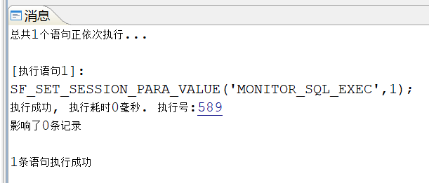

- 执行 sql 语句并获取操作符执行时间
```sql
SELECT
        A.NAME,
        LISTAGG(A.COMPANY, '->') WITHIN GROUP (
ORDER BY
        A.ENTRY_DATE)
FROM
        TEST A
GROUP BY
        A.NAME;
```

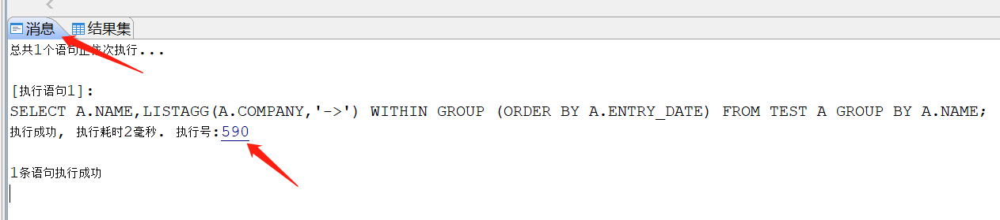

依次点击“消息”，“590”，（或者执行 et(590) ）弹出如下的操作符执行时间对话框：

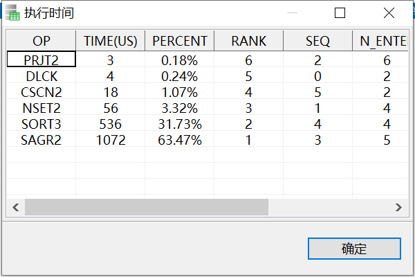

如上图所示，该 sql 语句共涉及 6 个操作符，按照执行的先后顺序分别是 SAGR2、SORT3、NSET2、CSCN2、DLCK、PRJT2。

其中，耗时最长的操作符是 SAGR2，耗时 1072 微秒，占总执行时间的 63.47%；耗时排第二位的操作符是 SORT3，耗时 536 微秒，占总执行时间的 31.73%。

根据上述的分析，我们就需要针对这 2 个操作符进行针对性的优化。

## disql 查看执行计划

**【问题说明】** ：  
disql 中开启自动跟踪 set autotrace trace + sql ，对应的执行计划看不到统计信息是否失真的对比（估算和实际记录数），三元组中记录数只有一个数字。

**【解决方法】** ：  
该功能开启前提是 ini 参数：ENABLE\_MONITOR、MONITOR\_SQL\_EXEC 已开启，故运行时先执行以下脚本设置参数

```sql
SP_SET_PARA_VALUE(1,'ENABLE_MONITOR',1);
SP_SET_PARA_VALUE(1,'MONITOR_SQL_EXEC',1);
```

分析完后，记得关闭，以免影响性能

```sql
SP_SET_PARA_VALUE(1,'ENABLE_MONITOR',0);
SP_SET_PARA_VALUE(1,'MONITOR_SQL_EXEC',0);'
```

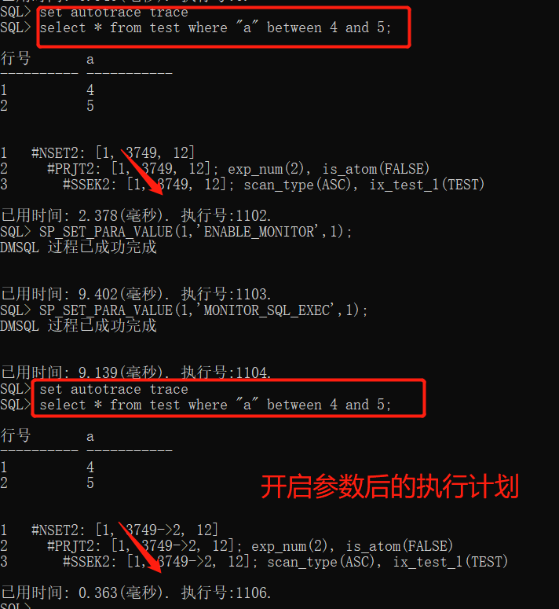

## 大量的 DML 动作(经常做增删改查)导致表的碎片很多，最终导致查询该表性能很慢，如何解决

**【问题解决】** ：

达梦的数据通过 B 树维护的。可对指定索引进行空间整理，重组数据，达到优化该表的目的。具体操作如下，以 test 为例介绍：

```sql
---首先查看 TEST 表的索引名
select name from sysobjects where pid=(select id from sysobjects where name='TEST' and type$='SCHOBJ')and subtype$='INDEX';
---重组 TEST 表的索引
SP_REORGANIZE_INDEX('SYSDBA','INDEX33555469');
```

## 执行大批量提交删除操作时，运行效率较低

**【问题描述】** ：

执行大批量提交删除操作时，运行效率较低，定位到 sql: delete from m\_object where oid=?; 并且负载过高。  
检查数据库没有阻塞 sql，没有锁等待，没有触发器。检查该列 oid 为主键列且执行计划也走了索引。此表数据量不到两百万，主键列的引用表个数 37 张，经常检索的引用表数据量大约 30G 左右，单条执行删除操作大约在 2-3s。

**【问题解决】** ：

由于 M\_OBJECT 表中主键列被其他表的外键约束引用，导致删除数据时会检查关联表的外键所以删除较慢，建议把外键列都加索引，约束改成 with index。  
例如：alter table "M\_VALUE\_POLICY" modify constraint "FK\_VALUE\_POLICY" to foreign key("OID") references "M\_OBJECT"("OID") with index;

> **注意**
> 
> sql 效率执行慢原因除了外键约束引用情况，还要综合分析触发器和主备数据同步之间影响等情况。

## 如何对缓存中的执行计划进行过滤

**【问题描述】**

在业务系统中 sql 的执行速度，执行计划会随着数据量和数据类型变化而变化，应用需要定时对 sql 进行巡检，保证业务性能。

**【问题解决】**

1. 导出数据库内全部缓存的执行计划。
```sql
select  'ALTER SESSION SET EVENTS ''IMMEDIATE TRACE NAME PLNDUMP,LEVEL '||cache_item||''';'  from v$cachepln ;
```

该命令执行后，会在 DAMENG/trace 目录下生成 trc 文件。

3. 将包含 "CSCN2" 的 sql 进行梳理，过滤规则为：  
	① 凡是涉及到向大量客户开放使用或常用业务中频繁使用的 sql，需要根据实际情况判断是否需要优化  
	② 经过判断执行次数比较少的 sql 可以不做处理。
4. 在导出的 trace 文件中，查找 "CSCN2"、"SSCN" 等表示全表扫描的执行计划，然后向上找到对应的 sql 文本和 cache item 编号。

## 如何开启结果集缓存

**【问题描述】**

开启结果集缓存策略，可大大提升 sql 执行时间，达梦数据库如何开启结果集缓存？

**【问题解决】**

1. 修改 dm.ini 参数；
```shell
vim /dmdata/DAMENG/dm.ini

##设置参数值，开启结果集缓存
RS_CAN_CACHE=1
BUILD_FORWARD_RS=1
```

当 RS\_CAN\_CACHE 为 1 时，还可以通过设置 INI 参数 RS\_CACHE\_TABLES 和 RS\_CACHE\_MIN\_TIME 对缓存的结果集进行限制和过滤。RS\_CACHE\_TABLES 指定可以缓存结果集的基表清单，只有查询涉及的所有基表全部在参数指定范围内，此查询才会缓存结果集。RS\_CACHE\_MIN\_TIME 则指定了缓存结果集的查询语句执行时间的下限，只有实际执行时间不少于指定值的查询结果集才会缓存。

参数说明：

| 参数名 | 默认值 | 说明 | 属性 |
| --- | --- | --- | --- |
| RS\_CAN\_CACHE | 0 | 结果集缓存配置。   0：禁止重用结果集；   1：强制模式，此时默认缓存所有结果集，   但可通过 RS\_CACHE\_TABLES 参数和语句   HINT 进行手动设置；   2：手动模式，此时默认不缓存结果集，   但可通过语句 HINT 对必要的结果集进行   缓存 | 静态 |
| BUILD\_FORWARD\_RS | 0 | 仅向前游标是否生成结果集。   0：不生成；   1：生成 | 静态 |
| RS\_CACHE\_TABLES | 空串 | 指定可以缓存结果集的基表的清单，   当 RS\_CAN\_CACHE=1 时，只有查   询涉及的所有基表全部在此参数指   定范围内，该查询才会缓存结果集。   当参数值为空串时，此参数失效。 | 手动 |
| RS\_CACHE\_MIN\_TIME |  | 结果集缓存的语句执行时间下限，只   有实际执行时间不少于指定时间值的   查询，其结果集才会被缓存，仅在   RS\_CAN\_CACHE=1 时有效。默认值 0，   表示不限制；有效值范围（0~4294967294）   ，以 MS 为单位。 | 动态，系统级 |

2. 验证 dm.ini 修改是否正确；
```sql
select * from v$dm_ini where PARA_NAME in ('RS_CAN_CACHE','BUILD_FORWARD_RS','RS_CACHE_TABLES');
```
3. 重启数据库生效。

**示例** ：

1. 修改 dm.ini 参数；
```shell
vim /dmdata/DAMENG/dm.ini

RS_CAN_CACHE=1
BUILD_FORWARD_RS=1
RS_CACHE_TABLES=HGTEST.YBCK_CBEC_ELIST_ITEM,HGTEST.YBCK_CBEC_ELIST
```
2. 验证 dm.ini 修改是否正确；
```sql
select * from v$dm_ini where PARA_NAME in ('RS_CAN_CACHE','BUILD_FORWARD_RS',
'RS_CACHE_TABLES');
```

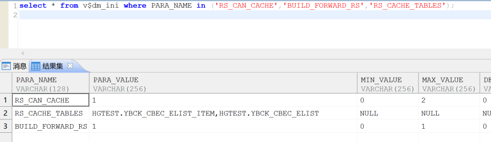

3. 重启数据库；
4. 验证结果集缓存。
- 第一次查询慢 sql 需要加载所有结果集，耗时较长。

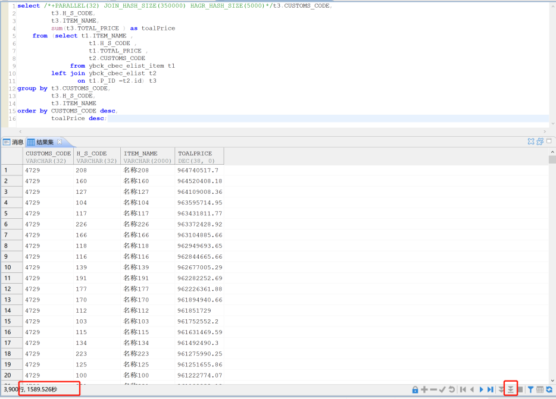

- 第二次查询使用到结果集缓存，耗时很短。

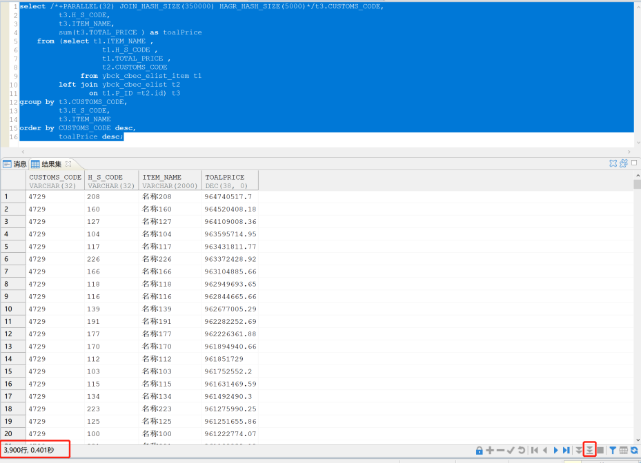

## 如何使用 DBMS\_SQLTUNE 包获取 SQL 执行信息

**【问题解决】**

DBMS\_SQLTUNE 包提供一系列对实时 SQL 监控的方法。当 SQL 监控功能开启后，DBMS\_SQLTUNE 包可以实时监控 SQL 执行过程中的信息，包括：执行时间、执行代价、执行用户、统计信息等情况。SQL 监控功能开启的方法是将 DM.INI 参数 ENABLE\_MONITOR 和 MONITOR\_SQL\_EXEC 均设置为 1。

具体操作步骤：

1. 设置 disql 界面显示长度。
```sql
SET LONG 9999999
```
2. 打开 MONITOR\_SQL\_EXEC。
```sql
sf_set_session_para_value('MONITOR_SQL_EXEC',1);
```
3. 执行需要调优的 SQL，例如如下 SQL：
```sql
select * from t1
```

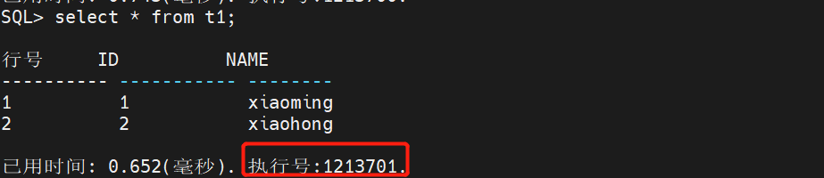

4. 调用 DBMS\_SQLTUNE.REPORT\_SQL\_MONITOR，传入执行 ID 1213701。
```sql
select DBMS_SQLTUNE.REPORT_SQL_MONITOR(SQL_EXEC_ID=>1213701) from dual;
```

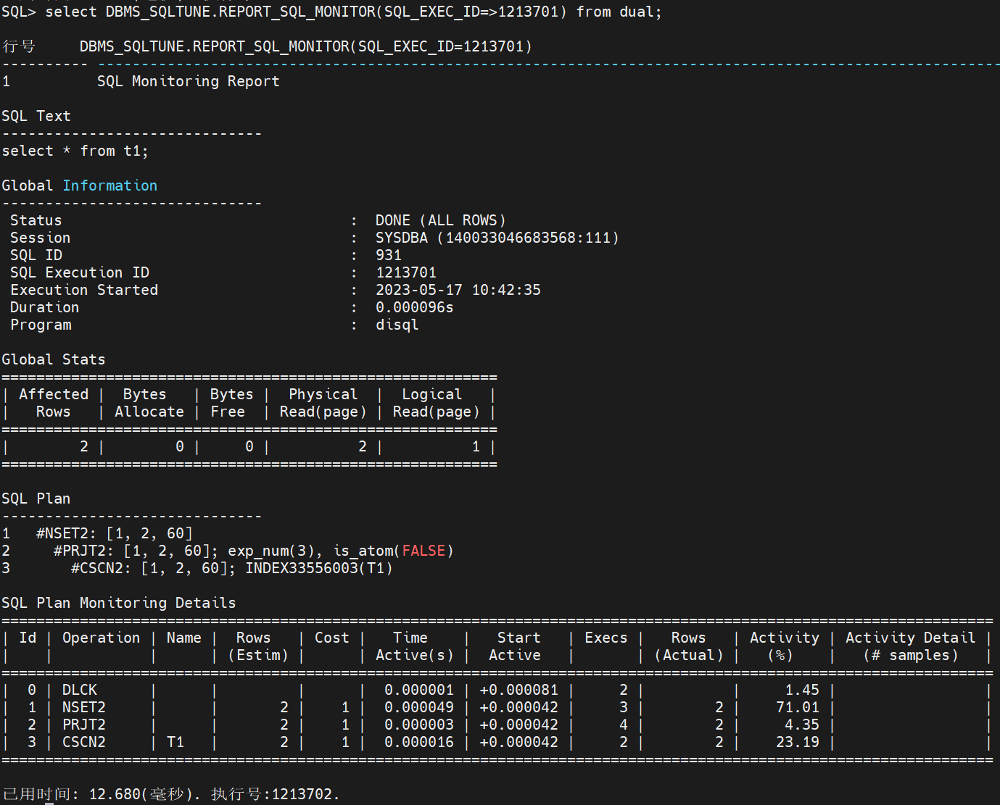

> **注意**
> 
> 数据库监控开启后对数据库性能有一定的影响，使用完毕后需及时关闭。

## DM 二级索引中是否包含了 null 值

**【问题描述】**

Oracle 数据库索引中不包含 null 值，因此 where 条件通过 null 值查询，无法使用索引，那么 DM 二级索引中是否包含了 null 值呢？

**【问题分析】**

验证步骤：

1. 创建测试表及索引。
```sql
create table t as select rownum id,md5(rownum) c1 from dual connect by rownum < 100000;
create index idxt on t(c1);
update t set c1=null where id=100;
commit;
```
2. 通过 null 条件查询。
```sql
select * from t where c1 is null;
1   #NSET2: [2, 2499, 68]
2     #PRJT2: [2, 2499, 68]; exp_num(3), is_atom(FALSE)
3       #BLKUP2: [2, 2499, 68]; IDXT(T)
4         #SSEK2: [2, 2499, 68]; scan_type(ASC), IDXT(T), scan_range[NULL,NULL], is_global(0)
```

从执行计划可知，使用了二级索引扫描，因此可以确定，DM 二级索引中存储了索引列 null 值。

## 如何查询 sql 被数据库哪些已绑定的 hint 匹配到

**【问题描述】**

如何查询 sql 被数据库哪些已绑定的 hint 匹配到，进而影响了执行计划。

**【问题解决】**

可使用下面语句进行查询获取：

```sql
select
        name                     ,
        dbms_lob.substr(sql_text) sql_text,
        dbms_lob.substr(hint_text) hint_text,
  CRTDATE
from
        sysinjecthint
where
'查询的sql' like CONCAT('%',sql_text,'%')order by
        crtdate ;
```

## 在 dmdpc 集群中，由于某些异常，导致执行计划中表行数显示不对，如何解决？

**【问题解决】**

可能 sp 缓存记录与 mp 中的实际记录不一致，可尝试清除本地缓存，通过以下 sql 清理所有或指定表缓存：

```sql
SP_CLEAR_TAB_ROWCNT_CACHE(站点号，表 id)；
SP_CLEAR_TAB_ROWCNT_CACHE(NULL,NULL);
```

## 如何获取内存的执行计划，计划生成时间，相关表来自哪个模式？

**【问题解决】**

可通过以下 SQL 获取，其中已拼接清理计划和 dump 计划的命令。

```sql
select
        s.phd_time         ,
        s1.name as sch_name,
        c.cache_item       ,
        'sp_clear_plan_cache('
        || c.cache_item
        || ');',
        'alter session set events ''immediate trace name plndump level '
        || C.CACHE_ITEM
        || ',dump_file ''''/tmp/'
        || C.CACHE_ITEM
        ||'.log'''''';',
        c.HASH_VALUE   ,
        c.sqlstr
from
        v$cachepln c
join V$SQL_PLAN s
on
        c.cache_item=s.PLN_ADDR
    and c.HASH_VALUE=s.HASH_VALUE
join sysobjects s1
on
        s.SCHID=s1.id
where
        c.sqlstr like '获取计划的sql%' ;
```

## 如何通过 sql 方式快速获取表定义和索引定义？

**【问题解决】**

```sql
--- 获取表定义
select TABLEDEF('模式名', '表名'); 

----- 获取索引定义
select
        indexdef(id, 1)
from
        sysobjects
where
        pid =
        (
                SELECT
                        ID
                FROM
                        sysobjects
                WHERE
                        NAME='表名'
                    AND SCHID =
                        (
                                SELECT ID FROM SYSOBJECTS WHERE NAME='模式名' AND TYPE$='SCH'
                        )
        )
    and subtype$ = 'INDEX'
    and name != 'INDEX' || id ;
```

## 怎么在达梦数据库中绑定执行计划

**【问题解决】**

以下是开启达梦数据库执行计划绑定的方法：

1. 设置参数 LOAD\_BINDED\_PLN=1
```sql
sp_set_para_value(1,'LOAD_BINDED_PLN',1);
```
2. 通过查询执行计划缓存视图，找到 SQL 需要绑定的正确执行计划缓存的 hash 值。
```sql
select * from v$cachepln where sqlstr like '%XXX%'
```
3. 绑定执行计划，通过语句 hash 值绑定执行计划。
```sql
--内存中绑定
SP_SET_PLN_BINDED(-522750294, 'SYSDBA', 'SQL', 1);
--持久化绑定
SP_SET_PLN_BINDED(-522750294, 'SYSDBA', 'SQL', 2);
```

如果想取消绑定，清理计划缓存即可。

```sql
sp_clear_plan_cache(-522750294);
```

补充查询视图信息。

```sql
--查询系统中绑定执行计划持久化的信息。
select * from SYSPLNINFO;
--查询系统中绑定执行计划对应字典对象的信息。
select * from SYSPLNOBJID;
```

参数说明：

（1）LOAD\_BINDED\_PLN： 动态，系统级；默认值 0 ，是否从系统表 SYSPLNINFO 加载已持久化的绑定计划。1:加载;0:不加载。

（2）SP\_SET\_PLN\_BINDED(sql\_text/hash\_value,schname,type,binded)    

- sql\_text：执行计划对应的 SQL 语句，该语句可以从动态视图 V$SQL\_PLAN 中的 SQLSTR 列获得。
- hash\_value：执行计划的哈希值，其值可以从动态视图 V$SQL\_PLAN 中的 HASH\_VALUE 列获得。
- schname：执行计划的模式名。
- type：执行计划的类型，可取值：SQL：查询语句类型；PL/OBJ：存储过程或触发器类型。
- binded：是否绑定执行计划，可取值：0、1、2。0：解除内存中绑定；1：内存中绑定；2：持久化绑定。解除持久化绑定可以通过系统过程函数 SP\_REMOVE\_STORE\_PLN 完成。对于长度超过 1000 字节的 SQL 语句建议使用内存中绑定。由于持久化绑定只保存 SQL 语句的前 1000 字节，通过执行计划哈希值以及前 1000 字节字符共同校验以查找计划，故可能存在 SQL 语句不同但哈希值相同的情况，导致查找到错误的计划。

> **注意**
> 
> 通过该方法绑定执行计划适用于2024年Q3季度版及以后的版本。

## 没有 et 执行权限时如何查看执行计划代价？

**【问题描述】**

通常在创建普通用户时只授予 public,resource,vti,soi 权限，如果没有授予 execute on sys.et 权限，执行 et 过程会报错：\[-5505\]:No execute privilege on object \[ET\]，在没有 et 执行权限时如何查看执行计划代价？

**【问题解决】**

1. session 级别开启 MONITOR\_SQL\_EXEC。
```sql
alter session set 'MONITOR_SQL_EXEC'=1;
```
2. 执行待优化的 SQL，获取到 SQL 的执行 ID。
3. 使用 et 过程中的查询 SQL，EXEC\_ID 条件为 SQL 执行 ID，可以在没有权限的情况下查看执行计划代价，结果与 et 一致。
```sql
SELECT
       NAME AS "OP",
       TIME_USED AS "TIME(US)",
       CAST(TIME_USED * 100.0/SUM(TIME_USED) OVER() AS DEC(10, 2)) || '%' AS "PERCENT",
       RANK() OVER (ORDER BY TIME_USED DESC) AS "RANK",
       SEQ_NO AS "SEQ",
       N_ENTER AS "N_ENTER",
       MEM_USED AS "MEM_USED(KB)",
       DISK_USED AS "DISK_USED(KB)",
       HASH_USED_CELLS AS "HASH_USED_CELLS",
       HASH_CONFLICT AS "HASH_CONFLICT",
       DHASH3_USED_CELLS AS "DHASH3_USED_CELLS",
       DHASH3_CONFLICT AS "DHASH3_CONFLICT"
FROM
       V$SQL_NODE_HISTORY A,
       V$SQL_NODE_NAME B
WHERE
       A.TYPE$   = B.TYPE$
   AND EXEC_ID   = <SQL执行ID>
   AND TIME_USED > 0
ORDER BY 2;
```

## 通过 ET 工具查看操作符的执行时间，发现有非该语句的执行计划操作符

**【问题描述】**

在通过执行号查看 sql 语句每个操作符的执行时间时，发现有非该 SQL 语句执行计划的操作符。

具体步骤如下：

1. SYSDBA 用户开启 SQL 监控，使用 ET 方法查看执行操作符及耗时情况；
```sql
/**开启系统监控**/
SP_SET_PARA_VALUE(1,'ENABLE_MONITOR',1);
/**开启时间监控**/
SP_SET_PARA_VALUE(1,'MONITOR_TIME' ,1);
```
2. 打开操作符、虚拟机栈帧、执行计划节点的监控，选择打开系统级或者会话级；
```sql
/*系统级，对所有会话生效*/
SP_SET_PARA_VALUE(1,'MONITOR_SQL_EXEC' ,1);

/*会话级，只对本会话有效*/
SF_SET_SESSION_PARA_VALUE('MONITOR_SQL_EXEC' ,1)
```
3. 查看 update 语句执行计划；
```sql
explain UPDATE T_1 SET NAME='MIKE' WHERE ID=1;
```

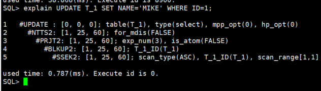

4. 执行该 sql 并查看 et，发现有不属于该语句执行计划的操作符。

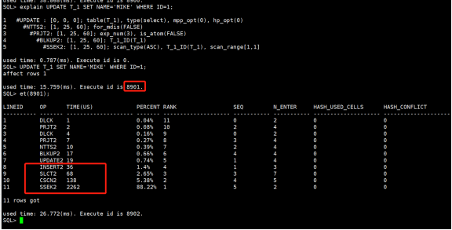

**【问题分析】**

分析执行操作符，推测该现象可能是有触发器之类的对象造成，通过检查发现涉及到的表上存在触发器。

检查表 T\_1 存在触发器。

```sql
SELECT * FROM DBA_TRIGGERS WHERE OWNER='SYSDBA' AND TABLE_NAME='T_1';
```

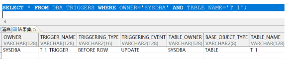

**【问题解决】**

sql 语句的执行号操作符信息，同时会包含该语句所触发的触发器执行信息，所以此现象为正常现象。

## ET 不显示结果

**【问题描述】**

ENABLE\_MONITOR、MONITOR\_TIME、MONITOR\_SQL\_EXEC 三个参数均已开启，但是管理工具中 ET 有时候不显示结果。

**【问题解决】**

1. ET 能出结果的前提是，SQL 查询完所有结果，如果结果集过大，可以用 limit 或 TOP 获取一部分数据。
2. 管理工具中执行 SQL，如果结果集未加载完想要查看 ET 信息，可在执行该 SQL 的窗口执行 ET(执行号)显示结果。

## 有哪些方法可以获取当前会话的事务 id？

**【问题解决】**

1. 通过包 DBMS\_TRANSACTION。
```sql
select DBMS_TRANSACTION.LOCAL_TRANSACTION_ID();
```
2. 通过函数 tid。
```sql
select tid ;
```
3. 通过 v$sessions 视图。
```sql
select trx_id from v$sessions where sess_id=sessid;
```

## 开启 SQL 监控参数，使用非 DBA 用户查看 ET 方法报错：“没有执行\[ET\]对象权限”。

**【问题描述】** ：

第一步：SYSDBA 用户开启 SQL 监控，使用 ET 方法查看执行操作符及耗时情况：

```sql
/**开启系统监控**/
SP_SET_PARA_VALUE(1,'ENABLE_MONITOR',1);
/**开启时间监控**/
SP_SET_PARA_VALUE(1,'MONITOR_TIME' ,1);
```

第二步：打开操作符、虚拟机栈帧、执行计划节点的监控，选择打开系统级或者会话级。

```sql
/*系统级*/
SP_SET_PARA_VALUE(1,'MONITOR_SQL_EXEC' ,1);

/*会话级,只对本会话有效*/
SF_SET_SESSION_PARA_VALUE('MONITOR_SQL_EXEC' ,1);
```

第三步：开启后使用非 DBA 用户查看 ET 时报错：

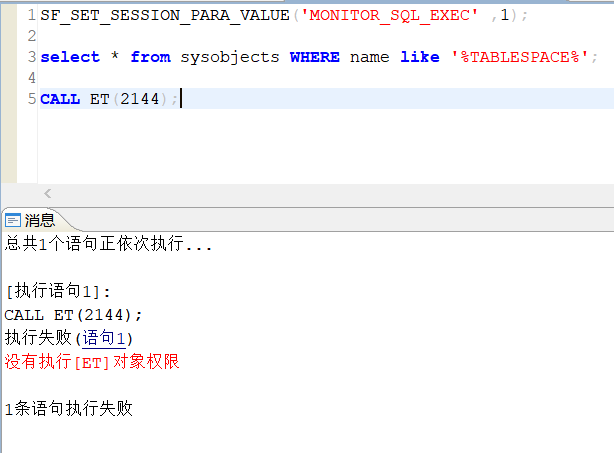

**【问题解决】** ：

1. 检查相关参数是否开启；
```sql
select para_name,sess_value from v$dm_ini where para_name in ('MONITOR_TIME','ENABLE_MONITOR','MONITOR_SQL_EXEC');
--sess_value  都为1 表示开启，缺少这表示未开启。
```

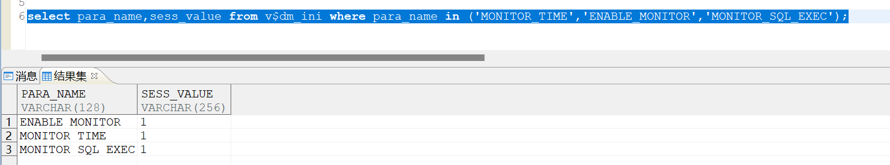

2. 检查当前用户是否拥有 et 权限；
```sql
select * from (
select urid,(select name from SYSOBJECTS where type$='UR' and id=urid) user_name,objid,(select name from SYSOBJECTS where  id=objid) obj_name,grantor,(select name from SYSOBJECTS where  id=grantor) grantor_name from SYSGRANTS a where OBJID  in (select object_id from all_objects where object_name ='ET')
) where user_name=user;
--有一条记录表示当前用户拥有ET权限，没有则表示该用户未授权使用ET.
```

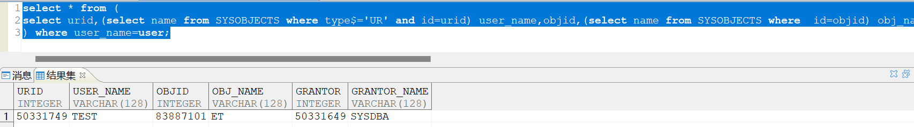

3. 如果没有授权通过以下方法进行授权。

按最小权限原则，通过命令 `grant EXECUTE on "SYS"."ET" to "TEST";` 给非 dba 用户授权"SYS"."ET"的 EXECUTE 执行权限。  
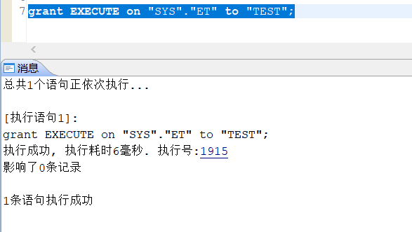

授权成功后再使用非 DAB 用户查看 ET 成功。

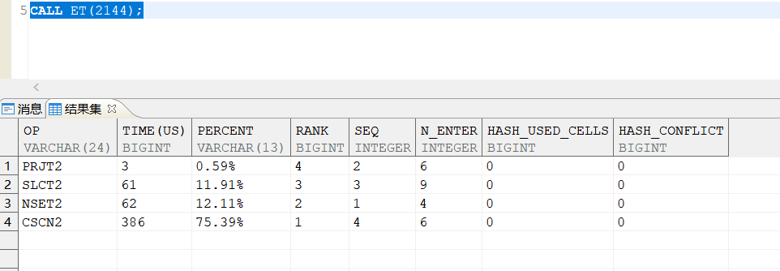

相关参数说明：

| 参数 | 默认值 | 属性 | 说明 |
| --- | --- | --- | --- |
| ENABLE\_MONITOR | 1 | 动态，系统级 | 用于打开或者关闭系统的监控功能。1：打开；0：关闭。 |
| MONITOR\_TIME | 1 | 动态，系统级 | 用于打开或者关闭时间监控。该监控项的生效必须是在   ENABLE\_MONITOR 打开的情况下。1：打开；0：关闭。 |
| MONITOR\_SQL\_EXEC | 0 | 动态，会话级 | 操作符、虚拟机栈帧、执行计划节点的监控开关。该监   控项的生效必须是在 ENABLE\_MONITOR 打开的情况   下。0：关闭监控；1：打开监控；2：打开监控，在 1   的基础上，又增加了表达式运行时操作符的统计。 |