本章节主要介绍达梦数据库 SQL 函数常见问题，为用户提供 SQL 函数常见问题的分析和解决思路。除此之外，用户还可前往 [达梦技术社区](https://eco.dameng.com/community/question/) 参与更多问题讨论。

## 目录

## 正文

## DM 中按姓氏笔画排序用什么函数

可以使用 `NLSSORT 函数` 实现此功能，NLSSORT 支持以拼音、笔画、部首排序，示例如下：

```sql
拼音：SELECT * FROM PEOPLE ORDER BY NLSSORT(name,'NLS_SORT = SCHINESE_PINYIN_M');
笔画：SELECT * FROM PEOPLE ORDER BY NLSSORT(name,'NLS_SORT = SCHINESE_STROKE_M');
部首：SELECT * FROM PEOPLE ORDER BY NLSSORT(name,'NLS_SORT = SCHINESE_RADICAL_M');
```

## to\_date(2019/12/31,'YYYY-MM-DD')报：无效的日期格式

**【场景复现】** ：

**【解决方式】** ：

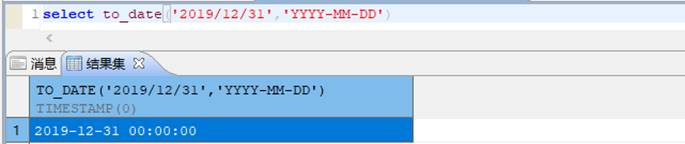

**【报错原因】** ：

合法的 DATE 格式为年月日、月日年和日月年三种，各部分之间可以有间隔 `(".","-","/")` 或者没有间隔符；合法的 TIME 格式为： **时分** 和 **时分秒** ，间隔符为":"。

详见《DM\_SQL 语言手册》第八章-函数 8.3 日期时间函数中第 37 条。（手册位于 **数据库安装路径** `/dmdbms/doc` 文件夹下）

举例如下：

```sql
SELECT TO_DATE('2003-06-19 08:40:36','YYYY-MM-DD HH:MI:SS');
```

查询结果如下：

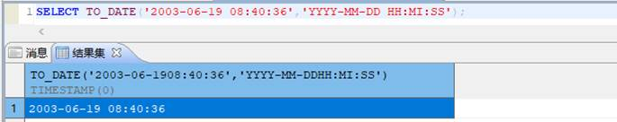

## 类似 Oracle 正则表达式 regexp\_substr 函数

- regexp\_like 样例测试

REGEXP\_LIKE  
(  
source\_string,  
pattern  
\[, match\_parameter\]  
)

```sql
--创建表并初始化数据
--创建表
create table fzq (  
   id varchar(4),  
   value varchar(10)
);
--插入数据
insert into fzq values ('1','1234560');
insert into fzq values ('2','1234560');
insert into fzq values ('3','1b3b560');
insert into fzq values ('4','abc');
insert into fzq values ('5','abcde');
insert into fzq values ('6','ADREasx');
insert into fzq values ('7','123 45');
insert into fzq values ('8','adc de');
insert into fzq values ('9','adc,.de');
insert into fzq values ('10','1B');
insert into fzq values ('10','abcbvbnb');
insert into fzq values ('11','11114560');
insert into fzq values ('11','11124560');
--提交
commit;
```
```sql
select * from fzq where regexp_like(value,'1[0-9]{4}60');
```

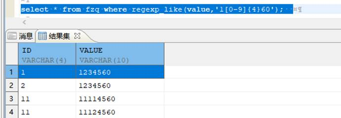

- REGEXP\_SUBSTR 测试样例

REGEXP\_SUBSTR  
(  
source\_string,  
pattern  
\[,position \[,occurrence \[,match\_parameter\]\]\]  
)

```sql
SELECT REGEXP_SUBSTR('17,20,23','[^,]+',1,1,'i') AS STR FROM DUAL;
```

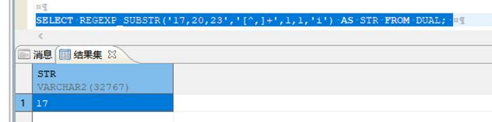

- REGEXP\_INSTR 样例测试

REGEXP\_INSTR  
(  
source\_string,  
pattern  
\[,start\_position  
\[,occurrence  
\[,return\_option  
\[,match\_parameter\]\]\]\]  
)

```sql
SELECT REGEXP_INSTR ('hello itmyhome', 'e')FROM dual;
```

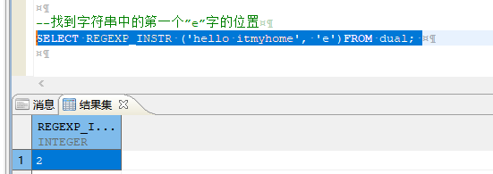

- REGEXP\_REPLACE 样例测试

REGEXP\_REPLACE  
(  
source\_string,  
pattern  
\[,replace\_string\]  
\[,position\]  
\[,occurtence\]  
\[,match\_parameter\]  
)

```sql
select regexp_replace('asdlfj','(.)','\1 ') from dual;
```

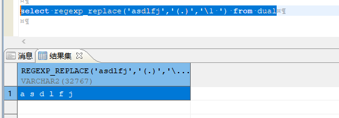

## 分段连接、拼接字符串函数

**【问题描述】** ：

- Oracle 的分段连接函数：WMSYS.WM\_CONTACT，在 DM 库中有对应的函数吗？
- DM 中有办法实现 MySQL 的 group\_concat 函数吗？
- DM 有没聚合，拼接字符串的函数？

**【解决方法】** ：

DM 数据库可以用 wm\_concat。推荐使用 listagg。

可参《DM\_SQL 语言使用手册》-LISTAGG/LISTAGG2 集函数，手册位于 **数据库安装路径** `/dmdbms/doc` 文件夹下。

## 是否有类似 MySQL 的 ShA()等加密函数

可通过 dbms\_obfuscation\_toolkit 包实现。

## 有类似 mysql 的 LAST\_INSERT\_ID() 的函数吗

可以使用下面语句：

```sql
select @@IDENTITY;
```

举例说明：

```sql
CREATE TABLE new_employees
(
id_num int IDENTITY(1,1),
fname varchar (20),
minit char(1),
lname varchar(30)
);
insert into new_employees(fname,minit,lname) values('test','d','test1');
select @@IDENTITY;
```

## 达梦数据库的“函数”、“存储过程”的使用参考文档

可以参考安装目录 doc 目录下的《DM\_SQL 语言使用手册》、《DM\_SQL 程序设计》。

## 达梦有类似 MySQL 的 conv() 进制转换的函数么?

可以使用语法：RAWTOHEX (binary)

功能：将 RAW 类数值 binary 转换为一个相应的十六进制表示的字符串。binary 中的 每个字节都被转换为一个双字节的字符串。 RAWTOHEX 和 HEXTORAW 是两个相反的函数。

例：

```sql
SELECT RAWTOHEX('达梦数据库有限公司');
```

查询结果为：B4EFC3CECAFDBEDDBFE2D3D0CFDEB9ABCBBE

```sql
SELECT RAWTOHEX('13');
```

查询结果为：3133

## IP 函数 inet\_aton()和 inet\_ntoa()怎么转换成达梦语法？

目前达梦数据库没有这两个函数，但是可以用基础函数实现，如下：

```sql
样本数据
IP格式： 192.168.117.181   对应的数字格式：3232265653

inet_ntoa()     --整数转IP

select
   trunc(ip/16777216)||'.'|| trunc( mod(ip, 16777216)/65536) ||'.'|| trunc(mod(ip,65536)/256)||'.'|| trunc(mod(ip,256)) as ip_address
from
   (select 3232265653 as ip from dual);

输出：192.168.117.181

inet_aton()

select
   to_number(regexp_replace(ip, '([0-9]{1,3})\.([0-9]{1,3})\.([0-9]{1,3})\.([0-9]{1,3})', '\1')) * 16777216 +
   to_number(regexp_replace(ip, '([0-9]{1,3})\.([0-9]{1,3})\.([0-9]{1,3})\.([0-9]{1,3})', '\2')) * 65536 +
   to_number(regexp_replace(ip, '([0-9]{1,3})\.([0-9]{1,3})\.([0-9]{1,3})\.([0-9]{1,3})', '\3')) * 256 +
   to_number(regexp_replace(ip, '([0-9]{1,3})\.([0-9]{1,3})\.([0-9]{1,3})\.([0-9]{1,3})', '\4'))  as ip_number
from
   (select '192.168.117.181' as ip from dual);

输出：3232265653
```

## PIVOT 行列转换函数报错

行列转换 PIVOT 子句，必须要包含一个聚合函数，聚合函数分别是：COUNT、SUM、MAX、MIN、AVG，针对不同的使用场景，选择聚合函数。

语法格式：

pivot (聚合函数(列名) for 被转换的列名 in(要显示出来的列名))

```sql
select
        *
from
        table_name pivot(max(column_name)  --行转列后的列的值value，聚合函数是必须要有
        for column_name in(value_1, value_2, value_3) --需要行转列的列及其对应列的属性1/2/3
        );
```

示例说明：

```sql
create table tmp as select * from (
select '张三' student,'语文' course ,78 score from dual union all
select '张三','数学',87 from dual union all
select '张三','英语',82 from dual union all
select '张三','物理',90 from dual union all
select '张三','物理',92 from dual union all
select '李四','语文',65 from dual union all
select '李四','数学',77 from dual union all
select '李四','英语',65 from dual union all
select '李四','物理',85 from dual);

--PIVOT行转列
select
        t.*,
        (t.语+t.数+t.外+t.物) as total
from
        (
                select
                        *
                from
                        tmp pivot ( max(score) for course in ('语文' as 语, '数学' as 数, '英语' as 外, '物理' as 物) )
        )
        t;

--返回结果集

张三   78   87   82   182   429

李四   65   77   65   85   292
```

## TRANSLATE 剔除字符串中的字符后结果为空

**【问题分析】** ：

现需要使用 TRANSLATE 剔除字符串 a 中，包含字符集 b 的任一字符，例如在'1@111\*/'中，要剔除 @、\*和/中的任一字符，使其结果为'1111'。  
而使用 TRANSLATE( char,from,to)，只要第三个参数 to 为空，则整个结果为空。如下图所示：

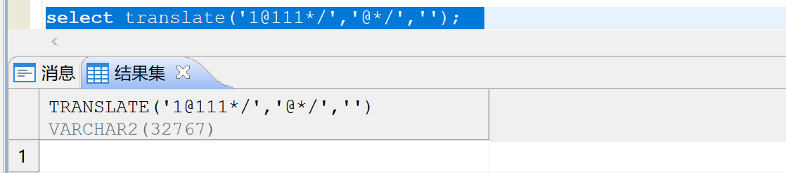

可以使用 regexp\_replace 函数代替，如下图所示：

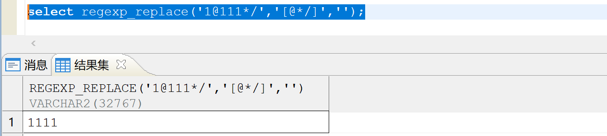

## 在一条 select 查询中无法同时执行两个 distinct()函数

**【问题分析】** ：

distinct() 函数的执行原理为从被选择出的具有重复行的每一组中仅返回一个符合筛选条件的这些行的拷贝，而同时执行两个 distinct() 函数意味着需要从被选择出的具有重复行的每一组中返回两个符合不同筛选条件的这些行的拷贝，从执行原理上产生了冲突，所以无法同时执行两个 distinct() 函数。  
解决办法：将两个 distinct() 函数分别用两条 select 查询语句分次执行。

```sql
---执行报错：
select distinct(JOB_ID),distinct(MIN_SALARY) from DMHR.JOB;  

---分开执行 distinct，执行成功
select distinct(JOB_ID) from DMHR.JOB;
select distinct(MIN_SALARY) from DMHR.JOB;
```

## Oracle XML 函数在 DM 中相同功能函数替代案例说明

**【问题分析】** ：

Oracle XML 函数在 DM 中有相应函数替代，ORACLE SYS\_XMLAGG 在达梦数据库中可以用 XMLAGG 进行替代，XMLTABLE 可以视实际的情况使用 XMLTABLE 或者 XMLQUERY 来进行替代，同时 XMLTABLE 在写法上和 ORACLE 有一定的差异。以下简要介绍 XMLAGG 和 XMLTABLE 函数：

1.XMLAGG 函数替代案例

```sql
---Oracle端 SYS_XMLAGG 函数使用方式
select SYS_XMLAGG(xmltype(reg_data)) data from bdc_regdata where sd_id='430811005' and reg_type='14';

---DM 端 XMLAGG 函数使用方式
 select XMLAGG(xmltype(reg_data)) data from bdc_regdata where sd_id='430811005' and reg_type='14'
```

2.XMLTABLE 函数替代案例一

```sql
---Oracle端 SYS_XMLTABLE 函数使用方式
select * from xmltable('//抵押权登记' passing (select SYS_XMLAGG(xmltype(reg_data)) data 
  from bdc_regdata where sd_id='430811005' and reg_type='14') );

---DM 端 SYS_XMLTABLE 函数使用方式
select XMLQUERY(t.reg_data,'/不动产登记簿信息/抵押权登记信息/抵押权登记') 
   from bdc_regdata t where t.sd_id='430811005' and t.reg_type='14' ;
```

3.XMLTABLE 函数替代案例二

```sql
---Oracle端 SYS_XMLTABLE 函数使用方式
select szbs
  from xmltable('//目录' passing
                (select SYS_XMLAGG(xmltype(data)) data from clob_test)
                columns data_id VARCHAR2(28) PATH '不动产单元号',
                szbs number PATH '所在本数')
  where data_id = '430811005';

---DM 端 SYS_XMLTABLE 函数使用方式
select szbs
  from CLOB_TEST t,xmltable('//目录' passing (xmltype(t.data)) columns bdcid VARCHAR2(28) PATH '不动产单元号', szbs number PATH '所在本数' )
  where bdcid='430811005';
```

关于 XMLTABLE、XMLAGG、XMLQUERY 以及其他 XML 相关的函数使用方法以及详细介绍请参考《SQL 语言使用手册》（手册位于 **数据库安装路径** `/dmdbms/doc` 文件夹下）。

## 达梦等价实现 MySQL 的列转行拼接功能

**【问题描述】**

达梦如何等价实现 MySQL 的列转行拼接功能？

**【问题解决】**

1. 创建建测试表；
```sql
create table t1 (id int,name varchar(20));
insert into t1 values(1,'a1');
insert into t1 values(2,'b');
insert into t1 values(3,'c');
insert into t1 values(4,'d');
insert into t1 values(5,'e');
insert into t1 values(6,'ff');
insert into t1 values(7,'gg');
insert into t1 values(8,'h');
insert into t1 values(9,'i');
commit;
```
2. MySQL 列转行拼接换行符；
```sql
SELECT GROUP_CONCAT(name SEPARATOR '\n') FROM t1 WHERE id IN (1,2,7,9);
```

方法一：使用 listagg 函数。

DM 列转行拼接换行符。

```sql
select listagg(name,chr(10)) from t1 WHERE id IN (1,2,7,9);
```

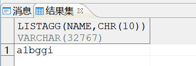

方式二：DM 在 2025 年 3 月及之后的版本可支持 GROUP\_CONCAT 函数。

兼容方法：

（1）会话级设置兼容方法

```sql
CALL SP_SET_SESSION_PARSE_TYPE(‘MYSQL’)；
```

（2）用户连接兼容性设置方法

在 url 连接串里添加 ServerOption={parse\_type=MYSQL} 进行兼容。

## 达梦是否支持 Oracle 中的 userenv() 函数？

**【问题描述】**

Oracle 中 userenv 函数返回关于当前会话的信息。此信息可以用于编写一个应用程序特定的审计跟踪表或确定特定语言的角色目前使用的会话。

Oracle 中 userenv 函数有两种用法：

```sql
--第一种用法
select userenv(‘isdba’) from dual;
--第二种用法
select SYS_CONTEXT('USERENV','ISDBA') isdba from dual;
```

达梦是否支持 Oracle 中的 userenv() 函数？

**【问题解决】**

达梦数据库支持 userenv 函数获取当前会话的上下文信息，但只支持 oracle 中的第二种用法：

```sql
select SYS_CONTEXT('USERENV','ISDBA') isdba from dual;
```

达梦数据库中 userenv 函数的参数说明:

| 参数 | 功能 |
| --- | --- |
| CURRENT\_SCHEMA | 返回当前模式名 |
| CURRENT\_SCHEMAID | 返回当前模式 ID |
| CURRENT\_USER | 返回当前的用户名 |
| CURRENT\_USERID | 返回当前的用户 ID |
| DB\_NAME | 返回数据名 |
| HOST | 返回客户端的主库名 |
| INSTANCE\_NAME | 返回实例名 |
| IP\_ADDRESS | 返回客户端的 IP 地址 |
| ISDBA | 如果当前会话用户拥有 DBA 权限，则返回 TRUE，否则，返回 FALSE |
| LANG | 语言包简写，中文返回―CN‖，英文返回―EN‖ |
| LANGUAGE | 语言包，返回库的编码方式 |
| NETWORK\_PROTOCOL | 通信协议 |
| SERVER\_HOST | 实例运行的主机名 |
| SESSION\_USER | 会话的用户名 |
| SESSION\_USERID | 会话的用户 ID |
| SID | 当前会话的 ID |

## 达梦数据库有没有用于分割字符串的函数？

**【问题描述】**

达梦数据库有没有用于分割字符串的函数？例如 SQL server 的 string\_split 函数和 Oracle 的 split 函数。

**【问题解决】**

可以通过创建分割字符串函数来实现，以下提供两种方法供参考。

方法一：

```sql
CREATE OR REPLACE TYPE TYPE_SPLIT AS TABLE OF VARCHAR2 (4000);
CREATE OR REPLACE FUNCTION SPLIT(P_STRING VARCHAR2, P_SEP VARCHAR2 := ',')
 RETURN TYPE_SPLIT
 PIPELINED IS
 IDX  PLS_INTEGER;
 V_STRING VARCHAR2(4000) := P_STRING;
BEGIN
 LOOP
   IDX := INSTR(V_STRING, P_SEP);
   IF IDX > 0 THEN
     PIPE ROW(SUBSTR(V_STRING, 1, IDX - 1));
     V_STRING := SUBSTR(V_STRING, IDX + LENGTH(P_SEP));
   ELSE
     PIPE ROW(V_STRING);
     EXIT;
   END IF;
 END LOOP;
END;
```

示例：调用函数 split 。

```sql
select * from table(SPLIT('北京|上海|广州|深圳','|'));
```

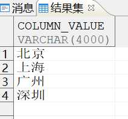

方法二：

```sql
create or replace type t_test as object(col varchar2(500));
create or replace type t_test_table as table of t_test;
CREATE or replace FUNCTION f_splitSTR(
s   varchar(8000),--待分拆的字符串
split_ varchar(10)  --数据分隔符
)RETURN t_test_table
AS
DECLARE
v_test t_test_table := t_test_table();
BEGIN
WHILE instr(s,split_)>0
loop
v_test.extend();        --   append   one   null   element
v_test(v_test.count) := t_test(LEFT(s,instr(s,split_)-1));
s=STUFF(s,1,instr(s,split_),'');
END loop;
v_test.extend();  
v_test(v_test.count) := t_test(s);
return v_test;
END;
```

示例：调用函数 f\_splitSTR 。

```sql
select * from table(f_splitSTR('北京|上海|广州|深圳','|'));
```

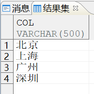

## 使用 length（）查询 blob 列字节长度时报错：“参数不兼容”

**【问题描述】**

SQL 语句查询 blob 列字节长度时使用 length(BLOB 列)，报错“参数不兼容”。

**【问题分析】**

达梦中 length 函数用于字符串，所以字段类型是 blob 时无法使用 length 函数。

**【问题解决】**

以下提供两种解决方案。

方案 1：使用系统包 dbms\_Lob.Getlength。

```sql
SELECT DBMS_LOB.GETLENGTH(GRADE) FROM TEST1;
```

方案 2：使用 lengthb 函数。

```sql
SELECT LENGTHB(GRADE) FROM TEST1;
```

## 通过数据库将中文转换为拼音

**【问题描述】**

如何通过数据库将中文转换为拼音。

**【问题解决】**

方法一：使用方法实现。

```sql
--小写全拼
select FN_GETPY('中华人民共和国')

zhonghuarenmingongheguo

--大写全拼
select FN_GETPY('中华人民共和国',1)

ZHONGHUARENMINGONGHEGUO

--首字母大写全拼
select FN_GETPY('中华人民共和国',2)

ZhongHuaRenMinGongHeGuo

--小写字母简拼
select FN_GETPY('中华人民共和国',3)

zhrmghg

--大写字母简拼
select FN_GETPY('中华人民共和国',4)

ZHRMGHG
```

方法二：使用自定义函数实现，自定义函数见附件“中文转拼音函数”。

[中文转拼音函数.txt](https://eco.dameng.com/eco-file-server/file/eco/download/20230615152426GGFLCUB6EJIX0HNJ7C)

测试如下：

```sql
select fn_getpy('你好');
```

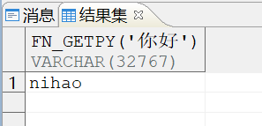

注意：多音字的拼音转换只能转成一个音可能会不正确，生僻字可能转换不正确。

## 如何将 16 进制数据转换为 10 进制或者将 10 进制数据转换为 16 进制

**【问题解决】**

16 进制转换为 10 进制，可以通过 to\_number 函数实现，如下：

```sql
select to_number('十六进制串','xxx') from dual;
```

10 进制转换为 16 进制，可以通过 to\_char 函数转换，如下：

```sql
select to_char(123,'xxx') from dual;
```

to\_number 函数和 to\_char 函数的详细使用方法可参考数据库安装目录 doc 目录下的《DM8\_SQL 语言使用手册》。

## 空间数据如何调用 ST\_WKT 将几何类型数据通过文本方式表示出来

**【问题解决】**

在达梦数据库中，ST\_WKT 是指 Well-Known Text（WKT）格式，用于表示几何类型的数据。ST\_GEOMETRY 是达梦数据库提供的一个扩展函数，可以将几何类型的数据转换为 WKT 格式，或将 WKT 格式的数据转换为几何类型的数据。如何调用 ST\_WKT 可参考如下方法：

1. 首先需要调用系统过程 SP\_INIT\_GEO\_SYS(1) 创建 DMGEO 包；
```sql
SP_INIT_GEO_SYS(1);
```
2. 创建一个包含几何类型数据的表，例如；
```sql
CREATE TABLE mytable (id INT, geom ST_GEOMETRY);
```
3. 使用 INSERT 语句将几何类型的数据插入到表中；
```sql
INSERT INTO mytable (id, geom) VALUES (1, dmgeo.ST_GeomFromText('POINT(1 1)',0));
--查询表数据
select * from mytable
```
4. 使用 SELECT 语句查询包含几何类型数据的表，并使用 ST\_AsText() 函数将几何类型的数据转换为 WKT 格式。
```sql
SELECT id, dmgeo.ST_AsText(geom) FROM mytable;
```

## 管道表函数调用方法

**【问题描述】**

达梦数据库中如何调用管道表函数。

**【问题分析】**

管道表函数是可以返回行集合的函数，用户可以像查询数据库表一样查询它。目前 DM 管道表函数的返回值类型暂时只支持 VARRAY 类型和嵌套表类型。

**【问题解决】**

由于管道表函数的返回参数类型为集合，可作为表函数使用，表函数是在 from 子句中以 table() 调用，达梦目前支持调用的方式如下：

```sql
SELECT * FROM TABLE(F_PIPE);
```

示例：

1. 创建类型。
```sql
CREATE OR REPLACE TYPE OBJ_RECORD AS OBJECT (
    ID NUMBER,
    DAYTIME DATE
);
```
2. 创建嵌套表。
```sql
CREATE OR REPLACE TYPE TYPE_OBJ_RECORD AS TABLE OF OBJ_RECORD;
```
3. 创建管道函数，并将数据放入管道中。
```sql
CREATE OR REPLACE FUNCTION F_PIPE
RETURN TYPE_OBJ_RECORD
PIPELINED
AS
BEGIN
PIPE ROW(OBJ_RECORD(1, SYSDATE()));
PIPE ROW(OBJ_RECORD(2, SYSDATE()+1));
RETURN;
END;
/
```
4. 调用管道表函数。
```sql
SELECT * FROM TABLE(F_PIPE);
```

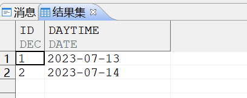

## 在达梦数据库中如何替代 sql server 中 for xml path 功能的函数？

**【问题描述】**

达梦数据库是否有替代 sql server 中 for xml path 功能的函数，将 select 结果集输出成 xml 文本格式。

**【问题分析】**

在达梦数据库中可以用系统包 dbms\_xmlgen.getxml() 来替代 sql server 中 for xml path 功能，但 getxml() 只能替代 sql server 中 for xml path 模式的功能( path 不带参数)。

**【问题解决】**

以下提供三种方式供参考：

创建示例表并插入数据：

```sql
create table t1 (id int,c1 varchar(36),c2 varchar(20));
insert into t1 select
rownum ,dbms_random.string('U',36),dbms_random.string('U',20)
FROM DUAL CONNECT BY LEVEL <=50;
COMMIT;
```

方式一：将 select 中的结果集转成 xml 格式打印 ，转后格式与 sqlserver 的 for xml path 相同,可以指定列。此方法根据指定的 SQL 语句，生成内部临时上下文句柄获取 XML 数据并返回，并释放临时上下文句柄。

```sql
select dbms_xmlgen.getxml('select id,c2 from t1 where  id<=10 ') as xmlstr from dual;
```

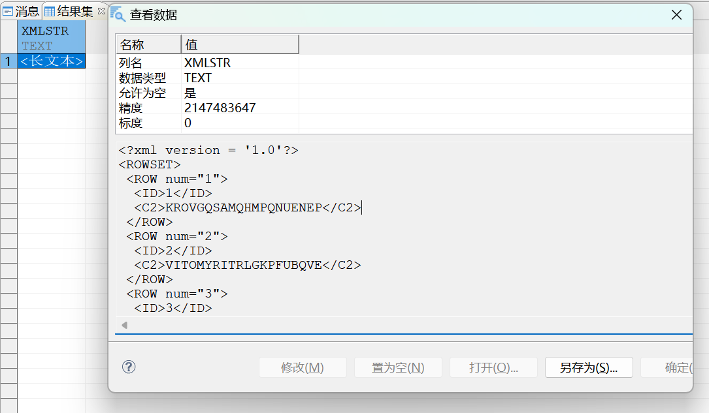

方式二：通过存储过程方式将结果集转换成 xml 格式，转换后格式与 sqlserver 的 for xml path 相同。此方法会将获取的 XML 数据放在一个临时生成的 clob 中，并返回这个临时 clob，该临时 clob 必须通过 DBMS\_LOB.FREETEMPORARY 进行释放 ， 可以多次打印。

```sql
DECLARE
CTX DBMS_XMLGEN.CTXHANDLE; --可以查看dbms_xmlgen包定义，ctxhandle是个int类型
DTA CLOB;
MAXROWS INT;
BEGIN
CTX := DBMS_XMLGEN.NEWCONTEXT('select id,c2 from t1 where id<=10');  --申请上下文句柄
print(CTX); -- 测了一下同一个会话中，每申请一个上下文句柄，CTX值加一  
select count(*) into MAXROWS from  t1 where id<=10;

DBMS_XMLGEN.SETMAXROWS(CTX, 2);   --设置每次调用 GETXML 时的最大获取行数
DTA := DBMS_XMLGEN.GETXML(CTX);   --此方法会将获取的XML数据放在一个临时生成的clob中，并返回这个临时clob，该临时 clob 必须通过 DBMS_LOB.FREETEMPORARY 进行释放。
print(DTA);  --由于每次调用getxml最大获取两行，因此这里打印了两行
DBMS_LOB.FREETEMPORARY(DTA);  --释放临时的 LOB 操作符。

DBMS_XMLGEN.SETMAXROWS(CTX, 3);
DTA := DBMS_XMLGEN.GETXML(CTX);
print(DTA);
DBMS_LOB.FREETEMPORARY(DTA);

DBMS_XMLGEN.SETMAXROWS(CTX, 5);
DTA := DBMS_XMLGEN.GETXML(CTX);
print(DTA);
DBMS_LOB.FREETEMPORARY(DTA);
 
DBMS_XMLGEN.CLOSECONTEXT(CTX); --关闭上下文句柄并释放相关资源。
END;
/
```

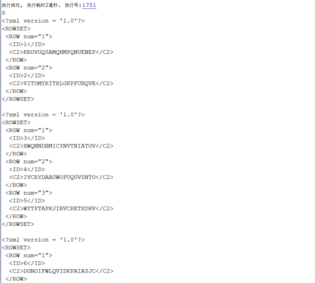

方式三：通过存储过程方式将结果集转换成 xml 格式，转换后格式与 sqlserver 的 for xml path 相同。根据指定的最大获取行数，将获取的数据添加在传入的 clob 的内容之后。使用该函数可以重用 clob，避免额外的 clob 复制。

```sql
DECLARE
CTX DBMS_XMLGEN.CTXHANDLE; --可以查看dbms_xmlgen包定义，ctxhandle是int类型
DTA CLOB;
MAXROWS INT;
BEGIN
CTX := DBMS_XMLGEN.NEWCONTEXT('select id,c2 from t1 where id<=10');  --申请上下文句柄
print(CTX); -- 测了一下同一个会话中，每申请一个上下文句柄，CTX值加一 
select count(*) into MAXROWS from  t1 where id<=10;
--DTA:='';    --DTA最开始为空串，否则会报错：-2201 无效的数据库对象 

DBMS_XMLGEN.SETMAXROWS(CTX, 0);   --设置每次调用 GETXML 时的最大获取行数为0 
DTA:=DBMS_XMLGEN.GETXML(CTX);   
print(DTA);  --由于每次调用getxml最大获取两行，因此这里打印了0行 数据的xml 格式

DBMS_XMLGEN.SETMAXROWS(CTX, 2);
DBMS_XMLGEN.GETXML(CTX,DTA); --将获取的数据添加在传入的 clob 的内容之后
print(DTA);

DBMS_XMLGEN.SETMAXROWS(CTX, 5);
DBMS_XMLGEN.GETXML(CTX,DTA); --将获取的数据添加在传入的 clob 的内容之后
print(DTA);

DBMS_XMLGEN.SETMAXROWS(CTX, 3);
DBMS_XMLGEN.GETXML(CTX,DTA); --将获取的数据添加在传入的 clob 的内容之后
print(DTA);
 
DBMS_XMLGEN.CLOSECONTEXT(CTX); --关闭上下文句柄并释放相关资源。
END;
/
```

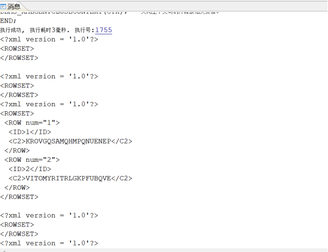

## 如何使用 extract 函数将两个 timestamp 字段相减

**【问题描述】**

使用 extract 函数将两个 timestamp 字段相减报错：“-6118: 非法的时间日期类型数据”。示例如下：

创建测试表：

```sql
CREATE TABLE TEST3
             ( LOGTIME1 TIMESTAMP(6), LOGTIME2 TIMESTAMP(6)
             );
 
insert into TEST3 values (to_timestamp('2024-01-08 23:37:08','yyyy-mm-dd hh24:mi:ss'), 
       to_timestamp('2024-03-07 07:40:48','yyyy-mm-dd hh24:mi:ss'));
 
commit;
```

执行如下 SQL 查询报错：

```sql
select to_char(extract(day from (logtime2 - logtime1))) from test3;
```

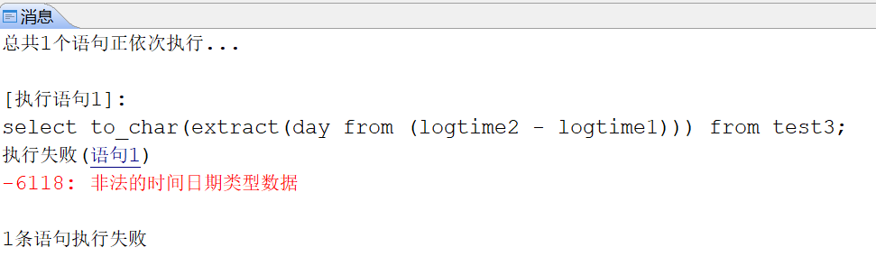

那么要如何才能使用 extract 函数将两个 timestamp 字段相减。

**【问题分析】**

DM 的时间相减默认是 DOUBLE 数据类型，可以通过开启兼容 ORACLE 的时间来返回间隔类型。

**【问题解决】**

可以通过设置参数 COMPATIBLE\_MODE=2 和 ORA\_DATE\_FMT=1 兼容 ORACLE，使用 extract 函数将两个 timestamp 字段相减。具体步骤如下：

1. 在 dm.ini 中修改参数 COMPATIBLE\_MODE=2 和 ORA\_DATE\_FMT=1。
2. 重启数据库。
3. 执行 SQL 查询验证。
```sql
select to_char(extract(day from (logtime2 - logtime1))) from test3;
```

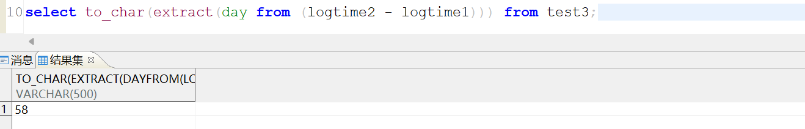

## 使用 decode 函数报错：“-6111: 字符串转换出错”

**【问题描述】**

执行以下 SQL 命令时报错：“-6111: 字符串转换出错”。

```sql
select DECODE(0,0,0,to_char(TO_DATE('20240408','YYYYMMDD'))) from dual;
```

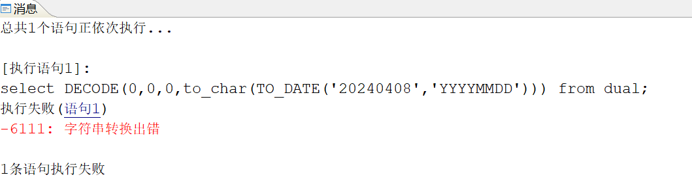

**【问题分析】**

decode 函数，经过分析时 then..else 表达式目标类型为 int，由于 CASE\_WHEN\_CVT\_IFUN 取值包含 1，内部转换为函数时，执行阶段首先计算参数值，因此转 int 时报错。

参数解释：

| 参数名 | 默认值 | 属性 | 说明 |
| --- | --- | --- | --- |
| CASE\_WHEN\_CVT\_IFUN | 9 | 动态，会话级 | 对 CASE WHEN 查询表达式的优化处理。   0：不优化；   1：将 CASE WHEN 查询表达式转换为 IFOPERATOR 函数；   2：将 CASE WHEN 查询表达式转换为 IFOPERATOR 函数，且有限制地进行表达式重用；   4：CASE WHEN 查询表达式在运算符中转换为 OR 进行处理；   8：对于 CASE WHEN 查询表达式不允许 THEN…ELSE 表达式重用；   16：将参数个数少于 30 的 COALESCE 函数转为 CASE WHEN 表达式，提升执行性能；   32：CASE WHEN 的条件表达式中有恒真或恒假的条件时进行简化；   64：将 CASE VALUE1 WHEN VALUE2 转为 CASE WHEN VALUE1=VALUE2，可配合取值 1 时转为函数进行批量处理，提升性能；   256：允许包含除法运算的 CASE WHEN 转为 IFOPERATOR 函数，但可能会导致报错(由于变函数后参数先计算)，需要在 1 开启的基础上使用。   支持使用上述有效值的组合值，如 5 表示同时进行 1 和 4 的优化 |

**【问题解决】**

使 CASE\_WHEN\_CVT\_IFUN 取值不包含 1 即可。例如：

```sql
select  /*+CASE_WHEN_CVT_IFUN(0)*/  DECODE(0,0,0,to_char(TO_DATE('20240408','YYYYMMDD'))) from dual;
```

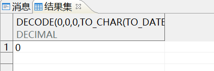

## to\_date('12-DEC-2024','DD-MON-YYYY') 执行报错

**【问题描述】**

执行如下两条 SQL，预期全部执行成功，实际第一条执行报错：“-6118: 非法的时间日期类型数据”。

```sql
select to_date('12-DEC-2024','DD-MON-YYYY'); --执行报错
select to_date('12-12月-2024','DD-MON-YYYY'); -- 执行成功
```

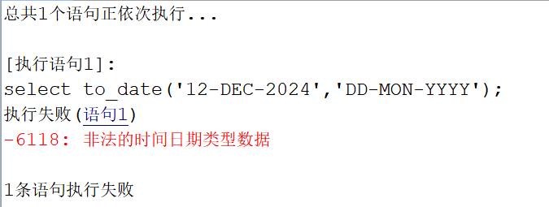

**【问题分析】**

TO\_DATE() 函数语法：TO\_DATE (char \[,fmt\[,'nls'\]\])。其中 NLS：指定日期时间串的语言类型，取值：AMERICAN、ENGLISH 或 SIMPLIFIED CHINESE，分别表示美式英语、英语和简体中文，其中 AMERICAN 和 ENGLISH 的效果相同，缺省为 SIMPLIFIED CHINESE。 `select to_date('12-DEC-2024','DD-MON-YYYY')` 中日期时间串“12-DEC-2024”为英文表达式需要指定 NLS 为"AMERICAN"或“ENGLISH”。

**【问题解决】**

修改 SQL 指定 TO\_DATE() 函数中的 NLS 为对应的日期时间串的语言类型。

```sql
select to_date('12-DEC-2024','DD-MON-YYYY','NLS_DATE_LANGUAGE=''AMERICAN''');
```

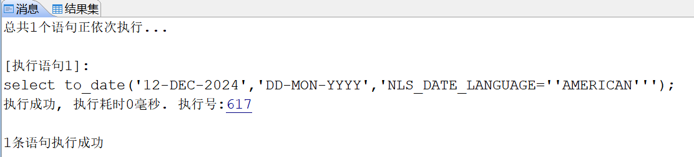

## power 函数计算大数值时有误差

**【问题描述】**

power 函数计算出大数值时有误差，如 2 的 60 次方，准确值为 1152921504606846976，查询 select power(2,60) 值为 1.15292150460684698E18 存在误差。

**【问题分析】**

达梦中 DOUBLE 类型为标准 C 语言中 DOUBLE，标准 C 语言中 DOUBLE 类型提供大约 15 至 16 位的有效十进制数字。意味着小数点后大约 15 至 16 位数字的精度可以保持准确，但超出这个范围的数字可能会有舍入误差。

**【问题解决】**

要获取准确的数值，可以使用 power2 函数。因为 POWER() 的返回值类型为 DOUBLE，POWER2() 的返回值类型为 DECIMAL 精度更大。

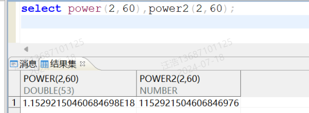

## 达梦有很多内置函数，比如 sp\_set\_para\_value, sf\_set，有没有一张表或者视图可以查询出来

可通过查询 v$ifun 视图查看：

```sql
select * from v$ifun;
```

## 使用 to\_date 函数进行数据类型转换过程中出现报错：非法的时间日期类型数据

**【问题描述】** ：

使用 to\_date 函数进行数据类型转换过程中出现报错：非法的时间日期类型数据。如下图所示：

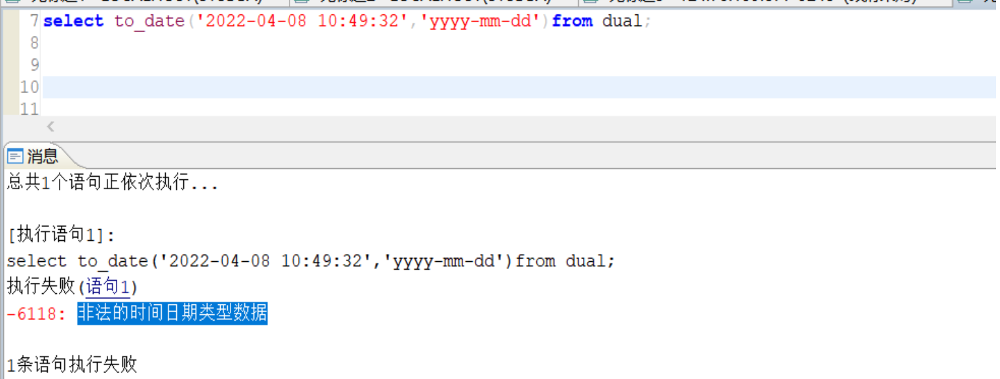

**【问题解决】** ：

可以通过修改 DATETIME\_FAST\_RESTRICT 参数为 0 解决。如下图所示：

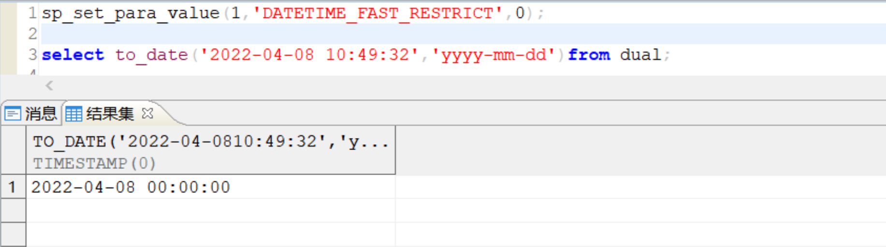

> **注意**
> 
> DATETIME\_FAST\_RESTRICT为动态系统级参数（默认为1），TO\_DATE（字符串，FAST格式）或 ALTERSESSION 设置了 DATE 的格式为 FAST 格式后，CAST 字符串 AS DATE 时： 0：字符串可以带时间； 1：字符串不允许带时间，带时间会报错。 其中FAST格式（标准格式）为：YYYY-MM-DD、YYYY/MM/DD、YYYY:MM:DD、YYYY.MM.DD。

## 如何通过地图上两个点的经纬度计算距离

**【问题解决】**

执行以下 SQL 命令创建函数，可以通过创建的函数利用经纬度计算出地图上两个点距离：

1. 创建弧度的函数
```sql
CREATE OR REPLACE FUNCTION Radian(d number) RETURN NUMBER
is
PI number :=3.141592625;
begin
return  d* PI/180.0;
end ;
```
2. 经纬度计算距离的函数
```sql
CREATE OR REPLACE FUNCTION Get_Distance(lat1 number,
                                      lng1 number,
                                      lat2 number,
                                      lng2 number) RETURN NUMBER is
 earth_padius number := 6378.137;
 radLat1      number := Radian(lat1);
 radLat2      number := Radian(lat2);
 a            number := radLat1 - radLat2;
 b            number := Radian(lng1) - Radian(lng2);
 s            number := 0;
begin
 s := 2 *
      Asin(Sqrt(power(sin(a / 2), 2) +
                cos(radLat1) * cos(radLat2) * power(sin(b / 2), 2)));
 s := s * earth_padius;
 s := Round(s * 10000) / 10000;
 return s;
end;
```
3. 测试验证

故宫坐标:（116.40355,39.923678）

天坛坐标:（116.417133,39.887923）

```sql
select Get_Distance('116.40355','39.923678','116.417133','39.887923') from dual
```

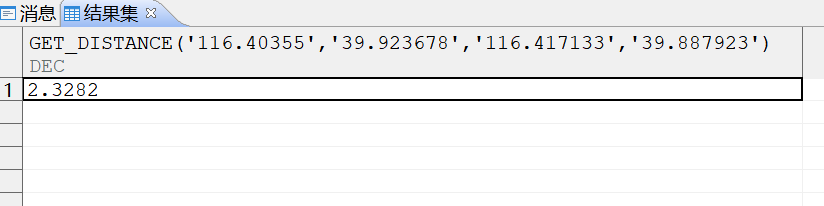

## jsonb\_concat 函数拼接：报错“字符串截断”

**【问题描述】**

表字段类型为 text，存储 JSON 格式的数据，使用 jsonb\_concat 函数进行拼接，报错：”字符串截断”。示例如下：

```sql
--创建表
CREATE TABLE tb_channel_test1
(
extended_attribute text) STORAGE(ON "MAIN", CLUSTERBTR) ;
--插入一条测试数据
insert into tb_channel_test1(extended_attribute) values('{"decodeTag":"hikvision","staticLat":null,"staticLon":null,"cameraType":"0","streamType":"0","deviceClass":"100001","noTagLatLon":"1","mapIndexCode":null,"dataSourceExtend":{"latitude":"24.896963","longitude":"115.034719","cameraName":"定南县岭北镇公办中心幼儿园离岗监测","cameraType":"COMMON","deviceName":"定南县岭北镇公办中心幼儿园离岗监测","deviceType":"100001","cameraAddress":"定南县岭北镇公办中心幼儿园离岗监测","cameraIndexCode":"e0ba7120f4d04200a9f78d5d86a31785","deviceIndexCode":"11db94e6874c40cb9258a5429b8f76e2","recognitionSign":1,"regionIndexCode":"3d4c5a0a25a34e81aa3d94302fa385dc","cameraExternalCode":"36072800001310271670"}}');
--执行如下语句提示报错
SELECT
       case
              when extended_attribute is null
              then '{"streamType":"0","ownerOrgCode":"360704","gbExternalIndexCode":"36070400801327000759","capDirection":"3","port":"80","iPAddr":"127.0.0.1"}'
              else jsonb_concat( extended_attribute, '{"streamType":"0","ownerOrgCode":"360704","gbExternalIndexCode":"36070400801327000759","capDirection":"3","port":"80","iPAddr":"127.0.0.1"}' )
       end
  FROM tb_channel_test1
 WHERE extended_attribute IS NOT NULL;
```

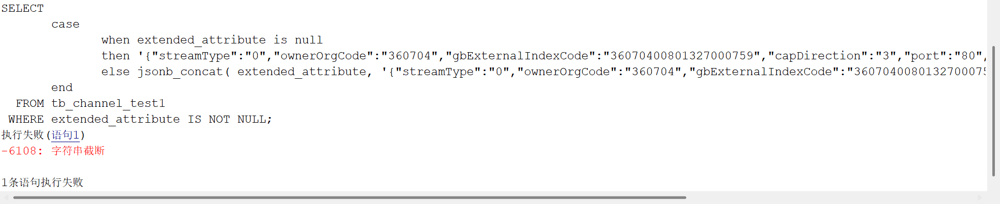

**【问题分析】**

该错误与 JSON 数据长度无关，是 CASE WHEN 语句中 THEN 分支返回字符串字面量、ELSE 分支返回 jsonb\_concat 函数值，两者类型不一致导致。

**【问题解决】**

修改 SQL，通过 TO\_CLOB() 将 THEN 分支的字符串显式转换为 CLOB，使两个分支类型一致即可，如下：

```sql
SELECT
       case
              when extended_attribute is null
              then to_clob('{"streamType":"0","ownerOrgCode":"360704","gbExternalIndexCode":"36070400801327000759","capDirection":"3","port":"80","iPAddr":"127.0.0.1"}')
              else jsonb_concat( extended_attribute, '{"streamType":"0","ownerOrgCode":"360704","gbExternalIndexCode":"36070400801327000759","capDirection":"3","port":"80","iPAddr":"127.0.0.1"}' )
       end
  FROM tb_channel_test1
 WHERE extended_attribute IS NOT NULL;
```

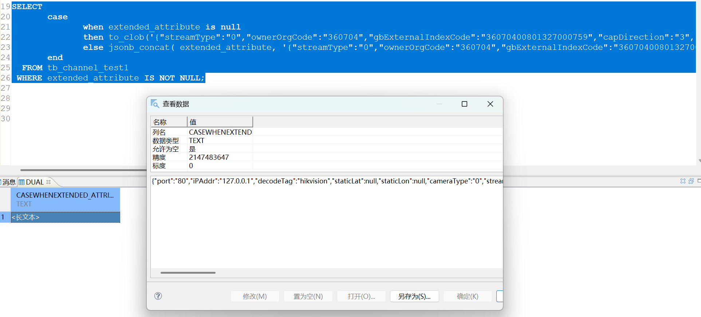