本章节主要介绍达梦数据库 SQL 查询常见问题，为用户提供 SQL 查询常见问题的分析和解决思路。除此之外，用户还可前往 [达梦技术社区](https://eco.dameng.com/community/question/) 参与更多问题讨论。

## 目录

## 正文

## 有类似 Oracle 的 REDO 日志的文件吗，如何语句查询

DM 有 REDO 日志，默认位置在数据库文件夹内，名称为：数据库名 0X.log。

如 (DAMENG01.log DAMENG02.log) 可以通过如下语句查看 REDO 日志信息。

```sql
select * from v$rlogfile;
```

关于 REDO 日志的介绍请参考《DM 系统管理手册》第二章-2.4 节内容（手册位于 **数据库安装路径** `/dmdbms/doc` 文件夹下），节选如下：

- 重做日志，又叫 REDO 日志，指在 DM 数据库中添加、删除、修改对象，或者改变数据，DM 数据库都会按照特定的格式，将这些操作执行的结果写入到当前的重做日志文件中。重做日志文件以 log 为扩展名。每个 DM 数据库实例必须至少有 2 个重做日志文件，默认两个日志文件为 `DAMENG01.log、DAMENG02.log` ，这两个文件循环使用。
- 重做日志文件主要用于数据库的备份与恢复。理想情况下，数据库系统不会用到重做日志文件中的信息。但是如果出现意外情况，例如电源故障、系统故障、介质故障，或者数据库实例进程被强制终止等，数据库缓冲区中的数据页来不及写入数据文件。这样，在重启 DM 实例时，通过重做日志文件中的信息，就可以将数据库的状态恢复到发生意外时的状态。
- 重做日志文件对于数据库是至关重要的。它们用于存储数据库的事务日志，以便系统在出现系统故障和介质故障时能够进行故障恢复。在 DM 数据库运行过程中，任何修改数据库的操作都会产生重做日志，例如，当一条元组插入到一个表中的时候，插入的结果写入了重做日志，当删除一条元组时，删除该元组的操作也记录在日志内，这样，当系统出现故障时，通过分析日志可以知道在故障发生前系统做了哪些动作，并可以重做这些动作使系统恢复到故障之前的状态。

## DM 数据库如何获取表的列注释？在代码中如何修改列属性的注释

DM 数据库查询表的列注释语句如下：

```sql
select * from SYSCOLUMNCOMMENTS;
```

如题所示：用户可以自行条件筛选得到想要的结果集。

列属性的注释：

```sql
select COMMENTS from user_col_comments where TABLE_NAME='TEST' AND COLUMN_NAME='ID';
```

修改列属性的注释：

```sql
comment on column "SYSDBA"."TEST"."ID" is 'ttttt';
```

## DM 数据库如何获取系统时间

DM 数据库提供对应的系统函数获取系统时间，如下所示：

```sql
--返回值为：DATE
select current_date();
--返回值为：TIMESTAMP(0)
select sysdate();
--返回值为：DATETIME(6) WITH TIME ZONE
select current_timestamp();
```

## 达梦嵌套模糊查询如何编写

**【问题描述】** ：

```sql
SQL1: select unit_code from s_org s
SQL2: select * from t_org where path like concat('%', SQL1.unit_code, '%')
sql1的查询结果，作为sql2的模糊查询条件，该怎么实现
select * from t_org where path like concat('%', '1111', '%')
select * from t_org where path like concat('%', '1122', '%')
select * from t_org where path like concat('%', '1123', '%')
.....
```

就像这个，如何写成一条 SQL。

**【解决方法】** ：

可以使用 REGEXP\_LIKE 函数

```sql
CREATE TABLE "SYSDBA"."ORG"
("ORGID" INT) STORAGE(ON "MAIN", CLUSTERBTR) ;

CREATE TABLE "SYSDBA"."TESTUSER"
("ID" INT,"A1" CHAR(10)) STORAGE(ON "MAIN", CLUSTERBTR) ;

select
        ID,
        A1
from
        TESTUSER
where
        REGEXP_LIKE (A1,
        (
                select
                        replace(wm_concat(orgid), ',', '|')
                from
                        (
                                select orgid from org
                        )
        )
        );
```

## 达梦如何判断表中的字段是否为自增列？如何用脚本查询？

可以通过 SYSCOLUMNS 的 INFO2 来确认，查询自增列表和列可以使用以下语句查询；

```sql
select
        b.TABLE_NAME,
        a.NAME as COL_NAME
from
        SYS.SYSCOLUMNS a,
        all_tables b    ,
        SYS.SYSOBJECTS c
where
        a.INFO2&0x01=0x01
    and a.ID        =c.ID
    and c.NAME      =b.TABLE_NAME;
```

## 查询语句中如何按照自定义的顺序进行排序

**【问题描述】** ：

现有需求要根据自定义的顺序进行排序，例如：现有 PERSON 表，需要将第 7 条数据作为第一行，第 3 条数据作为第二行，第 2 条数据作为第三行进行输出，表中数据如图：

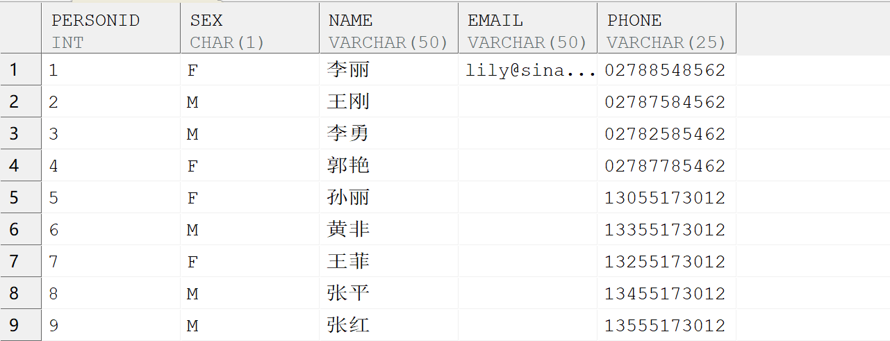

**【问题解决】** ：

- 利用 CASE 语句：
```sql
SELECT * FROM PERSON.PERSON WHERE PERSONID IN (2,3,7)
ORDER BY CASE PERSONID
             WHEN 7 THEN 1       ---将 PERSONID=7 的数据作为第一行输出
             WHEN 3 THEN 2       ---将 PERSONID=3 的数据作为第二行输出
             WHEN 2 THEN 3       ---将 PERSONID=2 的数据作为第三行输出
        END;
```
- 利用 DECODE 函数：
```sql
SELECT * FROM PERSON.PERSON WHERE PERSONID IN (2,7,3)
ORDER BY DECODE(PERSONID,7,1,3,2,2,3);
```

以上两种方法均可得到以下输出结果：

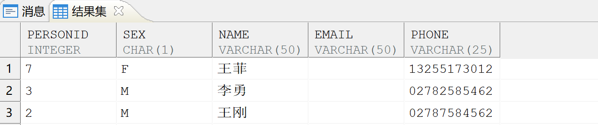

## sql 快捷命令：授予用户对某一模式的只读权限，并查询

```sql
select ‘grant select  on 模式名.’||table_name||’  to 只读用户;’ from dba_tables where owner=‘模式名’;

---例如授予 READER 用户对 SYSDBA 模式下所有表的只读权限，并查询：
select 'grant select on SYSDBA.'||table_name||' to READER' from dba_tables where owner='SYSDBA';
```

或者

```sql
select 'grant select on '||owner||'.'||object_name||' to 用户名;' from dba_objects where owner in ('当前用户')  and object_type='TABLE';

---例如授予 READER 用户对 DMHR 模式下所有表的只读权限，并查询：
select 'grant select on '||owner||'.'||object_name||' to READER;' from dba_objects where owner in ('DMHR') and object_type='TABLE';
```

## 如何查询一个表涉及到的所有触发器

**【问题解决】** ：

通过以下语句进行查询：

```sql
select * from dba_triggers where DBA_TRIGGERS.OWNER = '模式名' AND DBA_TRIGGERS.TABLE_NAME = '表名'
```

## 子查询语句执行报错，提示单行子查询返回多行

报错截图如下：

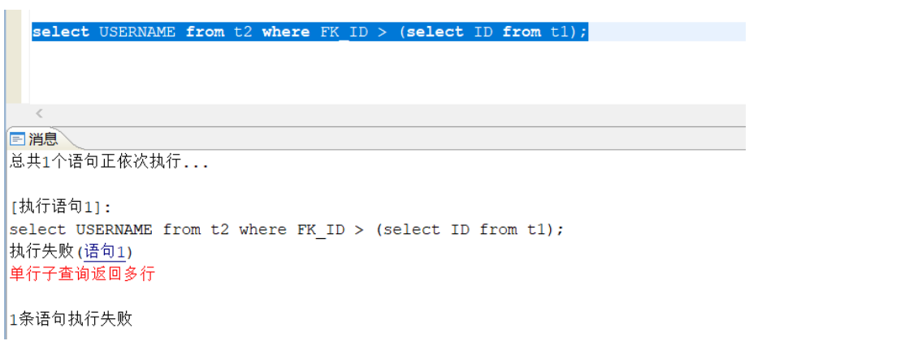

**【问题解决】** ：

问题原因：子查询语句输出结果并非单值，主查询语句的 where 筛选条件中 FK\_ID 的值与子查询语句的输出结果不能相互匹配，where 条件出现一对多情况。

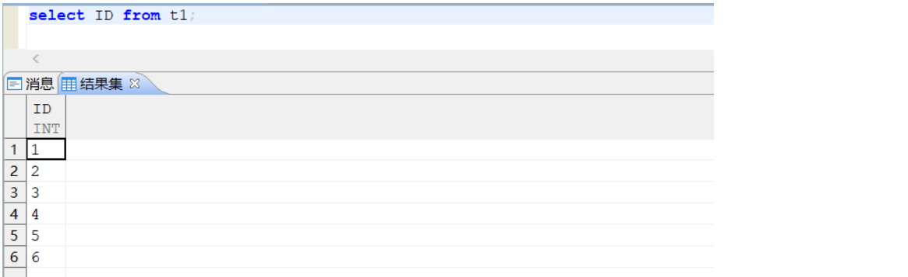

解决办法：根据具体业务需求在子查询语句中添加 where 筛选条件，或者在主查询语句中添加 all、any 等关键字，使子查询语句输出结果为单值，确保主查询语句的 where 筛选条件中 FK\_ID 的值与子查询语句的输出结果相互匹配。查询语句修改后的执行结果如下所示：  
1.在子查询语句中添加 where 筛选条件：

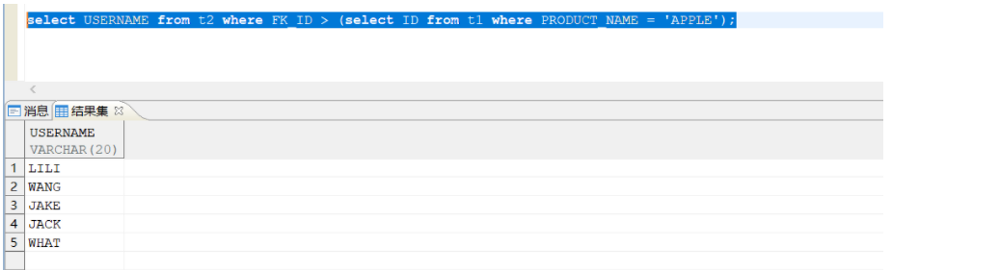

2.在主查询语句中使用 all 关键字：

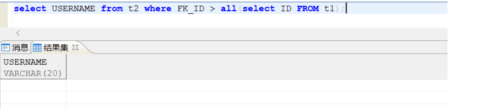

3.在主查询语句中使用 any 关键字：

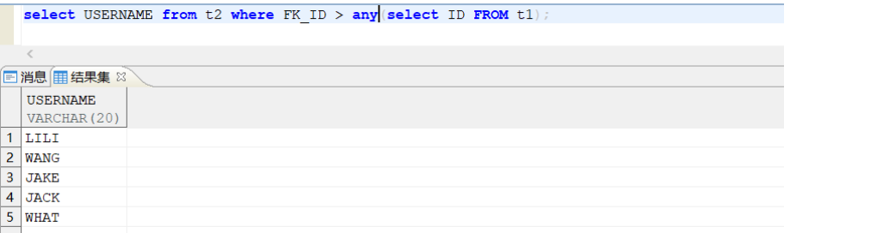

## count 查询某张表显示为空，但是 select \* from 查询某张表是有数据的

**【问题描述】：**

count 查询某张表显示为空，但是 select \* from 某张表是有数据的。

**【问题解决】：**

通过看两条语句的执行计划可以发现，两个计划走的索引不一致，select \*语句计划走的索引为表自带索引，count 语句计划走的索引为 BM$\_33557020，此索引为位图索引，删除此位图索引解决。

```sql
SQL> explain select count(*) from ZWFW_XWSJZX.XWXT_HISTORYDATA_OPT_LOGS;
      #NSET2:[1，1，4]
           #PRJT2:[1，1，4];exp_num(1)，is_atom(FALSE)
               #AAGR2:[1，1，4];grp_num(0)，sfun_num(1),distinct_f1ag[0]; slave_empty(0)
                    #CSCN2:[1，1，4];INDEX33557021(BM$_33557020) 
已用时间:0.522(毫秒).执行号:0.

SQL> explain select top 2 * from ZWFW_XWSJZX. XWXT_HISTORYDATA_OPT_LOGS;
      #NSET2:[2621，2，482]
           #PRJT2:[2621，2，482];exp_num(12)，is_atom(FALSE)
               #TOPN2:[2621，2，482];top_num(2)
                   #CSCN2:[2621，12871527，482];INDEX33555462(XWXT_HISTORYDATA_OPT LOGS) 
已用时间:0.557(毫秒).执行号:0
```

## 查询数据时怎么样可以不带模式名

**【问题解决】** ：

**方式一** ：通过使用模式所属的用户登录，查询时可以只用写表名。

**方式二** ：通过设置 `set schema 模式名 `,使得其他用户也可以不用加模式名操作该模式的对象。此种方法的前提是需要登录的用户具有该模式对象的权限。

未设置模式时：

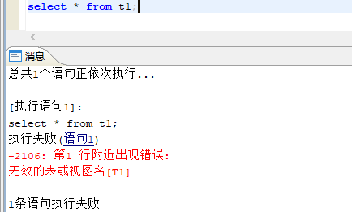

设置模式后查询成功：

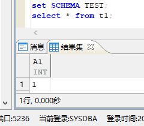

## 数据库报错 select 包含过多表

**【问题描述】** ：

当 select 后查询不同表的列时，其中表的数量超过了时，报错：“select 包含过多表（不能超过 100 个）”

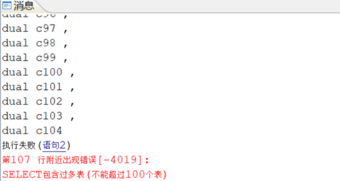  
**【解决方法】** ：

可以在 v$dm\_ini 视图中直接找到 MAX\_TABLES\_IN\_SELECT 参数，对其进行修改，但是需要注意的是，该参数值上限为 150。

查看默认参数值：

```sql
select * from  v$dm_ini WHERE para_name = 'MAX_TABLES_IN_SELECT';
```

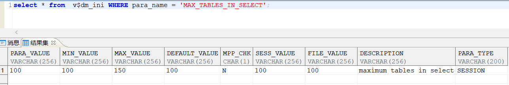

修改参数值为 110：

```sql
SP_SET_PARA_VALUE(1,'MAX_TABLES_IN_SELECT',110);
```

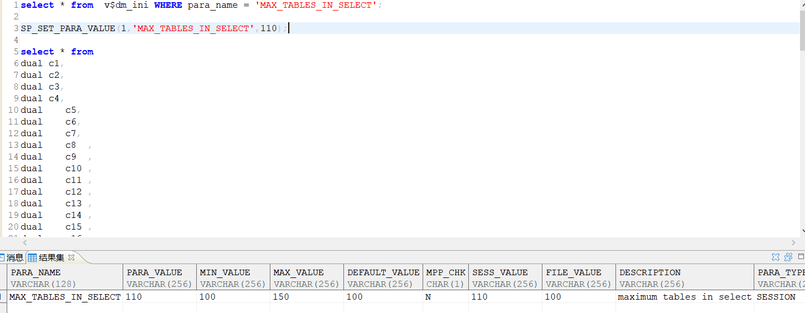

再次执行查询语句，查询成功。

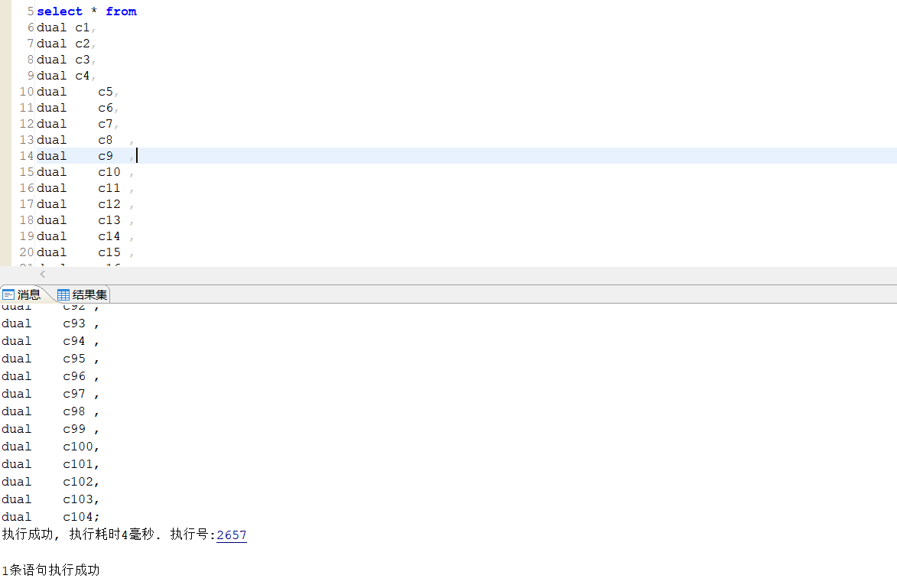

> **注意**
> 
> MAX\_TABLES\_IN\_SELECT 该参数属于系统会话级参数，修改参数值后只对该会话生效，参数值上限为150。

## 如何通过 V$SQL\_BINDDATA\_HISTORY 视图，查看历史 SQL 绑定变量具体的值

**【问题解决】**

1、开启参数 ENABLE\_MONITOR 和 ENABLE\_MONITOR\_BP；  
2、通过以下 SQL 替换其中的? 为具体的执行号（exec\_id），即可明文查看绑定变量的值。

```sql
WITH SBH AS
(SELECT EXEC_ID, SF_EXTRACT_BIND_DATA_NUM(BINDDATA, 1) AS ARG_NUM, BINDDATA
FROM V$SQL_BINDDATA_HISTORY S
WHERE EXEC_ID = ?)
SELECT SBH.EXEC_ID,
SBH.ARG_NUM,
LEVEL AS ARG_POS,
SF_EXTRACT_BIND_DATA(BINDDATA, LEVEL, 1) AS ARG_TYPE,
SF_EXTRACT_BIND_DATA(BINDDATA, LEVEL, 2) AS ARG_VAL
FROM SBH
CONNECT BY LEVEL <= ARG_NUM;
```

参数说明：

| 参数 | 默认值 | 属性 | 说明 |
| --- | --- | --- | --- |
| ENABLE\_MONITOR | 1 | 动态，系统级 | 用于打开或者关闭系统的监控功能。1：打开；0：关闭。 |
| ENABLE\_MONITOR\_BP | 1 | 动态，系统级 | 是否监控绑定参数相关信息。该监控项的生效必须是在   ENABLE\_MONITOR 打开的情况下。0：不监控；1：监   控。 |

## 如何通过 SQL 获取指定表的定义

**【问题解决】**

可以通过调用系统存储过程函数 SP\_TABLEDEF() 来获取指定表的定义。

SP\_TABLEDEF 定义如下：

```sql
void
SP_TABLEDEF (
schname varchar(128),
tablename varchar(128)
)
```

功能说明：以结果集的形式返回表的定义，当表定义过长时，会以多行返回。  
参数说明：schname：模式名；tablename：表名。  
返回值：无。

举例说明：  
CALL SP\_TABLEDEF('SYSDBA','T2');

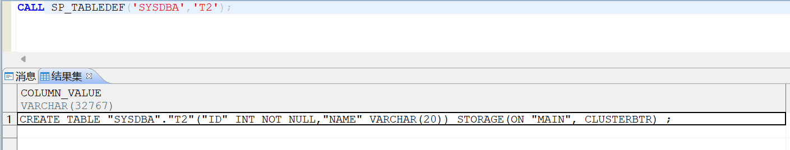

返回 SYSDBA 模式下 T2 表的定义。

## 如何通过 sql 查询表的分布类型、分布列、以及创建时间

**【问题解决】**

可以通过以下 sql 查询表的分布类型、分布列、以及创建时间。

```sql
select
        T1.table_name,
        dis_type     ,
        列名                ,
         分布列名 ,
        CREATED
from
        (
                SELECT
                        a.SCHEMA_NAME,
                       -- a.TABLE_NAME ,
                        a.TABLE_TYPE ,
                        a.DIS_TYPE   ,
                        '("'
                        ||c.column_name
                        ||'")' 列名           ,
                        to_char( a.DIS_COLS) 分布列名,
                        c.TABLE_NAME
                from
                        (
                                select
                                        *
                                from
                                        ALL_TAB_COLUMNS b
                                where
                                        b.OWNER      ='模式名'
                                    AND b.COLUMN_NAME='PRIPID'
                        )
                        c
                left join ALL_TABLES_DIS_INFO a
                on
                        c.TABLE_NAME = a.TABLE_NAME
                        and c.OWNER      =a.SCHEMA_NAME
                where
                         a.SCHEMA_NAME='模式名'
        )
        T1
        left join 
        DBA_OBJECTS T2
        on  T2.OBJECT_NAME   =T1.TABLE_NAME
        and t2.OWNER=t1.SCHEMA_NAME
where
    T1.schema_name='模式名'
    and T2.OBJECT_TYPE='TABLE'
```

查询结果如下：

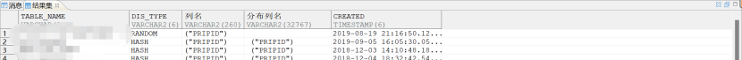

## 对象视图存在，但查询报错："指定的对象数据库中不存在"

**【问题描述】**

在 dba\_objects 视图中查询到该对象存在，且 dba\_objects 里的 object\_type 为 VIEW。

```sql
select owner,object_name,object_type,status from dba_objects where object_name='M_VIEW';
```

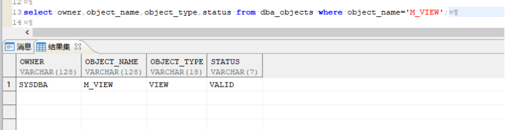

在通过以下 SQL 查询时报错 -6815："指定的对象数据库中不存在"

```sql
select dbms_metadata.get_ddl('VIEW','M_VIEW','SYSDBA')
```

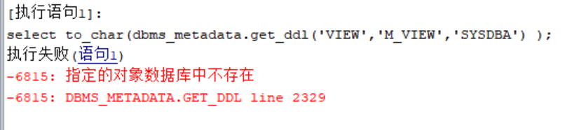

**【问题分析】**

通过以下 SQL 查询到该对象是个物化视图

```sql
sp_viewdef('SYSDBA','M_VIEW');
```

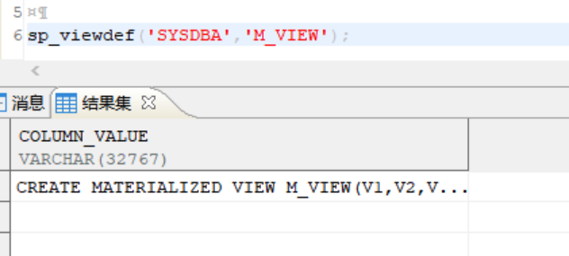

由于该对象是个物化视图在使用 dbms\_metadata.get\_ddl 方法时 OBJECT\_TYPE 参数应使用物化视图对应的类型名称即 MATERIALIZED\_VIEW。

**【问题解决】**

调整 dbms\_metadata.get\_ddl 方法中 OBJECT\_TYPE 参数使用物化视图对应的类型名称 MATERIALIZED\_VIEW。

```sql
select to_char(dbms_metadata.get_ddl('MATERIALIZED_VIEW','M_VIEW','SYSDBA') );
```

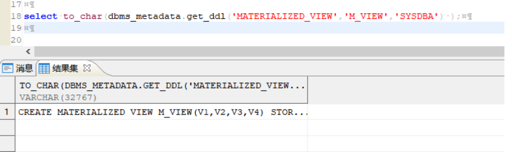

## 如何查询列存储分区表的单列使用大小

**【问题解决】**

如果想要查询列存储存分区表的单列使用大小可以参考以下方法。

1. 创建查询列存储分区表的单列使用大小函数 huge\_col\_use\_space。
```sql
create or replace function huge_col_use_space(sch_name varchar, tab_name varchar, col_name varchar) return bigint
as
type name_arr_t is table of varchar;
sch_id  int;
tab_id  int;
col_id  int;
ptab_id int;
name_arr  name_arr_t;
sz_single bigint;
sz_totle  bigint;
sql       varchar;
i         int;
begin
--1、获取schid
select id into sch_id from sysobjects where type$='SCH' and schid=0 and name=sch_name;
print 'sch_id:'||sch_id;
--2、获取tabid
select id, pid into tab_id, ptab_id from sysobjects where type$='SCHOBJ' and schid=sch_id and name=tab_name;
print 'tab_id:'||tab_id;
--3、如果要计算的是个子表，则获取其根表的id,用于步骤4获取colid（如果是以colid作为参数的话，步骤3、4是不需要的）
if (ptab_id = -1) then

ptab_id = tab_id;
else
 select id into ptab_id from sysobjects where pid=-1 connect by prior pid=id start with id=pid;
end if;
print 'root_tab_id:'||ptab_id;
--4、获取colid
select colid into col_id from syscolumns where id=ptab_id and name=col_name;
print 'col_id:'||col_id;
--5、获取所有叶子子表信息,层次查询的叶子节点就是叶子子表
select name bulk collect into name_arr from
(select name, pid, id from sysobjects where type$='SCHOBJ' and schid=sch_id and name like tab_name||'%')
where connect_by_isleaf=1
connect by prior id=pid start with id=tab_id;
--6、查询各个叶子子表的辅助表统计该列的长度
sz_totle = 0;
for i in 1..name_arr.count loop
sql = 'select sum(n_len) into ? from ' ||name_arr(i)||'$AUX where colid='||col_id;
execute immediate sql using out sz_single;
print 'tab['||name_arr(i)||'] size:'||sz_single;
if sz_single is not null then
  sz_totle = sz_totle + sz_single;
end if;
end loop;
return sz_totle;
end;
/
```
2. 调用该函数 huge\_col\_use\_space 查询列存储分区表的单列使用大小。
```sql
select  huge_col_use_space （'用户名','表名','列名'）；
```

## 如何查询列存储分区表的物理占用空间大小

**【问题解决】**

如果想要查询列存储分区表的物理占用空间大小可以参考以下方法。

1. 创建查询列存储分区表的物理占用空间大小存储过程 TABLE\_COUNT。
```sql
CREATE OR REPLACE PROCEDURE SYSDBA.TABLE_COUNT(V_SCH_NAME VARCHAR(30),V_TABLE_NAME VARCHAR(128)) AS
BEGIN
SELECT /*+ CASE_WHEN_CVT_IFUN(0) */
V_TABLE_NAME AS TABLE_NAME,--表名
IS_HUGE,--是否为HUGE表
IS_PARTITION, --是否为分区表
SF_GET_TABLE_COUNT(V_SCH_NAME,V_TABLE_NAME) AS ROW_COUNT, --表行数
CASE IS_HUGE WHEN 'N' THEN TABLE_USED_SPACE(V_SCH_NAME,V_TABLE_NAME) * SF_GET_PAGE_SIZE() / 1024.0 /1024 ELSE HUGE_TABLE_USED_SPACE(V_SCH_NAME,V_TABLE_NAME) END || 'M' AS USED_SPACE_MB --表大小，单位MB
FROM (
SELECT
V_TABLE_NAME,
CASE WHEN (INFO3 & 0X3F)  BETWEEN 0X21 AND 0X27 THEN 'Y' ELSE 'N' END IS_HUGE, --判断表类型
(SELECT CASE WHEN COUNT(*) > 0 THEN 'Y' ELSE 'N' END FROM SYS.SYSOBJECTS WHERE PID = X.ID AND SUBTYPE$='UTAB' AND SCHID = (SELECT ID FROM SYS.SYSOBJECTS WHERE TYPE$='SCH' AND NAME = V_SCH_NAME)) IS_PARTITION--判断是否为分区表
FROM SYS.SYSOBJECTS X
WHERE SCHID = (SELECT ID FROM SYS.SYSOBJECTS WHERE TYPE$='SCH' AND NAME = V_SCH_NAME) AND
     SUBTYPE$='UTAB' AND PID = -1 AND NAME=V_TABLE_NAME
);
END;
/
```
2. 调用该存储过程 TABLE\_COUNT 查询列存储分区表的单列使用大小。
```sql
call TABLE_COUNT('模式名','表名')；
```

## 如何通过数据库生成未来一段时段的年月数据库

**【问题描述】**

如何通过数据库生成未来一段时段的年月数据库，用于在应用系统中作为字典表使用。

生成年月在数据库事务系统及分析系统中都可能会使用到。例如：OLAP 系统中年月数据库可以作为维度表来使用，OLTP 系统中年月数据可以作为表单的选项字典等。

**【问题解决】**

可以参考如下 SQL 生成年月数据，例如：生成 2023-01 至 2050-12 区间的年月数据。

```sql
select
        to_char(add_months(to_date('2023-01', 'yyyy-mm'), rownum-1), 'yyyy') year,
        to_char(add_months(to_date('2023-01', 'yyyy-mm'), rownum-1), 'mm') month
from
        dual connect by rownum<= months_between(to_date('2050-12', 'yyyy-mm'), to_date('2023-1', 'yyyy-mm'))+1
```

## SQL 无法查询到对应数据

**【问题描述】**

数据库中的数据存在换行符或回车符，利用 Like ‘回车’无法查询到对应数据。

**【问题解决】**

可以利用 '%'||chr(13)||'%' 或 '%'||chr(10)||'%' 进行模糊匹配。

'%'||chr(10)||'%' 表示换行符。  
'%'||chr(13)||'%' 表示回车符。

用法如下：

```sql
SELECT * from 表名称 WHERE "字段" like '%'||chr(13)||'%'   or "字段" like '%'||chr(10)||'%';
```

## 含有全文索引的表执行 SQL 查询报错：“-6803: 非法的参数数据“

**【问题描述】**

含有全文索引的表执行 SQL 查询报错：“-6803: 非法的参数数据“，如下 SQL：

```sql
--创建测试表
drop table if exists DDD.TIND1;
create table DDD.TIND1 (c1 int primary key,c2 int,c3 int ,c4 varchar(10));
create context  index "IDX_TIND1_CONTEXT_C4" on DDD.TIND1(c4 asc);  --全文索引

select
        owner     ,
        index_name,
        index_type,
        INDEX_USED_SPACE(OWNER, INDEX_NAME)
from
        dba_indexes
where
        1                                  =1
    and owner                             in('DDD')
    and index_type not                    in ('CLUSTER')
    and INDEX_USED_SPACE(OWNER, INDEX_NAME)>0 ;
```

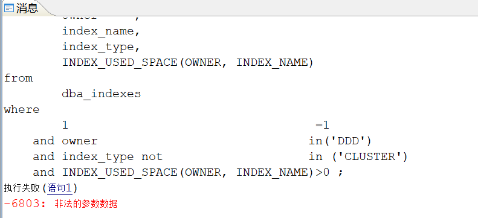

**【问题解决】**

该问题是由于查询全文索引的使用空间出现此报错 。

**【问题解决】**

可以通过添加 hint 表达式来处理该报错，具体如下：

```sql
select
        /*+ ENABLE_IN_VALUE_LIST_OPT(5) */
        owner     ,
        index_name,
        index_type,
        INDEX_USED_SPACE(OWNER, INDEX_NAME)
from
        dba_indexes
where
        1                                  =1
    and owner                             in('DDD')
    and index_type not                    in ('CLUSTER', 'DOMAIN')
    and INDEX_USED_SPACE(OWNER, INDEX_NAME)>0 ;
```

参数解释：

| 参数 | 默认值 | 属性 | 说明 |
| --- | --- | --- | --- |
| ENABLE\_IN\_VALUE\_LIST\_OPT | 6 | 动态，会话级 | 是否允许 IN LIST 表达式优化。   0：不优化。   1：将 IN LIST 表达式在语义分析阶段优化为 CONST VALUE LIST；   2：将 IN LIST 表达式在代价优化阶段优化为 CONST VALUE LIST；   4：生成传递闭包优化；   8：将 IN LIST 表达式优化为范围条件，仅限于 HUGE 表；   16：OR 表达式优化为 LIST IN LIST 表达式时，允许 LIST 中的列来源于不同的表；   32：允许 IN LIST 表达式中的列为分区列时转化为 SEMI JOIN；   64：当 IN LIST 表达式左侧包含多列，并且包含非列类型表达式时，允许将其优化为 CONST VALUE LIST；   128：分析阶段将 IN VALUE LIST 表达式转换为 OR 表达式。   256：使用索引连接时，当连接条件中有多个 IN 表达式时，多个 IN 表达式会先做连接。取该值时，不允许分析阶段 IN 连接后的行数超过一万行。   512：语义分析阶段将多列 NOT IN 转换为 NULL\_EQU 函数，预期走批量计算，提升执行效率；目前仅支持 NOT IN 为常量值链表时进行转换。   1024：在取值 1 关闭情况下，将表连接(JOIN)的 IN LIST 表达式在语义分析阶段优化为 CONST VALUE LIST。   2048：扩大 IN LIST 作为 JOIN CONDITION 的代价，缩减其转换为 CONST VALUE LIST 的代价。   4096：增强 OR 表达式转换为 IN 表达式（或者 AND 表达式转换为 NOT IN 表达式）的优化，将转换后的 IN 表达式（IN LIST 或 LIST IN LIST）按数据类型（仅限数值和字符类型）进行拆分，避免转换后的不等价引发的报错或结果错误；该增强优化仅在 OR 表达式转换为 IN 表达式（或者 AND 表达式转换为 NOT IN 表达式）的优化生效后有效。   支持使用上述有效值的组合值，如 3 表示同时进行 1 和 2 的优化。 |

## 如何通过表名查询表上对应索引定义

**【问题解决】**

可通过以下 SQL 查询表上对应索引定义：

```sql
select
        indexdef(id, 1)
from
        sysobjects A
where
        pid=
        (
                select id from sysobjects where name ='bus_car'
        )
    and subtype$ = 'INDEX'
    and name != 'INDEX'
        || id
```

## 如何通过语句统计库中的普通索引和全局索引

**【问题解决】**

可通过以下 SQL 统计库中的普通索引和全局索引：

```sql
--查看分区表的索引类型（LOCAL OR GLOBAL）
select
        aa.owner         ,
        aa.table_name    ,
        aa.index_name    ,
        bb.partition_type,
        case partitioned when 'YES' then 'LOCAL' when 'NO' then 'GLOBAL' end as index_type
from
        dba_indexes aa,
        (
                select
                        owner      ,
                        object_name,
                        partition_type
                from
                        SYSHPARTTABLEINFO,
                        dba_objects
                where
                        object_id=base_table_id
                group by
                        partition_type,
                        owner         ,
                        object_name
        )
        bb
where
        aa.owner     =bb.owner
    and aa.table_name=bb.object_name;
```

## 如何像 MySQL 一样查询所有表的表数据行数？如何统计表占用空间大小？

**【问题解决】**

达梦提供 TABLE\_ROWCOUNT 函数用来统计表行数，提供 TABLE\_USED\_PAGES 函数来统计表使用的页数，因此可参考使用以下 SQL 来查询：

```sql
SELECT B.OWNER, 
         B.TABLE_NAME, 
         ROUND(TABLE_USED_PAGES(B.OWNER,B.TABLE_NAME)*(PAGE/1024)/1024/1024,2) "GB", 
         TABLE_ROWCOUNT(B.OWNER,B.TABLE_NAME) "TABLE_ROWS" 
    FROM (SELECT A.OWNER, 
                 A.TABLE_NAME 
            FROM ALL_TABLES A 
           WHERE A.OWNER IN ('USER1', 
                             'USER2') --可指定要统计的模式名
             AND A.TABLE_NAME NOT LIKE 'CTI%' 
             AND A.TABLE_NAME NOT LIKE 'SREF_CON_TAB%' 
             AND A.TABLE_NAME NOT LIKE 'BM%' ) B 
ORDER BY 3 DESC, 
         1, 
         2;
```

## 如何输出格式为 yyyy 年 mm 月 dd 日 HH 时 MM 分 SS 秒 的日期数据

```sql
SELECT to_char(sysdate,'yyyy"年"mm"月"dd"日" HH24"时"mi"分"ss"秒"') from dual；
```

## 如何查询所有自增列

可执行下列语句进行查询：

```sql
select b.table_name,a.name COL_NAME from  SYS.SYSCOLUMNS a,all_tables b,sys.sysobjects c where a.INFO2 & 0x01 = 0x01
and a.id=c.id and c.name= b.table_name
```

## 当虚拟列的基列中有空数据时，查询虚拟列或者把虚拟列作为查询条件会报错:非法的参数数据

**【问题描述】** ：

表 xnl 中，pwd 字段为虚拟列，其基列是 passwd，passwd 中有空值。

利用如下语句进行查询，均出现报错：非法的参数数据

```sql
select * from "SYSDBA"."xnl"
select "id","passwd","sex","pwd" from "SYSDBA"."xnl" ;
```

**【问题解决】** ：

把虚拟列用 ifnull 参数处理一下即可，如下图所示：

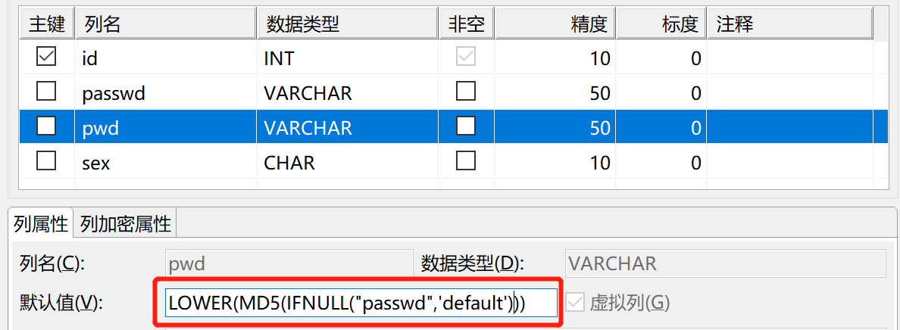

## 如何利用 SQL 语句查看数据库用户限制登录和允许登录的 IP 地址

**【问题解决】** ：

```sql
---查询所有用户的 IP 黑白名单：
select a.id,b.username,a.allow_addr,a.not_allow_addr from sysuser$ a, dba_users b where a.id=b.user_id;
```

## 执行查询语句时报错：字符串转换出错

**【问题描述】**

问题重现如下：

```sql
---建表，设置 ID 列的数据类型为 varchar
create table test1008(id varchar(20));
insert into test1008 values(12345678);
insert into test1008 values('12345678_2');
insert into test1008 values('12345678_3');
commit;

---按照以下语句进行查询报错：字符转换出错
select * from test1008 where id>=1;
```

**【问题分析】**

需要检查查询语句的条件列是否正确，根据表结构可以看出 ID 列数据类型为 varchar，不是数值型数据，所以需要加上单引号，修改查询语句如下即可。

```sql
select * from test1008 where id>='1';
```

## LIKE 语句 CLOB 字段模糊查询报错：字符串截断

**【问题解决】** ：

DM7 LIKE 语句中 CLOB 类型的最大长度默认值为 31KB，DM8 LIKE 语句中 CLOB 类型的最大长度默认值为 10240KB，当查询的 CLOB 字段长度超过这个值后就会报错。  
处理方法：使用命令 `sp_set_para_value(1,'CLOB_LIKE_MAX_LEN',10240);` 修改 CLOB\_LIKE\_MAX\_LEN 的值，之后重启数据库生效。  
CLOB\_LIKE\_MAX\_LEN：LIKE 语句中 CLOB 类型的最大长度，单位 KB，有效值范围（8~102400），静态参数，修改后需要重启。

## 如何查询出 varchar 字段中包含的非数字数据

**【问题描述】**

字段中存在 varchar 类型，正常情况存储的为数字，如何查询出字段中包含的非数字数据。如：

```sql
create table reg_test(c1 int,c2 varchar(100));
insert into reg_test values(1,'1');
insert into reg_test values(2,'11');
insert into reg_test values(3,'12');
insert into reg_test values(4,'1a3');
insert into reg_test values(4,'13a');
insert into reg_test values(4,'13a$');
insert into reg_test values(4,'13￥');
insert into reg_test values(4,'13.');
```

**【问题解决】**

可通过以下 SQL 语法解决：

```sql
select * from reg_test where not regexp_like(c2, '^[[:digit:]]*$');
```