本章节主要介绍达梦数据库错误码常见问题，为用户提供错误码常见问题的分析和解决思路。除此之外，用户还可前往 [达梦技术社区](https://eco.dameng.com/community/question/) 参与更多问题讨论。

## 目录

## 正文

## \[-3209\]: 无效的存储参数

新建表，指定一个存在的表空间，模拟报错信息，如下图所示：

但是将 STORAGE(on "TEST") 改为 STORAGE(on "test")，则创建成功。

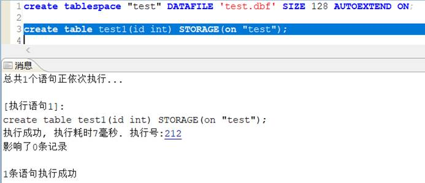

> **原因**
> 
> 初始化数据库实例的时候，有个大小写敏感的参数 CASE\_SENSITIVE，要设置正确。大小写敏感的库，在 DM 默认都会转为大写，但是当用双引号引起来，如"test"，则创建的对象名是小写的。上例中，创建的表空间名是小写的 test，所以，单独写 TEST 或者 test，都会报这个对象不存在。如果创建的是大小写不敏感的库，则创建的对象名是小写就是小写，大写就是大写。

## \[-4080\]: 不是 group by 表达式

创建表，还原报错，如下所示：

```sql
CREATE TABLE "SYSDBA"."FZQ"(
"ID" VARCHAR(4),
"COLUMN_1" NUMBER(22,6),
"COLUMN_2" CHAR(10),
"COLUMN_3" INT) STORAGE(ON "MAIN", CLUSTERBTR) ;

select sum(COLUMN_1),COLUMN_2 ,COLUMN_3 from "SYSDBA"."FZQ" where 1=1  group by COLUMN_2 order by COLUMN_3 desc
```

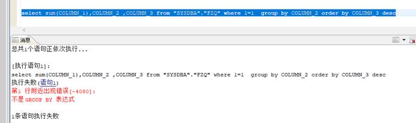

**【问题原因】** ：

- GROUP BY 和 ORDER BY 一起使用时，ORDER BY 要在 GROUP BY 的后面。
- GROUP BY 后面必须有 ORDER BY 的字段。
- 在 select 需要查询的语句中选中的字段，必须出现在 GROUP BY 子句中。

**修改后** 如下所示：

```sql
select sum(COLUMN_1),COLUMN_2 ,COLUMN_3 from "SYSDBA"."FZQ" where 1=1  group by COLUMN_2,COLUMN_3 order by COLUMN_3 desc;
```

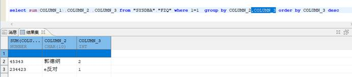

> **注意**
> 
> 若不想修改 SQL 语句，可以通过以下方法解决： 方法 1：修改 dm.ini 的 compatible\_mode 参数为 4，来兼容 MySQL 语法，修改参数后需要重启数据库服务。 方法 2: 非 mysql 兼容模式下（即 COMPATIBLE\_MODE 不等于 4），修改 GROUP\_OPT\_FLAG（动态会话级）参数包含 1 取值，即支持查询项不是 GROUP BY 表达式。
> 
> ```sql
> alter  system set 'GROUP_OPT_FLAG'=1 both;
> ```

## \[-2665\]: 记录超长

**【问题原因】** ：

DM 中记录长度不能超过页大小的一半。

**【解决方法】** ：

DM 在初始化的时候，默认的页大小是 8 KB，也就是说一个表一条记录的所有的字段的总长度不能超过 4 KB。选择的页大小影响后面表每行数据的长度，表每行的长度之和（普通数据类型）不能超过一页大小，如果超过 1 页大小即报记录超长的错误，

考虑实际场景选择：

1. 找到表中 varchar 类型比较长的（如 varchar2（8000）这种），修改成 text 类型；
2. 把页大小改为 16 KB 或者 32 KB； **这是一个底层参数，在数据库生命周期内都不能更改，所以必须重新初始化** 。（对于表中 varchar2 类型较长，并且字段较多的情况不太适合，这种情况采用方法 1 解决。）
3. 利用该表的启用超长记录来解决；
4. 考虑使用大字段，大字段是不参与上述描述计算的。大字段长度能够达到 2 GB。但是要注意，大字段的使用和普通字段是有区别的。详情可以参考相关文档。
5. 如果从其他数据库通过 DTS 迁移工具将数据迁移到达梦，已经将页大小修改成 32K 仍然报错。可以重新初始化数据库，将页大小设置成 32K 的基础上，再将“Length\_in\_char”参数勾选上（或命令行初始化的时候，将“Length\_in\_char”设置成“Y”）。

举例说明：

比如安装时页大小为 8 kB，那么一行记录的长度除大字段外所有列加起来不能超过 4 kB。

```sql
select page(); --8192
create table test(c1 int,c2 varchar(2000),c3 varchar(2000),c4 varchar(2000)); --可创建成功
insert into test values(1,LPAD('a',2000),'a','a'); --未超过 4 kB，可以插入成功
insert into test values(2,LPAD('a',2000),LPAD('a',2000),'a'); --超过 4 kB，报错：记录超长
update test set c3=LPAD('a',2000) where c1=1; --更新操作导致记录超长，报错
```

## \[-6160\]: 数据类型的变更无效

由于 TEXT 和 VARCHAR 是属于不同类型的数据且长度是不同的，TEXT 属于多媒体数据类型，最大存储长度是 2G-1 字节，而 VARCHAR 属于字符数据类型，最大存储长度只有 8188 字节。当你直接修改字段时会报下图错误。

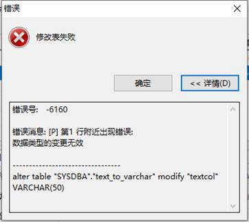

一般情况下不建议将 TEXT 类型转换为 VARCHAR 类型，因为长度不同，如果 TEXT 字段数据长度超过了 VARCHAR 字段的长度时做数据强制插入或迁移时会报【字符串截断】，但可能你在定义表时使用了错误字段，必须要更正，那么首先要查出表中 TEXT 字段的长度超过 8188 的数据并处理掉，然后重建表，然后通过 insert into select 或者迁移数据的方式将处理后的源表数据插入新表中。过程如下：

- 定义表，如下所示：
```sql
CREATE TABLE "text_to_varchar"
("id" CHAR(10),
"textcol" TEXT)；
```
- 分别插入两条数据

第一条：

```
id：8000
textcol：自造的 8000 字节长度的任意数据
```

第二条：

```
id：10000
textcol：自造的 10000 字节长度的任意数据。
```

通过长度计算参数可以查看当前字段长度如下图所示：

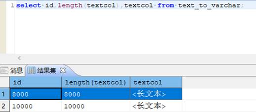

尝试将字段 textcol 从 text 转换为 varchar 时报错，如下图所示：

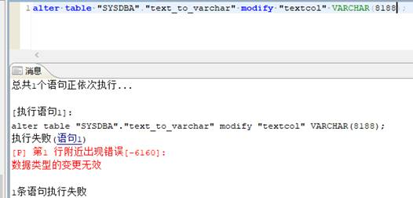

- 重新定义表，如下所示：
```sql
create table "text_to_varchar1"
(
"id" CHAR(10),
"textcol" VARCHAR(8188)
);
```

尝试使用 insert into select 的方式插入数据会报错，如下图所示：

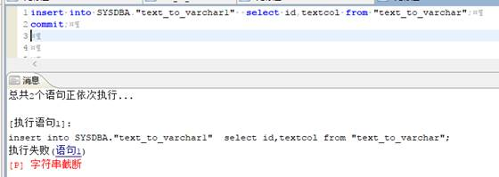

尝试使用迁移工具迁移数据同样会报字符串截断错误，如下图所示：

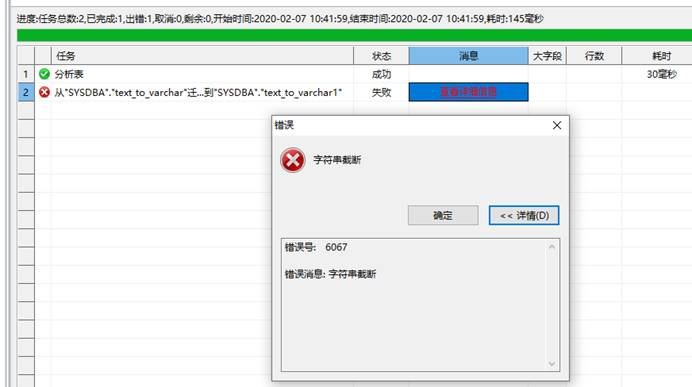

处理掉长度超长的数据，我这里是直接删除掉了该条数据，但实际数据可能是有用的，根据情况进行适当处理，如下图所示：

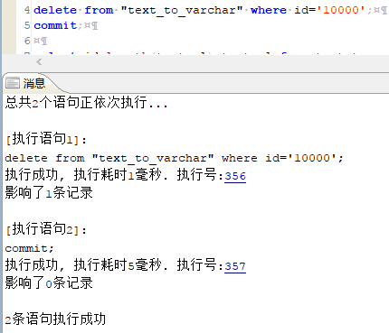

然后再尝试插入或迁移数据，此时就不会报错了，如下图所示：

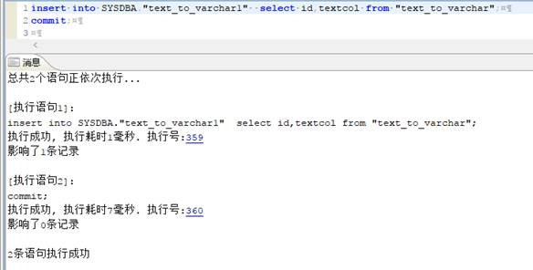

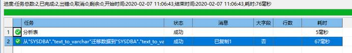

## \[-2106\]: 无效的表或者视图名

- 加上模式名，不是 SYSDBA 下的表都要加上模式名。

这个表确实不是该模式下的—如果查询不是当前模式下的表格，请加上模式。

- 从其他数据库迁移数据到 DM 时，一般情况下建议将 **【保持对象名大小写】勾去掉** ，因为在 DM 本身是大小写敏感的情况下，数据库中小写的对象名经常会导致【无效的表名或视图名】的错误。
- 使用 activiti 配置，连接 DM 数据的时候，报错无效的表或视图名。

举例如下：

DM 数据库已经连上了，报了无效的表或视图名，登录数据库查看发现没有这个表，很显然表没建上或者建表的脚本报错了，通过 SQL 日志观察发现根本没有执行建表操作，所以可以判断出这个地方和 DM 数据库没有关系，和 activiti 的配置有关，activiti 第一次启动时才需要建表。

进行以下配置：

```
<property name="databaseSchemaUpdate" value="false" /
--把这个属性中 false 改成 true 就可以建表了
<property name="databaseSchemaUpdate" value="true" /
```

activiti 默认是不支持 DM 的，所以我们选择了 Oracle 数据库类型来兼容 DM。

- 初始化无效的表或者视图名 `SYSCOLINFOS` 。数据库版本问题，用的两个数据库版本，有一个过低。
- 导入数据时报“无效的表或视图名”：需要先创建对象，然后再导入。
- 数据迁移时无效的表名：查看目标端是否有数据库表
- 如果是小写的或者大小写混合的表名，加双引号试试。

DM 数据库的大小写敏感，可以参考 [详解 DM 数据库字符串大小写敏感](http://eco.dameng.com/community/article/df11811a02de8e923c2e57ef6597bc62)

- 使用低版本管理工具连接高版本数据库，在管理工具中修改数据库用户时出现此报错。  
	该问题是由高版本数据库服务端中存在系统表 SYS.SYSUSERPROFILES 表及其相关同义词，但是低版本数据库服务端不存在此表，因此，在管理工具中右键进行修改用户操作的时候会报错。  
	此时可提供两种解决办法：  
	（1）使用高版本数据库对应的管理工具；  
	（2）在库里面新建 SYS.SYSUSERPROFILES 表。由于 SYS.SYSUSERPROFILES 表是系统表，所以需要创建公共同义词，然后就可以正常在管理工具中修改用户。SQL 语句如下：
```sql
CREATE TABLE SYSUSERPROFILES
(
"UID" INTEGER NOT NULL,
"PID" INTEGER NOT NULL,
CLUSTER PRIMARY KEY("UID"));

CREATE OR REPLACE PUBLIC SYNONYM "SYSUSERPROFILES" FOR "SYSUSERPROFILES";
```

## \[-6407\] 锁超时

**【问题描述】** ：

准备禁用掉数据库里某个触发器，但是操作后报了个锁超时的提示，导致无法禁用触发器。如下图所示：

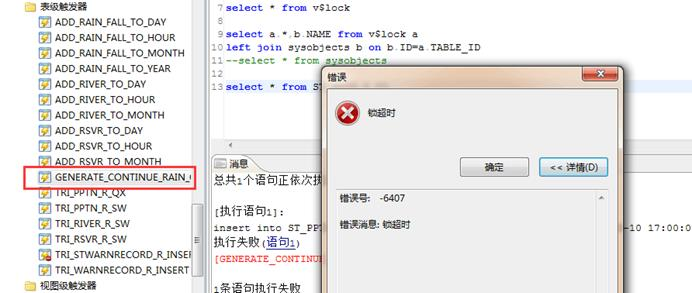

**【解决方法】** ：

- 查询数据库表的锁的情况
```sql
select * from v$lock;
```
- 查询对象信息
```sql
select * from sysobjects;
```
- 查询会话信息
```sql
select * from v$sessions;
```

上述 3 条语句组合一下就能查出哪张表上的某种锁是由哪个会话里的操作加上的。

```sql
select a.*,b.NAME,c.SESS_ID from v$lock a
left join sysobjects b on b.ID=a.TABLE_ID
left join v$sessions c on a.TRX_ID=c.TRX_ID;
```

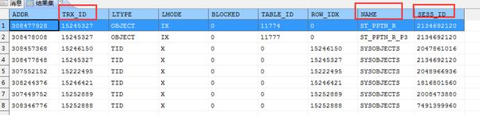

关闭对应的会话：

```sql
sp_close_session(sess_id);
```

## \[-2723\]: 仅当指定列列表，且 SET IDENTITY\_INSERT 为 ON 时，才能对自增列赋值

**【问题描述】** ：

例如，现有表 T1 和 T2，需要将表 T1 的数据都转移到 T2 表中：

```sql
create table t1(c1 int identity(1,1) not null,c2 varchar(20));   ---创建表 T1
insert into t1 values('a');            ---对表 T1 插入数据
insert into t1 values('b');
insert into t1 values('c');
commit;   

create table t2(c1 int identity(1,1) not null,c2 varchar(20));   ---创建表 T2
```

对表 T2 执行以下插入数据语句均会报错：仅当指定列列表，且 SET IDENTITY\_INSERT 为 ON 时，才能对自增列赋值

```sql
insert into t2 select * from t1;
insert into t2(c1,c2) select * from t1;
```

**【问题分析】** ：

一般情况下，当数据表中，某一列被设置成了标识列之后，是无法向标识列中手动的去插入标识列的显示值。但是，可以通过设置 SET IDENTITY\_INSERT 属性来实现对标识列中显示值的手动插入。语法说明：

- SET IDENTITY\_INSERT 表名 ON：表示开启对标识列显示值插入模式，允许对标识列显示值进行手动插入数据。
- SET IDENTITY\_INSERT 表名 OFF：表示关闭对标识列显示值的插入操作，标识列不允许手动插入显示值。

> **注意**
> 
> IDENTITY\_INSERT 的开启 ON 和关闭 OFF 是成对出现的，所以，在执行完手动插入操作之后，记得一定要把 IDENTITY\_INSERT 设置为 OFF，否则下次的自动插入数据会插入失败。

根据以上分析，利用以下语句插入数据成功：

```sql
insert into t2 select c2 from t1;
```

或者

```sql
SET IDENTITY_INSERT t2 on;   
insert into t2(c1,c2) select * from t1;
SET IDENTITY_INSERT t2 off;
```

## \[-3719\]: 非法的基类名

执行下列语句报错，错误消息: 第 6 行附近出现错误: 非法的基类名\[JSON\]。

```sql
CREATE TABLE  "CES_CLOUD_SAAS_SYS"."sys_route_conf"
(
"id" INT IDENTITY(34,1) NOT NULL,
"route_name" VARCHAR(200) NULL,
"route_id" VARCHAR(200) DEFAULT '' NOT NULL,
"predicates" JSON NULL,
"filters" JSON NULL,
"uri" VARCHAR(200) NULL,
"order" INT DEFAULT 0   NULL,
"create_time" TIMESTAMP(0) DEFAULT  CURRENT_TIMESTAMP()   NULL,
"update_time" TIMESTAMP(0) NULL,
"del_flag" CHAR(4) DEFAULT '0'   NULL
)
```

**【解决方法】** ：

```sql
CREATE TABLE  "sys_route_conf"
(
"id" INT IDENTITY(34,1) NOT NULL,
"route_name" VARCHAR(200) NULL,
"route_id" VARCHAR(200) DEFAULT '' NOT NULL,
"predicates" VARCHAR(1000)  CONSTRAINT ensure_json CHECK ("predicates" IS JSON),
--JSON NULL,
--"filters" JSON NULL,
"uri" VARCHAR(200) NULL,
"order" INT DEFAULT 0   NULL,
"create_time" TIMESTAMP(0) DEFAULT  CURRENT_TIMESTAMP()   NULL,
"update_time" TIMESTAMP(0) NULL,
"del_flag" CHAR(4) DEFAULT '0'   NULL
)
po_document  VARCHAR(1000) CONSTRAINT ensure_json CHECK (po_document IS JSON)
);
```

## \[-3243\]: 同时包含聚集 KEY 和大字段

DM 不支持表中同时包含聚集 KEY 和大字段，可以通过将表重建为非聚集型主键的方式来解决。

由于 PK\_WITH\_CLUSTER 默认取值为 1，即仅指定 PRIMARY KEY 关键字时默认创建为聚集主键，修改为 0 后默认创建非聚集主键。

可以使用以下语句来查询该参数的值：

```sql
SELECT * FROM V$DM_INI WHERE PARA_NAME = 'PK_WITH_CLUSTER';
```
- 使用 `SP_SET_PARA_VALUE(1,'PK_WITH_CLUSTER',0);` 将该参数值修改为 0，
- 使用 `SP_SET_PARA_VALUE(1,'PK_WITH_CLUSTER',1);` 将该参数值改回 1。

## \[-2007\]: 语法分析出错

出现此类报错，首先查看 SQL 语句是否符合达梦的语法规则。可以参考《DM SQL 语言使用手册》，（手册位于 **数据库安装路径** `/dmdbms/doc` 文件夹下）。

如下是一些典型场景的总结：

- DM 客户端管理工具执行 SQL 报错
	- 将 SQL 从其他地方如实复制，一个成功，一个失败：  
		存在可能：一个是正常的空格 一个是个全角空格；
		- 特殊字符是否用了中文键：比如引号，双引号，括号；
		- 删除原来的空格 输入成空格或者 制表符 或者回车；
		- 语句中缺少 `,` 或者 `;`
		- 是不是设置了屏蔽关键字了？可以根据下面语句进行查询
	```sql
	select * from v$dm_ini where para_name ='EXCLUDE_RESERVED_WORDS';
	```
	根据报错的信息提示，再运行 SQL 语句得到的关键字信息，查看是否屏蔽的关键字。修改屏蔽的关键字有三种方法：  
	方法一：直接在配置文件 dm.ini 内修改参数；  
	方法二：按照实际需求，在数据库执行以下 SQL 语句;
	```sql
	SF_SET_SYSTEM_PARA_VALUE('EXCLUDE_RESERVED_WORDS','',1,2);    ---删除全部。
	SF_SET_SYSTEM_PARA_VALUE('EXCLUDE_RESERVED_WORDS','DOMAIN,verify,reference,offset,TYPE',1,2);   ---只保留关键字DOMAIN,verify,reference,offset,TYPE
	```
	方法三：在控制台工具内修改参数值。  
	因为此参数是静态参数，重启数据库服务后生效。
- 数据迁移报错
	- 由于使用达梦的保留字冲突导致，建议如果可以更换尽量更换，如果不行可以采用屏蔽关键字的方法进行屏蔽。  
		对保留字加上双引号或者 dmsvc 中配置 TRACE=(XXX) 来让驱动自动屏蔽关键字， `select * from V$RESERVED_WORDS where RESERVED='Y';` 来查询关键字
		- 字符兼容问题，是否使用了中文的标点符号
		- Oracle 和 DM 有语法不一致的地方，需要根据具体问题具体分析，例如：

| Oracle | DM |
| --- | --- |
| Select DUMMY From dual | Select ID From dual |
| to\_nchar | to\_char |
| NLS\_UPPER | NLS\_UPPER |

**中文符号的处理** ：

1. 达梦的 Mmanager 管理工具中，不支持中文标点、异常空白符。（即不是空格、/r、/n 的其他的空白符、不支持全角符号 —— 当成字符串处理的除外，通常发生在语法正常但是还是报错的情况）
2. 该空白符通过客户端工具，调整编辑器为显示空白字符，可以分别异常空白符，所有正常的空格，均会显示为：虚点。

## \[-2103\]: 无效的模式名

1. 首先在数据库中检查，看是否有这个模式；
2. 注意大小写敏感问题，在大小写敏感的数据库实例里面，如果模式名是小写，可以试试加将报错的模式加双引号，否则默认转成大写；
3. 如果是在数据迁移过程中报此错，建议要先创建相关用户的。比如，用 DBO 用户，来迁移 DBO 的模式。

## \[-129\]:RESTORE/RECOVER 还原恢复后的库，需执行'recover database... update db\_magic'更新 DB\_MAGIC 值后才能启动

备份还原的步骤没有完成，备份、还原、恢复三个阶段如果停留在中间某一步时，重启数据，会报错。

**【解决方法】** ：

完成备份还原后，再完成备份恢复，最后再重启数据库。

## \[-2167\]:分区列更新将引起分区的更改

分区表更新分区列时报错：-2167(分区列更新将引起分区的更改)

解决方法是：可以修改建表属性，指定为 ENABLE ROW MOVEMENT。

设置行迁移功能，仅对行存储的水平分区表有效，其它表类型自动忽略。

- ENABLE ROW MOVEMENT，打开行迁移，允许更新后数据发生跨分区的移动。
- DISABLE ROW MOVEMENT，关闭行迁移，不允许更新后数据发生跨分区的移动。

缺省为 DISABLE ROW MOVEMENT；

具体实例如下：

```sql
---创建表，指定为 enable row movement
drop  table  dmtest;
create table  dmtest(
c1 datetime(6) default sysdate not null,
c2 varchar2(10))partition by range(c1)
interval(numtodsinterval(1,'DAY'))
(
partition p1 values less than (datetime'2018-04-01 00:00:00')
) enable row movement;

---创建
insert into dmtest values(datetime'2017-10-13 19:33:41','aswq');
commit;

---更新分区列，执行成功
update  dmtest set c1='2018-10-14 12:00:00'
```

## \[-7106\]:对象处于无效状态

1. 查看是不是触发器导致的（检查一下这个提示对象是不是触发器，看一下是否已失效）。
2. 基表可能没有了，重新创建表和视图。
3. 去左边导航栏查找这个对象，看是不是有感叹号。
4. 也可能是对象定义中存在语法错误。检查对象的创建语句。

## Hash 列修改报错：语法分析错误

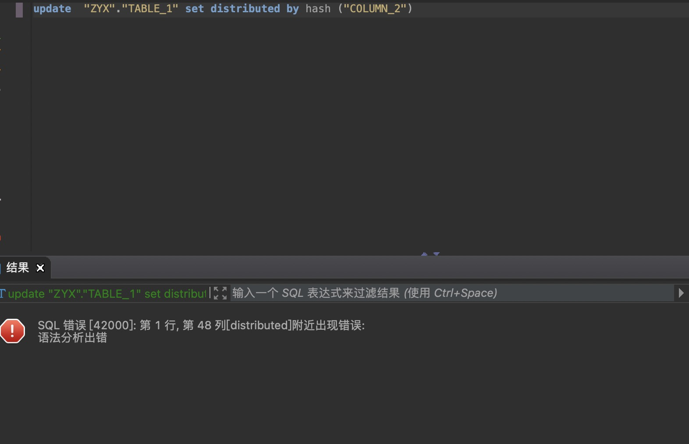

只允许对分布列的数据进行更新，不允许修改分布方式。

## \[-2639\]:试图删除被依赖对象\[%s\]

可以级联删除 CASCADE 选项。  
删除用户的时候，如果未使用 CASCADE 选项，若该用户建立了数据库对象 (如表、视图、过程或函数)，或其他用户对象引用了该用户的对象，或在该用户的表上存在其它用户建立的视图，  
DM 将返回错误信息，而不删除此用户。

## \[-6012\]无法连接到指定主机

在做表的增删改的时候报错：【-6012】无法连接到指定主机

可能的原因：

- 数据库连接断开

此时检查此操作用户是否与服务器断开连接，如果断开需要重新连接。

- 此表损坏

可以做测试：

```sql
create table test as select * from A ;
```

如若新建表 test 可以删除，只是对表 A 不能增删改。那么有可能是表损坏了。

此时可以忽略此表，或者新建一个实例，将此实例的数据内容迁移到新实例里。

## \[-2870\]:Load the third-party library \[libgeos\_c.so\] failed

**【问题说明】** ：

在 centos 上安装数据库后，执行命令 SP\_INIT\_GEO\_SYS(1); 出现如下错误：

```shell
[-2870]:Load the third-party library [libgeos_c.so] failed, library is missing or too old.
```

**【解决方法】** ：

- 先在数据库 bin 目录下看一下有没有这个 libgeos\_c.so 文件；
- 其次检查一下在当前用户下是否设置了数据库环境变量；
- 若前两步没问题，考虑从别处拷贝新的 libgeos\_c.so 文件；

## \[-3236\]:此列列表已索引

创建的索引已经存在，一列只能建一个索引。

> **注意**
> 
> 如果在管理工具上遇此报错，将索引刷新一下能见到已经创建的索引。

## \[-2510\]:模式\[%s\]不属于当前用户

```sql
SET SCHEMA <模式名>;只能设置属于自己的模式。
```

**【举例说明】** ：  
SALES 属于 SYSDBA 用户创建的模式，PERSON 不属于 SYSDBA 创建的模式，那么 SYSDBA 就不能使用 SET SCHEMA 来将当前模式切换到 PERSON 模式

## \[-2207\]:无法解析的成员表达式

- 检查客户端版本和服务器版本是否相差过大。  
	DM7 运行：select \* from v$version  
	DM8 运行：select id\_code
- 大小写敏感问题，如果字段是小写的，注意加双引号。  
	详解 DM 数据库字符串大小写敏感：  
	[DM 数据库字符串大小写敏感](http://eco.dameng.com/community/article/df11811a02de8e923c2e57ef6597bc62)
- 语法不符合 DM 的语法规则，请参考安装目录 DOC 目录下的—DM SQL 语言使用手册

## \[-2251\]:DBLINK 远程服务器获取对象\[%s\]失败

**【问题说明】** ：

达梦 8 创建 DBLINK 到 oracle 数据库，查询对端信息报错。如下图所示：

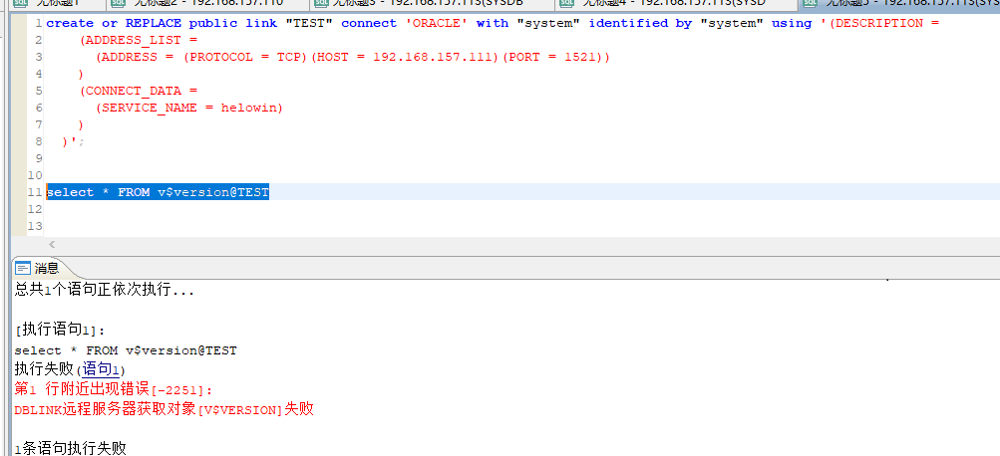

**【解决方法】** ：

在创建 DBLINK 的时候用户名要指定大写。

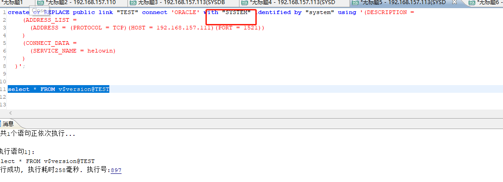

## \[-3719\]:非法的基类名\[DBMS\_SQL\]

**【问题说明】** ：

DM8 使用 dbms\_sql 系统包定义 dbms\_sql.varchar2s ，出现报错：

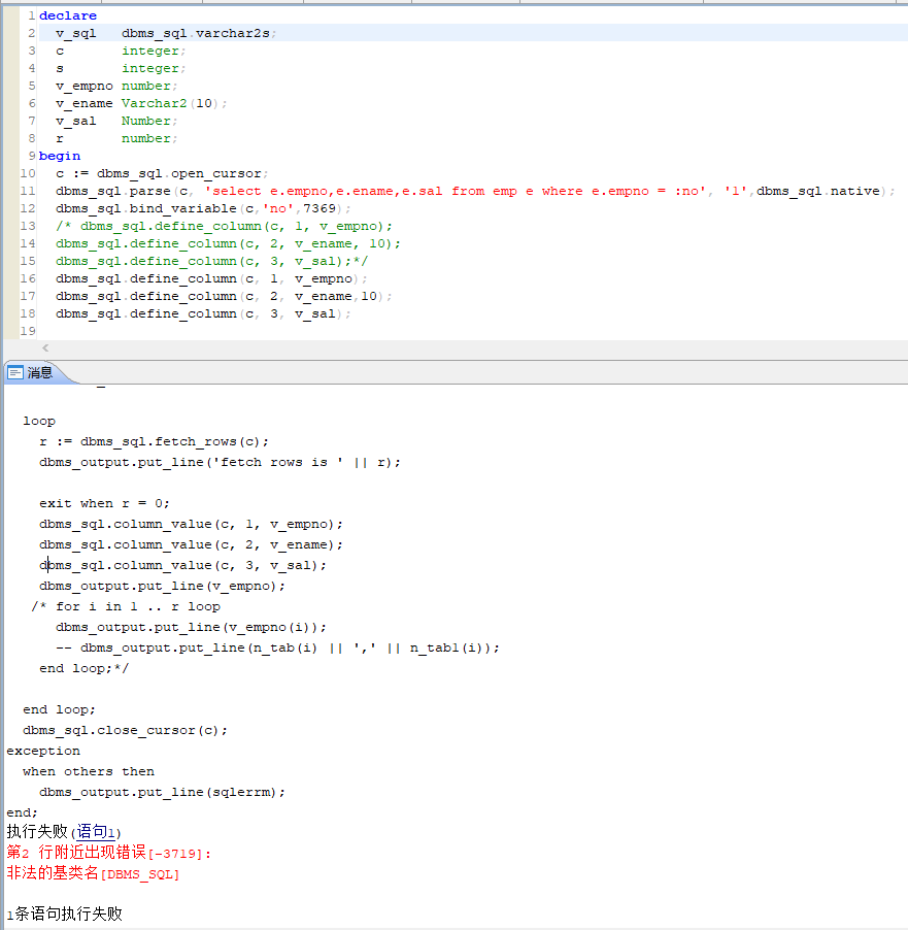

**【解决办法】** ：

DBMS\_SQL 包中索引表类型不支持 varchar2s ，支持 varchar2a。  
因此修改 dbms\_sql.varchar2s 为 dbms\_sql.varchar2a。

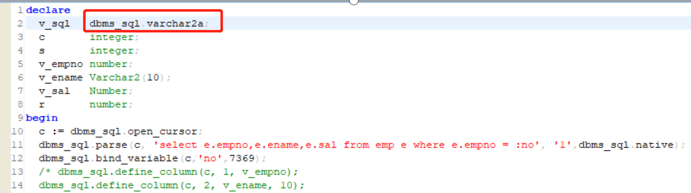

## \[-2410\]:数据文件\[test.dbf\]大小无效

**【问题描述】** ：

创建表空间时提示数据文件\[test.dbf\]大小无效，报错信息如下：

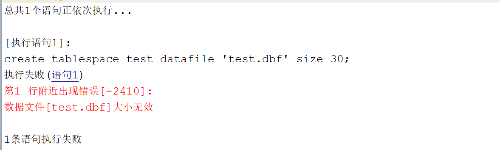

**【问题解决】** ：

表空间最小值与页大小有关，最小为页大小数值的 4 倍，单位为 M，例如当页大小为 8K 时，创建大小为 31M 的表空间失败，创建大小为 32M 的表空间成功。

## \[-2101\]:无效的用户名\[xxx\]

**【问题描述】** ：

SQL 语法无误，但创建用户报错：无效的用户名。报错截图如下：

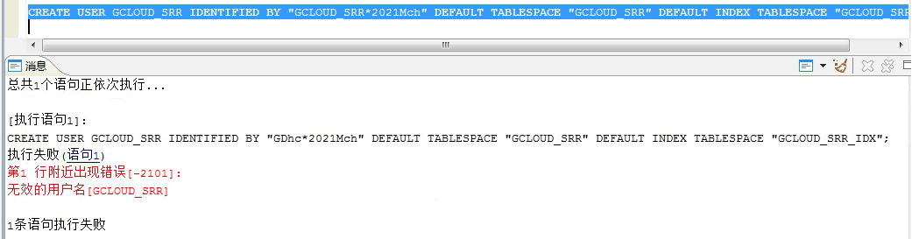

**【问题解决】** ：

可能是对象名已被使用，通过如下语句检查数据库中是否已有名为 GCLOUD\_SRR 的对象：

```sql
select * from all_objects where object_name='GCLOUD_SRR';
```

## \[-7071\]：触发器运行时出错

**【问题描述】** ：

使用 SYSDBA 登录，创建表时报错：\[-7071\]触发器运行时出错，具体信息如下：

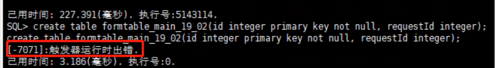

**【问题解决】** ：

查找系统中有没有对应的 ddl 的触发器，比如 create 之类的，将其置为无效，重新创建表即可。

```sql
---查找系统中对应的 create 触发器语句
SELECT  TRIGGER_NAME ,OWNER FROM DBA_TRIGGERS WHERE BASE_OBJECT_TYPE='DATABASE' AND TRIGGERING_EVENT LIKE '%CREATE%%';

---找到对应的触发器，将其置为无效
alter trigger  触发器名称 disable;
```

具体过程如下图所示：

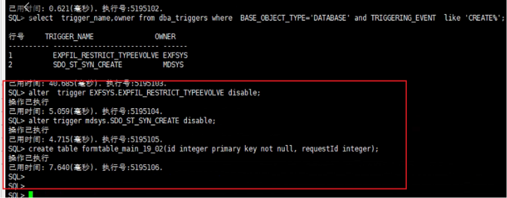

## \[-2750\]:随机分布表不支持 UNIQUE 索引

**【问题描述】** ：

mpp 上创建表报错：\[-2750\]:随机分布表不支持 UNIQUE 索引

```sql
create TABLE TEST(id int PRIMARY KEY,name VARCHAR(20))
```

**【问题解决】** ：

在 MPP 上创建表，如果未指定分布列则默认为随机分布列。随机分布表不支持 UNIQUE 索引，也不支持主键列。想要创建主键，可将随机分布表修改为其他分布方式（除随机分布外，其他分布方式都支持创建主键，可按需选择）。

- 完全分发：distributed fully
- 指定列表列分发：distributed by list
- 指定范围列分发：distributed by range
- 指定哈希列分发：distributed by hash

> **注意**
> 
> HASH、范围分布列数量不能超过 16，LIST 分布列数量只能为 1。

SQL 方法指定分布方式：

指定该表为 HASH 分布表，按照 id 来进行 HASH 分布，此时 id 就可以作为主键。如下：

```sql
create TABLE TEST(id int PRIMARY KEY,name VARCHAR(20)) DISTRIBUTED BY HASH(id);
```

管理工具方法指定分布方式：

新建表-选项-选择自己需要的分布方式。

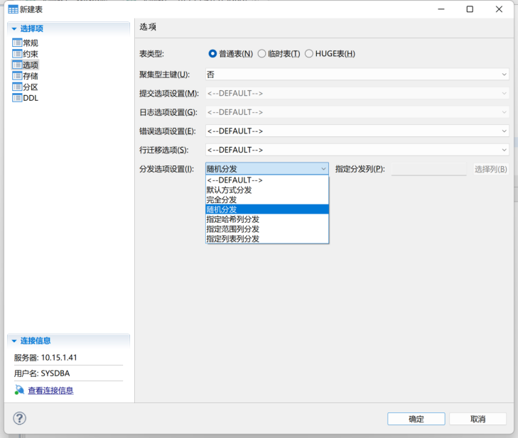

部分分布方式简要说明：

1. 完全分发。

每个站点上的数据都保持一致。

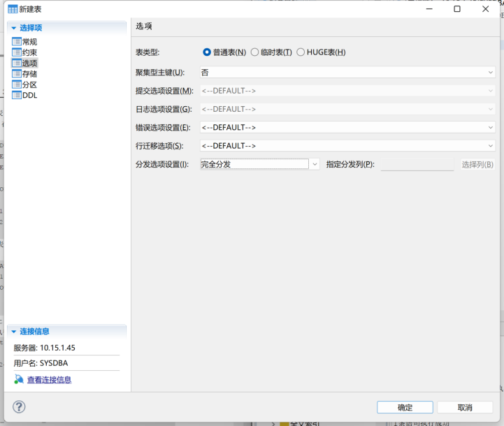

2. 范围列分布表。

小于 3 的（1，2）会分布在第一节点，小于 6 的（3，4，5）会分布在第二节点，其他值会报错。

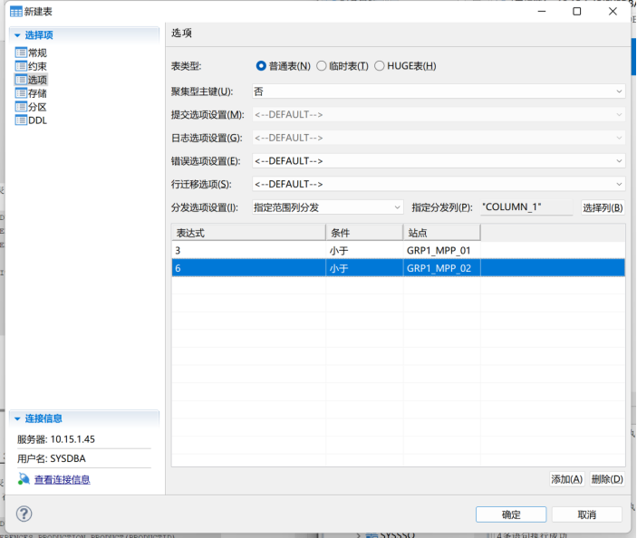

3. 指定列分发。

1，2，3，4 分发在第 2 列上，其他值会报错。

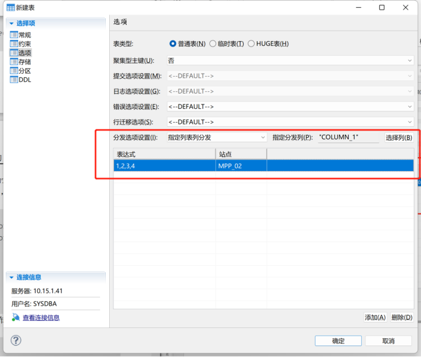

## \[-6111\]:字符串转换出错

**【问题描述】** ：

DM 执行如下 SQL 语句报错：字符串转换出错，但在 Oracle 可以执行。

```sql
select DECODE('688.46673946623', null,null,0,null,'VERIFY', 0, '688.46673946623') from dual;
```

**【问题解决】** ：

由于 CASE\_COMPATIBLE\_MODE 的默认参数为 1，DECODE 函数的选择方式与 ORACLE 机制不太一致，可以通过修改该参数或改写 SQL 的方式解决。

- 方法一：修改兼容参数 CASE\_COMPATIBLE\_MODE。
```sql
---查询原先参数值
select * from v$dm_ini where para_name = ‘CASE_COMPATIBLE _MODE’;

---修改参数为2，并重启数据库生效
SP_SET_PARA_VALUE(1,’CASE_COMPATIBLE _MODE’,2);

---最后，再次执行可以成功执行
```
- 方式二：改写 SQL 实现。
```sql
---SQL改写如下:
select DECODE('688.46673946623', null,null,’0’,null,'VERIFY', 0, '688.46673946623') from dual;
```

> **注意**
> 
> CASE\_COMPATIBLE \_MODE：涉及不同数据类型的 CASE 运算，是否需要兼容 ORACLE 的处理策略。 0：不兼容； 1：兼容，本模式下，当函数 DECODE()中的多个 CASE 类型不一致时，DECODE 会从其中选择一个类型进行匹配； 2：兼容，本模式下，当函数 DECODE()中的多 个 CASE 类型不一致时，DECODE 根据第一个 CASE 的类型来决定匹配类型

## \[-2685\]:试图在 blob 或者 clob 列上排序或比较

**【问题描述】** ：

对大字段类型列进行排序和分组操作报错：试图在 blob 或者 clob 列上排序或比较。具体如下图：

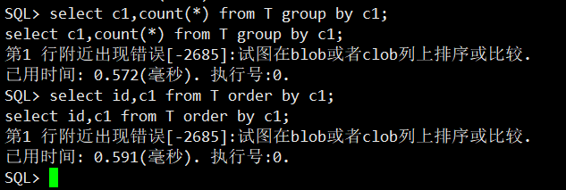

**【问题解决】** ：

**方法一：** 修改数据库参数 ENABLE\_BLOB\_CMP\_FLAG 为 1  
ENABLE\_BLOB\_CMP\_FLAG：是否支持大字段类型的比较。0：不支持；1：支持。设置为 1 后支持 DISTINCT、ORDER BY、分析函数和集函数支持对大字段进行处理。  
注意：该参数并不能支持 GROUP BY 对大字段进行处理。

```sql
---将ENABLE_BLOB_CMP_FLAG参数设置为1
sp_set_para_value(1,'ENABLE_BLOB_CMP_FLAG',1);
```

执行 order by SQL 语句：

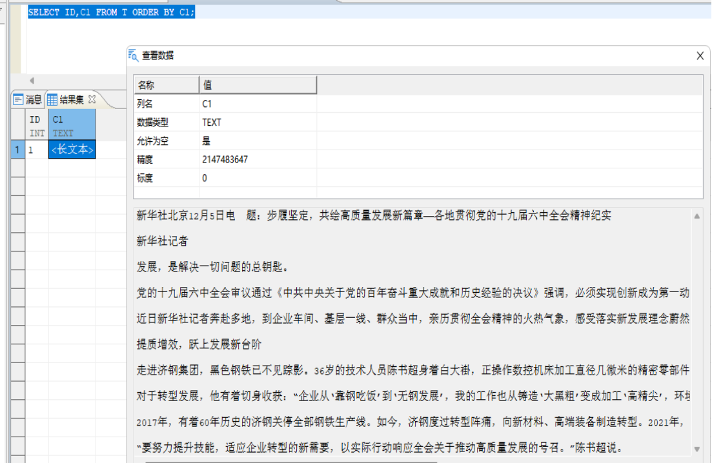

执行 group by SQL 语句：

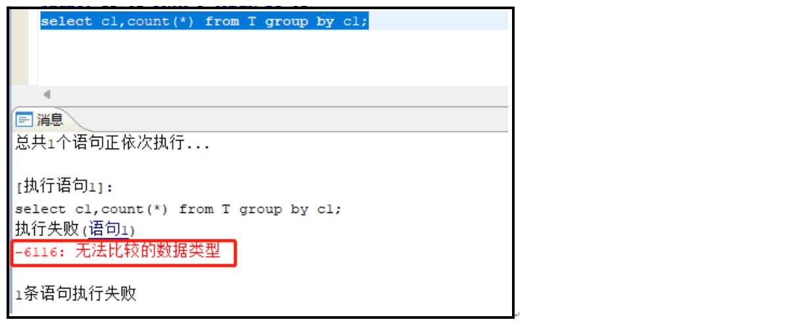

**方法二：** 将大字段类型转换为字符串类型。

GROUP BY 无法通过修改 ENABLE\_BLOB\_CMP\_FLAG 参数来支持，可将对应的大对象列转换为字符串类型进行处理。

- 使用 CAST 将字段类型转换为字符串类型
```sql
SELECT ID,CAST(C1 AS VARCHAR) FROM T ORDER BY CAST(C1 AS VARCHAR);
SELECT CAST(C1 AS VARCHAR), COUNT(*) FROM T GROUP BY CAST(C1 AS VARCHAR);
```

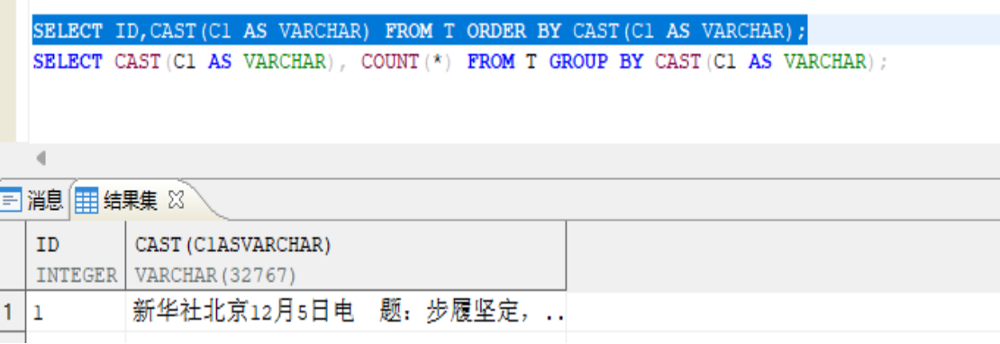

- 使用 DBMS\_LOB.SUBSTR 函数
```sql
SELECT ID,DBMS_LOB.SUBSTR(C1) FROM T ORDER BY DBMS_LOB.SUBSTR(C1);
select DBMS_LOB.SUBSTR(C1),count(*) from T group by DBMS_LOB.SUBSTR(C1);
```

> **注意**
> 
> 1、使用方法一，修改数据库参数的方式，无法支持 GROUP BY 对大字段的处理。 2、使用方法二，通过转换大字段类型为字符串类型可以达到相应的效果，但是如果大字段的内容长度比较长超过 32767，内容可能会自动截断。

## \[-5403\]:参数不兼容

**【问题描述】** ：

执行 SELECT hour(round(3661));报错：参数不兼容。如下图所示：

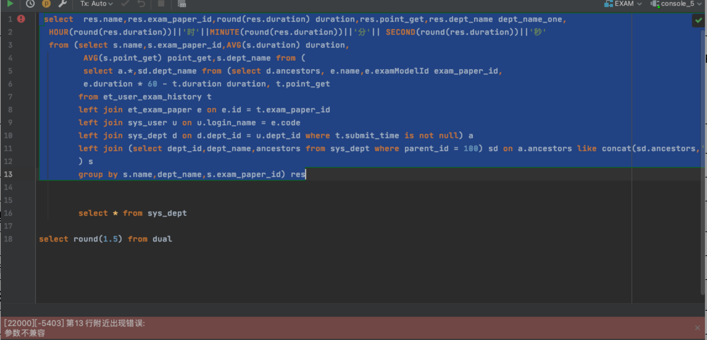

**【问题解决】** ：

问题原因：该报错是由于函数传值类型错误导致。本例中主要是使用 HOUR、MINUTE、SECOND 函数，数据类型为 time（时间戳 int 或者日期 date 类型），但是传入的数据为 ROUND 后的数据，数据类型为 DEC。  
解决方案：引入 cast 函数强制转换数据类型，如下：

```sql
SELECT hour(cast(round(3661) as int))  --round 结果集转换为 int 类型后，成功执行。
```

## \[-2008\]：TRACE 事件设置错误

**【问题描述】** ：

执行如下 SQL 语句报错：TRACE 事件设置错误

```sql
alter session set events 'immediate trace name plndump level 281338830366824,dump_file ''/opt/dmdbms/log/dm.log''';
```

**【问题解决】** ：

考虑存在全角空格导致 sql 解析错误。  
解决：在管理工具中，窗口——选项——查询分析器——编辑器，勾选显示空白字符，修改错误字符。

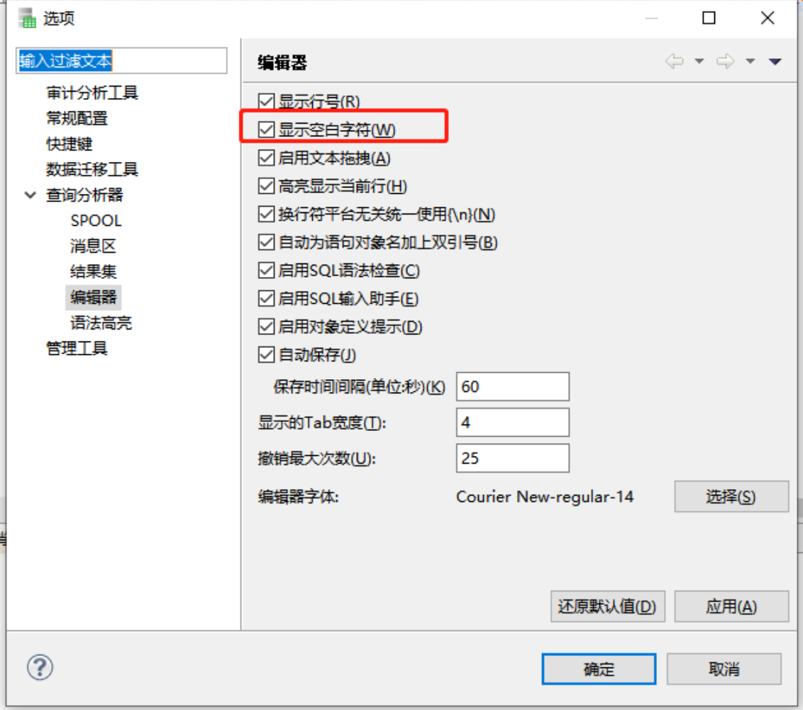

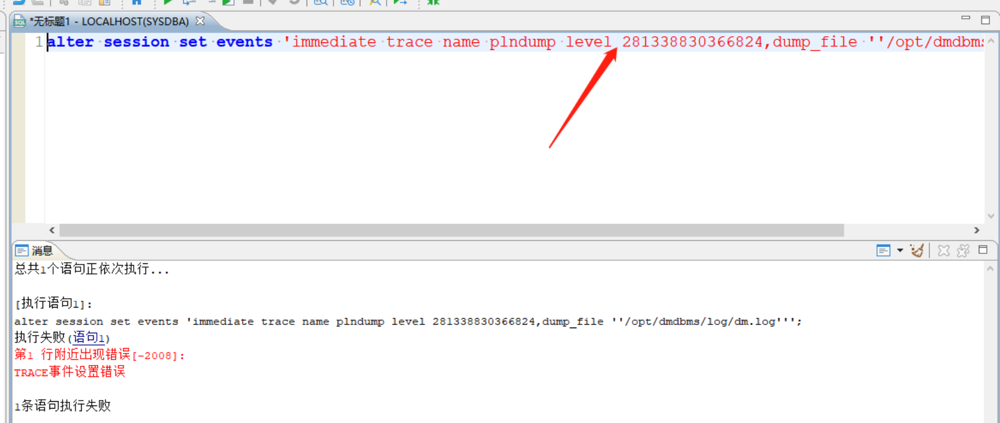

## \[-6509\]：当前对象被占用

**【问题描述】** ：

删除模式时报错：当前对象被占用

```sql
DROP  SCHEMA SYSDBA_1;
总共1个语句正依次执行...

[执行语句1]:
DROP  SCHEMA SYSDBA_1;
执行失败(语句1)
-6509: 第1 行附近出现错误:
当前对象被占用

1条语句执行失败
```

**【问题解决】** ：

排查删除模式中是否存在表、视图等对象信息，排查 SQL 参考：

```sql
select * from all_objects where owner='SYSDBA_1';
```

确认相关对象数据无用后删除，再删除模式即可。

## \[-6510\]：试图在事务运行中，改变其属性

**【问题描述】** ：

按照如下步骤修改事务为读未提交隔离级，报错：试图在事务运行中，改变其属性。

```sql
---修改事务为只读事务
SET TRANSACTION READ ONLY;

---查看v$trx视图，看到事务为只读模式
select * from v$trx;

---修改事务为读未提交隔离级，出现报错
set transaction isolation level read uncommitted;
```

报错截图如下：

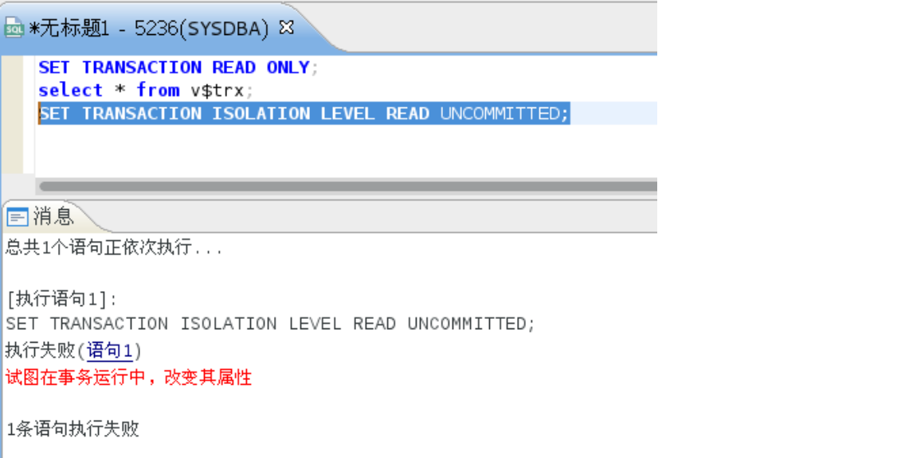

**【问题解决】** ：

修改为只读事务后，需要执行 commit 提交，然后再修改事务隔离级为读未提交隔离级。

## \[-3528\]：嵌套层次太深

**【问题描述】** ：

在进行大批量的插入或使用 union all 合并多个 select 查询结果集时报错：“嵌套层次太深”。

**【问题解决】** ：

适当调整参数：N\_PARSE\_LEVEL 和 EXPR\_N\_LEVEL。以下给出建议值（实际环境需要按情况进行调整）。

调用函数调整参数。

```sql
sp_set_para_value(1,'EXPR_N_LEVEL',1000) ；
sp_set_para_value(1,'N_PARSE_LEVEL',1000)；
```

参数说明：

| 参数名 | 属性 | 默认值 | 说明 |
| --- | --- | --- | --- |
| N\_PARSE\_LEVEL | 动态，会话级 | 200 | 表达式最大嵌套层数。取值范围 30~1000 |
| EXPR\_N\_LEVEL | 动态，会话级 | 200 | 表示对象 PROC、VIEW、PKG、CLASS 的最大解析层次，如果层次过深则报错返回。取值范围 30~1000 |

## \[-3503\]: 无效的函数参数

**【问题描述】** ：

调用系统过程 SF\_GET\_PARA\_VALUE()、SF\_GET\_PARA\_DOUBLE\_VALUE()、SF\_GET\_PARA\_STRING\_VALUE()查看参数值时，报错：-3503: 无效的函数参数。

**【问题解决】** ：

出现该报错主要有以下场景：

场景一：调用系统过程 SF\_GET\_PARA\_VALUE()、SF\_GET\_PARA\_DOUBLE\_VALUE()、SF\_GET\_PARA\_STRING\_VALUE()查看参数值时，参数值名称错误。例如：使用系统过程 SF\_GET\_PARA\_VALUE()查看 MAX\_SESSIONS（静态参数）参数值时，误将参数名写错：

```sql
SELECT SF_GET_PARA_VALUE(1,'MAX_SESSION');
总共1个语句正依次执行...

[执行语句1]:
SELECT SF_GET_PARA_VALUE(1,'MAX_SESSION');
执行失败(语句1)
-3503: 无效的函数参数

1条语句执行失败
```

场景二：调用系统过程 SF\_GET\_PARA\_VALUE()、SF\_GET\_PARA\_DOUBLE\_VALUE()、SF\_GET\_PARA\_STRING\_VALUE()查看参数值时，未根据参数名选择正确的系统过程执行。例如：  
参数名 UNDO\_RETENTINS，类型为 DOUBLE，本应使用系统过程 SF\_GET\_PARA\_DOUBLE\_VALUE()查看，但却使用 SF\_GET\_PARA\_VALUE()查看。

```sql
SELECT SF_GET_PARA_VALUE(1,'UNDO_RETENTIN');
总共1个语句正依次执行...

[执行语句1]:
SELECT SF_GET_PARA_VALUE(1,'UNDO_RETENTIN');
执行失败(语句1)
-3503: 无效的函数参数

1条语句执行失败
```

解决方案：调用系统过程 SF\_GET\_PARA\_VALUE()、SF\_GET\_PARA\_DOUBLE\_VALUE()、SF\_GET\_PARA\_STRING\_VALUE()查看参数值时除了要确保参数名正确，还要确保不同类型的参数类型选择不同的系统过程。  
更多调用系统过程内容请参照《系统管理员手册》中《配置文件》章节，确认具体参数名和参数类型信息。手册位于 **数据库安装路径** `/dmdbms/doc` 文件夹。

## \[-4585\]：试图在方法\[%s\]游标\[%s\]中访问策略关联对象

**【问题描述】：**

创建 PVD 策略对表的查询进行限制，在方法中使用游标访问表时报错\[-4585\]：试图在方法\[%s\]游标\[%s\]中访问策略关联对象”，在 Oracle 测试正常，在 dm7 测试异常。场景描述如下：

1. 创建 PVD 策略函数，对 PURCHASE\_ORDER\_ITEM 表进行 select 访问限制。
	```sql
	--创建PVD策略
	begin
	DBMS_RLS.ADD_POLICY(OBJECT_SCHEMA => 'TGPMS',
	OBJECT_NAME => 'PURCHASE_ORDER_ITEM',
	POLICY_NAME => 'PURCHASE_ORDER_ITEM_IU_P',
	FUNCTION_SCHEMA => 'TGPMS',
	POLICY_FUNCTION => 'PO_ITEM_VAL',
	UPDATE_CHECK => TRUE,
	STATEMENT_TYPES => 'SELECT',
	ENABLE => TRUE);
	end;
	```
2. PO\_ITEM\_VAL 方法。
	```sql
	Create or Replace FUNCTION "TGPMS"."PO_ITEM_VAL" (piv_po_number VARCHAR2,
	                     piv_po_item   VARCHAR2)
	       RETURN VARCHAR2 IS
	  item_desc  Purchase_order_item.Description%TYPE;
	  CURSOR ud_cursor(c_piv_po_status VARCHAR2) IS
	  SELECT poi.Description
	  FROM   Purchase_order_item poi, Purchase_order po
	  WHERE  poi.Po_no     = piv_po_number
	  AND    poi.Po_item   = piv_po_item
	  AND    po.Po_no      = poi.Po_no
	  AND    (po.Po_status = c_piv_po_status
	  OR      c_piv_po_status IS NULL);
	BEGIN
	    OPEN ud_cursor for sqlstr;
	    FETCH ud_cursor INTO item_desc;
	RETURN('0~,'||item_desc);
	CLOSE ud_cursor;
	END;
	/
	```
3. 数据表。
	```sql
	CREATE TABLE "TGPMS"."PURCHASE_ORDER_ITEM"
	(
	"PO_NO" VARCHAR2(12) NOT NULL,
	"PO_ITEM" VARCHAR2(50) NOT NULL,
	"PO_ITEM_TYPE" VARCHAR2(3),
	"DESCRIPTION" VARCHAR2(100)
	);
	CREATE TABLE "TGPMS"."PURCHASE_ORDER"
	(
	"PROJECT" VARCHAR2(6) NOT NULL,
	"PO_NO" VARCHAR2(12),
	"PO_STATUS" VARCHAR2(6) NOT NULL
	);
	```

**【问题解决】：**

出现该报错是由于达梦不支持带参数的游标语句中包含关联策略的对象。

解决方案：改写 PO\_ITEM\_VAL 方法，将游标相关代码改写为动态 SQL 执行的方式。具体修改内容参见以下代码：

```sql
Create or Replace FUNCTION "TGPMS"."PO_ITEM_VAL" (piv_po_number VARCHAR2,
                     piv_po_item   VARCHAR2)
       RETURN VARCHAR2 IS
  item_desc  Purchase_order_item.Description%TYPE;

  type myctype is ref cursor;
  ud_cursor myctype;
  sqlstr varchar2(500);

---改写前
  /* 
CURSOR ud_cursor(c_piv_po_status VARCHAR2) IS
  SELECT poi.Description
  FROM   Purchase_order_item poi, Purchase_order po
  WHERE  poi.Po_no     = piv_po_number
  AND    poi.Po_item   = piv_po_item
  AND    po.Po_no      = poi.Po_no
  AND    (po.Po_status = c_piv_po_status
  OR      c_piv_po_status IS NULL); */

---改写后
   sqlstr := '
   SELECT poi.Description,poi.Po_item_type,poi.Pcs,poi.Unit_of_measure,
         poi.Currency,poi.Ptd_commitment_rate,poi.Ptd_commitment_frate,
         poi.Incurred_type,poi.Ptd_commitment_amt,
         poi.Ptd_commitment_famt,poi.Ptd_commitment_qty,poi.Stop_order,poi.budget_hierarchy_code
   FROM Purchase_order_item poi, Purchase_order po
   WHERE poi.Po_no = '''||piv_po_number||'''
   AND poi.Po_item = '''||piv_po_item||'''
   AND po.Po_no = poi.Po_no
   AND (po.Po_status = '||v_piv_po_status||'
   OR '||v_piv_po_status||' IS NULL)';

    OPEN ud_cursor for sqlstr;
    FETCH ud_cursor INTO item_desc;
    RETURN('0~,'||item_desc);
    CLOSE ud_cursor;
END;
/
```

调用语句：

```sql
select PO_ITEM_VAL('LWDMT1','');
```

## \[-2670\]：Invalid xxx 约束表达式无效错误

**【问题描述】**

编写匿名块创建临时表时报错："\[-2670\]:Invalid default value expression for \[s%\].（对象\[s%\]DEFAULT 约束表达式无效错误）"。

**【问题分析】**

```sql
--原始SQL
DECLARE
        TOTAL INT:=0;
BEGIN
        SELECT
                COUNT(1)
        INTO
                TOTAL
        FROM
                USER_TABLES A
        WHERE
                A.TABLE_NAME = 'T_MONITOR_RUN_TMP';
        IF TOTAL             = 0 THEN
                EXECUTE IMMEDIATE 'CREATE GLOBAL TEMPORARY TABLE T_MONITOR_RUN_TMP(
"DEVICECODE" CHAR(50) NOT NULL,
"ONLINE" INTEGER DEFAULT 0,
"CPU" VARCHAR(50) DEFAULT "50%",
"MEN" VARCHAR(50) DEFAULT "50%",
"MYDISK" VARCHAR(50) DEFAULT "50%",
"ZOMBIE_PROCESS" VARCHAR(50) DEFAULT 0,
"TCPNUM" VARCHAR(50) DEFAULT0,
"RUN_LENGTH" VARCHAR(50) DEFAULT0,
"RUNING_STATE" VARCHAR(50) DEFAULT "正常",
"DB_RESIDUAL_CONNECTIONS" VARCHAR(50) DEFAULT "-",
"DB_CONNECTIONS_USED" VARCHAR(50) DEFAULT "-",
"DB_SPACE_USAGE" VARCHAR(50) DEFAULT "-",
"MASTER_STANDBY_STATE" VARCHAR(50) DEFAULT "-",
"MING_TUNNEL" VARCHAR(50) DEFAULT "-",
"MING_STRATEGY" VARCHAR(50) DEFAULT "-",
"MING_FLEX" VARCHAR(50) DEFAULT "-",
"MING" VARCHAR(50) DEFAULT "-",
"DEVICE_OFFLINE_LEN" VARCHAR(50) DEFAULT "-",
"TRANSMISSION_STATE" VARCHAR(50 )DEFAULT "-",
"DEVICEID" VARCHAR(50),
"NETPORTOPEN" VARCHAR(50)) on commit delete rows';
        END IF;
end;
/
```

根据报错信息分析表中字段的 default 约束无效，单独运行建表语句正常确认语法无误后，再分析匿名块中的语法。

在匿名块当中使用 EXECUTE IMMEDIATE '...'; 语句时，在单引号当中应当避免使用 “” 号，如果在单引号当中使了用单引号必须用 ' 做转义。

**【问题解决】**

修改原始脚本代码，在单引号中避免使用 “”，在单引号当中使了用单引号须使用 ’ 号转义。修改后运行成功。

```sql
--修改后脚本
DECLARE
        TOTAL INT:=0;
BEGIN
        SELECT
                COUNT(1)
        INTO
                TOTAL
        FROM
                USER_TABLES A
        WHERE
                A.TABLE_NAME = 'T_MONITOR_RUN_TMP';
        IF      TOTAL = 0 THEN
        EXECUTE IMMEDIATE 'CREATE GLOBAL TEMPORARY TABLE T_MONITOR_RUN_TMP(
DEVICECODE CHAR(50) NOT NULL,
ONLINE INTEGER DEFAULT 0,
CPU VARCHAR(50) DEFAULT ''50%'',
MEN VARCHAR(50) DEFAULT ''50%'',
MYDISK VARCHAR(50) DEFAULT ''50%'',
ZOMBIE_PROCESS VARCHAR(50) DEFAULT 0,
TCPNUM VARCHAR(50) DEFAULT 0,
RUN_LENGTH VARCHAR(50) DEFAULT 0,
RUNING_STATE VARCHAR(50) DEFAULT ''正常'',
DB_RESIDUAL_CONNECTIONS VARCHAR(50) DEFAULT ''-'',
DB_CONNECTIONS_USED VARCHAR(50) DEFAULT ''-'',
DB_SPACE_USAGE VARCHAR(50) DEFAULT ''-'',
MASTER_STANDBY_STATE VARCHAR(50) DEFAULT ''-'',
MING_TUNNEL VARCHAR(50) DEFAULT ''-'',
MING_STRATEGY VARCHAR(50) DEFAULT ''-'',
MING_FLEX VARCHAR(50) DEFAULT ''-'',
MING VARCHAR(50) DEFAULT ''-'',
DEVICE_OFFLINE_LEN VARCHAR(50) DEFAULT ''-'',
TRANSMISSION_STATE VARCHAR(50 )DEFAULT ''-'',
DEVICEID VARCHAR(50),
NETPORTOPEN VARCHAR(50)) on commit delete rows';
        END IF;
end;
/
```

## 使用 to\_date 时报错，报错号如：-6132、-6133、-6134、-6136、-6137

**【问题解决】**

使用 to\_date 时要注意以下几点：

1. 年月日时分秒作为字段值时，如果字段值不符合时间值的范围，都会出现类似的问题。
2. sql 语句 TO\_DATE 中的“表名.字段名”不能用单引号括起来，否则也会报错。

正确用法如下所示：

```sql
create TABLE SYSDBA.T1(C1 varchar2(50));

insert into SYSDBA.T1 VALUES ('20221121132326');commit;

select C1 from SYSDBA.T1 WHERE DATEDIFF(DD,TO_DATE(T1.C1,'YYYY-MM-DD HH24:MI:SS'),SYSDATE) <= '2';
```

其中需要注意的点是在插入语句中的时间范围 `VALUES ('20221121132326')` 要符合要求，TO\_DATE 中的“表名.字段名” `T1.C1` 不能用单引号括起来。

to\_data 更多用法和使用规范请参考达梦数据库安装目录的 doc 目录下的《DM8\_SQL 语言使用手册》。

## \[-70009\]:UTF string not integrated

**【问题描述】**

执行 SQL 文件时报错： \[-70009\]:UTF string not integrated。

**【问题分析】**

客户端默认获取操作系统编码，当 SQL 文件和客户端编码不一致时会出现该错误提示。

**【问题解决】**

调整 SQL 脚本编码和操作系统编码一致或者修改客户端本地 dm\_svc.conf 文件，添加 CHAR\_CODE 参数使得编码和 SQL 脚本一致即可。

dm\_svc.conf 文件是 DM 安装时生成一个配置文件，不同平台的目录有所不同：

- 32 位的 DM 安装在 Win32 操作平台下，此文件位于 %SystemRoot%\\system32 目录；
- 64 位的 DM 安装在 Win64 操作平台下，此文件位于 %SystemRoot%\\system32 目录；
- 32 位的 DM 安装在 Win64 操作平台下，此文件位于 %SystemRoot%\\SysWOW64 目录；
- 在 Linux 平台下，此文件位于/etc 目录。

## \[-2038\]: 无效的 pivot 子句

**【问题描述】**

dm 在开启 ENABLE\_BLOB\_CMP\_FLAG=1 参数后，pivot 函数中涉及大字段时报错："-2038: 无效的 pivot 子句"。

例如：

```sql
CREATE TABLE ADV_SEL_PIV (C1 INT,C2 text);
INSERT INTO ADV_SEL_PIV VALUES(1,'A');
INSERT INTO ADV_SEL_PIV VALUES(2,'B');
INSERT INTO ADV_SEL_PIV VALUES(3,'C');
COMMIT;
select * from ADV_SEL_PIV PIVOT(SUM(C1) FOR  C2 IN ('A' A,'B' B));
总共1个语句正依次执行...

[执行语句1]:
select * from ADV_SEL_PIV PIVOT(SUM(C1) FOR  C2 IN ('A' A,'B' B));
执行失败(语句1)
-2038: 第1 行附近出现错误:
无效的pivot子句

1条语句执行失败
```

**【问题解决】**

通过以下命令设置参数使达梦数据库兼容 oracle，执行后重启数据库服务即可支持。

```sql
sp_set_para_value(2,'COMPATIBLE_MODE ',1);
```

## \-4030: 用户数据中的 CONNECT BY 循环

**【问题解决】**

层次查询存在死循环，可以通过添加 nocycle 避免，如下 SQL：

```sql
SELECT name  from test START WITH id='101'  connect by nocycle prior pid=id
```

## \-6512：检测到活动的自治事务，已回滚

**【问题描述】**

示例如下：

```sql
create table t1 (msg varchar2(25) );
create or replace procedure Autonomous_Insert
as
   pragma autonomous_transaction;
begin
    insert into t1 values ( 'Autonomous Insert' );
end;
/
--执行调用自治事务将会报此错误
begin
    insert into t1 values ( 'Roll Back Block' );
    Autonomous_Insert;
    rollback;
end;
/
```

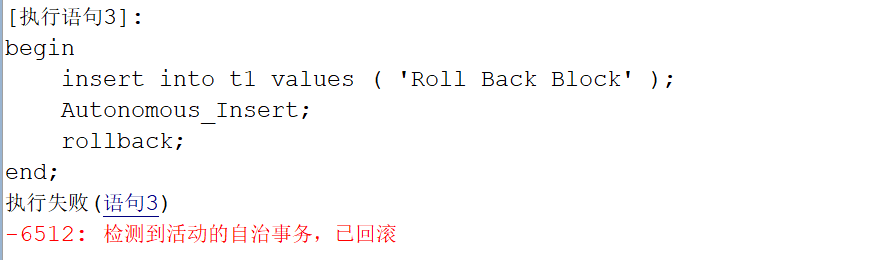

**【问题分析】**

自治事务必须显式提交或回滚，否则会抛出异常。

**【问题解决】**

对自治事务进行显示提交或回滚。

```sql
create or replace procedure Autonomous_Insert
as
   pragma autonomous_transaction;
begin
    insert into t1 values ( 'Autonomous Insert' );
    commit;  --显示提交
end;
/
```

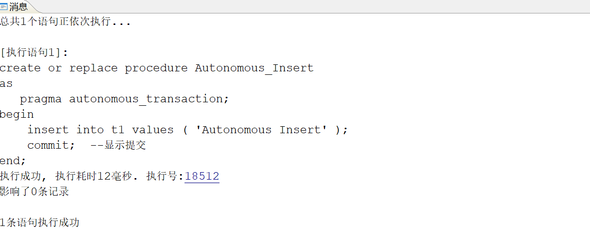

## \-3947: 服务器版本不一致，系统函数未找到

**【问题描述】**

执行 update 语句时报错 -3947: 服务器版本不一致，系统函数未找到。

**【问题分析】**

该问题通常在升级版本后会出现，主要原因如下：

1. 使用的驱动版本与数据库驱动相差过大，会因协议问题导致更新出错；
2. 数据库版本升级后未重建新的系统包；
3. 更新表时会更新相关的索引但索引使用了系统函数。

**【解决方案】**

1. 应用更换与数据库版本相对应的驱动。
2. 重建系统包。
```sql
sp_create_system_packages(0);
sp_create_system_packages(1);
```
3. 该示例中因升级后 fun 格式调整，需重建这个表相关的索引函数。

## \[-2154\]:口令重复次数超限, 请使用新口令

**【问题描述】**

修改密码时报错：“\[-2154\]:口令重复次数超限, 请使用新口令”。

```sql
SQL> alter user fyu IDENTIFIED by 123456789;
alter user fyu IDENTIFIED by 123456789;
第1 行附近出现错误[-2154]:口令重复次数超限, 请使用新口令.
已用时间: 1.688(毫秒). 执行号:0.
```

**【问题分析】**

修改用户密码时，新密码与上一次设置的密码重复会出现该报错提示。

**【问题解决】**

在修改密码时，使用与上次设置的密码不相同的密码。

## \[-2304\]: 密钥长度过短

**【问题描述】**

使用系统包解密函数报如下错误：

```sql
select unhex(DBMS_CRYPTO.DECRYPT('1269A376307F28F5EEA3FEBA64F34F56D39E164654948179591AD081316916D4', 

            DBMS_CRYPTO.ENCRYPT_AES128 + DBMS_CRYPTO.CHAIN_ECB + DBMS_CRYPTO.PAD_PKCS5,

            hex('abcd@123')));
```

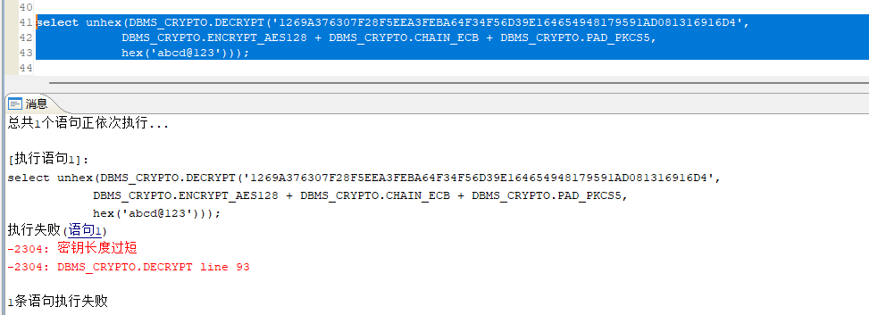

**【问题分析】**

加密使用的 KEY，不能为空。 KEY 长度必须足够，大于等于算法所需密钥长度，超出长度部分忽略，长度不足将会报错。 算法的 KEY 值可通过 V$CIPHERS 视图 KH\_SIZE 列获取。

**【问题解决】**

示例：

1. 查询当前使用算法需要的密钥长度。
```sql
select * from V$CIPHERS where CYT_NAME like '%AES128%';
```

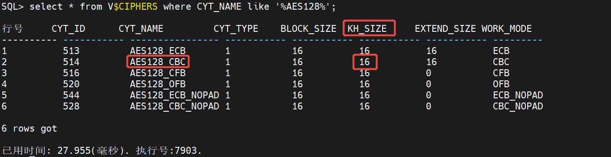

通过 V$CIPHERS 视图 KH\_SIZE 列获取到当前使用算法需要的密钥长度为 16。

2. 当前使用加密算法的长度为 16，所以对密钥长度用 0 做补全处理。
```sql
select unhex(DBMS_CRYPTO.DECRYPT('1269A376307F28F5EEA3FEBA64F34F56D39E164654948179591AD081316916D4', 

            DBMS_CRYPTO.ENCRYPT_AES128 + DBMS_CRYPTO.CHAIN_ECB + DBMS_CRYPTO.PAD_PKCS5,

            hex(RPAD('abcd@123', 16, CHR(0)))));
```

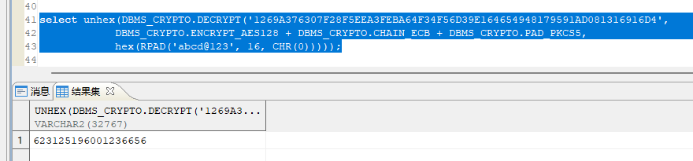

## \[-4596\]:此查询表达式不允许 FOR UPDATE

**【问题描述】**

执行以下 SQL 报错：”-4596：此查询表达式不允许 FOR UPDATE“。

```sql
select * from
       (select e.ename as ename,
               e.sal   as sal  ,
               d.dname as dname
        from emp e
        left join dept d
        on e.deptno=d.deptno
       ) t where sal>1000 for update;
```

**【问题分析】**

带有派生表的子查询 SQL 无法进行 select for update，达梦默认为不可更新视图，因此报错。

**【问题解决】**

调整参数 view\_pullup\_flag=2，对包含别名和同名列的视图进行上拉优化。

```sql
select /*+ view_pullup_flag(2)*/ * from
       (select e.ename as ename,
               e.sal   as sal  ,
               d.dname as dname
        from emp e
        left join dept d
        on e.deptno=d.deptno
       ) t where sal>1000 for update;
```

## \[-5516\]: 没有创建或修改视图权限

**【问题描述】**

用户 B 在用户 A 下创建视图报错："-5516:没有创建或修改视图权限”。

```sql
[dmdba@itsdata ~]$ disql B/123456789
SQL> create view a.v_t1 as select * from a.t1;
create view a.v_t1 as select * from a.t1;
第1 行附近出现错误[-5516]:没有创建或修改视图权限.
已用时间: 1.783(毫秒). 执行号:0.
```

**【问题分析】**

B 用户没有在 A 用户下创建或修改视图的权限。

**【问题解决】**

使用 SYSDBA 用户授予 B 用户在 A 用户下创建视图的权限。

```sql
SQL> grant create any view to b;
```

使用 B 用户再次在 A 用户下创建视图。

```sql
SQL> create view a.v_t1 as select * from a.t1;
操作已执行
已用时间: 114.472(毫秒). 执行号:900.
```

权限说明：create any view 表示用户可以在任何模式下创建视图，如果只授予 creat view 权限则无法在其他模式下创建视图。

## \[-5723\]:用户不能自己为自己 GRANT/REVOKE 权限

**【问题描述】**

用户在进行授权时报错：”-5723:用户不能自己为自己 GRANT/REVOKE 权限“。

```sql
[dmdba@itsdata ~]$ disql a/123456789

服务器[LOCALHOST:5236]:处于普通打开状态
登录使用时间 : 3.001(ms)
disql V8
SQL> grant dba to a;
grant dba to a;
第1 行附近出现错误[-5723]:用户不能自己为自己 GRANT/REVOKE 权限.
已用时间: 0.424(毫秒). 执行号:0.
SQL>
```

**【问题分析】**

在授予或回收权限时，用户不能自己给自己授予或回收权限。

**【问题解决】**

使用 SYSDBA 用户登录数据库，授予或回收目标用户的权限。

## \[-6121\]: 数据精度超出范围

**【问题描述】**

创建表时报错：据精度超出范围。

```sql
CREATE TABLE t1(c1 VARCHAR(32768));
第1 行附近出现错误[-6121]:数据精度超出范围
```

**【问题分析】**

VARCHAR 数据类型指定变长字符串，用法类似 CHAR 数据类型，可以指定一个不超过 32767 的正整数作为字节或字符长度，例如：VARCHAR (100)指定 100 字节长度；VARCHAR(100 CHAR)指定 100 字符长度。如果未指定长度，缺省为 8188 字节。指定字符串长度超过最大限制则会报错。

**【问题解决】**

调整数据类型精度范围到该数据类型最大长度内。

DM 数据库所支持的数据类型及详细说明可参考数据库安装目录下 DOC 目录中《DM8 SQL 语言使用手册》。

## \[-6169\]: 列 XX 长度超出定义

**【问题描述】**

插入数据时报错：“-6169: 列\[C2\]长度超出定义”。

```sql
CREATE TABLE T1(c1 varchar(10),c2 varchar(10))
INSERT INTO T1 VALUES('AAAAAAAAAA','AAAAAAAAAAA')

[执行语句1]:
INSERT INTO T1 VALUES('AAAAAAAAAA','AAAAAAAAAAA')
执行失败(语句1)
-6169: 列[C2]长度超出定义
```

**【问题分析】**

插入的数据超过了定义的长度，varchar 和 char 类型超长都会报错。

**【问题解决】**

调整数据类型长度或调整插入数据的长度，保证插入的数据在数据类型长度规定的范围内。

## \[-7198\]: 收集下标越界

**【问题描述】**

执行以下 SQL 报错：“-7198：收集下标越界”。

```sql
declare
TYPE my_array_type
IS
    VARRAY(10) OF number;
    a my_array_type not null := my_array_type(1,2,3,4);
begin 
    for i in 1..5
    loop
        print a[i];
    end loop;
end;
```

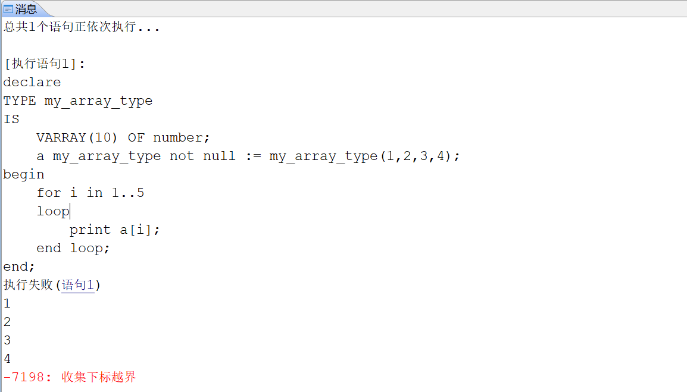

**【问题分析】**

PL/SQL 中的循环次数超过数组元素的个数定义。

**【问题解决】**

调整循环逻辑或调整数组定义。

```sql
declare
TYPE my_array_type
IS
    VARRAY(10) OF number;
    a my_array_type not null := my_array_type(1,2,3,4);
begin 
    for i in 1..4
    loop
        print a[i];
    end loop;
end;
```

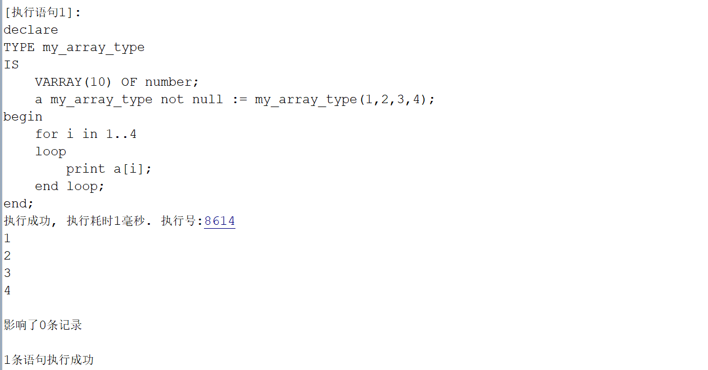

## \[-2661\]: 试图删除被依赖列

**【问题描述】**

相关表无对象依赖于它，修改该表的字段类型报错-2661: 试图删除被依赖列。

**【问题分析】**

该错误通常是由于某字段被某个视图，存储过程，触发器、位图索引等直接或间接引用导致。数据库阻止修改是为了避免破坏依赖关系。查找到该表的被依赖对象后删除才能进行该表的修改。