本章节主要介绍达梦数据库 SQL 语法常见问题，为用户提供 SQL 语法常见问题的分析和解决思路。除此之外，用户还可前往 [达梦技术社区](https://eco.dameng.com/community/question/) 参与更多问题讨论。

## 目录

## 正文

## between and 怎么使用

**【问题描述】**

达梦数据库中 between......and...... 如何使用，and 前后范围是否包含。

**【问题解决】**

在 between......and....... 的条件查询中，查询范围既包括 and 前的条件又包括 and 后的条件，如下：

如果需要了解更多 SQL 使用方法及详细说明可参考数据安装目录下 doc 目录中的《DM8\_SQL 语言使用手册》。

## 如何设置成主键后，生成默认自增

DM 数据库也可以实现这种方式，只是和 MySQL 的操作方式不一样而已。举例如下：

```sql
CREATE TABLE "TAB_12"
(
"ID" INT IDENTITY (1, 1) NOT NULL,
"NAME" VARCHAR(10),
NOT CLUSTER PRIMARY KEY("ID")) ;
```

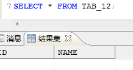

## 小写调用存储过程报错

这个是数据库大小写敏感的问题。数据库在初始化的时候选择是否大小写敏感，默认是大小写敏感。这时执行的 SQL 在到解释器那层解析时，会自动转换为大写名称。举例如下：

```sql
create or REPLACE PROCEDURE p_test as
V_BACKUP_DATE varchar;
begin
V_BACKUP_DATE := TO_CHAR(SYSDATE,'YYYY_MM_DD_HH24_MI_SS');
print V_BACKUP_DATE;
end;
```

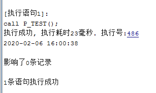

而以下语句将报错：

```sql
create or REPLACE PROCEDURE "p_test1" as
V_BACKUP_DATE varchar;
begin
V_BACKUP_DATE := TO_CHAR(SYSDATE,'YYYY_MM_DD_HH24_MI_SS');
print V_BACKUP_DATE;
end;
```

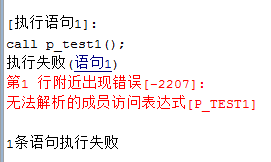

因为执行 call `p_test1()` 时，数据库解释器自动换行成 CALL `P_TEST1()` ，而对象 `P_TEST1` 在数据库中是不存在的，数据库中存的是 `p_test1` 这个。可以加上 `“”` 再执行，执行结果如下图所示：

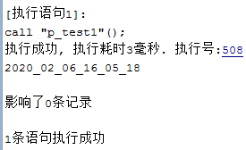

## 字符串截断、超长文本截取

- 执行 INSERT 时报错

一般此类问题是由于目标表存在一个（或多个）字段长度不够，导致插入失败。重点关注 `CHAR、VARCHAR` 字段的长度，可以创建一个具备足够长度的测试表，将报错数据插入测试表中，通过 `select max(length(“目标字段”)) from “测试表”` ，获得插入数据实际的长度信息，从而修改目标表数据或者处理包含超长字段的记录。

另外，注意中文字符的长度问题：数据库初始化参数 `LENGTH_IN_CHAR=0` 时，unicode 编码下一个中文占据 3 个字节 `（char(3)）` ；GBK 编码下一个中文占据 2 个字节 `（char(2)）` ；当数据库初始化参数 `LENGTH_IN_CHAR=1` 时， `char(1)` 即可存储一个字符。

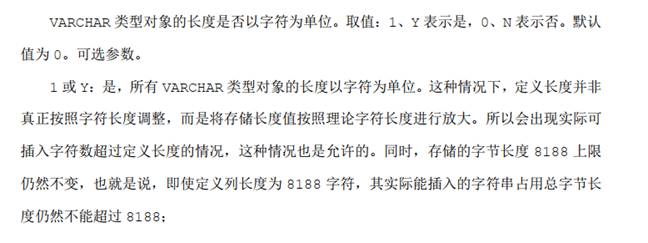

- 执行查询时报此错误

此类问题常见于分组查询中使用了 `wm_concat()` 之类函数拼接字符串，由于分组数据记录过多导致拼接函数返回值超长，解决方法一般是改写 SQL 查询条件降低分组记录数或者对 SQL 语句进行修改（如改为超长切分）。

此外，clob 字段进行模糊查询时的字符串截断： `Case (clob_column_name as varchar) like` 。

- 数据迁移时报错

一般从 Oracle 迁移到 DM 的时候，出现字符串截断的一般都是字段中含有中文，出现这种问题是因为 DM 初始化的时候选择的字符集是 `Unicode（即 utf-8）` ，该字符集的国际标准是一个汉字占 3 个字节，而 Oracle 中默认情况下一个汉字占 2 个字节，此时迁移的时候就会报。

遇到该错误有 3 种解决方法。

1. 在初始化数据库的时候，字符集选择【gb18030】。
2. 在初始化数据库的时候，选择【VARCHAR 类型以字符为单位】。
3. 因为前面 2 种都需要重新初始化数据库，第三种不需要重新初始化数据库即可解决，即在选择迁移方式时，选择字符长度映射关系为 2，如下图所示：

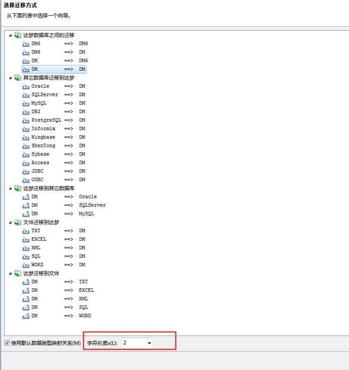

4. 也可使用数据库自带的包解决 clob 字段模糊查询的问题。

例如：

```sql
---执行以下语句报错，其中a1字段为clob类型
select * from test where a1 like '%会议%';

---尝试使用to_char进行转换后模糊查询，报错test类型数据过长
select * from test where to_char(a1) like '%会议%';

---通过数据库自带的包 dbms_lob.instr 处理，解决该问题
select * from test where dbms_lob.instr(a1,'会议',1,1)>0;
```

## 数据链路在哪里创建

数据链路也就是外部链接，外部链接对象 (LINK) 是 DM 中的一种特殊的数据库实体对象，它记录了远程数据库的连接和路径信息，用于建立与远程数据的联系。用户可以通过外部链接对远程数据库的表进行查询和增删改操作，以及本地调用远程的存储过程。

例如：DM-DM 外部链接的创建

- 两台服务器，其中一个为目的主机 A，另一个为源端机器 B；分别在这两台服务器上修改 dm.ini 中参数 `MAL_UTHR_FLAG = 0` ， `MAL_INI=1` （开启 MAL 系统），且配置 dmmal.ini （保证源端目的端的 dmmal.ini 文件相同）如下：
```
[MAL_INST1]
MAL_INST_NAME = DMSERVER  #实例名，和 dm.ini 中的 INSTANCE_NAME 一致
MAL_HOST   = 192.168.10.2  #实例所在 IP 地址
MAL_PORT   = 5536  #MAL系统监听 TCP 连接的端口，不是数据库端口号
```
```
[MAL_INST2]
MAL_INST_NAME = DMSERVER1
MAL_HOST   = 192.168.10.3
MAL_PORT   = 5537
```
- 分别重启 A，B 两台机器上的 DM 服务。
- 在主机 A 上建表 test：
```sql
CREATE TABLE TEST(C1 INT,C2 VARCHAR(20));
```

在 B 上建立到 A 的外部链接 LINK01：

```sql
CREATE PUBLIC LINK LINK01 CONNECT WITH SYSDBA IDENTIFIED BY ***** USING '192.168.10.2/5536';
```
- 在 B 上使用链接进行插入，更新，删除等操作，说明外部链接创建成功。如下图所示：

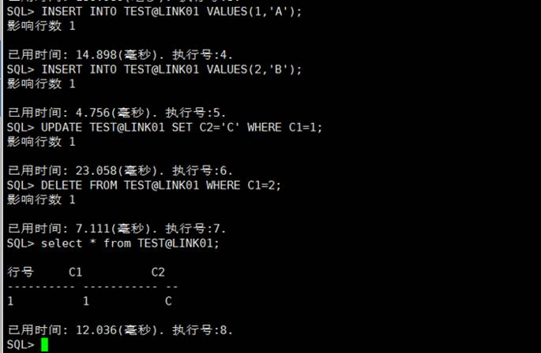

> **注意**
> 
> 异构外部链接创建步骤请参考《DM\_SQL 语言使用手册》第 16 章-外部链接。（手册位于\*\*数据库安装路径\*\* \`/dmdbms/doc\` 文件夹下）

## DM 有没有类似 pl\\sql 的对比表结构，比对表数据差异的工具，生成更新脚本，更新到正式环境

DM 数据库目前没有比对工具，可以自己写一个 SQL 进行比对或手动比对。示例如下：

- 执行如下语句查看表结构信息。
```sql
SELECT * FROM DBA_TAB_COLUMNS;
```

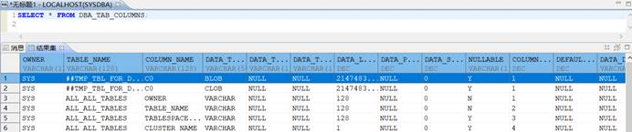

- 执行如下语句将不同数据库中表结构信息导入至新创建表中，方便进行对比。
```sql
CREATE TABLE TABLE_2 AS SELECT * FROM DBA_TAB_COLUMNS;
CREATE TABLE TXT_1 AS SELECT * FROM DBA_TAB_COLUMNS;
```

表 TABLE\_2 是 DM 数据库实例（端口 5236）中的表结构信息，表 TXT\_1 是 DM 数据库实例（端口 5237）中的表结构信息，根据不同实例中的表结构进行比对是否存在不一致的表。

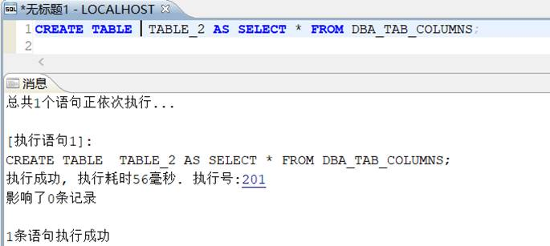

- 将 TXT\_1（端口 5237）表导入到 DM 数据库（端口 5236）中，进行左连接查询，比对是否存在表结构差异。
```sql
SELECT DISTINCT A.OWNER,A.TABLE_NAME
FROM SYSDBA.TABLE_2 A LEFT JOIN SYSDBA.TXT_1 B
ON A.OWNER|| A.TABLE_NAME = B.OWNER|| B.TABLE_NAME AND B.COLUMN_NAME = A.COLUMN_NAME AND
B.COLUMN_ID=A.COLUMN_ID
WHERE A.OWNER='SYSDBA' AND B.OWNER IS NULL
ORDER BY A.TABLE_NAME;
```

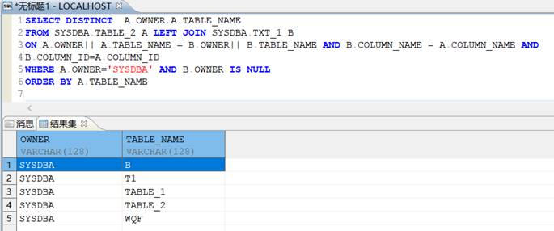

## DM 数据库 VARCHAR2 的长度最大是多少

- DM 数据库的 VARCHAR2 长度如果指定了 USINGLONG ROW 存储选项，则插入 VARCHAR 数据类型的长度不受数据库页面大小限制。VARCHAR 类型在表达式计算中的长度上限不受页面大小限制，为 32767；

关于 VARCHAR2 长度详细简介详见《DM\_SQL 语言使用手册》-1.41 章节。（手册位于 **数据库安装路径** `/dmdbms/doc` 文件夹下）

- VARCHAR2 数据类型指定变长字符串，用法类似 CHAR 数据类型，可以指定一个不超过 8188 的正整数作为字符长度，在 DM 数据库中，VARCHAR2 数据类型的实际最大长度由数据库页面大小决定，在建库时指定，之后无法修改。具体最大长度算法如下表所示：

| 数据页面大小 | 实际最大长度 |
| --- | --- |
| 4K | 1900 |
| 8K | 3900 |
| 16K | 8000 |
| 32K | 8188 |

## DM 支持的字段名最大长度

正规标识符的最大长度是 128 个英文字符或 64 个汉字。

- 测试：64 个汉字长度字段。
```sql
CREATE TABLE "SYSDBA"."TABLE_1" --64个汉字字段
(
"一二三四五六七八九十一二三四五六七八九十一二三四五六七八九十一二三四五六七八九十一二三四五六七八九十一二三四五六七八九十一二三四" CHAR(10)) STORAGE(ON "MAIN", CLUSTERBTR);

测试结果：创建成功

CREATE TABLE "SYSDBA"."TABLE_1" --65个汉字字段
(
"一二三四五六七八九十一二三四五六七八九十一二三四五六七八九十一二三四五六七八九十一二三四五六七八九十一二三四五六七八九十一二三四五" CHAR(10))STORAGE(ON "MAIN", CLUSTERBTR
);  

测试结果：失败
```

测试结果：最大长度是 64 个汉字字符。

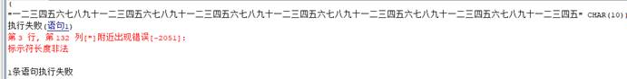

- 测试：128 个英文字符长度字段。

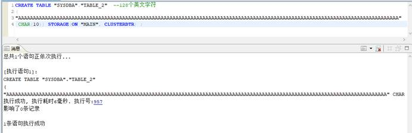

测试成功。

- 测试：129 个英文字符长度字段。

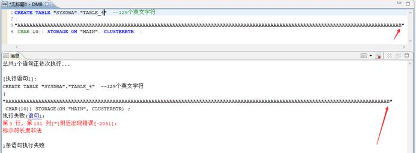

测试结果：最大长度是 128 个英文字符。

## DM 数据库有类似于 Oracle 的 v$sql 的视图吗

DM 数据库没有提供完全一样的系统视图，提供了 `V$SQL_HISTORY` 视图来达到类似的功能。目前 DM 数据库可以兼容 100 多个 Oracle 的系统视图。在《DM 系统管理员手册》中有更多介绍（手册位于 **数据库安装路径** `/dmdbms/doc` 文件夹下）。

## \[不能修改或删除聚集索引的列\] 或 \[试图删除聚集主键\]、\[表 xx 中不能同时包含聚集 KEY 和大字段\]

- 情况一

表上某一列上创建有聚集索引，但是该列不是主键列。举例如下：

```sql
CREATE TABLE TEST_C (A INT, B VARCHAR,
CONSTRAINT C1 CLUSTER KEY (A));
```

或：

```sql
CREATE TABLE TEST_C1(A INT,B VARCHAR);
CREATE CLUSTER INDEX IDX1 ON TEST_C1(A);
```

这种情况下，在列 A 上有一个聚集索引，如下图所示：

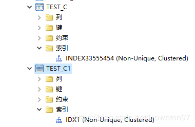

此时若想直接修改列 A 的字段类型或删除列 A，会报错： `不能修改或删除聚集索引的列` 。

若想对列 A 进行修改，需要先删除掉 A 上的索引，再做修改。

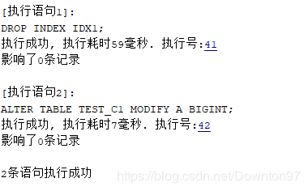

- 情况二

表上某一列为聚集主键，举例如下：

```sql
CREATE TABLE TEST_PK(A INT PRIMARY KEY,B VARCHAR);
```

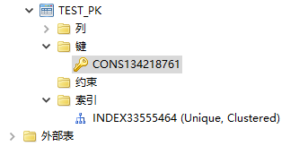

此时修改或删除列 A，会报错： `不能修改或删除聚集索引的列` ；删除表上的主键约束会报错： `试图删除聚集主键` 。

在这种情况下，若想对列 A 进行修改，可以重建表，或者重新在别的列上建立一个聚集索引，然后再删掉，此时主键上的索引变成非聚集了，就可以修改了。

要想在一开始建表的时候就指定非聚集主键，有两种方法：

1. **用语句显式指定；**
2. **修改 dm.ini 参数 PK\_WITH\_CLUSTER 为 0，默认创建主键时为非聚集型；**

语句显式指定如下：

```sql
CREATE TABLE TEST_PK2(A INT,B VARCHAR,
CONSTRAINT C1 NOT CLUSTER PRIMARY KEY (A));
```

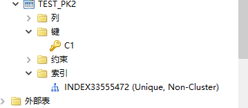

此时可以对列 A 进行修改与删除，如下图所示：

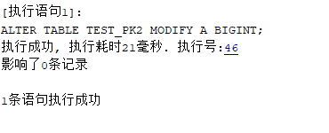

- 修改 dm.ini 参数的方式

由于 `PK_WITH_CLUSTER` 默认取值为 1，即仅指定 PRIMARY KEY 关键字时默认创建为聚集主键，修改为 0 后默认创建非聚集主键。如下所示：

```sql
SELECT * FROM V$DM_INI WHERE PARA_NAME = 'PK_WITH_CLUSTER';
```

查询该参数的值可以使用 `SP_SET_PARA_VALUE(1,'PK_WITH_CLUSTER',0)` 语句来将该参数值修改为 0；使用 `SP_SET_PARA_VALUE(1,'PK_WITH_CLUSTER',1)` 语句将该参数值改回 1。

另外，报错 `表 xx 中不能同时包含聚集 KEY 和大字段` 也可以通过将表重建为非聚集型主键的方式来解决。

## DM 是否可以并发创建索引

目前在最新版的 DM 数据库中，支持并发创建索引。

例如，可以尝试执行以下语句创建并行索引可以执行成功：

```sql
create  index ind_c2 on SYSDBA.TABLE1(c2) parallel 2;
```

## SQL 执行计划绑定变量和非绑定变量的不一致

- 检查是否赋值有数据类型转换，导致不走索引。举例说明如下：
```sql
create  table table1 (c1 int,c2  VARCHAR2(10),c3 number);
insert into table1 select  level,level,level from dual CONNECT by level <10000;
create index ind_c2 on  SYSDBA.TABLE1(c2);
```
```sql
select * from SYSDBA.TABLE1 where  TABLE1.C2=?

执行计划：（走 IND_C2 索引）

1  #NSET2: [0, 249,  90]
2   #PRJT2: [0, 249,  90]; exp_num(4), is_atom(FALSE)
3    #BLKUP2:  [0, 249, 90]; IND_C2(TABLE1)
4       #SSEK2: [0, 249, 90]; scan_type(ASC), IND_C2(TABLE1),scan_range[exp_param(no:0),exp_param(no:0)]
```
```sql
select * from SYSDBA.TABLE1 where  TABLE1.C2=5

执行计划：（有数据类型转换，不走 IND_C2 索引）

1  #NSET2: [1, 499,  90]
2   #PRJT2: [1, 499,  90]; exp_num(4), is_atom(FALSE)
3    #SLCT2: [1,  499, 90]; exp_cast(TABLE1.C2) = 5
4     #CSCN2:  [1, 9999, 90]; INDEX33555695(TABLE1)
```
```sql
select * from SYSDBA.TABLE1 where TABLE1.C2='5'

执行计划：（无数据类型转换，走 IND_C2 索引）

1  #NSET2: [0, 249,  90]
2   #PRJT2: [0, 249,  90]; exp_num(4), is_atom(FALSE)
3    #BLKUP2:  [0, 249, 90]; IND_C2(TABLE1)  
4     #SSEK2:  [0, 249, 90]; scan_type(ASC), IND_C2(TABLE1), scan_range['5','5']
```
- 估算值不同，使用的连接方式、连接顺序会有差异，影响最终的执行计划。

## 有过滤条件，查询时不走索引

需注意 **数据分布** 和 **统计信息** ，很多时候，统计信息不全会导致优化器计算执行代价的时候算错，误认为走索引会比全表慢，造成执行计划不对。

- 统计信息的收集方法

某用户下的所有索引：

```sql
DBMS_STATS.GATHER_SCHEMA_STATS('SSCKF',100,TRUE,'FOR ALL INDEXED SIZE AUTO');
```

某用户下所有字段(包括索引)：

```sql
DBMS_STATS.GATHER_SCHEMA_STATS('SSCKF',100,TRUE,'FOR ALL COLUMNS SIZE AUTO');
```

某表下的所有字段：

```sql
DBMS_STATS.GATHER_TABLE_STATS('SSCKF','FO_ACCOUNTBILL',null,100,TRUE,'FOR ALL COLUMNS SIZE AUTO');
```

收集某一列的统计信息：

```sql
sp_col_stat_init('JXWOA','OA2_RECEIVEDOC','RD_STATE');

sp_col_stat_init('JXWOA','OA2_SENDDOC','SD_STATE');
```

例如有 10 万条测试数据，然后执行查询语句 `SELECT * FROM T WHERE C='A'` ；但这 10 万条数据全是一样的，是不可能走索引的。

修改测试数据的脚本，让 C 这个字段的值平均分布在 1~1000 上，做完后收集统计信息，就走索引了。

## 如何修改用户默认表空间

创建用户 TEST 并指定默认表空间为 TBS\_TEST，如下所示：

```sql
create tablespace TBS_TEST datafile  'TBS_TEST.dbf' size 50;

create user TEST identified by “123456789” default tablespace  TBS_TEST;
```

修改用户 TEST 的默认表空间为 TBS\_TEST1：

```sql
create tablespace TBS_TEST1 datafile  'TBS_TEST1.dbf' size 50;

alter user TEST default tablespace  TBS_TEST1;
```

## DM 支持 Oracle 的闪回查询么

闪回开启参数，在 dm.ini 文件中。（ **生产环境最好不要开闪回功能，慎用** ）

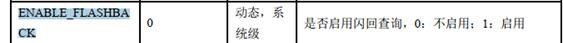

管理工具开启闪回功能如下：

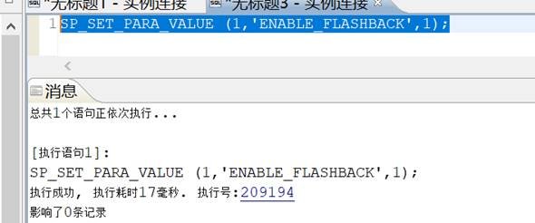

管理工具界面闪回按钮如下：

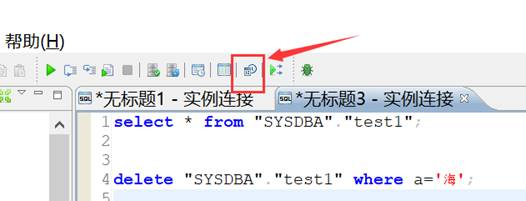

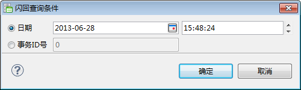

**时刻** ：指定闪回查询时刻。

**事务 ID 号** ：指定事务 ID 号。

要使用闪回功能实例要开启归档：

- 在线开启

修改数据库为 Mount 状态，如下所示：

```sql
SQL ALTER DATABASE MOUNT;
```

配置本地归档，如下所示：

```sql
SQL ALTER DATABASE ADD ARCHIVELOG 'DEST = /archive, TYPE = local, FILE_SIZE = 1024, SPACE_LIMIT = 0';
//DEST=归档路径  FILE_SIZE：单个归档文件大小。SPACE_LIMIT：预留归档总大小，0 表示没有限制。
```

开启归档模式，如下所示：

```sql
SQL ALTER DATABASE ARCHIVELOG;
```

修改数据库为 OPEN 状态，如下所示：

```sql
SQL ALTER DATABASE OPEN;
```

## null 值结果排序前后问题

对可为空的 timestamp 列排序，都是 null 在最前面

创建测试表并初始化数据，如下所示：

```sql
CREATE TABLE "SYSDBA"."a"
("COLUMN_1" TIMESTAMP(6)) STORAGE(ON "MAIN", CLUSTERBTR);

insert "SYSDBA"."a" values (''),(SYSTIMESTAMP),(SYSTIMESTAMP);
commit;
insert "SYSDBA"."a" values (''),(SYSTIMESTAMP),(SYSTIMESTAMP);
commit;
insert "SYSDBA"."a" values (''),(SYSTIMESTAMP),(SYSTIMESTAMP);
commit;
```

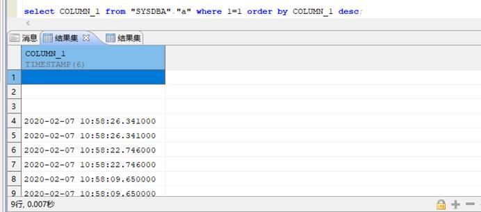

测试结果：可为空的 timestamp 列排序，无论 asc，desc，都是 null 在最前面，解决方法如下：

- 修改 dm.ini 中 ORDER\_BY\_NULLS\_FLAG 的值为 1；  
	这个值默认是 0，意义是  
	Whether to place NULL values to the end of the result set when in ascending order  
	修改以后，重启数据库。查询时 order by asc 就发现 null 值在最后了，但是 DESC 降序时该参数无效。
- 修改 SQL 写法
```sql
order by NVL(column , '0') 当column列为null时则指定为0。
order by column asc nulls first : null值始终放在最前面。
order bu column desc nulls last : null值始终放在最后面。
```

## Insert values 超过最大参数个数 (2048)

```sql
insert into xx(id, name ....) values (?,?,?), (?,?,?), (?,?,?)
报错：超过最大参数个数(2048)

insert into FZQ(COLUMN_1) values (1),(2)....(2048);
```

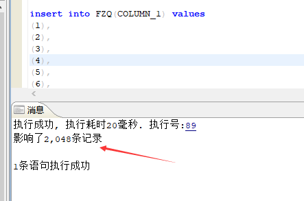

**尝试插入 2049 个报错复现：**

```sql
insert into FZQ(COLUMN_1) values (1),(2)....(4100);
```

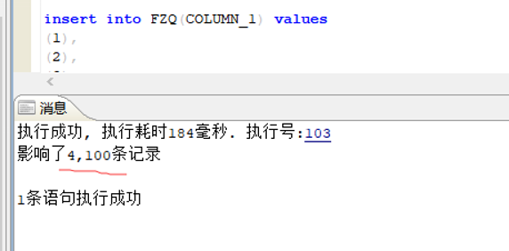

**结论：** 最大参数不止 2048。

- insert all INTO 语法改写

批量插入数据 insert all。

```
INTO  A(field_1,field_2) VALUES (value_1,value_2)
INTO  A(field_1,field_2) VALUES (value_3,value_4)
INTO  A(field_1,field_2) VALUES (value_5,value_6)  select  1 from dual;
```

Demo 如下所示：

```
INSERT ALL
INTO FZQ(COLUMN_1) VALUES (1)
INTO FZQ(COLUMN_1) VALUES (2)  .......
INTO FZQ(COLUMN_1) VALUES (4100)
select 1 from dual
```

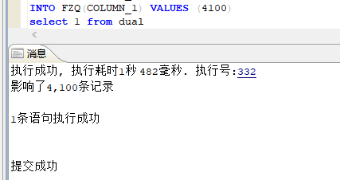

## 对象权限的授权

```sql
--对象权限的授予

grant select on  ""SYS"".""V$SQL_NODE_NAME"" to ""用户"";
grant select on  ""SYS"".""V$CIPHERS"" to ""用户"";
grant select on  ""SYS"".""V$DATAFILE"" to ""用户"";
```

## USING LONG ROW（启用超长记录）选项的作用

在建表时，字符类型的字段和整条数据的存储长度是受初始化参数 PAGE\_SIZE（页大小）限制的，具体关系如下图所示：

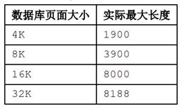

实际插入表中的列长度受到记录长度的约束，每条记录总长度不能大于页面大小的一半。例如我们页大小初始化是 32 KB，某表中有 3 个 VARCHAR 类型的字段，那么每个字段最大长度不能操作 8188 字节，且每条记录不能超过页大小（32 KB）的一半，也就是不能超过 16 KB，如果记录超过 16 KB 时，会报“错误号:-2665 错误消息:\[P\] 记录超长”。

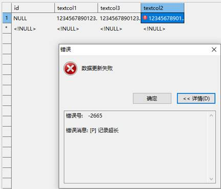

当指定了 USINGLONG ROW 存储选项，则每条记录的长度不受数据库页面大小限制。USINGLONG ROW 选项用法如下：

```sql
create table "text_to_varchar1"
(
"id" CHAR(8188),
"textcol1" VARCHAR(8188),
"textcol3" VARCHAR(8188),
"textcol4" VARCHAR(8188),
"textcol5" VARCHAR(8188),
"textcol2" VARCHAR(8188)
) STORAGE (USING LONG ROW);
```

## 关于 DM 数据库的数据类型

DM 数据的数据类型请参考如下两个手册的内容（手册位于 **数据库安装路径** `/dmdbms/doc` 文件夹下。）：

- 《DM\_SQL 语言使用手册》-DM\_SQL 所支持的数据类型章节；其中手册中“长度最大为 2G-1 字节”的“-”表示减号。
- 《DM\_SQL 程序设计》-DM\_SQL 程序数据类型与操作符章节。

## insert 后如何获取自增 ID

```
IDENT_CURRENT
定义：
int
IDENT_CURRENT (
 fulltablename varchar(8187)
)
功能说明：
获取自增列当前值
参数说明：
fulltablename：表全名；格式为“模式名.表名”
返回值：
自增列当前值
```

举例说明：

```sql
SELECT IDENT_CURRENT('PRODUCTION.PRODUCT');
```

若为序列作为自增列，则使用 select 模式名.序列名.CURRVAL 获取当前值；select 模式名.序列名.NEXTVAL 获取下一值。

## DM 和其他数据库的兼容性配置

DM 数据库初始化 dm.ini 文档，是否兼容其他数据库模式，如下所示：

```
0：不兼容
1：兼容 SQL92 标准
2：部分兼容 Oracle
3：部分兼容 MS SQL SERVER
4：部分兼容 MySQL
5：兼容 DM6
6：部分兼容 TERADATA
```

## Oracle 和 DM 数据类型对比表

| Oracle |  | DM |  |  |
| --- | --- | --- | --- | --- |
| 类型名 | 说明 | 类型名 | 说明 | 备注 |
| CHAR (n) | 定长字符串，最大长度 2000，长度不足 n 时，自动填充空格 | CHAR (n)、CHARACTER (n) | 定长字符串，最大长度 8000（页大小为 16 KB 或以上时），长度不足 n 时，自动填充空格 | DM 允许的串最大长度可通过设置页大小参数分别调整为 1900，3900，8000，16200 之一。 |
| VARCHAR (n) VARCHAR2 (n) | 可变长字符串，最大长度 4000 | VARCHAR (n)、 VARCHAR2 (n) | 可变长字符串，最大长度 8000（页大小为 16 KB 或以上时） |  |
| LONG | 可变长文本，最大长度 134217727，表中只能有一个 LONG 列 | TEXT、LONGVARCHAR | 长文本，最大长度 2G-1，表中可有多个 TEXT/LONGVARCHAR 列 | 可用于存储较长的非格式化文本，文本较小时可考虑用 Oracle 的 VARCHAR2 或 DM 的 VARCHAR |
| NUMBER | 可变长数值列，最大数值长度为 38 个数字，NUMBER 是 Oracle 特有的非标准数据类型 | BIT、BOOLEAN | BIT 类型用于存储整数数据 1、0 或 NULL。BOOLEAN 类型的字值可以取常量 TRUE 和 FALSE，或者数值 1 和 0 | 这些数据类型都不带精度描述。DM 的 BIT 类型与 SQL Server 2000 的 BIT 数据类型相似。 |
| BYTE、 TINYINT | 1 字节存储的整数，精度 3，标度 0 | BIT、BOOLEAN 都可以用来支持 ODBC JDBC 的布尔数据类型，MONEY 类型便于存储货币数据。 |  |  |
| SMALLINT | 2 字节存储的整数，精度 5，标度 0 |  |  |  |
| INT、 INTEGER | 4 字节存储的整数，精度 38，标度 0 |  |  |  |
| BIGINT | 8 字节存储的长整数，精度 19，标度 0 |  |  |  |
| DEC、 DECIMAL、 NUMERIC、 NUMBER | 定点数，精度 16，标度 0 |  |  |  |
| MONEY | 定点数，精度 19，标度 4 |  |  |  |
| NUMBER (m,n) | 可变长数值列，最大数值长度为 38 个数字 | DECIMAL (m,n)、 NUMBER (m,n)、NUMERIC (m,n) |  | 这些数据类型都带精度描述。 |
| FLOAT | 浮点数，精度 126 | FLOAT、DOUBLE、DOUBLE PRECISION | 浮点数，最大二进制精度 53，十进制精度 15 |  |
| REAL | 实数类型，NUMBER (63)，精度更高 | REAL | 浮点数，二进制精度 24，十进制精度 7 |  |
| (LONG) RAW | 可变长二进制数据 最大长度 134217727，表中只能有一个 LONG RAW 列 | BINARY (n) | 定长二进制数据，缺省长度 1，最大长度同 CHAR，长度不足 n 时，自动填充 0 |  |
| VARBINARY (n) | 可变长二进制数据，缺省长度 1，最大长度同 CHAR |  |  |  |
| IMAGE、LONGVARBINARY | 可变长的长二进制数据，最大长度 2G-1，表中可有多个 IMAGE/ LONGVARBINARY 列 | 可用于存储多媒体图像、WORD 文档等，长度较小时可考虑用 DM 的 VARBINARY |  |  |
| BLOB (n) | 可变长二进制大对象，最大长度 4G-1 | BLOB (n) | 可变长二进制大对象，最大长度 100G-1 |  |
| CLOB (n) | 可变长二进制大对象，最大长度 4G-1 | CLOB (n) | 可变长字符串大对象，最大长度 100G-1 |  |
| DATE | 固定长度（7 字节）的日期型，时间也作为一部分存储其中。Oracle 的 DATE 是其特有的非标准数据类型。 | DATETIME | 日期型，包括年、月、日、时分秒信息。数据格式：datetime'2013-11-06 12:23:22' | 时间间隔类型 Oracle、DM 均支持（略） |
| TIME | 时间型，包括时、分、秒信息。格式：time ’09:10:21’ |  |  |  |
| TIMESTAMP | 时间戳型，包括年月日时分秒信息。例如：timestamp ‘1999-07-13 10:11:22’ |  |  |  |
| BFILE | 存放在数据库外的二进制数据，最大长度 4 GB | BFILE | 存储在操作系统中的二进制文件，文件存储在操作系统而非数据库中，仅能进行只读访问，最大长度 2G-1。 |  |
| NCHAR (n) | 根据字符集而定的固定长度字符串，最大长度 2000 bytes | NCHAR (n) | 根据字符集确定需要扩展的长度，最大长度 8000（页大小为 16 KB 或以上时） |  |
| NVARCHAR2 | 根据字符集而定的可变长度字符串，最大长度 4000 bytes | NVARCHAR2 (n) | 根据字符集确定需要扩展的长度，最大长度 8000（页大小为 16 KB 或以上时） |  |
| ROWID | 数据表中记录的唯一行号，10 bytes | VARCHAR (n)、VARCHAR2 (n) | 可变长字符串，最大长度 8000（页大小为 16 KB 或以上时） |  |
| NROWID | 二进制数据表中记录的唯一行号，最大长度 4000 bytes | VARCHAR (n)、VARCHAR2 (n) | 可变长字符串，最大长度 8000（页大小为 16 KB 或以上时） |  |

## 如何加 comment 备注

举例如下：

```sql
CREATE TABLE "AEFD01"
("BANKID" VARCHAR2(3)) STORAGE(ON "MAIN", CLUSTERBTR) ;
COMMENT ON TABLE "AEFD01" IS '会计事件定义';--备注名称
```

## 字段名和关键字冲突

- 建议尽可能避免这些关键词，关键字在《DM\_SQL 语言使用手册》附录 1 中有说明。（手册位于 **数据库安装路径** `/dmdbms/doc` 文件夹下）
- 双引号可以屏蔽关键字。（同样注意，双引号也能匹配大小写）
```sql
--[执行语句1]:
create table testdomain(domain int);
执行失败(语句1)
第 1 行, 第 24 列[domain]附近出现错误:
语法分析出错
--[执行语句1]:
create table testdomain("DOMAIN" int);
执行成功, 执行耗时362毫秒. 执行号:1626676
影响了0条记录
1条语句执行成功
```
- 通过配置 dm\_svc.conf 文件 `KEYWORDS` 参数解决保留关键字的问题。  
	KEYWORDS  
	标识用户关键字，所有在列表中的字符串， 如果以单词的形出现在 SQL 语句中，则这个单词会被加上双引号。该参数主要用来解决用户需要使用 DM 中的保留字作为对象名使用的状况。  
	修改服务名配置文件如下：
```shell
TIME_ZONE=(480)
LANGUAGE=(cn)
dm=(10.*.*.9:5236)
[dm]
KEYWORDS=(需要排除的关键字 以逗号做分割)
```
- 通过 jdbc 的 url 中添加 keyWords 参数，例如 aa abc
```java
jdbc:dm://dm?keyWords=aa,abc
```

> **建议**
> 
> 不建议屏蔽，更换列名是最合适。

## 时间类型的默认值可以是当前时间

- 问题截图

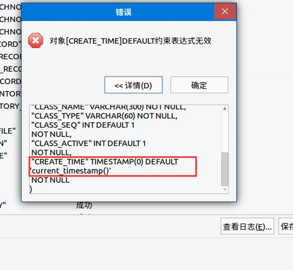

- 处理办法

使用查询函数 CURRENT\_TIMESTAMP，如下所示：

```sql
SELECT CURRENT_TIMESTAMP();
```

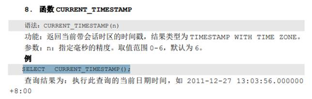

创建测试表，如下所示：

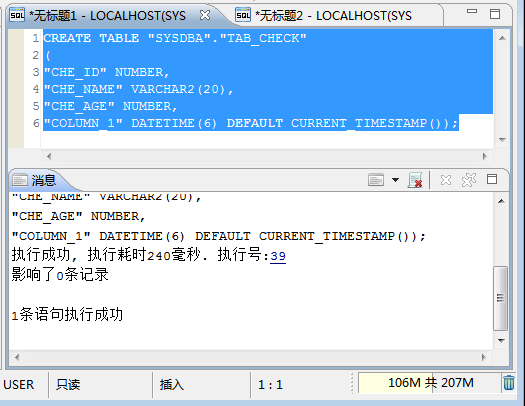

**使用函数作为值不需要加引号。**

## 含中文字符的 SQL 语句执行报错

实例如下所示：

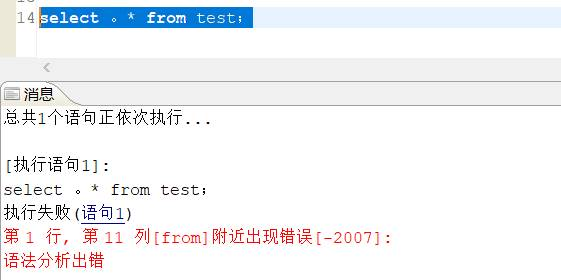

复制 SQL 语句到 DM 客户端执行要注意是英文输入模式下的标点符号。同时可以打开选项设置，勾选显示空白字符，可以很方便的发现是否有中文标点符号。

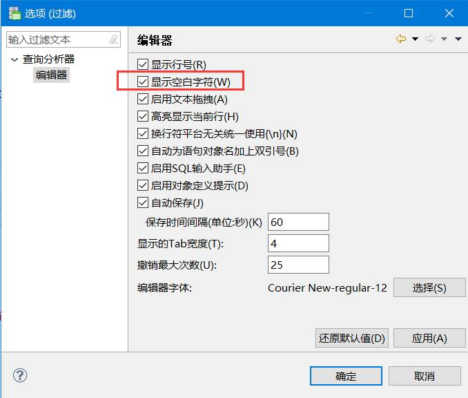

## Manager 中 SQL 自动补全

SQL 自动补全功能又称为：SQL 提示补充、SQL 查询补全、SQL 联想功能。  
通过启动 Manager，打开窗口，选择【启用 SQL 输入助手】开启该功能，如下图所示：

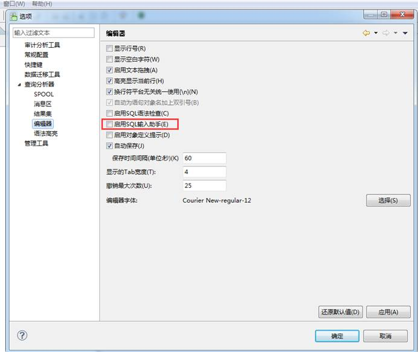

## 如何使用打印信息

可使用如下方法打印信息：

```sql
DBMS_OUTPUT.**ENABLE**();--使 DBMS_OUTPUT 启用

DBMS_OUTPUT.PUT_LINE('11111');
```

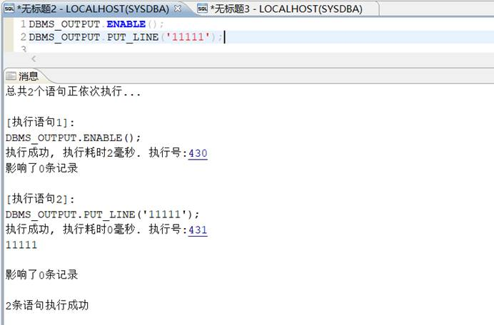

## PB 调用存储过程

PB 调用 he\_test 报错 `Space must be allocated for bind parameter` ，翻译过来是 `约束变量必须分配空间` 。

**【报错原因】** ：

PB 中使用 Declare 方式不能调用具有 `in out` 类型参数的存储过程，故采用外部函数的方式。

**【问题描述】** ：

```sql
create or replace procedure he_test(tin in varchar2,
out1 out varchar2,
out2 out varchar2)
as
begin
out1 := tin;
out2 := tin;
end he_test;
```

PowerBuilder：

```java
string tpstring,ta,tb,tc
tpstring = 'ssss'
DECLARE get_trriff PROCEDURE FOR
he_test(:tpstring,:ta,:tb) using ORA;
EXECUTE get_trriff ;
if ORA.SqlCode < 0 then
      MessaGeBox("1","1" + ORA.sqlerrtext)
      CLOSE get_trriff;
      RETURN -1
    end if
FETCH get_trriff INTO :ta,:tb;
if ORA.SqlCode < 0 then
   MessaGeBox("2","2" + ORA.sqlerrtext)
   CLOSE get_trriff;
   RETURN -1
end if
sle_1.text = ta
sle_2.text = tb
```

如果要获取 OUTPUT 可把 procedure 作为 transaction 的外部函数引用 `(local external function)` 。新建 `-standare class- transation - local external function` 右键 `- paste special-sql - remote sp` 。

## shell 执行 DM 语句

- 编写 SQL 脚本，写入需要执行的 SQL 语句。

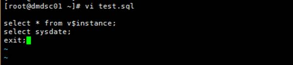

- shell 脚本中执行 DM 语句的格式如下：

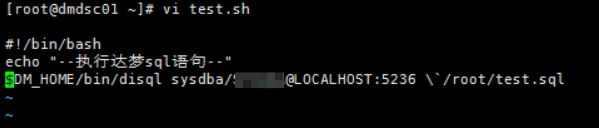

- 执行脚本

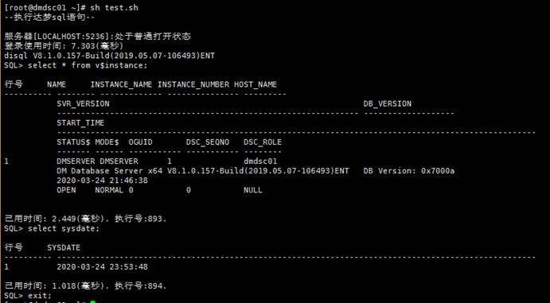

详细用法可参考《DM\_Disql 使用手册》，手册位于 **数据库安装路径** `/dmdbms/doc/special` 文件夹下。

## update 和 order by 如何一起用

错误示例：

```sql
update scm set row_id = rownum where bill_id =12345 order by id;
```

正确示例：

```sql
update scm t set row_id =  (select rn from (select bill_id, id, row_number() over(order by id) rn from scm tt where bill_id = 12345) tt where t.id = tt.id) where bill_id = 12345;
```

## 写 SQL 如何才能不带上模式名

在 DM 数据库里面，为何 SQL 要加上模式名（数据库名）访问？

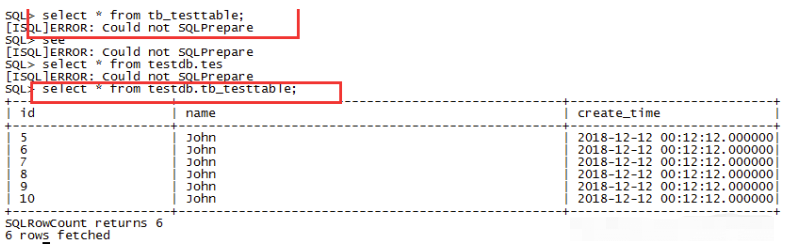

其实这是把 MySQL 或者 SQL Server 的思维代入 DM 数据库造成的，MySQL 的体系架构是单实例多库的，一个用户可以访问多个数据库，然后指定当前数据库写 SQL 的时候就不用带上数据库名了。

达梦的体系架构是单库多实例的，也就是没有多个数据库的概念了，从 MySQL 或者 SQL Server 转到达梦，就需要建多个用户 + 表空间来对应 MySQL 的多个数据库。

第一步：例如 MYSQL 中有 TESTDB1,TESTDB2 两个库，都用 root 用户来访问，首先在达梦数据库中创建两个表空间：

```sql
CREATE TABLESPACE TESTDB1 DATAFILE 'TESTDB1.DBF' SIZE 128;
CREATE TABLESPACE TESTDB2 DATAFILE 'TESTDB2.DBF' SIZE 128;
```

第二步：创建两个用户，授予对应的权限：

```sql
--以下 SQL 用 SYSDBA 用户登录执行
CREATE USER TESTDB1 IDENTIFIED BY "123456789" DEFAULT TABLESPACE TESTDB1;
CREATE USER TESTDB2 IDENTIFIED BY "123456789" DEFAULT TABLESPACE TESTDB2;
GRANT RESOURCE TO TESTDB1;
GRANT RESOURCE TO TESTDB2;
```

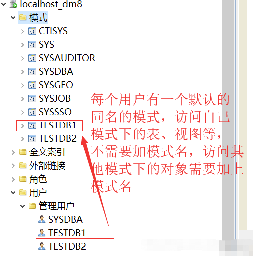

第三步：迁移 MySQL TESTDB1 数据库里面的表，数据库迁移工具就使用 TESTDB1 用户来迁移

迁移 MySQL TESTDB2 数据库里面的表，数据库迁移工具就使用 TESTDB2 用户来迁移

第四步：访问 TESTDB1 用户（模式）下的表，就使用 TESTDB1 用户登录来访问，就不需要加模式名 TESTDB1

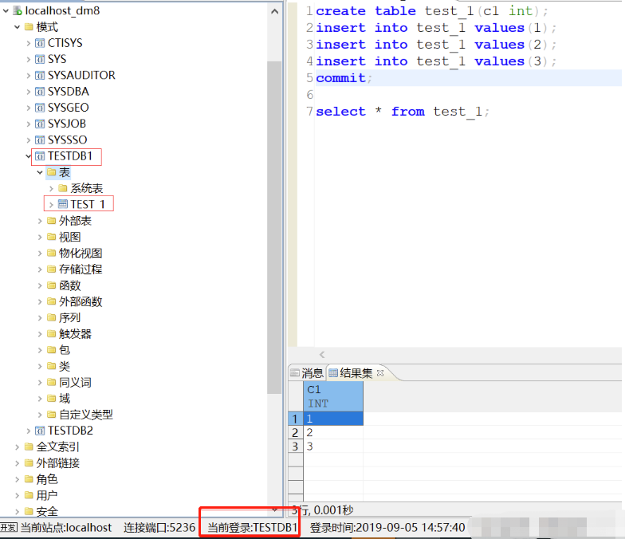

如果要用 JDBC 来访问数据库，设置如下：

```java
jdbc.driver=dm.jdbc.driver.DmDriver
jdbc.url=jdbc:dm://127.0.0.1:5236
jdbc.username=TESTDB1
jdbc.password=123456789
```

补充说明一下：假设一个用户拥有多个模式，该用户访问自己所属的其他非同名模式下的对象时，如何才能不带模式名呢？

这里以 SYSDBA 用户为例：

```sql
CREATE SCHEMA "TEST" AUTHORIZATION "SYSDBA";

CREATE TABLE TEST.TTTT(C1 INT);

INSERT INTO TEST.TTTT VALUES(1);

COMMIT;

SELECT * FROM TTTT; --会报错

SET SCHEMA TEST;  --切换当前模式为TEST

SELECT * FROM TTTT;  --执行成功
```

## DISQL 语句不结束怎么处理

对于普通 SQL，输入 `;` 后回车结束。对于执行语句块（例如，创建触发器、存储过程、函数、包和模式等时），输入 `/` 结束。

## 获取 GUID 的函数

**【问题描述】** ：

SQL Server 中有 uniquidentifer 类型的 GUID；DM 中的 GUID 是什么？

**【解决方法】** ：

DM 中没有 uniquidentifer，获取 GUID 的函数 `sys_guid()` 。

sys\_guid() 用的是 binary(16)，16 个字节的二进制，和 SQL Server 的 uniqueidentifier 类型一样的。

## 需要 transform 定义 DDL 语句

**【问题描述】** ：

在 dbms\_metadata 下，获取一个 table 的 DDL 语句，现在表相关的序列，外键都出来了，用户只想定制只返回 create table 的语句。

- ORALCE 的 DBMS\_METADATA.GET\_DDL 定义语句如下：
```sql
DBMS_METADATA.GET_DDL (
object_type IN VARCHAR2,
name IN VARCHAR2,
schema IN VARCHAR2 DEFAULT NULL,
version IN VARCHAR2 DEFAULT 'COMPATIBLE',
model IN VARCHAR2 DEFAULT 'ORACLE',
transform IN VARCHAR2 DEFAULT 'DDL') RETURN CLOB;
```

其中可以关闭索引、外键等关联如下：

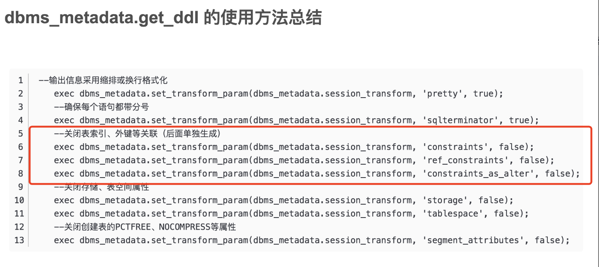

- DM 的 DBMS\_METADATA.GET\_DDL 定义如下：
```sql
FUNCTION GET_DDL(
OBJECT_TYPE IN VARCHAR(30),
NAME IN VARCHAR(128),
SCHNAME IN VARCHAR(128) DEFAULT NULL )
RETURN CLOB
```

**【解决方法】** ：

这属于需求开发，建议联系相应项目的技术服务人员/销售提交功能需求。

## 如何查询 SQL 计划中各操作符的执行时间

```sql
SELECT N.NAME, TIME_USED, N_ENTER FROM V$SQL_NODE_NAME N,
V$SQL_NODE_HISTORY H WHERE N.TYPE$ = H.TYPE$ AND EXEC_ID = 538;

--538 为该 SQL 的执行号，dm.ini 中 ENABLE_MONITOR 参数需要改为 3。

--可以创建一个存储过程，来封装这个查询的 sql，输入参数为 sql 语句的执行号：
create or replace procedure sql_et(eid int) is
    begin
    select
            name as "OP",
            time_used/1000 || 'ms' as "TIME",
            cast(time_used * 100.0/sum(time_used) over() as dec(10, 2)) || '%' as "PERCENT" ,
            rank() over (order by time_used desc) as "RANK"    ,
            seq_no as "SEQ"
        from
           v$sql_node_history a,
           v$sql_node_name b
       where
           a.type$ = b.type$
           and exec_id = eid
       order by time_used desc;
   End;
```

## 执行 SQL 报错：试图在 blob 或者 clob 列上排序或比较

- 不能 order by blob 或者 clob；
- 有大字段的查询，不允许 distinct；

具体的语法规则，请参考《DM SQL 语言使用手册》，手册位于 **数据库安装路径** `/dmdbms/doc/special` 文件夹下。

## 达梦数据库如何兼容 MySQL 的语法

**【问题描述】** ：

如何在达梦数据库中支持以下语法：

- 判断表存在就删除 drop table if exists table\_name
- 不存在就创建 CREATE TABLE IF NOT EXISTS

**【解决方法】** ：

- 需要在 dm.ini 文件中修改参数 compatible\_mode=4，并重启数据库服务，就可以兼容 MySQL 数据库才支持的语法。
- 也可以参考下 Oracle 的写法，Oracle 怎么判断表是否存在，就可以用在达梦上。

一般可以查询 DBA\_TABLES 表，通过一个 IF 条件进行判断。

## 如何写复制表的 SQL

语句如下：

```sql
create table table1 as select * from table2;
```

可以参考安装目录 \\doc 目录下的《DM\_SQL 语言使用手册》—表管理章节。

## 如何用命令清理归档日志

删除 n 天前的归档日志，可执行下列语句：

```sql
SELECT SF_ARCHIVELOG_DELETE_BEFORE_TIME(SYSDATE - n);
```

## 获取表的主键的视图

使用下列语句：

```sql
select * from ALL_CONSTRAINTS where CONSTRAINT_TYPE='P';
```

## 在 Linux 环境下，AWR 报告如何取出来

```sql
--启用系统包和 AWR 包
CALL SP_INIT_AWR_SYS(1);
CALL SP_CREATE_SYSTEM_PACKAGES(1);

--查询 AWR 快照
SELECT * FROM SYS.WRM$_SNAPSHOT;

--设置快照间隔
--如果不设置快照间隔，手动执行快照后 SYS.WRM$_SNAPSHOT 视图中将没有记录。
CALL DBMS_WORKLOAD_REPOSITORY.AWR_SET_INTERVAL(50);

--在两个时间点分别手动创建快照，或者等待系统自动生成
--10:00 时创建第一快照：
CALL DBMS_WORKLOAD_REPOSITORY.CREATE_SNAPSHOT();
--30 分钟后再创建一个，10:30:
CALL DBMS_WORKLOAD_REPOSITORY.CREATE_SNAPSHOT();

--查询快照
SELECT * FROM SYS.WRM$_SNAPSHOT;

--创建AWR报告
---SYS.AWR_REPORT_HTML(快照ID1,快照ID2,'AWR报告存放路径','AWR报告名称.HTML');：
SYS.AWR_REPORT_HTML(1,2,'/opt','AWR1.HTML');
```

## 表的 id 字段没有重复值，但是添加主键就提示违反唯一性约束

- 首先检查该列有没有唯一索引，如果有的话就不能添加主键。  
	例如：
```sql
create table "SYSDBA"."TABLE_1"("COLUMN_1" CHAR(10) unique ,"COLUMN_2" CHAR(10));
--[执行语句1]:
alter table "SYSDBA"."TABLE_1" add primary key("COLUMN_1");
--执行失败(语句1)
--第1 行附近出现错误[-2864]:
--表中已存在这样的唯一关键字或主键
```
- 使用 trim 函数找到存在重复的数据，去除重复值后就可以正常使用唯一性约束
```sql
CREATE TABLE "SYSDBA"."TEST"("T1" INT,"T2" VARCHAR(50));

insert into "SYSDBA"."TEST"("T1", "T2") VALUES(1,'TEST1');
insert into "SYSDBA"."TEST"("T1", "T2") VALUES(1,'TEST2');
insert into "SYSDBA"."TEST"("T1", "T2") VALUES(2,'TEST3');
insert into "SYSDBA"."TEST"("T1", "T2") VALUES(2,'TEST4');
insert into "SYSDBA"."TEST"("T1", "T2") VALUES(3,'TEST5');

--给有重复数据的列添加主键，就会报错：-6612  错误消息: 违反唯一性约束
alter table "SYSDBA"."TEST" add primary key("T1");

--你用 trim 函数查询重复值
select trim(T1) as ,count(*) from "SYSDBA"."TEST" group by trim(T1) having count(*) >1
```

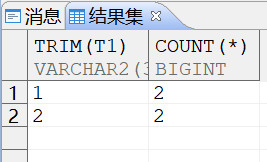

## 表创建完成后怎么修改字段顺序？

表创建之后不能修改顺序。可以把当前的表删掉重新建一下（删除之前做好备份），然后将数据重新导入。

## 是否支持 IF 函数

**【问题描述】：**

是否支持 IF 函数，如 IF(TRUE,'A','B')/ 自定义函数实现 IF 功能

**【问题解答】：**

支持/使用 IF 函数，或者使用 DECODE 函数来实现。具体可以参考安装目录 doc 目录下的《DM\_SQL 语言使用手册》。

## NVARCHAR2 和 VARCHAR2、VARCHAR 的区别

Oracle 的这三个类型有区别，DM 的这三个类型是没有区别的。

## 达梦不支持布尔类型，请问可以使用什么替代？

可以通过 BIT 类型替代，具体语法请参考 [BIT 类型语法](https://eco.dameng.com/document/dm/zh-cn/sql-dev/dmpl-sql-datatype###%E4%BD%8D%E4%B8%B2%E6%95%B0%E6%8D%AE%E7%B1%BB%E5%9E%8B)

## 达梦可以给自增列赋值么？

可以，可以通过设置 SET IDENTITY\_INSERT \[< 模式名 >.\]< 表名 > ON;的形式进行赋值插入指定的数据，设置 on 之后会自动还原成 off；不会影响到后续自增列的使用。

示例如下：

```sql
create table "SYSDBA"."TABLE_5"
(
"ID" INTEGER identity(1, 1) not null ,
"NAME" CHAR(50),
primary key("ID")
);
--插入数据
insert into "SYSDBA"."TABLE_5"("NAME") VALUES('测试数据001');
insert into "SYSDBA"."TABLE_5"("NAME") VALUES('测试数据002');
insert into "SYSDBA"."TABLE_5"("NAME") VALUES('测试数据003');
SET IDENTITY_INSERT SYSDBA.TABLE_5 ON;--设置自增列插入
insert into "SYSDBA"."TABLE_5"("ID","NAME") VALUES(5,'测试数据004');--插入指定数据给自增列
insert into "SYSDBA"."TABLE_5"("NAME") VALUES('测试数据005');
select * from "SYSDBA"."TABLE_5";
```

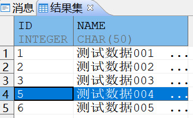

## 达梦数据库中整数相除如何让结果为小数？如 select TRUNCATE((1/5),4) from dual

方法 1：将分子或者分母设置为小数。

```sql
select TRUNCATE((1/5.0),4) from dual
```

方法 2：执行以下语句修改 dm.ini 参数并重启数据库服务。

```sql
SP_SET_PARA_VALUE(2,'CALC_AS_DECIMAL',1);
```

## 达梦如何用脚本导出某个模式下全部表定义

- 方法一，将模式下的表定义生成到表中
```sql
--创建表存放表定义数据
drop table sch_table_ddl;
create table sch_table_ddl(tab_name VARCHAR, tab_ddl clob);

--创建存储过程获取表定义，并存放到指定表中
create or replace procedure get_schema_table_ddl(sch_name VARCHAR(30))
as
begin
for rec in (select table_name from dba_tables where owner = sch_name and table_name != 'SCH_TABLE_DDL')
loop
insert into sch_table_ddl values (rec.table_name,dbms_metadata.get_ddl('TABLE',rec.table_name,sch_name));
commit;
end loop;
EXCEPTION when others
then 
dbms_output.Put_line('导出异常');
end;

--测试获取SYSDBA模式下的表定义
call get_schema_table_ddl('SYSDBA');

--查询表定义
SELECT TAB_NAME,TO_CHAR(TAB_DDL) FROM sch_table_ddl;
```
- 方法二，将模式下的表定义生成到脚本文件
```sql
--创建存放ctrl文件的路径
CREATE OR REPLACE DIRECTORY TMP AS 'D:\dmdbms\data\DAMENG';

CREATE OR REPLACE
PROCEDURE SP_sch_table_ddl
IS
        FILE_HANDLE UTL_FILE.FILE_TYPE;
        WRITE_CONTENT   clob;
        TAB_NAME varchar(30);
        CURSOR CUR_SP_OUT
        IS
        select table_name from dba_tables where owner = 'SYSDBA' and table_name != 'SCH_TABLE_DDL';
BEGIN
                FILE_HANDLE     := UTL_FILE.FOPEN('TMP', 'SYSDBA_DDL.sql', 'W');
        OPEN CUR_SP_OUT;
        LOOP
        --此处写入内容为表的列名
                FETCH CUR_SP_OUT INTO TAB_NAME;
                EXIT  WHEN CUR_SP_OUT%NOTFOUND;
                WRITE_CONTENT   := dbms_metadata.get_ddl('TABLE',TAB_NAME,'SYSDBA');
                --写入文件
                IF UTL_FILE.IS_OPEN(FILE_HANDLE) THEN
                        UTL_FILE.PUT_LINE(FILE_HANDLE, WRITE_CONTENT);
                END IF;
                --关闭文件
        END LOOP;
          UTL_FILE.FCLOSE(FILE_HANDLE);
END;

CALL SP_sch_table_ddl;
```

## 子查询中存在相同列名，进行查询时，报有歧义的列名

**【问题描述】：**

```sql
--创建表test，
CREATE TABLE "SYSDBA"."TEST"
(
"ID" INT,
"NAME" VARCHAR(100));
--使用如下语句进行查询
select * from (select ID,ID,NAME from test) T1;
```

报错，有歧义的列名：

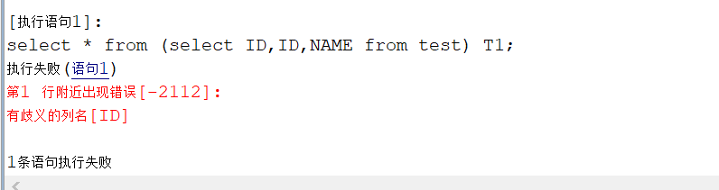

**【问题解答】：**

修改 ERROR\_COMPATIBLE\_FLAG 参数可绕过；

```sql
CALL SP_SET_PARA_VALUE(1,'ERROR_COMPATIBLE_FLAG',0);
```

## 收集列的统计信息时是否会收集索引统计信息

**【问题说明】：**

```sql
--收集指定用户下所有表所有列的统计信息：
DBMS_STATS.GATHER_SCHEMA_STATS('username',100,TRUE,'FOR ALL COLUMNS SIZE AUTO');
```

这个语句是否会收集索引的统计信息？

**【问题解答】：**

会收集，测试如下：

```sql
select * from "TEST"."TEST_WL";
--新建索引
create index idx_test_wl_id on test.test_wl(id);
--查看索引统计信息情况
dbms_stats.index_stats_show('TEST','IDX_TEST_WL_ID');
--收集模式下的列统计信息
dbms_stats.gather_schema_stats('TEST',100,TRUE,'FOR ALL COLUMNS SIZE AUTO');
--再次查看索引统计信息即可查看到统计信息情况
```

## 在客户端做 TEXT 数据类型查询时，无法直接看到文本内容

可以查出来，也可以用 “=” 作匹配，只是在客户端查出来的结果也一般是显示为：< 长文本 >

如果想要在客户端工具直接显示成文本，一般对大字段进行查询都要进行特殊处理，有两种查询大字段方式：

- cast/to\_char

如：

```sql
select id ,cast(t_text as varchar) from test;
```
- dbms\_lob.substr

如：

```sql
select id ,dbms_lob.substr(t_text,8000) from test;
```

## Mysql 的 replace into 语法，用达梦怎么实现

达梦可以用 merge into 实现 replace into 操作。详细操作可以参考安装目录 DOC 目录下的 -- DM SQL 语言使用手册。

举例：

例如 MySQL 中，用 replace into 指令替换属性 id,numbers,age 的值分别为 2,100,15：

```sql
replace into test(code,number,age) values(2,100,15)
```

在达梦数据库中，使用 merge into 替换为：

```sql
merge into table1
using (select 2 code,100 number,15 age from dual) t
on(table1.code = t.code)
when matched then
update set table1.number=t.number,table1.age=t.age
when not matched then
insert (code,number,age) values(t.code,t.number,t.age)
```

## xml 解析库未加载

使用包内的过程和函数之前，如果还未创建过系统包。请先调用系统过程创建系统包。

```sql
SP_CREATE_SYSTEM_PACKAGES (1,'DBMS_LOB');
SP_CREATE_SYSTEM_PACKAGES (1,'DBMS_XMLGEN');
SP_CREATE_SYSTEM_PACKAGES (1,'DBMS_OUTPUT');
SET SERVEROUTPUT ON;
```

## SQL 语法错误：无效的表或视图名\[dual\]

**【问题解决】** ：

dual 前面不要写模式名，用法如下：

```sql
select 1 from dual;
```

此外，在 DM6 数据库中，dual 伪表在 SYSTEM 库的 SYSDBA 模式下，非 SYSDBA 用户访问时需要带上库名和模式名来访问，如果需要直接访问可以用 SYSDBA 创建一个 PUBLIC 同义词：

```sql
--创建 public 同义词
CREATE PUBLIC SYNONYM dual for SYSTEM.SYSDBA.SYSDUAL;

--创建完成后，用户库中的非 SYSDBA 用户就可以直接访问
select to_date(sysdate,'yyyy-MM-dd') from dual;
```

## 在 disql 中，语句用 ";" 无法结束

**【问题描述】** ：

disql 中，用";" 无法结束，或报错：The script file is not complete,last sql has not been executed.

**【问题解决】** ：

创建触发器，存储过程，函数，包，模式等时需要用“/”结束。

## 如何利用数据库取得一个唯一值编号？

- 可以利用自增列取得唯一值。
```sql
CREATE TABLE T
(
ID INT IDENTITY(1,1),
MEMO VARCHAR(256)
);
INSERT INTO T VALUES('A');
COMMIT;
SELECT * FROM T;
```
- 可以使用序列取得唯一值。
```sql
CREATE SEQUENCE SEQ_1 INCREMENT BY 1;
CREATE TABLE T_SEQ(ID INT,C1 DATE);
INSERT INTO T_SEQ VALUES(SEQ_1.NEXTVAL,SYSDATE());
COMMIT;
SELECT * FROM T_SEQ;
```
- 如果是字符串，可以使用 GUID 函数返回唯一的值。
```sql
SELECT GUID FROM DUAL;
```

## 达梦整数或者整除的显示，如何保持与 Oracle 相同？

达梦数据库整数除法等运算默认舍弃小数，不会进行四舍五入，与 Oracle 不同。  
达梦数据库中：

```sql
SQL> SELECT 123456/10000 FROM DUAL;
行号       123456/10000
---------- ------------
1          12
```

Oracle 中：

```sql
SQL> SELECT 123456/10000 FROM DUAL;
123456/10000
------------
    12.3456
```

达梦数据库使用 to\_char(CEIL(表达式))结果返回为科学记数法

```sql
SQL> select to_char(ceil((SYSDATE - to_date('2020-10-26 10:39:05','YYYY-MM-DD hh24:mi:ss')) * 24 * 60)) from dual;
行号       TO_CHAR(CEIL((SYSDATE-TO_DATE('2020-10-2610:39:05','YYYY-MM-DDhh24:mi:ss'))*24*60))
---------- -----------------------------------------------------------------------------------
1          6.31E2
```

此时 Oracle 返回整数

可通过修改参数设置，使达梦输出与 Oracle 一致：

修改 CALC\_AS\_DECIMAL 参数值为 2，并重启数据库生效并验证。

```sql
sp_set_para_value(2,'CALC_AS_DECIMAL',2);
```

需重启数据库生效；

## blob 字段用 length 取长度报错：参数不兼容

对 blob 字段取长度，无法使用 length， 可以使用系统包 DBMS\_LOB.GETLENGTH(列名)或者 lengthb(列名);

```sql
Select  dbms_log.getlength(file_content) from  AR_FILE;
```

## 字符串太长，导致 LISTAGG 函数报“字符串截断”如何处理？

处理方法：将 LISTAGG 改成 LISTAGG2。示例如下：  
1、创建测试表和造测试数据：

```sql
--创建测试表test
create table test
as select level id ,rpad('A',1000,'B') c1 FROM DUAL CONNECT BY LEVEL<=10;
--插入测试数据
BEGIN
for I in 1..10
LOOP
INSERT INTO TEST
SELECT * FROM TEST;
END LOOP;
commit;
END;
--查询测试表的总数据量
select count(*) from test；--10240
```

2、用 listagg 函数去执行 sql 语句

```sql
SELECT ID ,LISTAGG(C1,'->') WITHIN GROUP (ORDER BY ID)
FROM TEST
GROUP BY ID;
--报错，字符串截断
```

3、将 listagg 修改成 listagg2，再次执行该 sql 语句

```sql
SELECT ID ,LISTAGG2(C1,'->') WITHIN GROUP (ORDER BY ID)
FROM TEST
GROUP BY ID;   --成功
```

## 使用 UTL\_FILE 包报错：utf.file.open 无访问权限

**【问题解决】** ：

- 读功能，当读取的文件 dmdba 用户无法访问时会报无权限访问问题，修改其用户属组或者权限即可。
- 写功能，达梦为安全考虑，默认调用系统包只能写入特定目录，即库目录，可以通过以下语句查询到目录路径：
```sql
SELECT * FROM V$DM_INI WHERE PARA_NAME LIKE '%SYSTEM_PATH%';
```

## 如何批量禁用/启用用户下的所有约束信息

**【问题解决】** ：

- 禁用:运行以下 SQL 语句，将得到的结果复制出来在 disql 中批量执行。
```sql
select 'alter table '|| t.OWNER||'.' ||t.TABLE_NAME||' disable constraint '|| t.CONSTRAINT_NAME|| ';'
from dba_constraints t
where t.OWNER not in( 'SYSDBA','SYS');
```
- 启用：运行以下 SQL 语句，将得到的结果复制出来在 disql 中批量执行。
```sql
select 'alter table '|| t.OWNER||'.' ||t.TABLE_NAME||' enable constraint  '|| t.CONSTRAINT_NAME|| ';'
from dba_constraints t
where t.OWNER not in( 'SYSDBA','SYS');
```

## 插入的数据带 & 字符，显示请输入 XXX 的值，该如何解决

**【问题描述】** ：

如下图所示，name 列插入数据带 & 字符，显示要输入 cc 的值。回车后，认定 cc 为空，因此只插入了值 aa。

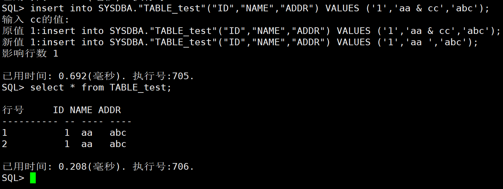

**【问题解决】** ：

这里插入的语句中 name 字段的值‘aa & cc’中的 & 被当成了变量，因此显示需要输入 cc 的值。此时有两种解决办法：

**方法一** ：  
sql 命令行中执行 `set define off;` 关闭替代标记功能后，重新插入数据成功。

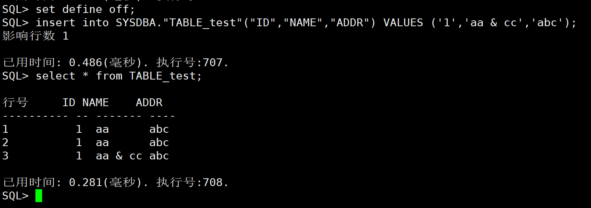

**方法二** ：  
通过使用转义符取消掉 & 符号的特殊含义，具体如下：全文替换：& 替换为'||'&'||'，然后再导入就可以了。

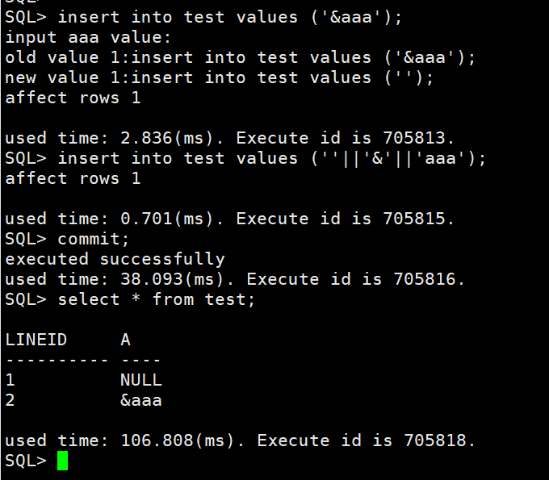

## 达梦的聚集索引不支持大字段操作，将聚集索引变成非聚集索引应如何操作

**【问题解决】** ：

可通过在表上除聚集主键外的任意一列创建一个聚集索引，原聚集主键列被取代，再删除新创建的聚集索引即可。具体实例如下：

```sql
---创建测试表 TEST111，设置 ID 列为聚集主键
drop table  TEST111;
CREATE TABLE TEST111(ID int CLUSTER PRIMARY KEY,name varchar);
insert  into TEST111 select id ,name from sysobjects ;
commit;

---先用该表上除聚集主键以外的任意一列创建一个聚集索引
 create cluster index idx1_1 on TEST111(name);

---查询现在的表定义，原先在 id 上的聚集主键列，已经变成非聚集主键列
 select tabledef('SYSDBA','TEST111');

---最后在删除先前创建的 idx1_1 聚集索引
 drop   index idx1_1;
```

## DM 中默认除数和被除数都是整数，最后的结果也被当作整数处理

**【问题描述】** ：

当被除数和除数都是整数，结果也直接默认取整数，此结果和 oracle 不一致。例如：

```sql
---dm 数据库运行结果为 0，Oracle 数据库运行结果为 0.4
select 8/20；
```

**【问题解决】** ：

- 达梦数据库种默认整数相除，最后的结果集是按照整数处理。
- 如果除数或者被除数有一个是浮点型，最后的结果都是按照浮点型处理。
```sql
---以下运行结果均为 0.4
select 24/60.0;
或者
select 24.0/60;
```
- 达梦数据库还在 dm.ini 配置文件中提供了 CALC\_AS\_DECIMAL 参数，该参数是静态参数，需要重启数据库才生效。该参数值的含义如下：  
	0：默认值，表示整数类型的除法、整数与字符或 BINARY 串的所有四则运算，结果都处理成整数；  
	1：表示整数类型的除法全部转换为 DEC(0，0)处理；  
	2：表示将整数与字符或 BINARY 串的所有四则运算都转换为 DEC(0，0)处理。

> **注意**
> 
> CALC\_AS\_DECIMAL 参数只有在 USE\_PLN\_POOL 为 0 或 1 时有效。当 USE\_PLN\_POOL 为 2 或 3 时，按照 CALC\_AS\_DECIMAL=2 处理

例如：

```sql
---打开 CALC_AS_DECIMAL=1,整数类型的除法全部转换为 DEC(0，0)浮点型处理，运行结果为 0.4
select 24/60=0.4
```

## 插入数据时报错：违反引用约束\[CONSxxxxx\]

**【问题解决】** ：

若在表 A 的 fid 字段上设置了外键，引用了表 B 的 pid 字段，则当在表 A 的 fid 字段插入数据前，需确保表 B 的 pid 字段已存在相同数据，否则会因为违反引用的约束，无法正常完成数据插入。

## 对于 resource 角色的用户跨用户访问其他模式对象，向外键所在表插入修改数据报错：没有引用表\[T1\]上的权限

**【问题描述】** ：

对于 resource 角色的用户跨用户访问其他模式对象，赋予外键和外键引用主键表的全部 DML 权限，向外键所在表插入修改数据报错：没有引用表\[T1\]上的权限。具体实例如下：

```sql
---建立用户 test1 和 test2，并授予默认权限
create user test1 identified by ****;
create user test2 identified by ****;

---在 test1 上创建表 t1 和 t2，并设置主键和外键
create table test1.t1(c1 int,c2 int,primary key(c1));
create table test1.t2(c1 int,c2 int,primary key(c1));
alter table test1.t2 add constraint foreign key(c2) references test1.t1(c1);

---将 test1 上表 t1 和 t2 的所有 DML 权限授予给 test2 用户
grant select,insert,delete,update on test1.t1 to test2;
grant select,insert,delete,update on test1.t2 to test2;

---使用 TEST2 用户登录数据库，执行如下语句：
INSERT INTO TEST1.T1 VALUES(1,1); --执行成功，不报错
COMMIT;
INSERT INTO TEST1.T2 VALUES(1,1);--报错：没有引用表[T1]上的权限
```

**【问题解决】** ：

对于存在外键的表，需要增加 references 权限的授予,赋予如下权限即可。

```sql
grant references on test1.t1 to test2;
```

## 插入数据到视图，报错：提示违反视图\[t1\_v\]CHECK 约束

**【问题描述】** ：

插入数据到视图，报错，提示违反视图\[t1\_v\]CHECK 约束，报错截图和视图数据来源表的查询结果截图如下：

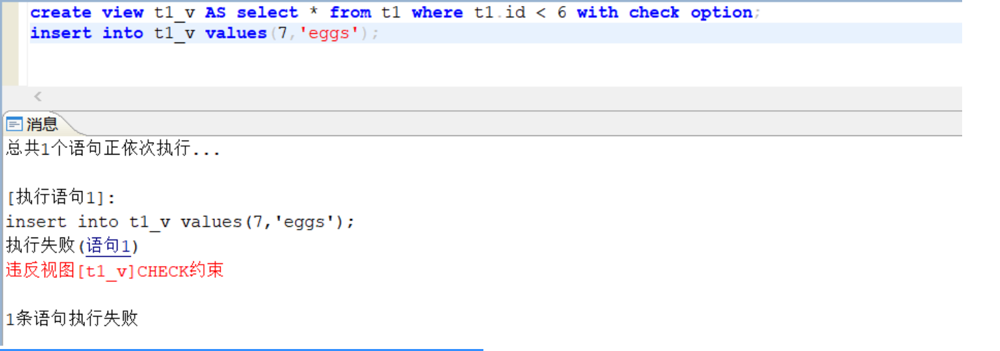

视图数据来源表的查询结果：

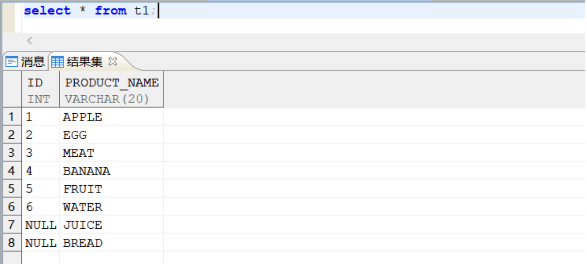

**【问题分析】** ：

出现以上报错是由于在创建视图 t1\_v 时指定了 witch check option 关键字，这也就是说，新增或更新后的每一条数据仍然要满足创建视图时指定的 where 条件。因为新增的记录的 id 值为 7，超过了 where 条件中限制的 t.id<6 的范围，所以报错，提示违反视图\[t1\_v\]CHECK 约束。  
解决方法：调整新增的记录的 id 值，使 id 值保持在 t.id<6 的范围内，语句即可正常执行。

## BLOB 如何转换成可视化字符串

通过以下 SQL 语法进行转换：

```sql
SELECT
utl_raw.cast_to_varchar2(dbms_lob.substr(表.列))
from 表
```

## 多字段组合唯一性约束限制

**【问题描述】** ：

唯一性约束可以实现对多个字段的组合唯一性约束限制，现有如下类型的唯一性要求，如表 TEST(C1 INT,C2 INT)，要求在 C1 <0 的情况下，C1 和 C2 的组合不参与唯一性判断；在 C1>=0 时，要求 C1 和 C2 的组合必须唯一。

**【问题解决】** ：

该需求可以通过条件表达式来实现：

```sql
create unique index index_ttt on test(case when  c1 <0 then null else cast(c1 as varchar)||','||cast(c2 as varchar) end);
```

## 如何设置部分用户禁止删除某张数据表

**【问题描述】** ：

针对数据表无法设定 TRUNCATE 操作权限，为了提高安全性，要求对部分用户禁止针对某张数据表做 truncate 和 drop 操作。应该如何设置。

**【问题解决】** ：

可以通过触发器实现权限设定：

```sql
CREATE OR REPLACE TRIGGER  tri_prevent_drop_truncate
  BEFORE TRUNCATE OR DROP ON DATABASE
BEGIN
  IF :eventinfo.objectname='表名' and :eventinfo.schemaname='用户名'
  THEN
     raise_application_error (-20000, '禁止DROP或TRUNCATE表TEST!');
  END IF;
END;
```

## MySQL 迁移到 DM 的存储过程运算结果与原库不一致

**【问题描述】** ：

MySQL 中执行 `SELECT SIGN(65^4)^1*100/10;` 运算结果为 0；而 DM 数据库中执行结果为 11。

**【问题分析】** ：

此问题是由于 MySQL 和 DM 数据库运算优先级不一致导致。

DM 数据库运算优先级：


MySQL 数据库运算优先级：


因此 MySQL 中该运算 `SELECT SIGN(65^4)^1*100/10;` 实际执行顺序为： `select (sign(65^4)^1)*100/10;`  
DM 中该运算 `SELECT SIGN(65^4)^1*100/10;` 实际执行顺序为： `select sign(65^4)^(1*100/10);`

解决方法：在达梦的过程中实现与 MySQL 一样的顺序，对异运算加括号干预： `select (sign(65^4)^1)*100/10;`

## 创建索引后，在管理工具导航栏索引下看不到索引信息

**【问题描述】** ：

执行以下语句创建索引，命令执行成功，但在管理工具中无法查看索引信息。

```sql
create table test(id int,name varchar(20));
create index idx_test_id on test('id');
```

**【问题解决】** ：

该问题的原因是引号使用错误：单引号在数据库中表示字符串。  
用单引号括起来表示索引目标是一个常量字符串，而不是某个字段。但针对某个 id 对象创建索引时，应该直接使用字段名称，而不应该用单引号括起来。  
以上创建过程使用以下命令查看索引类型为函数索引，而非普通索引，所以不会在管理工具中显示。

```sql
---查看索引类型为函数索引
select index_type from "SYS"."DBA_INDEXES" where index_name='IDX_TEST_ID';
```

正确创建索引方法：

```sql
---方法一：不加双引号
create index idx_test_id on test(id);

---方法二：用双引号将字段名称括起来
create index idx_test_id on test("ID");
```

## 嵌套层次太深

**【问题描述】**

在单表的某函数转换的字段上创建触发器，在对该字段进行插入和修改时报错：”嵌套层次太深”。

建表：

```sql
create table stu(id int,name varchar(20),ag varchar(20));
insert into stu values(1,'喜','2022-11-28 15:46:30');
```

触发器：

```sql
create or replace trigger tri_stu
before update of ag on stu
for each row 
begin 
update stu a set ag=to_char(to_date(ag,'yyyy-MM-dd hh24:mi:ss'),'yyyymmddhh24miss');
end;
```

更新数据：

```sql
update stu a set ag=to_char(to_date(ag,'yyyy-MM-dd hh24:mi:ss'),'yyyymmddhh24miss');
```


**【问题解决】**

将触发器修改为：

```sql
create or replace trigger tri_stu
before update of ag on stu
for each row 
begin 
 select to_char(to_date(:NEW.ag,'yyyy-MM-dd hh24:mi:ss'),'yyyymmddhh24miss') into :NEW.ag from dual;
end;
```


再次更新数据成功：

```sql
update stu a set ag=to_char(to_date(ag,'yyyy-MM-dd hh24:mi:ss'),'yyyymmddhh24miss');
```


查询数据：

```sql
select * from stu;
```


## 为什么有时候简单的 insert 语句会阻塞查询事务。

**【问题分析】**

按照一般理解，insert 操作不应阻塞 select 查询事务。insert 操作在 DM 中通常只使用意向锁，但在某些情况下 insert 操作会为对象加上 X 独占锁，导致需要查询该表的其他事务无法上 IS 意向共享锁，形成了查询被阻塞的现象。

例如对存在位图索引的表进行 insert 操作时，将会对该表加上独占锁，导致需要操作该表的其他事务均被阻塞。因此，位图索引要谨慎使用，否则可能顾此失彼。尤其不应在频繁更新的表上创建位图索引，否则可能严重影响业务系统正常运行。这里仅以位图索引举例，实际可能有不同的原因导致此现象，需要根据场景中的事务与锁情况具体分析。

示例如下：

1. 在第一个会话中执行以下命令。
```sql
create table T1 (ID int);
create bitmap index idx_id on T1(ID);
insert into T1 values (1);
---（不提交）
```


2. 新建会话查询。
```sql
select * from T1;
--（被阻塞）
```


3. 在第一个会话中查询锁。
```sql
select l.* from v$lock l,sysobjects o where l.table_id = o.id and o.name='T1';
--（T1 表被加了独占锁）
```


## 表数量与实际的表数量不一致

**【问题描述】**

使用 SQL 语句 `select * from all_tables;` 查出来的表数量与实际的表数量不一致，存在个别表名并非真正的表的情况，这些表在管理工具的模式下看不到，如 SREF\_CON\_TAB 开头的表。


**【问题解决】**

达梦创建外键，该外键关联的字段是本表的字段时，会创建 3 张临时表，表名为：

- SREF\_CON\_TAB+ 外键约束 id+\_LEVEL
- SREF\_CON\_TAB+ 外键约束 id+\_REFING
- SREF\_CON\_TAB+ 外键约束 id+\_REFED

如果想根据这里的临时表信息查询其基表信息，请使用如下 SQL：

```sql
select
       b.id           ,
       owner          ,
       constraint_name,
       r_owner        ,
       table_name
from
       SYS.DBA_CONSTRAINTS a,
       sysobjects b
where
       a.CONSTRAINT_NAME=b.name
   and b.id            in
       (
               select
                       REGEXP_SUBSTR(table_name, '[0-9]+', 1)
               from
                       all_tables
               where
                       tablespace_name='TEMP'
                   and TABLE_NAME like 'SREF_CON_TAB%'
       );
```

## 如何不退出 disql 使用代理功能

**【问题解决】**

授予代理用户代理权限。

例如：被代理用户 USER1 的口令和密码为 USER111/USER111，代理用户 SYSDBA 的用户名和密码为 SYSDBA/\*\*\*\*\*。

1. 授予代理用户代理权限。
```sql
ALTER USER USER1 GRANT CONNECT THROUGH SYSDBA；
```


2. 查看当前用户。
```sql
select user;
```


3. 使用代理用户 SYSDBA 登录被代理用户 USER1 的数据库。
```sql
conn SYSDBA/*****#{proxy_client=USER1};
```


4. 查看当前用户。
```sql
select user;
```


5. 回收代理权限语句。
```sql
alter user USER1 revoke connect through sysdba;
```

## 如何并行创建分区表上的索引

**【问题描述】**

如何并行创建分区表上的索引。

**【问题解决】**

1. 创建含无效索引类型的分区表
```sql
CREATE TABLE TEST(C1 INT, C2 INT) PARTITION BY HASH(C1) PARTITIONS 3 ;
```
2. 创建无效索引
```sql
CREATE INDEX INDEX_C1 ON TEST(C1) UNUSABLE;
```
3. 并行重建分区表上的索引,最大支持并行数 8
```sql
ALTER INDEX INDEX_C1 REBUILD SHARE ASYNCHRONOUS 8;
```

## 当前用户无法调用其他用户创建的存储函数/存储过程/包

**【问题描述】**

当前用户无法调用其他用户创建的存储函数/存储过程/包

例如：用户 A 创建如下存储函数：

```sql
CREATE TABLE TEST (ID NUMBER,NAME VARCHAR2(20));
INSERT INTO TEST VALUES(101,'TONY');
COMMIT;
CREATE OR REPLACE FUNCTION VALID_ID(vid in number) return boolean
is
  temp_id number;
begin
  select id into temp_id from test where id=vid;
  return (true);
  exception when no_data_found then return (false);
end valid_id;
```

B 用户需要直接调用 A 用户创建的函数。

```sql
--B用户执行
declare
rtn boolean;
begin
rtn := VALID_ID(101);
print rtn;
end;
/
```

报错：

```sql
-2207: 第4 行附近出现错误:无法解析的成员访问表达式[VALID_ID]

-5505: 没有执行[VALID_ID]对象权限
```

**【问题分析】**

第一个报错是由于用户 B 下不存在或未找到相关数据库对象，可通过创建同义词，并开启 ENABLE\_PL\_SYNONYM 参数进行处理。

第二个报错是由于用户 B 没有执行对象的权限，可通过授权解决，授权后用户 B 可以正常调用用户 A 下的对象。

**【问题解决】**

问题一：-2207: 第 4 行附近出现错误:无法解析的成员访问表达式 \[VALID\_ID\]。

1. 开启 ENABLE\_PL\_SYNONYM 参数，可以通过全局同义词执行非系统用户创建的包或者存储过程。1 是，0 否。
```sql
sp_set_para_value(1,'ENABLE_PL_SYNONYM',1);
```
2. 用户 B 创建同名同义词。
```sql
CREATE OR REPLACE SYNONYM SCHEMA_B.VALID_ID FOR SCHEMA_A.VALID_ID;
```

问题 二：-5505: 没有执行\[VALID\_ID\]对象权限。

- DBA 用户执行授权 B 用户执行 A 用户存储函数 VALID\_ID 的权限。
```sql
GRANT EXECUTE ON SCHEMA_A.VALID_ID TO SCHEMA_B;
```

## disql 如何同时给多条 sql 赋予变量值？

**【问题解决】**

例如：有如下两条查询 SQL：

```sql
select * from bus_car where color='&color';
select * from bus_car2 where color='&color';
```

现在需要同时为两条 SQL 的 color 赋与相同的值进行查询，步骤如下：

1. 编辑 SQL 脚本 q.sql。
```sql
DEF color=&color;
select * from bus_car where color='&color';
select * from bus_car2 where color='&color';
```
2. 登录 disql 执行脚本。
```sql
[dmdba@192-168-164-6 bin]$ ./disql SYSDBA/*****

服务器[LOCALHOST:5236]:处于普通打开状态
登录使用时间 : 2.363(ms)
disql V8
SQL> start q.sql
```
3. 根据提示输入变量值。
```sql
SQL> DEF color=&color;
输入 color的值:白色
原值 1:DEF color=&color;
新值 1:DEF color=白色;
```
4. 为变量赋值成功并输出查询结果。


## 如何从动态 SQL 中返回新记录 ROWID 的值

**【问题解决】**

例如有如下表 T3。

```sql
create table t3(name varchar2(20),pdate timestamp(6));
```

创建存储过程返回新记录 ROWID 的值：

```sql
create or replace procedure rowidtest (tname varchar2,cprowid out varchar2) is
begin
insert into t3 values (tname,sysdate)
returning rowid into cprowid;
end;
/
```

## 如何通过 sql 语句更改单列 blob 图片

**【问题解决】**

可以通过创建更新图片的存储过程来更新图片。

例如：

创建测试表:T3；

```sql
CREATE TABLE "T3"("C" BLOB,"ID" INTEGER);
```

创建存放图片目录；

```sql
CREATE OR REPLACE DIRECTORY "IMAGES" AS 'D:\Program Files\deckpt\yule';--具体路径
```

创建更新图片存储过程；

```sql
CREATE OR REPLACE PROCEDURE IMG_UPDATE
(TID INT,
FILENAME VARCHAR(200))AS
F_LOB BFILE;
B_LOB BLOB;
BEGIN
--update 语句
update t3 set c=EMPTY_BLOB () where id=TID
RETURN c INTO B_LOB;
F_LOB:= BFILENAME ('IMAGES', FILENAME);
DBMS_LOB.FILEOPEN (F_LOB, DBMS_LOB.FILE_READONLY);
DBMS_LOB.LOADFROMFILE (B_LOB, F_LOB,
DBMS_LOB.GETLENGTH (F_LOB));
DBMS_LOB.FILECLOSE (F_LOB);
COMMIT;
END;
```

执行存储过程更新图片，传入 id 值和图片名称。

```sql
CALL IMG_UPDATE(1,'2.jpg');
```

## 表数据分组拆分合并，同时列转多行

**【问题描述】**

有如下表：

```sql
CREATE TABLE T1 (ID INT,NAME VARCHAR(20));
INSERT INTO T1 VALUES(1,'张三');--姓名
INSERT INTO T1 VALUES(2,'100');--语文
INSERT INTO T1 VALUES(3,'90');--数学
INSERT INTO T1 VALUES(4,'88');--英语
INSERT INTO T1 VALUES(5,'99');--历史
INSERT INTO T1 VALUES(6,'98');--地理
INSERT INTO T1 VALUES(7,'77');--生物
INSERT INTO T1 VALUES(8,'95');--物理
INSERT INTO T1 VALUES(9,'87');--化学
INSERT INTO T1 VALUES(10,'87');--思想政治
INSERT INTO T1 VALUES(1,'李四');--姓名
INSERT INTO T1 VALUES(2,'100');--语文
INSERT INTO T1 VALUES(3,'90');--数学
INSERT INTO T1 VALUES(4,'88');--英语
INSERT INTO T1 VALUES(5,'99');--历史
INSERT INTO T1 VALUES(6,'98');--地理
INSERT INTO T1 VALUES(7,'77');--生物
INSERT INTO T1 VALUES(8,'95');--物理
INSERT INTO T1 VALUES(9,'87');--化学
INSERT INTO T1 VALUES(10,'87');--思想政治
COMMIT;
```

计划实现如下效果：  
姓名 语文 数学 英语 历史 地理 生物 物理 化学 思想政治  
张三 100 90 88 99 98 77 95 87 87  
李四 100 90 88 99 98 77 95 87 87

**【问题解决】**

通过使用 rownum 、case when 实现一列转多行。

```sql
SELECT MAX(C1) 姓名,MAX(C2) 语文,MAX(C3)数学,MAX(C4) 英语,MAX(C5) 历史,MAX(C6)地理,MAX(C7)生物,MAX(C8)物理,MAX(C9)化学,MAX(C10)思想政治  FROM (
SELECT CASE WHEN MOD(ROWNUM,10) =1 THEN NAME END AS C1,
      CASE WHEN MOD(ROWNUM,10) =2 THEN NAME END  AS C2,
      CASE WHEN MOD(ROWNUM,10) =3 THEN NAME END  AS C3,
      CASE WHEN MOD(ROWNUM,10) =4 THEN NAME END  AS C4,
      CASE WHEN MOD(ROWNUM,10) =5 THEN NAME END  AS C5,
      CASE WHEN MOD(ROWNUM,10) =6 THEN NAME END AS C6,
      CASE WHEN MOD(ROWNUM,10) =7 THEN NAME END  AS C7,
      CASE WHEN MOD(ROWNUM,10) =8 THEN NAME END  AS C8,
      CASE WHEN MOD(ROWNUM,10) =9 THEN NAME END  AS C9,
      CASE WHEN MOD(ROWNUM,10) =0 THEN NAME END  AS C10    FROM T1)
GROUP BY TRUNC(ROWNUM/10.0 +0.9);
```


## 使用 sql 复制表结构无法将主键和约束复制到新表

**【问题描述】**

使用 AS 复制相同的表结构。

```sql
CREATE TABLE table_name AS SELECT * FROM other_table WHERE 1=2;(或者 LIMIT 0)
```

使用 LIKE 复制相同的表结构。

```sql
CREATE TABLE table_name LIKE other_table;
```

以上这两种方式都无法将主键和约束复制到新表上去。

**【问题解决】**

可以使用如下方法来复制表结构。

1. 通过系统包查询建表的 ddl 语句。
```sql
SELECT DBMS_METADATA.GET_DDL('TABLE','表名','模式名');
```
2. 修改 ddl 语句，更改表名重新执行 ddl 语句即可创建相同表结构的新表。

## 使用达梦管理工具创建自增列表后，如何获取上一次 insert 语句的 id

**【问题解决】**

管理工具中创建自增表默认使用序列方式实现自增，需要 @@IDENTITY 获取上一次 insert 语句的 id ，例如：

1. 创建序列自增表；
```sql
CREATE TABLE new_employees1
(
id_num int IDENTITY(1,1),
fname varchar (20),
minit char(1),
lname varchar(30)
);
```
2. 插入数据；
```sql
insert into new_employees1(fname,minit,lname) values('test','d','test1');
```
3. 通过 @@IDENTITY 获取上一次 insert 语句的 id。
```sql
select @@IDENTITY;
```

达梦有两个自增方式，上述为序列自增，已下为自增列方式。

1. 创建自增列表；
```sql
CREATE TABLE "SYSDBA"."TABLE_8"
(
"ID" INT PRIMARY KEY AUTO_INCREMENT ,
"NAME" CHAR(10)
);
```
2. 插入数据；
```sql
insert into TABLE_8(name) values('test');
```
3. 通过 LAST\_INSERT\_ID 函数获取上一次 insert 语句的 id。
```sql
select LAST_INSERT_ID；
```

## 存储过程报错：“数据类型不匹配”

**【问题描述】**

如下存储过程执行时报错：“数据类型不匹配”。

```sql
DECLARE
   REC INT;
begin
   for REC in(SELECT 1 FROM DUAL)
   loop
       print REC;
   end loop;
end;
```


**【问题分析】**

该报错是由于 in 方式取值，引用的值不明确。

**【问题解决】**

改写 SQL 如下：

```sql
DECLARE
   REC INT;
begin
   for REC in(SELECT 1 A FROM DUAL)
   loop
       print REC.A;
   end loop;
end;
```


## 达梦 like 模糊匹配可以走索引吗？

**【问题解决】**

对于 like 前缀模糊匹配或者 like 后缀模糊匹配是可以走索引的，但对于 like 前后缀都进行模糊匹配时没办法使用到索引。

具体分析如下：

1. 对于后缀模糊匹配，name like 'str%'，可以直接用到 name 列的普通索引进行匹配。
2. 对于前缀模糊匹配，name like '%str'，可以通过对 name 列创建反向索引使前缀模糊匹配自动应用到该反向索引进行匹配，具体方法可参考如下：

  （1）对 name 列创建反向索引。

```sql
CREATE  INDEX "IDX_TEST_NAME" ON "TEST_INDEX"("REVERSE"(NAME));
```

  （2）并修改参数 STR\_LIKE\_IGNORE\_MATCH\_END\_SPACE 为 0，可通过会话级修改只影响当前会话或系统级修改影响所有会话。

  会话级修改：

```sql
SF_SET_SESSION_PARA_VALUE('STR_LIKE_IGNORE_MATCH_END_SPACE',0);
```

  系统级修改：

```sql
SP_SET_PARA_VALUE(1,'STR_LIKE_IGNORE_MATCH_END_SPACE',0);
```

  此时前缀模糊匹配就可以自动应用到该反向索引进行匹配。

3. 对于前后缀模糊匹配，name like '%str%'，目前没有好的办法令该条件使用索引扫描。实际使用中要尽量减少使用该模糊过滤方法，如果实在需要使用尽量创建覆盖索引来避免全表扫描。

覆盖索引：select 的数据列只用从索引中就能够取得，不必读取数据行，换句话说查询列要被所建的索引覆盖。

## DM 可以类似 mysql 中 json 数据能够通过虚拟列实现添加索引吗

**【问题解决】**

MYSQL 中 json 数据通过虚拟列添加索引：

```sql
-建表插数据建索引
mysql> CREATE TABLE jemp (
   ->     c JSON,
   ->     g INT GENERATED ALWAYS AS (c->"$.id"),
   ->     INDEX i (g)
   -> );
Query OK, 0 rows affected (0.03 sec)

mysql> INSERT INTO jemp (c) VALUES
   ->   ('{"id": "1", "name": "Fred"}'), ('{"id": "2", "name": "Wilma"}'),
   ->   ('{"id": "3", "name": "Barney"}'), ('{"id": "4", "name": "Betty"}');
Query OK, 4 rows affected (0.00 sec)
Records: 4  Duplicates: 0  Warnings: 0

mysql> commit;
Query OK, 0 rows affected (0.01 sec)
--查看执行计划
mysql>  EXPLAIN SELECT c->>"$.name" AS name FROM jemp WHERE g > 2\G
*************************** 1. row ***************************
          id: 1
 select_type: SIMPLE
       table: jemp
  partitions: NULL
        type: range
possible_keys: i
         key: i
     key_len: 5
         ref: NULL
        rows: 2
    filtered: 100.00
       Extra: Using where
1 row in set, 1 warning (0.00 sec)
```

DM 中 json 数据通过虚拟列添加索引：

```sql
--建表插数据建索引
CREATE TABLE jemp (
c varchar  CHECK (c IS JSON),
g int GENERATED ALWAYS AS (json_value(c, '$.id'))
);
INSERT INTO jemp (c) VALUES
('{"id": "1", "name": "Fred"}'), ('{"id": "2", "name": "Wilma"}'),
('{"id": "3", "name": "Barney"}'), ('{"id": "4", "name": "Betty"}');
commit;
create index idx_jemp on jemp(g);
--查看执行计划
EXPLAIN select json_value(C, '$.name'),g FROM jemp where g<2;

1   #NSET2: [1, 2, 64]
2     #PRJT2: [1, 2, 64]; exp_num(3), is_atom(FALSE)
3       #BLKUP2: [1, 2, 64]; IDX_JEMP(JEMP)
4         #SSEK2: [1, 2, 64]; scan_type(ASC), IDX_JEMP(JEMP), scan_range(null2,2)
```

## 时间范围分区表，插入数据扩展分区报错

**【问题描述】**

时间范围分区表，插入数据扩展分区报错：“-2903：语句块/包、存储函数中的间隔分区不支持自动扩展”。

示例如下：

创建测试用表：

```sql
CREATE TABLE SYSDBA."EVENT_TASK_STATUS"
(
"ETS_ID" NUMBER(19,0) NOT NULL,
"ETS_HDLTIMES" NUMBER(9,0),
"ETS_STATUS" VARCHAR2(1),
"ETS_SENDTIME" TIMESTAMP(0),
"ETS_HANDLETM" TIMESTAMP(0),
"ETS_VERSION" NUMBER(19,0) DEFAULT 0,
"ETS_SYSTIME" TIMESTAMP(6) DEFAULT (SYSDATE) --新加时间列
) STORAGE(ON "MAIN",BRANCH(32,32), CLUSTERBTR) 
PARTITION BY RANGE (ETS_SYSTIME)
INTERVAL (NUMTODSINTERVAL(1,'DAY'))
(PARTITION P1 VALUES LESS THAN ('2023-08-24')STORAGE(ON "MAIN", CLUSTERBTR)
) ENABLE ROW MOVEMENT;
COMMENT ON COLUMN SYSDBA."EVENT_TASK_STATUS"."ETS_SYSTIME" IS '当数据插入时获取系统当前时间插入';
```

创建循环插入存储过程：

```sql
create or replace PROCEDURE p_in_EVENT_TASK_STATUS(num int,inc integer)
as
begin
    for i in 1..num
    loop
        insert into "SYSDBA"."EVENT_TASK_STATUS"("ETS_ID",
               "ETS_HDLTIMES",
               "ETS_STATUS",
               "ETS_SENDTIME",
               "ETS_HANDLETM",
               "ETS_VERSION",
               "ETS_SYSTIME")
               VALUES(CEILING(RAND() * 1000000),
               CEILING(RAND() * 1000000),
               DBMS_RANDOM.RANDOM_STRING('U',1),
               SYSDATE()+inc,
               SYSDATE()+inc,
               CEILING(RAND() * 1000000), 
               SYSDATE+inc);
  
        if (i%10000 = 0) then
            commit;
        end if;
    end loop;
end;
```

执行存储过程插入前 1 个分区的数据：

```sql
call P_IN_EVENT_TASK_STATUS(10000000,1);
```


**【问题解决】**

设置参数 DEL\_HP\_OPT\_FLAG 的值为 12，重新执行改存储过程即可成功。

```sql
alter system set 'DEL_HP_OPT_FLAG'=12;

call P_IN_EVENT_TASK_STATUS(10000000,1);
```

DEL\_HP\_OPT\_FLAG 参数解释如下:

| 参数名 | 默认值 | 属性 | 说明 |
| --- | --- | --- | --- |
| DEL\_HP\_OPT\_FLAG | 0 | 动态，会话级 | 控制分区表的操作优化，0：不优化；   1：打开分区表 DELETE 优化；   2：控制范围分区表创建的优化处理，转换为数据流方式实现；   4：允许语句块中的间隔分区表自动扩展；   8：开启对 TRUNCATE 分区表的优化处理；   16：完全刷新时删除老数据使用 DELETE 方式；   32：开启对分区表全局索引 DDL 操作的优化处理，直接操作索引数据，无须重建全局索引   支持使用上述有效值的组合值，如 7 表示同时进行 1、2、4 的优化 |

## DM8 如何创建并使用空间数据类型

**【问题解决】**

DM8 支持空间数据类型及对应的方法，使用之前需要创建对应的系统包，使用 DMGEO 包需要执行 SP\_INIT\_GEO\_SYS(1)，使用 DMGEO2 包需要执行 SP\_INIT\_GEO2\_SYS(1) 。一般只需要执行一个即可，建议直接使用 SP\_INIT\_GEO2\_SYS(1) 使用 DMGEO2 系统包，相比于 DMGEO 系统包 DMGEO2 系统包增加了新的空间数据类型及几何体计算函数。相关包具体使用方法可以参考数据库安装目录下 doc 目录中《DM8 系统包使用手册》。

## 在达梦数据库中如何创建对象数组类型的 TYPE

**【问题解决】**

1. 创建对象的类型;
```sql
CREATE OR REPLACE TYPE OBJ as OBJECT(
ID int,
C1 varchar2(12),
C2 varchar2(1000));
```
2. 创建对象数组。
```sql
create TYPE MEMBER_LIST AS ARRAY  OBJ[1000]  ;
```

在创建对象数组时需要注意使用方括号。

## 主键为自增列，插入 0 后无法通过主键查询到数据

**【问题描述】**

主键列为 int 类型自增列，插入 0 无法查询到结果，插入其他值可以正常查询到结果。


**【问题分析】**

由于主键添加了自增属性导致，在包含自增属性列上 0 是一个特殊值，传入 0 代表自动为其分配下一个自增 ID。

DM 提供两种自增列方式：IDENTITY 自增列和 AUTO\_INCREMENT 自增，两种自增配置方式。当采用 AUTO\_INCREMENT 自增列，插入 0 时，是否自动插入自增的下一个值受到参数 NO\_AUTO\_VALUE\_ON\_ZERO 控制，当参数为 1 时，主键插入 0 会自动插入自增的下一个值。当采用 IDENTITY 自增时，插入 0 则会报错。

**【问题解决】**

方法一：取消自增属性。

方法二：修改 NO\_AUTO\_VALUE\_ON\_ZERO 参数值为 0。

方法三：传参不要使用 0 作为主键 ID。

参数说明：

| 参数 | 缺省值 | 属性 | 说明 |
| --- | --- | --- | --- |
| NO\_AUTO\_VALUE\_ON\_ZERO | 1 | 动态，会话级 | 用于 AUTO\_INCREMENT 自增列中。表示 AUTO\_INCREMENT 列插入 0 时，是否自动插入自增的下一个值。取值范围 0、1。0 否，插入 0；1 是，插入自增值。 |

示例说明如下：

1. 创建 2 张测试表采用不同的自增方式。
```sql
CREATE TABLE test231201 (
    id INT AUTO_INCREMENT PRIMARY KEY,---AUTO_INCREMENT方式自增
    name VARCHAR(50) NOT NULL
);

CREATE TABLE test231202
(
id INT IDENTITY(1, 100) PRIMARY KEY,---IDENTITY方式自增
name VARCHAR(50) NOT NULL
);
```
2. AUTO\_INCREMENT 自增方式的表主键插入 0 后自增为 1。
```sql
--主键写入 0 会自增为 1
insert into test231201 values(0,'aaa');
select * from test231201;
```


3. 修改 NO\_AUTO\_VALUE\_ON\_ZERO 参数值为 0 后，主键可以插入 0。
```sql
--修改参数值
sp_set_para_value(1,'NO_AUTO_VALUE_ON_ZERO',0)
--插入数据
insert into test231201 values(0,'bbb');
```


4. IDENTITY 自增方式主键插入 0 报错。
```sql
insert into test231202 values(0,'aaa');
```


## 使用 for update 语法报错：此查询表达式不允许 FOR UPDATE

**【问题描述】**

派生表子查询或视图嵌套使用 for update 语法报错：“此查询表达式不允许 FOR UPDATE”。示例如下：

1. 创建测试表
```sql
CREATE TABLE "EMP"("EMPNO" NUMBER,"ENAME" VARCHAR2(10),"JOB" VARCHAR2(9),"MGR" NUMBER,"HIREDATE" DATETIME(0),"SAL" NUMBER(7,2),"COMM" NUMBER(7,2),"DEPTNO" NUMBER(2,0),"STATUS" VARCHAR2(5));
CREATE TABLE "DEPT" ("DEPTNO" NUMBER,"DNAME" VARCHAR2(14),"LOC" VARCHAR2(13));
```
2. 执行 SQL，出现报错：-4596: 此查询表达式不允许 FOR UPDATE。
```sql
select * from
      (select e.ename as ename,
              e.sal   as sal  ,
              d.dname as dname
       from emp e
       left join dept d
       on e.deptno=d.deptno
      ) t
where sal>1000 for update;
```


**【问题解决】**

调整参数 VIEW\_PULLUP\_FLAG=2 或在 SQL 中使用 hint 表达式设置参数 VIEW\_PULLUP\_FLAG=2 。

```sql
select /*+ VIEW_PULLUP_FLAG(2) */
       * from
      (select e.ename as ename,
              e.sal   as sal  ,
              d.dname as dname
       from emp e
       left join dept d
       on e.deptno=d.deptno
      ) t
where sal>1000 for update;
```

参数说明：

| 参数名 | 属性 | 默认值 | 说明 |
| --- | --- | --- | --- |
| VIEW\_PULLUP\_FLAG | 动态，会话级 | 34 | 是否对视图进行上拉优化，把视图转换为其原始定义，消除视图。   0：不进行视图上拉优化；   1：对不包含别名和同名列的视图进行上拉优化；   2：对包含别名和同名列的视图也进行上拉优化；   4：强制允许带变量的查询语句进行视图上拉优化，有可能造成结果集错误；   8：不对 LEFT JOIN 的右孩子\\RIGHT JOIN 的左孩子\\FULL JOIN 左右孩子进行上拉；   16：不对 LEFT JOIN 的左孩子进行上拉；   32：视图上拉后，从视图符号表删除不被引用的列   支持使用上述有效值的组合值，如 3 表示同时进行 1 和 2 的优化 |

## 如何去除 char 类型数据后的空格

**【问题描述】**

应用开发时移植代码未对 char 类型后的空格进行处理，导致数据无法匹配，使用 alter table modify 将 char 类型修改为 varchar 类型后空格依然存在。

**【问题解决】**

在将 char 修改为 varchar 类型后使用 rtrim 函数将空格去除。示例如下:

1. 新建测试表，一列为 char 类型，一列为 varchar 类型。
```sql
create table test_char(char_ char(2),varchar_ varchar(2));
--插入一个字符
insert into test_char values('a','a');
commit;
```

查询结果可以发现 char\_ 列末尾存在空格，此时无法匹配数据。


2. 修改列类型，将 char\_ 列修改为 varchar 类型。
```sql
alter table test_char modify char_ varchar(2);
```

将 char\_ 列修改为 varchar 类型后空格依旧存在。


3. 使用 rtrim 函数去除尾部空格。
```sql
update test_char set char_=rtrim(char_);
commit;
```

此时空格消除。


## 如何在达梦中实现 Oracle 存储过程里输出 N\*\*M（N 的 M 次幂）的计算方法

**【问题解决】**

Oracle 实现 N 的 M 次幂写法：

```sql
declare
n number := 5;
m number := 2;
begin
dbms_output.enable();
dbms_output.put_line(n**m);
end;
/
--执行结果：25
```

达梦实现方法如下：

1. 创建自定义函数。
```sql
CREATE OR REPLACE FUNCTION FUNC_OP_TEST(
C1 IN NUMBER,
C2 IN NUMBER
) RETURN NUMBER
AS
BEGIN
RETURN CAST(POWER(C1,C2) AS NUMBER);
END;
/
```
2. 创建自定义运算符\*\*，即可在不修改 Oracle 代码的情况下，实现 N 的 M 次幂计算。
```sql
CREATE OPERATOR ** (FUNCTION FUNC_OP_TEST, LEFTARG NUMBER, RIGHTARG NUMBER);
```
3. 执行结果如下所示。
```sql
declare
n number := 5;
m number:= 2;
begin
dbms_output.enable () ;
dbms_output.put_line (n**m) ;
end;
执行成功， 执行耗时0毫秒。 执行号:632
25
```

## 如何给表添加虚拟列

**【问题解决】**

虚拟列，从本质上来说，它是在表的定义中为派生列生成了元数据。可以在生成表时直接生成虚拟列，也可以在需要时再添加。虚拟列的定义不占用表的空间，当对表进行访问时，虚拟列的结果是临时计算出来的。示例如下:

1. 创建表。
```sql
CREATE TABLE "SYSDBA"."ACCOUNTS"
(
"ID" INTEGER,
"NAME" VARCHAR2(100),
"PRICE" INT,
"QUAN" INT ) STORAGE(ON "MAIN", CLUSTERBTR) ;
```
2. 添加虚拟列。
```sql
alter table ACCOUNTS add line_total as   (TO_CHAR(PRICE*QUAN));
```
3. 查询虚拟列。

查询数据字典。

```sql
select DATA_DEFAULT,* from SYS.DBA_TAB_COLUMNS where TABLE_NAME like 'ACCOUNTS'
```

查看的表定义（VIRTUAL 关键字）如下所示：

```sql
CREATE TABLE "SYSDBA"."ACCOUNTS"
(
"ID" INTEGER,
"NAME" VARCHAR2(100),
"PRICE" INT,
"QUAN" INT,
"LINE_TOTAL" VARCHAR2(500) GENERATED ALWAYS AS (TO_CHAR((PRICE * QUAN))) VIRTUAL ) STORAGE(ON "MAIN", CLUSTERBTR) ;
```

## 删除 varray 集合指定下标元素报错“-7088 非法的对象方法序号”

**【问题描述】**

删除 varray 集合指定下标元素报错“-7088 非法的对象方法序号”。如下图所示：


**【问题分析】**

DMSQL 程序支持三种集合类型：VARRAY 类型、索引表类型和嵌套表类型。集合支持 COUNT、LIMIT、FIRST、LAST、NEXT、PRIOR、EXISTS、DELETE、TRIM 和 EXTEND 等方法，但存在一些限制。限制如下：

1. VARRAY 类型不支持指定索引下标 DELETE 方法；
2. 索引表类型不支持 EXTEND 方法；
3. 索引表类型不支持 TRIM 方法。

**【问题解决】**

使用索引表类型取代 varray，示例如下：

```sql
DECLARE
  TYPE IntList IS TABLE OF NUMBER INDEX BY INT;
  v IntList;
  i INT;
BEGIN
  print '# empty, v.count=' || v.COUNT;
  for i in 1 .. 5
  LOOP
     print i||': '||i*2-1;
     v(i) := i*2-1;
  end loop;
  print v.first;
  print '# added 5 numbers, v.count=' || v.COUNT;
  v(v.last+1)=999.99;
  v.delete(v.first);
  print '# added 1 more and delete the first, v.count=' || v.COUNT;
  print '# all elements: ';
  for i in v.first .. v.last
   loop
    print i || ': ' ||v(i);
  end loop;
END;
```

执行结果正常，实现了指定下标元素的删除，截图如下：


## 执行 sql 报错“ -7141: 方法所属对象未初始化”

**【问题描述】**

select 语句中，引用自定义对象类型的方法时，即执行如下 sql：

```sql
--其中 hr_person_test.personname 为表名.列名，personname 是自定义对象类型，类体中有 tostring 函数
select personname,hr_person_test.personname.tostring() from hr_person_test;
```

报错“ -7141: 方法所属对象未初始化”。

**【问题分析】**

在 DM 中自定义对象类型的使用方法和类类型的使用方法一样，DMSQL 程序中可以声明一个类类型的变量，初始化该变量后就可以访问类的成员变量，调用类的成员方法了。 因此，personname 列为 null 的话，就被认为没有初始化。

**【问题解决】**

1. 可以通过在 select 语句中加上 where is not null 即可执行成功。
2. 也可以根据业务特点，考虑把 personname 设置成非空列。

示例如下：

1. 创建自定义对象类型。
```sql
create or replace TYPE ENCRYPT_STR AS OBJECT
(
    REAL_NUM VARCHAR2(512),
    MEMBER FUNCTION toString
    return VARCHAR2,
    MAP MEMBER FUNCTION strToNumber
    RETURN NUMBER );
  
create or replace TYPE BODY ENCRYPT_STR
IS
    MEMBER FUNCTION tostring
    RETURN VARCHAR2
IS
BEGIN
    RETURN REAL_NUM;
END;
MAP MEMBER FUNCTION strToNumber
    RETURN NUMBER
IS
    RETVAL NUMBER;
BEGIN
    SELECT REAL_NUM||'123456654321' INTO RETVAL FROM DUAL;
  
    RETURN RETVAL;
END;
END;
```
2. 创建测试表。
```sql
drop table if exists HR_PERSON_TEST;
 
CREATE TABLE HR_PERSON_TEST 
             (PERSONNAME ENCRYPT_STR,GONGHAO VARCHAR(128) 
             );
 
INSERT INTO HR_PERSON_TEST (PERSONNAME, 
       GONGHAO) 
       VALUES(ENCRYPT_STR('MCICBAEpaLkCCBf125SCHiACBBDkIlY9icepIZz8p6+qIXYO'), 
       '123456');
 
insert into HR_PERSON_TEST values (null,'999');
 
insert into HR_PERSON_TEST values ( encrypt_str(''),'888');
 
insert into HR_PERSON_TEST values ( encrypt_str(null),'666');
 
commit;
```
3. 执行如下语句将报错。
```sql
select personname,hr_person_test.personname.tostring() from hr_person_test;
```


本例中，personname 列为空值，就相当于是没有初始化，因此报错"-7141: 方法所属对象未初始化"。

4. 加上 "where personname is not null"后，正常执行。


## 使用 SQL 语句进行列排序时汉字未按拼音首字母进行排序

**【问题描述】**

使用 SQL 语句对汉字进行列排序时，汉字未按拼音首字母进行排序。

**【问题解决】**

可以通过修改排序方式来实现按汉字拼音首字母进行排序，以下提供 3 种解决方法，示例如下：

示例表：

```sql
create table test1 (id int,name VARCHAR(10));

INSERT into TEST1 VALUES (1,'张无忌');
INSERT into TEST1 VALUES (2,'郭靖');
INSERT into TEST1 VALUES (3,'杨过');
INSERT into TEST1 VALUES (4,'赵敏');
INSERT into TEST1 VALUES (5,'黄蓉');
INSERT into TEST1 VALUES (6,'小龙女');

select * from TEST1;
```


```sql
select * from TEST1 order by name;
```


方法一：使用 NLSSORT() 函数。

修改 SQL 查询语句使用 NLSSORT() 函数实现按汉字拼音首字母进行排序。

```sql
SELECT * FROM TEST1 ORDER BY NLSSORT(name,'NLS_SORT = SCHINESE_PINYIN_M');
```


NLSSORT() 函数说明可参考《DM8\_SQL 语言使用手册》。

方法二：通过设置当前会话的自然语言排序方式为按照中文拼音排序来实现。此种方式只对当前会话生效。

```sql
alter session set nls_sort=schinese_pinyin_m;

select * from TEST1 order by name;
```


方法三：通过设置全局参数 NLS\_SORT\_TYPE 指定自然语言的排序方式为按中文拼音排序。此种方式对执行完语句后的新会话有效。

```sql
SP_SET_PARA_VALUE(1,'NLS_SORT_TYPE',1);

select * from TEST1 order by name;
```


参数 NLS\_SORT\_TYPE 说明：

| 参数 | 默认值 | 属性 | 说明 |
| --- | --- | --- | --- |
| NLS\_SORT\_TYPE | 0 | 动态，会话级 | 指定自然语言的排序方式。0：按默认字符集二进制编码排序；1：按中文拼音排序；2：按中文笔画排序；3：按中文部首排序；4：按泰文排序；5：按韩文排序。仅字符集为 UTF-8 的数据库支持自然语言按泰文排序 |

## 间隔分区表使用方法

**【问题解决】**

创建表：

```sql
CREATE TABLE interval_day_table01
            (
                         employee_id   NUMBER,
                         employee_name VARCHAR2(20),
                         birthday      DATETIME
            )
PARTITION BY RANGE (birthday )
            INTERVAL
            (
             NUMTODSINTERVAL(1,'DAY')
            )
(PARTITION p1 VALUES LESS THAN(to_date('2024-01-25 00:00:00','yyyy-mm-dd hh24:mi:ss'))
);
```


插入测试数据:

```sql
insert into  interval_day_table01 values(1,'aa','2024-01-25 10:00:00');
insert into  interval_day_table01 values(1,'aa','2024-01-25 20:00:00');
insert into  interval_day_table01 values(1,'aa','2024-01-26 10:00:00');
insert into  interval_day_table01 values(1,'aa','2024-01-27 10:00:00');
insert into  interval_day_table01 values(1,'aa','2024-01-25 10:00:00');
insert into  interval_day_table01 values(1,'aa','2024-01-30 10:00:00');
insert into  interval_day_table01 values(1,'aa','2024-01-29 00:00:00');
insert into  interval_day_table01 values(1,'aa','2024-01-28 00:00:00');
insert into  interval_day_table01 values(1,'aa','2024-01-25 00:00:00');
insert into  interval_day_table01 values(1,'aa','2024-01-25 00:00:00');
insert into  interval_day_table01 values(1,'aa','2024-01-26 00:00:00');
insert into  interval_day_table01 values(1,'aa','2024-01-27 00:00:00');
commit;
```


查询分区，初始分区 P1 不能被删除：

```sql
select TABLE_OWNER,table_name,partition_name,HIGH_VALUE
from dba_tab_partitions
where table_name=upper('interval_day_table01') and PARTITION_NAME<>'P1';
```

根据 PARTITION\_NAME 查询结果来删除对应日期的分区：

```sql
alter table interval_day_table01 drop PARTITION SYS_P1337_1341;
```

详细数值数据类型说明可参考《DM8\_SQL 语言使用手册》。

## \-6105:数据类型不匹配

**【问题描述】**

SQL 中对 CLOB 字段进行比较报错：“-6105:数据类型不匹配”。


**【问题解决】**

方法一：修改参数 COMPATIBLE\_MODE=2，兼容 Oracle 后可按字符型处理。

方法二：可以通过 dbms\_lob 包中的方法对 CLOB 数据进行处理。

以下为方法二的示例：

1. 创建测试表、插入数据。
```sql
create table lob1(id number,name varchar2(10),content clob);
create table lob2(id number,name varchar2(10),content clob);
insert into lob1 values (1,'aa','asd');
insert into lob1 values (2,'bb','qwe');
insert into lob2 values (1,'AA','asd');
insert into lob2 values (2,'BB','zxc');
```
2. 执行查询报错。
```sql
select a.name,b.name
from lob1 a,lob2 b
where a.content = b.content;
```


3. 可通过以下两种方法进行查询。

使用 dbms\_lob.compare 方法比较两个 LOB 数据并返回结果。

```sql
select a.name, 
       b.name 
  from lob1 a, 
       lob2 b 
 where dbms_lob.compare(a.content,b.content)=0;
```


使用 dbms\_lob.substr 方法。

```sql
select a.name, 
       b.name 
  from lob1 a, 
       lob2 b 
 where dbms_lob.substr(a.content) = dbms_lob.substr(b.content);
```


dbms\_lob 包详细使用说明可参考《DM8 系统包使用手册》。

## 如何通过 SQL 快速获取表、注释、索引定义

**【问题解决】**

可用通过创建如下方法获取表、注释、索引定义：

1. 创建方法：
```sql
CREATE or REPLACE FUNCTION FN_GET_TABLE_DDL( DM_table_name   varchar2(200)) RETURN  VARCHAR2(10000) AS
DM_SCH_name  VARCHAR(200);
DM_TAB_name  VARCHAR(200);
DM_SQL  VARCHAR2(10000);
BEGIN
DM_table_name:=replace(DM_table_name,'"','');
if(instr(DM_table_name,'.')<2) then
RETURN '输入表名，需带模式名，如sysdba.Table001';--此处无需修改
end if;
SELECT
   REGEXP_SUBSTR(DM_table_name, '[^.]+', 1, 1) AS SCH,
   REGEXP_SUBSTR(DM_table_name, '[^.]+', 1, 2) AS TABLENAME into  DM_SCH_name, DM_TAB_name   from dual;

--查询结构返回
select LISTAGG(CC,chr(13)) as TSQL into DM_SQL from (
select TABLEDEF(DM_SCH_name, DM_TAB_name ) as CC union all
select 'COMMENT ON TABLE '||SCHNAME||'.'||TVNAME||' IS '''||COMMENT$||''';' as CC  from SYSTABLECOMMENTS
where TABLE_TYPE='TABLE'
and SCHNAME=DM_SCH_name and TVNAME=DM_TAB_name  union all
select 'COMMENT ON COLUMN '||SCHNAME||'.'||TVNAME||'.'||COLNAME||' IS '''||COMMENT$||''';' as CC  from SYSCOLUMNCOMMENTS
where TABLE_TYPE='TABLE'
and SCHNAME=DM_SCH_name and TVNAME=DM_TAB_name  union all
select indexdef(idx_obj.id, 1) as CC from sysobjects idx_obj, sysindexes idx where idx_obj.id = idx.id
and idx_obj.pid =
(SELECT id from sysobjects where name=DM_TAB_name  
and schid in(SELECT id from sysobjects where name=DM_SCH_name  
and type$='SCH') and subtype$='UTAB')
and idx_obj.subtype$ = 'INDEX' and idx.flag & 0x01 = 0);
return DM_SQL;
END;
```
2. 通过该方法查询表结构：
```sql
select FN_GET_TABLE_DDL('SYSDBA.LOB1');--查询 SYSDBA 用户下 LOB1 表，查询的表需要带模式名。
```


## 存储过程中通过 scope\_identity 获取不到自增列的最大值

**【问题描述】**

示例如下：

```sql
--创建自增表
create table cs2(id int identity(1,1),name varchar2(10));
--创建存储过程获取自增最大值
create or replace procedure cs
authid definer
as
begin
insert into cs2 select '1';
select scope_identity;
end;
--调用时显示为NULL
call cs();
```


**【问题解决】**

将 scope\_identity 调整为 global\_identity，返回在当前会话中的任何表内所生成的最后一个标识值，不受限于特定的作用域。一个作用域就是一个模块：存储过程、触发器、函数或批处理，若两个语句处于同一个存储过程、函数或批处理中，则它们位于相同的作用域中。

```sql
--修改存储过程
create or replace procedure cs
authid definer
as
begin
insert into cs2 select '1';
select global_identity;
end;
--调用过程
call cs();
```


## 修改表列精度报错：“Cannot modify col with context index”

**【问题描述】**

修改表列精度报错：

```sql
alter table context_tab MODIFY name varchar2(1000);
执行失败(语句 1)
-2867: Error in line: 1
Cannot modify col with context index
```

**【问题分析】**

该报错是因为修改表中对应列存在全文索引导致。

**【问题解决】**

可以通过先保存全文索引创建语句，再进行删除，再做对应的表列修改，当修改完成后再重新创建。

## 如何批量生成所有非系统用户的所属角色对象权限的授权语句

**【问题描述】**

如何批量生成所有非系统用户的所属角色对象权限的授权语句？

**【问题解决】**

使用如下命令则可以自动拼接 grant 命令，实现批量生成所有非系统用户的所有对象权限的授权语句，省时省力。

```sql
SELECT 'GRANT '||A.AA||' ON '||A.BB||' TO '||A.CC||';' AS GRANTS  FROM (
select SF_GET_OBJ_FULL_NAME(OBJID, COLID)AS BB, SF_GET_SYS_PRIV(PRIVID)AS AA, 
(select name from SYSOBJECTS where ID = GRANTS.GRANTOR) GRANTOR_NAME, GRANTABLE, 
(select TYPE$ from SYSOBJECTS where ID = GRANTS.OBJID) TYPE, 
(select DECODE(SUBTYPE$,'PROC',DECODE(INFO1 & 0X01,0,'FUNCTION',1,'PROCEDURE'),SUBTYPE$) 
from SYSOBJECTS where ID = GRANTS.OBJID) SUB_TYPE,USERS.USERNAME AS CC from SYSGRANTS GRANTS LEFT JOIN DBA_USERS USERS ON  GRANTS.URID=USERS.USER_ID 
where (OBJID != -1 OR COLID != -1) and PRIVID != -1 and USERS.USERNAME IN (select USERNAME from SYS.ALL_USERS WHERE USERNAME not LIKE 'SYS%')) A
```

同时搭配以下命令可以批量获取非系统用户的角色授权语句。

```sql
select 'GRANT "'||A.OBJNAME||'" TO "'||A.USERNAME||'";' from (
select (select name from SYSOBJECTS where ID = GRANTS.OBJID) OBJNAME,
 (select name from SYSOBJECTS where ID = GRANTS.GRANTOR) GRANTOR_NAME,
  GRANTABLE,USERS.USERNAME from SYSGRANTS GRANTS LEFT JOIN DBA_USERS USERS ON  GRANTS.URID=USERS.USER_ID 
  where PRIVID = -1 and USERS.USERNAME IN (select USERNAME from SYS.ALL_USERS WHERE USERNAME not LIKE 'SYS%'))A
```

## 如何通过 SQL 转换的毫秒级时间戳？

**【问题解决】**

可以通过如下 SQL 进行转换。

```sql
DECLARE
    my_timestamp_string VARCHAR2(13);
    my_timestamp TIMESTAMP;
BEGIN
    my_timestamp_string := '1689320399890'; -- 这里是需要转换的毫秒级时间戳

    -- 将毫秒转换为秒，并将Unix时间戳转换为日期和时间
    my_timestamp := TO_TIMESTAMP('1970-01-01 00:00:00', 'YYYY-MM-DD HH24:MI:SS') + NUMTODSINTERVAL(my_timestamp_string / 1000, 'SECOND');

    -- 打印结果
    DBMS_OUTPUT.ENABLE();
    DBMS_OUTPUT.PUT_LINE(my_timestamp);
    DBMS_OUTPUT.DISABLE();
    -- 然后可以使用 my_timestamp 变量，它已经是 TIMESTAMP 类型
END;
/
```


## 达梦中如何实现 MySQL 中的 signed 语法转换

**【问题描述】**

MySQL 中 signed 语法会从把首个非数字之后的内容都截掉，示例如下：

```sql
--MySQL
select cast('123' as signed integer)
union all
select cast('3年' as signed integer)
union all
select cast('3年1月' as signed integer)
union all
select cast('中123' as signed integer)
union all
select cast('3年123' as signed integer);
```


**【问题解决】**

在 DM 中可以通过如下 SQL 来实现 MySQL 中的 signed 语法转换功能。

```sql
SELECT NVL(TO_NUMBER(REGEXP_SUBSTR('123', '^\d+')),0)
union all
SELECT NVL(TO_NUMBER(REGEXP_SUBSTR('3 年', '^\d+')),0)
union all
SELECT NVL(TO_NUMBER(REGEXP_SUBSTR('3 年 1 月', '^\d+')),0)
union all
SELECT NVL(TO_NUMBER(REGEXP_SUBSTR('中 123', '^\d+')),0)
union all
SELECT NVL(TO_NUMBER(REGEXP_SUBSTR('3 年 123', '^\d+')),0)
;
```


## 创建包含 UNION ALL 的快速刷新物化视图失败

**【问题描述】**

创建包含 UNION ALL 的快速刷新物化视图失败，报错如下：


**【问题解决】**

创建快速刷新的 SETS 类物化视图限制条件较多，分为 3 类，其一是物化视图的基本限制，其二是快速刷新物化视图的限制，其三是 SETS 类物化视图的限制，必须符合所有限制条件才能创建 SETS 类的物化视图。  
其它两类物化视图限制条件这里不再进行说明，详细解释可参考数据库安装目录下 doc 目录中《DM8 系统管理员手册》，以下是 SETS 类物化视图快速刷新的限制：

1. UNION ALL 必须在顶层；
2. 每个 UNION ALL 的分支必须符合快速刷新条件；
3. 必须包含标识项(查询项位置相同，类型相同，且值不同的非负数值/字符串常量)；
4. 不允许外连接、远端表；

以下代码是正确的示例：

```sql
create table t071901 (c1 int primary key, c2 varchar(10));
create table t071902 (c1 int primary key, c2 varchar(10));
create materialized view log on t071901 with primary key;
create materialized view log on t071902 with primary key;

create materialized view mtv_0719 REFRESH FAST WITH primary key on commit
as
select c1, c2, 1 marker from t071901
union all
select c1, c2, 2 marker from t071902
;
```


## 普通 truncate 后失效索引会进行重建

**【问题分析】**

当表索引为失效的情况进行 truncate 表，此表索引会重建，Oracle 数据库也是此实现逻辑。

示例：

1. 创建表结构
```sql
create table test_idx (a int);
```
2. 进行创建索引
```sql
create index test_idx_idx on test_idx(a);
```
3. 执行失效索引的语句
```sql
alter index test_idx_idx unusable;
```
4. 查询索引状态，此时索引状态为：UNUSABLE
```sql
select owner,index_name,table_name,status from dba_indexes where index_name ='TEST_IDX_IDX';
```


5. 进行 truncate 表
```sql
TRUNCATE TABLE test_idx;
```
6. 此时再进行查询索引状态为：VALID
```sql
select owner,index_name,table_name,status from dba_indexes where index_name ='TEST_IDX_IDX';
```


## 存储过程中如何在游标中传入表名变量，通过传入表名来提高游标的复用率

**【问题描述】**

存储过程中如何在游标中传入表名变量，通过传入表名来提高游标的复用率。

**【问题分析】**

显式/隐式游标使用方式不支持引用变量作为表名，因为这种方式在定义的时候就需要对游标进行解析，无表名就会解析失败。

**【问题解决】**

通过定义引用游标的方式，先声明一个游标变量，再打开游标并与查询语句进行关联。案例如下：

```sql
DECLARE
  v_sql    varchar2(2000);
  v_t_name varchar2(100);
  V_A   varchar2(20);
--定义引用类型
  type refcur_type is ref CURSOR;
--声明引用游标变量
  s refcur_type ;
begin
--对表名变量进行赋值
  v_t_name:='v$dm_ini';
--对sql变量进行拼接
  v_sql := 'select para_name from ' || v_t_name || ' limit 10 ' ;
--将游标变量与查询进行关联
 open s for v_sql ;
 loop
--拨动游标
         fetch s into v_t_name;
--定义退出条件
         exit when s%NOTFOUND;
         PRINT '1: '||v_t_name;
 end loop;
--关闭游标
close s;
end;
```

## 在 DM 的 disql 中如何适配 Oracle 的 sqlplus 中的 exec 变量赋值

**【问题描述】**

oracle 数据库 sqlplus 支持 exec 变量赋值，语句在达梦 disql 中不能执行，在 DM 中要如何适配。例如 Oracle 中如下示例：

```sql
CREATE TABLE PERSON
(
PERSONID INT NOT NULL,
SEX CHAR(1) NOT NULL,
NAME VARCHAR(50) NOT NULL,
EMAIL VARCHAR(50),
PHONE VARCHAR(25),
PRIMARY KEY(PERSONID));

insert into PERSON (PERSONID, SEX, NAME, EMAIL, PHONE) values (1, 'M', 'DM', 'liujian@mail', '123456789');
insert into PERSON (PERSONID, SEX, NAME, EMAIL, PHONE) values (2, 'M', 'Oracle', '', '123456789');
insert into PERSON (PERSONID, SEX, NAME, EMAIL, PHONE) values (3, 'M', 'Mysql', '', '123456789');

var v_name varchar2(50);

exec :v_name := 'Mysql,DM,Oracle';

select * from person where name in (select regexp_substr(:v_name, '[^,]+', 1, level) as name from dual connect by level <= (length(translate(:v_name, ',' || :v_name, ',')) + 1));'
```


**【问题分析】**

在 DM 的 disql 中通过 DEFINE 命令开启本地变量功能并定义变量前缀符号。默认符号 & 作为变量的前缀。

格式：DEFINE 标识符 = 值

示例：

```sql
SQL> define n=1 ；
SQL> select &n from dual;
```


DEFINE 命令详细说明及用法请参考 DM 数据库安装目录下 DOC 目录中的《DM8 DIsql 使用手册》。

**【问题解决】**

示例 Oracle 的 sqlplus 中的 exec 变量赋值 SQL，在 DM 中可通过 DEFINE 来进行修改适配，如下：

```sql
CREATE TABLE PERSON
(
PERSONID INT NOT NULL,
SEX CHAR(1) NOT NULL,
NAME VARCHAR(50) NOT NULL,
EMAIL VARCHAR(50),
PHONE VARCHAR(25),
PRIMARY KEY(PERSONID));

insert into PERSON (PERSONID, SEX, NAME, EMAIL, PHONE) values (1, 'M', 'DM', 'liujian@mail', '123456789');
insert into PERSON (PERSONID, SEX, NAME, EMAIL, PHONE) values (2, 'M', 'Oracle', '', '123456789');
insert into PERSON (PERSONID, SEX, NAME, EMAIL, PHONE) values (3, 'M', 'Mysql', '', '123456789');

--DEFINE 命令开启本地变量功能
define v_name = 'Mysql,DM,Oracle';

--使用符号 & 作为变量的前缀并进行替换
select * from person where name in (select regexp_substr('&v_name', '[^,]+', 1, level) as name from dual connect by level <= (length(translate('&v_name', ',' || '&v_name', ',')) + 1));
```


## create table as select 方式创建新表时，不会将原表的约束以及索引复制

**【问题描述】**

通过 create table as select 方式创建新表时，分表拷贝表结构无法将自增列拷贝，如下：

```sql
CREATE TABLE TEST20250320(ID INT IDENTITY(1,1) NOT NULL);
CREATE TABLE IF NOT EXISTS TEST20250320_01 AS SELECT * FROM TEST20250320 WHERE 1=0;
SELECT DBMS_METADATA.GET_DDL('TABLE','TEST20250320_01','SYSDBA');
```


**【问题分析】**

为了创建一个与已有表相同的新表，或者为了创建一个只包含另一个表的一些行和列的新表，可以使用 CREATE TABLE AS SELECT(CTAS)命令。使用该命令，可以通过使用 WHERE 条件将已有表中的一部分数据装载到一个新表中，或者可以通过 SELECT \* FROM 子句将已有表的所有数据装载到创建的表中。

如果用户通过单表的全表查询进行建表操作，因 INI 参数 CTAB\_SEL\_WITH\_CONS 默认为 0，若源列是显式指定了 NOT NULL 约束的非主键列，或者源列是自增列，则拷贝源列的非空信息；否则都不拷贝其非空信息。

用户可以通过将 INI 参数 CTAB\_SEL\_WITH\_CONS 置为 1 进行原始表上约束的拷贝，列上能拷贝的约束包括默认值属性、自增属性、非空属性以及加密属性，表上能拷贝的约束包括唯一约束、PK 约束以及 CHECK 约束。如果拷贝的唯一约束和 PK 约束不是聚集索引键，则不拷贝聚集索引；若源表包含虚拟列，则将虚拟列变为普通列。需要注意的是，该参数取值为 1 的情况不支持 HUGE 表。

参数 CTAB\_SEL\_WITH\_CONS 更多说明可参考数据库安装目录下 DOC 目录中的《DM8 系统管理员手册》。

**【问题解决】**

将 CTAB\_SEL\_WITH\_CONS 设置为 1，再执行之前的 SQL 即可完成。参数 CTAB\_SEL\_WITH\_CONS 为动态、会话级参数，可通过命令在当前会话设置参数值。

```sql
SP_SET_PARA_VALUE(1, 'CTAB_SEL_WITH_CONS', 1);
CREATE TABLE IF NOT EXISTS TEST20250320_02 AS SELECT * FROM TEST20250320 WHERE 1=0;
SELECT DBMS_METADATA.GET_DDL('TABLE','TEST20250320_02','SYSDBA');
```


## 在 DM 中如何使用 DBMS\_LOB 包的 WRITE 方法

**【问题描述】**

在 Oracle 中可以直接使用 dbms\_lob.write 方法，但是在 DM 中直接执行存在报错，DM 中如何使用 DBMS\_LOB 包的 WRITE 方法。

**【问题解决】**

在 DM 中使用 DBMS\_LOB 包的 WRITE 方法时，需要先创建一个临时的 LOB 对象，并存储在临时的表空间里，如下所示：

```sql
dbms_lob.createtemporary(v_response_clob,true,dbms_lob.session);
```

然后再调用 DBMS\_LOB.WRITE 才能执行成功。

```sql
DBMS_LOB.WRITE(v_response_clob,v_length,1,v_part_response);
```

DM 包 dbms\_lob.createtemporary 解释：

1. 语法
```sql
PROCEDURE CREATETEMPORARY(
LOB_LOC IN OUT BLOB,
CACHE IN BOOLEAN,
DUR IN PLS_INTEGER := DBMS_LOB.SESSION
);
PROCEDURE CREATETEMPORARY(
LOB_LOC IN OUT CLOB,
CACHE IN BOOLEAN,
DUR IN PLS_INTEGER := 10
);
```
2. 参数解释
- LOB\_LOC ：目标临时大对象。
- CACHE ：仅支持 TRUE 操作，输入值为其它值时不报错，也不产生其它效果。
- DUR ：存活周期，支持 DBMS\_LOB.SESSION 和 DBMS\_LOB.”CALL”。

示例：

```sql
DECLARE
    v_response_clob clob;
    v_length        INTEGER;
    v_part_response VARCHAR2(8000);
    aa clob;
BEGIN
    v_response_clob := '1';
    v_length        := 999;
    v_part_response := '  
<?xml version="1.0" encoding="utf-8"?>  
<soapenv:Envelope xmlns:soapenv="http://schemas.xmlsoap.org/soap/envelope/" xmlns:xsd="http://www.w3.org/2001/XMLSchema" xmlns:xsi="http://www.w3.org/2001/XMLSchema-instance">  
<soapenv:Body>  
<ns1:ImageInterfaceServiceResponse soapenv:encodingStyle="http://schemas.xmlsoap.org/soap/encoding/" xmlns:ns1="http://imageCenter.web.com">  
<ImageInterfaceServiceReturn xsi:type="soapenc:string" xmlns:soapenc="http://schemas.xmlsoap.org/soap/encoding/">  
<?xml version="1.0" encoding="UTF-8"?>  
<root>  
<success></success>        
<errormsg></errormsg>        
<items>        
<item>                
<serviceid><![CDATA[1]]></serviceid>                        
<result><![CDATA[0]]></result>                        
<errormsg></errormsg><success></success></item></items>        
<result><![CDATA[0]]></result>  
</root>  
</ImageInterfaceServiceReturn>  
</ns1:ImageInterfaceServiceResponse>  
</soapenv:Body>  
</soapenv:Envelope>';
    dbms_lob.createtemporary(v_response_clob,true,dbms_lob.session);--创建临时LOB对象
    DBMS_LOB.WRITE(v_response_clob,v_length,1,v_part_response);     --调用 DBMS_LOB.WRITE
    print(v_response_clob) ;
end;
```


## SQL 执行报错：引用列与被引用列的数据类型、分布方式、分区方式或者存储位置不一致

**【问题描述】**

执行以下 SQL 时报错：引用列与被引用列的数据类型、分布方式、分区方式或者存储位置不一致。

示例一：

```sql
SQL> create table t1(c1 int,c2 varchar(50),primary key(c1)) PARTITION BY hash(c1) PARTITIONS default tablespace TS_001;
操作已执行
已用时间: 31.797(毫秒). 执行号:16778821.
SQL> create table t2(id int,c1 int,c2 varchar(50),primary key(id)) 
2   partition by list (c1)(
3   partition p01 values(0,1,2,3,4),
4   partition p02 values(5,6,7,8,9),
5   PARTITION pmax values (default)
6   ) tablespace TS_001;
操作已执行
已用时间: 29.932(毫秒). 执行号:16778822.
SQL> alter table t2 add constraint fk_t2_1 foreign key (c1) references t1 (c1);
alter table t2 add constraint fk_t2_1 foreign key (c1) references t1 (c1);
第1 行附近出现错误[-2801]:引用列与被引用列的数据类型、分布方式、分区方式或者存储位置不一致.
```

示例二：

```sql
SQL> create table t1(c1 int,c2 varchar(50),primary key(c1)) tablespace TS_001;
操作已执行
已用时间: 26.183(毫秒). 执行号:16778817.
SQL> create table t2(id int,c1 int,c2 varchar(50),primary key(id)) tablespace TS_002;
操作已执行
已用时间: 19.791(毫秒). 执行号:16778818.
SQL> alter table t2 add constraint fk_t2_1 foreign key (c1) references t1 (c1);
alter table t2 add constraint fk_t2_1 foreign key (c1) references t1 (c1);
第1 行附近出现错误[-2801]:引用列与被引用列的数据类型、分布方式、分区方式或者存储位置不一致.
```

**【问题分析】**

在 DMDPC 分布计算集群，创建主外键关联的表需要满足以下条件：

1. 关联键如果是分区列，则必须是相同的分区类型；
2. 主外键关联的表需要创建在相同的表空间（即使是存储在同一个 BP 节点也不行），对已存在的表在业务空闲时可以使用以下语句迁移表空间。
```sql
ALTER TABLE [<模式名>.]<表名> MOVE TO <表空间名> [FAST]
```

**【问题解决】**

示例一场景：将关联键改为相同的分区类型。

示例二场景：将 t2 表移动到和 t1 表相同的表空间，创建外键成功。

```sql
SQL> alter table t2 move to TS_001 fast;
操作已执行
已用时间: 565.644(毫秒). 执行号:16778819.
SQL> alter table t2 add constraint fk_t2_1 foreign key (c1) references t1 (c1);
操作已执行
已用时间: 26.422(毫秒). 执行号:16778820.
```

## DM 如何实现 MySQL 中 JSON 操作符 “->” 和 “->>”的功能

**【问题描述】**

DM 如何实现 MySQL 中 JSON 处理字符串数据的操作符->（保留引号）和->>（去除引号）。

示例如下：

```sql
--创建测试表
create table users (id int primary key,data json);

-- 插入JSON数据
INSERT INTO users VALUES
(1, '{"name": "Alice", "age": 25, "address": {"city": "New York"}}'),
(2, '{"name": "Bob", "age": 30, "address": {"city": "London"}}');
commit;

--MySQL 使用 -> 和 ->> 的查询
SELECT
data -> '$.name' AS name_json,
data ->> '$.name' AS name_str,
data -> '$.address.city' AS city_json,
data ->> '$.address.city' AS city_str
FROM users;
```


**【问题解决】**

达梦等价替换为函数形式：

```sql
SELECT
JSON_EXTRACT(data, '$.name') AS name_json,
JSON_UNQUOTE(JSON_EXTRACT(data, '$.name')) AS name_str,
JSON_EXTRACT(data, '$.address.city') AS city_json,
JSON_UNQUOTE(JSON_EXTRACT(data, '$.address.city')) AS city_str
FROM users;
```


## 如何模糊查询有下划线的数据

**【问题描述】**

使用 like 查询 W\_ 开头的数据会查询出 WAB\_ 开头的数据，如何仅查询出 W\_ 开头的数据。

示例如下：

1. 新建表结构并插入测试数据。
```sql
CREATE table T_TEST(id int,name VARCHAR(20));
insert into T_TEST(id,name) VALUES (1,'W_TEST'),(2,'WAB_TEST'),(3,'WAC_TEST');
commit;
select * from T_TEST;
```


2. 使用 like 进行查询 W\_ 开头的数据会查询出 WAB\_，WAC\_ 开头的数据。


**【问题解决】**

使用 ESCAPE 进行转义，可仅查询出 W\_ 开头的数据。

```sql
select * from T_TEST where name like 'W/_%' ESCAPE '/';
```


## 查询使用别名带有特殊符号报错：“语法分析出错”

**【问题描述】**

查询使用别名带有特殊符号报错：“语法分析出错”。

示例如下：

1. 新建表结构并插入测试数据。
```sql
CREATE table T_TEST(id int,name VARCHAR(20));
insert into T_TEST(id,name) VALUES (1,'W_TEST'),(2,'WAB_TEST'),(3,'WAC_TEST');
commit;
select * from T_TEST;
```


2. 查询别名带有特使符号时报错。
```sql
select name as test@123 from T_TEST;
```


**【问题解决】**

将别名使用双引号转义查询成功。

```sql
select name as "test@123" from T_TEST;
```


## 如何将 identity 自增列改为 auto\_increment 自增列

**【问题描述】**

迁移时或者建表时使用了 identity 的自增列语法，每次对 identity 列赋值时都需要设置 SET IDENTITY\_INSERT 为 ON，且只能当前会话生效，不够便捷。

**【问题解决】**

可以将当前表 identity 自增列语法改为 auto\_increment 自增列，这样不需要每次在手动赋值前执行 SET IDENTITY\_INSERT 为 ON 。

> **注意**
> 
> 修改前，先对涉及到的表进行备份，且需要关注 AUTO\_INCREMENT\_INCREMENT 参数是否为默认值 1，表示自增列步进。

示例：

1. 创建示例表
```sql
drop table if exists TEST01;
CREATE TABLE TEST01(ID int IDENTITY(1,1),TT VARCHAR(100));
```
2. 插入数据
```sql
insert into TEST202512(tt) values('12312');
insert into TEST202512(tt) values('2222');
insert into TEST202512(id,tt) values(3,'12312');
```

 只增列插入数据报错“-2723: 仅当指定列列表，且 SET IDENTITY\_INSERT 为 ON 时，才能对自增列赋值”.

3. 备份表
```sql
create table TEST01_BAK AS select * from TEST01;
```
4. 去掉 identity 自增列
```sql
alter table SYSDBA.TEST01 drop identity;
```


5. 设置 id 唯一约束
```sql
alter table SYSDBA.TEST01  add  constraint  unique(id);
```
6. 设置 id 为 AUTO\_INCREMENT 自定义自增
```sql
alter table SYSDBA.TEST202512  add id  AUTO_INCREMENT;
```
7. 插入数据
```sql
insert into TEST202512(id,tt) values(3,'12312');
insert into TEST202512(id,tt) values(4,'2222');
insert into TEST202512(tt) values('2222');
commit;
```


自增列数据插入成功。

8. 查询结果
```sql
select * from TEST01;
```


结果集正确。

## 如何修改自增列的数据类型

**【问题描述】**

AUTO\_INCREMENT 定义的自增列如何修改列类型。

**【问题解决】**

可先删除自增属性，再修改列类型属性，最后在重新添加自增属性。

示例如下：

以 AUTO\_INCREMENT 自增列表，将自增列类型由 INTEGER 修改为 bigint 为例。

1、创建测试表。

```sql
create table a_20260203 (id INTEGER AUTO_INCREMENT not null,name varchar(20),PRIMARY key (id));
```


2、修改自增列属性。

  （1）删除自增属性

```sql
ALTER TABLE SYSDBA.A_20260203  DROP AUTO_INCREMENT;
```

  

 （2）修改列类型为 BIGINT

```sql
ALTER TABLE SYSDBA.A_20260203  MODIFY "ID" BIGINT NOT NULL;
```

   （3） 重新添加自增属性

```sql
ALTER TABLE SYSDBA.A_20260203 add COLUMN "ID" AUTO_INCREMENT;
```


## Disql 执行存储过程或者匿名块 print 函数无法打印文本

**【问题描述】**

通过 Disql 执行存储过程或者匿名块，如果语句块里面存在 print 函数的打印文本操作步骤时候，disql 界面没有输出预期文本。

例如：

```sql
DECLARE
v_cc int;
begin 
   select 1 into v_cc;
   if v_cc = 1 THEN
      print sysdate||' the v_cc is :'||v_cc;
   end if;
end;   
/
```


**【问题分析】**

disql 执行存储过程或者匿名块时，默认不会对语句块中的打印文本操作进行实际信息打印，需要打开控制参数。

**【问题解决】**

在 disql 命令界面先设置变量参数 SERVEROUT 为 ON 后，再执行类似语句块时，即可在 disql 界面也打印对应文本信息，设置参数语句如下，不区分大小写：

```sql
set serverout on
```


## NUMBER(精度,标度)缩小精度和标度后，原数据是截断还是四舍五入？

**【问题描述】**

数据库表字段从 NUMBER(22,6)，批量改成 NUMBER(22,3)。调整 6 位小数至 3 位小数后，数据是截断还是四舍五入?

**【问题分析】**

结论：如果数据（小数位）已存在，通过修改列长度的方式（缩小列精度）会导致小数位被四舍五入。

测试：

1. 创建测试表
```sql
CREATE TABLE  "YC_123456"
(
"OCCUR_TIME" DATETIME(6)  ,
"CUR_100" NUMBER(22,6),
"STA_100" NUMBER(10,0));
```
2. 插入测试数据：
```sql
insert into YC_123456 (CUR_100)values(1.234567);
commit;
```
3. 修改表结果并查询数据
```sql
alter table YC_123456 modify CUR_100 NUMBER(22,3);
```

修改对象太多时可通过脚本进行修改

```sql
select 'alter table '||table_name||' modify '||column_name||' NUMBER(22,3);'  from dba_tab_columns
where table_name like '报名%' and data_type='NUMBER' and data_length=22 and data_scale=6;
```
4. 再次查询数据（数据被四舍五入）
```sql
select * from YC_123456;
```


## 包含 UNION 的视图查询失败

**【问题描述】**

有如下包含 UNION 的视图 T\_VIEW 查询报错 -6132: 年份值必须介于 -4713 和 +9999 之间, 且不为 0。

```sql
--创建示例表
create table tx(id int ,cur_date TIMESTAMP(0),date1 varchar(50));
create table tx1(id int ,cur_date TIMESTAMP(0),date1 varchar(50));
--插入数据
INSERT INTO  TX 
SELECT LEVEL,SYSDATE,LEVEL FROM DUAL  CONNECT BY LEVEL  <256;
COMMIT;
insert into tx1 VALUES(1,sysdate,'-5213133123');
commit;
--创建视图
create view T_VIEW
AS
select * from (
select  to_date(tc,'YYYY-MM-DD') tc1,* from (
select to_date(tc,'YYYY-MM-DD'),* from (select id,to_char(cur_date,'YYYY-MM-DD') tc,date1 from tx 
union select id,date1,to_char(cur_date,'YYYY-MM-DD') tc from tx1)));
--查询视图
SELECT * FROM T_VIEW;
```


**【问题分析】**

1. UNION / UNION ALL 按列位置匹配，不是按列名。必须保证所有分支在对应位置上的数据类型和业务含义一致。
2. 原错误本质是列顺序错位导致非法数据流入了日期转换函数。

**【问题解决】**

重新创建视图，调整视图中查询列顺序即可正常查询，如下：

```sql
create view T_VIEW
AS
select * from (
select  to_date(tc,'YYYY-MM-DD') tc1,* from (
select to_date(tc,'YYYY-MM-DD'),* from (
select id,to_char(cur_date,'YYYY-MM-DD') tc,date1  from tx 
union 
select id,to_char(cur_date,'YYYY-MM-DD') tc,date1  from tx1)));
```


## 如何获取表定义且去除存储参数

**【问题解决】**

使用包 DBMS\_METADATA 中的函数 SET\_TRANSFORM\_PARAM 过滤存储选项，示例如下：

1. 创建测试表
```sql
CREATE TABLE "DMHR"."TEST"
(
"C1" VARCHAR(8188),
"C2" VARCHAR(8188));
```
2. 查询表定义
```sql
SELECT DBMS_METADATA.GET_DDL('TABLE', 'TEST', 'DMHR') FROM DUAL;
```


3. 当前会话过滤存储选项
```
BEGIN
  DBMS_METADATA.SET_TRANSFORM_PARAM(
    DBMS_METADATA.SESSION_TRANSFORM,
    'STORAGE', FALSE);                 -- 屏蔽存储子句
END;
```
4. 再次查询表定义
```sql
SELECT DBMS_METADATA.GET_DDL('TABLE', 'TEST', 'DMHR') FROM DUAL;
```


查询到的表定义中存储选项已过滤掉。

DBMS\_METADATA 中的函数 SET\_TRANSFORM\_PARAM 更多详细使用方法可参考文档《DM8 系统包使用手册》。