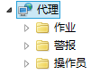

要进行作业管理，需要先创建作业环境，即创建一些系统表和系统视图来存储作业相关的对象、历史记录等信息。

系统表有 SYSJOBS、SYSJOBSTEPS、SYSJOBSCHEDULES、SYSMAILINFO、SYSJOBHISTORIES2、SYSSTEPHISTORIES2、SYSALERTHISTORIES、SYSOPERATORS、SYSALERTS 和 SYSALERTNOTIFICATIONS。系统视图有 USER\_JOBS\_VIEW、USER\_JOBSTEPS\_VIEW、USER\_JOBSCHEDULES\_VIEW、USER\_JOBHISTORIES\_VIEW、USER\_STEPHISTORIES\_VIEW。系统表和系统视图均位于 SYSJOB 模式下。下面一一详细介绍。

## 2.1 系统表和系统视图

### 2.1.1 SYSJOBS

SYSJOBS 系统表存储用户定义的作业信息。每一个作业对应此表中的一条记录。每一条记录都有一个自增 ID，用来唯一表示这个作业，同时这个作业还具有一个聚集关键字 NAME，这意味着作业不可以同名。仅拥有 SOI 角色权限的用户支持查询此表。

**语法如下：**

```
CREATE TABLE SYSJOB.SYSJOBS (
    ID                 INT IDENTITY(1,1),
    NAME             VARCHAR,
    ENABLE             INT,
    USERNAME         VARCHAR,
    CREATETIME         VARCHAR,
    MODIFYTIME         VARCHAR,
    ENABLE_EMAIL     INT,
    EMAIL_OPERID     INT,
    EMAIL_TYPE         INT,
    ENABLE_NETSEND     INT,
    NETSEND_OPERID     INT,
    NETSEND_TYPE     INT,
    VALID             CHAR,
    DESCRIBE         VARCHAR,
    SYS_FLAG         INTEGER,
    EP_SEQNO         INTEGER,
    RAFT_NAME       VARCHAR,
    CLUSTER PRIMARY KEY(NAME)
);
```

**参数详解**

- ID

作业 ID 号。一个作业只有唯一 一个 ID 号。

- NAME

作业名称。

- ENABLE

表示该作业是否被启用。1：是；0：否。

- USERNAME：

作业的创建者名称。也就是 SYSMAILINFO 表中的 LOGIN\_NAME 登录名。

- CREATETIME

作业的创建时间，由系统时间指定。

- MODIFYTIME

表示作业最后一次被修改的时间，由系统时间指定。

- ENABLE\_EMAIL、EMAIL\_OPERID、EMAIL\_TYPE

ENABLE\_EMAIL：表示作业是否开启邮件系统。1：是；0：否。如果开启，那么该作业相关的一些日志会通过邮件通知操作员；不开启就不会发送邮件。

EMAIL\_OPERID：指定操作员的 ID 号。如果开启了邮件通知功能，邮件会发送给该 ID 号的操作员。

EMAIL\_TYPE：表示如果在开启了邮件发送之后，在什么情况下发送邮件。取值范围：0、1、2。0 表示在作业执行成功后发送；1 表示在作业执行失败后发送；2 表示在作业执行完成后发送。

- ENABLE\_NETSEND、NETSEND\_OPERID、NETSEND\_TYPE

ENABLE\_NETSEND：表示作业是否开启网络发送。1：是；0：否。如果开启，那么这个作业相关的一些日志会通过网络发送通知操作员；如果不开启就不会通知。

NETSEND\_OPERID：如果开启了网络信息通知功能，则这个列指定通过网络发送来通知哪一个操作员，这里记录的是操作员 ID 号。

NETSEND\_TYPE：表示如果在开启了网络发送之后，在什么情况下发送网络信息。这个情况也有三种，和上面的 EMAIL\_TYPE 是完全一样的。

- VALID

表示作业是否完整。Y：是；N：否。没有配置的作业是不完整的。如果不完整，那么这个作业需要重新配置，使它的状态为完整。

- DESCRIBE

作业的描述信息。

- SYS\_FLAG

0：由系统过程函数创建的作业；1：系统内部创建的作业，例如 DM MPP 环境中非执行节点创建的作业；2：由 DBMS\_JOB 包创建的作业。

- EP\_SEQNO

作业的执行节点号。若指定的节点为非控制节点，且该节点故障，作业则在控制节点上执行。若指定的节点为控制节点，且该节点故障，DSC 集群会从剩下的正常节点中选取一个新的控制节点，作业在新的控制节点上执行。

- RAFT\_NAME

DPC 环境下，作业触发的 RAFT 组名。

### 2.1.2 SYSJOBSTEPS

SYSJOBSTEPS 系统表存储作业包括的所有步骤信息。每一行存储了某个作业的某个步骤的所有属性。这个表的聚集关键字为 JOBID 和步骤名，意味着在一个指定的作业下，不能有两个同名的步骤。仅拥有 SOI 角色权限的用户支持查询此表。

**语法如下：**

```
CREATE TABLE SYSJOB.SYSJOBSTEPS (
    ID                                 INT IDENTITY(1,1),
    NAME                             VARCHAR(8188),
    JOBID                             INT,
    SEQNO                             INT,
    TYPE                             INT,
    DBNAME                             VARCHAR,
    COMMAND                         TEXT,
    SUCC_ACTION                     INT,
    FAIL_ACTION                     INT,
    RETRY_ATTEMPTS                     INT,
    RETRY_INTERVAL                     INT,
    OUTPUT_FILE_PATH                VARCHAR(256),
    APPEND_FLAG                     INT,
    SUCC_NEXT_STEP                    VARCHAR(8188),
    FAIL_NEXT_STEP                    VARCHAR(8188),
    DESCRIBE                        VARCHAR(500),
    CLUSTER PRIMARY KEY(JOBID, NAME)
);
```

**参数详解**

- ID

步骤 ID 号。一个步骤唯一对应一个 ID 号。步骤 ID 号用来表示步骤的唯一性。

- NAME

步骤名称。必须是有效的标识符，同时不能是 DM 关键字。同一个作业不能有同名的步骤名称。

- JOBID

作业 ID 号。表示步骤属于 JOBID 号指定的作业，创建时这个作业必须存在才能创建成功。

- SEQNO

步骤在作业中的序列号。

- TYPE

步骤的类型。取值范围 0、1、2、3、4、5 和 6。说明如下：

0：表示执行一段 SQL 语句或者是语句块。

1：表示执行基于 V1.0 版本的备份还原（没有 WITHOUT LOG 和 PARALLEL 选项）。

2：表示重组数据库。

3：表示更新数据库的统计信息。

4：表示执行 DTS（数据迁移）。

5：表示执行基于 V1.0 版本的备份还原（有 WITHOUT LOG 和 PARALLEL 选项）。

6：表示执行基于 V2.0 版本的备份还原。

- DBNAME

表示步骤所属的数据库名（实例名），这是系统在创建一个步骤时指定的，也就是当前运行的数据库实例名。

- COMMAND

该列的值与步骤类型 TYPE 有关。在不同步骤类型下，该列的值就是步骤在运行时所执行的不同语句。

当 TYPE=0 时，这个列的值就是用户指定的要执行的 SQL 语句或者语句块，如果要指定多条语句，在语句之间必须用分号隔开。不支持多条 DDL 语句一起执行，否则在执行时可能会报出不可预知的错误信息。

当 TYPE 是 1、2、3、4、5 或 6 时，要执行的语句就是由系统内部根据不同类型生成的不同语句或者过程，生成时会用到上面的参数 DBNAME。

- SUCC\_ACTION

指定步骤执行成功后，下一步该做什么事。取值范围 0、1、2、3。说明如下：

0：表示不报告步骤执行成功，并结束作业。

1：表示报告步骤执行成功，并结束作业。

2：表示不报告步骤执行成功，并执行下一步。

3：表示报告步骤执行成功，并执行下一步。

SUCC\_ACTION 的值用两位二进制数来表示，低位为 0 表示不报告步骤结果，1 表示报告步骤结果；高位为 0 表示不执行下一步，1 表示执行下一步。

- FAIL\_ACTION

指定步骤执行失败后，下一步该做什么事。取值范围 0、1、2、3。说明如下：

0：表示不报告步骤执行失败，并结束作业。

1：表示报告步骤执行失败，并结束作业。

2：表示不报告步骤执行失败，并执行下一步。

3：表示报告步骤执行失败，并执行下一步。

FAIL\_ACTION 的值用两位二进制数来表示，低位为 0 表示不报告步骤结果，1 表示报告步骤结果；高位为 0 表示不执行下一步，1 表示执行下一步。

- RETRY\_ATTEMPTS

表示当步骤执行失败后，需要重试的次数。取值范围 0~99999。

- RETRY\_INTERVAL

表示在每两次步骤执行重试之间的间隔时间。取值范围 0~2147483647，单位秒。

- OUTPUT\_FILE\_PATH

表示步骤执行时输出文件的路径。这个路径必须是有效的。

- APPEND\_FLAG

输出文件的追写方式。如果指定输出文件，那么这个参数表示在写入文件时是否从文件末尾开始追写。1：是；0：否。如果是 0，那么从文件指针当前指向的位置开始追写。

- SUCC\_NEXT\_STEP

作业步骤执行成功时，下一步骤的名称。

- FAIL\_NEXT\_STEP

作业步骤执行失败时，下一步骤的名称。

- DESCRIBE

表示作业步骤的注释信息，最大值为 500 个字节。

### 2.1.3 SYSJOBSCHEDULES

一个作业可以有多个调度，调度用来指定一个作业的执行情况，可以指定作业的执行方式及时间范围。SYSJOBSCHEDULES 系统表存储作业的调度信息，聚集关键字为 JOBID 及调度名，意味着对于一个指定的作业，不能具有同名的调度。仅拥有 SOI 角色权限的用户支持查询此表。

**语法如下：**

```
CREATE TABLE SYSJOB.SYSJOBSCHEDULES (
    ID                         INT IDENTITY(1,1),
    NAME                     VARCHAR,
    JOBID                     INT,
    ENABLE                     INT,
    TYPE                     INT,
    FREQ_INTERVAL             INT,
    FREQ_SUB_INTERVAL         INT,
    FREQ_MINUTE_INTERVAL     INT,
    STARTTIME                 VARCHAR,
    ENDTIME                     VARCHAR,
    DURING_START_DATE         VARCHAR,
    DURING_END_DATE         VARCHAR,
    SCHNAME                 VARCHAR,
    TRIGNAME                 VARCHAR,
    VALID                     CHAR,
    DESCRIBE                 VARCHAR,
    CLUSTER PRIMARY KEY(JOBID, NAME)
);
```

**参数详解**

- ID

调度 ID 号。一个调度唯一对应一个 ID 号。调度 ID 号用来表示调度的唯一性。

- NAME

调度的名称。必须是有效的标识符，同时不能是 DM 关键字。一个作业不能创建两个同名的调度。

- JOBID

作业 ID 号。表示该调度属于 JOBID 号指定的作业。一个作业可以有多个调度。

- ENABLE

表示该调度是否启用。1：是；0：否。

- TYPE

调度的类型。表示指定的作业按什么类型来执行。取值范围 0、1、2、3、4、5、6、7、8、9。说明如下：

0：表示只执行一次。

1：表示按天的频率来执行。

2：表示按周的频率来执行。

3：表示在一个月的某一天执行。

4：表示在一个月的第一周第几天执行。

5：表示在一个月的第二周的第几天执行。

6：表示在一个月的第三周的第几天执行。

7：表示在一个月的第四周的第几天执行。

8：表示在一个月的最后一周的第几天执行。

9：表示由 dbms\_job 包创建的作业，此时 FREQ\_INTERVAL、FREQ\_SUB\_INTERVAL FREQ\_MINUTE\_INTERVAL 均置为-1

- FREQ\_INTERVAL

这个列的可选值与上面的不同调度类型有关。表示执行的频率。说明如下：

当 TYPE=0 时，取值为非负数，无实际意义。

当 TYPE=1 时，这个列表示每隔几天执行，值的有效范围为 1~100。

当 TYPE=2 时，这个列表示的是每隔几个星期执行，取值不小于 1。

当 TYPE=3 时，表示每几个月中的某一天执行，取值不小于 1。

当 TYPE 为 4、5、6、7 或 8 时，都表示每几个月的某一周执行，取值不小于 1。

当 TYPE=9 时，表示作业由 dbms\_job 包创建，间隔类型为表达式，值取-1。

- FREQ\_SUB\_INTERVAL

这个列的可选值与上面的不同调度类型有关。表示执行的频率，在 FREQ\_INTERVAL 基础上，继续指定更为精细的频率，当 TYPE 为 0-8 时，取值为非负数。说明如下：

当 TYPE=0 或 1 时，这个值没有实际意义。

当 TYPE=2 时，表示的是某一个星期的星期几执行，可以同时选中七天中的任意几天。取值范围 1~127。具体如何取值，请用户参考如下规则。因为每周有七天，所以 DM 用七位二进制来表示选中的日子。从最低位开始算起，依次表示周日、周一...周五、周六。选中周几，就将该位置 1，否则置 0。例如，选中周二和周六，7 位二进制就是 1000100，转化成十进制就是 68，所以 FREQ\_SUB\_INTERVAL 就取值 68。

当 TYPE=3 时，表示将在一个月的第几天执行，此时这个列的有效值范围为 1~31。

当 TYPE 为 4、5、6、7 或 8 时，都表示将在某一周内第几天执行，有效值为 1~7，分别表示从周日到周六。

当 TYPE=9 时，表示作业由 dbms\_job 包创建，间隔类型为表达式，值取-1。

- FREQ\_MINUTE\_INTERVAL

表示一天内每隔多少分钟执行一次。取值范围 0~1439，0 表示一天内执行一次。

其中通过 DBMS\_JOB 包创建的作业调度，FREQ\_MINUTE\_INTERVAL 字段可表示间隔多少分钟执行一次，也可表示间隔多少秒执行一次，具体如下：

FREQ\_MINUTE\_INTERVAL 取值大于 32768（即从低到高第 16 位值为 1 时），该字段表示间隔多少秒执行一次。FREQ\_MINUTE\_INTERVAL - 32768 结果为间隔秒数。间隔秒数取值范围 0~3599，0 表示一天内执行一次；

FREQ\_MINUTE\_INTERVAL 取值小于 32768（即从低到高第 16 位值为 0 时），该字段表示间隔多少分钟执行一次，含义同上。

当 TYPE=9 时，表示作业由 dbms\_job 包创建，间隔类型为表达式，值取-1。

- STARTTIME

定义作业调度的起始时间。

- ENDTIME

定义作业调度结束时间。

- DURING\_START\_DATE

指定作业被调度的有效日期范围的起始日期，必须是有效的日期字符串，不可以为空。

- DURING\_END\_DATE

指定作业被调度的有效日期范围的结束日期，可以为空。如果不为空，必须是有效的日期字符串，同时必须是在 DURING\_START\_DATE 日期之后。

- SCHNAME

表示调度对应的驱动触发器所属的数据库模式名。

- TRIGNAME

表示驱动触发器的触发器名。

- VALID

表示调度是否合法。Y：是；N：否。如果是 N，说明这个调度的配置是没有完成的，需要重新配置完成后才能起作用。

- DESCRIBE

表示调度的注释信息。

### 2.1.4 SYSJOBHISTORIES2

SYSJOBHISTORIES2 系统表存储作业的执行情况的日志。当一个作业执行完成后，会向这个表中插入一条作业执行情况的记录。

这个表中的所有记录都是由作业在运行过程中系统自动插入的，不是由用户来操作的。仅拥有 SOI 角色权限的用户支持查询此表。

**语法如下：**

```
CREATE TABLE SYSJOB.SYSJOBHISTORIES2 (
    EXEC_ID            BIGINT UNIQUE,
    NAME             VARCHAR,
    START_TIME         VARCHAR,
    END_TIME         VARCHAR,
    ERRCODE         INT,
    ERRINFO         VARCHAR(1024),
    HAS_NOTIFIED     INT,
    EP_SEQNO         INTEGER,
    RAFT_NAME       VARCHAR,
    JOBID           INTEGER,
    CLUSTER PRIMARY KEY(EXEC_ID, NAME)
    );
```

**参数详解**

- EXEC\_ID

作业执行的 ID 号。

- NAME

表示某一条历史记录是由哪一个作业产生，用作业名表示。

- START\_TIME

作业开始的时间。

- END\_TIME

作业结束的时间。

- ERRCODE

表示作业执行错误后，产生的错误码。

- ERRINFO

表示作业执行错误后，系统产生的错误描述信息。

- HAS\_NOTIFIED

表示这条历史记录是否已经（邮件及网络发送）通知用户。如果已通知则这个值为 1，未通知则为 0。

- EP\_SEQNO

表示本次作业执行所在的节点号。

- RAFT\_NAME

DMDPC 环境下，作业触发的 RAFT 组名。

- JOBID

作业的 ID。

### 2.1.5 SYSSTEPHISTORIES2

SYSSTEPHISTORIES2 系统表存储作业步骤的执行情况的日志。若在进行作业步骤设置时选择“报告结果”（即系统过程 SP\_ADD\_JOB\_STEP 的参数 SUCC\_ACTION 设置为 1 或 3，或者参数 FAIL\_ACTION 设置为 1 或 3，详情请参考 [4.1.2.3.1 增加步骤](job.md) ），则每当一个作业步骤执行完成时都会向这个表中插入一条作业步骤执行情况的记录。如果为重试步骤，RETRY\_ATTEMPTS 会记录重试的次数。仅拥有 SOI 角色权限的用户支持查询此表。

**语法如下：**

```
CREATE TABLE SYSJOB.SYSSTEPHISTORIES2(
    EXEC_ID         BIGINT,
    NAME             VARCHAR,
    STEPNAME         VARCHAR,
    START_TIME         VARCHAR,
    END_TIME         VARCHAR,
    ERRTYPE         INT,
    ERRCODE         INT,
    ERRINFO         VARCHAR(1024),
    RETRY_ATTEMPTS     INT,
    EP_SEQNO         INTEGER,
    RAFT_NAME       VARCHAR，
    JOBID           INTEGER,
    );
```

**参数详解**

- EXEC\_ID

作业执行的 ID 号。

- NAME

表示某一条历史记录是由哪一个作业产生，用作业名表示。

- STEPNAME

表示历史记录是由哪一个步骤产生的，用步骤名表示。

- START\_TIME

作业步骤开始的时间。

- END\_TIME

作业步骤结束的时间。

- ERRTYPE

这个列一般不用，现在都是 0。

- ERRCODE

表示作业步骤执行错误后，产生的错误码。

- ERRINFO

表示作业执行错误后，系统产生的错误描述信息。

- RETRY\_ATTEMPTS

表示这条历史记录是第几次重试时产生的，这个列记录其当前重试次数。

- EP\_SEQNO

表示作业步骤执行的节点号。

- RAFT\_NAME

DMDPC 环境下，作业触发的 RAFT 组名。

- JOBID

作业的 ID。

### 2.1.6 SYSOPERATORS

SYSOPERATORS 系统表存储作业管理系统中所有已定义操作员的信息，以 NAME 为聚集索引，意味着不能具有同名的操作员。仅拥有 SOI 角色权限的用户支持查询此表。

**语法如下：**

```
CREATE TABLE SYSJOB.SYSOPERATORS (
    ID                 INT IDENTITY(1,1),
    NAME             VARCHAR,
    ENABLE             INT,
    EMAILADDR         VARCHAR,
    NETSEND_IP         VARCHAR,
    CLUSTER PRIMARY KEY(NAME)
);
```

**参数详解**

- ID

操作员 ID 号。

- NAME

操作员的名称。

- ENABLE

表示操作员是否被启用。1：是；0：否。

- EMAILADDR

表示操作员的 EMAIL 地址。邮箱地址的长度不能超过 128 字节，必须包含且仅有 1 个 @ 字符，该 @ 字符不能位于邮箱地址的首尾处。@ 字符之前的部分是邮箱账号名，由字母（区分大小写）、数字以及 %、+、-、\_和.这些特殊字符组成；@ 字符之后的部分是域名，域名必须包含分隔符.，且分隔符.不能连续出现。域名字符只能由字母和数字组成，各级域名长度不能超过 63 字节，同时顶级域名长度不小于 2 字节且只能由字母组成，连字符-不能在各级域名的首尾，也不能出现连续 2 个连字符的情况。

- NETSEND\_IP

表示操作员所在的 IP 地址。

### 2.1.7 SYSALERTS

SYSALERTS 系统表存储作业管理系统中所有已定义的警报信息，聚集索引为 NAME，意味着不能定义同名的警报。仅拥有 SOI 权限的用户支持查询此表。

**语法如下：**

```
CREATE TABLE SYSJOB.SYSALERTS (
    ID                 INT IDENTITY(1,1),
    NAME             VARCHAR,
    ENABLE             INT,
    TYPE             INT,
    DBNAME             VARCHAR,
    ERRTYPE         INT,
    ERRCODE         INT,
    DELAYTIME         INT,
    ADDITION_TXT    VARCHAR,
    CLUSTER PRIMARY KEY(NAME)
);
```

**参数详解**

- ID

每一个警报都有一个唯一标识的 ID 号。

- NAME

警报名。

- ENABLE

警报是否开启。1：是；0：否。

- TYPE

警报的类型。取值范围 0 或 1。0 表示发生错误时警报；1 表示发生某些数据库事件时警报。

- DBNAME

警报所在的数据库实例名。

- ERRTYPE

触发警报类型：错误和数据库事件。与参数 TYPE 相关。

当 TYPE=0 时，ERRTYPE 表示触发警报的错误。取值范围 1~12。具体含义分别为：1：常规错误；2：启动错误；3：系统错误；4：服务器配置错误；5：分析阶段错误；6：权限错误；7：运行时错误；8：备份恢复错误；9：作业管理错误；10：数据库复制错误；11：其它错误；12：指定错误码。

当 TYPE=1 时，ERRTYPE 表示触发警报的数据库事件。取值范围 1~4。具体含义分别为：1：DDL 事件；2：授权回收事件；3：连接或断开数据库事件；4：数据库备份恢复事件。

- ERRCODE

指定错误码。错误码取值和参数 TYPE、ERRTYPE 相关。

当 TYPE=0、ERRTYPE=1~11 时，ERRCODE 无意义。

当 TYPE=0、ERRTYPE=12 时，指定各种错误类型相关的错误码，ERRCODE 必须是小于 0 的整数。

当 TYPE=1、ERRTYPE=1 时，指定 DDL 事件的错误码，ERRCODE 取值范围 1~15。如何取值，请参考如下规则：因为 DDL 事件包含 CREATE、ALTER、DROP 和 TRUNCATE 四种，所以此处的错误码是四种当中的任意几个组合值。ERRCODE 在 DM 数据库系统内部用四位二进制来表示它们的组合，从低位到高位依次是：CREATE、ALTER、 DROP、TRUNCATE。1 表示指定，0 表示不指定。用户输入的 ERRCODE 值需要转化为十进制。例如，指定 CREATE 和 DROP，内部二进制表示为 0101，转化为十进制为 5，所以 ERRCODE 值就是 5。

当 TYPE=1、ERRTYPE=2 时，指定授权回收事件的错误码，ERRCODE 取值范围：1、2、3。1 表示 GRANT 的错误码；2 表示 REVOKE 的错误码；3 表示 GRANT 和 REVOKE 的错误码。

当 TYPE=1、ERRTYPE=3 时，指定连接事件的错误码，取值范围：1、2、3。1 表示 LOGIN 的错误码；2 表示 LOGOUT 的错误码；3 表示 LOGIN 和 LOGOUT 的错误码。

当 TYPE=1、ERRTYPE=4 时，指定数据库备份恢复事件的错误码，取值范围：1、2、3。1 表示 BACKUP 的错误码；2 表示 RESTORE 的错误码；3 表示 BACKUP 和 RESTORE 的错误码。

- DELAYTIME

表示警报发生后，推迟多长时间通知操作员。取值范围 0~3600，单位秒。

- ADDITION\_TXT

表示警报的注释，最长为 500 个字节。

### 2.1.8 SYSALERTNOTIFICATIONS

SYSALERTNOTIFICATIONS 系统表存储警报需要通知的操作员的信息，即警报和操作员的关联信息。以 ALERTNAME 和 OPERID 为聚集关键字的，所以对于一个指定的警报和指定的操作员，它们只能有一个关联关系。仅拥有 SOI 角色权限的用户支持查询此表。

**语法如下：**

```
CREATE TABLE SYSJOB.SYSALERTNOTIFICATIONS(
    ALERTNAME             VARCHAR,
    OPERID                 INT,
    ENABLE_EMAIL         INT,
    ENABLE_NETSEND         INT,
    CLUSTER PRIMARY KEY(ALERTNAME, OPERID)
);
```

**参数详解**

- ALERTNAME

表示指定的警报名。

- OPERID

表示指定的操作员的 ID 号。

- ENABLE\_EMAIL

表示是否需要通过发邮件来通知。

- ENALE\_NETSEND

表示是否通过网络发送的方式来通知。只在 WINDOWS 早期版本（例如 WIN XP/2000）下才支持。

### 2.1.9 SYSALERTHISTORIES

SYSALERTHISTORIES 系统表存储警报发生的历史记录的日志。每个警报发生时都会向这个表中插入相应的记录，然后 Dmjmon 服务再通过扫描这个表把信息取出来通过邮件或者网络发送的方式通知关联的操作员，这个表中的所有信息都是在发生警报时，由系统自动向这个表中插入的。仅拥有 SOI 角色权限的用户支持查询此表。

**语法如下：**

```
CREATE TABLE SYSJOB.SYSALERTHISTORIES (
    ID                 INT IDENTITY(1,1),
    ALERTNAME         VARCHAR,
    EVENT_TYPE         INT,
    SUB_TYPE         INT,
    USERNAME         VARCHAR(128),
    DB_NAME         VARCHAR(128),
    OPTIME             VARCHAR(128),
    OPUSER             VARCHAR(128),
    SCH_NAME         VARCHAR(128),
    OBJ_NAME         VARCHAR(256),
    OBJ_TYPE         VARCHAR(128),
    GRANTEE_NAME     VARCHAR(256),
    ERRCODE         INT,
    HAS_NOTIFIED     INT DEFAULT 0,
    CLUSTER PRIMARY KEY(ID)
);
```

**参数详解**

- ID

每一条警报历史记录都有一个唯一标识为 ID 号。

- ALERTNAME

表示历史记录是由哪一个警报产生的。

- EVENT\_TYPE

表示历史记录的事件类型，与 SYSALERTS 表中的警报类型 TYPE 相关。如果 TYPE=0，则这个列的值也为 0；如果 TYPE=1，则这个值与 SYSALERTS 表中的列 ERRTYPE 值相对应。

- SUB\_TYPE

表示历史记录的事件子类型，与 SYSALERTS 表中的 TYPE 列相关。如果 TYPE=0，则这个列的值也为 0；如果 TYPE=1，则这个值与 SYSALERTS 表中的列 ERRCODE 相对应。

- USERNAME

当 TYPE 为 1 即发生数据库事件警报情况下，USERNAME 是当前用户；当 TYPE 为 0 即发生错误时警报情况下，USERNAME 表示创建警报的用户名，为 SYSDBA，与当前登录的用户无关，是拥有 SYSJOB 模式权限的用户，即 SYSDBA。

- DB\_NAME

表示警报所处的数据库实例名。

- OPTIME

表示警报发生时间。

- OPUSER

表示警报发生时当前的登录用户名。

- SCH\_NAME

表示触发警报的数据对象所属的模式名。

- OBJ\_NAME

表示触发警报的数据对象名。

- OBJ\_TYPE

表示触发警报的数据库对象类型。

- GRANTEE\_NAME

表示由授权或回收权限引起的警报的授权者或回收者名。

- ERRCODE

表示当警报定义的 TYPE 为错误时，发生错误时的错误码。

- HAS\_NOTIFIED

表示这条警报历史记录是否已经（邮件及网络发送）通知用户。如果已通知则这个值为 1，未通知则为 0。

### 2.1.10 SYSMAILINFO

SYSMAILINFO 系统表存储作业管理系统管理员的信息。每一个作业管理系统管理员对应这个表中的一条记录，登录用户名是唯一的，因为这个表是以第一列 LOGIN\_NAME 为聚集关键字的。此处的 LOGIN\_NAME 必须是 DM 数据库的登录用户名称。仅拥有 SOI 角色权限的用户支持查询此表。

**语法如下：**

```
CREATE TABLE SYSJOB.SYSMAILINFO (
    LOGIN_NAME             VARCHAR(128) NOT NULL,
    LOGIN_PWD             VARCHAR(1024),
    SMTP_SERVER         VARCHAR(256) NOT NULL,
    EMAIL                 VARCHAR(256) NOT NULL,
    USER_NAME             VARCHAR(128) NOT NULL,
    USER_PWD             VARCHAR(1024) NOT NULL,
    CLUSTER PRIMARY KEY(LOGIN_NAME)
);
```

**参数详解**

- LOGIN\_NAME

监控服务管理员的名称。

- LOGIN\_PWD

加密存储的管理员登录密码。该字段仅作兼容使用，实际不进行填充。

- EMAIL

这个列表示在开启邮件系统后，给管理员发邮件时用到邮件的地址。

- SMTP\_SERVER

邮件地址对应的 SMTP 服务器地址。这个地址必须要与 EMAIL 地址相对应，如果没有对应，则邮件不能成功发送。

- USER\_NAME

这个列表示的是在发送邮件时，对 SMTP 服务器进行验证的邮件用户名，如果验证成功才能成功发送邮件。

- USER\_PWD

这个列与上面的邮件用户名相对应，为邮箱的登录密码，以密文形式存储。若想获取明文信息，请参考 [6.1.1.4 获取管理员信息](monitoring-job.md) 。

### 2.1.11 USER\_JOBS\_VIEW

USER\_JOBS\_VIEW 视图存储当前用户定义的作业信息，字段含义和 SYSJOBS 表一样。

### 2.1.12 USER\_JOBSTEPS\_VIEW

USER\_JOBSTEPS\_VIEW 视图存储当前用户作业包括的所有步骤信息，字段含义和 SYSJOBSTEPS 表一样。

### 2.1.13 USER\_JOBSCHEDULES\_VIEW

USER\_JOBSCHEDULES\_VIEW 视图存储当前用户作业的调度信息，字段含义和 SYSJOBSCHEDULES 表一样。

### 2.1.14 USER\_JOBHISTORIES\_VIEW

USER\_JOBHISTORIES\_VIEW 视图存储当前用户作业的执行情况的日志，字段含义和 SYSJOBHISTORIES2 表一样。

### 2.1.15 USER\_STEPHISTORIES\_VIEW

USER\_STEPHISTORIES\_VIEW 视图存储当前用户作业步骤的执行情况的日志，字段含义和 SYSSTEPHISTORIES2 表一样。

## 2.2 管理系统表和系统视图

创建和删除作业相关系统表和系统视图可以通过以下两种方式来实现。一是通过系统过程 SP\_INIT\_JOB\_SYS 来实现；二是通过图形化客户端 MANAGER 管理工具实现。用户选择其中的一种即可。

### 2.2.1 通过系统过程创建和删除

用户可以通过调用系统过程 SP\_INIT\_JOB\_SYS(1)来创建这些表和视图。这些表被建在 SYSJOB 模式下。SP\_INIT\_JOB\_SYS(1)除了创建 2.1 节中介绍的表和视图之外，还会创建一张系统表 SYSJOBHISTORIES，此表只是为了兼容 DM8 之前的版本，与 DM8 无关，本文不做介绍。

创建 SYSJOB 模式、系统表和系统视图的语句。

**语法如下：**

```
SP_INIT_JOB_SYS(1);
```

删除 SYSJOB 模式、系统表和系统视图的语句。

**语法如下：**

```
SP_INIT_JOB_SYS(0);
```

### 2.2.2 通过图形化客户端创建和删除

在 DM MANAGER 管理工具中，右击 **代理** 。如下所示：

图2.1 创建代理界面

点击 **创建代理环境** ，即可创建代理环境成功。创建成功后，会增加 SYSJOB 模式（含系统表）；同时， **代理** 下拉菜单中出现：作业、警报和操作员。如下所示：



图2.2 创建成功的代理界面

点击 **清理代理环境** ，是 **创建代理环境** 的相反步骤。会删除和作业相关的一切信息。