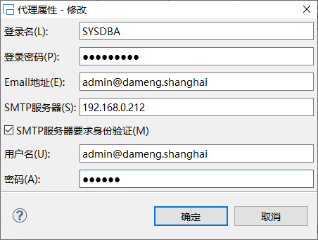
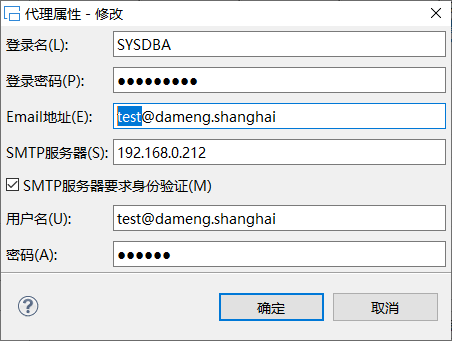
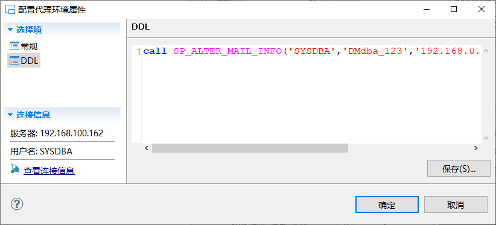
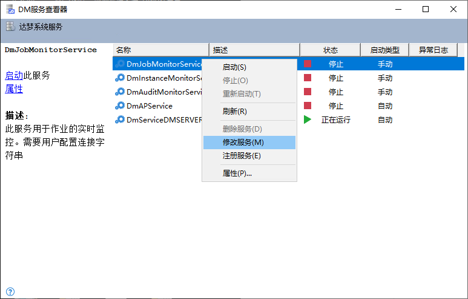
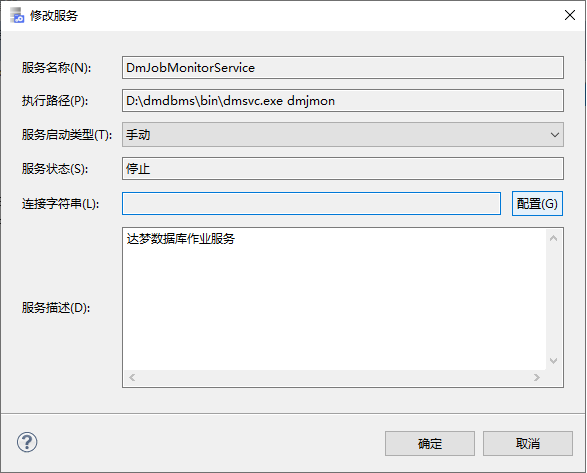
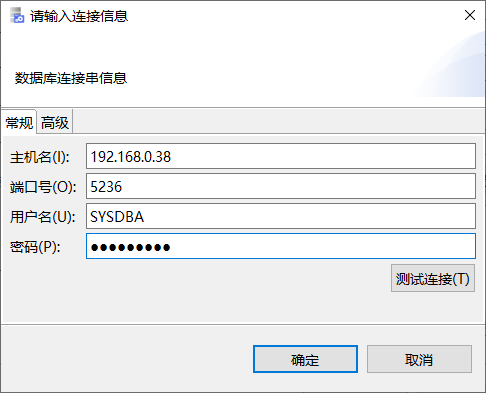

监控作业是指把作业的运行情况通过电子邮件发送给监控服务管理员。邮件成功发送的前提有两个：一是为监控服务配置管理员；二是开启监控服务。

## 6.1 配置监控服务管理员

配置管理员可以通过两种方式实现。一是通过系统过程来实现；二是通过图形化客户端 MANAGER 管理工具实现。用户选择其中的一种即可。

添加成功后，SYSMAILINFO 表中会相应增加一条记录。

### 6.1.1 通过系统过程实现

通过系统过程可以添加、修改和删除管理员。

#### 6.1.1.1 添加管理员

可以通过 SP\_ADD\_MAIL\_INFO 来添加监控服务管理员。对于仅拥有 ADMIN JOB 权限的用户，只能将自己添加为监控服务管理员；对于拥有 DBA 角色的用户，可以将所有用户添加为监控服务管理员。

**语法如下：**

```
SP_ADD_MAIL_INFO (
    login_name         varchar(128),
    login_pwd         varchar(128),
    smtp_server     varchar(128),
    email             varchar(128),
    user_name         varchar(128),
    user_pwd         varchar(128)
)
```

**参数详解**

- login\_name

监控服务管理员名称。必须是有效的数据库登录用户名。不能有同名管理员，如果创建同名管理员，系统会报错。此参数不能为空。

- login\_pwd

监控服务管理员登录时的密码，密码长度不能超过 48。

- smtp\_server

登录时指定的邮件 SMTP 服务器，必须是有效的 SMTP 服务器地址，否则无法发送电子邮件。若 SMTP\_SERVER、EMAIL、USER\_NAME、USER\_PWD 这四个参数其中一个为空或者为空串，系统自动将四个参数全部置为空串。

- email

邮件地址，用户的电子邮件地址，使用该用户去 SMTP 服务器认证。若 SMTP\_SERVER、EMAIL、USER\_NAME、USER\_PWD 这四个参数其中一个为空或者为空串，系统自动将四个参数全部置为空串。

- user\_name

邮件用户名（和邮件地址写法要完全一样）。若 SMTP\_SERVER、EMAIL、USER\_NAME、USER\_PWD 这四个参数其中一个为空或者为空串，系统自动将四个参数全部置为空串。

- user\_pwd

邮箱登录密码，用户在 SMTP 服务的密码。若 SMTP\_SERVER、EMAIL、USER\_NAME、USER\_PWD 这四个参数其中一个为空或者为空串，系统自动将四个参数全部置为空串。

例 增加一个监控服务管理员 DMJMON 的信息。

```
SP_ADD_MAIL_INFO('SYSDBA','DMdba_123','192.168.0.212','gyf@dameng.shanghai','gyf@dameng.shanghai','******');
```

> **注意**
> 
> 监控服务管理员名称login\_name，必须是有效的数据库登录用户

#### 6.1.1.2 修改管理员

如果希望修改某个监控服务管理员的信息，可以通过 SP\_ALTER\_MAIL\_INFO 来实现。对于仅拥有 ADMIN JOB 权限的用户，只能修改自身的监控服务管理员信息；对于拥有 DBA 角色的用户，可以修改所有监控服务管理员的信息。

**语法如下：**

```
SP_ALTER_MAIL_INFO (
    login_name         varchar(128),
    login_pwd         varchar(128),
    smtp_server     varchar(128),
    email             varchar(128),
    user_name         varchar(128),
    user_pwd         varchar(128)
)
```

**参数详解**

- login\_name

监控服务管理员名称，必须是有效的数据库登录名。不能有同名管理员，如果创建同名管理员，系统会报错。此参数不能为空。

- login\_pwd

监控服务管理员登录时的密码，密码长度不能超过 48。

- smtp\_server

登录时指定的邮件 SMTP 服务器，必须是有效的 SMTP 服务器地址，否则无法发送电子邮件。若 SMTP\_SERVER、EMAIL、USER\_NAME、USER\_PWD 这四个参数其中一个为空或者为空串，系统自动将四个参数全部置为空串。

- email

用户的邮件地址，使用该地址去 SMTP 服务器认证。若 SMTP\_SERVER、EMAIL、USER\_NAME、USER\_PWD 这四个参数其中一个为空或者为空串，系统自动将四个参数全部置为空串。

- user\_name

邮件用户名，必须保证该用户名可以在 SMTP 服务器认证。若 SMTP\_SERVER、EMAIL、USER\_NAME、USER\_PWD 这四个参数其中一个为空或者为空串，系统自动将四个参数全部置为空串。

- user\_pwd

邮箱登录密码，用户在 SMTP 服务的密码。若 SMTP\_SERVER、EMAIL、USER\_NAME、USER\_PWD 这四个参数其中一个为空或者为空串，系统自动将四个参数全部置为空串。

例 修改监控服务管理员 DMJMON 的信息。

```
SP_ALTER_MAIL_INFO('SYSDBA','DMdba_123','192.168.0.212','admin@dameng.shanghai','admin@dameng.shanghai','******');
```

#### 6.1.1.3 删除管理员

如果需要删除一个监控服务管理员，可以通过 SP\_DROP\_MAIL\_INFO 来实现，删除后则该管理员失效，不会再向该管理员发送信息。对于仅拥有 ADMIN JOB 权限的用户，只能删除自身的监控服务管理员信息；对于拥有 DBA 角色的用户，可以删除所有监控服务管理员的信息。

**语法如下：**

```
SP_DROP_MAIL_INFO (
    login_name varchar(128)
)
```

**参数详解**

- login\_name

待删除的监控服务管理员名称，此参数不能为空。

例 删除监控服务管理员 SYSDBA 的信息。

```
SP_DROP_MAIL_INFO ('SYSDBA');
```

#### 6.1.1.4 获取管理员信息

管理员信息保存在 SYSMAILINFO 表中，可通过查询 SYSMAILINFO 表来获取管理员信息。其中直接查询表获得的管理员信息中的 USER\_PWD 经过加密处理，用户可通过 SF\_GET\_MAIL\_INFO\_USER\_PWD 获取密码的明文信息。

DBA 用户可以获取所有 LOGIN\_NAME 用户的 USER\_PWD 明文；拥有 ADMIN\_JOB 的非 DBA 用户只能获取当前登录用户的 USER\_PWD 明文。

1. **SF\_GET\_MAIL\_INFO\_USER\_PWD**

**语法如下：**

```
SF_GET_MAIL_INFO_USER_PWD ( 
    LOGIN_NAME           VARCHAR(128) 
)
```

**参数详解**

- LOGIN\_NAME

待获取信息的监控服务管理员名称，此参数不能为空。

```
例 获取SYSDBA用户的USER_PWD明文密码。
```
```
SQL> SELECT SF_GET_MAIL_INFO_USER_PWD('SYSDBA') FROM DUAL;
```

查询结果如下：

```
行号       SF_GET_MAIL_INFO_USER_PWD('SYSDBA')
---------- -----------------------------------
1          888888
```

### 6.1.2 通过图形化客户端实现

通过 DM MANAGER 管理工具添加、修改和删除管理员。

#### 6.1.2.1 添加管理员

右击 **代理** 。选中 **配置代理属性** ，出现如下框体：

图6.1 配置代理环境属性界面

在 **常规** 界面，点击 **添加** 按钮，即可添加管理员。如果不勾选 SMTP 服务器要求身份验证，则用户名和密码不起作用。添加窗口如下：



图6.2 代理属性-新建界面

#### 6.1.2.2 修改管理员

选中要修改的管理员，点击 **编辑** 按钮，就可以修改管理员信息。不需要修改的不用动。例如，修改了 SYSDBA 的 Email 地址和用户名。



图6.3 代理属性-修改界面

#### 6.1.2.3 删除管理员

选中要删除的管理员，点击 **删除** 按钮，就可以完成删除。

#### 6.1.2.4 DDL

显示添加管理员的 SQL 语句。



图6.4 配置代理环境属性-DDL界面

## 6.2 开启监控服务

开启监控服务有两种方式：通过图形化客户端启动和通过命令行工具启动。用户选择其中一种方式即可。

### 6.2.1 通过图形化客户端启动

在成功安装了 DM 服务器程序后，用户在 Windows 系统下可以通过点击“开始”菜单选择“程序”－“达梦数据库”－“DM 服务查看器”菜单项启动数据库服务对话框，根据服务列表对相应的数据库服务进行操作，如图 6.5 所示。同样用户在 Linux 下如果使用 root 安装 DM 数据库，也会在菜单栏生成快捷方式，GNOME 桌面环境下点击 Application、KDE 桌面环境下点击 K，选择“达梦数据库”－“DM 服务查看器”来启动数据库服务对话框。

DmJobMonitorService 是监控作业的服务。监控服务的配置如下：

第一步，打开 **DM 服务查看器** ，右键点击 **DmJobMonitorService** ，选择 **修改服务** 。



图6.5 DM服务查看器界面

第二步，在修改服务界面，点击 **连接字符串** 右侧的 **配置** 按钮。



图6.6 修改服务界面

第三步，输入将要用到的主库名、端口号、监控服务管理员的用户名和密码。此处的管理员必须是 6.1 节中添加成功的管理员，即表 SYSMAILINFO 中可以查询到的。例如，主库名 192.168.0.38，端口号 5236，用户名 SYSDBA，密码 DMdba\_123。



图6.7 输入连接信息界面

至此，DMJMON 监控服务配置完成。

### 6.2.2 通过命令行工具启动

dmjmon 是启动作业监控服务的命令行工具。

进入 DM 安装目录下的 bin 目录，直接打开应用程序 dmjmon 就可以启动监控服务。

**语法如下：**

```
dmjmon userid=DM <username>[\<password>][@<server>][:<port>][##<sslpath>@ssl_pwd]
```

**参数详解**

- \<username>

指定数据库的用户名。缺省用户名为 SYSDBA。

- \<password>

指定数据库的密码。

- \<server>

指定服务器的 IP 地址或是在 dm\_svc.conf 中配置的网络服务名。

- \<sslpath>@ssl\_pwd

通信加密中客户端证书存放的地址和客户端证书密钥。各用户只能使用自己的证书，例如 SYSDBA 账户只能使用\\bin\\CLIENT\_SSL\\SYSDBA 下的证书和密码，如果证书没有密码可以缺省或使用任意数字代替。

例 开启作业监控服务器。

```
./dmjmon userid=SYSDBA/DMdba_123@192.168.0.38:5236
```