## 一、前言

DMDPC 是基于达梦数据库管理系统研发的一款同时支持在线分析处理和在线事务处理的新型分布式数据库系统。它既具备传统单机数据库的绝大部分功能，又提供了分布式计算集群才拥有的高可用、高扩展、高性能、高吞吐量和对用户透明等高级特性。

DPC 集群可通过 DEM 与命令行的方式搭建，考虑到 DPC 集群节点较多，使用命令行的方式搭建较为繁琐与不便，本文主要针对 DEM 工具对 DPC 集群安装部署进行介绍。

## 二、环境规划

### 2.1 软件规划

| 软件类型 | 版本 |
| --- | --- |
| 数据库软件 | 2023 年第二季度版 |

### 2.2 网络规划

<table><thead><tr><td colspan="1">机器名</td><td>IP（业务网）</td><td>IP（心跳网）</td><td>节点类型</td><td>网络要求</td></tr></thead><tbody><tr><td>DPC-MP-A</td><td>192.168.164.6</td><td>192.168.164.6</td><td>MP节点、SP节点</td><td rowspan="7">本次部署以业务网与心跳网共用为例，生产环境需要分开使用万兆网，并且均需要采用双网口绑定的方式，绑定模式为主备，两两绑定的网口不在一条pcie通道上。</td></tr><tr><td>DPC-MP-B</td><td>192.168.164.7</td><td>192.168.164.7</td><td>MP节点、SP节点</td></tr><tr><td>DPC-MP-C</td><td>192.168.164.8</td><td>192.168.164.8</td><td>MP节点、SP节点</td></tr><tr><td>DPC-BP-1</td><td>192.168.164.9</td><td>192.168.164.9</td><td>BP节点</td></tr><tr><td>DPC-BP-2</td><td>192.168.164.11</td><td>192.168.164.11</td><td>BP节点</td></tr><tr><td>DPC-BP-3</td><td>192.168.164.12</td><td>192.168.164.12</td><td>BP节点</td></tr><tr><td>DPC-BP-4</td><td>192.168.164.13</td><td>192.168.164.13</td><td>BP节点</td></tr></tbody></table>

### 2.3 集群规划

DMDPC 集群规划部署 6 个 SP，4 个 BP 和 1 个 MP。其中，每个 MP 和 BP 节点均带两个副本。集群架构图如下所示：MP 及其两个副本分别部署在物理 1 至 3 上；SP1 与 SP4 部署在物理机 1 上，SP2 与 SP5 部署在物理机 2 上，SP3 与 SP6 部署在物理机 3 上；BP 节点及其副本交叉部署在物理机 4-7 上，如 BP1\_A 部署于物理机 4，BP1\_A 的两个副本 BP1\_B 与 BP1\_C 分别部署在物理机 5 与物理机 6，剩余 BP 节点以此类推。

#### 2.3.1 实例规划

目录及大小：

<table><thead><tr><td colspan="1">目录类型</td><td>路径</td><td>大小</td><td>备注</td></tr></thead><tbody><tr><td>软件安装目录</td><td>/dmsoft</td><td rowspan="4">600G</td><td rowspan="4">*号部分为实例名</td></tr><tr><td>MP 实例目录</td><td>/dm/MP/</td></tr><tr><td>SP 实例目录</td><td>/dm/SP/</td></tr><tr><td>ARCH 目录</td><td>/dm/MP/dmdpc/MP_*/DAMENG/arch</td></tr><tr><td>CORE 文件目录</td><td>/var/log/dm/core/</td><td>1.5T</td><td rowspan="10">根据实际情况分配</td></tr><tr><td rowspan="3">BP_A、BP_B 及 BP_C 实例目录</td><td>/dm/bp_a</td><td rowspan="3">60T</td></tr><tr><td>/dm/bp_b</td></tr><tr><td>/dm/bp_c</td></tr><tr><td rowspan="3">BP_A、BP_B、BP_C redo日志目录</td><td>/dmredo/bp_a</td><td rowspan="3">150G</td></tr><tr><td>/dmredo/bp_b</td></tr><tr><td>/dmredo/bp_c</td></tr><tr><td rowspan="3">BP_A、BP_B、BP_C 归档日志目录</td><td>/dmarch/bp_a</td><td rowspan="3">1.5T</td></tr><tr><td>/dmarch/bp_b</td></tr><tr><td>/dmarch/bp_c</td></tr></tbody></table>

实例相关参数：

<table><tbody><tr><td>页大小</td><td>32</td></tr><tr><td>簇大小</td><td>32</td></tr><tr><td>端口</td><td>SP：5230、5231<br>MP：5220<br>BP：5240、5241、5242</td></tr><tr><td>字符集</td><td>GB18030</td></tr><tr><td>结尾空格填充模式是否兼容ORACLE</td><td>1</td></tr><tr><td>大小写是否敏感</td><td>1</td></tr><tr><td>是否生成HUGE表REDO日志</td><td>1</td></tr><tr><td>temp</td><td>MP/SP 400G<br>BP 400G</td></tr><tr><td rowspan="2">redo 日志大小</td><td>MP: 1024M*2/每节点</td></tr><tr><td>BP: 1024M*5/每节点</td></tr><tr><td rowspan="2">归档日志大小及上限</td><td>MP: 128M 51200M上限 /每节点</td></tr><tr><td>BP: 1024M 409600M 上限/每节点</td></tr></tbody></table>

#### 2.3.2 详细规划

同一类型的实例初始端口号要一致：

<table><thead><tr><td colspan="1">机器名</td><td>角色</td><td>实例名</td><td>实例端口</td><td>AP_PORT</td><td>路径</td></tr></thead><tbody><tr><td rowspan="4">DPC-MP-A</td><td rowspan="2">MP</td><td rowspan="2">MP_A</td><td rowspan="2">5220</td><td rowspan="2">1620</td><td>实例：/dm/MP/dmdpc/MP_A</td></tr><tr><td>归档：/dm/MP/dmdpc/MP_A/DAMENG/arch</td></tr><tr><td rowspan="2">SP</td><td>SP1</td><td>5230</td><td>1630</td><td>实例：/dm/SP/dmdpc/SP1</td></tr><tr><td>SP4</td><td>5231</td><td>1631</td><td>实例：/dm/SP/dmdpc/SP4</td></tr><tr><td rowspan="4">DPC-MP-B</td><td rowspan="2">MP</td><td rowspan="2">MP_B</td><td rowspan="2">5220</td><td rowspan="2">1620</td><td>实例：/dm/MP/dmdpc/MP_B</td></tr><tr><td>归档：/dm/MP/dmdpc/MP_B/DAMENG/arch</td></tr><tr><td rowspan="2">SP</td><td>SP2</td><td>5230</td><td>1630</td><td>实例：/dm/SP/dmdpc/SP2</td></tr><tr><td>SP5</td><td>5231</td><td>1631</td><td>实例：/dm/SP/dmdpc/SP5</td></tr><tr><td rowspan="4">DPC-MP-C</td><td rowspan="2">MP</td><td rowspan="2">MP_C</td><td rowspan="2">5220</td><td rowspan="2">1620</td><td>实例：/dm/MP/dmdpc/MP_C</td></tr><tr><td>归档：/dm/MP/dmdpc/MP_C/DAMENG/arch</td></tr><tr><td rowspan="2">SP</td><td>SP3</td><td>5230</td><td>1630</td><td>实例：/dm/SP/dmdpc/SP3</td></tr><tr><td>SP6</td><td>5231</td><td>1631</td><td>实例：/dm/SP/dmdpc/SP6</td></tr><tr><td rowspan="9">dpc-bp-1</td><td rowspan="9">BP</td><td rowspan="3">BP1_A</td><td rowspan="3">5240</td><td rowspan="3">1640</td><td>实例：/dm/bp_a/dmdpc/BP1_A</td></tr><tr><td>redo: /dmredo/bp_a/</td></tr><tr><td>归档：/dmarch/bp_a/</td></tr><tr><td rowspan="3">BP4_B</td><td rowspan="3">5241</td><td rowspan="3">1641</td><td>实例：/dm/bp_b/dmdpc/BP4_B</td></tr><tr><td>redo: /dmredo/bp_b/</td></tr><tr><td>归档：/dmarch/bp_b/</td></tr><tr><td rowspan="3">BP3_C</td><td rowspan="3">5242</td><td rowspan="3">1642</td><td>实例：/dm/bp_c/dmdpc/BP3_C</td></tr><tr><td>redo: /dmredo/bp_c/</td></tr><tr><td>归档：/dmarch/bp_c/</td></tr><tr><td rowspan="9">dpc-bp-2</td><td rowspan="9">BP</td><td rowspan="3">BP2_A</td><td rowspan="3">5240</td><td rowspan="3">1640</td><td>实例：/dm/bp_a/dmdpc/BP2_A</td></tr><tr><td>redo: /dmredo/bp_a/</td></tr><tr><td>归档：/dmarch/bp_a/</td></tr><tr><td rowspan="3">BP1_B</td><td rowspan="3">5241</td><td rowspan="3">1641</td><td>实例：/dm/bp_b/dmdpc/BP1_B</td></tr><tr><td>redo: /dmredo/bp_b/</td></tr><tr><td>归档：/dmarch/bp_b/</td></tr><tr><td rowspan="3">BP4_C</td><td rowspan="3">5242</td><td rowspan="3">1642</td><td>实例：/dm/bp_c/dmdpc/BP4_C</td></tr><tr><td>redo: /dmredo/bp_c/</td></tr><tr><td>归档：/dmarch/bp_c/</td></tr><tr><td rowspan="9">dpc-bp-3</td><td rowspan="9">BP</td><td rowspan="3">BP3_A</td><td rowspan="3">5240</td><td rowspan="3">1640</td><td>实例：/dm/bp_a/dmdpc/BP3_A</td></tr><tr><td>redo: /dmredo/bp_a/</td></tr><tr><td>归档：/dmarch/bp_a/</td></tr><tr><td rowspan="3">BP2_B</td><td rowspan="3">5241</td><td rowspan="3">1641</td><td>实例：/dm/bp_b/dmdpc/BP2_B</td></tr><tr><td>redo: /dmredo/bp_b/</td></tr><tr><td>归档：/dmarch/bp_b/</td></tr><tr><td rowspan="3">BP1_C</td><td rowspan="3">5242</td><td rowspan="3">1642</td><td>实例：/dm/bp_c/dmdpc/BP1_C</td></tr><tr><td>redo: /dmredo/bp_c/</td></tr><tr><td>归档：/dmarch/bp_c/</td></tr><tr><td rowspan="9">dpc-bp-4</td><td rowspan="9">BP</td><td rowspan="3">BP4_A</td><td rowspan="3">5240</td><td rowspan="3">1640</td><td>实例：/dm/bp_a/dmdpc/BP4_A</td></tr><tr><td>redo: /dmredo/bp_a/</td></tr><tr><td>归档：/dmarch/bp_a/</td></tr><tr><td rowspan="3">BP3_B</td><td rowspan="3">5241</td><td rowspan="3">1641</td><td>实例：/dm/bp_b/dmdpc/BP3_B</td></tr><tr><td>redo: /dmredo/bp_b/</td></tr><tr><td>归档：/dmarch/bp_b/</td></tr><tr><td rowspan="3">BP2_C</td><td rowspan="3">5242</td><td rowspan="3">1642</td><td>实例：/dm/bp_c/dmdpc/BP2_C</td></tr><tr><td>redo: /dmredo/bp_c/</td></tr><tr><td>归档：/dmarch/bp_c/</td></tr></tbody></table>

## 三、安装前系统调整

### 3.1 操作系统时间检查

操作系统时间不正确会导致产生以下问题：

1. 试用授权产品，会导致试用授权过期，无法使用；
2. 集群自动切换场景，可能会导致集群检测节点服务异常，引发误切换；
3. 数据库运行日志、数据库服务日志、归档日志、备份集等时间记录错误，会导致相关分析和排查工作难度增大。

操作系统时间修改命令如下：

```shell
##手动修改时间方法
date -s "yyyy-mm-dd HH:MM:SS"
##修改后需要复核，执行date -s查看。
```

### 3.2 创建用户和组

```shell
##创建安装用户组dinstall
groupadd -g 12349 dinstall
##在dinstall组内创建安装用户dmdba
useradd -u 12345 -g dinstall -m -d /home/dmdba -s /bin/bash dmdba
##修改密码
passwd dmdba
```

### 3.3 防火墙策略要求

端口对应服务外部无法访问，无法安装集群产品。修改命令如下：

```shell
防火墙的关闭与开启。
##关闭防火墙
[root@~]# systemctl stop firewalld
##关闭开机自启
[root@~]# systemctl disable firewalld

若实际操作中禁止关闭防火墙，可通过添加端口到白名单。
##查看防火墙端口开放情况：
firewall-cmd --zone=public --list-ports##redhat 6
iptables -L
```

### 3.4 磁盘调度算法

要求磁盘调度算法采用 deadline。

```shell
##查看
cat /sys/block/sd*/queue/scheduler
##如果不是deadline，需要按如下步骤进行调整：
vim /lib/udev/rules.d/60-block-scheduler.rules
修改为mq-deadline
##重启后生效
```

### 3.5 操作系统资源限制

```shell
vi /etc/security/limits.conf
##增加下述内容
dmdba  soft      nice       0
dmdba  hard      nice       0
dmdba  soft      as         unlimited
dmdba  hard      as         unlimited
dmdba  soft      fsize      unlimited
dmdba  hard      fsize      unlimited
dmdba  soft      nproc      131072
dmdba  hard      nproc      131072
dmdba  soft      nofile     131072
dmdba  hard      nofile     131072
dmdba  soft      core       unlimited
dmdba  hard      core       unlimited
dmdba  soft      data       unlimited
dmdba  hard      data       unlimited
dmdba  soft      memlock    unlimited
dmdba  hard      memlock    unlimited
```

### 3.6 操作系统内存参数检查

操作系统内存参数需设置为 0。

```shell
##查看
cat /proc/sys/vm/overcommit_memory
##如果不是0，需要按如下步骤进行调整：
vim /etc/sysctl.conf
修改vm.overcommit_memory=0
kernel.core_pattern=/var/log/dm/core/
执行sysctl -p 使配置文件生效
```

## 四、使用 DEM 搭建 DPC 集群

在正式部署 DPC 集群之前，建议先完成达梦数据库企业管理器（DEM）的安装和配置。DEM 的安装步骤和细节可以参考 [达梦企业管理器 DEM](tool-monitor.md) 。在本示例中，已将 DEM 安装在 IP 地址为 192.168.164.10 的机器上，以确保后续 DPC 集群的顺利搭建和管理。由于 DEM 版本可能存在差异，因此操作界面可能有所不同。请根据您实际使用的 DEM 版本进行相应的操作和调整。

### 4.1 登录 DEM

1. 打开 DEM 企业管理器，选择【集群管理】->【新建】。

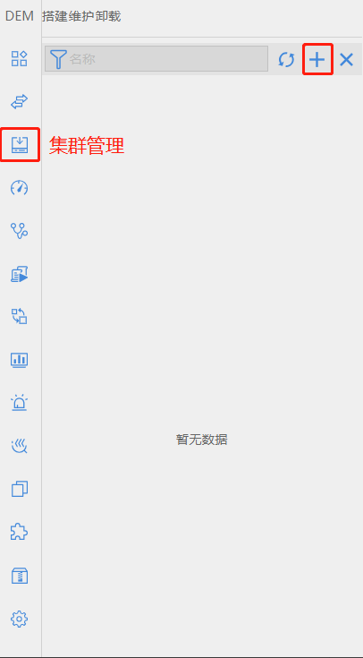

2. 输入搭建集群的名称【DPC】，为便于区分可简单编辑集群搭建描述，用户根据需要决定是否编辑即可，输入集群名称后，点击【确定】进入下一界面。

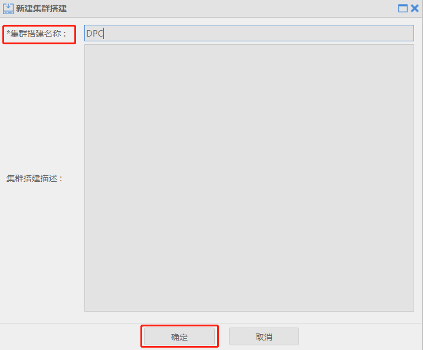

3. 选择集群类型为【分布式】，然后点击【下一步】进入下一界面。

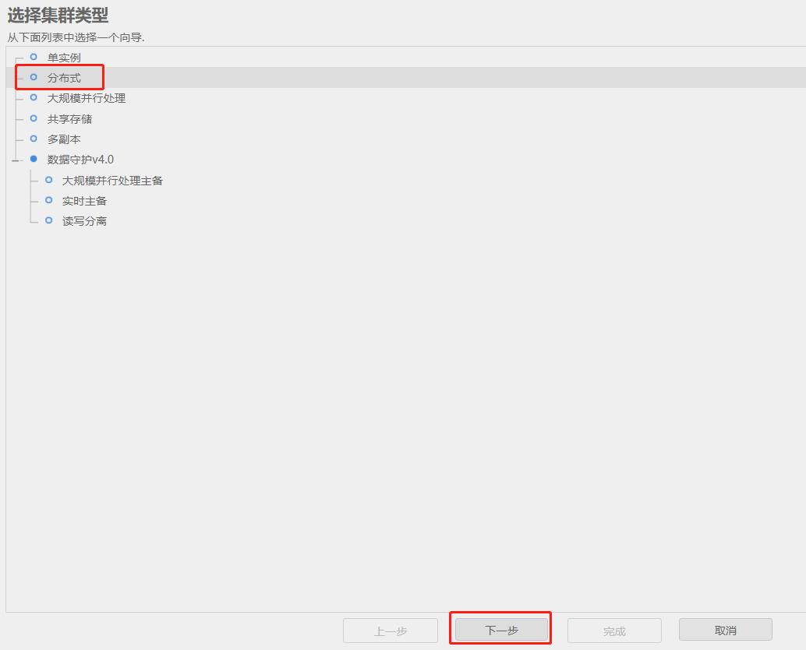

### 4.2 环境准备

1. 在此处确定 DPC 集群搭建的节点。在确定节点之前，需要在节点所在服务器上配置好 DEM 和 dmagent。以下 192.168.164.10 机器上已配置 DEM，剩余七台机器仅需配置 dmagent 即可。
2. 确认完成集群部署的主机后选择【下一步】。

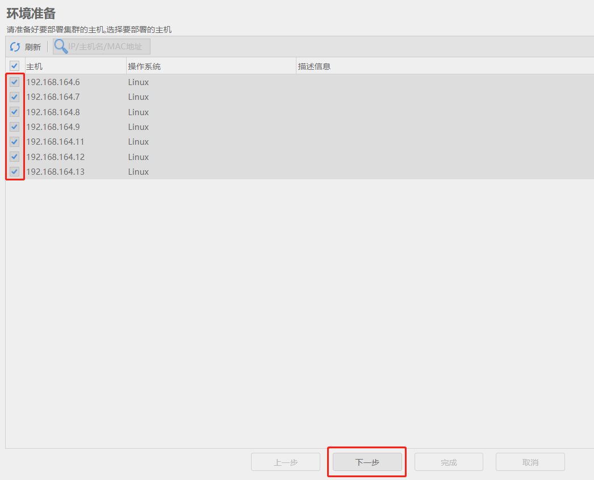

### 4.3 实例规划

在实例规划开始前，建议取消勾选【独立执行码】功能项，单个节点上所有实例共用一份执行码。实际生产环境建议取消勾选【创建混合表空间】选项，若后续需要可手工添加。选中【创建混合表空间】选项，可用于创建 huge 列存储表。

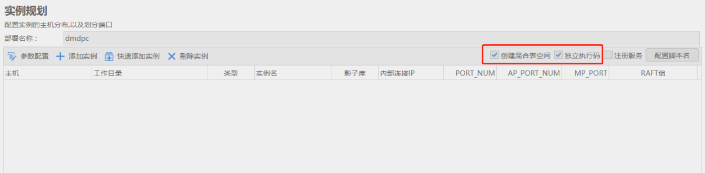

#### 4.3.1 MP 节点规划

MP：实例名前缀为 MP，PORT\_NUM 初始值为 5220，AP\_PORT\_NUM 初始值为 1620，MP\_PORT 初始值为 9000。

1. 点击【添加实例】

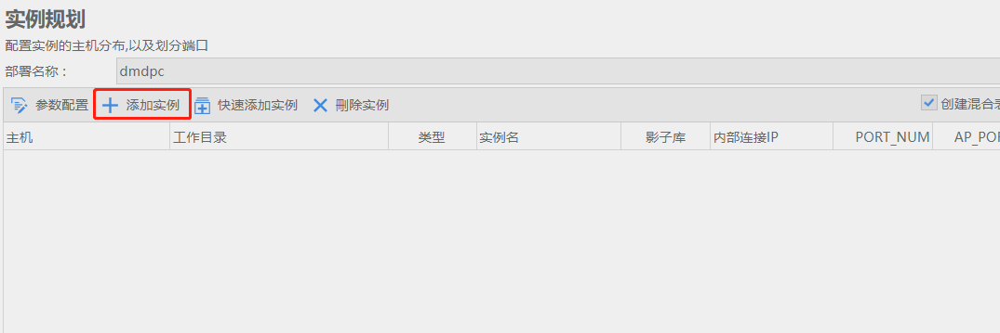

2. 实例类型选择【MP】节点，① 实例类型选择 MP，② 根据实例规划选择 MP 节点及其副本所在机器，③ 选择完成后，点击确定。

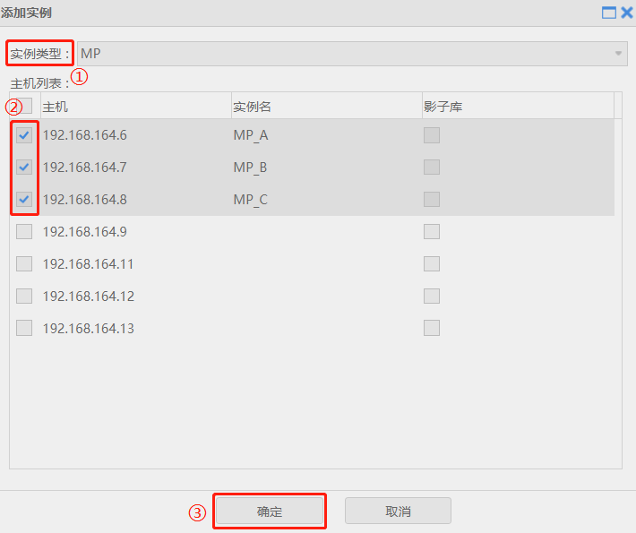

下图为 MP 节点的具体配置，下图中的【工作目录】项如果在参数配置的步骤没有设置，需要在此处按照集群规划中的目录进行填写。

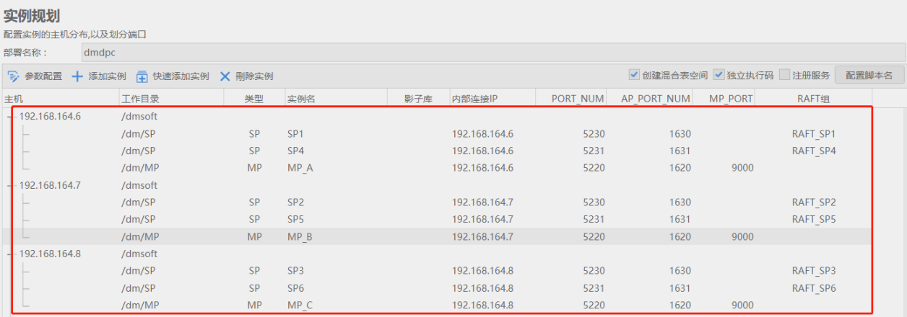

#### 4.3.2 SP 节点规划

SP：实例名前缀为 SP，PORT\_NUM 初始值为 5230，AP\_PORT\_NUM 初始值为 1630，RAFT 组名前缀为 RAFT\_SP。

添加 SP 节点的步骤与 4.3.1 节步骤 1、2 保持一致即可。因一台服务器上配置两个 SP 节点，需要注意实例工作目录、PORT\_NUM 和 AP\_PORT\_NUM。具体配置如下：

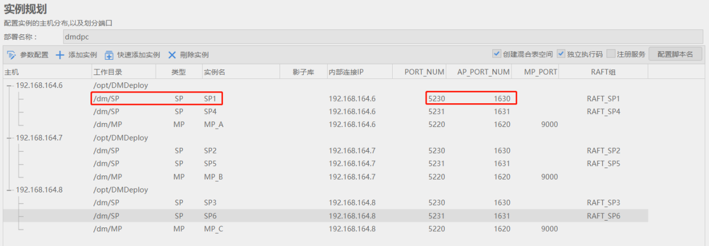

#### 4.3.3 BP 节点规划

BP：实例名前缀为 BP，PORT\_NUM 初始值为 5240，AP\_PORT\_NUM 初始值为 1640，RAFT 组名前缀为 RAFT\_BP。BP 各节点及其副本节点的分布如下表：

| 192.168.164.9 | BP1\_A | BP4\_B | BP3\_C |
| --- | --- | --- | --- |
| 192.168.164.11 | BP2\_A | BP1\_B | BP4\_C |
| 192.168.164.12 | BP3\_A | BP2\_B | BP1\_C |
| 192.168.164.13 | BP4\_A | BP3\_B | BP2\_C |

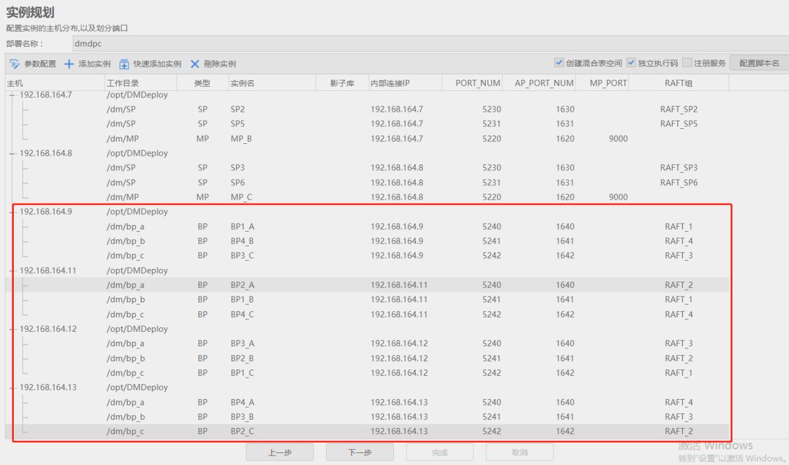

### 4.4 BP 组合 BP 域配置

拥有相同数据的一个或多个节点共同构成一个 RAFT 组。RAFT 组中的节点个数为奇数。多副本系统基于 RAFT 算法，管理组内的节点，并始终维护一个主节点，保持 RAFT 组内的数据一致性。当 RAFT 组中含有三个或三个以上节点时，RAFT 组中的所有节点（三个或三个以上）共同构成一个多副本系统。当 RAFT 组中只有 1 个节点时，则该节点称为单副本系统。

BP 组是个逻辑概念，它是 BP RAFT 组的集合，可作为 DPC 系统中所有 BP RAFT 组集合的全集或子集，甚至可以为空集。

对于 BP 来说，一个 DMDPC 架构可以配置一个或多个 RAFT 组。一个 BP 组可以包含一个或多个 RAFT 组。RAFT 组的创建不依赖于 BP 组，一个 RAFT 组既可隶属于多个 BP 组，又可独立存在，不加入任何 BP 组。在 BP 单副本系统中，一个 RAFT 组最多只能包含 1 个 BP。

① 点击【添加 BP 组】，添加成功后界面如下：

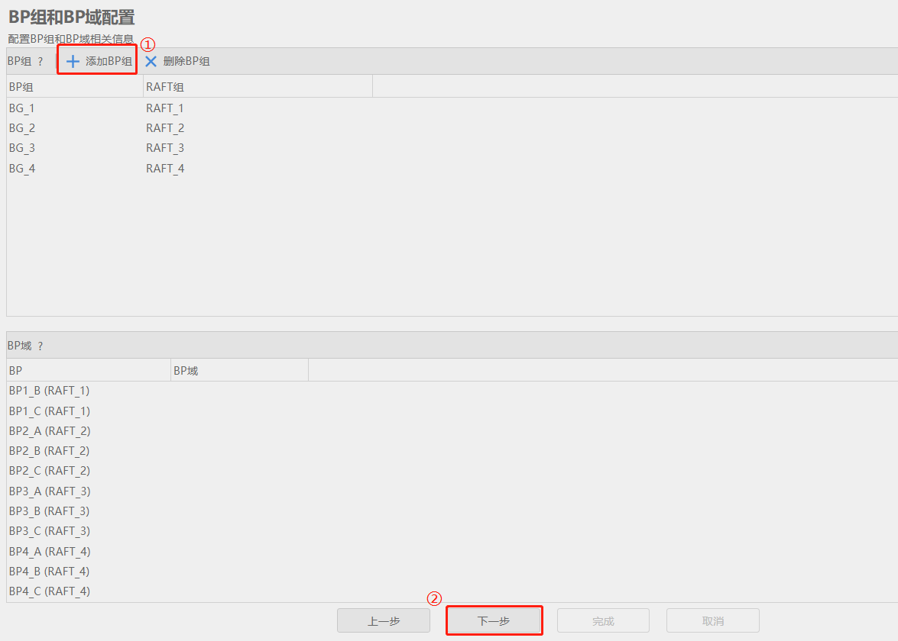

### 4.5 初始化参数配置

按照 2.3.2 详情规划配置数据库初始化参数。

1. 勾选上同步修改所有实例，修改数据库名，簇大小，页大小，日志文件个数和大小，字符集等参数配置。
2. 下图中的【自定义初始化参数】RLOG\_GEN\_FOR\_HUGE 最新版已兼容，不需要额外设置，其余初始化参数按照实际生产环境要求进行设置。

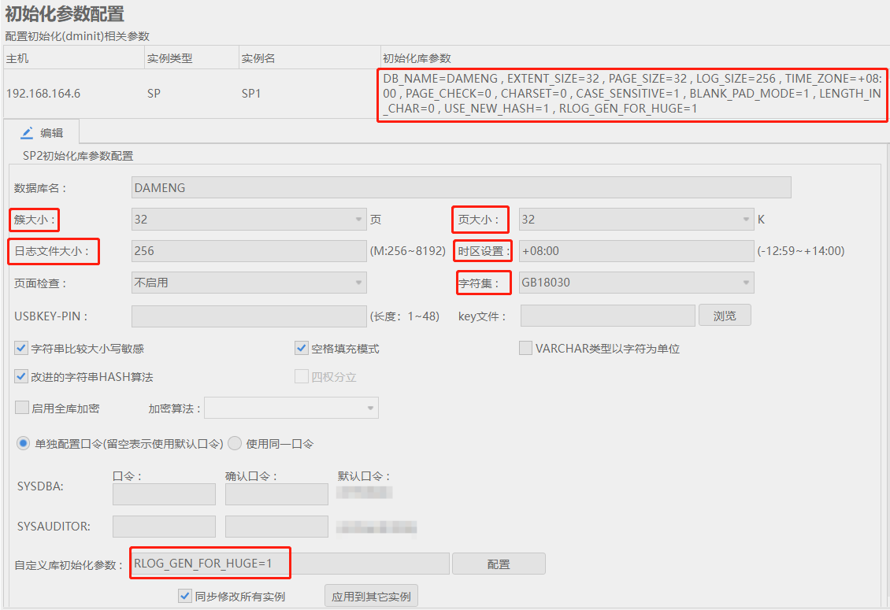

3. 当需要配置参数 RLOG\_GEN\_FOR\_HUGE 数值为 1 时，选择【配置】，点击【新建】，增加该参数。

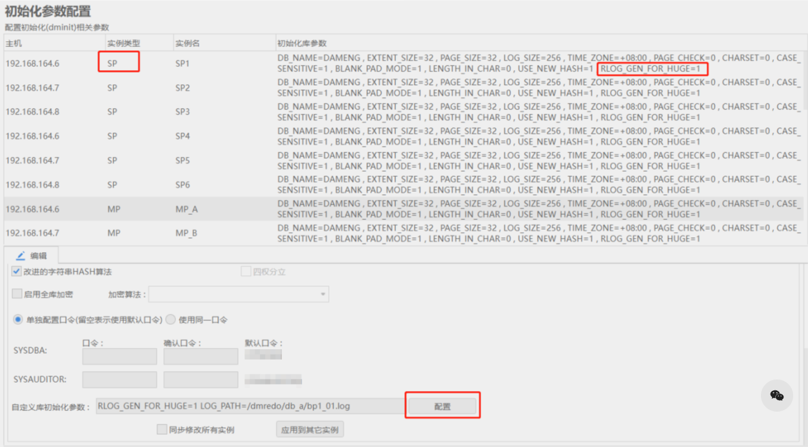

4. 在填写自定义初始化参数框中配置 redo 时，需要去掉【同步修改所有实例填写】，按照要求填写配置：PATH=/dmredo/....log。

例如 BP1 配置如下：

```shell
log_path=/dmredo/bp_a/bp_1_a01.log
RLOG_GEN_FOR_HUGE=1
```

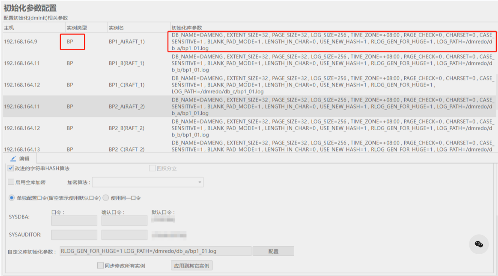

其他节点以此类推，设置好 redo 和初始化路径后，点击下一步：选【是】：

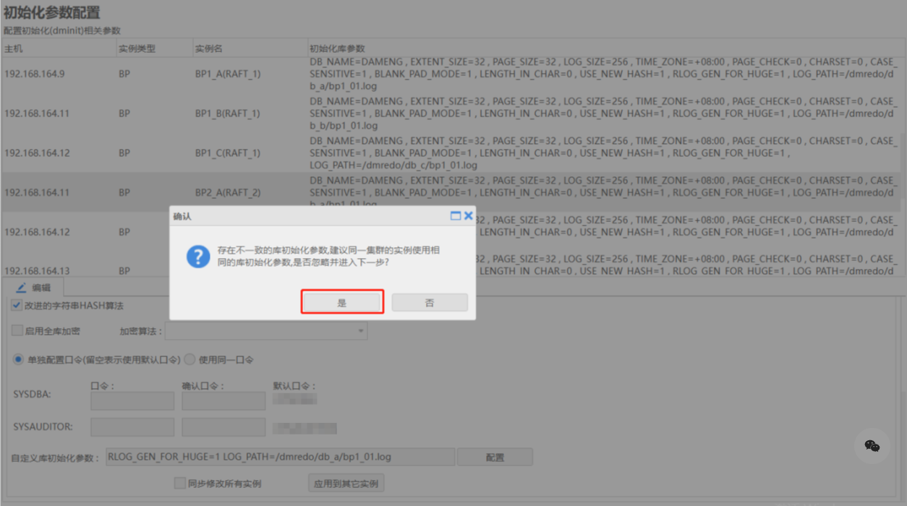

### 4.6 dm.ini 配置

dm.ini 各节点配置如下：确认无误后点击【下一步】。

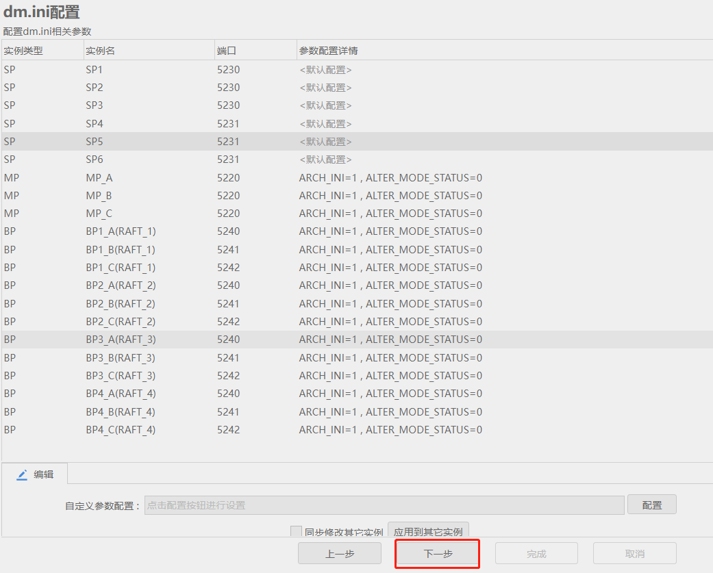

### 4.7 配置 dmarch.ini

设置归档文件路径：去掉使用默认值，使用 2.3.1 节实例规划中路径。需要额外注意 RAFT\_VOTE\_INTERVAL 参数，本文中 RAFT1 包含 BP1\_A、BP1\_B、BP1\_C，则该三个节点的 RAFT\_VOTE\_INTERVAL 参数需要分别配置为 7000/13000/21000。RAFT2、RAFT3 以及 RAFT4 以此类推。

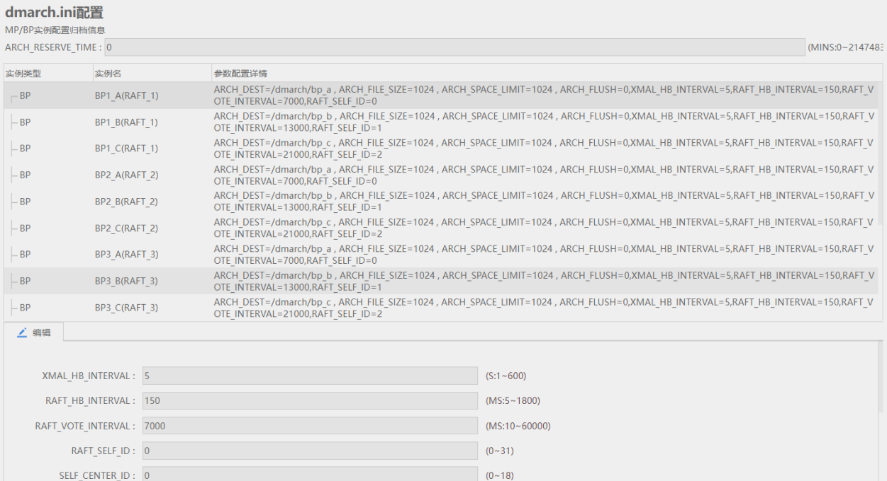

分别设置 MP 和 BP 的归档文件大小，MP 归档文件大小为 128M，上限为 51200；BP 归档文件大小为 1024M，上限为 409600M。该大小用户可根据实际情况合理调整。BP 和 MP 节点配置如下：

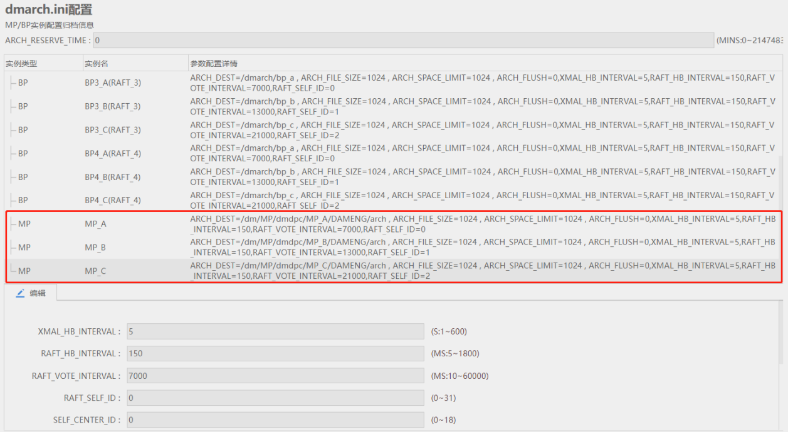

### 4.8 上传服务器文件

上传服务器文件有以下三种方式：

1. 若选择【各节点使用同一个达梦数据库服务器文件】，则安装包需要上传至 dem 服务器上。
2. 若选择【各节点将单独配置达梦数据库服务器文件】，则需要在集群中的各个节点单独配置数据库服务器文件。
3. 若选择【各节点已部署达梦数据库服务器文件】，则需提前在各个节点上部署 dm 数据库软件，选择数据库安装目录下的 bin 目录。  
	本文中，在集群中的各节点已提前安装部署达梦数据库服务器文件，因此选择数据库安装目录下的/bin 目录即可。用户可根据实际情况选择。

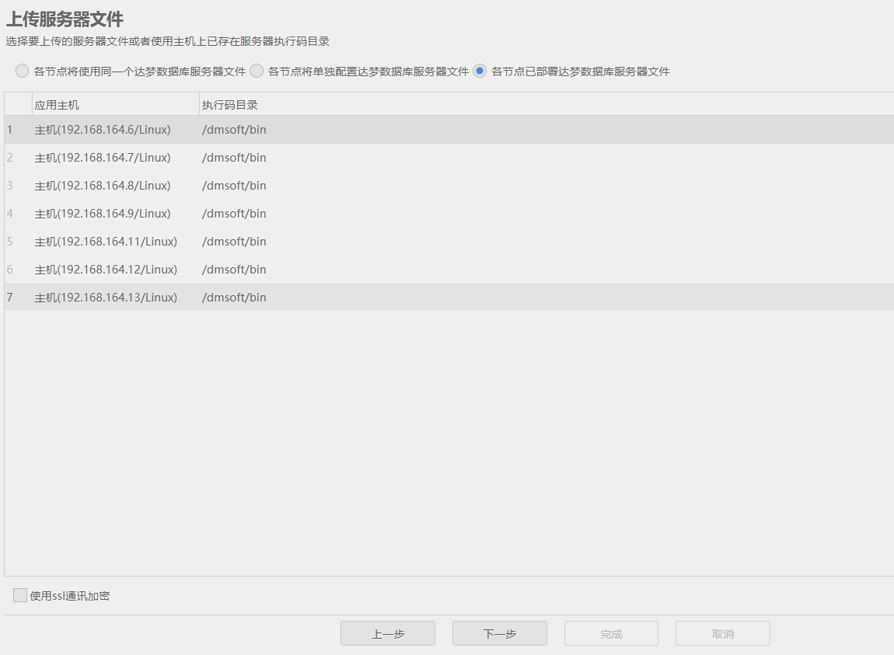

### 4.9 详情总览

以上配置都完成之后，执行至【详情总览步骤】，确认部署任务配置无误，保存并执行。

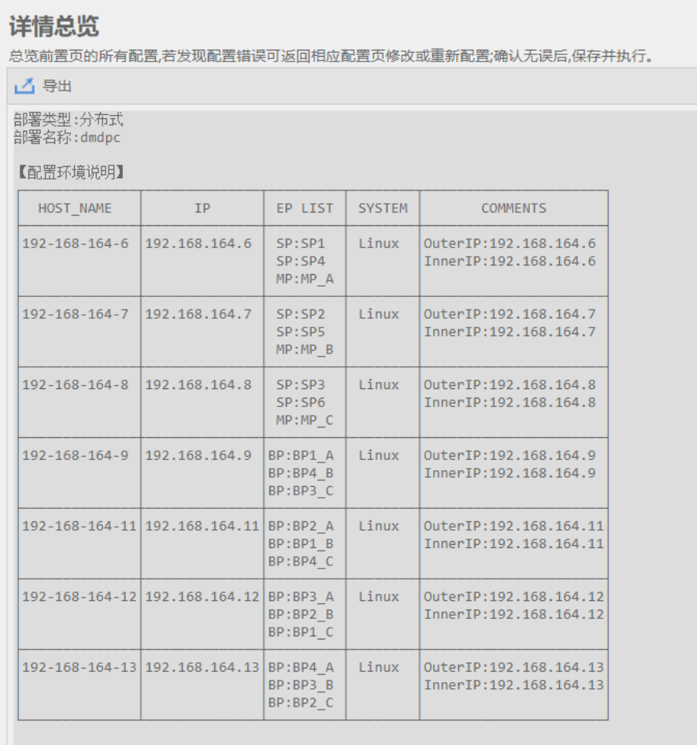

### 4.10 部署完成

确认集群配置无误后，在详情总览界面点击【保存并执行】，会出现以下界面，所有任务均执行成功，DPC 部署完成。

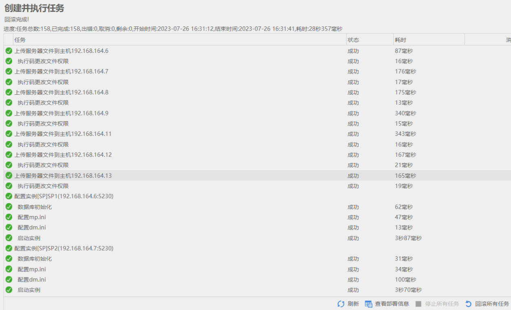