本章节主要介绍在 DM 数据库中如何使用分区表。

使用分区技术有以下好处：

- **减少所有数据损坏** 的可能性，一个表空间损坏不影响其他表空间，提高可用性。
- 大大减少恢复时间。
- 将同一个表中的数据分布在不同的磁盘上， **均衡磁盘上的 I/O 操作** 。
- 提高表的可管理性、可利用性和访问效率。

## 一、适用场景

| 软件 | 版本 |
| --- | --- |
| 操作系统 | Redhat 7 及以上版本 |
| DM 数据库 | DM 8.0 及以上版本 |
| CPU 架构 | x86、ARM、龙芯、飞腾等国内外主流 CPU |

## 二、DM 支持的分区类型

- 范围分区：对表中的某些列上值的范围进行分区，根据某个值的范围，决定将该数据存储在哪个分区上；
- 哈希分区：通过指定分区编号来均匀分布数据的一种分区类型，通过在 I/O 设备上进行散列分区，使得这些分区大小基本一致；
- 列表分区：通过指定表中的某个列的离散值集，来确定应当存储在一起的数据。例如，可以对表上的 status 列的值在('A'，'H'，'O')放在一个分区，值在('B'，'I'，'P')放在另一个分区，以此类推；
- 组合（多级）分区：按上述三种分区方法进行任意组合，将表进行多次分区，称为多级分区表。
- 间隔分区（属于范围分区）：在创建范围分区表时，可通过 `INTERVAL <间隔表达式>` 子句将该范围分区表指定为间隔分区表。当对间隔分区表中的数据进行插入或更新操作时，若新的数据无法匹配现有的分区子表，则系统将自动以用户指定的现有分区的末尾临界值为起始值，以 < 间隔表达式 > 指定的值为间隔值创建一个可以匹配新数据的间隔分区。

## 三、创建分区表的限制

- DM 默认类型的表（索引组织表）创建分区表的时候， **主键列必须在分区范围内** 。
- DM 的堆表上创建分区时，各个分区需要放在相同的表空间上。

如果表上存在聚集索引且索引键为主键，并希望各个分区放置在不同表空间上，优化 IO ，则 **必须在主键列中加入分区键** ，参考如下建表语句：

```sql
--创建表空间
CREATE TABLESPACE  tbs_p1   DATAFILE '/dm/data/DM1_NEW/p1.dbf'   SIZE 32;
CREATE TABLESPACE  tbs_p2   DATAFILE '/dm/data/DM1_NEW/p2.dbf'   SIZE 32;
CREATE TABLESPACE  tbs_p3   DATAFILE '/dm/data/DM1_NEW/p3.dbf'   SIZE 32;
CREATE TABLESPACE  tbs_pmax DATAFILE '/dm/data/DM1_NEW/pmax.dbf' SIZE 32;

--创建分区表
CREATE TABLE dmhr.rp_emp
(
   employee_id      INT,
   employee_name    VARCHAR (20),
   identity_card    VARCHAR (18),
   email            VARCHAR (50) NOT NULL,
   phone_num        VARCHAR (20),
   hire_date        DATE NOT NULL,
   job_id           VARCHAR (10) NOT NULL,
   salary           INT,
   commission_pct   INT,
   manager_id       INT,
   department_id    INT,
   CONSTRAINT pk_emp PRIMARY KEY (employee_id, hire_date),
   CONSTRAINT emp_dept_fk1 FOREIGN KEY
      (department_id)
       REFERENCES dmhr.department (department_id),
   CHECK (salary > 0)
)
PARTITION BY RANGE (hire_date)
   (PARTITION p1 VALUES LESS THAN ('2011-1-1') TABLESPACE tbs_p1,
  PARTITION p2 VALUES LESS THAN ('2015-1-1') TABLESPACE tbs_p2,
  PARTITION p3 VALUES LESS THAN ('2016-1-1') TABLESPACE tbs_p3,
  PARTITION pmax VALUES LESS THAN (MAXVALUE) TABLESPACE tbs_pmax)
```

## 四、创建各类分区表

### 4.1 范围分区

按照指定列的值所在的范围来创建分区。例如：以员工的入职时间为分区键创建范围分区，以年为间隔。示例语句如下：

```sql
--创建范围分区，以 hire_date 为分区键，同时增加 MAXVALUE 分区。
CREATE TABLE dmhr.rp_hiredt_emp
(
   employee_id      INT PRIMARY KEY,
   employee_name    VARCHAR (20),
   identity_card    VARCHAR (18),
   email            VARCHAR (50) NOT NULL,
   phone_num        VARCHAR (20),
   hire_date        DATE NOT NULL,
   job_id           VARCHAR (10) NOT NULL,
   salary           INT,
   commission_pct   INT,
   manager_id       INT,
   department_id    INT,
   CONSTRAINT emp_email_uk1 UNIQUE (email),
   CONSTRAINT emp_dept_fk1 FOREIGN KEY
      (department_id)
       REFERENCES dmhr.department (department_id),
   CHECK (salary > 0)
)
PARTITION BY RANGE(hire_date)
   (
      PARTITION p1 VALUES LESS THAN ('2007-1-1'),
      PARTITION p2 VALUES LESS THAN ('2008-1-1'),
      PARTITION p3 VALUES LESS THAN ('2009-1-1'),
      PARTITION p4 VALUES LESS THAN ('2010-1-1'),
      PARTITION p5 VALUES LESS THAN ('2011-1-1'),
      PARTITION p6 VALUES LESS THAN ('2012-1-1'),
      PARTITION p7 VALUES LESS THAN ('2013-1-1'),
      PARTITION p8 VALUES LESS THAN ('2014-1-1'),
      PARTITION p9 VALUES LESS THAN ('2015-1-1'),
      PARTITION p10 VALUES LESS THAN ('2016-1-1'),
      PARTITION pmax VALUES LESS THAN (MAXVALUE))
STORAGE (NOBRANCH
);
```

插入数据并提交，示例语句如下：

```sql
INSERT INTO dmhr.rp_hiredt_emp SELECT * FROM dmhr.employee;
COMMIT;
```

判断一张表是否为分区表，如果 **partitioned 字段为 yes** ，该表为分区表。示例语句如下：

```sql
SELECT partitioned FROM dba_tables WHERE table_name='RP_HIREDT_EMP';
```

查看表的分区状态，示例语句如下：

```sql
SELECT partitioning_type, partition_count, partitioning_key_count,
def_tablespace_name,status FROM dba_part_tables;
```

输出结果：

查看所有的表分区，示例语句如下：

```sql
SELECT partition_name, high_value, tablespace_name FROM dba_tab_partitions
WHERE table_name='RP_HIREDT_EMP';
```

输出结果：

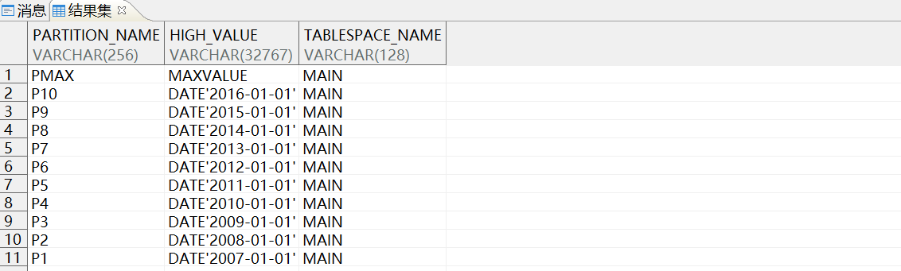

### 4.2 列表分区

按照公司员工的职位 (job\_id) 创建列表分区，示例语句如下：

```sql
CREATE TABLE dmhr.lp_job_emp
(
   employee_id      INT PRIMARY KEY,
   employee_name    VARCHAR (20),
   identity_card    VARCHAR (18),
   email            VARCHAR (50) NOT NULL,
   phone_num        VARCHAR (20),
   hire_date        DATE NOT NULL,
   job_id           VARCHAR (10) NOT NULL,
   salary           INT,
   commission_pct   INT,
   manager_id       INT,
   department_id    INT,
   CONSTRAINT emp_email_uk2 UNIQUE (email),
   CONSTRAINT emp_dept_fk2 FOREIGN KEY
      (department_id)
       REFERENCES dmhr.department (department_id),
   CHECK (salary > 0)
)
PARTITION BY LIST (job_id)
   (PARTITION p1 VALUES ('11','12','21','22'),
    PARTITION p2 VALUES ('31','32','41','42'),
    PARTITION p3 VALUES ('51','52','61','62'),
    PARTITION p4 VALUES ('71','72','81','82'),
    PARTITION pmax VALUES (DEFAULT))
STORAGE (NOBRANCH);
```

插入数据并提交，示例语句如下：

```sql
INSERT INTO dmhr.lp_job_emp SELECT * FROM dmhr.employee;
COMMIT;
```

查询各分区的行数和累加行数，示例语句如下：

```sql
WITH p AS
(SELECT 'P1' AS pars, COUNT(*) AS num FROM dmhr.lp_job_emp PARTITION (P1)
UNION ALL
SELECT 'P2', COUNT(*) FROM dmhr.lp_job_emp PARTITION (P2)
UNION ALL
SELECT 'P3', COUNT(*) FROM dmhr.lp_job_emp PARTITION (P3)
UNION ALL
SELECT 'P4', COUNT(*) FROM dmhr.lp_job_emp PARTITION (P4))
SELECT pars, num, SUM(num) OVER(order by pars rows unbounded preceding)
row_sum FROM p;
```

输出结果：

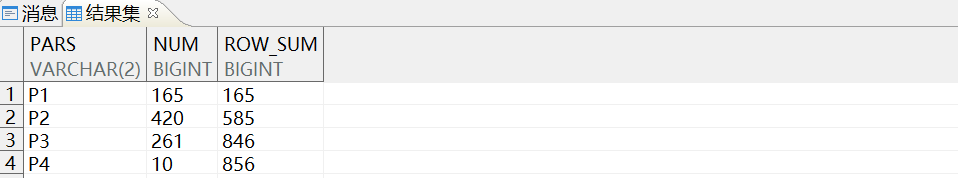

### 4.3 哈希分区

按照员工的 email 将员工信息数据 department 打散到 4 个分区中。示例语句如下：

```sql
CREATE TABLE dmhr.hp_email_emp
(
   employee_id      INT PRIMARY KEY,
   employee_name    VARCHAR (20),
   identity_card    VARCHAR (18),
   email            VARCHAR (50) NOT NULL,
   phone_num        VARCHAR (20),
   hire_date        DATE NOT NULL,
   job_id           VARCHAR (10) NOT NULL,
   salary           INT,
   commission_pct   INT,
   manager_id       INT,
   department_id    INT,
   CONSTRAINT emp_email_uk3 UNIQUE (email),
   CONSTRAINT emp_dept_fk3 FOREIGN KEY
      (department_id)
       REFERENCES dmhr.department (department_id),
   CHECK (salary > 0)
)
PARTITION BY HASH (email)
   (PARTITION p1, PARTITION p2, PARTITION p3, PARTITION p4)
STORAGE (NOBRANCH);
```

插入数据并提交，示例语句如下：

```sql
INSERT INTO dmhr.hp_email_emp SELECT * FROM dmhr.employee;
COMMIT;
```

查询各分区的行数和累加行数，示例语句如下：

```sql
WITH p AS
(SELECT 'P1' AS pars, COUNT(*) AS num FROM dmhr.hp_email_emp PARTITION (P1)
UNION ALL
SELECT 'P2', COUNT(*) FROM dmhr.hp_email_emp PARTITION (P2)
UNION ALL
SELECT 'P3', COUNT(*) FROM dmhr.hp_email_emp PARTITION (P3)
UNION ALL
SELECT 'P4', COUNT(*) FROM dmhr.hp_email_emp PARTITION (P4))
SELECT pars, num, SUM(num) OVER(order by pars rows unbounded preceding)
row_sum FROM p;
```

输出结果：

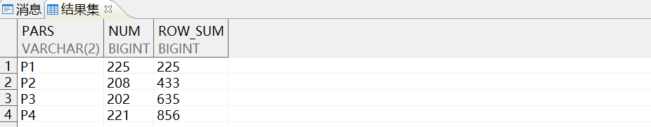

可以看出数据在哈希表的各个分区上 **分布比较均匀** 。

### 4.4 组合分区

组合分区也称为多级分区，在很多情况下，经过一次分区并不能精确地对数据进行分类，这时需要多级分区表。DM 支持最多 **八层多级** 分区。以下介绍其中一种组合分区 `range-hash` 。

员工的雇佣时间为主分区键，从 2007 年起，每 3 年划分一个分区，每个分区包含 2 个 hash 子分区。示例语句如下：

```sql
CREATE TABLE dmhr.rhp_emp
(
   employee_id      INT PRIMARY KEY,
   employee_name    VARCHAR (20),
   identity_card    VARCHAR (18),
   email            VARCHAR (50) NOT NULL,
   phone_num        VARCHAR (20),
   hire_date        DATE NOT NULL,
   job_id           VARCHAR (10) NOT NULL,
   salary           INT,
   commission_pct   INT,
   manager_id       INT,
   department_id    INT,
   CONSTRAINT emp_email_uk4 UNIQUE (email),
   CONSTRAINT emp_dept_fk4 FOREIGN KEY
      (department_id)
       REFERENCES dmhr.department (department_id),
   CHECK (salary > 0)
)
PARTITION BY RANGE (hire_date)
   SUBPARTITION BY HASH (email)
      SUBPARTITION TEMPLATE (SUBPARTITION p1 , SUBPARTITION p2 )
   (
      PARTITION p1 VALUES LESS THAN ('2010-1-1'),
      PARTITION p2 VALUES LESS THAN ('2013-1-1'),
      PARTITION p3 VALUES LESS THAN ('2016-1-1'),
      PARTITION pmax VALUES LESS THAN (MAXVALUE))
STORAGE (NOBRANCH);
```

查询每个主分区下的子分区，示例语句如下：

```sql
SELECT partition_name,
         subpartition_count,
         composite,
         high_value,
         tablespace_name
    FROM dba_tab_partitions
   WHERE table_name = UPPER ('rhp_emp')
ORDER BY partition_position;
```

输出结果：

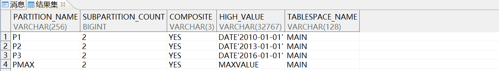

查询组合分区子分区的键信息，示例语句如下：

```sql
SELECT name,object_type,column_name,column_position FROM user_subpart_key_columns;
```

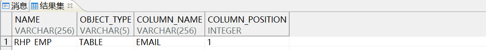

通过系统表 user\_subpart\_key\_columns 查询组合分区子分区的键信息， **必须以 dmhr 用户登录库** 。

### 4.5 间隔分区

间隔分区可以在输入相应分区的数据后自动创建分区，是范围分区的扩展。例如：将 dmhr 用户下 employee 表中员工信息按入职时间以年为间隔转换为分区表。

创建分区表 emp\_part，起始分区时间为小于 2007 年 1 月 1 日。示例语句如下：

```sql
CREATE TABLE dmhr.emp_part
(
   EMPLOYEE_ID      INT PRIMARY KEY,
   EMPLOYEE_NAME    VARCHAR (20),
   IDENTITY_CARD    VARCHAR (18),
   EMAIL            VARCHAR (50) NOT NULL,
   PHONE_NUM        VARCHAR (20),
   HIRE_DATE        DATE NOT NULL,
   JOB_ID           VARCHAR (10) NOT NULL,
   SALARY           INT,
   COMMISSION_PCT   INT,
   MANAGER_ID       INT,
   DEPARTMENT_ID    INT
)
PARTITION BY RANGE (hire_date)
   INTERVAL ( NUMTOYMINTERVAL (1, 'year') )
   (
      PARTITION
         P_BEFORE_2007
         VALUES LESS THAN (TO_DATE ('2007-01-01', 'yyyy-mm-dd')))
STORAGE (FILLFACTOR 85, BRANCH(32,32));
```

在 emp\_part 表中插入员工信息，示例语句如下：

```sql
INSERT INTO dmhr.emp_part SELECT * FROM dmhr.employee;
commit;
```

通过 dba\_tab\_partitions 表查询分区信息，示例语句如下：

```sql
SELECT table_name,partition_name, high_value FROM dba_tab_partitions
WHERE table_name='EMP_PART' ORDER BY high_value;
```

输出结果：

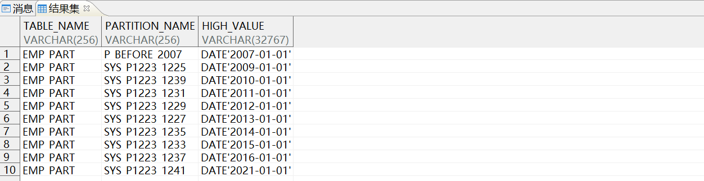

如上图所示，数据库以 2007 年 1 月 1 日 为起始点自动创建了 9 个分区。

按分区名称检索数据如下，示例语句如下：

```sql
SELECT * FROM dmhr.emp_part PARTITION(P_BEFORE_2007);
```

插入数据，自动新增分区表。在 emp\_part 表中插入一条新记录，员工入职时间为 2020 年 5 月 30 日。示例语句如下：

```sql
INSERT INTO dmhr.emp_part(EMPLOYEE_ID,EMPLOYEE_NAME,IDENTITY_CARD,EMAIL,
PHONE_NUM,HIRE_DATE,JOB_ID,SALARY,COMMISSION_PCT,MANAGER_ID,DEPARTMENT_ID)
VALUES(9990,'武达梦','340102196202303999','wudm@dameng.com','15312348566',
'2020-05-30','11',50000.00,0,1001,101);

commit;
```

通过系统表 dba\_tab\_partitions 查询新增数据分区，示例语句如下：

```sql
SELECT table_name,partition_name, high_value FROM dba_tab_partitions
WHERE table_name='EMP_PART' ORDER BY high_value;
```

输出结果：

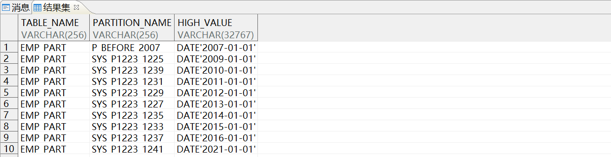

> **注意**
> 
> 如果是 sysdba 用户登录数据库，通过系统表 dba\_tab\_partitions 查询。 如果是 dmhr 用户登录数据库，通过系统表 user\_tab\_partitions 查询。

如上图所示，数据库自动创建了 1 个新分区存储的 high\_value 为 DATE'2021-01-01'， **总分区数从 9 增加至 10** 。

## 五、分区表的维护

### 5.1 增加分区

ALTER TABLE ADD PARTITION 语句将新分区增加到最后一个现存分区的后面。以上面建立的范围分区 **rp\_hiredt\_emp** 为例。

增加一个分区存储 2016 年雇佣的员工信息，示例语句如下：

```sql
ALTER TABLE dmhr.rp_hiredt_emp ADD PARTITION p_before_2017
VALUES LESS THAN ('2017-1-1');
```

输出结果：

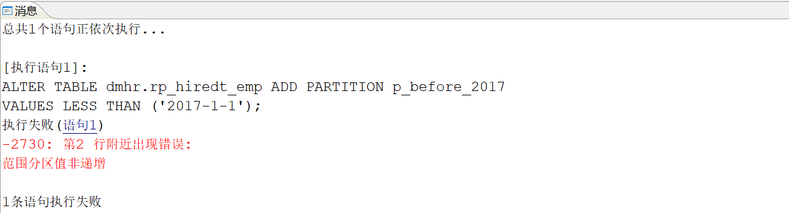

**【问题原因】** ：

分区表中 `已含有 MAXVALUE 分区，无法再增加分区` 。

**【解决方法】** ：

使用 `SPLIT PARTITION` 子句对分区进行拆分。删除 MAXVALUE 分区，新增分区后，再加上 MAXVALUE 分区。示例语句如下：

```sql
--1. 删除 MAXVALUE 分区
ALTER TABLE dmhr.rp_hiredt_emp DROP PARTITION pmax;

--2. 新增分区
ALTER TABLE dmhr.rp_hiredt_emp ADD PARTITION p_before_2017 VALUES
LESS THAN ('2017-1-1');

//3. 增加 MAXVALUE 分区
ALTER TABLE dmhr.rp_hiredt_emp ADD PARTITION pmax VALUES LESS THAN (MAXVALUE);
```

### 5.2 删除分区

- 使用 `DROP PARTITION` 可将分区的定义连同数据一起删除，示例语句如下：
```sql
ALTER TABLE dmhr.rp_hiredt_emp DROP PARTITION pmax;
```
- 使用 `TRUNCATE PARTITION` 仅删除分区的数据，示例语句如下：
```sql
ALTER TABLE dmhr.rp_hiredt_emp TRUNCATE PARTITION p7;
```

### 5.3 合并分区

将 2008 年和 2009 年入职员工各的分区合并为一个分区。

- 查询分区信息，示例语句如下：
```sql
SELECT 'P3' AS pars, COUNT(*) AS num FROM dmhr.rp_hiredt_emp PARTITION (P3)
UNION ALL
SELECT 'P4', COUNT(*) FROM dmhr.rp_hiredt_emp PARTITION (P4)
```

输出结果：

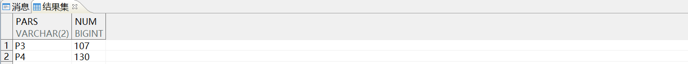

- 使用 `MERGE……INTO` 合并两个分区，示例语句如下：
```sql
ALTER TABLE dmhr.rp_hiredt_emp MERGE PARTITIONS p3, p4 into partition p3_4;
```
- 查询合并后的分区的记录数，示例语句如下：
```sql
SELECT COUNT(*) AS num FROM dmhr.rp_hiredt_emp PARTITION (P3_4);
```

输出结果：

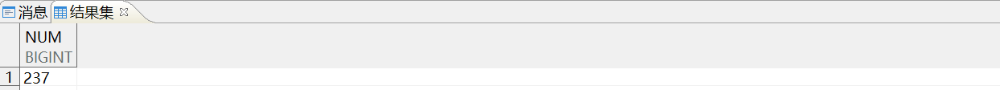

> **注意**
> 
> 仅范围分区支持合并，并且待合并的分区必须相邻。

### 5.4 拆分分区

当一个分区变得太大以至于要用很长时间才能完成备份、恢复或维护操作时，可考虑将分区进行拆分。

将上例中已合并的分区 P3\_4 重新拆分成 P3 和 P4.

- 使用 `SPLIT……INTO` 拆分分区，示例语句如下：
```sql
ALTER TABLE dmhr.rp_hiredt_emp SPLIT PARTITION p3_4 AT ('2009-01-01')
INTO (PARTITION p3, PARTITION p4);
```
- 查询拆分得到的 2 个分区，示例语句如下：
```sql
SELECT 'P3' AS pars, COUNT(*) AS num FROM dmhr.rp_hiredt_emp PARTITION (P3)
UNION ALL
SELECT 'P4', COUNT(*) FROM dmhr.rp_hiredt_emp PARTITION (P4)
```

输出结果：

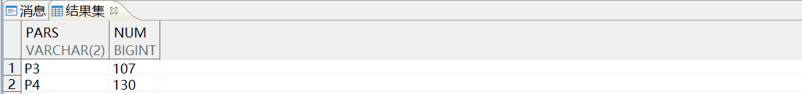

> **注意**
> 
> 拆分分区会导致数据的重组和分区索引的重建。因此，拆分分区可能比较耗时，所需时间取决于分区数据量的大小。

## 六、分区索引

- 支持对水平分区表建立普通索引、唯一索引、聚集索引和函数索引。
- 创建索引时若未指定 GLOBAL 关键字则建立的索引是局部索引。
- 局部索引是指每个表分区都对应一个索引分区，并且只能检索该分区上的数据。
- 全局索引是指每个表分区的数据都被索引在同一个 B 树中。
- 堆表上的 primary key 会自动变为全局索引。

在 lp\_job\_emp 表上的 salary 列上建立普通局部索引，示例语句如下：

```sql
CREATE INDEX ind_sal ON dmhr.lp_job_emp(salary);
```

在 lp\_job\_emp 表上的 email 列上建立局部唯一索引，同时 **必须将分区键 job\_id 列入** ，示例语句如下：

```sql
CREATE UNIQUE INDEX ind_mail ON dmhr.lp_job_emp(job_id, email);
```

建立局部分区索引后， **每一个分区子表都会建立一个索引分区** ，负责索引分区子表的数据。每个索引分区只负责索引本分区上的数据，其他分区上的数据无法维护。

查询分区索引如下，示例语句如下：

```sql
SELECT * FROM user_ind_partitions WHERE index_name=UPPER('ind_sal')
ORDER BY partition_name;
```

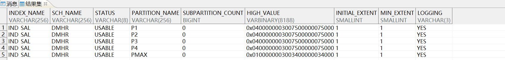

通过 user\_ind\_partitions 系统表查询分区索引信息， **必须以 dmhr 用户登录数据库** 。

```sql
SELECT index_name, index_type, table_name, uniqueness, tablespace_name, status,
partitioned FROM dba_indexes WHERE TABLE_NAME=UPPER('lp_job_emp');
```

输出结果：

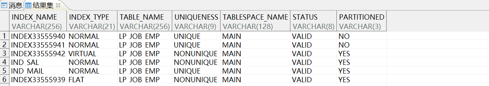

> **注意**
> 
> 不能在水平分区表上建立局部唯一函数索引，只能建立分区键索引，即分区键必须都包含在索引键中。

## 七、非分区表转换成分区表

根据原表结构创建所需的分区表，建立各种约束，转换方法如下：

- 使用 INSERT TABLE < 分区表名 > SELECT \* FROM < 非分区表 >。
- 使用 dexp/dimp 将数据从源表导出，再导入到目标分区表。

下面演示第二种情况，目标表为 dmhr 中的 department 表，department\_id 为表的主键列。按 department\_id 建立范围分区，并且每个分区对应不同的表空间。

- 数据准备，示例语句如下：
```sql
CREATE TABLE dmhr.dept AS SELECT * FROM dmhr.department;
ALTER TABLE dmhr.dept ADD PRIMARY KEY (department_id);
```
- 使用 dexp 工具将源表数据导出，示例语句如下：
```shell
dexp dmhr/dmhr20201111@172.16.100.80:5237 FILE=dept.dmp LOG=dexp_dept.log
DIRECTORY=/dm/backup/ TABLES=dmhr.dept
```
- 使用 dimp 工具将数据导入目标分区表。 **由于 DM 数据库目前不支持导入导出表映射，故先 drop 掉源表，然后建立同名的分区表** 。示例语句如下：
```sql
DROP TABLE dmhr.dept;

CREATE TABLE dmhr.dept
(
   department_id     NUMBER PRIMARY KEY,
   department_name   VARCHAR (30) NOT NULL,
   manager_id        INT,
   location_id       INT
)
PARTITION BY RANGE
   (department_id)
   (
      PARTITION p1 VALUES LESS THAN (400) TABLESPACE tbs_dept_400,
      PARTITION p2 VALUES LESS THAN (700) TABLESPACE tbs_dept_700,
      PARTITION p3 VALUES LESS THAN (1000) TABLESPACE tbs_dept_1000,
      PARTITION pmax VALUES LESS THAN (MAXVALUE) TABLESPACE tbs_dept_1000
    )
```
- 数据导出，示例语句如下：
```shell
dimp  dmhr/dmhr20201111@172.16.100.80:5237 FILE=dept.dmp LOG=dimp_dept.log
DIRECTORY=/dm/backup/ TABLES=dmhr.dept TABLE_EXISTS_ACTION=truncate IGNORE=Y
```
- 查看分区信息，示例语句如下：
```sql
SELECT table_name, owner, partitioned FROM dba_tables WHERE table_name=UPPER('dept');
```

输出结果：

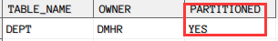

```sql
SELECT 'P1' AS pars, COUNT(*) AS num FROM dmhr.dept PARTITION (P1)
UNION ALL
SELECT 'P2', COUNT(*) FROM dmhr.dept PARTITION (P2)
UNION ALL
SELECT 'P3', COUNT(*) FROM dmhr.dept PARTITION (P3)
UNION ALL
SELECT 'PMAX', COUNT(*) FROM dmhr.dept PARTITION (PMAX);
```

输出结果：

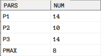

## 八、参考文档

更多 SQL 语言使用说明，请参考《DM\_SQL 语言使用手册》，手册位于 **数据库安装路径** `/dmdbms/doc` 文件夹下。如有其他问题，请在 [达梦技术社区](https://eco.dameng.com/community/question?_blank) 内咨询。