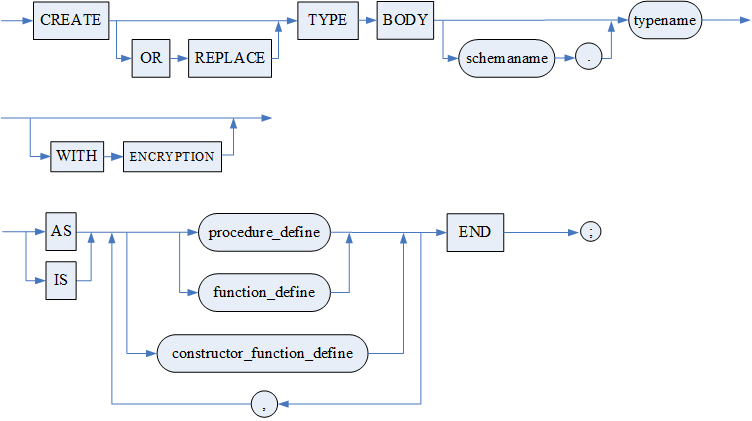
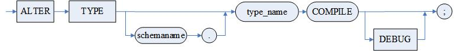
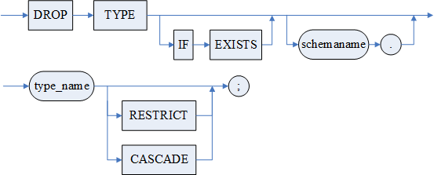
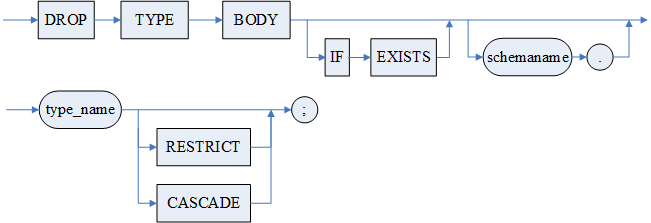
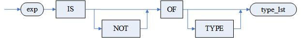

DM 支持使用 CREATE TYPE 语句创建自定义类型，具体为记录类型、对象类型、数组类型和集合类型。

其中对象类型的创建方法和另外三者略有不同，包含创建类型和创建类型体两部分。如果创建类型时声明了过程或方法，那么需要使用 CREATE TYPE BODY 定义这些过程或方法。

## 13.1 创建类型

可以使用 CREATE TYPE 语句创建记录类型、对象类型、数组和集合类型。

**语法格式**

```
CREATE [OR REPLACE] TYPE [<模式名>.]<类型名>[WITH ENCRYPTION] [<调用权限子句>] <自定义类型定义子句>;
[<调用权限子句>]::= 
    AUTHID DEFINER | 
    AUTHID CURRENT_USER
<自定义类型定义子句>::=
    <记录类型定义子句>|
    <对象类型定义子句>|
    <数组类型定义子句>|
    <集合类型定义子句>
<对象类型定义子句> ::= <object子句>|<under子句> (<对象定义>,{<对象定义>}) [<final属性>] [<instantiable属性>] [[NOT] PERSISTABLE]
<object子句> ::= AS|IS OBJECT
<under子句> ::= UNDER [<模式名>.]<父类型名>
<对象定义> ::= <变量列表定义>|<过程声明>|<函数声明>|<构造函数声明>
<过程声明> ::= <方法继承属性>[STATIC|MEMBER] PROCEDURE <过程名> <参数列表>
<函数声明> ::= <方法继承属性>[MAP] [STATIC|MEMBER] FUNCTION <函数名> <参数列表> RETURN <返回值数据类型>[DETERMINISTIC][PIPELINED]
<方法继承属性> ::= [<重载属性>] [<final属性>] [<instantiable属性>]
<重载属性> ::= [NOT] OVERRIDING
<final属性> ::= [NOT] FINAL
<instantiable属性> ::= [NOT] INSTANTIABLE 
<构造函数声明> ::= CONSTRUCTOR FUNCTION <函数名> <参数列表>　RETURN SELF AS RESULT
<记录类型定义子句> ::= AS|IS RECORD(变量列表定义)
<数组类型定义子句> ::= AS|IS ARRAY <数据类型>' [' [<常量表达式>]{,[<常量表达式>]}']'
<集合类型定义子句> ::= <数组集合定义子句>|<嵌套表定义子句>|<索引表定义子句>
<数组集合定义子句> ::= AS|IS VARRAY(<数组长度>) OF <数据类型> [NOT NULL]
<嵌套表定义子句> ::= AS|IS TABLE OF <数据类型> [NOT NULL]
<索引表定义子句> ::= AS|IS TABLE OF <数据类型> [INDEX BY <数据类型>]
```

**图例**

创建类型

**使用说明**

1. 创建的自定义类型的名称不能与系统创建的模式名称相同；
2. 对象类型中过程和函数的声明都是前向声明，类型定义中不包括任何实现代码；达梦系统中对象类型与类是等价的，关于类的说明详见 [第 12 章 类类型](class-type.md) ；
3. 对象类型中过程和函数可以声明为 STATIC 类型，表明为静态过程或函数；也可以声明为 MEMBER，表明为成员过程或函数，非 STATIC 且非构造函数的方法缺省为成员方法。MAP 表示将对象类型的实例映射为标量数值，只能用于成员函数；
4. 关于对象类型的继承，参考 [12.1 普通 CLASS 类型](class-type.md) 中类继承的相关说明；
5. WITH ENCRYPTION 选项，指定是否对自定义类型定义进行加密；
6. 记录类型的定义格式与对象类型类似，但记录类型中不能有过程和函数声明；
7. 在 < 数组类型定义子句 > 的数组长度定义的\[\]内添加’,’可以定义多维数组。< 数组长度 > 为正整数，若指定了数组长度，则定义的是静态数组，其数组长度是固定的。若没有指定数组长度，则定义的是动态数组，其数组长度是在使用时指定。理论上 DM 支持静态数组的每一个维度的最大长度为 65534，动态数组的每一个维度的最大长度为 10485760，但是数组最大长度同时受系统内部空间大小的限制，如果超出堆栈/堆的空间限制，系统会报错。
8. 数组集合类型中的常量表达式定义了其最大容量，其数组元素数据类型可以是基础类型，也可以是自定义数据类型。
9. 嵌套表类型和索引表类型没有元素个数限制，元素数据类型可以是基础数据类型也可以是其它自定义类型或是对象、记录、静态数组，但是不能是动态数组；第二个则是索引表的下标类型，目前仅支持 INTEGER/INT 和 VARCHAR 两种类型，分别代表整数下标和字符串下标。对于 VARCHAR 类型，长度不能超过 1024。
10. 创建对象类型时若指定了非永久性 NOT PERSISTABLE, 则该自定义类型不允许作为表列。

**权限**

1. 使用该语句的用户必须具有 DBA 角色（三权分立）、DB\_OBJECT\_OPER 角色（四权分立）、CREATE ANY PACKAGE 权限或 CREATE PACKAGE 权限。
2. 可以用关键字 AUTHID DEFINER |AUTHID CURRENT\_USER 指定自定义类型的调用者权限，若为 DEFINER，则采用自定义类型定义者权限，若为 CURRENT\_USER 则为当前用户权限，默认为定义者权限。

## 13.2 创建类型体

专用于对象类型。为可选项。当在创建类型中声明了过程或函数时使用，用于对声明的过程或者函数进行实现。如果没有声明过程或函数，则创建类型体部分可以省略。

**语法格式**

```
CREATE [OR REPLACE] TYPE BODY [<模式名>.]<类型名>[WITH ENCRYPTION] AS|IS <对象类型体定义子句> END;
<对象类型体定义子句>::= <对象类型体定义>,{<对象类型体定义>}
<对象类型体定义>::= <过程实现>|<函数实现>|<构造函数实现>
<过程实现> ::= <方法继承属性>[STATIC|MEMBER] PROCEDURE <过程名> <参数列表> AS|IS  BEGIN <实现体> END [<过程名>]
<函数实现> ::= <方法继承属性>[MAP] [STATIC|MEMBER] FUNCTION <函数名><参数列表> RETURN <返回值数据类型>[DETERMINISTIC] [PIPELINED] AS|IS BEGIN <实现体> END [<函数名>]
<方法继承属性> ::= [<重载属性>] [<final属性>] [<instantiable属性>]
<重载属性> ::= [NOT] OVERRIDING
<final属性> ::= [NOT] FINAL
<instantiable属性> ::= [NOT] INSTANTIABLE 
<构造函数实现> ::= CONSTRUCTOR FUNCTION <函数名> <参数列表>　RETURN SELF AS RESULT AS|IS BEGIN <实现体> END [<函数名>]
```

**图例**

创建类型体



**使用说明**

1. 对象类型体中的过程、函数定义必须和类型定义中的前向声明完全相同。包括过程的名字、参数定义列表的参数名和数据类型定义；
2. 支持 < 实现体 > 中使用形如”self:= new obj”的自赋值语法，可以在构造函数内部手动生成新的对象并赋值给 self；
3. 在 < 参数列表 > 中，支持 self 参数作为第一个参数使用，在调用该构造函数时会自动忽略该 self 参数；开启 oracle 兼容模式后，函数调用时指定第一个参数为 self 时自动忽略。

**权限**

使用该语句的用户必须具有 DBA 角色（三权分立）或 CREATE ANY PACKAGE 权限，或是该类型对象的拥有者且具有 CREATE PACKAGE 权限。

## 13.3 重编译类型

重新对类型进行编译，如果重新编译失败，则将类型置为禁止状态。

重编功能主要用于检验类型的正确性。

**语法格式**

```
ALTER TYPE [<模式名>.]<类型名> COMPILE [DEBUG];
```

**参数**

1．< 模式名 > 指明被重编译的类型所属的模式；

2．< 类型名 > 指明被重编译的类型的名字；

3．\[DEBUG\] 可忽略。

**图例**

重编译类型



**权限**

执行该操作的用户必须具有 DBA 角色（三权分立），或者是类型的创建者且具有 CREATE PACKAGE、DROP PACKAGE 和 EXECUTE PACKAGE 权限。

## 13.4 删除类型

类型的删除分为类型删除和类型体的删除。对于拥有类型体的对象类型，删除类型会将类型体一起删除；删除类型体的话，类型本身依然存在。

### 13.4.1 删除类型

使用 DROP TYPE 完成类型的删除。对于拥有类型体的对象类型，删除类型会将类型体一起删除。

**语法格式**

```
DROP TYPE [IF EXISTS] [<模式名>.]<类型名>[RESTRICT | CASCADE];
```

**图例**

删除类型



**使用说明**

1. 删除不存在的类型会报错。若指定 IF EXISTS 关键字，删除不存在的类型，不会报错；
2. 如果被删除的类型不属于当前模式，必须在语句中指明模式名；
3. 如果一个拥有类型体的对象类型被删除，那么对应的类型体被自动删除。

**权限**

执行该操作的用户必须具有 DBA 角色（三权分立）或 DROP ANY PACKAGE 权限，或者是该类型的拥有者且具有 DROP PACKAGE 权限。

### 13.4.2 删除类型体

使用 DROP TYPE BODY 删除一个对象类型的类型体。

**语法格式**

```
DROP TYPE BODY [IF EXISTS] [<模式名>.]<类型名>[RESTRICT | CASCADE];
```

**图例**

删除体类型



**使用说明**

1. 删除不存在的类型体会报错。若指定 IF EXISTS 关键字，删除不存在的类型体，不会报错；
2. 如果被删除的类型体不属于当前模式，必须在语句中指明模式名。

**权限**

执行该操作的用户必须具有 DBA 角色（三权分立）或 DROP ANY PACKAGE 权限，或者是该类型的拥有者且具有 DROP PACKAGE 权限。

## 13.5 自定义类型的使用

### 13.5.1 使用规则

1. 对象类型与类等价，类的使用规则可详见 [第 12 章 类类型](class-type.md) ；
2. 创建的对象类型、记录类型、数组类型和集合类型，可以直接在 DMSQL 程序语句块中直接使用，使用方式请参考《DM8\_SQL 程序设计》。
3. 用户自定义数据类型可以作为其他用户自定义数据类型的元素类型或成员变量类型；
4. 只有对象类型、VARRAY 类型以及嵌套表类型可以直接作为表中列的数据类型；其他类型只能作为上述类型中成员变量的类型或类型中嵌套使用的数据类型。但含有 BOOL、VOID、游标类型、异常变量、ANYTYPE, RESTOBJ, AOT 的自定义类型也不能作为表中列的数据类型；
5. 对象类型、动态数组类型和集合类型的自定义类型数据在 DM 中作为引用进行处理，并非作为值处理。

### 13.5.2 应用实例

例 1 创建一个用来表示复数的对象类型，有实数部分和虚数部分，并实现了复数的加与减的操作。

```
CREATE TYPE COMPLEX AS OBJECT(
  RPART REAL,
  IPART REAL,
  FUNCTION PLUS(X COMPLEX) RETURN COMPLEX,
  FUNCTION LES(X COMPLEX) RETURN COMPLEX
);
/

CREATE TYPE BODY COMPLEX AS
  FUNCTION PLUS(X COMPLEX) RETURN COMPLEX IS
  BEGIN
  RETURN COMPLEX(RPART+X.RPART, IPART+X.IPART);
  END;

  FUNCTION LES(X COMPLEX) RETURN COMPLEX IS
  BEGIN
    RETURN COMPLEX(RPART-X.RPART, IPART-X.IPART);
  END;
END;
```

建立表 c\_tab，表中的第二列的列类型为 complex 对象类型。

```
CREATE TABLE C_TAB(C1 INT, C2 COMPLEX);
```

向表 c\_tab 中插入数据。

```
INSERT INTO C_TAB VALUES(1, COMPLEX(2,3));

INSERT INTO C_TAB VALUES(2, COMPLEX(4,2).PLUS(COMPLEX(2,3)));
```

例 2 创建一个数组集合类型。

```
CREATE OR REPLACE TYPE ARR_NUM AS VARRAY(3) OF NUMBER; 

/
```

建立表 T1，表中的第二列的列类型为 ARR\_NUM 数组集合类型，并向表中插入数据。

```
CREATE TABLE T1 (C1 INT, C2 ARR_NUM);

INSERT INTO T1 VALUES(1,ARR_NUM(1,2));

INSERT INTO T1 VALUES(2,ARR_NUM(3,4,5));
```

查询表中数据。

```
SELECT * FROM T1;
```

查询结果如下：

```
行号         C1          C2  
---------- ----------- ---------------------
1            1             SYSDBA.ARR_NUM(1,2)
2            2             SYSDBA.ARR_NUM(3,4,5)
```

查询表的数组集合中的数据。

```
SELECT * FROM TABLE(SELECT C2 FROM T1 WHERE C1=2);
```

查询结果如下：

```
行号         COLUMN_VALUE
---------- -----------
1            3
2            4
3             5
```

例 3 创建一个嵌套表类型。

```
CREATE OR REPLACE TYPE T_CHA AS TABLE OF CHAR; 

/
```

建立表 T2，表中的第二列的列类型为 T\_CHA 嵌套表类型，并向表中插入数据。

```
CREATE TABLE T2 (C1 INT, C2 T_CHA);

INSERT INTO T2 VALUES(1,T_CHA('A','B'));

INSERT INTO T2 VALUES(2,T_CHA('C','D','E'));
```

查询表中数据。

```
SELECT * FROM T2;
```

查询结果如下：

```
行号         C1          C2   
---------- ----------- -------------------
1            1             SYSDBA.T_CHA(A,B)
2            2             SYSDBA.T_CHA(C,D,E)
```

查询表的嵌套表中的数据。

```
SELECT * FROM TABLE(SELECT C2 FROM T2 WHERE C1=1);
```

查询结果如下：

```
行号        COLUMN_VALUE
---------- ------------
1            A
2            B
```

例 4 本示例展示在 DM 中对象类型的数据被作为引用进行处理。

```
CREATE OR REPLACE TYPE ob AS OBJECT(
    RPART  INT,
    IPART  VARCHAR(10)
);
/
SET SERVEROUTPUT ON;  //PRINT需要设置这条语句，才能打印出消息
DECLARE
    V_0  ob;
    V_1  ob;
    V_2  ob;
BEGIN
    V_0=NEW ob (1,'abc');
    //设置对象类型V_1和V_2的数据与对象类型V_0的数据为同一组数据的引用
    V_1 := V_0;
    V_2 := V_0;

    PRINT  V_0;
    PRINT  V_1;
    PRINT  V_2;
    PRINT  '------';

    V_2.RPART = 2; //调整V_2的变量RPART的值为2
    PRINT  V_0;
    PRINT  V_1;
    PRINT  V_2;
END;
/
```

执行结果如下：

```
OB(1,'abc')
OB(1,'abc')
OB(1,'abc')
------
OB(2,'abc')
OB(2,'abc')
OB(2,'abc')
```

可以看到，在调整 V\_2 的 RPART 值后，V\_0 和 V\_1 的 RPART 值也被改为了 2，这是因为 V\_0、V\_1、V\_2 为同一组数据的引用，修改其中一个对象的变量值会导致同一引用的其他对象的变量值同时变动。

### 13.5.3 IS OF TYPE 的使用

IS OF TYPE 谓词用于判断一个表达式对应实例是否是指定 type 列表的子类或者是完全相同的类型。

**语法格式**

```
<表达式> IS [NOT] OF [TYPE] (<TYPE列表>)
```

**图例**

IS OF TYPE



**使用说明**

1. 用户需要具有表达式对应 TYPE 和 TYPE 列表中涉及所有 TYPE 的执行权限。
2. 如果表达式对应实例不是指定 TYPE 列表的子类或者是完全相同的类型，则直接报错表达式类型错误。

**举例说明**

例 1

```
CREATE OR REPLACE TYPE TYPE01 AS OBJECT(
NAME VARCHAR2(10))
NOT FINAL;
/

CREATE TABLE T1(C1 INT , C2 TYPE01);
INSERT INTO T1 VALUES(1, TYPE01('WSY'));
COMMIT;

SELECT * FROM T1 WHERE C2 IS OF (TYPE01);
```

查询结果如下：

```
行号       C1          C2  
---------- ----------- ------------------
 1         1           SYSDBA.TYPE01('WSY')
```

例 2

```
SELECT * FROM T1 WHERE C1 IS OF (TYPE01);
```

查询结果报错：

```
第1行附近出现错误[-2059]:表达式类型错误.
```

例 3

```
SELECT * FROM T1 WHERE C1 IS NOT OF (TYPE01);
```

查询结果报错：

```
第1行附近出现错误[-2059]:表达式类型错误.
```