3.5 本章介绍 DM 的数据定义语句，包括数据库修改语句、用户管理语句、模式管理语句、表空间管理语句、表管理语句等等。

需要注意的是，在数据定义语句中有时需要指定一些文件的路径，无论用户指定的是绝对路径还是相对路径，DM 在处理时最终都会将其统一处理为绝对路径，DM 规定这个绝对路径的长度不能超过 256 字节。

## 3.1 数据库修改语句

一个数据库创建成功后，可以修改日志文件大小、增加和重命名日志文件、可以移动数据文件；可以修改数据库的状态和模式；还可以进行归档配置。

**语法格式**

```
ALTER DATABASE <修改数据库子句>;
<修改数据库子句>::= 
    RESIZE LOGFILE <文件路径> TO <文件大小>|
    ADD LOGFILE <文件说明项>{,<文件说明项>}|
    DROP LOGFILE <文件路径>|
    ADD NODE LOGFILE <文件说明项>,<文件说明项>{,<文件说明项>}|
    RENAME LOGFILE <文件路径>{,<文件路径>} TO <文件路径>{,<文件路径>}|
    OPEN [FORCE] | 
    MOUNT | 
    SUSPEND |
    NORMAL [FORCE]|
    PRIMARY [FORCE]|
    STANDBY [FORCE]| 
    ARCHIVELOG | 
    NOARCHIVELOG | 
    <ADD|MODIFY|DELETE> ARCHIVELOG <归档配置语句> |
    ARCHIVELOG CURRENT
<文件说明项> ::= <文件路径>SIZE <文件大小>
<归档配置语句>::= 'TYPE = <归档类型>,DEST = <归档目标>'
<归档类型>::=
    LOCAL [<文件和空间限制设置>][,ARCH_FLUSH_BUF_SIZE = <归档合并刷盘缓存大小>][, HANG_FLAG=<0|1>] |
    REALTIME [,WAIT_APPLY=<0|1>] |
    ASYNC ,ARCH_TIMER_NAME = <定时器名称>[,ARCH_SEND_DELAY = <归档延时发送时间>] | 
    SYNC [,ARCH_RECOVER_TIME = <同步备库的异步恢复时间间隔>] |
    REMOTE ,INCOMING_PATH = <远程归档路径> | 
    TIMELY [,WAIT_APPLY=<0|1>]
<文件和空间限制设置>::=[,FILE_SIZE = <文件大小>][,SPACE_LIMIT = <空间大小限制>]
```

**参数**

1. RESIZE LOGFILE 将日志文件修改到指定大小。只能增加文件的大小，否则失败；
2. DROP LOGFILE 要求指定的重做日志文件满足以下几个条件，否则失败：

1)指定文件必须是当前节点自身的重做日志文件。

2)指定文件不是当前正在写的重做日志文件，并且该文件上不存在有效的重做日志。

3)指定文件必须是 RLOG 表空间中 FILE\_ID 最大的那个文件。

4)指定文件不能是 0 号或 1 号重做日志文件。

5)指定文件删除前后的日志空间都应该是安全的。即当前已使用的日志空间不应该超过 RLOG\_RESERVE\_THRESHOLD，并且删除该文件不会导致剩余日志空间过小。

3. < 文件路径 > 指明被操作的数据文件在操作系统下的绝对路径：'路径 ＋ 数据文件名'。例如：'C:\\DMDBMS\\data\\dmlog\_0.log'；
4. < 文件大小 > 重做日志文件的大小，单位 MB。在 32 位版本下，取值范围为 256 和 2048 之间的整数，缺省值为 2048；在 64 位版本下，取值范围为 256 和 8192 之间的整数，缺省值为 4096；
5. < 归档目标 > 指归档日志所在位置，若本地归档，则本地归档目录；若远程归档，则为远程服务实例名；删除操作，只需指定归档目标；
6. < 归档类型 > 指归档操作类型，包括 LOCAL/REALTIME/ASYNC/SYNC/REMOTE/TIMELY，分别表示本地归档/实时归档/异步归档/同步归档/远程归档/主备即时归档；
7. HANG\_FLAG 本地归档写入失败时系统是否挂起标志。取值 0 或 1，0 不挂起；1 挂起。缺省为 1（第一份本地归档系统内固定设为 1，设 0 实际也不起作用）；
8. WAIT\_APPLY 指定实时归档/即时归档是否为高性能模式或事务一致模式。取值 0 或 1，0 表示高性能模式；1 表示事务一致模式。若未指定 WAIT\_APPLY，则以 dmarch.ini 中的 ARCH\_WAIT\_APPLY 配置项为准；
9. < 空间大小限制 > 整数值，取值范围 1024~2147483647，若设为 0，表示不限制，仅本地归档有效；
10. < 定时器名称 > 异步归档中指定的定时器名称，仅异步归档有效；
11. < 归档延时发送时间 > 指源库到异步备库的归档延时发送时间，单位为分钟，取值范围 0~1440，缺省为 0，表示不启用归档延时发送功能。仅异步归档有效。如果源库是 DSC 集群，建议用户配置时保证各节点上配置的值是一致的，并保证各节点所在机器的时钟一致，避免控制节点发生切换后计算出的归档延时发送时间不一致；
12. < 同步备库的异步恢复时间间隔 > 指主库向同步备库发起异步恢复的时间间隔。单位秒，取值范围 1~86400，缺省为 1，表示主库每隔 1 秒检查一次同步备库的归档状态，若为 Invalid 且和同步备库通信正常，则发起异步恢复；
13. < 归档合并刷盘缓存大小 > 整数值，单位为 MB，取值范围 0~128，若设为 0，表示不使用归档合并刷盘。

**图例**

数据库修改语句


修改数据库子句（alter\_db\_clause）

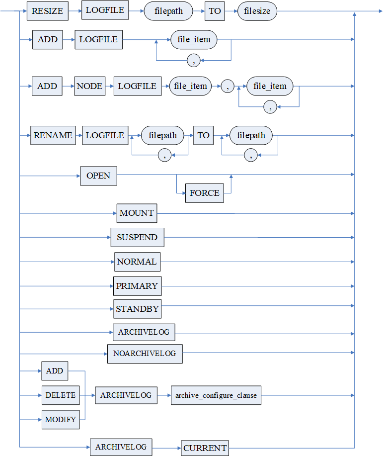

文件说明项（file\_item）

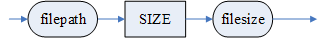

归档配置语句（archive\_configure\_clause）

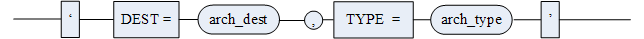

归档类型（arch\_type）

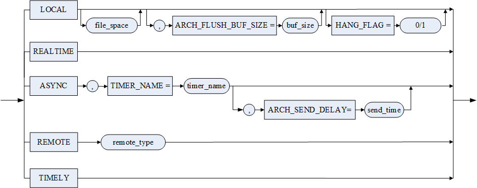

文件和空间限制设置（file\_space）

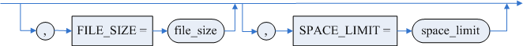

**语句功能**

供具有 DBA 和具有 ALTER DATABASE 权限的用户修改数据库。

**使用说明**

1. 归档的配置也可以通过 DM.INI 参数 ARCH\_INI 和归档配置文件 DMARCH.INI 进行，可参看《DM8 系统管理员手册》，SQL 语句提供了在 DM 服务器运行时对归档配置进行动态修改的手段，通过 SQL 语句修改成功后会将相关配置写入 DMARCH.INI 中；
2. 修改日志文件大小时，只能增加文件的大小，否则失败；
3. ADD NODE LOGFILE 用于 DMDSC 集群扩展节点时使用；
4. 只有 MOUNT 状态 NORMAL 模式下才能启用/关闭归档或者重命名归档日志文件；
5. 针对 REMOTE 归档，仅允许在 MOUNT 状态 NORMAL 模式下进行添加、修改或删除；
6. 针对 LOCAL 归档，仅允许在 MOUNT 状态 NORMAL 模式进行添加和修改，不允许删除本地归档。其中，< 文件和空间限制设置 > 中 SPACE\_LIMIT 和 FILE\_SIZE 两项，在 MOUNT 状态 NORMAL 模式或 OPEN 状态下均可被修改；
7. 针对 REALTIME/TIMELY 归档，在 MOUNT 状态 NORMAL 模式或 OPEN 状态下均可进行添加或删除，但仅允许在 MOUNT 状态 NORMAL 模式下修改 WAIT\_APPLY 配置项；
8. ARCHIVELOG CURRENT 把新生成的，还未归档的联机日志都进行归档；
9. 本地归档仅支持修改 space\_limit/file\_size 配置项值；
10. 非归档模式下，不允许添加、修改或删除任何归档配置；
11. 目前支持的归档配置中，INCOMING\_PATH、ARCH\_FLUSH\_BUF\_SIZE、HANG\_FLAG、ARCH\_TIMER\_NAME、WAIT\_APPLY 仅允许在 MOUNT 状态下修改；
12. DMDSC 数据守护环境中，删除 REALTIME/TIMELY 归档前，需要先依次连接 DMDSC 主库每个节点执行 SP\_SET\_ARCH\_STATUS 使待删除的归档失效，之后数据守护环境中的主库和备库才能执行 ALTER DATABASE DELETE 语句删除 REALTIME/TIMELY 归档。
13. NORMAL、PRIMARY、STANDBY 三种数据库模式切换在 MOUNT 状态下可以直接执行，在 OPEN 状态下需要加 FORCE 关键字强制执行（OPEN 状态下的模式切换仅在单机和 DSC 环境下有效）。

**举例说明**

假设数据库 BOOKSHOP 页面大小为 8K，数据文件存放路径为 C:\\DMDBMS\\data。

例 1 给数据库增加一个日志文件 C:\\DMDBMS\\data\\dmlog\_0.log，其大小为 256M。

```
ALTER DATABASE ADD LOGFILE 'C:\DMDBMS\data\dmlog_0.log' SIZE 256;
```

例 2 扩展数据库中的日志文件 C:\\DMDBMS\\data\\dmlog\_0.log，使其大小增大为 300M。

```
ALTER DATABASE RESIZE LOGFILE 'C:\DMDBMS\data\dmlog_0.log' TO 300;
```

例 3 重命名日志文件 C:\\DMDBMS\\data\\dmlog\_0.log 为 d:\\dmlog\_1.log。

```
ALTER DATABASE MOUNT;
ALTER DATABASE RENAME LOGFILE 'C:\DMDBMS\data\dmlog_0.log' TO 'd:\dmlog_1.log';
ALTER DATABASE OPEN;
```

例 4 设置数据库为 MOUNT 状态 NORMAL 模式，并开启归档模式。

```
ALTER DATABASE MOUNT;
ALTER DATABASE NORMAL;
ALTER DATABASE ARCHIVELOG;
```

例 5 增加本地归档配置，归档目录为 c:\\arch\_local，文件大小为 128MB，空间限制为 1024MB。需要保证当前数据库处于 MOUNT 状态、NORMAL 模式以及归档模式下。

```
ALTER DATABASE ADD ARCHIVELOG 'TYPE = local, DEST = c:\arch_local, FILE_SIZE = 128, SPACE_LIMIT = 1024';
```

例 6 增加一个实时归档配置，远程服务实例名为 realtime，需事先配置 mal。

```
ALTER DATABASE ADD ARCHIVELOG ' TYPE = REALTIME, DEST = realtime';
```

例 7 增加一个异步归档配置，远程服务实例名为 asyn1，定时器名为 timer1，需事先配置好 mal 和 timer。timer 可以通过 SP\_ADD\_TIMER 等定时器管理相关的函数进行动态配置。

```
ALTER DATABASE ADD ARCHIVELOG 'TYPE = ASYNC, DEST = asyn1, ARCH_TIMER_NAME = timer1';
```

例 8 增加一个异步归档配置，远程服务实例名为 asyn2，定时器名为 timer2，源库到异步备库的归档延时发送时间为 10 分钟，需事先配置好 mal 和 timer。timer 可以通过 SP\_ADD\_TIMER 等定时器管理相关的函数进行动态配置。

```
ALTER DATABASE ADD ARCHIVELOG 'TYPE=ASYNC, DEST=asyn2, ARCH_TIMER_NAME=timer2, ARCH_SEND_DELAY=10';
```

例 9 设置数据库状态为 OPEN。

```
ALTER DATABASE OPEN;
```

例 10 MOUNT 状态下设置数据库模式为 PRIMARY。

```
ALTER DATABASE MOUNT;
ALTER DATABASE PRIMARY;
ALTER DATABASE OPEN FORCE;
```

例 11 OPEN 状态下设置数据库模式为 STANDBY。

```
ALTER DATABASE OPEN;
ALTER DATABASE STANDBY FORCE;
ALTER DATABASE OPEN FORCE;
```

## 3.2 管理用户

### 3.2.1 用户定义语句

在数据库中创建新的用户，DM 中直接用 USER 与数据库服务器建立连接。

**语法格式**

```
CREATE USER [IF NOT EXISTS] <用户名> IDENTIFIED <身份验证模式>  [PASSWORD_POLICY <口令策略>][<锁定子句>][<存储加密密钥>][<只读标志>][<资源限制子句>][<口令过期子句>][<允许IP子句>][<禁止IP子句>][<允许时间子句>][<禁止时间子句>][<TABLESPACE子句>][<INDEX_TABLESPACE子句>][<表空间配额子句>];
<身份验证模式> ::= 
    <数据库身份验证模式>|
    <外部身份验证模式>
<数据库身份验证模式> ::= BY <口令> [<散列选项>]
<散列选项> ::= HASH WITH [<密码引擎名>.]<散列算法> [<加盐选项>]
<加盐选项> ::= [NO] SALT
<外部身份验证模式> ::= 
    EXTERNALLY | 
    EXTERNALLY AS <用户DN>| 
    EXTERNALLY RADIUS
<锁定子句> ::= 
    ACCOUNT LOCK | 
    ACCOUNT UNLOCK
<存储加密密钥> ::= ENCRYPT BY <口令>
<只读标志> ::= [NOT] READ ONLY
<资源限制子句> ::= 
    DROP PROFILE | 
    PROFILE <profile名> | 
    LIMIT <资源设置>
<资源设置> ::= 
    <资源设置项>{,<资源设置项>} | 
    <资源设置项>{ <资源设置项>}
<资源设置项> ::= 
    GLOBAL_SESSION_PER_USER <参数设置>|
    SESSION_PER_USER <参数设置> |
    CONNECT_IDLE_TIME <参数设置> |
    CONNECT_TIME <参数设置> |
    CPU_PER_CALL <参数设置> |
    CPU_PER_SESSION <参数设置> |
    MEM_SPACE <参数设置> |
    READ_PER_CALL <参数设置> |
    READ_PER_SESSION <参数设置> |
    FAILED_LOGIN_ATTEMPTS <参数设置> |
    PASSWORD_LIFE_TIME <参数设置> | 
    PASSWORD_REUSE_TIME <参数设置> |
    PASSWORD_REUSE_MAX <参数设置> | 
    PASSWORD_LOCK_TIME <参数设置> | 
    PASSWORD_GRACE_TIME <参数设置> |
    INACTIVE_ACCOUNT_TIME<参数设置>
<参数设置> ::=
    <参数值>| 
    UNLIMITED| 
    DEFAULT
<口令过期子句> ::= PASSWORD EXPIRE 
<允许IP子句> ::= 
                ALLOW_IP NULL |
                ALLOW_IP <IP项>{,<IP项>} |
                ALLOW_IP ADD <IP项>{,<IP项>} |
                ALLOW_IP DROP <IP项>{,<IP项>}
<禁止IP子句> ::= 
                NOT_ALLOW_IP NULL |
                NOT_ALLOW_IP <IP项>{,<IP项>} |
                NOT_ALLOW_IP ADD <IP项>{,<IP项>} |
                NOT_ALLOW_IP DROP <IP项>{,<IP项>}
<IP项> ::= 
    <具体IP>|
    <网段>
<允许时间子句> ::= ALLOW_DATETIME <时间项>{,<时间项>}
<禁止时间子句> ::= NOT_ALLOW_DATETIME <时间项>{,<时间项>}
<时间项> ::= 
    <具体时间段> | 
    <规则时间段>
<具体时间段> ::= <具体日期> <具体时间> TO <具体日期> <具体时间>
<规则时间段> ::= <规则时间标志> <具体时间> TO <规则时间标志> <具体时间> 
<规则时间标志> ::= 
    MON | 
    TUE | 
    WED | 
    THURS | 
    FRI | 
    SAT | 
    SUN
<TABLESPACE子句> ::= DEFAULT TABLESPACE <表空间名> 
<INDEX_TABLESPACE子句> ::= DEFAULT INDEX TABLESPACE <表空间名>
<表空间配额子句> ::= 
    QUOTA UNLIMITED |
    QUOTA 0 |
    QUOTA <配额大小> ON <表空间名>{ QUOTA <配额大小> ON <表空间名>}
<配额大小> ::= 
    UNLIMITED |
    <空间大小>[K|M|G|T]
```

**参数**

1. <用户名> 指明要创建的用户名称，用户名称最大长度 128 字节；
2. <参数设置> 用于限制用户对 DM 数据库服务器系统资源的使用；
3. 系统在创建用户时，必须指定一种身份验证模式：< 数据库身份验证模式 > 或者 < 外部身份验证模式 >。
	< 数据库身份验证模式 > 中如果缺省了 < 散列选项 >，则采用 HASH WITH SHA512 SALT。系统用户（SYSDBA、SYSAUDITOR、SYSSSO、SYSDBO）均采用 HASH WITH SHA512 SALT 方式。如果 MANAGER 登录时勾选了“保存口令（S）”，这个口令保存在客户端则采用 HASH WITH AES256 SALT 方式。< 加盐选项 > 缺省为 SALT。
	< 外部身份验证模式 > 支持 LDAP 身份验证、SSL 身份验证、KERBEROS 身份验证和 RADIUS 身份验证。外部身份验证功能仅在安全版本中提供支持，具体请参考《DM8 安全管理》2.3 节。
4. < 口令策略 > 用于设置口令策略，取值 15 或 31。15：禁止与用户名相同、口令长度需大于等于 INI 参数 PWD\_MIN\_LEN 设置的值、须同时包含大写字母(A~Z)和小写字母(a-z)、至少包含一个数字(0-9)；31：除了取值 15 的策略外，还要求至少包含一个标点符号(英文输入法状态下，除“ 和空格外的所有符号)。
5. < 存储加密密钥 > 用于与半透明加密配合使用，缺省情况下系统自动生成一个密钥，半透明加密时用户仅能查看到自己插入的数据；
6. < 只读标志 > 表示该登录是否只能对数据库进行只读操作，缺省为可读写。用户改为只读/非只读后，用户需要重新登录，会话才生效；
7. < 资源设置项 > 的各参数设置说明见下表：

表3.2.1 资源设置项说明

| **资源设置项** | **说明** | **最大值** | **最小值** | **缺省值** |
| --- | --- | --- | --- | --- |
| GLOBAL\_SESSION\_PER\_USER | 在所有 DSC 实例中，一个用户可以同时拥有的会话数量 | 32768 | 1 | 系统所能提供的最大值 |
| SESSION\_PER\_USER | 在一个实例中，一个用户可以同时拥有的会话数量 | 32768 | 1 | 安全版本中默认值为 4096；其他版本中默认值为系统所能提供的最大值 |
| CONNECT\_TIME | 一个会话连接、访问和操作数据库服务器的时间上限。   单位由 INI 参数 RESOURCE\_FLAG 决定。RESOURCE\_FLAG 取值 1、0 时，CONNECT\_TIME 单位分别为秒、分钟。RESOURCE\_FLAG 缺省值为 0 | 当 RESOURCE\_FLAG 取值 1、0 时，缺省值分别为 86400 秒、1440 分钟 | 1 | 无限制 |
| CONNECT\_IDLE\_TIME | 会话最大空闲时间。   单位由 INI 参数 RESOURCE\_FLAG 决定。RESOURCE\_FLAG 取值 1、0 时，CONNECT\_IDLE\_TIME 单位分别为秒、分钟。RESOURCE\_FLAG 缺省值为 0 | 当 RESOURCE\_FLAG 取值 1、0 时，缺省值分别为 86400 秒、1440 分钟 | 1 | 无限制 |
| FAILED\_LOGIN\_ATTEMPTS | 将引起一个账户被锁定的连续注册失败的次数 | 100 | 1 | 3，系统预设管理员用户默认无限制 |
| CPU\_PER\_SESSION | 一个会话允许使用的 CPU 时间上限（单位：秒） | 31536000（365 天） | 1 | 无限制 |
| CPU\_PER\_CALL | 用户的一个请求能够使用的 CPU 时间上限（单位：秒） | 86400（1 天） | 1 | 无限制 |
| READ\_PER\_SESSION | 会话能够读取的总数据页数上限 | 2147483646 | 1 | 无限制 |
| READ\_PER\_CALL | 每个请求能够读取的数据页数 | 2147483646 | 1 | 无限制 |
| MEM\_SPACE | 会话占有的私有内存空间上限（单位：MB） | 2147483647 | 1 | 无限制 |
| PASSWORD\_LIFE\_TIME | 口令有效期（单位：天）。过了有效期，会进入过期口令宽限期。过期口令宽限期由 PASSWORD\_GRACE\_TIME 设置 | 365 | 1 | 无限制 |
| PASSWORD\_REUSE\_TIME | 重用同一个口令的时间间隔（单位：天）。一个口令过了宽限期之后，将禁止使用。如果想再次使用该口令，须同时满足 PASSWORD\_REUSE\_TIME 和 PASSWORD\_REUSE\_MAX 的规定 | 365 | 1 | 无限制 |
| PASSWORD\_REUSE\_MAX | 重用同一个口令之前，需要修改口令的次数 | 32768 | 1 | 无限制 |
| PASSWORD\_LOCK\_TIME | 如果超过 FAILED\_LOGIN\_ATTEMPTS 设置值，一个用户将被锁定的分钟数 | 1440（1 天） | 1 | 1，系统预设管理员用户默认无限制 |
| PASSWORD\_GRACE\_TIME | 过期口令宽限期（单位：天）。宽限期仍可正常访问数据库。但在宽限期中，必须对口令进行修改，修改之后使用新口令可以继续登录系统。如果宽限期未修改口令，超过该宽限期后，将禁止执行除修改口令以外的其他操作 | 30 | 1 | 10，系统预设管理员用户默认无限制 |
| INACTIVE\_ACCOUNT\_TIME | 指定用户的非活跃时间（单位：天）。用户超过指定时间未登录将被自动锁定 | 24855 | 15 | 无限制 |

9. < 口令过期子句 > 用于设置口令过期。口令过期可使用 ALTER USER 语句进行重设；
10. 允许 IP 和禁止 IP 用于控制此登录是否可以从某个 IP 访问数据库，其中禁止 IP 优先。在设置 IP 时，可以利用\*或 CIDR 格式来设置网段，如 192.168.0.\*或 192.168.0.0/16；需要注意，\*和 CIDR 格式不能在同一 IP 中一起设置。设置的允许 IP 和禁止 IP 需要用双引号括起来；
11. 允许时间段和禁止时间段用于控制此登录是否可以在某个时间段访问数据库，其中禁止时间段优先。设置的时间段中的日期和时间要分别用双引号括起来。在设置时间段时，有两种方式：
	1)具体时间段，如 2021 年 1 月 1 日 8：30 至 2024 年 2 月 1 日 17：00；
	2)规则时间段，如 每周一 8：30 至 每周五 17：00。
12. 默认用户表空间\<TABLESPACE 子句 > 和默认索引表空间<INDEX\_TABLESPACE 子句 > 不能使用 SYSTEM、RLOG、ROLL、TEMP 表空间，DMDPC 环境下不支持 <INDEX\_TABLESPACE 子句 >；
13. < 表空间配额子句 > 用于设置用户对表空间的使用空间大小限制。QUOTA UNLIMITED 表示用户对所有表空间均无配额限制，缺省为 QUOTA UNLIMITED。QUOTA 0 表示用户对所有表空间的配额均为 0。允许指定 < 表空间名 > 来设置用户对特定表空间的配额大小，配额上限为 100T，< 空间大小 > 的默认单位为字节。

**图例**

用户定义语句

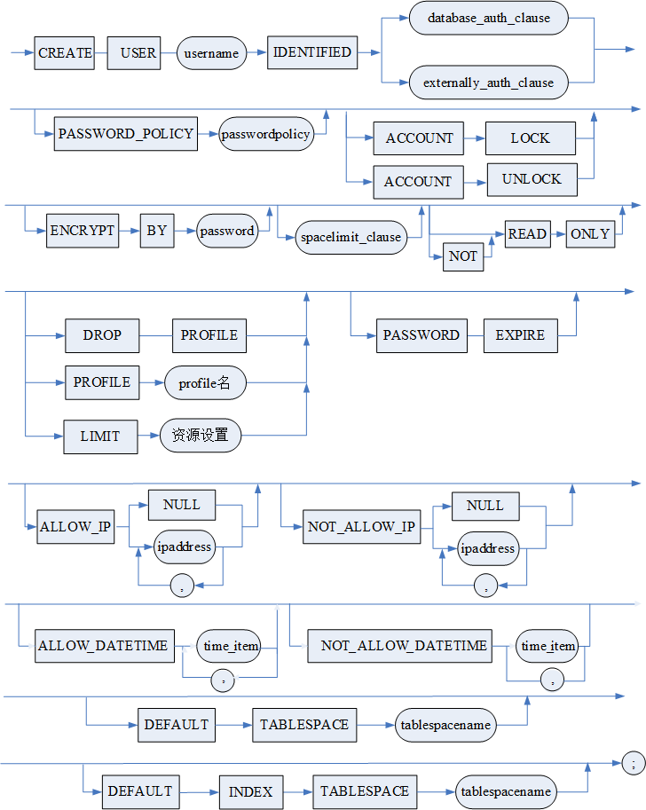

数据库身份验证模式（database\_auth\_clause）

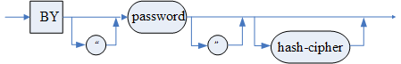

散列选项（hash\_cipher）

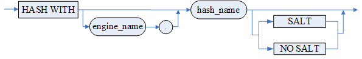

外部身份验证模式（externally\_auth\_clause）

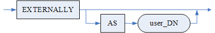

资源设置（set\_resource）

时间项（time\_item）

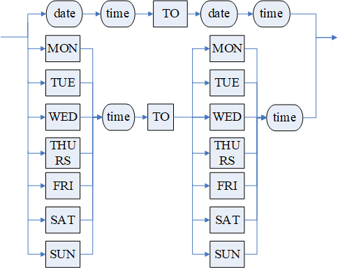

表空间配额子句（tablespace\_quota\_clause）

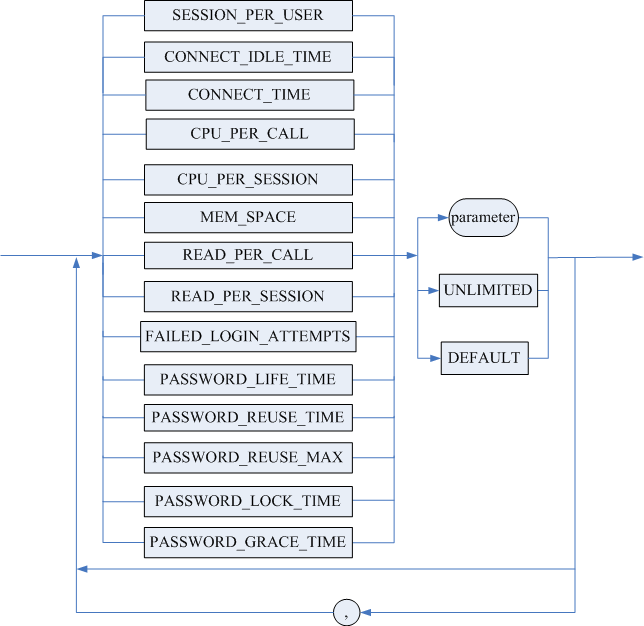 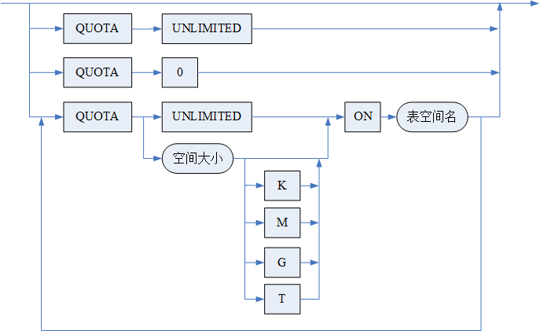

**语句功能**

创建新的用户。创建用户的操作一般只能由系统预设用户 SYSDBA、SYSSSO、SYSAUDITOR 和 SYSDBO 完成，如果普通用户需要创建用户，必须具有 CREATE USER 的数据库权限。

**使用说明**

1. 用户名在服务器中必须唯一。如果用户名已存在则报错，若指定 IF NOT EXISTS 关键字，用户名已存在不报错，忽略本次用户创建操作；
2. 系统为一个用户存储的信息主要有：用户名、口令、资源限制；
3. 用户口令以密文形式存储；
4. 如果没有指定用户默认表空间，则系统指定 MAIN 表空间为用户的默认表空间；
5. 如果没有指定用户默认索引表空间，则 HUGE 表的索引缺省存储在用户的默认表空间中，普通表的索引缺省存储在表的聚集索引所在的表空间中。临时表的索引永远在 TEMP 表空间；
6. 系统预先设置了四个用户，分别为 SYSDBA、SYSAUDITOR、SYSSSO 和 SYSDBO，其中 SYSDBO 用户仅四权分立下支持。各预设用户拥有的具体权限请参考《DM8 安全管理》；
7. < 资源限制子句 > 使用 DROP PROFILE 删除关联的 profile 文件；使用 PROFILE \<profile 名 > 指定关联的 profile 文件；使用 LIMIT < 资源设置 > 直接设置资源设置项。关联 profile 文件后的用户，资源设置项由关联的 profile 文件统一管理配置，无法再通过使用 LIMIT < 资源设置 > 直接设置资源设置项。直到通过修改用户指定 DROP PROFILE 解除关联或关联的 PROFILE 被级联删除之后，才可以使用 LIMIT < 资源设置 > 设置；
8. < 表空间配额子句 > 不支持对系统表空间、临时表空间、回滚表空间设置配额；不支持对安全用户、审计用户设置配额。

**举例说明**

例 1 创建用户名为 BOOKSHOP\_USER、口令为 DMsys\_123、会话超时为 30 分钟的用户。

```
CREATE USER BOOKSHOP_USER IDENTIFIED BY DMsys_123 LIMIT CONNECT_TIME 30;
```

例 2 设置创建 user1，设置密码为过期。需进行重设才能使用。

```
//使用SYSDBA登录
CREATE USER user1 IDENTIFIED BY DMsys_123456 PASSWORD EXPIRE;  

//使用user1/DMsys_123456登录。显示口令过期。无法进行下一步操作
SQL> conn user1/DMsys_123456@localhost:5236
服务器[localhost:5236]:处于普通打开状态
登录使用时间 : 7.617(ms)
口令剩余有效时间(天) : 0
口令是否过期         : 过期

//使用SYSDBA登录。重设密码
ALTER USER user1 IDENTIFIED BY DMsys_123456;

//使用user1/DMsys_123456登录。密码正常。可继续操作数据库
SQL> conn user1/DMsys_123456@localhost:5236
服务器[localhost:5236]:处于普通打开状态
登录使用时间 : 6.332(ms)
```

### 3.2.2 修改用户语句

修改数据库中的用户。

**语法格式**

```
ALTER USER <用户名> [<修改用户子句>] | [<用户代理功能子句>];
<修改用户子句> ::= [IDENTIFIED <身份验证模式>] [REPLACE <口令>] [PASSWORD_POLICY <口令策略>] [<锁定子句>] [<存储加密密钥>] [<只读标志>][<资源限制子句>][<口令过期子句>] [DISCARD OLD PASSWORD][<允许IP子句>][<禁止IP子句>][<允许时间子句>][<禁止时间子句>][<TABLESPACE子句>][<INDEX_TABLESPACE子句>][<SCHEMA子句>][<表空间配额子句>]
<身份验证模式> ::= <数据库身份验证模式>|<外部身份验证模式>
<数据库身份验证模式> ::= BY <口令> [RETAIN CURRENT PASSWORD][<散列选项>]
<散列选项> ::= 参考3.2.1 用户定义语句中的<散列选项>
<外部身份验证模式> ::=  参考3.2.1 用户定义语句中的<外部身份验证模式>
<锁定子句> ::= ACCOUNT <LOCK | UNLOCK>
<存储加密密钥> ::= ENCRYPT BY <口令>
<只读标志> ::= [NOT] READ ONLY
<资源限制子句> ::= 参考3.2.1 用户定义语句中的<资源限制子句>
<口令过期子句> ::= PASSWORD EXPIRE 
<允许IP子句> ::= 
                ALLOW_IP NULL |
                ALLOW_IP <IP项>{,<IP项>}|
                ALLOW_IP ADD <IP项>{,<IP项>} |
                ALLOW_IP DROP <IP项>{,<IP项>}
<禁止IP子句> ::= 
                NOT_ALLOW_IP NULL |
                NOT_ALLOW_IP <IP项>{,<IP项>}|
                NOT_ALLOW_IP ADD <IP项>{,<IP项>} |
                NOT_ALLOW_IP DROP <IP项>{,<IP项>}
<IP项> ::= <具体IP>|<网段>
<允许时间子句> ::= ALLOW_DATETIME <时间项>{,<时间项>}
<禁止时间子句> ::= NOT_ALLOW_DATETIME <时间项>{,<时间项>}
<时间项> ::= 参考3.2.1 用户定义语句中的<时间项>
<TABLESPACE子句> ::=DEFAULT TABLESPACE <表空间名>
<INDEX_TABLESPACE子句> ::= DEFAULT INDEX TABLESPACE <表空间名>
<SCHEMA子句> ::= ON SCHEMA <模式名>
<表空间配额子句> ::= 参考3.2.1 用户定义语句中的<表空间配额子句>
<用户代理功能子句> ::= <GRANT | REVOKE> CONNECT THROUGH <代理用户名>
```

**参数**

用户代理功能子句用于赋予用户 B 能够以代理的身份认证登录用户 A 的权限，即 CONNECT THROUGH 权限。其中，用户 B 表示参数 < 代理用户名 > 指定的用户，用户 A 表示参数 < 用户名 > 指定的用户。关键字 GRANT 表示赋予权限，关键字 REVOKE 表示收回权限。

其余参数同用户定义语句的参数规定一样。

**图例**

用户修改语句

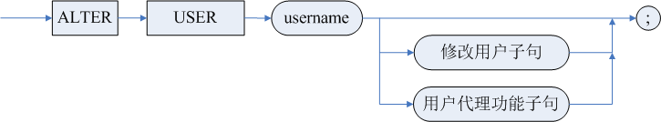

修改用户子句（alter\_user\_clause）

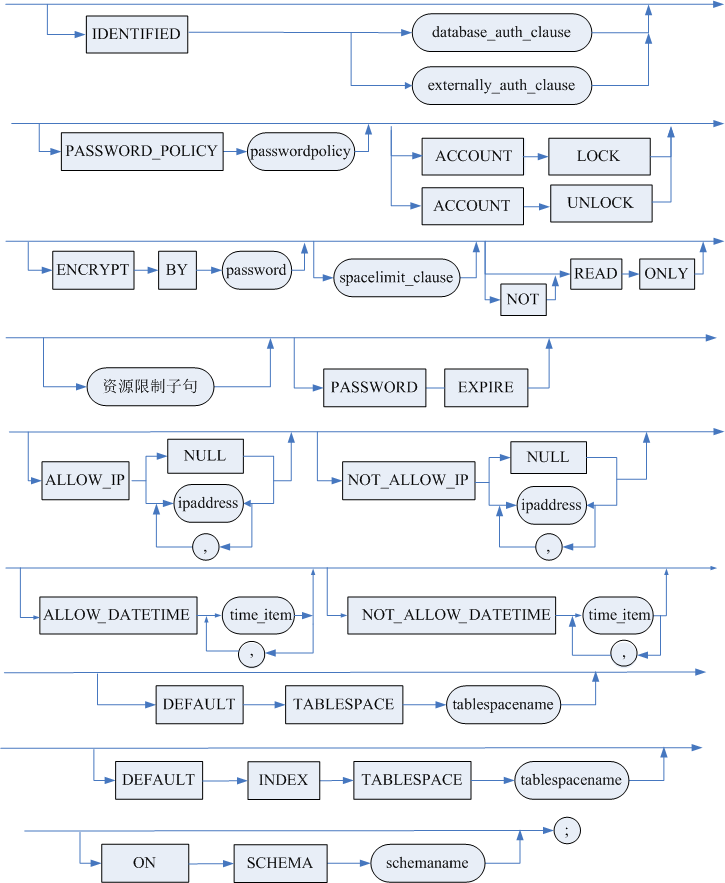

数据库身份验证模式（database\_auth\_clause）

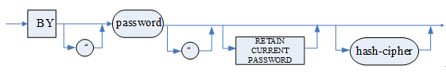

用户代理功能子句（user\_agency\_clause）

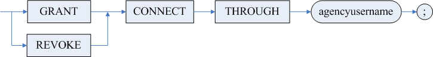

**语句功能**

修改用户。SYSDBA、SYSSSO、SYSAUDITOR 和 SYSDBO 可以无条件修改同类型的用户的信息。普通用户如果想修改自己和其他用户信息，必须具有 ALTER USER 数据库权限。

**使用说明**

1. 每个用户均可修改自身的口令，SYSDBA 用户可强制修改所有其他用户的口令(在数据库验证方式下)；
2. 只有具备 ALTER USER 权限的用户才能修改其身份验证模式、系统角色及资源限制项；
3. 不论 DM.INI 的 DDL\_AUTO\_COMMIT 设置为自动提交还是非自动提交，ALTER USER 操作都会被自动提交；
4. 修改用户口令时，口令策略应符合创建该用户时指定的口令策略；
5. 修改用户口令语句中，RETAIN CURRENT PASSWORD 表示保留原始口令，同时增加新的辅助口令;
6. DISCARD OLD PASSWORD 表示有两种口令的情况下，废弃原始口令;
7. 原始口令为空的用户无法 RETAIN CURRENT PASSWORD;
8. 用户存在原始口令时, 未指定 RETAIN CURRENT PASSWORD 的情况下更改口令, 原始口令保持不变;
9. 修改自己用户的口令, 需要有 APPLICATION\_PASSWORD\_ADMIN 权限才能使用保留原始口令和失效原始口令的操作;
10. 修改其他用户的口令, 需要有 ALTER USER 权限;
11. 不能修改系统固定用户的系统角色；
12. 不能修改系统固定用户为只读；
13. REPLACE < 口令 > 用于在修改数据库身份验证模式下的用户口令时, 指定用户原始口令，与 INI 参数 PASSWORD\_VERIFICATION 有关，该参数缺省为 0。当 INI 参数 PASSWORD\_VERIFICATION 为 1 时，用户修改自己的口令时必须指定 REPLACE 语句，并且在指定后，会校验原口令正确性，如果原始口令校验不通过则无法修改用户口令；拥有修改当前用户权限的其他用户在修改当前用户口令时可以不指定 REPLACE 子句，指定时不会校验原始口令。当 INI 参数 PASSWORD\_VERIFICATION 为 0 时，可选择是否指定 REPLACE 子句；若用户修改自己的口令时指定了 REPLACE 子句，会校验原始口令的正确性；
14. \<SCHEMA 子句> 用于设置用户的缺省模式；
15. 针对用户 B 以代理的身份认证登录用户 A 的权限，即 CONNECT THROUGH 权限，需注意：
	1） 只有拥有 DBA 角色权限的用户（DBA/DB\_POLICY\_ADMIN/DB\_AUDIT\_ADMIN/DB\_OBJECT\_ADMIN）才能赋予用户 B 该权限；
	2） 只有赋予用户 B 以 CONNECT THROUGH 权限后，用户 B 才能以代理的身份认证登录用户 A；
	3） 用户 A、B 可以为 SYSDBA 用户，且用户 A、B 可以为同一用户；
	4） 如果用户 A 或用户 B 不存在，则报错；
	5） 用户 A、B 类型（普通/安全/审计/OBJECT）必须相同，否则报错；
	6） 系统表 SYSGRANTS 中查不到 CONNECT THROUGH 权限；
	7） 无法对三权分立和四权分立的角色设置 CONNECT THROUGH 权限；
	8） CONNECT THROUGH 权限无法和用户其他属性（如口令策略）同时设置。
16. < 资源限制子句 > 使用 DROP PROFILE 删除关联的 profile 文件；使用 PROFILE \<profile 名 > 指定关联的 profile 文件；使用 LIMIT < 资源设置 > 直接设置资源设置项，此处只需要设置要修改的设置项即可，其他设置项值保持不变；
17. < 口令过期子句 > 用于设置口令过期；
18. < 表空间配额子句 > 新修改的配额限制不会影响用户已经使用的表空间；若用户拥有 UNLIMITED TABLESPACE 权限，则对该用户指定 < 表空间配额子句 > 无效，该用户始终对所有表空间均无配额限制；
19. 其他参数的取值、意义与 CREATE USER 中的要求一样。

**举例说明**

例 1 修改用户 BOOKSHOP\_USER，会话空闲期为无限制，最大连接数为 10。

```
ALTER USER BOOKSHOP_USER LIMIT SESSION_PER_USER 10, CONNECT_IDLE_TIME UNLIMITED;
```

例 2 赋予用户 USER2 代理权限，使用户 USER2 可以认证登录用户 USER1。

```
ALTER USER USER1 GRANT CONNECT THROUGH USER2;
```

### 3.2.3 用户删除语句

删除用户。

**语法格式**

```
DROP USER [IF EXISTS] <用户名> [RESTRICT | CASCADE];
```

**参数**

<用户名> 指明被删除的用户。

**图例**

用户删除语句

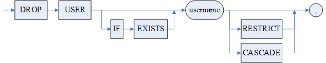

**语句功能**

删除指定用户。删除用户的操作一般由 SYSDBA、SYSSSO、SYSAUDITOR 和 SYSDBO 完成，他们可以删除同类型的其他用户。普通用户要删除其他用户，必须具有 DROP USER 权限。

**使用说明**

1．系统自动创建的四个系统用户 SYSDBA、SYSAUDITOR、SYSSSO 和 SYSDBO 不能被删除；

2．具有 DROP USER 权限的用户即可进行删除用户操作；

3．执行此语句将导致 DM 删除数据库中该用户建立的所有对象，且不可恢复。如果要保存这些实体，请参考 REVOKE 语句；

4．删除不存在的用户会报错。若指定 IF EXISTS 关键字，删除不存在的用户，不会报错；

5．如果未使用 CASCADE 选项，若该用户建立了数据库对象(如表、视图、过程或函数)，或其他用户对象引用了该用户的对象，或在该用户的表上存在其它用户建立的视图，DM 将返回错误信息，而不删除此用户；

6．如果使用了 CASCADE 选项，除数据库中该用户及其创建的所有对象被删除外，如果其他用户创建的表引用了该用户表上的主关键字或唯一关键字，或者在该表上创建了视图，DM 还将自动删除相应的引用完整性约束及视图依赖关系；

7．正在使用中的用户可以被删除，删除后重登录或者做操作会报错。

**举例说明**

例 删除用户 BOOKSHOP\_USER。

```
DROP USER BOOKSHOP_USER;
```

## 3.3 管理模式

### 3.3.1 模式定义语句

模式定义语句创建一个架构，并且可以在概念上将其看作是包含表、视图和权限定义的对象。在 DM 中，一个用户可以创建多个模式，一个模式中的对象(表、视图)可以被多个用户使用。

系统为每一个用户自动建立了一个与用户名同名的模式作为默认模式，用户还可以用模式定义语句建立其它模式。

**语法格式**

```
<模式定义子句1> | <模式定义子句2>
<模式定义子句1> ::= CREATE SCHEMA <模式名> [AUTHORIZATION <用户名>][<DDL_GRANT子句> {< DDL_GRANT子句>}];
<模式定义子句2> ::= CREATE SCHEMA AUTHORIZATION <用户名> [<DDL_GRANT子句> {< DDL_GRANT子句>}];
<DDL_GRANT子句> ::= <表定义> | <域定义>| <基表修改> | <索引定义> | <视图定义> | <序列定义> | <存储过程定义> | <存储函数定义> | <外部函数定义> | <触发器定义> | <特权定义> | <全文索引定义> | <同义词定义> | <包定义> | <包体定义> | <类定义> | <类体定义> | <外部链接定义>] | <物化视图定义> | <物化视图日志定义> | <注释定义> | <自定义运算符定义>
```

**参数**

1. <模式名> 指明要创建的模式的名字，最大长度 128 字节；
2. <表定义> 建表语句；
3. <域定义> 域定义语句；
4. <基表修改> 基表修改语句；
5. <索引定义> 索引定义语句；
6. <视图定义> 建视图语句；
7. <序列定义> 建序列语句；
8. <存储过程定义> 存储过程定义语句；
9. <存储函数定义> 存储函数定义语句；
10. < 外部函数定义 > 外部函数定义语句；
11. <触发器定义> 建触发器语句；
12. <特权定义> 授权语句；
13. <全文索引定义> 全文索引定义语句；
14. <同义词定义> 同义词定义语句；
15. <包定义> 包定义语句；
16. <包体定义> 包体定义语句；
17. <类定义> 类定义语句；
18. <类体定义> 类体定义语句；
19. <外部链接定义> 外部链接定义语句；
20. <物化视图定义> 物化视图定义语句；
21. <物化视图日志定义> 物化视图日志定义语句；
22. <注释定义> 注释定义语句；
23. < 自定义运算符定义 > 自定义运算符定义语句。

**图例**

模式定义语句


sch\_def\_clause1

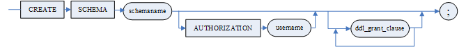

sch\_def\_clause2

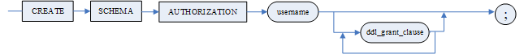

ddl\_grant\_clause：略

**语句功能**

供具有 DBA 角色（三权分立）、DB\_OBJECT\_ADMIN 角色（四权分立）或具有 CREATE SCHEMA 或 CREATE ANY SCHEMA 权限的用户在指定数据库中定义模式。

**使用说明**

1. 在创建新的模式时，如果此模式所属用户下已存在同名的模式，那么创建模式的操作会被跳过，而如果后续还有 DDL 子句，根据权限判断是否可在已存在模式上执行这些 DDL 操作；
2. AUTHORIZATION < 用户名 > 指定拥有该模式的用户。创建者为 SYSDBA 用户才可以使用此选项。非 DBA 用户（普通用户）不能使用该选项创建其他用户拥有的模式；
3. 使用 sch\_def\_clause2 创建模式时，模式名与用户名相同；
4. 使用该语句的用户必须具有 DBA 或 CREATE SCHEMA 权限；
5. DM 使用 DMSQL 程序模式执行创建模式语句，因此创建模式语句中的标识符不能使用系统的保留字；
6. 定义模式时，用户可以用单条语句同时建多个表、视图，同时进行多项授权；
7. 模式一旦定义，该用户所建表、视图等均属该模式，其它用户访问该用户所建立的表、视图等均需在表名、视图名前冠以模式名；而建表者访问自己当前模式所建表、视图时模式名可省；若没有指定当前模式，系统自动以当前用户名作为模式名；
8. 模式定义语句中的基表修改子句只允许添加表约束；
9. 模式定义语句中的索引定义子句不能定义聚集索引；
10. 模式未定义之前，其它用户访问该用户所建的表、视图等均需在表名前冠以建表者名；
11. 模式定义语句不允许与其它 SQL 语句一起执行；
12. 在 DIsql 中使用该语句必须以“/”结束。

**举例说明**

例 用户 SYSDBA 创建模式 SCHEMA1，建立的模式属于 SYSDBA。

```
CREATE SCHEMA SCHEMA1 AUTHORIZATION SYSDBA;
```

### 3.3.2 设置当前模式语句

设置当前模式。

**语法格式**

```
SET SCHEMA <模式名>;
```

**图例**

设置当前模式语句


**语句功能**

供用户设置当前模式。

**举例说明**

例 SYSDBA 用户将当前的模式从 SYSDBA 换到 SALES 模式。

```
SET SCHEMA SALES;
```

### 3.3.3 模式删除语句

在 DM 系统中，允许用户删除整个模式。

**语法格式**

```
DROP SCHEMA [IF EXISTS] <模式名> [RESTRICT | CASCADE];
```

**参数**

<模式名> 指要删除的模式名。

**图例**

模式删除语句

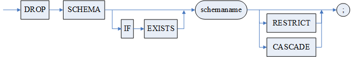

**语句功能**

供具有 DBA 角色（三权分立）或 DROP ANY SCHEMA 权限的用户删除模式。

**使用说明**

1. 删除不存在的模式会报错。若指定 IF EXISTS 关键字，删除不存在的模式，不会报错；
2. 用该语句的用户必须具有 DBA 权限或是该模式的所有者；
3. 如果使用 RESTRICT 选项，只有当模式为空时删除才能成功，否则，当模式中存在数据库对象时则删除失败。默认选项为 RESTRICT 选项；
4. 如果使用 CASCADE 选项，则将整个模式、模式中的对象，以及与该模式相关的依赖关系都删除。

**举例说明**

例 以 SYSDBA 身份登录数据库后，删除 BOOKSHOP 库中模式 SCHEMA1。

```
DROP SCHEMA SCHEMA1 CASCADE;
```

## 3.4 管理表空间

### 3.4.1 表空间定义语句

创建表空间。

DM 数据库中的表空间可以分为普通表空间和混合表空间。使用\<HUGE 路径子句 > 创建的表空间为混合表空间，未使用\<HUGE 路径子句 > 创建的表空间即为普通表空间。普通表空间只能存储普通表（非 HUGE 表）；而混合表空间既可以存储普通表又可以存储 HUGE 表。

**语法格式**

```
CREATE TABLESPACE [IF NOT EXISTS] <表空间名> <数据文件子句>[<数据页缓冲区子句>][<存储加密子句>][<指定ASM存储子句>][<HUGE路径子句>][<文件个数限制子句>][<STORAGE子句>]
<STORAGE子句> ::= 
    STORAGE (ON <RAFT组名>)|
    STORAGE (ON <BP组名>)
<数据文件子句> ::= DATAFILE <文件说明项>{,<文件说明项>}
<文件说明项> ::= <文件路径> [ MIRROR <文件路径>] SIZE <文件大小>[<自动扩展子句>]
<自动扩展子句> ::= AUTOEXTEND <ON [<每次扩展大小子句>][<最大大小子句>] |OFF> 
<每次扩展大小子句> ::= NEXT <扩展大小>
<最大大小子句> ::= MAXSIZE <文件最大大小> |
                        UNLIMITED
<数据页缓冲区子句> ::= CACHE = <缓冲区名>
<存储加密子句> ::= ENCRYPT WITH <加密算法> <密码子句>
<密码子句>::=BY <加密密码> | 
           BY WRAPPED <加密密码密文>
<指定ASM存储子句>：：= [<条带化类型子句>][<镜像类型子句>]
<条带化类型子句> ::= STRIPING<0|32|64|128|256>
<镜像类型子句> ::= HIGH | NORMAL | EXTERNAL
<HUGE路径子句> ::= WITH HUGE PATH <HUGE数据文件路径> 
<文件个数限制子句> ::= FILE LIMIT <文件个数>
```

**参数**

1. <表空间名> 表空间的名称，最大长度 128 字节；
2. <文件路径> 指明新生成的数据文件在操作系统下的路径 ＋ 新数据文件名。数据文件的存放路径符合 DM 安装路径的规则，若指定目录不存在则自动创建相应目录。若路径是相对路径，仅支持路径起始位置的当前目录的相对路径“./”。例如：支持“./data/TS.DBF”，不支持“../data/TS.DBF”、“/./TS.DBF”等；DSC 镜像环境下若创建表空间时指定多个 ASM 文件路径，要求数据文件必须属于同一磁盘组；
3. MIRROR 数据文件镜像，用于在数据文件出现损坏时替代数据文件进行服务；MIRROR 数据文件的<文件路径>必须是绝对路径。要使用数据文件镜像，必须在建库时开启页校验的参数 PAGE\_CHECK；
4. <文件大小> 整数值，指明新增数据文件的大小，单位 MB，取值范围 4096\*页大小~2147483647\*页大小；存在特殊情况：若控制系统中为表空间提前预留的簇个数的 INI 参数 TS\_RESERVED\_EXTENTS 取缺省值 64，且数据库初始化时指定簇大小 EXTENT\_SIZE 为 64，此时表空间预留簇个数占用空间大小正好等于表空间大小的理论最小值（4096\*页大小）；而新创建的表空间至少要占用 1 个簇，由于当前剩余的空间不满足 TS\_RESERVED\_EXTENTS 参数指定的预留簇个数要求，系统会按照 INI 参数 TS\_AUTO\_EXTEND\_SIZE 的值，自动扩展表空间大小直至满足预留簇个数所需的空间要求；
5. < 每次扩展大小子句 > 指明数据库文件每次扩展的大小，单位 MB，取值范围为 1~2048。若不指定该子句，则扩展大小默认设为 INI 参数 TS\_AUTO\_EXTEND\_SIZE 所指定的大小，后续不随该 INI 参数的变化而动态调整。另外，TEMP 表空间文件在 V$DATAFILE 中显示的扩展大小始终为 0，但其实际扩展大小由 INI 参数 TS\_AUTO\_EXTEND\_SIZE 控制，会随着该参数值的变化而自动调整；使用 V8.1.5.13 之前的版本创建的扩展大小为 0 的表空间文件在 V$DATAFILE 中显示的扩展大小为 0 时，其实际扩展大小由 INI 参数 TS\_AUTO\_EXTEND\_SIZE 控制，会随着该参数值的变化而自动调整；
6. < 最大大小子句 > 指明数据库文件的最大大小，单位 MB，如果不指定此子句，则为无限制；
7. <缓冲区名> 指明表空间数据页所在的缓冲区名，可取值 NORMAL 或 KEEP，缺省为 NORMAL。该参数目前无实际作用，KEEP 取值不生效；
8. <加密算法> 可以是系统内置的加密算法也可以是第三方加密算法，详情请参考手册《DM8 安全管理》；
9. <加密密码> 必须满足长度大于等于 INI 参数 PWD\_MIN\_LEN 设置的值，同时不超过 32，且包含大写、小写、数字。若未指定，由 DM 随机生成。
	< 加密密码密文 > 提供一种创建和现有的加密表/表空间一样密钥的表/表空间的语法，和 WRAPPED 关键词搭配使用。加密密码密文可通过查看现有的加密表/表空间定义语句获取。例如：select dbms\_metadata.get\_ddl('TABLESPACE','TS03');查看到的 CREATE TABLESPACE "TS03" DATAFILE '/data/sdb/DAMENG/ts03.dbf' SIZE 32 AUTOEXTEND ON NEXT 64 MAXSIZE 16777215 CACHE = "NORMAL" ENCRYPT WITH OPENSSL\_SM4\_OFB\_V1 BY WRAPPED '0xDEFBACCB9F0D15FB420717215C138B3D55E83D2A72B528751EF40D0B4719B540160A90456BACB7A225BE040AB4FCF84E36BD58C30C708607' COPY 0 MICRO WITH HUGE PATH '/data/sdb/DAMENG/ts03' MICRO;。则'0xDEFBACCB9F0D15FB420717215C138B3D55E83D2A72B528751EF40D0B4719B540160A90456BACB7A225BE040AB4FCF84E36BD58C30C708607'即为加密密码密文。
10. <指定 ASM 存储子句 > 专门用于 DMASM 镜像环境，用于指定表空间数据文件的条带化粒度和镜像类型。

< 条带化类型子句 > 用于指定数据文件条带化粒度。取值 0、32、64、128 和 256，缺省值 32，单位 KB。取值 0 表示粗粒度，粗粒度条带是将文件按 AU 大小分割为一个个数据块。取值 32~256 表示细粒度，细粒度条带是将文件按照条带化粒度大小分割为一个个数据块。

< 镜像类型子句 > 用于指定数据文件镜像类型，即文件的副本数。取值 EXTERNAL、NORMAL、HIGH，分别表示单副本、两副本和三副本，缺省值为 ASM 数据文件所属磁盘组的副本数。

11. \<HUGE 路径子句 > 用于创建一个混合表空间。HUGE 数据文件存储在\<HUGE 路径子句 > 指定的路径中，普通（非 HUGE）数据文件存储在 < 数据文件子句 > 指定的路径中。
12. < 文件个数限制子句 > 用于限制当前表空间所支持的最大文件个数。与全局 INI 参数 TS\_FIL\_MAX\_ID（限制每个表空间的最大文件个数）不同，本子句仅作用于当前表空间。取值范围 64~8191，缺省值为 255。
13. \<STORAGE 子句 > DMDPC 专用，对单节点如果使用了\<STORAGE 子句 > 会直接忽略。通过\<RAFT 组名 > 或\<BP 组名 > 指定一个 RAFT 组作为表空间的存储位置。RAFT 组名或 BP 组名必须是已存在的组名。若指定的是\<RAFT 组名 >，则为明确指定 RAFT 组名。若指定的是\<BP 组名 >，则系统会从指定的 BP 组中随机挑选一个 RAFT 组。如果\<STORAGE 子句 > 缺省，即\<RAFT 组名 > 和\<BP 组名 > 均未指定，则系统会从现有的 BP RAFT 组中随机挑选一个作为表空间的存储位置。

**图例**

表空间定义语句

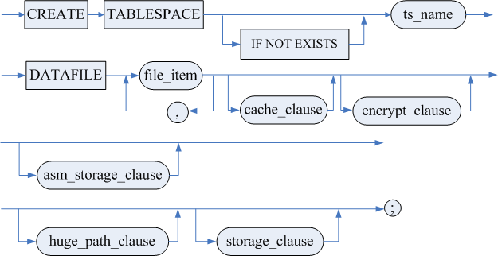

文件说明项（file\_item）

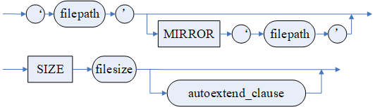

自动扩展子句（autoextend\_clause）

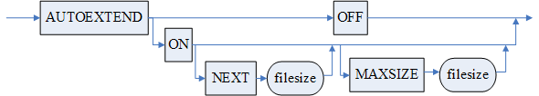

数据页缓冲区子句（cache\_clause）


存储加密子句（encrypt\_clause）

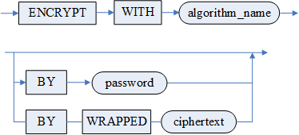

指定 ASM 存储子句（asm\_storage\_clause）

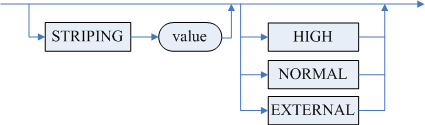

HUGE 路径子句（huge\_path\_clause）  


文件个数限制子句（file\_limit\_clause）


storage 子句（storage\_clause）

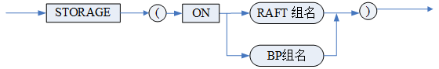

**语句功能**

供具有 DBA 角色 或具有 CREATE TABLESPACE 权限的用户定义表空间。

**使用说明**

1. 表空间名在数据库中必须唯一。如果表空间名已存在则报错。若指定 IF NOT EXISTS 关键字，表空间名已存在不报错，忽略本次表空间创建操作；
2. 一个表空间中，数据文件和镜像文件的个数一起不能超过 INI 参数 TS\_FIL\_MAX\_ID 设置的值；
3. 如果全库已经加密，就不再支持表空间加密；
4. SYSTEM 表空间、TEMP 表空间不允许关闭自动扩展；
5. TEMP 表空间相关信息记录在 dmtemp.ctl 控制文件中，DM 服务器启动时根据 dmtemp.ctl 中的内容构建 TEMP 表空间数据文件。
6. DSC 镜像环境下若创建表空间时指定多个 ASM 文件路径，要求数据文件必须属于同一磁盘组。

**举例说明**

例 1 以 SYSDBA 身份登录数据库后，创建表空间 TS1，指定数据文件 TS1.dbf，大小 128M。

```
CREATE TABLESPACE TS1 DATAFILE 'd:\TS1.dbf' SIZE 128;
```

例 2 在基于 DMASM 镜像的 DMDSC 中，创建一个数据文件条带化粒度为 128KB、镜像类型为 HIGH(三副本)的表空间。

```
CREATE TABLESPACE TS1 DATAFILE '+DATA/dsc_mirror/test.dbf' SIZE 128 STRIPING 128 HIGH;
```

### 3.4.2 修改表空间语句

修改表空间。

**语法格式**

```
ALTER TABLESPACE <表空间名> [ONLINE｜OFFLINE｜CORRUPT|<表空间重命名子句>｜<数据
文件重命名子句>|<增加数据文件子句>|<修改文件大小子句>|<修改文件自动扩展子句>|<数据页缓冲区子句>|<DSC集群表空间负载均衡子句>|<增加HUGE路径子句>|<删除表空间文件>|<修改文件个数限制子句>]
<表空间重命名子句> ::= RENAME TO <表空间名>
<数据文件重命名子句>::= RENAME DATAFILE <文件路径>{,<文件路径>} TO <文件路径>{,<文件路径>}
<增加数据文件子句> ::= ADD <数据文件子句>
<数据文件子句> ::= 参考3.4.1 表空间定义语句中的<数据文件子句>
<修改文件大小子句> ::= RESIZE DATAFILE <文件路径> TO <文件大小> [ON RAFT_NAME]
<修改文件自动扩展子句> ::= DATAFILE <文件路径>{,<文件路径>}[<自动扩展子句>]
<自动扩展子句> ::= 参考3.4.1 表空间定义语句中的<自动扩展子句>
<数据页缓冲区子句> ::= CACHE = <缓冲区名>
<DSC集群表空间负载均衡子句> ::= OPTIMIZE <DSC集群节点号>
<增加HUGE路径子句> ::= ADD HUGE PATH <HUGE数据文件路径>
<删除表空间文件>::=DROP DATAFILE <文件路径>
<修改文件个数限制子句> ::= FILE LIMIT <文件个数>
```

**参数**

1. <表空间名> 表空间的名称；
2. ONLINE｜OFFLINE｜CORRUPT 表示表空间的状态。ONLINE 为联机状态，ONLINE 时才允许用户访问该表空间中的数据；OFFLINE 为脱机状态， OFFLINE 时不允许访问该表空间中的数据；CORRUPT 为损坏状态，当表空间处于 CORRUPT 状态时，只有被还原恢复后才能提供服务，否则不能使用只能删除。三种状态的相互转换情况：ONLINE<->OFFLINE->CORRUPT；
3. <文件路径> 指明数据文件在操作系统下的路径 ＋ 新数据文件名。数据文件的存放路径符合 DM 安装路径的规则，且该路径必须是已经存在的；
4. <文件大小> 整数值，指明新增数据文件的大小，单位 MB；
5. ON RAFT\_NAME 仅在 DPC 环境下有效，非 DPC 环境下直接忽略指定的 RAFT\_NAME；且 DPC 环境下，若修改非临时表空间时指定了 RAFT\_NAME，也直接忽略。DPC 环境下连接 SP/BS 时，可指定修改单个节点所在的 RAFT（包括 SP/MP/BP/BS）临时表空间文件的大小，不指定时则广播修改除 MP 以外的 RAFT 临时表空间文件的大小；直连 MP 时无论是否指定 RAFT，都只修改 MP 本地临时文件大小；
6. <缓冲区名> 指明表空间数据页所在的缓冲区名，可取值 NORMAL 或 KEEP，缺省为 NORMAL。该参数目前无实际作用，KEEP 取值不生效；
7. < 增加 HUGE 路径子句 > 增加一个 HUGE 数据文件路径。最多可添加 127 个 HUGE 数据文件路径。DMDPC 环境下 HUGE 表空间不支持多路径；
8. < 删除表空间文件 > 删除表空间中某一路径对应的数据文件。删除的前提条件为：表空间必须处于 ONLINE 状态；数据库必须是 PRIMARY 或者 NORMAL 模式，并且处于 OPEN 状态；不支持 SYSTEM、回滚表空间；联机日志不能删除 0 号和 1 号文件；其它表空间则不能删除 0 号文件或表空间中唯一文件；必须先删除最大文件 ID 的文件；执行文件删除前必须删除从该文件分配了簇的数据库对象；
9. < 修改文件大小子句 > 将表空间中某一路径对应的数据文件进行体积更改。对文件大小进行缩减的前提条件为：表空间必须处于 ONLINE 状态；数据库必须处于 OPEN 状态。另外，不支持缩减联机日志；只有当指定偏移之后的簇被释放后截断操作才能执行，因而操作并不总是能够截断到指定偏移。另外需要注意的是，回滚表空间文件的缩减比较特殊，由于执行缩减语句的事务本身需要分配新的回滚页，而每个用户会话上事务新分配出的回滚页页号分布是不同的，因此，当指定的目标缩减偏移较小时，即使不存在其他已使用未释放的回滚页，也不保证能够一次性缩减成功，遇到这种情况，可以关闭所有已连接会话，然后创建一个新的会话再尝试缩减；
10. < 数据文件重命名子句 >：源文件路径无要求，对于 TO 后的目标文件路径，若路径是相对路径，仅支持路径起始位置的当前目录的相对路径“./”。例如：支持“./data/TS.DBF”，不支持“../data/TS.DBF”、“/./TS.DBF”等。
11. < 修改文件个数限制子句 > 修改表空间所支持的最大文件个数限制。取值范围 64~8191，且不允许小于表空间已有文件个数。

**图例**

修改表空间语句

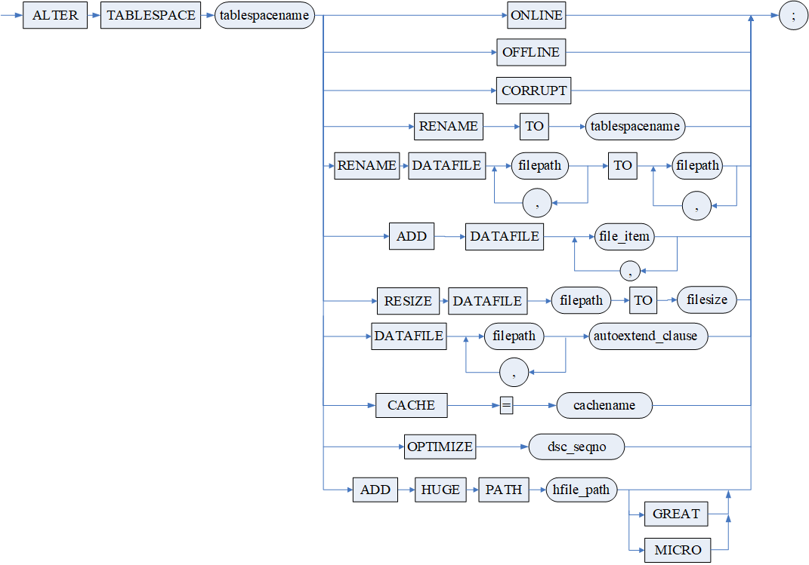

**语句功能**

供具有 DBA 角色或 ALTER TABLESPACE 权限的用户修改表空间。

**使用说明**

1. 不论 DM.INI 的 DDL\_AUTO\_COMMIT 设置为自动提交还是非自动提交，ALTER TABLESPACE 操作都会被自动提交；
2. SYSTEM 表空间、TEMP 表空间不允许关闭自动扩展；
3. 如果表空间有未提交事务时，表空间不能修改为 OFFLINE 状态；在故障节点活动事务回滚完成前和已提交事务 PURGE 完成前，表空间不能修改为 OFFLINE 状态；
4. 重命名表空间数据文件时，表空间必须处于 OFFLINE 状态，修改成功后再将表空间修改为 ONLINE 状态；
5. 表空间如果发生损坏（表空间还原失败，或者数据文件丢失或损坏）的情况下，允许将表空间切换为 CORRUPT 状态，并删除损坏的表空间，如果表空间上定义有对象，需要先将所有对象删除，再删除表空间；
6. DSC 集群表空间负载均衡子句用于在 DSC 集群环境中进行基于表空间的负载均衡设置，可指定优化节点号，当 INI 参数 DSC\_TABLESPACE\_BALANCE 为 1 时，符合条件的查询语句会被自动重连至\<DSC 集群节点号 > 指定的节点执行，从而实现负载均衡。当指定的\<DSC 集群节点号 > 为非法节点号时，此表空间的优化节点失效；
7. 对普通表空间使用<增加 HUGE 路径子句 >，可将普通表空间升级为混合表空间；对混合表空间使用<增加 HUGE 路径子句 >，可为混合表空间添加新的 HUGE 数据文件路径。

**举例说明**

例 １ 将表空间 TS1 名字修改为 TS2。

```
ALTER TABLESPACE TS1 RENAME TO TS2;
```

例 2 增加一个路径为 d:\\TS1\_1.dbf，大小为 128M 的数据文件到表空间 TS1。

```
ALTER TABLESPACE TS1 ADD DATAFILE 'd:\TS1_1.dbf' SIZE 128;
```

例 3 修改表空间 TS1 中数据文件 d:\\TS1.dbf 的大小为 200M。

```
ALTER TABLESPACE TS1 RESIZE DATAFILE 'd:\TS1.dbf' TO 200;
```

例 4 重命名表空间 TS1 的数据文件 d:\\TS1.dbf 为 e:\\TS1\_0.dbf。

```
ALTER TABLESPACE TS1 OFFLINE;
ALTER TABLESPACE TS1 RENAME DATAFILE 'd:\TS1.dbf' TO 'e:\TS1_0.dbf';
ALTER TABLESPACE TS1 ONLINE;
```

例 5 修改表空间 TS1 的数据文件 d:\\TS1.dbf 自动扩展属性为每次扩展 10M，最大文件大小为 1G。

```
ALTER TABLESPACE TS1 DATAFILE 'd:\TS1.dbf' AUTOEXTEND ON NEXT 10 MAXSIZE 1000;
```

例 6 修改表空间为 CORRUPT 状态，注意只有在表空间处于 OFFLINE 状态或表空间损坏的情况下才允许使用。

```
ALTER TABLESPACE TS1 CORRUPT;
```

例 7 为表空间 TS1 添加 HUGE 数据文件路径

```
ALTER TABLESPACE TS1 ADD HUGE PATH 'D:\dmdbms\data\DAMENG\TS1\HUGE2';
```

### 3.4.3 表空间删除语句

删除表空间。

**语法格式**

```
DROP TABLESPACE [IF EXISTS] <表空间名>
```

**参数**

<表空间名> 所要删除的表空间的名称。

**图例**

表空间删除语句

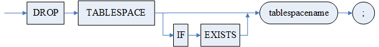

**语句功能**

供具有 DBA 角色或 DROP TABLESPACE 权限的用户删除表空间。

**使用说明**

1. 删除不存在的表空间会报错。若指定 IF EXISTS 关键字，删除不存在的表空间，不会报错；
2. SYSTEM、RLOG、ROLL 和 TEMP 表空间不允许删除；
3. 系统处于 SUSPEND 或 MOUNT 状态时不允许删除表空间，系统只有处于 OPEN 状态下才允许删除表空间。

**举例说明**

例 以 SYSDBA 身份登录数据库后，删除表空间 TS1。

```
DROP TABLESPACE TS1;
```

### 3.4.4 表空间失效文件检查

表空间恢复失效文件的检查。

**语法格式**

```
SP_FILE_SYS_CHECK ();
```

**语句功能**

在 LINUX 操作系统下，检查是否有数据文件被删除。

**使用说明**

该过程只在 LINUX 下有效。

**举例说明**

```
SP_FILE_SYS_CHECK ();
```

### 3.4.5 表空间失效文件恢复准备

表空间恢复失效文件的准备。

**语法格式**

```
SP_TABLESPACE_PREPARE_RECOVER(<表空间名>);
```

**语句功能**

在 LINUX 操作系统下，如果出现了正在使用数据文件被删除的情况，该过程完成失效文件恢复的准备工作。

**使用说明**

该过程只在 LINUX 下有效。

**举例说明**

```
SP_TABLESPACE_PREPARE_RECOVER('MAIN');
```

### 3.4.6 表空间失效文件恢复

表空间失效文件的恢复。

**语法格式**

```
SP_TABLESPACE_RECOVER(<表空间名>);
```

**语句功能**

在 LINUX 操作系统下，如果出现了正在使用数据文件被删除的情况，在调用了恢复准备的 SP\_TABLESPACE\_PREPARE\_RECOVER 及在 OS 系统内完成了数据文件的复制后，调用该过程完成文件的恢复工作。表空间失效文件恢复的详细步骤可参考《DM8 系统管理员手册》。

**使用说明**

1. 该过程只在 LINUX 下有效；
2. 在 SP\_TABLESPACE\_PREPARE\_RECOVER 及在 OS 系统内完成了数据文件的复制后调用。

**举例说明**

```
SP_TABLESPACE_RECOVER('MAIN');
```

## 3.5 管理表

### 3.5.1 表定义语句

用户数据库建立后，就可以定义基表来保存用户数据的结构。DM 数据库的表可以分为两类，分别为数据库内部表和外部表，数据库内部表由数据库管理系统自行组织管理，而外部表在数据库的外部组织，是操作系统文件。其中内部表包括：数据库基表、HUGE 表和水平分区表。手册中如无明确说明均指数据库基表。下面分别对这各种表的创建与使用进行详细描述。

#### 3.5.1.1 定义数据库基表

用户数据库建立后，就可以定义基表来保存用户数据的结构。需指定如下信息：

1. 表名、表所属的模式名；
2. 列定义；
3. 完整性约束。

**语法格式**

```
CREATE [[GLOBAL] TEMPORARY] TABLE [IF NOT EXISTS] <表名定义> <表结构定义>;
<表名定义> ::= [<模式名>.] <表名> 
<表结构定义>::=<表结构定义1> | <表结构定义2>
<表结构定义1>::= (<列定义> {,<列定义>} [,<表级约束定义>{,<表级约束定义>}])[<属性子句>] [<延迟段分配子句>] [<压缩子句>][表并行度子句][<高级日志子句>] [<add_log子句>] [<DISTRIBUTE子句>][<AUTO_INCREMENT子句>]
<表结构定义2>::= (<列定义> {,<列定义>} [,<表级约束定义>{,<表级约束定义>}])[<属性子句>] [<延迟段分配子句>] [<压缩子句>][<表并行度子句>]AS <不带INTO的SELECT语句>[<add_log子句>] [<DISTRIBUTE子句>];
<列定义> ::= <不同类型列定义> [<列定义子句>] [<STORAGE子句>][<存储加密子句>][COMMENT '<列注释>']
<不同类型列定义> ::=<普通列列定义>|<虚拟列列定义>
<普通列列定义>::= <列名> <数据类型>
<虚拟列列定义> ::= <列名>[<数据类型>] [GENERATED ALWAYS]AS (<虚拟列定义>) [VIRTUAL] [VISIBLE]
<列定义子句> ::= 
    DEFAULT [ON NULL] <列缺省值表达式> |
    <自增列子句> |
    <列级约束定义> |
    DEFAULT [ON NULL] <列缺省值表达式> <列级约束定义> |
    <自增列子句> <列级约束定义> |
    <列级约束定义> DEFAULT [ON NULL] <列缺省值表达式> |
    <列级约束定义> <自增列子句> 
<自增列子句> ::= 
IDENTITY [(<种子>,<增量>)]|
AUTO_INCREMENT
<列级约束定义> ::= <列级完整性约束>{ <列级完整性约束>}
<列级完整性约束> ::=[CONSTRAINT <约束名>] <column_constraint_action> [<失效生效选项>]
<column_constraint_action>::=
     [NOT] NULL |
     <唯一性约束选项> [USING INDEX TABLESPACE {<表空间名> | DEFAULT}] |
     <引用约束> |
     CHECK (<检验条件>)|
     NOT VISIBLE
<唯一性约束选项> ::= 
PRIMARY KEY | 
[NOT] CLUSTER PRIMARY KEY |
CLUSTER [UNIQUE] KEY | 
UNIQUE 
<引用约束> ::= [FOREIGN KEY] REFERENCES [PENDANT] [<模式名>.]<表名>[(<列名>{[,<列名>]})] [MATCH  <FULL|PARTIAL|SIMPLE>][<引用触发动作>] [WITH INDEX] 
<引用触发动作> ::=
    <UPDATE 规则> [<DELETE 规则>] |
    <DELETE 规则> [<UPDATE 规则>]
<UPDATE 规则> ::= ON UPDATE <引用动作>
<DELETE 规则> ::= ON DELETE <引用动作>
<引用动作> ::= CASCADE | SET NULL | SET DEFAULT | NO ACTION
<失效生效选项>::=ENABLE | DISABLE  
<STORAGE子句> ::= STORAGE(<STORAGE项> {,<STORAGE项>})
<STORAGE项> ::= 
    INITIAL <初始簇数目> |
    NEXT <下次分配簇数目> |
    MINEXTENTS <最小保留簇数目> |
    ON <表空间名> |
    FILLFACTOR <填充比例> |
    BRANCH  <BRANCH数> |
    BRANCH  (<BRANCH数>, <NOBRANCH数>) |
    NOBRANCH |
    CLUSTERBTR |
    WITH COUNTER |
    WITHOUT COUNTER |
    USING LONG ROW|
    DISABLE USING LONG ROW

<存储加密子句>::= <透明存储加密子句>|<半透明存储加密子句>
<透明存储加密子句>::= <透明存储加密子句1>|<透明存储加密子句2>
<透明存储加密子句1>::= ENCRYPT [<透明加密用法>] 
<透明存储加密子句2>::= ENCRYPT <透明加密用法><散列选项>
<透明加密用法> ::= WITH <加密算法> [<透明加密选项>]|
                   <透明加密选项> 
<透明加密选项> ::= <透明加密选项1> |<透明加密选项2> |<透明加密选项3> 
<透明加密选项1> ::= AUTO 
<透明加密选项2> ::= AUTO BY <列存储密钥> 
<透明加密选项3> ::= AUTO BY WRAPPED <列存储密钥的密文>
<半透明存储加密子句> ::= ENCRYPT [WITH <加密算法>] MANUAL [<半透明加密选项>][<散列选项>]
<半透明加密选项> ::= <半透明加密选项1> | <半透明加密选项2> | <半透明加密选项3>
<半透明加密选项1> ::= <可见用户列表>
<半透明加密选项2> ::= BY <列存储密钥> [<可见用户列表>]
<半透明加密选项3> ::= BY WRAPPED <列存储密钥的密文> [<可见用户列表>]
<可见用户列表> ::= USER ([<用户名> {,<用户名>}])
<散列选项> ::= HASH WITH <散列算法> [<加盐选项>]
<加盐选项> ::= [NO] SALT

<表级约束定义>::=[CONSTRAINT <约束名>] <表级约束子句>[<失效生效选项>][<VALIDATE选项>]
<表级约束子句>::=<表级完整性约束> 
<表级完整性约束> ::=
    <唯一性约束选项> (<列名> {,<列名>}) [USING INDEX TABLESPACE{ <表空间名> | DEFAULT}] [GLOBAL]|
    FOREIGN KEY (<列名>{,<列名>}) <引用约束> |
    CHECK (<检验条件>) 
<属性子句>::= <表空间子句>| 
ON COMMIT <DELETE | PRESERVE>  ROWS| 
<空间限制子句>| 
<STORAGE子句>
<表空间子句>::=TABLESPACE <表空间名>
<空间限制子句> ::= 
    DISKSPACE LIMIT <空间大小>|
    DISKSPACE UNLIMITED
<延迟段分配子句> ::= 
    SEGMENT CREATION IMMEDIATE |
    SEGMENT CREATION DEFERRED 
<压缩子句> ::= 
    COMPRESS | 
    COMPRESS (<列名> {,<列名>}) | 
    COMPRESS EXCEPT (<列名> {,<列名>})
<表并行度子句>::=
    PARALLEL|
    PARALLEL<并行度>|
    NOPARALLEL
<高级日志子句> ::= WITH ADVANCED LOG
<add_log子句>::= ADD LOGIC LOG
<DISTRIBUTE子句> ::= 
    DISTRIBUTED [RANDOMLY | FULLY]|
    DISTRIBUTED BY [<HASH>](<列名> {,<列名>})|
    DISTRIBUTED BY RANGE (<列名> {,<列名>})(<范围分布项> {,<范围分布项>})|
    DISTRIBUTED BY LIST (<列名> {,<列名>})(<列表分布项> {,<列表分布项>})
<范围分布项> ::= 
    VALUES LESS THAN (<范围表达式>{,<范围表达式>}) ON <实例名>|
    VALUES EQU OR LESS THAN (<范围表达式>{,<范围表达式>}) ON <实例名>
<范围表达式> ::= MAXVALUE | <表达式>
<列表分布项> ::= VALUES (DEFAULT | <表达式>{,<表达式>}) ON <实例名>
<AUTO_INCREMENT子句>:：= AUTO_INCREMENT [=] <起始边界值>
<不带INTO的SELECT语句> ::= <查询表达式>|<带参数查询语句>
<带参数查询语句>::=<子查询> | (<带参数查询语句>)
<VALIDATE选项>::=[NOVALIDATE | VALIDATE]
```

**参数**

1. \[GLOBAL\] TEMPORARY 指明创建临时表，GLOBAL 选项无实际作用。如果临时表的表名不以“#”开头，则创建全局临时表；如果临时表的表名以“#”开头并且后面第二个字符也是“#”，则创建全局临时表；如果临时表的表名以“#”开头并且后面第二个字符不是“#”，则创建局部临时表，局部临时表仅在 DMSQL 程序中支持，详细介绍请参考《DM8\_SQL 程序设计》。全局临时表只在一个会话中有效，当一个会话结束，该临时表被自动清空。当临时表的表名以“#”开头时，可以不指定\[GLOBAL\] TEMPORARY，此时也会创建相应的临时表；
2. <模式名> 指明该表属于哪个模式，缺省为当前模式；
3. <表名> 指明被创建的基表名，基表名最大长度 128 字节；
4. <列名> 指明基表中的列名，列名最大长度 128 字节；
5. <数据类型> 指明列的数据类型；支持设置定长串的字符长度，如 char(n char)，n 为在 1~32767 中的整数；当 ini 参数 NVARCHAR\_LENGTH\_IN\_CHAR 设置为 1 时，支持 nchar 设置定长串的字符长度，此时 nchar(n)等价于 char(n char)的处理；
6. <列缺省值表达式> 如果之后的 INSERT 语句省略了插入的列值，那么此项为列值指定一个缺省值，可以通过 DEFAULT 指定一个值。DEFAULT 表达式串的长度不能超过 2048 字节；对指定了 ON NULL 的列，插入数据时若数据为 NULL，则该位置数据被替换为列缺省值进行插入；
7. <列级完整性约束定义> 支持同时指定多个列级完整性约束，各约束之间使用空格分隔。列级完整性约束中各个参数含义如下：

1）NULL 指明指定列可以包含空值，为缺省选项；

2）NOT NULL 非空约束，指明指定列不可以包含空值；

3）UNIQUE 唯一性约束，指明指定列作为唯一关键字；

4）PRIMARY KEY 主键约束，指明指定列作为基表的主关键字，INI 参数 PK\_WITH\_CLUSTER 控制该约束默认为 CLUSTER 或 NOT CLUSTER；

5）CLUSTER PRIMARY KEY 主键约束，指明指定列作为基表的聚集索引主关键字；

6）NOT CLUSTER PRIMARY KEY 主键约束，指明指定列作为基表的非聚集索引主关键字；

7）CLUSTER KEY 指定列为聚集索引键，但是是非唯一的；

8）CLUSTER UNIQUE KEY 指定列为聚集索引键，并且是唯一的；

9）USING INDEX TABLESPACE < 表空间名 > 指定索引存储的表空间，DMDPC 环境下忽略该选项。

缺省该子句或使用 USING INDEX TABLESPACE DEFAULT 均为缺省情况。缺省情况下，当约束使用了 CLUSTER 关键字（CLUSTER PRIMARY KEY 、CLUSTER KEY、CLUSTER UNIQUE KEY 或当 INI 参数 PK\_WITH\_CLUSTER=1 时的 PRIMARY KEY）时，约束将使用表聚集索引的存储表空间作为约束的缺省存储表空间。

当约束未使用 CLUSTER 关键字时，约束将使用<INDEX\_TABLESPACE 子句 > 指定的默认索引表空间作为约束的缺省存储表空间，若未指定用户默认索引表空间，将使用表聚集索引的存储表空间；

10）REFERENCES 指明指定列的引用约束。引用约束要求引用对应列类型必须基本一致。所谓基本，是因为 CHAR 与 VARCHAR，BINARY 与 VARBINARY，TINYINT、SMALLINT 与 INT 在此被认为是一致的。如果有 WITH INDEX 选项，则为引用约束建立索引，否则不建立索引，通过其他内部机制保证约束正确性；

11）CHECK 检查约束，指明指定列必须满足的条件；

12）NOT VISIBLE 列不可见，当指定某列不可见时，使用 SELECT \*进行查询时将不添加该列作为选择列。使用 INSERT 无显式指定列列表进行插入时，值列表不能包含隐藏列的值。

8. < 失效生效选项 > 用于指定约束的状态：ENABLE 启用；DISABLE 失效。缺省为启用。
9. < 表级完整性约束 > 中的参数：

1）UNIQUE 唯一性约束，指明指定列或列的组合作为唯一关键字；

2）PRIMARY KEY 主键约束，指明指定列或列的组合作为基表的主关键字。指明 CLUSTER，表明是主关键字上的聚集索引；指明 NOT CLUSTER，表明是主关键字上的非聚集索引；也可通过 INI 参数 PK\_WITH\_CLUSTER 控制该约束默认为 CLUSTER 或 NOT CLUSTER；

3）USING INDEX TABLESPACE <表空间名> 指定索引存储的表空间，DMDPC 环境下忽略该选项；

4）FOREIGN KEY 指明表级的引用约束，如果使用 WITH INDEX 选项，则为引用约束建立索引，否则不建立索引，通过其他内部机制保证约束正确性；

5）CHECK 检查约束，指明基表中的每一行必须满足的条件；

6）与列级约束之间不应该存在冲突。

当指定 < 唯一性约束选项 > 为 UNIQUE 或 PRIMARY KEY 约束时，支持通过指定 GLOBAL 关键字，通过约束创建全局索引；由于全局索引只能是二级索引，因此当指定 CLUSTER 关键字创建聚集索引时，会创建为本地索引，但表定义、约束定义中仍然有 GLOBAL 语法项。GLOBAL 关键词仅在分区表中生效，在普通表上指定既不生效也不报错；

10. ON COMMIT\<DELETE | PRESERVE>ROWS 用来指定临时表（TEMPORARY）中的数据是事务级或会话级的，缺省情况下是事务级。ON COMMIT DELETE ROWS：指定临时表是事务级的，每次事务提交或回滚之后，表中所有数据都被删除；ON COMMIT PRESERVE ROWS：指定临时表是会话级的，会话结束时才清空表；
11. CHECK < 检验条件 > 指明表中一列或多列能否接受的数据值或格式；
12. <查询表达式>和<子查询> 定义请查看数据查询章节；
13. STORAGE 项中：BRANCH、NOBRANCH 是堆表创建关键字，堆表为“扁平 B 树表”。这两个参数用来指定堆表并发分支 BRANCH 和非并发分支 NOBRANCH 的数目。\<BRANCH 数> 取值范围为 1~64，\<NOBRANCH 数> 取值范围为 1~64。当 ini 参数 LIST\_TABLE=1 时，创建堆表的并发分支数还可以通过 ini 参数 LIST\_TABLE\_BRANCH 控制，非并发分支数还可以通过 ini 参数 LIST\_TABLE\_NON\_BRANCH 控制。
	分支数目主要用于插入场景中。适当提高分支数量可有效地提升并发数据处理效率，但是分支过多又会增加扫描的代价，因此，合适的\<BRANCH 数 > 和\<NOBRANCH 数 > 值需用户根据实际情况来决定。\<BRANCH 数 > 主要在 FLDR 导入和查询插入等并发、批量插入场景中使用；\<NOBRANCH 数 > 在非并发、单行插入场景中使用。
	1)NOBRANCH：指定创建的表为堆表，并发分支个数为 0，非并发分支个数为 1；  
	2)BRANCH（\<BRANCH 数>, \<NOBRANCH 数>）：指定创建的表为堆表，并发分支个数为\<BRANCH 数>，非并发个数为\<NOBRANCH 数>；  
	3)BRANCH \<BRANCH 数>：指定创建的表为堆表，并发分支个数为\<BRANCH 数>，非并发分支个数为 1。
14. CLUSTERBTR 指定创建的表为非堆表，即普通 B 树表；
15. <虚拟列定义> 指明定义虚拟列的表达式；
16. < 表并行度子句 > 指定查询本表时是否可使用并行查询。NOPARALLEL 表示不使用并行；PARALLEL 或 PARALLEL< 并行度 > 表示可使用并行；缺省为 NOPARALLEL。< 并行度 > 取值范围：0~MAX\_PARALLEL\_DEGREE，0 表示不并行。MAX\_PARALLEL\_DEGREE 在 DM.INI 中设置。PARALLEL 表示采用 MAX\_PARALLEL\_DEGREE 的值作为并行度。此处使用并行的前提条件，是设置 INI 参数 PARALLEL\_POLICY=2 开启手动并行模式；
17. <高级日志子句> 指定创建日志辅助表，具体可参考 [19.3.1.1 创建日志辅助表](advanced-log.md) ；
18. <add\_log 子句> 开启表的物理逻辑日志记录功能，缺省为不开启。<add\_log 子句>开启时和 INI 参数 RLOG\_IGNORE\_TABLE\_SET=1 时功能一样；
19. <AUTO\_INCREMENT 子句 > 用于指定隐式插入值的起始边界值，即当隐式插入时，系统自动增长的自增列值必须大于等于起始边界值。不指定默认为 1。要求大于等于 0 小于数值的最大值；
20. < 表空间子句 > 不能和\<STORAGE 子句 > 中的 ON <表空间名 > 同时使用；
21. \<VALIDATE 选项 > 用于约束是否检查原有数据，VALIDATE 表示启用检查，NOVALIDATE 表示不启用检查，若在 ENABLE 下缺省本选项则默认值为 VALIDATE，若在 DISABLE 下缺省本选项则默认值为 NOVALIDATE。不支持 DISABLE VALIDATE 选项。

**图例**

表定义语句

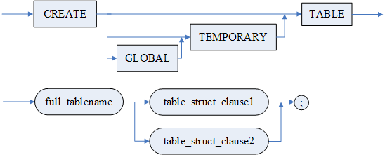

full\_tablename

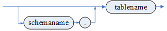

table\_struct\_clause1

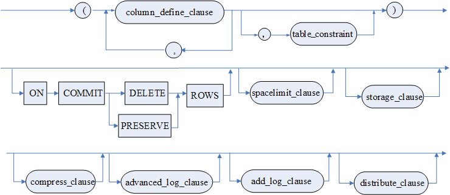

table\_struct\_clause2

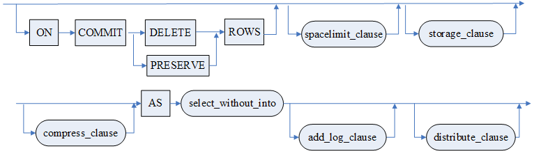

column\_define\_clause

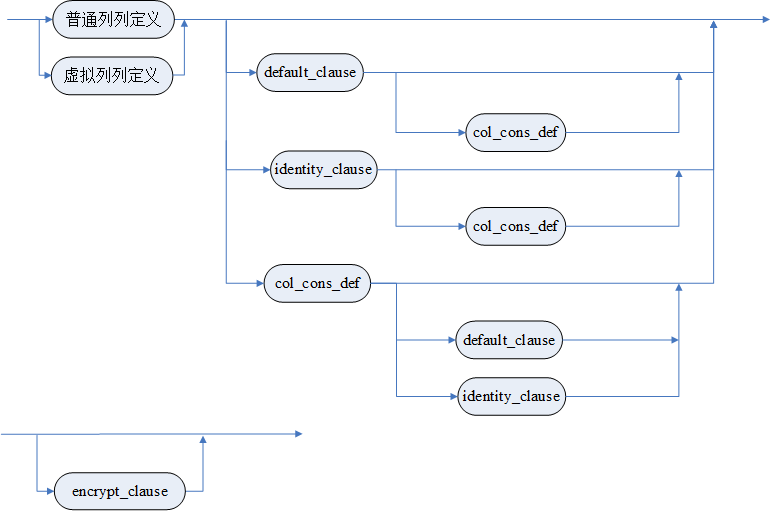

<普通列定义>

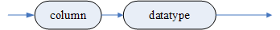

<虚拟列列定义>

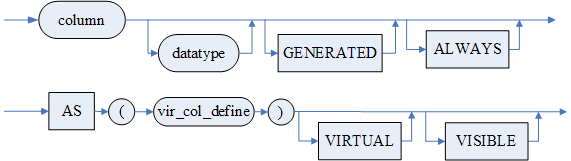

default\_clause


自增列子句

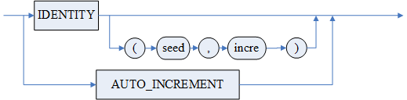

identity\_clause

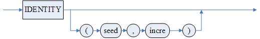

column\_constraint

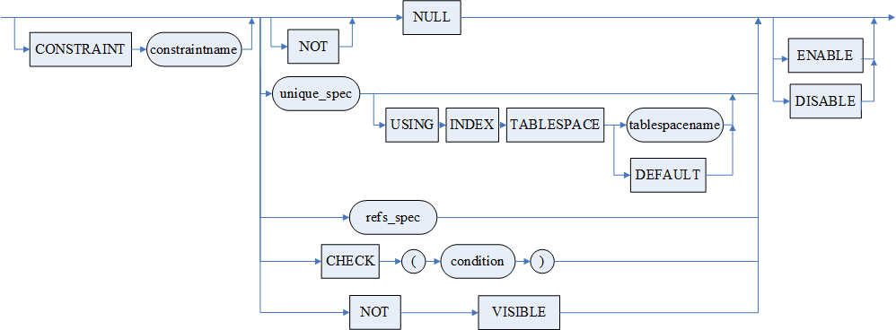

唯一性约束选项（unique\_spec）


refs\_spec

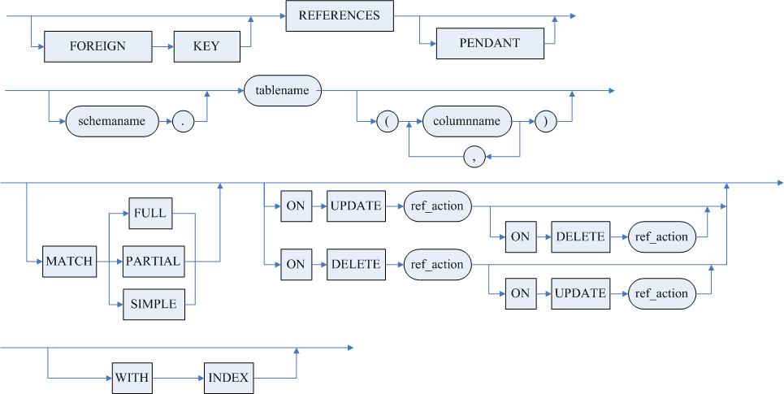

ref\_action

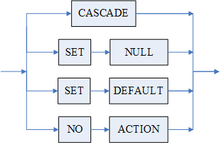

storage 子句


storage

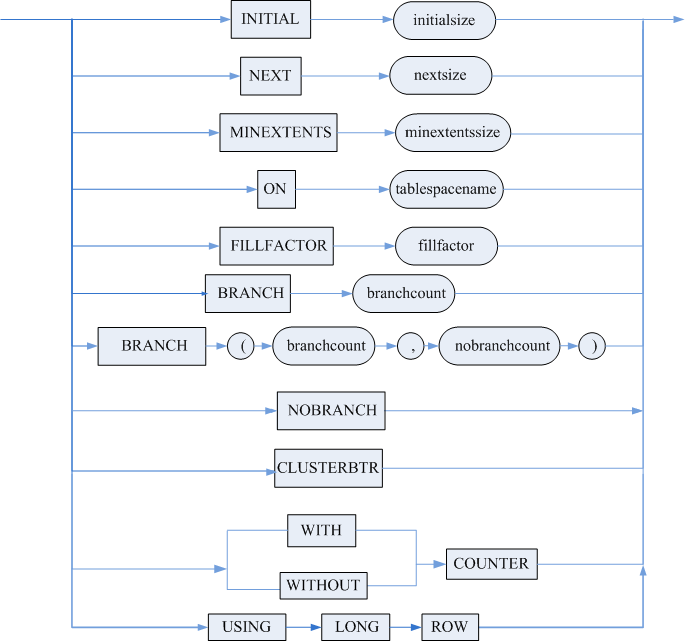

存储加密子句

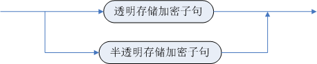

透明存储加密子句

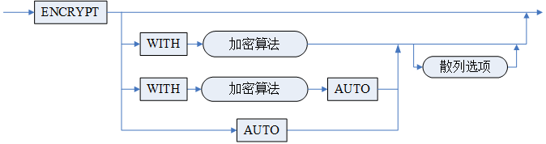

透明加密用法

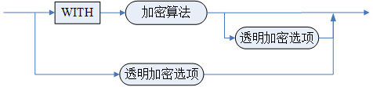

透明加密选项

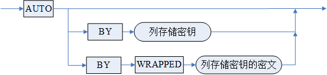

半透明存储加密子句

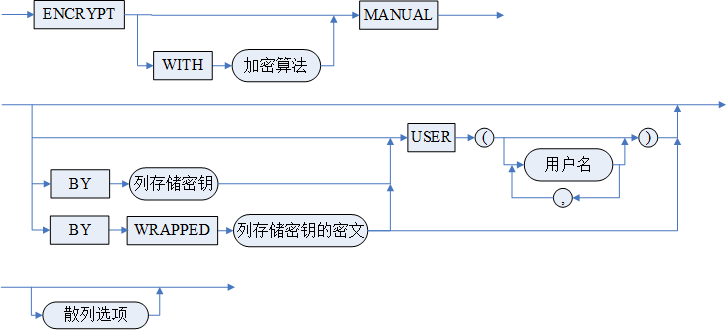

散列选项（hash\_cipher）


table\_constraint

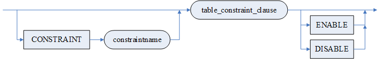

table\_constraint\_clause

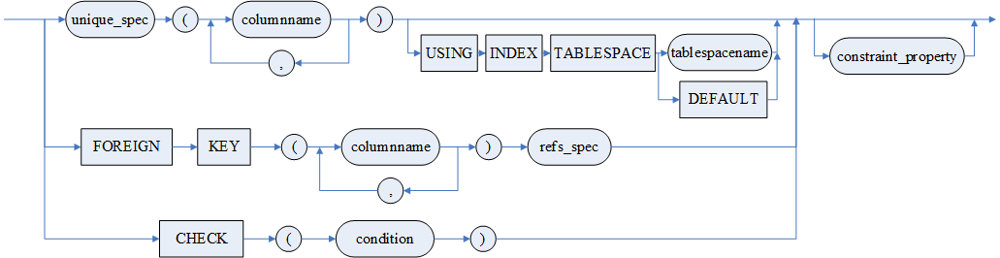

属性子句

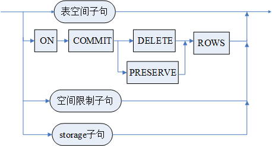

表空间子句


空间限制子句

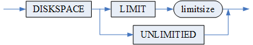

延迟段分配子句（deferred\_segment\_creation\_clause）


压缩子句


表并行度子句


高级日志子句（advanced\_log\_clause）


add\_log 子句（add\_log\_clause）


DISTRIBUTE 子句


range\_dis\_act


list\_dis\_act


AUTO\_INCREMENT 子句


不带 INTO 的 SELECT 语句


**语句功能**

供具有 DBA 角色（三权分立）、DB\_OBJECT\_ADMIN 角色（四权分立）或具有 CREATE TABLE 或 CREATE ANY TABLE 权限的用户定义基表。

**使用说明**

1. <表名>指定了所要建立的基表名。表名需要是合法的标识符，且满足 SQL 语法要求。在一个<模式>中，<基表名>、<视图名>均不相同。如果<模式名>缺省，则缺省为当前模式；
2. 表名不允许使用以下字符串作为前缀：BM$\_、BMJ$\_、MDRT$\_、MLOG$\_、MTAB$\_、MVIEW$\_、MTRG$\_、STAT$\_、BIN$\_。表名不允许使用以下字符串作为后缀：$ALOG、$AUX、$DAUX、$RAUX、$ROT、$UAUX；
3. 当 ENABLE\_TMP\_TAB\_ROLLBACK 为 0 时，不允许对临时表创建主键约束以及唯一约束；
4. 表名最大长度为 128 个字节；
5. 所建基表至少要包含一个<列名>指定的列，在一个基表中，各<列名>不得相同。一张基表中至多可以包含 2048 列；
6. 虚拟列上存在约束时，不支持使用 dmfldr 导入；
7. \<DEFAULT 子句>指定列的缺省值，如：DEFAULT DATE '2023-12-26'；
8. 如果未指明 NOT NULL，也未指明\<DEFAULT 子句>，则隐含为 DEFAULT NULL；
9. DM 提供两种自增列方式：IDENTITY 自增列和 AUTO\_INCREMENT 自增列。两者不能同时指定。

(1)\<IDENTITY 子句 > 自增列不能使用\<DEFAULT 子句 >。\<IDENTITY 子句 > 的种子和增量缺省值均为 1。

(2) AUTO\_INCREMENT 自增列。AUTO\_INCREMENT 列必须为唯一性约束的部分，只支持整数类型（支持 TINYINT/SMALLINT/INT/BIGINT，不支持 dec(N, 0)等），不能违反主键的唯一性约束。

AUTO\_INCREMENT 关键字需要和<AUTO\_INCREMENT 子句 >、三个 AUTO\_INCREMENT 相关 INI 参数（AUTO\_INCREMENT\_INCREMENT，AUTO\_INCREMENT\_OFFSET，NO\_AUTO\_VALUE\_ON\_ZERO）一起配合使用。当表中没有 AUTO\_INCREMENT 关键字时，仍然可以指定<AUTO\_INCREMENT 子句 >，但不会生效。

<AUTO\_INCREMENT 子句 > 用于指定隐式插入值的起始边界值，即当隐式插入时，系统自动增长的自增列值 X 必须大于等于起始边界值。

INI 参数 AUTO\_INCREMENT\_INCREMENT，动态会话级，表示 AUTO\_INCREMENT 的步长。取值范围 1~65535。缺省值为 1。

INI 参数 AUTO\_INCREMENT\_OFFSET，动态会话级，表示 AUTO\_INCREMENT 的基准偏移。取值范围 1~65535。缺省值为 1。

INI 参数 NO\_AUTO\_VALUE\_ON\_ZERO，动态会话级，表示 AUTO\_INCREMENT 列插入 0 时，是否自动插入自增的下一个值。取值范围 0、1。0 否，插入 0；1 是，插入自增值。缺省值为 1。

隐式生成的自增列值 X 由系统根据 AUTO\_INCREMENT\_OFFSET 、AUTO\_INCREMENT\_INCREMENT 等因子自动计算得出，计算公式 X=AUTO\_INCREMENT\_OFFSET+n\*AUTO\_INCREMENT\_INCREMENT，n 为从 1 开始依次递增的正整数，即第一个 X 值理论上为 AUTO\_INCREMENT\_OFFSET+1\*AUTO\_INCREMENT\_INCREMENT，第二个 X 值理论上为 AUTO\_INCREMENT\_OFFSET+2\*AUTO\_INCREMENT\_INCREMENT。同时，X 值必须满足以下两个条件：1）大于等于起始边界值；2）大于当前自增列值中最大值（包括显式和隐式）。例如，用户指定的起始边界值为 20，AUTO\_INCREMENT\_OFFSET=6，AUTO\_INCREMENT\_INCREMENT=10，则第一个 X 值理论上为 16，第二个 X 值理论上为 26，但是由于 X 值必须大于等于 20，因此第一个 X 值实际上为 26，第二个 X 值为 36，之后假设用户在该自增列中显式插入值 50，即该自增列中的第三个值为 50，由于 X 必须大于当前自增列值中最大值，因此下一个生成的 X 值为 56，即该自增列中的第四个值为 56。

例如，现有三个 AUTO\_INCREMENT 自增列，进行四次插入操作，前两次为隐式插入，第三次为显式插入，第四次为隐式插入，则四次操作插入的值如下表所示。

表3.5.1 AUTO\_INCREMENT示例

| **定义** | **1 号自增列** | **2 号自增列** | **3 号自增列** |
| --- | --- | --- | --- |
| 起始边界值 | 20 | 12 | 40 |
| AUTO\_INCREMENT\_OFFSET | 6 | 10 | 27 |
| AUTO\_INCREMENT\_INCREMENT | 10 | 7 | 6 |
| 理论上的隐式插入值 | 16、26、36、46、56、66…… | 17、24、31、38、45、52…… | 33、39、45、51、57、63…… |
| 第一次插入值（隐式） | 26 | 17 | 45 |
| 第二次插入值（隐式） | 36 | 24 | 51 |
| 第三次插入值（显式） | 50 | 35 | 60 |
| 第四次插入值（隐式） | 56 | 38 | 63 |

10. 若设置 DEFAULT ON NULL，相应列上会隐式添加 NOT NULL 约束，手动添加的约束不能与之冲突；不能在对象类型的列上指定 DEFAULT ON NULL；
11. < 列缺省值表达式 > 的数据类型必须与本列的 < 数据类型 > 一致。缺省值表达式存在以下几点约束：
1. 仅支持只读系统函数或指定 FOR CALCULATE 创建的存储函数；
2. 不支持表列；
3. 不支持包变量或语句参数；
4. 不支持查询表达式；
5. 不支持 LIKE；
6. 不支持 CONTAINS 表达式。
12. 如果列定义为 NOT NULL，则当该列插入空值时会报错；
13. 约束被 DM 用来对数据实施业务规则，完成对数据完整性的控制。DM\_SQL 中主要定义了以下几种类型的约束：非空约束、唯一性约束、主键约束、引用约束和检查约束。如果完整性约束只涉及当前正在定义的列，则既可定义成列级完整性约束，也可以定义成表级完整性约束；如果完整性约束涉及到该基表的多个列，则只能在语句的后面定义成表级完整性约束。

定义与该表有关的列级或表级完整性约束时，可以用 CONSTRAINT< 约束名 > 子句对约束命名，系统中相同模式下的约束名不得重复，且不能指定为系统格式的索引名（格式为前缀关键字 INDEX 与数值组合：'INDEX< 系统索引数值 >'，系统索引数值范围为 33554432~50331647）或系统格式的约束名（格式为前缀关键字 CONS 与数值组合：'CONS< 系统约束数值 >'，系统约束数值范围为 134217728~150994943）。如果不指定约束名，系统将为此约束自动命名。经定义后的完整性约束被存入系统的数据字典中，用户操作数据库时，由 DBMS 自动检查该操作是否违背这些完整性约束条件。

1）非空约束主要用于防止向一列添加空值，这就确保了该列在表中的每一行都存在一个有意义的值。

a) 该约束仅用于列级；

b) 如果定义了列约束为 NOT NULL，则其 < 列缺省值表达式 > 不能将该列指定为 NULL；

c) 空值即为未知的值，没有大小，不可比较。除关键字列外，其列可以取空值。不可取空值的列要用 NOT NULL 进行说明。

2）唯一性约束主要用于防止一个值或一组值在表中的特定列里出现不止一次，确保数据的完整性。

a) 唯一性约束是通过唯一索引来实现的。创建了一个唯一索引也就创建了一个唯一性约束；同样的，创建了一个唯一性约束，也就同时创建了一个唯一索引，这种情况下唯一索引是由系统自动创建的；

b) NULL 值是不参加唯一性约束的检查的。DM 系统允许插入多个 NULL 值。对于组合的唯一性约束，只要插入的数据中涉及到唯一性约束的列全为 NULL 值时，系统则认为这笔数据不违反唯一性约束。

3）主键约束确保了表中构成主键的一列或一组列的所有值是唯一的。主键主要用于识别表中的特定行。主键约束是唯一性约束的特例。

a) 可以指定多个列共同组成主键，最多支持 63 个列；

b) 主键约束涉及的列必须为非空。通常情况下，DM 系统会自动在主键约束涉及的列上自动创建非空约束；

c) 每个表中只能有一个主键；

d) 主键约束是通过创建唯一索引来实现的。DM 系统允许用户自己定义创建主键时，通过 CLUSTER 或 NOT CLUSTER 关键字来指明创建索引的类型。CLUSTER 指明该主键是创建在聚集索引上的，NOT CLUSTER 指明该主键是创建在非聚集索引上的。在 DM.INI 配置文件中，可以指定配置项使表中的主键自动转化为聚集主键，该配置项为 PK\_WITH\_CLUSTER。默认情况下，PK\_WITH\_CLUSTER 为 0，即建表时指定的主键不会自动转化为聚集主键；若为 1，则主键自动变为聚集主键。堆表和列存储表不允许建立聚集主键。

4）引用约束用于保证相关数据的完整性。引用约束中构成外键的一列或一组列，其值必须至少匹配其参照的表中的一行的一个主键或唯一键值。我们把这种数据的相关性称为引用关系，外键所在的表称为引用表，外键参照的表称为被引用表。

a) 引用约束指明的被引用表上必须已经建立了相关主键或唯一索引。也就是说，必须保持引用约束所引用的数据必须是唯一的；

b) 引用约束的检查规则：

i. 插入规则：外键的插入值必须匹配其被引用表的某个键值。

ii. 更新规则：外键的更新值必须匹配被引用表的某个键值。当修改被引用表中的主键值时，如果定义约束时的选项是 NO ACTION，且更新结果会违反引用约束则不允许更新；如果定义的是 SET NULL 则将引用表上的相关外键值置为 NULL；如果定义的是 CASCADE，那么引用表上的相关外键值将被修改为同样的值；如里定义的是 SET DEFAULT，则把引用列置为该列的缺省值。

iii. 删除规则：当从被引用表中删除一行数据时，如果定义约束时的选项是 NO ACTION，就不删除引用表上的相关外键值；如果定义的是 SET NULL 则将引用表上的相关外键值置为 NULL；如果定义的是 CASCADE，那么引用表上的相关外键值将被删除；如里定义的是 SET DEFAULT，则把每个引用列置为“< 列缺省值表达式 >”规则中所指定的缺省值。

c) NULL 值不参加引用约束的检查。受引用约束的表，如果要插入的涉及到引用约束的列值有一个或多个 NULL，则认为插入值不违反引用约束；

d) MPP 环境下，引用列和被引用列都必需包含分布列，且分布情况完全相同；

e) MPP 环境下，不支持创建 SET NULL 或 SET DEFAULT 约束检查规则的引用约束。

5）检查约束用于对将要插入的数据实施指定的检查，从而保证表中的数据都符合指定的限制。< 检验条件 > 必须是一个有意义的布尔表达式，其中的每个列名必须是本表中定义的列，但列的类型不得为多媒体数据类型，并且不应包含子查询、集函数。

14. 可以使用空间限制子句 DISKSPACE LIMIT 来限制表的最大存储空间，以 MB 为单位，取值范围为 1~1048576，关键字 UNLIMITED 表示无限制。系统不支持查询建表情况下指定空间限制；
15. 可以使用 STORAGE 子句指定表的存储信息：

1)初始簇数目：指建立表时分配的簇个数，必须为整数，最小值为 1，最大值为 256，缺省为 1；  
2)下次分配簇数目：指当表空间不够时，从数据文件中分配的簇个数，必须为整数，最小值为 1，最大值为 256，缺省为 1；  
3)最小保留簇数目：当删除表中的记录后，如果表使用的簇数目小于这个值，就不再释放表的空间，必须为整数，最小值为 1，最大值为 256，缺省为 1；  
4)表空间名：在指定的表空间上建表，表空间必须已存在，缺省为该用户的默认表空间；  
5)填充比例：指定存储数据时每个数据页和索引页的充满程度，取值范围为 0 到 100。可以通过设置 INI 参数 DEFAULT\_FILLFACTOR 来设置填充比例的默认值。DEFAULT\_FILLFACTOR 的取值范围为 0~100，取缺省值 0 时，等价于 100，表示全满填充。插入数据时填充比例的值越低，可由新数据使用的空间就越多；更新数据时填充比例的值越大，更新导致出现的页分裂的几率越大。同样，创建索引时，填充比例的值越低，可由新索引项使用的空间也就越多；  
6)BRANCH 和 NOBRANCH：指定 BRANCH 和 NOBRANCH 的个数；  
7)CLUSTERBTR：当 INI 参数 LIST\_TABLE = 1 时，指定 CLUSTERBTR，则建立的表为普通 B 树表而非堆表；  
8)WITH COUNTER：在表上维护当前表内的行数；WITHOUT COUNTER：表上只维护一个非实时的大概的行数；  
对用户的影响：例如 SELECT COUNT(\*) FROM test; 如果表 test 是 WITH COUNTER 属性，服务器直接取行数返回即可，可以快速响应；如果表 test 是 WITHOUT COUNTER 属性，服务器需要先扫描 B 树获取行数返回后才能响应。不同的场景，根据需要灵活选择 COUNTER 属性。WITH COUNTER 属性可以通过 ALTER TABLE 语句修改。若省略该选项，默认是 WITH COUNTER 属性。  
9)USING LONG ROW：显式开启超长记录存储功能。除此之外，还可以通过设置 INI 参数 CTAB\_WITH\_LONG\_ROW=1 来隐式开启该功能，隐式开启需满足一定的附加条件，具体请参考《DM8 系统管理员手册》CTAB\_WITH\_LONG\_ROW 介绍。超长记录存储功能是指当 DM 行存储的记录长度超过页大小一半时，先尝试将过长的变长字符串转换为行外 BLOB 存储，如果转换后仍超长则报错。建议变长字段定义长度不超过页大小，否则在处理排序等操作时报错。临时表、HUGE 表、外部表不支持 USING LONG ROW 选项。水平分区子表的 USING LONG ROW 选项自动采用与主表保持一致的方式，两者不同的情况下，直接忽略水平分区子表的 USING LONG ROW 选项。  
10)DISABLE USING LONG ROW 可以关闭 INI 参数 CTAB\_WITH\_LONG\_ROW=1 时隐式开启的超长记录存储功能。

16. < 延迟段分配子句 > 用于指定是否启用延迟段分配功能。若不启用，则在建表时为表分配数据段；若启用，则向表中插入第一条数据时为表分配数据段。SEGMENT CREATION IMMEDIATE 表示不启用，SEGMENT CREATION DEFERRED 表示启用。若不指定 < 延迟段分配子句 >，则根据 INI 参数 DEFERRED\_SEGMENT\_CREATION 决定是否启用延迟段分配功能。HUGE 表不支持延迟段分配功能，忽略该子句；
17. < 压缩子句 > 只是语法支持，功能已经取消；
18. 记录的列长度总和不超过页大小的一半，变长数据类型实际是否越界还需要判断实际记录的长度，如 VARCHAR、VARBINARY 等数据类型，而定长数据类型的长度是实际数据长度，如 INT、CHAR（注意建库参数 CHAR\_FIX\_STORAGE 为 N/0 时，CHAR 类型转换成 VARCHAR2 类型存储）、BINARY 等数据类型。例如，若建库参数页大小为 16K、CHAR\_FIX\_STORAGE 为 1，可以定义 CREATE TABLE TEST(C1 VARCHAR(8000),C2 INT)，但是不能定义 CREATE TABLE TEST(C1 CHAR(8000)，C2 INT)；
19. DM 具备自动断句功能；
20. 在对列指定存储加密属性时，对用户的数据在保存到物理介质之前使用指定的加密算法加密，防止数据泄露；
21. < 加密算法 > 可以是系统内置的加密算法也可以是第三方加密算法，详情请参考手册《DM8 安全管理》。当使用第三方加密算法时，用户需要将已实现的第三方加密动态库放到 bin 目录下的文件夹 external\_crypto\_libs 中，DM 支持加载多个第三方加密动态库，然后重启 DM 服务器即可引用其中的算法；
22. < 散列算法 > 用于保证用户数据的完整性，若用户数据被非法修改，则能判断该数据不合法。散列算法可以是系统内置的散列算法也可以是第三方散列算法，详情请参考手册《DM8 安全管理》。加盐选项可以与散列算法配合使用；
23. < 透明存储加密子句 > 是指用透明加密的方式加密列上的数据，在数据库中保存加密该列的密钥，执行 DML 语句的过程中自动获取密钥。关于表列透明加密的具体介绍请参考手册《DM8 安全管理》；
24. < 半透明存储加密子句 > 是指用半透明加密的方式加密列上的数据，DM 使用当前操作用户的存储密钥对数据进行加密，半透明加密列的密文后追加了 4 个字节的 UID，用户查询数据时，若当前会话用户 ID 与列密文数据中存储的 UID 相同，则返回明文，否则返回 NULL。关于表列半透明加密的具体介绍请参考手册《DM8 安全管理》；
25. 可以使用 DISTRIBUTE 子句指定表的分布类型，创建为分布表：

1)单机模式下建的分布表和普通表一样，但是不能创建指定实例名的分布表（如范围分布表和 LIST 分布表）。  
2)在 MPP 模式下建分布表，如果未指定列则默认为 RANDOMLY 分布表（随机分布表）。  
3)不支持除了单机和 MPP 集群外的其它环境使用。  
4)分布列类型不支持 BLOB、CLOB、IMAGE、TEXT、LONGVARCHAR、BIT、BINARY、VARBINARY、LONGVARBINARY、时间间隔类型和用户自定义类型。  
5)HASH 分布、RANGE 分布、LIST 分布允许更新分布列，并支持包含大字段列的表的分布列更新，列存储表/堆表不支持进行分布列更新。  
6)对于 FULLY 分布表（复制分布表），只支持单表查询的更新和删除操作，并且查询项或者条件表达式中都不能包含 ROWID 伪列表达式。  
7)RANGE 分布表（范围分布表）和 LIST 分布表（列表分布表），分布列与分布列值列表必须一致，并且指定的实例名不能重复。  
8)随机分布表不支持 UNIQUE 索引。

26. 虚拟列的使用：

虚拟列的值是不存储在磁盘上的，而是在查询的时候，根据定义的表达式临时计算后得到的结果。虚拟列可以用在查询、DML、DDL 语句中。索引可以建在虚拟列上。用户可以像使用普通列一样使用虚拟列。

1)GENERATED ALWAYS 和 VIRTUAL 为可选关键字，主要用于描述虚拟列的特性，写与不写没有本质区别。  
2)虚拟列中的 VISIBLE 只是语法支持，没有实际意义。  
3)不支持在索引表、外部表、临时表、对象表上使用虚拟列。虚拟列和虚拟列中使用的列必须来自同一个表。表中至少要有一个非虚拟列。  
4)在虚拟列上建索引相当于在表上建函数索引。  
5)即使表达式中的列已经有列级安全属性，虚拟列也不会继承列的安全规则。因此，为了保护虚拟列的数据，可以复制列级安全策略或者使用函数隐式来保护虚拟列数据。例如，信用卡的卡号被列级安全策略保护，只允许员工看到卡号的后四位。在这种情况下，可以把信用卡号的后四位定义成虚拟列。  
6)虚拟列不能作为分布表的分布列。  
7)虚拟列之间不能嵌套定义。  
8)虚拟列最后的输出应该是标量性的。  
9)虚拟列不能是用户自定义类型、大字段类型。  
10)不能直接插入、更新虚拟列；但是可以在更新和删除的 WHERE 子句中使用虚拟列。  
11)不能删除被虚拟列引用的实际列。表中只有一个实际列时，这个实际列不能被删除。  
12)虚拟列不能被修改为实际列。实际列也不能被修改为虚拟列。  
13)虚拟列不能设置 DEFAULT 值。  
14)虚拟列不能设置为 IDENTITY。  
15)不支持在虚拟列上建立位图连接索引和全文索引。  
16)不支持在虚拟列上建立聚集索引和位图索引。  
17)不支持在虚拟列上建立物化视图日志。  
18)虚拟列不能在创建时作为 CLUSTER PK、UNIQUE 或者 PK。但是可以在虚拟列上创建 UNIQUE INDEX。  
19)虚拟列不支持 PLUS JOIN。  
20) 虚拟列不支持统计信息。  
21)虚拟列不支持加密。  
22)虚拟列的表达式定义长度不能超过 2048 字节。  
23)DM 支持虚拟列为系统函数，但是不能保证数据的确定性。  
24)虚拟列定义中不支持 ROW LIKE 表达式。  
25)虚拟列定义中不支持 CONTAINS 表达式。  
26)如果虚拟列定义包含函数，则必须是确定性的函数。不允许使用分组函数、子查询（集函数、分析函数都不允许）。  
27)虚拟列上有约束时，使用 dmfldr 导入，将不能保证正确性。  
28)虚拟列作为分区列或索引列时，不允许修改列定义。

27. < 表结构定义 2> 为查询建表语句，其中的 < 列定义 >、< 表级约束定义 > 有一定的限制。对于 < 列定义 >，仅支持指定列名、DEFAULT 子句、列级约束定义，其中 DEFAULT 子句不支持 ON NULL 选项，列级约束定义不支持外键约束和聚集索引。对于 < 表级约束定义 >，不支持外键约束和聚集索引。其他语法如虚拟列定义、数据类型、自增列子句等均不支持。具体请参考《DM8 系统管理员手册》查询建表介绍。
28. 使用\<STORAGE 子句 > 中的 BRANCH 或 NOBRANCH 选项创建堆表时，不支持将堆表创建在文件个数限制大于 255 的表空间中。

**举例说明**

例 1 首先回顾一下第二章中定义的基表，它们均是用列级完整性约束定义的格式写出，也可以将唯一性约束、引用约束和检查约束以表级完整性约束定义的格式写出的。假定用户为 SYSDBA，下面以产品的评论表为例进行说明。

```
CREATE  TABLE PRODUCTION.PRODUCT_REVIEW
( 
PRODUCT_REVIEWID INT IDENTITY(1,1), 
 PRODUCTID INT NOT NULL,
 NAME VARCHAR(50) NOT NULL,
 REVIEWDATE DATE NOT NULL,
 EMAIL VARCHAR(50) NOT NULL,
 RATING INT NOT NULL,
 COMMENTS TEXT,
 PRIMARY KEY(PRODUCT_REVIEWID),
 FOREIGN   KEY(PRODUCTID)  REFERENCES  PRODUCTION.PRODUCT(PRODUCTID),
 CHECK(RATING IN(1,2,3,4,5))
);
//注：该语句的执行需在“产品的信息表”已经建立的前提下
```

系统执行建表语句后，就在数据库中建立了相应的基表，并将有关基表的定义及完整性约束条件存入数据字典中。需要说明的是，由于被引用表要在引用表之前定义，本例中的产品的信息表被产品的评论表引用，所以这里应先定义产品的信息表，再定义产品的评论表，否则就会出错。

例 2 建表时指定存储信息，表 PERSON 建立在表空间 FG\_PERSON 中，初始簇大小为 5，最小保留簇数目为 5，下次分配簇数目为 2，填充比例为 85。

```
CREATE TABLESPACE FG_PERSON DATAFILE 'FG_PERSON.DBF' SIZE 128;

CREATE TABLE PERSON.PERSON
( PERSONID  INT IDENTITY(1,1) CLUSTER PRIMARY KEY,
SEX CHAR(1) NOT NULL,
NAME VARCHAR(50) NOT NULL,
EMAIL VARCHAR(50),
PHONE VARCHAR(25))
STORAGE
( INITIAL       5,
MINEXTENTS   5,
NEXT    2,
ON        FG_PERSON,
FILLFACTOR   85);
```

例 3 在 MPP 集群环境下建立如下范围分布表后，表 PRODUCT\_INVENTORY 将按照 QUANTITY 列值，被分布到 2 个站点上。

```
CREATE TABLE PRODUCTION.PRODUCT_INVENTORY
(PRODUCTID INT NOT NULL REFERENCES PRODUCTION.PRODUCT(PRODUCTID),
LOCATIONID INT NOT NULL REFERENCES PRODUCTION.LOCATION(LOCATIONID),
QUANTITY INT NOT NULL)
DISTRIBUTED BY RANGE (QUANTITY)
(
    VALUES EQU OR LESS THAN (100) ON EP01,
    VALUES EQU OR LESS THAN (MAXVALUE) ON EP02
);
```

例 4 在 MPP 集群环境下建立如下列表分布表后，表 PRODUCT\_INVENTORY 将按照 LOCATIONID 列值，被分布到 2 个站点上，1，2，3，4 在 EP01 上，5，6，7，8 在 EP02，如果有插入其它值时则报错。

```
CREATE TABLE PRODUCTION.PRODUCT_INVENTORY
(PRODUCTID INT NOT NULL REFERENCES PRODUCTION.PRODUCT(PRODUCTID),
LOCATIONID INT NOT NULL REFERENCES PRODUCTION.LOCATION(LOCATIONID),
QUANTITY INT NOT NULL)
DISTRIBUTED BY LIST (LOCATIONID)
(
    VALUES (1,2,3,4) ON EP01,
    VALUES (5,6,7,8) ON EP02
);
```

例 5 在 MPP 集群环境下建立如下复制分布表后，表 LOCATION 被分布到 MPP 各个站点上，每个站点上的数据都保持一致。

```
CREATE TABLE PRODUCTION.LOCATION
(LOCATIONID INT IDENTITY(1,1) PRIMARY KEY,
PRODUCT_SUBCATEGORYID INT NOT NULL,
NAME VARCHAR(50) NOT NULL)
DISTRIBUTED  FULLY;
```

例 6 建立普通表查看 select count(\*) 执行计划，再删除后重建表 test 带 without counter 属性，再查看执行计划：

```
create table test(c1 int);
SQL>explain select count(*) from test;
```

执行结果如下：

```
1   #NSET2: [1, 1, 0] 
2     #PRJT2: [1, 1, 0]; exp_num(1), is_atom(FALSE); INFO_BITS(0); BATCH_EXP_NUM(0); spl_info(NULL)
3       #FAGR2: [1, 1, 0]; sfun_num(1)
```

删除表后再重建 test 表带 without counter 属性，再查看执行计划。

```
drop table test;
create table test(c1 int) storage(without counter);
explain select count(*) from test;
```

执行结果如下：

```
1   #NSET2: [1, 1, 0] 
2     #PRJT2: [1, 1, 0]; exp_num(1), is_atom(FALSE); INFO_BITS(0);  BATCH_EXP_NUM(0);spl_info(NULL)
3       #AAGR2: [1, 1, 0]; grp_num(0), sfun_num(1), distinct_flag[0]; slave_empty(0)
4         #CSCN2: [1, 1, 0]; INDEX33555478(TEST); btr_scan(1); need_slct(0); prejudge_iescn(0)
```

例 7 使用 AUTO\_INCREMENT 自增列。先设置 INI 参数值，然后建表，最后隐式和显式插入自增列值。

```
ALTER SESSION SET 'AUTO_INCREMENT_INCREMENT' =6;
ALTER SESSION SET 'AUTO_INCREMENT_OFFSET' =15;
ALTER SESSION SET 'NO_AUTO_VALUE_ON_ZERO' =1;
CREATE TABLE T1(id int PRIMARY KEY AUTO_INCREMENT,name varchar(100)) AUTO_INCREMENT=20;
INSERT INTO T1(NAME) VALUES ('TEST1');    //隐式插入自增列值
INSERT INTO T1(id,NAME) VALUES (34,'TEST2');  //显式插入自增列值 34
INSERT INTO T1(NAME) VALUES ('TEST1');  //隐式插入自增列值 

SELECT * FROM T1;
```

查询结果如下：

```
行号    ID     NAME
---------- ----------- -----
1     21     TEST1
2     34     TEST2
3     39     TEST1
```

例 8 对表 T 的 C1 列使用 < 半透明加密选项 > 进行按列加密。

先创建用户 USER01 和 USER02。

```
CREATE USER USER01 IDENTIFIED BY DMsys_123456; 

CREATE USER USER02 IDENTIFIED BY DMsys_123456;
```

创建 T 表，对 C1 列进行按列加密，加密列对用户 USER01 和 USER02 可见。

```
CREATE TABLE T(C1 INT ENCRYPT MANUAL USER (USER01,USER02));
```

#### 3.5.1.2 定义外部表

需指定如下信息：

1. 表名、表所属的模式名；
2. 列定义；
3. 控制文件和数据文件所在目录。

**语法格式**

```
CREATE EXTERNAL TABLE [IF NOT EXISTS] <表名定义> <表结构定义>;
<表名定义> ::=[<模式名>.]<表名>
<表结构定义> ::= (<列定义> {,<列定义>}) <FROM子句>
<列定义> ::= <列名> <数据类型> [COMMENT '<列注释>']
<列定义>  参见3.5.1.1节说明
<FROM子句> = <FROM子句1> | <FROM子句2> 
<FROM子句1>    ::= FROM <控制文件选项>
<控制文件选项> ::= DEFAULT DIRECTORY <目录对象名> LOCATION ('<控制文件名>'[ON <RAFT组名>])
<FROM子句2>    ::= FROM DATAFILE <数据文件选项> [<数据文件参数列表>]
<数据文件选项> ::= DEFAULT DIRECTORY <目录对象名> LOCATION ('<数据文件名>'[ON <RAFT组名>])
<数据文件参数列表> ::= PARMS(<参数选项> {,<参数选项>})
<参数选项> ::= 
    FIELDS DELIMITED BY <表达式> | 
    RECORDS DELIMITED BY <表达式>|
    ERRORS <n>|
    BADFILE '<错误日志文件名称>'| 
    LOG '<日志文件名称>'|
    NULL_STR <NULL字符串>|
    SKIP <跳过行数>|
    CHARACTER_CODE <文件字符集>|
    MISSING FIELD VALUES ARE NULL
```

**参数**

1. <模式名> 指明该表属于哪个模式，缺省为当前模式；
2. <表名> 指明被创建的外部基表名；
3. <列名> 指明基表中的列名；
4. < 数据类型> 指明列的数据类型，其余同 3.5.1.1 定义数据库基表 中的说明；
5. <参数选项>
	FIELDS 表示列分隔符，缺省为'|'；
	RECORDS 表示行分隔符，缺省为回车；
	ERRORS 表示忽略外部表数据转换中出现错误的行数，取值范围为大于 0 的正整数，缺省为 0，表示不忽略错误；指定为 4294967294 表示不限制错误行数，全部忽略；
	BADFILE 表示错误日志文件（.bad 文件）名称，存放在指定目录下。缺省情况下，将在查询外部表时自动生成(若中途无错误数据，将不生成.bad 文件)，缺省 BADFILE 文件前缀为“表名 + 表 id”；
	LOG 表示日志文件（.log 文件）名称，存放在指定目录下。缺省情况下，将在查询外部表时自动生成，缺省 LOG 文件前缀为“表名 + 表 id”；
	NULL\_STR 载入时视为 NULL 值处理的字符串，仅载入有效，默认忽略此参数；
	SKIP 指定跳过数据文件起始的逻辑行数，默认为 0；
	CHARACTER\_CODE 指定数据文件中数据的编码格式，默认为 GBK，可选项有 GBK，UTF-8，SINGLE\_BYTE 和 EUC-KR；
	MISSING FIELD VALUES ARE NULL 指定当文件中外部表数据缺少部分列时，使用 NULL 进行填充，不进行报错处理；
6. <表达式> 字符串或十六进制串类型表达式；
7. <目录对象名> 指控制文件或数据文件所属的目录对象的名称；
8. \<RAFT 组名 > 指定了在 DMDPC 环境存储外部表的 RAFT 组。非 DMDPC 环境忽略此参数。如果 DMDPC 下未指定此选项，则存储在执行建表语句的 RAFT 组上。如果 RAFT 组里包含多个实例分布在不同主机上，用户需要自己确保每个实例所在的主机均有指定的数据文件，并且确保数据一致。

**图例**

定义外部表


from\_clause


from1\_clause


from2\_clause


param\_list


**语句功能**

供具有 DBA 角色（三权分立）、DB\_OBJECT\_ADMIN 角色（四权分立）或具有 CREATE TABLE 或 CREATE ANY TABLE 权限的用户定义外部基表。MPP 环境、DSC 环境和 DPC 环境下不支持创建外部表。

**使用说明**

1. <表名>指定了所要建立的外部表名。如果<模式名>缺省，则缺省为当前模式。表名需要是合法的标识符，且满足 SQL 语法要求；
2. 表名前缀和后缀的限制规则请参考 3.5.1.1 定义数据库基表 ；
3. 外部表的表名最大长度为 128 个字符；
4. 所建外部基表至少要包含一个<列名>指定的列，在一个外部基表中，各<列名>不得相同。一张外部基表中至多可以包含 2048 列；
5. 外部基表允许使用大字段列，行数据长度要求小于 16\*1024\*1000 字节，否则数据将无法解析；
6. 外部基表不能存在任何约束条件；
7. 外部基表不能为临时表，不能建立分区；
8. 外部基表上不能建立任何索引；
9. 外部基表是只读的，不存在表锁，不允许任何针对外部表的增删改数据操作，不允许 TRUNCATE 外部表操作；
10. 用户在创建外部表之前，须先指定文件目录；
11. 用户创建外部表时必须具有指定目录的读权限；
12. 用户查询外部表时必须具有指定目录的读权限；由于用户查询外部表时，默认会在指定目录下生成日志文件和错误日志文件，因此用户还需具有指定目录的写权限；
13. 控制文件的书写格式为：
```
[OPTIONS(
<id>=<value> 
……
    )]
LOAD [DATA] 
INFILE [<file_option>|<directory_option>][BADFILE <path_name>]<into_table_clause>
<file_option>::= [LIST] <file_option子句> [,<file_option子句>]
<file_option子句>::=<file_name> [<row_term_option>]
<file_name> ::=文件名称
<row_term_option> ::=STR [X] <delimiter>
<directory_option> ::= DIRECTORY <directory_name> [<row_term_option>]
<into_table_clause> ::= <into_table_single>{<into_table_single>}
<into_table_single> ::=INTO TABLE [<schema>.]<tablename> [FIELDS [TERMINATED BY] [X] <delimiter>]
<schema> ::=模式名
<tablename> ::=表名
<delimiter> ::='<字符串常量>'
```

其中 OPTIONS 选项为可选部分，目前 OPTIONS 中支持 DATA、LOG、errors、badfile、null\_str、skip、character\_code 选项。DATA 表示数据文件名称，其余选项请参考上述参数介绍部分。<file\_name> 和<directory\_name> 只能指定文件或文件夹名称，不能包含路径信息，否则报错。

14. 如果没有使用<参数选项>的 RECORDS 指定行分隔符，则在数据文件中的一行数据必须以回车结束；
15. 外部表支持查询 ROWID 伪列，不支持查询 TRXID 伪列；
16. DMMPP 环境、DMDSC 环境下不支持创建外部表。

**举例说明**

例 1 将文本文件作为控制文件以及数据文件，指定控制文件创建外部表。

编写数据文件（d:\\ext\_table\\data.txt）如下：

```
a|abc|varchar_data|12.34|12.34|12.34|12.34|0|1|1|1234|1234|1234|100|11|1234|1|1|14.2|12.1|12.1|1999-10-01|9:10:21|2002-12-12|15
```

编写控制文件（d:\\ext\_table\\ctrl.txt）如下：

```
LOAD DATA
INFILE  'data.txt'
INTO TABLE EXT
FIELDS '|'
```

创建目录对象如下：

```
CREATE OR REPLACE DIRECTORY  "EXTDIR"  AS 'd:\ext_table';
```

建表语句：

```
DROP TABLE EXT;
CREATE EXTERNAL TABLE EXT (
L_CHAR CHAR(1),
L_CHARACTER CHARACTER(3),
L_VARCHAR VARCHAR(20),
L_NUMERIC NUMERIC(6,2),
L_DECIMAL DECIMAL(6,2),
L_DEC DEC(6,2),
L_MONEY DECIMAL(19,4),
L_BIT BIT,
L_BOOL BIT,
L_BOOLEAN BIT,
L_INTEGER INTEGER,
L_INT INT,
L_BIGINT BIGINT,
L_TINYINT TINYINT,
L_BYTE BYTE,
L_SMALLINT SMALLINT,
L_BINARY BINARY,
L_VARBINARY VARBINARY,
L_FLOAT FLOAT,
L_DOUBLE DOUBLE,
L_REAL REAL,
L_DATE DATE,
L_TIME TIME,
L_TIMESTAMP TIMESTAMP,
L_INTERVAL INTERVAL YEAR
)FROM DEFAULT DIRECTORY EXTDIR LOCATION ('ctrl.txt');
```

系统执行建表语句后，就在数据库中建立了相应的外部基表。查询 EXT 表：

```
SELECT * FROM EXT;
```

查询结果如下：

```
L_CHAR L_CHARACTER L_VARCHAR    L_NUMERIC L_DECIMAL L_DEC L_MONEY L_BIT L_BOOL L_BOOLEAN L_INTEGER   L_INT
------ ----------- ------------ --------- --------- ----- ------- ----- ------ --------- ----------- -----------
L_BIGINT             L_TINYINT   L_BYTE      L_SMALLINT  L_BINARY L_VARBINARY L_FLOAT
-------------------- ----------- ----------- ----------- -------- ----------- -------------------------
L_DOUBLE                  L_REAL             L_DATE     L_TIME   L_TIMESTAMP                L_INTERVAL
------------------------- ------------------ ---------- -------- -------------------------- ---------------------
a      abc         varchar_data 12.34     12.34     12.34 12.3400 0     1      1         1234        1234
1234                 100         11          1234        0x01     0x01        1.420000000000000E+01
1.210000000000000E+01    1.2100000E+01     1999-10-01 09:10:21 2002-12-12 00:00:00.000000 INTERVAL '15' YEAR(2)
```

例 2 将文本文件作为数据文件，指定数据文件创建外部表。

编写数据文件（d:\\ext\_table\_2\\data.txt）如下：

```
10|9|7
4|3|2
```

创建目录对象如下：

```
CREATE OR REPLACE DIRECTORY "EXTDIR_2" AS 'd:\ext_table_2';
```

在 Windows 操作系统中建表语句如下：

```
DROP TABLE EXT_TABLE2;
CREATE EXTERNAL TABLE EXT_TABLE2(
C1 INT,
C2 INT,
C3 INT
) FROM DATAFILE DEFAULT DIRECTORY EXTDIR_2 LOCATION ('data.txt') PARMS(FIELDS DELIMITED BY '|', RECORDS DELIMITED BY 0x0d0a);
```

在 Linux 操作系统中建表语句如下：

```
DROP TABLE EXT_TABLE2;
CREATE EXTERNAL TABLE EXT_TABLE2(
C1 INT,
C2 INT,
C3 INT
) FROM DATAFILE DEFAULT DIRECTORY EXTDIR_2 LOCATION ('data.txt') PARMS(FIELDS DELIMITED BY '|', RECORDS DELIMITED BY 0x0a);
```

查询 ext\_table2 表：

```
select * from ext_table2;
```

查询结果如下：

```
行号       C1          C2          C3
---------- ----------- ----------- -----------
1          10          9           7
2          4           3           2
```

例 3

在 Windows 操作系统中编写控制文件（d:\\test\_externtable\\quan.ctrl），内容如下：

```
OPTIONS( 
DATA = 'quan.txt' 
ERRORS  =  5 
BADFILE  =  't1.bad' 
LOG  =  't1.log' 
NULL_STR  = ' ffff '  
SKIP  =     0 
CHARACTER_CODE =  'utf-8'  
)
LOAD DATA 
INFILE 'quan.txt' STR x '0D0A'
BADFILE 'test1.bad' 
INTO TABLE fldr1 
FIELDS TERMINATED BY  '||'
```

在 Linux 操作系统中编写控制文件（d:\\test\_externtable\\quan.ctrl），内容如下：

```
OPTIONS( 
DATA = 'quan.txt' 
ERRORS  =  5 
BADFILE  =  't1.bad' 
LOG  =  't1.log' 
NULL_STR  = ' ffff '  
SKIP  =     0 
CHARACTER_CODE =  'utf-8'  
)
LOAD DATA 
INFILE 'quan.txt' STR x '0A'
BADFILE 'test1.bad' 
INTO TABLE fldr1 
FIELDS TERMINATED BY  '||'
```

编写数据文件（d:\\test\_externtable\\quan.txt）如下：

```
1||ab||2
1||ab||1
```

创建目录对象如下：

```
CREATE OR REPLACE DIRECTORY "EXTDIR_3" AS 'd:\test_externtable';
```

建表语句：

```
CREATE EXTERNAL TABLE  fldr1(
"C1" NUMBER(2,1),
"C2" VARCHAR(4),
"C3" NUMBER(2,0)
) FROM DEFAULT DIRECTORY EXTDIR_3 LOCATION ('quan.ctrl');
```

查询表 fldr1 中的数据：

```
select * from fldr1;
```

查询结果如下：

```
行号       C1  C2 C3
---------- --- -- --
1          1.0 ab 2
2          1.0 ab 1
```

#### 3.5.1.3 定义 HUGE 表

**语法格式**

```
CREATE HUGE TABLE [IF NOT EXISTS] <表名定义> <表结构定义>[<PARTITION子句>] [<表空间子句>] [<STORAGE子句1>][<压缩子句>] [<日志属性>][<DISTRIBUTE子句>][<指定ASM存储子句>];
<表名定义> ::= [<模式名>.] <表名> 
<表结构定义> ::=<表结构定义1> | <表结构定义2>
<表结构定义1> ::= (<列定义> {,<列定义>} [<表级约束定义>{,<表级约束定义>}])
<表结构定义2> ::= AS <不带INTO的SELECT语句>[<DISTRIBUTE子句>]
<列定义> ::=<列名> <数据类型>[DEFAULT [ON NULL] <列缺省值表达式>][<列级约束定义>][<STORAGE子句2>][<存储加密子句>][COMMENT '<列注释>']
<表级约束定义> ::= [CONSTRAINT <约束名>] <表级完整性约束>
<表级完整性约束> ::=
    <唯一性约束选项> (<列名> {,<列名>}) [USING INDEX TABLESPACE {<表空间名> | DEFAULT}]|
    CHECK (<检验条件>) 
<列级约束定义> ::= <列级完整性约束>{ <列级完整性约束>}
<列级完整性约束> ::= [CONSTRAINT <约束名>]<huge_column_constraint_action>
<huge_column_constraint_action>::=
    [NOT] NULL |
    <唯一性约束选项> [USING INDEX TABLESPACE {<表空间名> | DEFAULT}]
<唯一性约束选项> ::= PRIMARY KEY |
                  UNIQUE
<存储加密子句> ::= <透明存储加密子句>
<透明存储加密子句> 参见3.5.1.1 定义数据库基表
<PARTITION子句> 参见3.5.1.4 定义水平分区表
<表空间子句> ::= TABLESPACE <混合表空间名>
<STORAGE子句1> ::= STORAGE(<STORAGE1子项>,{<STORAGE1子项>,} ON <混合表空间名>)
<STORAGE1子项>::=
    SECTION (<区大小>) |
    INITIAL <文件初始大小> |
    FILESIZE (<文件大小>) |
    STAT [NONE | SYNCHRONOUS | ASYNCHRONOUS] [<ON | EXCEPT> (<列名>{,<列名>})] |
    <WITH | WITHOUT> DELTA
<STORAGE子句2> ::= STORAGE(STAT NONE)
<压缩子句> ::=
    COMPRESS [LEVEL <压缩级别>] [<压缩类型>]|
    COMPRESS  [LEVEL <压缩级别>] [<压缩类型>](<列名> [LEVEL <压缩级别>]  [<压缩类型>] {,<列名> [LEVEL <压缩级别>] [<压缩类型>] })|
    COMPRESS  [LEVEL <压缩级别>]  [<压缩类型>] EXCEPT (<列名>{,<列名>})
<压缩类型>::= FOR 'QUERY [LOW | HIGH]'
<DISTRIBUTE子句> ::= 
    DISTRIBUTED [RANDOMLY | FULLY]|
    DISTRIBUTED BY [HASH](<列名> {,<列名>})|
    DISTRIBUTED BY RANGE (<列名> {,<列名>})(<范围分布项> {,<范围分布项>})|
    DISTRIBUTED BY LIST (<列名> {,<列名>})(<列表分布项> {,<列表分布项>})
<范围分布项> ::= 
        VALUES LESS THAN (<表达式>{,<表达式>}) ON <实例名>|
        VALUES EQU OR LESS THAN (<表达式>{,<表达式>}) ON <实例名>
<列表分布项> ::= VALUES (<表达式>{,<表达式>}) ON <实例名>
<日志属性> ::= 
    LOG NONE|
    LOG LAST|
    LOG ALL
<指定ASM存储子句>：：= [<条带化类型子句>][<镜像类型子句>]
<条带化类型子句> 参见3.4.1 表空间定义语句
<镜像类型子句> 参见3.4.1 表空间定义语句
```

**参数**

1. <表名> 指明被创建的 HUGE 表名。普通 HUGE 表，由于表名 + 辅助表名最大长度不大于 128 字节，则表名不大于 123 字节；分区 HUGE 表，由于子表名 + 辅助表名的长度不大于 128 字节，则子表名不大于 123 字节；
2. <区大小> 指一个区的数据行数。区的大小必须是 2 的 n 次方，如果不是则向上对齐。取值范围：1024 行~1024\*1024 行。不指定则默认值为 65536 行；
3. \<storage 子句 1> 中 FILESIZE (< 文件大小 >)指定 HUGE 表列存数据文件的大小，单位为 MB，取值范围为 16~1024\*1024，不指定则默认为 64M。文件大小必须是 2 的 n 次方，如果不是则向上对齐；INITIAL < 文件初始大小 > 指定 HUGE 表列存数据文件的初始大小。
	1）如果未指定 FILESIZE，则设置为 INI 参数 HUGE\_DEFAULT\_FILE\_SIZE 指定的值；
	2）如果未指定 INITIAL，则获取 INI 参数 HUGE\_DEFAULT\_FILE\_INIT\_SIZE，如果该参数非 0，则取该 INI 参数与 FILESIZE 的较小值；如果该 INI 参数为 0，则设定为该表的 FILESIZE。
4. \<storage 子句 1> 中 STAT \[NONE | SYNCHRONOUS | ASYNCHRONOUS\] \[\<ON | EXCEPT> (< 列名 >{,< 列名 >})\]设置 HUGE 表的统计状态。
	1. 设置表的统计状态\[NONE | SYNCHRONOUS | ASYNCHRONOUS\]
	a) NONE：不计算统计信息，在数据修改时不做数据的统计。
	b) SYNCHRONOUS：实时计算统计信息。
	c) ASYNCHRONOUS：异步计算统计信息，仅支持 WITH DELTA 的 HUGE 表。
	d) 省略此项：如果是 WITH DELTA 的 HUGE 表，统计状态参考 INI 参数 HUGE\_STAT\_MODE；如果是 WITHOUT DELTA 为实时统计。
	2. 设置列\[\<ON | EXCEPT> (< 列名 >{,< 列名 >})\]，用于设置表中特定某些列的统计信息状态
	a) 如果列设置省略，则表示所有列上的统计开关均为打开。
	b) 列设置仅对计算统计信息时有效；如果表的统计状态是 NONE 状态，此时设置列，则报错。
	c) 如果是 ON，则对列表中的列计算统计信息，其余的不计算统计信息。
	d) 如果是 EXCEPT，则对列表中的列不计算统计信息，其余的计算统计信息。
	e) 不支持同时在表和列的定义中指定列的统计信息状态，如果在表定义 \<storage 子句 1> 的 stat 子句中指定了列，在表中某些列定义的 \<storage 子句 2> 中也指定了 stat 子句，则报错。
	f) 允许下列情况：表设置了要计算统计信息，但所有列上都设置不计算统计信息。
5. \<storage 子句 2> 的 STAT NONE 对某一列进行设置，该列不计算统计信息，在修改时不做数据的统计；此处不设置 STAT NONE，表示进行统计；
6. <混合表空间名> 指要创建的 HUGE 表所属的混合表空间。不指定则存储于默认用户表空间 MAIN 中。不支持同时使用 < 表空间子句 > 和 \<storage 子句 1> 指定混合表空间名；
7. <压缩级别> 指定列的压缩级别，有效值范围为：0~10，分别代表不同的压缩算法和压缩级别。有两种压缩算法：SNAPPY 和 ZIP。10 采用 SNAPPY 算法轻量级方式压缩。2~9 采用 ZIP 算法压缩，2~9 代表压缩级别，值越小表示压缩比越低、压缩速率越快；值越大表示压缩比越高、压缩速度越慢。0 和 1 为快捷使用，默认值为 0。0 等价于 LEVEL 2；1 等价于 LEVEL 9；
8. < 压缩类型 > 指定列压缩类型。FOR 'QUERY \[LOW\]'表示进行规则压缩；FOR 'QUERY HIGH'表示结合进行规则压缩与通用压缩结合，前者的压缩比一般在 1:1 至 1:3 之间，后者一般为 1:3 至 1:5 之间。规则压缩方式一般适用于具有一定的数据规则的数据的压缩，例如重复值较多等。若某列的类型为字符串类型且定义长度超过 48，则即使指定规则压缩也无效，实际只进行通用压缩；
9. <日志属性> 此属性仅对非事务型 HUGE 表有效，支持通过做日志来保证数据的完整性。完整性保证策略主要是通过数据的镜像来实现的，镜像的不同程度可以实现不同程度的完整性恢复。三种选择：1）LOG NONE：不做镜像。相当于不做数据一致性的保证，如果出错只能手动通过系统函数 SF\_REPAIR\_HFS\_TABLE(模式名,表名)来修复表数据。2）LOG LAST：做部分镜像。但是在任何时候都只对当前操作的区做镜像，如果当前区的操作完成了，这个镜像也就失效了，并且可能会被下一个被操作区覆盖，这样做的好处是镜像文件不会太大，同时也可以保证数据是完整的。但有可能遇到的问题是：一次操作很多的情况下，有可能一部分数据已经完成，另一部分数据还没有来得及做的问题。3）LOG ALL：全部做镜像。在操作过程中，所有被修改的区都会被记录下来，当一次操作修改的数据过多时，镜像文件有可能会很大，但能够保证操作完整性。默认选择为 LOG LAST；
10. <WITH|WITHOUT> DELTA WITH DELTA 表示创建事务型 HUGE 表；WITHOUT DELTA 表示创建非事务型 HUGE 表，缺省为 WITH DELTA。若要创建非事务型 HUGE 表，则需要在创建数据库时指定 HUGE\_WITH\_DELTA=0 以及 RLOG\_GEN\_FOR\_HUGE=0，缺省情况下上述参数取值均为 1，即不支持创建非事务型 HUGE 表。
11. < 指定 ASM 存储子句 > 参考 3.4.1 表空间定义语句 。
	< 条带化类型子句 > 参考 3.4.1 表空间定义语句 。
	< 镜像类型子句 > 参考 3.4.1 表空间定义语句 。
	数据文件的条带化粒度和镜像类型的缺省值分别为所在表空间的条带化粒度和镜像类型。

**图例**

创建 HUGE 表


full\_tablename


table\_struct\_clause1


table\_struct\_clause2


column\_define\_clause


col\_cons\_def


column\_constraint


table\_constraint


table\_constraint\_clause


unique\_spec


表空间子句


storage\_clause1


storage1 子项


storage\_clause2


compress\_clause


distribute\_clause


range\_dis\_act


list\_dis\_act


log\_clause


asm\_storage\_clause：参考 3.4.1 表空间定义语句 。

**语句功能**

供具有 DBA 角色（三权分立）、DB\_OBJECT\_ADMIN 角色（四权分立）或具有 CREATE TABLE 或 CREATE ANY TABLE 权限的用户创建 HUGE 表。

**使用说明**

1. 表名前缀、后缀及约束名的限制规则请参考 3.5.1.1 定义数据库基表 ；
2. 非事务型 HUGE 表的插入、删除与更新操作处理都不能进行回滚；
3. 建 HUGE 表时仅支持定义 NULL、NOT NULL、UNIQUE 约束以及 PRIMARY KEY。后两种约束也可以通过 ALTER TABLE 的方式添加，但这两种约束不检查唯一性，用户需要确保实际数据符合约束，否则相关操作的结果可能不符合预期；
4. HUGE 不允许建立聚集索引，允许建立二级索引，不支持建位图索引，DPC 环境下不支持建立位图连接索引，其中 UNIQUE 索引不检查唯一性；
5. 不支持 SPACE LIMIT（空间限制）；
6. 不支持建立全文索引；
7. 不支持使用自定义类型；
8. 不支持引用约束；
9. 不支持 IDENTITY 自增列；
10. 不支持大字段列；
11. 不支持建触发器；
12. 不支持显式游标的修改操作；
13. 非事务型 HUGE 表 PRIMARY KEY 主键约束或 UNIQUE 唯一约束不检查唯一性，对应的索引都为虚索引。事务型 HUGE 表的 PRIMARY KEY 主键约束或 UNIQUE 唯一约束的唯一性检查由 DM.INI 参数 HUGE\_UNIQUE\_CHECK 决定，当 HUGE\_UNIQUE\_CHECK=1 时，PRIMARY KEY 主键约束或 UNIQUE 唯一约束对应的索引均为实索引；HUGE\_UNIQUE\_CHECK=0 时，创建索引规则仍然与非事务型 HUGE 表保持一致；
14. 不允许对分区子表设置 SECTION 和 WITH/WITHOUT DELTA；
15. 对于非事务型 HUGE 表，若指定记录区统计信息，可能因为统计信息超长造成记录插入或更新失败；
16. 当事务型 HUGE 表进行了较多增删改操作时，应对其进行数据重整操作，以提高性能；
17. HUGE 表不支持删除 NOT NULL 约束，删除 PK 约束时，会保留 NOT NULL 约束；
18. HUGE 表不支持查询 TRXID 和 PHYROWID 列；
19. DPC 环境下，HUGE 表加列时不支持以序列作为默认值；
20. 在 DAUX 和 RAUX 表有数据的情况下，HUGE 表不允许修改 NULL 列为 NOT NULL 列，若要修改，需要先重整数据。

**举例说明**

例 以 SYSDBA 身份登录数据库后，创建 HUGE 表 orders。

```
CREATE HUGE TABLE orders
    (
        o_orderkey               INT, 
        o_custkey                INT,
        o_orderstatus                CHAR(1), 
        o_totalprice                FLOAT,
        o_orderdate              DATE,
        o_orderpriority                CHAR(15),
        o_clerk                    CHAR(15),
        o_shippriority                INT,
        o_comment               VARCHAR(79) STORAGE(stat none)
    )STORAGE(SECTION(65536) , FILESIZE(64), WITH DELTA, ON TS1) COMPRESS LEVEL 9 FOR 'QUERY HIGH'  (o_comment);
```

这个例子创建了一个名为 ORDERS 的事务型 HUGE 表，ORDERS 表的区大小为 65536 行，文件大小为 64M，指定所在的混合表空间为 TS1，o\_comment 列指定的区大小为不做统计信息，其它列（默认）都做统计信息，指定列 o\_comment 列压缩类型为查询高压缩率，压缩级别为 9。

#### 3.5.1.4 定义水平分区表

水平分区包括范围分区、哈希分区和列表分区三种。水平分区表的创建需要通过\<PARTITION 子句>指定。

范围（RANGE）分区，按照分区列的数据范围，确定实际数据存放位置的划分方式。

列表（LIST）分区，通过指定表中的某一个列的离散值集，来确定应当存储在一起的数据。范围分区是按照某个列上的数据范围进行分区的，如果某个列上的数据无法通过划分范围的方法进行分区，并且该列上的数据是相对固定的一些值，可以考虑使用 LIST 分区。一般来说，对于数字型或者日期型的数据，适合采用范围分区的方法；而对于字符型数据，取值比较固定的，则适合于采用 LIST 分区的方法。

哈希（HASH）分区，对分区列值进行 HASH 运算后，确定实际数据存放位置的划分方式，主要用来确保数据在预先确定数目的分区中平均分布，允许只建立一个 HASH 分区。在很多情况下，用户无法预测某个列上的数据变化范围，因而无法实现创建固定数量的范围分区或 LIST 分区。在这种情况下，DM 哈希分区提供了一种在指定数量的分区中均等地划分数据的方法，基于分区键的散列值（HASH 值）将行映射到分区中。当用户向表中写入数据时，数据库服务器将根据一个哈希函数对数据进行计算，把数据均匀地分布在各个分区中。在哈希分区中，用户无法预测数据将被写入哪个分区中。

在很多情况下，经过一次分区并不能精确地对数据进行分类，这时需要多级分区表。在进行多级分区的时候，三种分区类型还可以交叉使用。

**语法格式**

```
CREATE TABLE [IF NOT EXISTS] <表名定义> <表结构定义>;
<表名定义> ::= [<模式名>.] <表名> 
<表结构定义>::=<表结构定义1>|<表结构定义2>
<表结构定义1>::= (<列定义> {,<列定义>} [,<表级约束定义>{,<表级约束定义>}])<PARTITION子句>[<属性子句>] [<延迟段分配子句>] [<压缩子句>] [<表并行度子句>] [<ROW MOVEMENT子句>][<高级日志子句>] [<add_log子句>][<DISTRIBUTE子句>] [<AUTO_INCREMENT子句>]
<表结构定义2>::=<PARTITION子句>[<空间限制子句>] [<STORAGE子句>] [<压缩子句>] [<表并行度子句>] [<高级日志子句>] [<add_log子句>]  AS <不带INTO的SELECT语句>[<DISTRIBUTE子句>] [<AUTO_INCREMENT子句>]
其中<列定义>、<表级约束定义>、<属性子句>、<延迟段分配子句>、<压缩子句>、<add_log子句>、<DISTRIBUTE子句>、<AUTO_INCREMENT子句>、<空间限制子句>、<表并行度子句>、<高级日志子句>、<不带INTO的SELECT语句>等语法，参见3.5.1.1 定义数据库基表说明
<PARTITION子句> ::= PARTITION BY <PARTITION项>
<PARTITION项> ::=
    RANGE (<列名>{,<列名>}) [INTERVAL (<间隔表达式>)] [<SUBPARTITION 子句>{,< SUBPARTITION 子句>}](<RANGE分区项> {,<RANGE分区项>}) | 
    HASH (<列名>{,<列名>}) [<SUBPARTITION 子句>{,<SUBPARTITION 子句>}]PARTITIONS <分区数> [<STORAGE HASH 子句>]| 
    HASH(<列名>{,<列名>})[<SUBPARTITION 子句>{,<SUBPARTITION 子句>}] (<HASH分区项> {,<HASH分区项>})| 
    LIST(<列名>)[<SUBPARTITION 子句>{,<SUBPARTITION 子句>}](<LIST分区项> {,<LIST分区项>}) 
<RANGE分区项>::= PARTITION <RANGE分区项子句>
<RANGE分区项子句>::= <分区名> VALUES [EQU OR] LESS THAN (< <常量表达式>|<日期函数表达式>|MAXVALUE >{,< <常量表达式>|<日期函数表达式>|MAXVALUE >}) [<表空间子句>][<STORAGE子句>][<子分区描述项>]
<日期函数表达式> ::= <to_date函数表达式> | <to_datetime函数表达式> | <to_timestamp函数表达式>
<HASH分区项>::= PARTITION <HASH分区项子句>
<HASH分区项子句>::= <分区名> [<表空间子句>][<STORAGE子句>][<子分区描述项>]
<LIST分区项>::= PARTITION <LIST分区项子句>
<LIST分区项子句>::= <分区名> VALUES (DEFAULT|<表达式>,{<表达式>}>) [<表空间子句>][<STORAGE子句>][<子分区描述项>]
<子分区描述项> ::=
    (<RANGE子分区描述项>{,<RANGE子分区描述项>})|
    (<HASH子分区描述项>{,<HASH子分区描述项>})|
    SUBPARTITIONS <分区数> [<STORAGE HASH 子句>]|
    (<LIST子分区描述项>{,<LIST子分区描述项>})
<RANGE子分区描述项> ::= <RANGE子分区项>[<子分区描述项>]
<HASH子分区描述项> ::= <HASH子分区项>[<子分区描述项>]
<LIST子分区描述项> ::= <LIST子分区项>[<子分区描述项>]
<RANGE子分区项> ::= SUBPARTITION <RANGE子分区项子句>
<RANGE子分区项子句>::= <分区名> VALUES [EQU OR] LESS THAN (<常量表达式|<日期函数表达式>|MAXVALUE>){,<常量表达式|<日期函数表达式>|MAXVALUE>}) [<表空间子句>][<STORAGE子句>]
<HASH子分区项> ::= SUBPARTITION <HASH子分区项子句>
<HASH子分区项子句>::= <分区名> [<表空间子句>][<STORAGE子句>]
<LIST子分区项> ::= SUBPARTITION <LIST子分区项子句>
<LIST子分区项子句>::= <分区名> VALUES (DEFAULT|<<表达式>,{<表达式>}>) [<表空间子句>][<STORAGE子句>]
<间隔表达式> ::= <日期间隔函数> | <数值常量>
<SUBPARTITION 子句>::= <RANGE子分区模板项>|<HASH子分区模板项>|<LIST子分区模板项>
<RANGE子分区模板项> ::= SUBPARTITION BY RANGE (<列名>{,<列名>})[SUBPARTITION TEMPLATE (<RANGE子分区项> {,<RANGE子分区项>})]
<HASH子分区模板项> ::= 
    SUBPARTITION BY HASH (<列名>{,<列名>})SUBPARTITION TEMPLATE SUBPARTITIONS <分区数> [<STORAGE HASH 子句>]|
    SUBPARTITION BY HASH (<列名>{,<列名>})SUBPARTITION TEMPLATE (<HASH子分区项> {,<HASH子分区项>})
<LIST子分区模板项> ::= SUBPARTITION BY LIST (<列名>{,<列名>})[SUBPARTITION TEMPLATE (<LIST子分区项> {,<LIST子分区项>})]
<STORAGE HASH 子句> ::= STORE IN (<表空间名列表>)
<表空间子句> ::= 3.5.1.1节中<表空间子句>
<STORAGE子句> ::= STORAGE(<STORAGE项> {,<STORAGE项>})
<STORAGE项> ::= 3.5.1.1节中<STORAGE项> | HASHPARTMAP(<哈希分区表定位方式>)
<哈希分区表定位方式> ::= 0|1|2|3
<ROW MOVEMENT子句> ::= 
    ENABLE ROW MOVEMENT | 
    DISABLE ROW MOVEMENT
```

**参数**

1. <模式名> 指明该表属于哪个模式，缺省为当前模式；
2. <表名> 指明被创建的基表名，基表名最大长度 128 字节；如果是分区表，主表名和分区名遵循“主表名\_分区名”总长度最大不超过 128 字节。按数目方式创建 HASH 分区，子分区命名规则为“DMHASHPART+ 分区序号”，其他方式的分区名由用户指定；
3. <子分区描述项> 多级分区表支持自定义子分区描述项，自定义的子分区描述项分区类型与分区列必须与子分区模板一致。如果子分区模板和自定义子分区描述项均指定了分区信息则按自定义分区描述项处理；
4. \<STORAGE HASH 子句> 指定哈希分区依次使用的表空间；
5. \<ROW MOVEMENT 子句> 设置行迁移功能，仅对行存储的水平分区表有效，其它表类型自动忽略。ENABLE ROW MOVEMENT 打开行迁移，允许更新后数据发生跨分区的移动。DISABLE ROW MOVEMENT，关闭行迁移，不允许更新后数据发生跨分区的移动。缺省为 DISABLE ROW MOVEMENT；
6. <间隔表达式> 中日期间隔函数为 NUMTOYMINTERVAL、NUMTODSINTERVAL；数值常量为：整型、DEC 类型。使用了 < 间隔表达式 > 的分区表称为间隔分区表。当对间隔分区表中的数据进行插入或更新操作时，若新的数据无法匹配现有的分区子表，则系统将自动以用户指定的现有分区的末尾临界值为起始值，以 < 间隔表达式 > 指定的值为间隔值创建一个可以匹配新数据的间隔分区。用户可通过查看系统表 SYSHPARTTABLEINFO 来获取新建分区的分区表 ID 以及分区名等信息。该功能可方便数据库管理员对分区表的管理；
7. < 表空间子句 > 不能和\<STORAGE 子句 > 中的 ON < 表空间名 > 同时使用。

**图例**

表定义语句


full\_tablename


table\_struct\_clause1


table\_struct\_clause2


partition\_clause


partition\_item


range\_partition


hash\_partition


list\_partition


subpartition\_desc


subpartition\_range\_desc


subpartition\_hash\_desc


subpartition\_list\_desc


range\_subpartition


hash\_subpartition


list\_subpartition


subpartition\_clause


range\_subpartition\_template


hash\_subpartition\_template


list\_subpartition\_template


storage\_hash\_clause


row\_movement\_clause


**语句功能**

供具有 DBA 角色（三权分立）、DB\_OBJECT\_ADMIN 角色（四权分立）或具有 CREATE TABLE 或 CREATE ANY TABLE 权限的用户定义水平分区表。

**使用说明**

1. < 表名> 指定所要建立的水平分区表名；
2. 表名前缀和后缀的限制规则请参考 3.5.1.1 定义数据库基表 ；
3. \<PARTITION 子句> 用来指定水平分区。其中 RANGE 和 HASH 可以指定一个或多个列作为分区列，LIST 只能指定一个列作为分区列；
	1. “PARTITION BY RANGE……”子句用来指定范围分区，然后在每个分区中分区列的取值通过 VALUES 子句指定。
		2. “PARTITION BY LIST……”子句用来指定 LIST 分区，然后在每个分区中分区列的取值通过 VALUES 子句指定。当用户向表插入数据时，只要分区列的数据与 VALUES 子句指定的数据之一相等，该行数据便会写入相应的分区子表中。LIST 分区的分区范围值必须唯一，不能重复。
		3. “PARTITION BY HASH……”子句用来指定 HASH 分区。
4. 分区列类型必须是数值类型、字符类型、一般日期时间数据类型或标准时区类型；包含包方法或自定义函数的虚拟列不能作为分区列；
5. 不能在水平分区表上建立自引用约束；
6. 普通环境中，水平分区表的各级分区数的总和上限是 65535；MPP 环境下，水平分区表的各级分区总数上限取决于 INI 参数 MAX\_EP\_SITES，上限为 2(16-log2MAX\_EP\_SITES)。比如：当 MAX\_EP\_SITES 为默认值 64 时，分区总数上限为 1024；
7. 可以定义主表的 BRANCH 选项，但不能对水平分区子表进行 BRANCH 项设置，子表的 BRANCH 项只能通过主表继承得到；
8. 仅单机和 DMDSC 环境下，水平分区表支持自增列；
9. 不允许引用水平分区子表作为外键约束；
10. 水平分区子表删除后，会将子表上的数据一起删除；
11. 范围分区和哈希分区的分区键可以多个，每一层最多不超过 16 列；LIST 分区的分区键必须唯一；
12. 范围分区表使用说明：
1. 范围分区支持 MAXVALUE 值的使用，MAXVALUE 代表一个比任何值都大的值。MAXVALUE 值需要用户指定才能使用，作为分区中的最大值。
2. 范围分区的范围值表达式类型应与分区列类型一致，否则按分区列类型进行类型转换。
3. 对于范围分区，增加分区必须在最后一个分区范围值的后面添加，要想在表的开始范围或中间增加分区，应使用 SPLIT PARTITION 语句。
13. 间隔分区表使用说明：
1. 仅支持一级范围分区创建间隔分区。
2. 只能有一个分区列，且分区列类型为数值类型、一般日期时间数据类型或标准时区类型。
3. 对间隔分区进行 SPLIT，只能在间隔范围内进行操作。
4. 被 SPLIT/MERGE 的分区，其左侧分区不再进行自动创建。
5. 不相邻的间隔的分区，不能 MERGE。
6. 表定义不能包含 MAXVALUE 分区。
7. 不允许新增分区。
8. 不能删除起始间隔分区。
9. 间隔分区表定义语句显示到起始间隔分区为止。
10. 自动生成的间隔分区，均不包含边界值。
11. MPP 下不支持间隔分区表。
12. 当间隔分区的“间隔”设置得过大时，可能导致触发扩展分区时计算次数超过上限，新增间隔分区失败。
13. 不支持创建 HUGE 间隔分区表。
14. LIST 分区表使用说明：
1. LIST 分区支持 DEFAULT 关键字的使用，所有不满足分区条件的数据，都划分为 DEFAULT 的分区，但 DEFAULT 关键字需要用户指定，系统不会自动创建 DEFAULT 分区。
2. LIST 分区子表范围值个数与分区列的数据类型、数据页大小和相关系统表列长度相关，存在以下限制：

a) 4K 页，单个子表最多支持 120 个范围值。

b) 8K 页，单个子表最多支持 254 个范围值。

c) 16K 或 32K 页，单个子表最多支持 270 个范围值。

15. 水平分区表为堆表时，主表及其各子表必须位于同一个表空间；
16. 组合水平分区表层次最多支持八层；
17. 普通表、堆表、列存储表均支持多级分区；
18. HASHPARTMAP(< 哈希分区表定位方式 >)用于指定哈希分区表的数据定位方式。< 哈希分区表定位方式 > 取值 0 表示采用 DM 原有的数据定位方式；取值 1 表示采用新数据定位方式，此时可以添加分区；取值 2 为兼顾数据分布均衡和允许添加分区的数据定位方式；取值 3 采用新的 hash 算法计算分区列哈希值，分区定位方式与 HASHPARTMAP(1) 保持一致。其默认值由 INI 参数 DEFAULT\_HASHPARTMAP 指定，该参数默认为 1。当分区表根表为 RANGE 或 LIST 分区表时也可以指定 HASHPARTMAP(< 哈希分区表定位方式 >)，用来影响下层 HASH 分区子表。当水平分区子表指定 HASHPARTMAP(< 哈希分区表定位方式 >)时不生效，该属性以根表为准；
19. 创建水平分区表时，若表的 PRIMARY KEY 未包含所有分区列，系统会自动创建全局索引，否则自动创建局部索引。
20. 创建多级分区表建表时，不支持子表的存储参数为分离存储的 LOB。

**举例说明**

例 1 创建一个范围分区表 callinfo，用来记录用户 2023 年的电话通讯信息，包括主叫号码、被叫号码、通话时间和时长，并且根据季度进行分区。

```
CREATE  TABLE  callinfo( 
caller     CHAR(15), 
callee     CHAR(15),
time  DATETIME,
duration  INT
)
PARTITION BY RANGE(time)(
PARTITION p1 VALUES LESS THAN ('2023-04-01'),
PARTITION p2 VALUES LESS THAN ('2023-07-01'),
PARTITION p3 VALUES LESS THAN ('2023-10-01'),
PARTITION p4 VALUES EQU OR LESS THAN ('2023-12-31'));
                                    //'2023-12-31'也可替换为MAXVALUE
```

表中的每个分区都可以通过“PARTITION”子句指定一个名称。并且每一个分区都有一个范围，通过“VALUES LESS THAN”子句可以指定上界，而它的下界是前一个分区的上界。如分区 p2 的 time 字段取值范围是\['2023-04-01', '2023-07-01')。如果通过“VALUES EQU OR LESS THAN”指定上界，即该分区包含上界值，如分区 p4 的 time 字段取值范围是\['2023-10-01','2023-12-31'\]。另外，可以对每一个分区指定 STORAGE 子句，不同分区可存储在不同表空间中。

例 2 查询分区子表，直接使用子表名称进行查询。

当在分区表中执行 DML 操作时，实际上是在各个分区子表上透明地修改数据。当执行 SELECT 命令时，可以指定查询某个分区上的数据。

例如，查询 callinfo 表中分区 p1 的数据，可以通过以下方式：

```
SELECT * FROM callinfo PARTITION (p1);
```

例 3 创建一个间隔分区表 ages，统计居民的年龄分布情况。

```
CREATE  TABLE  ages( 
name  VARCHAR(30), 
age   INT
)
PARTITION BY RANGE(age) INTERVAL(10)(
PARTITION p1 VALUES EQU OR LESS THAN (18),
PARTITION p2 VALUES EQU OR LESS THAN (35),
PARTITION p3 VALUES EQU OR LESS THAN (60),
PARTITION p4 VALUES EQU OR LESS THAN (100));
INSERT INTO ages VALUES('张三',121);
INSERT INTO ages VALUES('李四',120);
INSERT INTO ages VALUES('王五',103);
INSERT INTO ages VALUES('赵六',100);
```

“张三”、“李四”和“王五”的年龄无法匹配任何一个现有分区表，因此系统自动创建间隔分区以容纳新插入的值。本例中系统将以 100 为起始值，以 10 为间隔值创建 2 个间隔分区，第一个间隔分区的范围为 120~129，第二个间隔分区的范围为 100~109，由于用户定义的 p4 分区中包含值 100，因此值 100 会被划分到 p4 分区中。

1. 通过查询系统表 SYSOBJECTS 获取表 ages 的 ID
```
SELECT NAME,ID FROM SYSOBJECTS WHERE NAME='AGES';
```

查询结果如下：

```
行号         NAME ID   

---------- ---- -----------

1            AGES 1250
```
2. 通过查询系统表 SYSHPARTTABLEINFO 获取表 ages 中的分区表信息
```
SELECT BASE_TABLE_ID,PART_TABLE_ID,PARTITION_NAME FROM SYSHPARTTABLEINFO WHERE BASE_TABLE_ID=1250;
```

查询结果如下：

```
行号     BASE_TABLE_ID PART_TABLE_ID PARTITION_NAME

---------- ------------- ------------- --------------

1          1250          1251          P1
2          1250          1252          P2
3          1250          1253          P3
4          1250          1254          P4
5          1250          1256          SYS_P1250_1255
6          1250          1258          SYS_P1250_1257
```
3. 查询 P4 分区表数据
```
SELECT * FROM ages PARTITION (p4);
```

查询结果如下：

```
行号         NAME   AGE  

---------- ------ -----------

1            赵六   100
```

查询 SYS\_P1250\_1255 分区数据

```
SELECT * FROM ages PARTITION (SYS_P1250_1255);
```

查询结果如下：

```
行号         NAME   AGE  

---------- ------ -----------

1            张三   121
2            李四   120
```

查询 SYS\_P1250\_1257 分区表数据

```
SELECT * FROM ages PARTITION (SYS_P1250_1257);
```

查询结果如下：

```
行号         NAME   AGE  

---------- ------ -----------

1            王五   103
```

例 4 创建多列分区。创建一个范围分区表 callinfo，以 time，duration 两列为分区列。

```
CREATE  TABLE  callinfo( 
caller  CHAR(15), 
callee  CHAR(15),
time  DATETIME,
duration  INT
)
PARTITION BY RANGE(time, duration)(
PARTITION p1 VALUES LESS THAN ('2023-04-01',10),
PARTITION p2 VALUES LESS THAN ('2023-07-01',20),
PARTITION p3 VALUES LESS THAN ('2023-10-01',30),
PARTITION p4 VALUES EQU OR LESS THAN ('2023-12-31', 40) );

insert into CALLINFO values('CHERRY','JACK','2023-12-31',40);
insert into CALLINFO values('CHERRY','JACK','2023-12-31',41); //报错：没有找到合适的分区
```

如果分区表包含多个分区列，采用多列比较方式定位匹配分区。首先，比较第一个分区列值，如果第一列值在范围之内，就以第一列为依据进行分区；如果第一列值处于边界值，那么需要比较第二列的值，根据第二列为依据进行分区；如果第二列的值也处于边界值，需要继续比较后续分区列值，以此类推，直到确定目标分区为止。匹配过程参看下表。

表3.5.2 多分区列匹配

<table><tbody><tr><td rowspan="2;"><b>插入记录</b></td><td colspan="3;"><b>分区范围值</b></td></tr><tr><td>(10,10,10)</td><td>(20,20,20)</td><td>(30,30,30)</td></tr><tr><td>(5,100,200)</td><td>满足</td><td>　</td><td>　</td></tr><tr height="33"><td>(10,10,11)</td><td>╳</td><td>满足</td><td>　</td></tr><tr height="33"><td>(20,20,29)</td><td>╳</td><td>╳</td><td>满足</td></tr><tr height="20"><td>(31,1,1)</td><td>╳</td><td>╳</td><td>╳</td></tr></tbody></table>

例 5 创建一个产品销售记录表 sales，记录产品的销量情况。由于产品只在几个固定的城市销售，所以可以按照销售城市对该表进行 LIST 分区。

```
CREATE  TABLE  sales( 
sales_id  INT,
saleman      CHAR(20),
saledate  DATETIME,
city       CHAR(10)
)
PARTITION BY LIST(city)(
PARTITION p1 VALUES ('北京', '天津'),
PARTITION p2 VALUES ('上海', '南京', '杭州'),
PARTITION p3 VALUES ('武汉', '长沙'),
PARTITION p4 VALUES ('广州', '深圳'),
PARTITION p5 VALUES (default)
);
```

例 6 如果销售城市不是相对固定的，而是遍布全国各地，这时很难对表进行 LIST 分区。如果为该表进行哈希分区，可以很好地解决这个问题。

```
CREATE  TABLE  sales01( 
sales_id  INT,
saleman   CHAR(20),
saledate  DATETIME,
city       CHAR(10)
)
PARTITION BY HASH(city)(
PARTITION p1,
PARTITION p2,
PARTITION p3,
PARTITION p4
);
```

例 5 创建一个产品销售记录表 sales，记录产品的销量情况。由于产品只在几个固定的城市销售，所以可以按照销售城市对该表进行 LIST 分区。

```
CREATE  TABLE  sales( 
sales_id    INT,
saleman        CHAR(20),
saledate    DATETIME,
city        CHAR(10)
)
PARTITION BY LIST(city)(
PARTITION p1 VALUES ('北京', '天津'),
PARTITION p2 VALUES ('上海', '南京', '杭州'),
PARTITION p3 VALUES ('武汉', '长沙'),
PARTITION p4 VALUES ('广州', '深圳'),
PARTITION p5 VALUES (default)
);
```

例 6 如果销售城市不是相对固定的，而是遍布全国各地，这时很难对表进行 LIST 分区。如果为该表进行哈希分区，可以很好地解决这个问题。

```
CREATE  TABLE  sales01( 
sales_id    INT,
saleman        CHAR(20),
saledate    DATETIME,
city        CHAR(10)
)
PARTITION BY HASH(city)(
PARTITION p1,
PARTITION p2,
PARTITION p3,
PARTITION p4
);
```

如果不指定分区表名，还可以通过指定哈希分区个数来建立哈希分区表。

```
CREATE  TABLE  sales02( 
sales_id    INT,
saleman        CHAR(20),
saledate    DATETIME,
city        CHAR(10)
)
PARTITION BY HASH(city) 
PARTITIONS 4 STORE IN (ts1, ts2, ts3, ts4);
```

例 7 创建一个产品销售记录表 sales，记录产品的销量情况。由于产品需要按地点和销售时间进行统计，则可以对该表进行多级分区，一级 LIST 分区、二级 RANGE 分区。

```
DROP TABLE SALES;
CREATE  TABLE  SALES( 
SALES_ID   INT,
SALEMAN    CHAR(20),
SALEDATE   DATETIME,
CITY        CHAR(10)
)
PARTITION BY LIST(CITY)
 SUBPARTITION BY RANGE(SALEDATE) SUBPARTITION TEMPLATE(
    SUBPARTITION P11 VALUES LESS THAN ('2023-04-01'),
    SUBPARTITION P12 VALUES LESS THAN ('2023-07-01'),
    SUBPARTITION P13 VALUES LESS THAN ('2023-10-01'),
    SUBPARTITION P14 VALUES EQU OR LESS THAN (MAXVALUE))
(
    PARTITION P1 VALUES ('北京', '天津')
    (
      SUBPARTITION P11_1 VALUES LESS THAN ('2023-10-01'),
      SUBPARTITION P11_2 VALUES EQU OR LESS THAN (MAXVALUE)
    ),
    PARTITION P2 VALUES ('上海', '南京', '杭州'),
    PARTITION P3 VALUES (DEFAULT)
);
```

在创建多级分区表时，指定了子分区模板，同时子分区 P1 又自定义了子分区描述项 P11\_1 和 P11\_2。除了 P1 使用自定义的子分区描述项，拥有两个自定义的子分区 P11\_1 和 P11\_2 之外，其他子分区 P2 和 P3 都使用子分区模板，各自拥有四个子分区 P11、P12、P13 和 P14。如下表所示：

表 3.5.3

<table><tbody><tr><td><b>父表</b></td><td><b>一级分区</b></td><td><b>二级分区</b></td></tr><tr><td rowspan="10">SALES</td><td rowspan="2">P1</td><td>P11_1</td></tr><tr><td>P11_2</td></tr><tr><td rowspan="4">P2</td><td>P11</td></tr><tr><td>P12</td></tr><tr><td>P13</td></tr><tr><td>P14</td></tr><tr><td rowspan="4">P3</td><td>P11</td></tr><tr><td>P12</td></tr><tr><td>P13</td></tr><tr><td>P14</td></tr></tbody></table>

例 8 创建一个三级分区，更多级别的分区表的建表语句按照语法类推。

```
CREATE TABLE STUDENT(
NAME VARCHAR(20), 
AGE INT, 
SEX VARCHAR(10) CHECK (SEX IN ('MALE','FEMALE')), 
GRADE INT CHECK (GRADE IN (7,8,9))
)
PARTITION BY LIST(GRADE)
  SUBPARTITION BY LIST(SEX) SUBPARTITION TEMPLATE
  (
     SUBPARTITION Q1 VALUES('MALE'),
     SUBPARTITION Q2 VALUES('FEMALE')
  ),
  SUBPARTITION BY RANGE(AGE) SUBPARTITION TEMPLATE
  (
     SUBPARTITION R1 VALUES LESS THAN (12),
     SUBPARTITION R2 VALUES LESS THAN (15),
     SUBPARTITION R3 VALUES LESS THAN (MAXVALUE)
   )
(
  PARTITION P1 VALUES (7),
  PARTITION P2 VALUES (8),
  PARTITION P3 VALUES (9)
);
```

本例子中各分区表的表名详细介绍如下：

表3.5.4 分区表详情

<table><tbody><tr><td><b>父表</b></td><td><b>一级分区</b></td><td><b>二级分区</b></td><td><b>三级分区</b></td></tr><tr><td rowspan="18">STUDENT</td><td rowspan="6">P1</td><td rowspan="3">Q1</td><td>R1</td></tr><tr><td>R2</td></tr><tr><td>R3</td></tr><tr><td rowspan="3">Q2</td><td>R1</td></tr><tr><td>R2</td></tr><tr><td>R3</td></tr><tr><td rowspan="6">P2</td><td rowspan="3">Q1</td><td>R1</td></tr><tr><td>R2</td></tr><tr><td>R3</td></tr><tr><td rowspan="3">Q2</td><td>R1</td></tr><tr><td>R2</td></tr><tr><td>R3</td></tr><tr><td rowspan="6">P3</td><td rowspan="3">Q1</td><td>R1</td></tr><tr><td>R2</td></tr><tr><td>R3</td></tr><tr><td rowspan="3">Q2</td><td>R1</td></tr><tr><td>R2</td></tr><tr><td>R3</td></tr></tbody></table>

### 3.5.2 表修改语句

#### 3.5.2.1 修改数据库表

为了满足用户在建立应用系统的过程中需要调整数据库结构的要求，DM 系统提供表修改语句。可对表的结构进行全面的修改，包括修改表名、列名、增加列、删除列、修改列类型、增加表级约束、删除表级约束、设置列缺省值、设置触发器状态等一系列修改。系统只提供外部表的文件（控制文件或数据文件）路径修改功能，如果想更改外部表的表结构，可以通过重建外部表来实现。

**语法格式**

```
ALTER TABLE [<模式名>.]<表名> <修改表定义子句>
<修改表定义子句> ::=
MODIFY <列定义>|
ADD [COLUMN] [IF NOT EXISTS] <列定义>|
ADD [COLUMN] [IF NOT EXISTS] (<列定义> {,<列定义>})| 
REBUILD COLUMNS|
DROP [COLUMN] [IF EXISTS] <列名> [RESTRICT | CASCADE] |
ADD [CONSTRAINT [<约束名>] ] <表级约束子句> [<失效生效选项>] [<VALIDATE选项>] |
RENAME CONSTRAINT <约束名1> TO <约束名2> |
RENAME COLUMN <列名1> TO <列名2> |
DROP CONSTRAINT <约束名> [RESTRICT | CASCADE] |
DROP CONSTRAINT <约束名> [CASCADE] {[DROP|KEEP] INDEX}|
ALTER [COLUMN] <列名> SET DEFAULT [ON NULL] <列缺省值表达式>| 
ALTER [COLUMN] <列名> DROP DEFAULT |
ALTER [COLUMN] <列名> RENAME TO <列名> |
ALTER [COLUMN] <列名> SET <NULL | NOT NULL>|
ALTER [COLUMN] <列名> SET [NOT] VISIBLE|
ALTER [COLUMN] <列名> ADD USER (<用户名> {,<用户名>})|
ALTER [COLUMN] <列名> DROP USER (<用户名> {,<用户名>})|
RENAME TO <表名> |
ENABLE ALL TRIGGERS |
DISABLE ALL TRIGGERS |
MODIFY <空间限制子句>|
MODIFY CONSTRAINT <约束名> TO <表级约束子句> [<VALIDATE选项>] [RESTRICT | CASCADE]|
MODIFY CONSTRAINT <约束名> ENABLE [<VALIDATE选项>]|
MODIFY CONSTRAINT <约束名> DISABLE [<VALIDATE选项>] [RESTRICT | CASCADE] |
WITH COUNTER |
WITHOUT COUNTER |
MODIFY PATH <外部表文件路径> |
DROP IDENTITY|
DROP AUTO_INCREMENT|
ADD [COLUMN] <列名> <自增列子句>|
AUTO_INCREMENT [=] <起始边界值>|
ENABLE CONSTRAINT <约束名> [<VALIDATE选项>]|
DISABLE CONSTRAINT <约束名> [<VALIDATE选项>] [RESTRICT | CASCADE] |
DEFAULT DIRECTORY <目录名>|
LOCATION ('<文件名>'[ON <RAFT组名>])|
DEFAULT DIRECTORY <目录名> LOCATION ('<文件名>'[ON <RAFT组名>])|
ENABLE USING LONG ROW|
DISABLE USING LONG ROW|
ADD LOGIC LOG |
DROP LOGIC LOG |
WITHOUT ADVANCED LOG |
TRUNCATE ADVANCED LOG |
TRUNCATE PARTITION <分区名> [DROP STORAGE | REUSE STORAGE] |
TRUNCATE PARTITION (<分区名>) [DROP STORAGE | REUSE STORAGE] |
TRUNCATE SUBPARTITION <子分区名> [DROP STORAGE | REUSE STORAGE] |
TRUNCATE SUBPARTITION (<子分区名>) [DROP STORAGE | REUSE STORAGE] |
MOVE TABLESPACE <表空间名>|
PARALLEL|
PARALLEL<并行度>|
NOPARALLEL|
DROP PRIMARY KEY [RESTRICT | CASCADE]|
READ WRITE|
READ ONLY
<列定义>、<空间限制子句>、<表级约束子句>::=请参考3.5.1.1定义数据库基表
<VALIDATE选项>::=[NOVALIDATE | VALIDATE]
```

**参数**

1. <模式名> 指明被操作的基表属于哪个模式，缺省为当前模式；
2. <表名> 指明被操作的基表的名称；
3. <列名> 指明修改、增加或被删除列的名称；
4. <数据类型> 指明修改或新增列的数据类型；
5. <列缺省值> 指明新增/修改列的缺省值，其数据类型与新增/修改列的数据类型一致；
6. <空间限制子句> 分区表不支持修改空间限制；
7. \<VALIDATE 选项 > 设置在添加、修改约束的时候，是否对表中的数据进行约束检查，若指明 NOVALIDATE 则不检查原有数据，只检查新数据；使约束生效时，默认 VALIDATE；使约束失效时，默认 NOVALIDATE；暂不支持 DISABLE VALIDATE；注意，当前仅对唯一约束和外键约束生效，其他约束仅语法支持；当有老数据不符合约束时，不允许创建聚集索引；
8. <外部表文件路径>指明新的文件在操作系统下的路径 ＋ 新文件名。数据文件的存放路径符合 DM 安装路径的规则，且该路径必须是已经存在的；
9. < 表空间名 > 指明被操作的基表移动的目标表空间；dpc 下仅非分区表支持单机迁移的语法，其限制与《DM8 分布计算集群》中的“基于表空间的迁移”章节所介绍内容一致；
10. < 并行度 > 创建数据表时，为 TABLE 指定并行度，并行度的合法范围为 0~128；
11. AUTO\_INCREMENT \[=\] < 起始边界值 > 指定的 < 起始边界值 > 必须大于当前系统中的 < 起始边界值 >。如果小于，则修改无效。

**图例**

表修改语句


modify\_table\_clause


table\_constraint\_clause


unique\_spec


**语句功能**

供具有 DBA 角色（三权分立）、DB\_OBJECT\_ADMIN 角色（四权分立）的用户或该表的建表者或具有 ALTER ANY TABLE 权限的用户对表的定义进行修改。

修改包括：

1. 修改一列的数据类型、精度、刻度，设置列上的 DEFAULT、NOT NULL、NULL、VISIBLE、可见用户等；
2. 增加一列及该列上的列级约束；
3. 重建表上的聚集索引数据，消除附加列；
4. 删除一列；
5. 增加、删除表上的约束；
6. 启用、禁用表上的约束；
7. 表名/列名的重命名；
8. 修改触发器状态；
9. 修改表的最大存储空间限制；
10. 修改外部表的文件路径；
11. 启用、关闭超长记录（变长字符串）存储功能；
12. 增加、删除表上记录物理逻辑日志的功能；
13. 将表移动到目标表空间。
14. 删除表中的主键约束（PRIMARY KEY）；
15. 修改表的读写权限为只读或者可读可写。

**使用说明**

1. 各个子句中都可以含有单个或多个列定义（约束定义），单个列定义（约束定义）和多个列定义（约束定义）应该在它们的定义外加一层括号，括号要配对；
2. MODIFY < 列定义 > 说明：
	1. 使用 MODIFY < 列定义 > 时，支持不指定 < 数据类型 > 语法。在这种格式下，不支持\<STORAGE 子句 > 和 < 存储加密子句 > 属性的修改。仅修改 < 列定义子句 > 中指定的属性，其它属性保留原状。
		2. 使用 MODIFY < 列定义 > 时，不能更改聚集索引的列或者函数索引的列，位图、位图连接索引的列以及自增列不允许被修改。
		3. 修改引用约束中引用和被引用的列时，列类型与引用的列类型或列类型与被引用的列类型须兼容。
		4. 使用 MODIFY < 列定义 > 子句能修改的约束有列上的 NULL/NOT NULL 约束、CHECK 约束、 唯一约束（不包括聚集唯一约束）、 主键约束（不包括聚集主键约束）；如果修改数据类型不变，则列上现有值必须满足约束条件；不允许被修改为自增列。
		5. 使用 MODIFY < 列定义 > 子句添加 NULL 约束时，不能重复添加；如果某列现有的值均非空，则允许添加 NOT NULL；主键约束和 NULL 约束不允许同时添加；表上已经有主键约束，则不可以添加主键约束。列上已有唯一约束和主键约束，则不允许添加唯一约束和主键约束。添加了唯一主键约束就不能添加唯一主键约束。
		6. 使用 MODIFY < 列定义 > 修改可更改列的数据类型时，若该表中无元组，则可任意修改其数据类型、长度、精度或量度和加密属性；若表中有元组，则系统会尝试修改其数据类型、长度、精度或量度，如果修改不成功，则会报错返回。
		7. 修改有默认值的列的数据类型时，原数据类型与新数据类型必须是可以转换的，否则即使数据类型修改成功，但在进行插入等其他操作时，仍会出现数据类型转换错误。
3. ADD COLUMN 说明：
	1. 当设置 INI 参数 ALTER\_TABLE\_OPT 为 1 时，添加列采用查询插入实现，可能会导致 ROWID 的改变；ALTER\_TABLE\_OPT 为 2 时，系统开启快速加列功能，对于没有默认值或者默认值为 NULL 的新列，系统内部会标记为附加列，能够达到瞬间加列的效果，此时记录 ROWID 不会改变，若有默认值且默认值不为 NULL，则默认值的存储长度不能超过 4000 字节，此时仍旧采取查询插入实现；ALTER\_TABLE\_OPT 为 3 时，系统会开启快速加列功能，允许指定新增列的默认值，系统会为该列设置附加列标记，查询表中已存在的数据时，会自动为记录设置附加列默认值，此时记录 ROWID 不会改变。
		2. 使用 ADD COLUMN 时，新增列名之间、新增列名与该基表中的其它列名之间均不能重复。若新增列有缺省值，则已存在的行的新增列值是其缺省值。添加新列对于任何涉及表的约束定义没有影响，对于涉及表的视图定义不会自动增加。例如：如果用“\*”为一个表创建一个视图，那么后加入的新列不会加入到该视图。
		3. 使用 ADD COLUMN 时，还有以下限制条件：  
		a) 列定义中如果带有列约束，只能是对该新增列的约束，且不支持引用约束、聚集唯一约束和聚集主键约束；列级约束可以带有约束名，系统中同一模式下的约束名不得重复，且不能指定为系统格式的索引名（格式为前缀关键字 INDEX 与数值组合：'INDEX< 系统索引数值 >'，系统索引数值范围为 33554432~50331647）或系统格式的约束名（格式为前缀关键字 CONS 与数值组合：'CONS< 系统约束数值 >'，系统约束数值范围为 134217728~150994943）；如果不带约束名，系统自动为此约束命名；  
		b) 如果表上没有元组，列可以指定为 NOT NULL；如果表中有元组，对于已有列可以指定同时有 DEFAULT 和 NOT NULL，新增列不能指定 NOT NULL；  
		c)允许向空数据的表中，添加自增列；  
		d) ADD \[COLUMN\] < 列名 >\<IDENTITY 子句 > 将表中的 NOT NULL 列修改为自增列。DM MPP 下不支持该功能；  
		e)HUGE 表加列仅允许一次增加一个列，且仅支持事务性 HUGE 表。HUGE 表加列不支持增加虚拟列、包含约束子句的列。
4. 使用 REBUILD COLUMNS 对添加过新列的表，重建表中的索引数据，消除附加列。水平分区表增加列后不允许使用 REBUILD COLUMNS；
5. 用 DROP COLUMN 子句删除一列有两种方式：RESTRICT 和 CASCADE。RESTRICT 方式为缺省选项，确保只有不被其他对象引用的列才被删除。无论哪种方式，表中的唯一列不能被删除。RESTRICT 方式下，当设置 INI 参数 drop\_cascade\_view = 1 或者 COMPATIBLE\_MODE = 1 时，下列类型的列不能被删除：被引用列、建有视图的列、有 check 约束的列。删除列的同时将删除该列上的约束。CASCADE 方式下，将删除这一列上的引用信息和被引用信息、引用该列的视图、索引和约束；系统允许直接删除 PK 列。但被删除列为 CLUSTER PRIMARY KEY 类型时除外，此时不允许删除；
6. ADD CONSTRAINT 子句用于添加表级约束。表级约束包括：PRIMARY KEY 约束、UNIQUE 约束、引用约束（REFERENCES）和检查约束（CHECK）。添加表级约束时可以带有约束名，系统中同一模式下的约束名不得重复，且不能指定为系统格式的索引名（格式为前缀关键字 INDEX 与数值组合：'INDEX< 系统索引数值 >'，系统索引数值范围为 33554432~50331647）或系统格式的约束名（格式为前缀关键字 CONS 与数值组合：'CONS< 系统约束数值 >'，系统约束数值范围为 134217728~150994943）；如果不带约束名，系统自动为此约束命名。  
	当 ENABLE\_TMP\_TAB\_ROLLBACK 为 0 时，不允许对临时表创建主键约束以及唯一约束。  
	当添加 PRIMARY KEY 约束时，除手动指定 CLUSTER 或 NOT CLUSTER 关键字外，还可通过 INI 参数 PK\_WITH\_CLUSTER 控制该约束默认为 CLUSTER 或 NOT CLUSTER。其中，若添加 CLUSTER PRIMARY KEY 约束，则将根据约束列重建聚集索引。  
	用 ADD CONSTRAINT 子句添加约束时，对于该基表上现有的全部元组要进行约束违规验证：  
	1)添加一个 PRIMARY KEY 约束时，要求将成为关键字的字段上无重复值且值非空，并且表上没有定义主关键字；  
	2)添加一个 UNIQUE 约束时，要求将成为唯一性约束的字段上不存在重复值，但允许有空值；  
	3)添加一个 REFERENCES 约束时，要求将成为引用约束的字段上的值满足该引用约束。  
	4)添加一个 CHECK 约束或外键时，要求该基表中全部的元组满足该约束。
7. RENAME CONSTRAINT 子句用于对表级约束进行重命名，新的名称不能为空，也不能与已有约束名重复，且不能指定为系统格式的索引名（格式为前缀关键字 INDEX 与数值组合：'INDEX< 系统索引数值 >'，系统索引数值范围为 33554432~50331647）或系统格式的约束名（格式为前缀关键字 CONS 与数值组合：'CONS< 系统约束数值 >'，系统约束数值范围为 134217728~150994943）；
8. RENAME COLUMN 子句用于对表列进行重命名，新的名称不能为空，也不能与表已有列名重复；
9. DROP CONSTRAINT< 约束名 > \[RESTRICT | CASCADE\]用于删除表级约束，表级约束包括：主键约束（PRIMARY KEY）、唯一性约束（UNIQUE）、引用约束（REFERENCES）和检查约束（CHECK）。用 DROP CONSTRAINT 子句删除约束时，有 RESTRICT 和 CASCADE 两种可选方式，缺省为 RESTRICT 方式。当删除主键或唯一性约束时，系统自动创建的索引也将一起删除。RESTRICT 确保只有不被其它外部约束引用的约束才被能删除。CASCADE 可删除约束和任何引用该约束的外部约束；\[DROP|KEEP\] INDEX 用于约束含有对应索引的情况，只能和 CASCADE 搭配使用，CASCADE 也可缺省。指定 DROP INDEX 删除约束的同时删除对应的索引，指定 KEEP INDEX 则既不删除约束也不删除索引并报错返回；
10. 使用 SET DEFAULT \[ON NULL\] < 列缺省值表达式 > 语句可以设置列默认值和 ON NULL 选项；
11. 使用 DROP DEFAULT 语句删除列缺省值时，会一并删除列上的隐式 NOT NULL 约束；
12. DISABLE CONSTRAINT 子句用于禁用约束，不支持禁用聚集唯一约束和聚集主键约束；
13. 空间限制子句说明：修改表的最大存储空间限制时，空间大小以 MB 为单位，取值范围在表的已占用空间和 1024\*1024 之间，还可以利用 UNLIMITED 关键字去掉表的空间限制；
14. MODIFY PATH 说明：
1. 只能用于修改外部表的文件路径，文件包括控制文件和数据文件；
2. 只支持对应创建方式的文件路径修改：原表使用控制文件创建，则只支持修改控制文件路径；原表使用数据文件创建，则只支持修改数据文件路径。
15. DEFAULT DIRECTORY < 目录名 > 和 LOCATION ('< 文件名 >' \[ON \<RAFT 组名 >\]))，专门用于修改外部表路径名、文件名和所在 RAFT 组。其中，\<RAFT 组名 > 为 DMDPC 环境专用，非 DMDPC 环境会忽略 \<RAFT 组名 > 选项；
16. ADD/DROP LOGIC LOG 开启或关闭物理逻辑日志记录；
17. WITHOUT/TRUNCATE ADVANCED LOG 用于删除日志辅助表和清除日志辅助表数据，具体可参考\[19.3.1 管理日志辅助表\](#19.3.1 管理日志辅助表)；
18. MOVE TABLESPACE 用于将表及其索引移动到指定的表空间上。如果移动的是分区表，则连同所有分区子表一起移动。不支持移动带自增列的分区表。不支持移动 huge 表。移动后数据的 TRXID 和 ROWID 可能发生改变；
19. DROP STORAGE/REUSE STORAGE 用于删除或重用分区，默认值为 DROP STORAGE。在 DPC 环境下仅做语法兼容；
20. DROP PRIMARY KEY\[RESTRICT|CASCADE\]：用于删除表中的主键约束（PRIMARY KEY）。系统自动创建的与该主键相关的唯一索引也会一起被删除。有两种方式：RESTRICT 和 CASCADE。缺省为 RESTRICT 方式。RESTRICT 确保只有不被其它外部约束引用的主键约束才被能删除。CASCADE 可删除主键约束和任何引用该主键的外部约束。不允许删除聚集主键约束（CLUSTER PRIMARY KEY）。用户需要注意，当 INI 参数 PK\_WITH\_CLUSTER=1 时，缺省情况下创建的主键约束均为聚集主键约束；
21. USING INDEX 子句仅支持主键约束使用当前表已有的索引，且需要索引有效以及索引列定义与约束定义一致，不支持 HUGE 表。当使用非 UNIQUE 的局部索引时，需要保证索引列包含所有分区列；
22. ENABLE USING LONG ROW 用于开启超长记录存储功能，当 DM 行存储的记录长度超过页大小一半时，先尝试将过长的变长字符串转换为行外 BLOB 存储，如果转换后仍超长则报错。DISABLE USING LONG ROW 用于关闭超长记录存储功能，如果表中已有超长数据，则不能关闭超长记录存储功能；
23. 可以使用 READ WRITE 和 READ ONLY 设置表的读写权限。缺省情况下，表的读写权限是 READ WRITE 状态。

**举例说明**

例 1 产品的评论表中 COMMENTS、PRODUCT\_REVIEWID、PRODUCTID、RATING 列都不允许修改，分别因为：COMMENTS 为多媒体数据类型；PRODUCT\_REVIEWID 上定义有关键字，属于用于索引的列；PRODUCTID 用于引用约束（包括引用列和被引用列）；RATING 用于 CHECK 约束。另外，关联有缺省值的列也不能修改。而其他列都允许修改。假定用户为 SYSDBA，如将评论人姓名的数据类型改为 VARCHAR(8)，并指定该列为 NOT NULL，且缺省值为'刘青'。

```
ALTER TABLE PRODUCTION.PRODUCT_REVIEW MODIFY NAME VARCHAR(8) DEFAULT '刘青' NOT NULL;
```

此语句只有在表中无元组的情况下才能成功。

例 2 具有 DBA 权限的用户需要对 EMPLOYEE\_ADDRESS 表增加一列，列名为 ID（序号），数据类型为 INT，值小于 10000。

```
ALTER TABLE RESOURCES.EMPLOYEE_ADDRESS ADD ID INT PRIMARY KEY CHECK (ID<10000);
```

仅在表上没有元组且没有 PRIMARY KEY 的情况下，才可以将新增列指定为 PRIMARY KEY。表上没有元组时也可以将新增列指定为 UNIQUE，但同一列上不能同时指定 PRIMARY KEY 和 UNIQUE 两种约束。

例 3 具有 DBA 权限的用户需要对 ADDRESS 表增加一列，列名为 PERSONID，数据类型为 INT，定义该列为 DEFAULT 和 NOT NULL。

```
ALTER TABLE PERSON.ADDRESS ADD PERSONID INT DEFAULT 10 NOT NULL;
```

如果表上没有元组，新增列可以指定为 NOT NULL；如果表上有元组且都不为空，该列可以指定同时有 DEFAULT 和 NOT NULL，不能单独指定为 NOT NULL。

例 4 具有 DBA 权限的用户需要删除 PRODUCT 表的 PRODUCT\_SUBCATEGORYID 一列。

```
ALTER TABLE PRODUCTION.PRODUCT DROP PRODUCT_SUBCATEGORYID CASCADE;
```

删除 PRODUCT\_SUBCATEGORYID 这一列必须采用 CASCADE 方式，因为该列引用了 PRODUCT\_SUBCATEGORY 表的 PRODUCT\_SUBCATEGORYID。

例 5 具有 DBA 权限的用户需要在 PRODUCT 表上增加 UNIQUE 约束，UNIQUE 字段为 NAME。

```
ALTER TABLE PRODUCTION.PRODUCT ADD CONSTRAINT CONS_PRODUCTNAME UNIQUE(NAME);
```

用 ADD CONSTRAINT 子句添加约束时，对于该基表上现有的全部元组要进行约束违规验证。在这里，分为三种情况：

1. 如果表商场登记里没有元组，则上述语句一定执行成功；
2. 如果表商场登记里有元组，并且欲成为唯一性约束的字段商场名上不存在重复值，则上述语句执行成功；
3. 如果表商场登记里有元组，并且欲成为唯一性约束的字段商场名上存在重复值，则上述语句执行不成功，系统报错“违反唯一性约束”。

如果语句执行成功，用户通过

```
CALL SP_TABLEDEF('PRODUCTION', 'PRODUCT');
```

可以看到，修改后的商场登记的表结构显示为：

```
行号       COLUMN_VALUE
---------- -----------------------------------------------------------------------------------------------------------
1          CREATE TABLE "PRODUCTION"."PRODUCT"  (  "PRODUCTID" INT IDENTITY(1, 1) NOT NULL,  "NAME" VARCHAR(50) NOT NULL,  "AUTHOR" VARCHAR(25) NOT NULL,  "PUBLISHER" VARCHAR(50) NOT NULL,  "PUBLISHTIME" DATE NOT NULL,  "PRODUCT_SUBCATEGORYID" INT NOT NULL,  "PRODUCTNO" VARCHAR(25) NOT NULL,  "SAFETYSTOCKLEVEL" SMALLINT NOT NULL,  "ORIGINALPRICE" DEC(19,4) NOT NULL,  "NOWPRICE" DEC(19,4) NOT NULL,  "DISCOUNT" DECIMAL(2,1) NOT NULL,  "DESCRIPTION" TEXT,  "PHOTO" IMAGE,  "TYPE" VARCHAR(5),  "PAPERTOTAL" INT,
2            "WORDTOTAL" INT,  "SELLSTARTTIME" DATE NOT NULL,  "SELLENDTIME" DATE,  NOT CLUSTER PRIMARY KEY("PRODUCTID"),  FOREIGN KEY("PRODUCT_SUBCATEGORYID") REFERENCES "PRODUCTION"."PRODUCT_SUBCATEGORY"("PRODUCT_SUBCATEGORYID"),  UNIQUE("PRODUCTNO"),  CONSTRAINT "CONS_PRODUCTNAME" UNIQUE("NAME")) STORAGE(ON "BOOKSHOP", CLUSTERBTR) ;
```

例 6 假定具有 DBA 权限的用户需要删除 PRODUCT 表上的 NAME 列的 UNIQUE 约束。当前的 PRODUCT 表结构请参见例 5。

删除表约束，首先需要得到该约束对应的约束名，用户可以查询系统表 SYSOBJECTS，如下所示。

```
SELECT NAME FROM SYS.SYSOBJECTS WHERE SUBTYPE$='CONS' AND PID =
(SELECT ID FROM SYS.SYSOBJECTS WHERE NAME = 'PRODUCT' AND TYPE$='SCHOBJ' AND
SCHID=( SELECT ID FROM SYS.SYSOBJECTS WHERE NAME='PRODUCTION' AND
TYPE$='SCH'));
```

该系统表显示商场登记表上的所有 PRIMARY KEY、UNIQUE、CHECK 约束。查询得到 NAME 列上 UNIQUE 约束对应的约束名，这里为 CONS\_PRODUCTNAME。

然后，可采用以下的语句删除指定约束名的约束。

```
ALTER TABLE PRODUCTION.PRODUCT DROP CONSTRAINT CONS_PRODUCTNAME;
```

语句执行成功。

例 7 建立普通表查看 SELECT COUNT(\*) 执行计划，再 ALTER 该表为 WITHOUT COUNTER 属性，再查看执行计划：

```
CREATE TABLE test(c1 INT);

EXPLAIN SELECT COUNT(*) FROM test;
```

执行结果如下：

```
1   #NSET2: [1, 1, 0] 
2     #PRJT2: [1, 1, 0]; exp_num(1), is_atom(FALSE); INFO_BITS(0); BATCH_EXP_NUM(0); spl_info(NULL)
3       #FAGR2: [1, 1, 0]; sfun_num(1)
```

ALTER 该表为 WITHOUT COUNTER 属性，再查看执行计划。

```
ALTER TABLE test WITHOUT COUNTER;

EXPLAIN SELECT COUNT(*) FROM test;
```

执行结果如下：

```
1   #NSET2: [1, 1, 0] 
2     #PRJT2: [1, 1, 0]; exp_num(1), is_atom(FALSE); INFO_BITS(0); BATCH_EXP_NUM(0);spl_info(NULL)
3       #AAGR2: [1, 1, 0]; grp_num(0), sfun_num(1), distinct_flag[0]; slave_empty(0)
4         #CSCN2: [1, 1, 0]; INDEX33555479(TEST); btr_scan(1); need_slct(0); prejudge_iescn(0)
```

例 8 创建、启用、禁用、删除 PERSON 表约束 unq。

```
ALTER TABLE PERSON.PERSON ADD CONSTRAINT unq UNIQUE(PHONE);
ALTER TABLE PERSON.PERSON ENABLE CONSTRAINT unq;
ALTER TABLE PERSON.PERSON DISABLE CONSTRAINT unq;
ALTER TABLE PERSON.PERSON DROP CONSTRAINT unq;
```

例 9 取消按列加密的 C1 列对用户 USER02 可见，增加对 USER03 可见。

```
ALTER TABLE T ALTER COLUMN C1 DROP USER (USER02);
ALTER TABLE T ALTER COLUMN C1 ADD USER (USER03);
```

#### 3.5.2.2 修改水平分区表

本节专门列出水平分区表在分区方面的修改。其他方面的常规修改和普通表一样，普通表的修改方法在水平分区表上完全适用，详细请参考 3.5.2.1 修改数据库表 部分。

**语法格式**

```
ALTER TABLE [<模式名>.]<表名> <修改表定义子句>
<修改表定义子句> ::=
MODIFY <增加多级分区子表>|
<删除一级分区子表>|
<删除多级分区子表>|
MODIFY <修改LIST分区子表>|
ADD PARTITION [IF NOT EXISTS] <水平分区项子句>|
EXCHANGE <PARTITION| SUBPARTITION > <分区名> WITH TABLE [<模式名.>]<表名>|
<SPLIT子句>|
MERGE PARTITIONS <分区编号>,<分区编号>  INTO PARTITION <分区名> [<全局索引子句>] |
MERGE PARTITIONS <分区名>,<分区名>  INTO PARTITION <分区名> [<全局索引子句>] |
SET SUBPARTITION TEMPLATE <分区模板描述项> |
TRUNCATE PARTITION <分区名> [DROP STORAGE | REUSE STORAGE] [<全局索引子句>] |
TRUNCATE PARTITION (<分区名>)[DROP STORAGE | REUSE STORAGE] [<全局索引子句>] |
TRUNCATE PARTITION FOR (<分区列值>) [<全局索引子句>] |
TRUNCATE SUBPARTITION <子分区名> [DROP STORAGE | REUSE STORAGE] [<全局索引子句>] |
TRUNCATE SUBPARTITION (<子分区名>) [DROP STORAGE | REUSE STORAGE] [<全局索引子句>] |
TRUNCATE SUBPARTITION FOR (<分区列值>) [<全局索引子句>] |
ENABLE ROW MOVEMENT |
DISABLE ROW MOVEMENT |
RENAME <修改分区子表名> |
MOVE PARTITION <分区名> TABLESPACE <表空间名> |
MOVE SUBPARTITION <子分区名> TABLESPACE <表空间名>
<增加多级分区子表>::=<PARTITION | SUBPARTITION> <分区名> ADD SUBPARTITION [IF NOT EXISTS] <<RANGE子分区项子句>|<LIST子分区项子句>>
<删除一级分区子表>::=
DROP PARTITION [IF EXISTS] <分区名> [<全局索引子句>] |
DROP PARTITION FOR [IF EXISTS] (<分区列值>) [<全局索引子句>]
<删除多级分区子表>::=
DROP SUBPARTITION [IF EXISTS] <分区名> [<全局索引子句>] |
DROP SUBPARTITION FOR [IF EXISTS] (<分区列值>) [<全局索引子句>]
<修改LIST分区子表>::=<PARTITION | SUBPARTITION> <分区名> <ADD|DROP> VALUES(分区值[,分区值])
<SPLIT子句>::=<SPLIT子句1>|
             <SPLIT子句2>|
             <SPLIT子句3>|
             <SPLIT子句4>
<SPLIT子句1>::=SPLIT PARTITION <分区名> AT (<表达式>{,<表达式>}) INTO ({PARTITION <分区名> [<表空间子句>] [<STORAGE子句>]}, {PARTITION <分区名> [<表空间子句>] [<STORAGE子句>]})[<全局索引子句>]
<SPLIT子句2>::=SPLIT PARTITION <分区名> VALUES (<表达式>{,<表达式>}) INTO ({PARTITION <分区名> [<表空间子句>] [<STORAGE子句>]}, {PARTITION <分区名> [<表空间子句>] [<STORAGE子句>]})[<全局索引子句>]
<SPLIT子句3>::=SPLIT PARTITION <分区名> INTO (<RANGE分区项> {,<RANGE分区项>}, PARTITION <分区名> [<表空间子句>] [<STORAGE子句>])[<全局索引子句>]
<SPLIT子句4>::=SPLIT PARTITION <分区名> INTO (<LIST分区项> {,<LIST分区项>}, PARTITION <分区名> [<表空间子句>] [<STORAGE子句>])[<全局索引子句>]
<修改分区子表名>::=
<修改一级分区子表名>|
<修改多级分区子表名>
<修改一级分区子表名>::=PARTITION <分区名> TO <新名称>
<修改多级分区子表名>::=SUBPARTITION <分区名> TO <新名称>
<全局索引子句>::=
    UPDATE GLOBAL INDEXES | 
    IGNORE GLOBAL INDEXES

<分区列值>::=<常量|计算表达式{,常量|计算表达式}>
<水平分区项子句>::=<RANGE分区项子句>|<HASH分区项子句>|<LIST分区项子句>
<RANGE分区项>、<HASH分区项>、<LIST分区项>请参考3.5.1.4 定义水平分区表
<RANGE分区项子句>、<HASH分区项子句>、<LIST分区项子句>请参考3.5.1.4 定义水平分区表
<RANGE子分区项>、<HASH子分区项>、<LIST子分区项>请参考3.5.1.4 定义水平分区表
<RANGE子分区项子句>、<HASH子分区项子句>、<LIST子分区项子句>请参考3.5.1.4 定义水平分区表
<表空间子句>请参考3.5.1.4 定义水平分区表
<STORAGE子句>请参考3.5.1.4 定义水平分区表

<分区模板描述项>::=([<分区模板描述项1>])|<分区模板描述项2>
<分区模板描述项1>::=<RANGE子分区项> {,<RANGE子分区项>} |
                    <HASH子分区项> {,<HASH子分区项>} |
                    <LIST子分区项> {,<LIST子分区项>}
<分区模板描述项2>::=[SUBPARTITIONS] <子分区数> <STORAGE HASH 子句> 
<STORAGE HASH 子句>请参考3.5.1.4 定义水平分区表
```

**参数**

1. <模式名> 指明被操作的分区表属于哪个模式，缺省为当前模式；
2. <表名> 指明被操作的分区表的名称；
3. <分区编号> 从 1 开始，2、3、4……以此类推，编号最大值为：实际分区数。

**图例**

修改水平分区表


modify\_table\_clause


  


增加多级分区子句（add\_subpartition\_clause）


exchange\_clause


SPLIT 子句 1


SPLIT 子句 2


SPLIT 子句 3


SPLIT 子句 4


merge\_clause


分区模板描述项


修改 LIST 分区子表


全局索引子句


**语句功能**

供具有 DBA 角色（三权分立）、DB\_OBJECT\_ADMIN 角色（四权分立）的用户或该表的建表者或具有 ALTER ANY TABLE 权限的用户对水平分区表的定义进行修改。

修改包括：

1. 删除一级分区子表；
2. 增加、删除多级分区子表；
3. 修改一级 LIST 分区子表；
4. 拆分、合并、交换水平分区；
5. 修改水平分区子表名称；
6. 移动水平分区子表所在表空间。

**使用说明**

1. 具有 DBA 权限的用户或该表的建表者才能执行此操作；
2. <增加多级分区子表>说明：
	1. 对于 HASH 分区表，只有存储选项 HASHPARTMAP 为 1 或 2 的 HASH 分区表才能增加分区子表或多级分区子表；
		2. 新增的分区名不能与子表重名；
		3. 只能增加一个下层子表；
		4. 如果新增子表为中间层子表，可以为其自定义子表或根据模板进行创建；
		5. 禁止对间隔分区新增子表；
		6. 子表名称长度不能超过 128，否则报错。
3. < 删除一级分区子表 > 和 < 删除多级分区子表 > 说明:
	< 删除一级分区子表 > 说明：
	1. 提供两种方式删除一级子表：一是指定子表表名方式；二是指定分区列值的方式；
		2. 待删除子表为唯一分区时，禁止删除；
		3. 采用指定分区列值方式删除子表时，分区列的数目为子表上所有分区列个数总和。例如：一级分区列(c1,c2)，那么在删除一级子表时候，分区列的数目为 2 个；
		4. 禁止删除 HASH 分区的子表。从父表到待删除子表之间也不允许存在 HASH 分区。
		5. 当删除不存在的分区子表时会报错。若指定 IF EXISTS 关键字后，删除不存在的分区子表，则不会报错。
	< 删除多级分区子表 > 说明:
	1. 提供两种方式删除二级或二级以上的子表：一是指定子表表名方式；二是指定分区列值的方式；
		2. 待删除子表为唯一分区时，禁止删除；
		3. 采用指定分区列值方式删除子表时，分区列的数目为子表上所有分区列个数总和。例如：一级分区列(c1,c2); 二级分区列(c3);三级分区列(c4)，那么在删除二级子表时候，分区列的数目为 3 个，三级分区列的数目为 4 个；
		4. 禁止删除 HASH 分区的子表。从父表到待删除子表之间也不允许存在 HASH 分区。
		5. 当删除不存在的分区子表时会报错。若指定 IF EXISTS 关键字后，删除不存在的分区子表，则不会报错。
4. <修改 LIST 分区子表>说明:
	1. 支持修改一级、多级分区的 LIST 分区子表范围值。修改后的子分区，通过 SP\_TABLEDEF()显示完整的分区定义；
		2. 新增的分区值不能重复；
		3. 不能删除分区所有范围值；
		4. 修改的范围值必须为常量；
		5. 如果表中存在某个范围值的记录，则不能删除此范围值；
		6. 不能重复删除同一个范围值；
		7. 不能增加、删除 DEFAULT 值；
		8. 不能修改 DEFAULT 分区。
5. MERGE 合并分区说明：
	将相邻的两个范围分区合并为一个分区。合并分区通过指定分区名或分区编号进行，相邻的两个分区的表空间没有特殊要求。其中，LIST 分区 MERGE 时只支持用分区名进行合并。
	仅范围分区表和 LIST 分区表支持合并分区。多级分区表与一级分区表的 MERGE 语法一样。
	其中，多级分区表进行 MERGE 合并的注意事项：
	1. 仅支持一级子表类型为 RANGE、LIST；
		2. 合并多级分区表中的一级子表时，该一级子表下的二级及以上层次子表按照级别分别判断：在创建分区表时当前层次是否指定了模板，若指定了模板，则按照模板创建当前层次子表；若未指定模板，则由系统自动合并为一个子表，子表名称为系统内部设置。RANGE 类型范围值为 MAXVALUE；LIST 类型范围值为 DEFAULT；
		3. 不允许自定义二级及以上层次子表；
		4. 不允许直接合并二级及以上层次子表。
6. SPLIT 拆分分区说明：
	将某一个 RANGE 范围分区或 LIST 列表分区拆分为相邻的两个或多个分区。拆分范围分区时指定的常量表达式值不能是原有的分区表范围值。拆分列表分区时指定的常量表达式须包含在被拆分区中，新分区至少包含一个范围值且新分区之间范围值不能冲突。
	拆分分区时，可以指定分区表空间，也可以不指定；指定的分区表空间不要求一定与原有分区相同；如果不指定表空间缺省使用拆分前分区的表空间；拆分分区会对分区中的数据从主表的角度进行重定位；拆分成多个分区的语法，一次拆分最多支持将一个分区拆分成 128 个新分区。
	仅范围分区表和 LIST 分区表支持拆分分区。
	多级分区表与一级分区表都只支持拆分一级子表的分区。
	\<SPLIT 子句 1> 和\<SPLIT 子句 3> 用于 RANGE 分区表，< 表达式 > 的个数和分区列的个数一致。\<SPLIT 子句 2> 和\<SPLIT 子句 4> 用于 LIST 分区表。
	\<SPLIT 子句 1> 和\<SPLIT 子句 2> 只支持 SPLIT 为 2 个分区。\<SPLIT 子句 3> 和\<SPLIT 子句 4> 支持拆分为多个分区。
	SPLIT 产生的新分区二级及以上层次子表结构与被分隔子表保持一致，名称由系统内部定义。
7. 对于堆表分区，不论是拆分还是添加分区，都不能改变分区表空间，各子表必须和原表位于同一表空间；
8. 哈希分区支持重命名、增加/删除/修改约束、设置触发器是否启用的修改操作；
9. 范围分区支持分区合并、拆分、增加、删除、交换、重命名、增加/删除/修改约束、设置触发器是否生效操作；
10. LIST 分区支持分区合并、拆分、增加、删除、交换、重命名、增加/删除/修改约束、设置触发器是否生效操作；
11. 对范围分区增加分区值必须是递增的，即只能在最后一个分区后添加分区。LIST 分区增加分区值不能存在于其他已在分区；
12. 当水平分区数仅剩一个时，不允许进行删除分区；
13. 不允许删除被引用表的子分区；
14. EXCHANGE PARTITION/SUBPARTITION 用于交换一级分区/多级子分区的表。交换一级分区，仅范围分区和 LIST 分区支持交换分区，哈希分区表不支持。
	1. 普通表（非 HUGE 表）交换分区要求分区表与交换表具有相同的结构（相同的表类型、相同的 BRANCH 选项、相同的列结构、相同的索引、相同的分布方式）。不支持包含全局索引的分区表与普通表进行交换分区操作。不支持分区表和含有快速加列的表进行交换分区。分区交换并不会校验数据，如交换表的数据是否符合分区范围等，即不能保证分区交换后的分区上的数据符合分区范围；
		2. HUGE 表交换分区要求分区表与交换表具有相同的 STORAGE 参数(SECTION，FILESIZE，WITH/WITHOUT DELTA 和 STAT NONE)；HUGE 分区表交换表分区时，如果表空间包含多个路径，则源表与目标表必须存储在同一个表空间；
		3. 若分区表或交换表上存在无效索引，则禁止交换分区。
15. TRUNCATE PARTITION/SUBPARTITION 用于清除指定一级分区子表/子分区子表的数据，对应一级分区子表/子分区子表结构仍然保留；MPP 环境下不支持对包含全局索引的分区子表进行 TRUNCATE 操作。DROP STORAGE / REUSE STORAGE 用于删除或重用分区，默认值为 DROP STORAGE。在 DPC 环境下仅做语法兼容。
16. < 全局索引子句 > 提供两种在对水平分区表执行 DDL 操作时维护全局索引的方式，指定为 UPDATE GLOBAL INDEXES 表示对全局索引进行重建；指定为 IGNORE GLOBAL INDEXES 表示仅将全局索引置为失效，不进行重建；缺省时指定为 UPDATE GLOBAL INDEXES。
17. 修改分区模板说明：
1. 支持模板信息从无到有、从有到无的修改；
2. 模板信息定义需要匹配子表类型，并符合对应分区类型的限制，例如范围分区值递增、列表分区不能存在重复值、范围值不能为 NULL 等；
3. 修改模板信息后，之前创建的子表不受影响，后续新增子表按照新的模板信息进行创建；
4. 仅支持修改第二层子表的模板信息。
18. 多级分区表支持下列修改表操作：新增分区、删除分区、新增列、删除列、新增自增列、删除自增列、删除表级约束、修改表名、设置与删除列的默认值、设置列 NULL 属性、设置列可见性、设置行迁移属性、启用超长记录存储功能、关闭超长记录存储功能、WITH DELTA、新增子分区、删除子分区、修改二级分区模板信息、SPLIT/MERGE 分区；
19. 水平分区表支持的列修改操作除了多级分区表支持的操作外，还支持：设置触发器生效/失效、修改列名、修改列属性、增加表级主键约束；
20. < 修改分区子表名> 支持修改所有类型的分区子表名称。修改的子表名不能与现有子表重名。修改的名称需要符合对象命名规则，例如名称长度限制等；
21. MOVE PARTITION/SUBPARTITION 用于将分区移动到指定的表空间上。移动的分区若包含子表，则连同子表一起移动。不支持移动 HUGE 分区表和堆分区表。

**举例说明**

例 1 合并分区表，修改分区表。

```
DROP TABLE IF EXISTS TEST;
CREATE TABLE TEST (QUANTITY INT NOT NULL)
PARTITION BY RANGE(QUANTITY)(
PARTITION p1 VALUES LESS THAN (50),
PARTITION p2 VALUES LESS THAN (100),
PARTITION p3 VALUES LESS THAN (10000),
PARTITION p4 VALUES EQU OR LESS THAN (MAXVALUE)
);
ALTER TABLE TEST MERGE PARTITIONS P1,P2 INTO PARTITION P5;
```

执行后，分区结构如下：

表3.5.5 执行合并修改后的分区结构

| **PARTITIONNO** | **P5** | **P3** | **P4** |
| --- | --- | --- | --- |
| VALUES | QUANTITY<=100 | 100<QUANTITY<=10000 | QUANTITY<MAXVALUE |

例 2 使用\<SPLIT 子句 > 拆分水平分区表。

```
//使用<SPLIT子句1>和<SPLIT子句3>拆分范围分区表
DROP TABLE T1 CASCADE;
CREATE  TABLE T1( 
caller  CHAR(15), 
callee   CHAR(15),
time     int,
duration   INT
)
PARTITION BY RANGE(time,duration)(
PARTITION p1 VALUES LESS THAN (10,10),
PARTITION p2 VALUES LESS THAN (20,20),
PARTITION p3 VALUES LESS THAN (30,30),
PARTITION p4 VALUES EQU OR LESS THAN (100,100));

ALTER TABLE T1 SPLIT PARTITION P1 AT(5,5) INTO(PARTITION P5,PARTITION P6);
ALTER TABLE T1 SPLIT PARTITION P3 INTO(PARTITION p7 VALUES LESS THAN(25,25),PARTITION p8 VALUES LESS THAN (28,28),PARTITION p9);

//使用<SPLIT子句2>和<SPLIT子句4>拆分LIST分区表
DROP TABLE T1 CASCADE;
CREATE  TABLE T1( 
caller   CHAR(15), 
callee   CHAR(15),
time   int,
duration   INT
)
PARTITION BY list(time)(
PARTITION p1 VALUES(1,2,3),
PARTITION p2 VALUES(11,12,13),
PARTITION p3 VALUES(21,22,23,24,25,26,27,28),
PARTITION p4 VALUES(31,32,33));

ALTER TABLE T1 SPLIT PARTITION P2 values(11,12) INTO(PARTITION P6,PARTITION P7);
ALTER TABLE t1 SPLIT PARTITION P3 INTO(PARTITION p5 VALUES(21,22),PARTITION p8 VALUES(24,25),PARTITION p9);
```

例 3 增加，删除分区子表。

```
DROP TABLE T1 CASCADE;
CREATE TABLE T1 (C1 INT, C2 INT)
   PARTITION BY LIST (C1)
   SUBPARTITION BY RANGE (C2)   SUBPARTITION TEMPLATE (
      SUBPARTITION SP1 VALUES LESS THAN(10),
      SUBPARTITION SP2 VALUES LESS THAN(20))
   (
      PARTITION FP1 VALUES(1,2,3),
      PARTITION FP2 VALUES(4,5,6)
   );
// 增加一个二级分区SP3。增加的二级分区名称为T1_FP1_SP3。
ALTER TABLE T1 MODIFY PARTITION FP1 ADD SUBPARTITION SP3 VALUES LESS THAN(300) ;
// 为一级LIST分区FP2增加一个范围值7。
ALTER TABLE T1 MODIFY PARTITION FP2 ADD VALUES(7);
// 删除分区子表。采用指定分区列值的方法和指定子表名的方法定位分区子表。指定第二列值为2，第三列值为60，可以定位到FP1_SP3子表，等同于直接指定子表名FP1_SP3。
ALTER TABLE T1 DROP SUBPARTITION FOR(2,60);  
等同于
ALTER TABLE T1 DROP SUBPARTITION FP1_SP3;
```

例 4 交换分区子表。

```
CREATE HUGE TABLE PARTITION_T1(C1 INT, C2 INT)PARTITION BY RANGE(C1)(
        PARTITION PAR1 VALUES LESS THAN (2),
        PARTITION PAR2 VALUES LESS THAN (10),
        PARTITION PAR3 VALUES LESS THAN (30)
    );

    INSERT INTO PARTITION_T1 VALUES (1,1);
    INSERT INTO PARTITION_T1 VALUES (9,19);
    INSERT INTO PARTITION_T1 VALUES (21,22);
    COMMIT;
    CREATE HUGE TABLE PARTITION_T2(C1 INT, C2 INT);
INSERT INTO PARTITION_T2 VALUES (100,100);
COMMIT;
```

将分区表 PAR1 分区和表 PARTITION\_T2 进行交换。

```
ALTER TABLE PARTITION_T1 EXCHANGE PARTITION PAR1 WITH TABLE PARTITION_T2;
```

交换之后，数据发生了互换，分别对 PAR1 和 PARTITION\_T2 进行查询。先对 PAR1 表进行查询：

```
SELECT * FROM PARTITION_T1_PAR1;
```

查询结果如下：

```
行号       C1          C2

---------- ----------- -----------

1          100         100
```

再对 PARTITION\_T2 表进行查询：

```
SELECT * FROM PARTITION_T2;
```

查询结果如下：

```
行号       C1          C2

---------- ----------- -----------

1          1           1
```

#### 3.5.2.3 修改 HUGE 表

本节专门列出 HUGE 表的修改操作。

**语法格式**

```
ALTER TABLE [<模式名>.]<表名><修改表定义子句>
<修改表定义子句> ::=
……
ADD [COLUMN] <列名>[<列压缩子句>]|
ALTER [COLUMN] <列名> SET STAT NONE|
ALTER [COLUMN] (<列名>{,<列名>})SET STAT [NONE]|
WITH DELTA|
SET STAT [NONE | SYNCHRONOUS | ASYNCHRONOUS] [<ON | EXCEPT> (<列名>{,<列名>})]|
REFRESH STAT|
FORCE COLUMN STORAGE
<列压缩子句> ::= COMPRESS [LEVEL <压缩级别>] [<压缩类型>]
<压缩级别>、<压缩类型>::=请参考3.5.1.3 定义HUGE表
```

省略号“……”部分包含两部分。一部分来自 [3.5.2.1 修改数据库表](https://eco.dameng.com/document-preview/dm/zh-cn/pm/definition-statement#3.5.2.1%20%E4%BF%AE%E6%94%B9%E6%95%B0%E6%8D%AE%E5%BA%93%E8%A1%A8) ，一部分来自 [3.5.2.2 修改水平分区表](https://eco.dameng.com/document-preview/dm/zh-cn/pm/definition-statement#3.5.2.2%20%E4%BF%AE%E6%94%B9%E6%B0%B4%E5%B9%B3%E5%88%86%E5%8C%BA%E8%A1%A8) 。

来自 [3.5.2.1 修改数据库表](https://eco.dameng.com/document-preview/dm/zh-cn/pm/definition-statement#3.5.2.1%20%E4%BF%AE%E6%94%B9%E6%95%B0%E6%8D%AE%E5%BA%93%E8%A1%A8) 的部分如下：

```
MODIFY <列定义>|
ADD [CONSTRAINT [<约束名>] ] <表级约束子句> [<失效生效选项>] [<VALIDATE选项>]|
RENAME CONSTRAINT <约束名1> TO <约束名2> |
RENAME COLUMN <列名1> TO <列名2> |
DROP CONSTRAINT <约束名> [RESTRICT | CASCADE] |
ALTER [COLUMN] <列名> SET DEFAULT <列缺省值表达式>| 
ALTER [COLUMN] <列名> DROP DEFAULT |
ALTER [COLUMN] <列名> RENAME TO <列名> |
RENAME TO <表名> |
ENABLE CONSTRAINT <约束名> [<VALIDATE选项>]|
DISABLE CONSTRAINT <约束名> [<VALIDATE选项>] [RESTRICT | CASCADE]
<表级约束子句>::=<表级完整性约束> 
<表级完整性约束> ::=
    <唯一性约束选项> (<列名> {,<列名>}) [USING INDEX TABLESPACE{ <表空间名> | DEFAULT}]
<唯一性约束选项> ::= 
PRIMARY KEY | 
UNIQUE
```

来自 [3.5.2.2 修改水平分区表](https://eco.dameng.com/document-preview/dm/zh-cn/pm/definition-statement#3.5.2.2%20%E4%BF%AE%E6%94%B9%E6%B0%B4%E5%B9%B3%E5%88%86%E5%8C%BA%E8%A1%A8) 的部分如下：

```
MODIFY <增加多级分区子表>|
ADD <水平分区项>|
DROP PARTITION <分区名>|
EXCHANGE <PARTITION| SUBPARTITION > <分区名> WITH TABLE [<模式名.>]<表名>|
<SPLIT子句>|
MERGE PARTITIONS <分区编号>,<分区编号>  INTO PARTITION <分区名>|
MERGE PARTITIONS <分区名>,<分区名>  INTO PARTITION <分区名>|
SET SUBPARTITION TEMPLATE <分区模板描述项> 

<增加多级分区子表>：：=<PARTITION> <分区名> ADD <<RANGE子分区项>|<LIST子分区项>>
<水平分区项>、<SPLIT子句>请参考3.5.2.2修改水平分区表
<分区模板描述项> ::= ([<分区模板描述项1>])| <分区模板描述项2>
<分区模板描述项1> ::= <RANGE子分区项> {,<RANGE子分区项>} |
                    <HASH子分区项> {,<HASH子分区项>} |
                    <LIST子分区项> {,<LIST子分区项>}
<分区模板描述项2> ::= [SUBPARTITIONS] <子分区数> <STORAGE HASH 子句> 
<STORAGE HASH 子句>请参考3.5.1.4定义水平分区表
```

**参数**

1. <模式名> 指明被操作的 HUGE 表属于哪个模式，缺省为当前模式；
2. <表名> 指明被操作的 HUGE 表的名称；
3. <列名> 指明修改、增加或被删除列的名称；
4. ADD COLUMN 指明增加列。一次只能增加一个列，且仅支持事务型 HUGE 表。不支持增加虚拟列、包含约束子句的列。当 ALTER\_TABLE\_OPT 为 0 和 1 效果一样，均为采用查询插入实现；当 ALTER\_TABLE\_OPT 为 2 时，支持对于没有默认值或者默认值为 NULL 的新列使用快速加列。当 ALTER\_TABLE\_OPT 为 3 时，允许对指定了默认值的新增列进行快速加列；
5. < 列压缩子句 > 指明列的压缩级别和压缩类型；
6. ALTER \[COLUMN\] <列名> SET STAT NONE 修改（关闭）某一个列的统计信息属性。
7. ALTER \[COLUMN\] (<列名>{,<列名>})SET STAT \[NONE\] 修改表的某一列或多列的统计开关，STAT 为打开，STAT NONE 为关闭。只有表的统计状态是实时或异步时，支持打开或关闭列的统计开关，打开之后列的统计状态和表的统计状态一致；如果表的统计开关是关闭的，不支持打开或关闭列的统计开关。如下表所示：

表3.5.6 打开或关闭指定列的统计开关

| **表统计状态** | **列状态** | **操作** |
| --- | --- | --- |
| 实时或异步 | STAT | 当表的状态是实时或异步时，支持打开列统计，统计状态与表统计状态相同 |
|  | STAT NONE | 当表的状态是实时或异步时，支持关闭列统计 |
| NONE | STAT | 当表的状态是 NONE 时，不支持打开或关闭列统计 |
|  | STAT NONE |  |

8. WITH DELTA 表示将一个非事务型 HUGE 表修改为事务型。只支持将非事务型（WITHOUT DELTA）HUGE 表修改为事务型（WITH DELTA）的。不支持将一个事务型的 HUGE 表修改为非事务型的；
9. SET STAT \[NONE | SYNCHRONOUS | ASYNCHRONOUS\] \[\<ON | EXCEPT> ( col\_lst)\]修改表的统计状态。转换规则见下表：

表3.5.7 设置表的统计信息

<table><tbody><tr><td><b>原STAT</b></td><td><b>新STAT</b></td><td><b>列设置</b></td><td><b>说明</b></td></tr><tr><td>实时或异步</td><td>NONE</td><td>不设置</td><td>关闭表的统计开关（即所有列都不做统计）</td></tr><tr><td>实时</td><td>异步</td><td rowspan="2">不设置</td><td rowspan="2">切换表统计状态</td></tr><tr><td>异步</td><td>实时</td></tr><tr><td>NONE</td><td>实时或异步</td><td>必须设置</td><td>设置表的统计状态，并打开指定列的统计</td></tr><tr><td colspan="2">前后状态一致</td><td>设置或不设置</td><td>报错</td></tr></tbody></table>

转换规则注意事项如下：  
1)\[NONE | SYNCHRONOUS | ASYNCHRONOUS\] \[ON | EXCEPT ( col\_lst )\]的详细意义请参考 3.5.1.3 定义 HUGE 表 \<storage 子句 1>；  
2)如果是从 NONE 到打开统计，必须要带上列设置\<ON | EXCEPT> ( col\_lst )，否则报错；  
3)如果是从打开到 NONE，影响所有列；  
4)如果是实时和异步之间的切换，不支持列设置，不影响各列上的统计状态，只是切换计算统计信息的方式；  
5)如果修改后是实时计算统计信息，对于表中需要计算统计信息的列，要将统计信息的值设置为准确的值。

10. REFRESH STAT 刷新辅助表$AUX 的统计信息，为了更新不准确的数据区的信息；
11. FORCE COLUMN STORAGE 强制把 R 表数据写入数据文件，仅 with delta 的 HUGE 表支持；
12. MODIFY < 列定义 > 已经插入数据的 HUGE 表仅对修改列定义进行有限度的支持：对于不需要重建数据的情况，比如变长类型扩展长度、在数据满足条件的情况下缩小数据长度或增减约束等，可以成功；而对于需要重建数据的情况，比如修改数据类型、修改加密压缩类型等，则会报错不支持。

**图例**

表修改语句


modify\_table\_clause


或


或


或


或


或


“……”部分的语法图请参考 3.5.2.1 修改数据库表 和 3.5.2.2 修改水平分区表 。

**语句功能**

供具有 DBA 角色（三权分立）、DB\_OBJECT\_ADMIN 角色（四权分立）的用户或该表的建表者或具有 ALTER ANY TABLE 权限的用户对 HUGE 表的定义进行修改。

**举例说明**

创建一个 HUGE 表 STUDENT，表的区大小为 65536 行，文件大小为 64M，S\_comment 列指定的区大小为不做统计信息，其它列（默认）都做统计信息。

```
CREATE HUGE TABLE STUDENT
    (
        S_NO               INT, 
        S_CLASS        VARCHAR, 
        S_COMMENT               VARCHAR(79) STORAGE(STAT NONE)
    )STORAGE(SECTION(65536), WITH DELTA, FILESIZE(64));
```

重新设置列 S\_comment，打开 S\_comment 的统计开关，对该列做统计信息。

```
ALTER TABLE STUDENT ALTER COLUMN (S_COMMENT) SET STAT;
```

修改表 STUDENT 的统计状态为关闭，即所有列都不做统计信息。

```
ALTER TABLE STUDENT SET STAT NONE;
```

修改表 STUDENT 的统计状态为 SYNCHRONOUS，并打开 s\_no、 s\_class、s\_comment 三列的统计开关，打开之后，列的统计状态和表的统计状态一致。

```
ALTER TABLE STUDENT SET STAT SYNCHRONOUS ON (s_no, s_class, s_comment);
```

### 3.5.3 基表删除语句

DM 系统允许用户随时从数据库中删除基表。

**语法格式**

```
DROP TABLE [IF EXISTS] [<模式名>.]<表名> [RESTRICT|CASCADE];
```

**参数**

1. <模式名> 指明被删除基表所属的模式，缺省为当前模式；
2. <表名> 指明被删除基表的名称。

**图例**

表删除语句


**语句功能**

供具有 DBA 角色（三权分立）或 DROP ANY TABLE 权限的用户或该表的拥有者（具有 DROP TABLE 权限）删除基表。

**使用说明**

1. 删除不存在的基表会报错。若指定 IF EXISTS 关键字，删除不存在的表，不会报错；
2. 表删除有两种方式：RESTRICT/CASCADE 方式（外部基表除外）。其中 RESTRICT 为缺省值。如果以 CASCADE 方式删除该表，将删除表中唯一列上和主关键字上的引用完整性约束，当设置 INI 参数 DROP\_CASCADE\_VIEW 值为 1 时，还可以删除所有建立在该基表上的视图。如果以 RESTRICT 方式删除该表，要求该表上已不存在任何视图以及引用完整性约束，否则 DM 返回错误信息，而不删除该表。当 INI 参数 DROP\_CASCADE\_VIEW 值为 0 时，表与其上建立的视图的依赖关系被剥离，此时使用 CASCADE 和 RESTRICT 方式删除该表都可以成功，且只会删除该表，不会删除其上的视图；
3. 该表删除后，在该表上所建索引也同时被删除；
4. 该表删除后，所有用户在该表上的权限也自动取消，以后系统中再建同名基表是与该表毫无关系的表；
5. 删除外部基表无需指定 RESTRICT 和 CASCADE 关键字。

**举例说明**

例 1 用户 SYSDBA 删除 PERSON 表。

```
DROP TABLE PERSON.PERSON CASCADE;
```

例 2 假设当前用户为用户 SYSDBA。现要删除 PERSON\_TYPE 表。为此，必须先删除 VENDOR\_PERSON 表，因为它们之间存在着引用关系，VENDOR\_PERSON 表为引用表，PERSON\_TYPE 表为被引用表。

```
DROP TABLE PURCHASING.VENDOR_PERSON;
DROP TABLE PERSON.PERSON_TYPE;
```

也可以使用 CASCADE 强制删除 PERSON\_TYPE 表，但是 VENDOR\_PERSON 表仍然存在，只是删除了 PERSON\_TYPE 表的引用约束。

```
DROP TABLE PERSON.PERSON_TYPE CASCADE;
```

### 3.5.4 基表数据删除语句

DM 可以从表中删除所有记录。

**语法格式**

```
TRUNCATE TABLE [<模式名>.]<表名>[PARTITION <分区名>|(<分区名>)]  [DROP STORAGE | REUSE STORAGE] [CASCADE] [<全局索引子句>];
<全局索引子句>::=
    UPDATE GLOBAL INDEXES | 
    IGNORE GLOBAL INDEXES
```

**参数**

1. <模式名> 指明表所属的模式，缺省为当前模式；
2. <表名> 指明被删除记录的表的名称。
3. <分区名> 指明被删除分区表的名称。

**图例**

基表数据删除语句


**语句功能**

供具有 DBA 角色的用户或该表的拥有者从表中删除所有记录。

**使用说明**

1. TRUNCATE 命令一次性删除指定表的所有记录，比用 DELETE 命令删除记录快。但 TRUNCATE 不会触发表上的 DELETE 触发器；
2. 如果 TRUNCATE 删除的表上有被引用关系，且未指定 CASCADE，则此语句失败；
3. 如果 TRUNCATE 删除的表上有被引用关系，且指定 CASCADE，若所有引用表的引用约束选项指定为“ON DELETE CASCADE”，则系统将级联删除所有引用表中的数据，否则将报错；
4. TRUNCATE 不同于 DROP 命令，因为它保留了表结构及其上的约束和索引信息；
5. TRUNCATE 命令只能用来删除表的所有的记录，而 DELETE 命令可以只删除表的部分记录。

**举例说明**

例 假定删除模式 PRODUCTION 中的 PRODUCT\_REVIEW 表中所有的记录。

```
TRUNCATE TABLE PRODUCTION.PRODUCT_REVIEW;
```

### 3.5.5 事务型 HUGE 表数据重整

事务型 HUGE 表删除和更新的数据都存储在对应行辅助表中，查询时还需要扫描行辅助表。当随着时间推移，行辅助表中数据量较大时，需要对数据进行重整，以免影响事务型 HUGE 表的查询效率。数据重整将事务型 HUGE 表中涉及更新和删除操作的数据区进行区内数据重整，重整后 HUGE 表中每个数据区内的数据紧密排列，但数据不会跨区移动。需要注意的是，数据重整会导致 ROWID 发生变化。

仅 with delta 的 HUGE 表支持数据重整。

**语法格式**

```
ALTER TABLE [<模式名>.]<表名> REBUILD SECTION;
```

**参数**

1. <模式名> 指明表所属的模式，缺省为当前模式；
2. <表名> 指明被删除记录的表的名称；

**图例**

事务型 HUGE 表数据重整


**语句功能**

具有 DBA 角色的用户或该表的建表者才能执行此操作。

**举例说明**

例 对事务型 HUGE 表 ORDERS 进行重整。

```
ALTER TABLE ORDERS REBUILD SECTION;
```

## 3.6 管理索引

### 3.6.1 索引定义语句

为了提高系统的查询效率，DM 系统提供了索引。但也需要注意，索引会降低那些影响索引列值的命令的执行效率，如 INSERT、UPDATE、DELETE 的性能，因为 DM 不但要维护基表数据还要维护索引数据。

**语法格式**

```
CREATE [OR REPLACE] [CLUSTER|NOT PARTIAL][UNIQUE | BITMAP] INDEX [IF NOT EXISTS] <索引名> ON [<模式名>.]<表名>(<索引列定义>{,<索引列定义>})  [<GLOBAL项>][<PARTITION子句>][<表空间子句>][<STORAGE子句>] [NOSORT] [ONLINE] [REVERSE] [UNUSABLE] [<PARALLEL项>];
<索引列定义>::= <索引列表达式>[ASC|DESC]
<表空间子句>::= TABLESPACE <表空间名>
<STORAGE子句>::=<STORAGE子句1>|<STORAGE子句2>
<STORAGE子句1>::= STORAGE(<STORAGE1项> {,<STORAGE1项>})
<STORAGE1项> ::= 
    INITIAL <初始簇数目> |
    NEXT <下次分配簇数目> |
    MINEXTENTS <最小保留簇数目> |
    ON <表空间名> |
    FILLFACTOR <填充比例> |
    BRANCH <BRANCH数> |
    BRANCH (<BRANCH数>, <NOBRANCH数>) |
    NOBRANCH |
    CLUSTERBTR
<STORAGE子句2>::= STORAGE(<STORAGE2项> {,<STORAGE2项>})
<STORAGE2项> ::=  [ON <表空间名>]|[STAT NONE]|[SECTION (<区数>)]
<GLOBAL项>::= 
    LOCAL | 
    GLOBAL
<PARALLEL项> ::= 
    NOPARALLEL | 
    PARALLEL [<并行度>]
<PARTITION子句> ::=请参考3.5.1.4 定义水平分区表
```

**参数**

1. UNIQUE 指明该索引为唯一索引；
2. BITMAP 指明该索引为位图索引；
3. CLUSTER 指明该索引为聚集索引，不能应用到函数索引中；
4. NOT PARTIAL 指明该索引为非聚集索引，缺省即为非聚集索引；
5. <索引名> 指明被创建索引的名称，索引名称最大长度 128 字节；不能指定为系统格式的索引名（格式为前缀关键字 INDEX 与数值组合：'INDEX< 系统索引数值 >'，系统索引数值范围为 33554432~50331647）或系统格式的约束名（格式为前缀关键字 CONS 与数值组合：'CONS< 系统约束数值 >'，系统约束数值范围为 134217728~150994943）；
6. <模式名> 指明被创建索引的基表属于哪个模式，缺省为当前模式；
7. <表名> 指明被创建索引的基表的名称。
8. <索引列定义> 指明创建索引的列定义。
9. <索引列表达式> 指明被创建的索引列可以为表中列、以表中列为变量的函数或表达式；
10. \<GLOBAL 项 > 指明该索引是否为全局索引。LOCAL 表示创建的索引为局部索引，GLOBAL 表示创建的索引为全局索引，缺省为局部索引。专门用于水平分区表，非水平分区表忽略该选项；
11. \<PARTITION 子句 > 创建分区索引。专门用于 DMDPC 架构下的分区表。必须和 GLOBAL 关键字一起使用才有效，不支持和 ONLINE 关键字一起使用。\<PARTITION 子句 > 仅支持一级分区，且分区列必须是索引列的子集和前导列。\<PARTITION 子句 > 中指定的子索引表空间、\<STORAGE 子句 > 中主索引的表空间，均需和主表的表空间保持一致；
12. ASC 递增顺序；
13. DESC 递减顺序；
14. < 表空间子句 > 不能和 \<STORAGE 子句 > 中的 ON < 表空间名 > 同时使用；
15. \<STORAGE 子句> 普通表的索引参考\<STORAGE 子句 1>，HUGE 表的索引参考\<STORAGE 子句 2>；
16. \<STORAGE 子句 1>中，BRANCH 和 NOBRANCH 只能用以指定聚集索引；
17. NOSORT 指明该索引相关的列已按照索引中指定的顺序有序，不需要在建索引时排序，提高建索引的效率。若数据非有序却指定了 NOSORT，则在建索引时会报错；
18. ONLINE 表示支持异步索引，即创建索引过程中可以对索引依赖的表做增、删、改操作；
19. REVERSE 表示将当前索引创建为反向索引，即按索引数据的原始数据的反向排列顺序创建索引。（缺省为按原始数据的正向排列顺序创建索引）；
20. UNUSABLE 表示将当前索引创建为无效索引，系统不会维护无效索引，可以在 SYSOBJECTS 的 VALID 字段查看该值。对于无效索引，可以利用 REBUILD 来重建；
21. \<PARALLEL 项 > 指明是否并行创建索引，NOPARALLEL 表示不并行，PARALLEL\[<并行度 >\]表示并行，缺省为 NOPARALLEL。< 并行度 > 取值范围：0~MAX\_PARALLEL\_DEGREE。MAX\_PARALLEL\_DEGREE 在 DM.INI 中设置。若指定的 < 并行度 > 为 0 或不指定 < 并行度 >，则按照 INI 参数 MAX\_PARALLEL\_DEGREE 的值并行创建索引。指定并行创建索引时，需要设置 INI 参数 PARALLEL\_POLICY 开启并行模式，若 PARALLEL\_POLICY=0 则将始终按照非并行模式创建索引。

**图例**

索引定义语句


index\_column


表空间子句


storage\_clause

.png)

storage1


storage1 项


storage2


storage2 项


parallel\_clause


**语句功能**

供用户定义索引。使用者须满足以下至少一个条件：

1. 具有 DBA 角色（三权分立）或 DB\_OBJECT\_ADMIN 角色（四权分立）；
2. 拥有 CREATE ANY INDEX 权限；
3. 是该索引所属基表的拥有者且具有 CREATE INDEX 权限；
4. 在该索引所属基表上拥有 INDEX 权限。

**使用说明**

1. 当索引名已存在时，若指定 OR REPLACE，则使用新索引替换原同名索引；若指定 IF NOT EXISTS，则忽略本次索引创建操作；若同时指定 OR REPLACE 和 IF NOT EXISTS，则按照 OR REPLACE 的策略执行；若均不指定，则报错；
2. 索引列不得重复出现且数据类型不得为多媒体数据类型、类类型和自定义类型，二级索引列不得为本地时区类型；
3. 索引列最多不能超过 63 列；
4. 可以使用 STORAGE 子句指定索引的存储信息，它的参数说明参见 CREATE TABLE 语句；
5. 索引的默认表空间与其基表的表空间一致；
6. 索引的模式名与其基表的模式名一致；
7. 索引各字段值相加得到的记录内总数据值长度不得超过页大小的 1/5，二级索引各字段值相加得到的记录内总数据值长度则不能超过 min(页大小 1/5, MAX\_SEC\_INDEX\_SIZE)；
8. 在下列情况下，DM 利用索引可以提高性能：
1. 用指定的索引列值来搜索记录；
2. 用索引列的顺序来存取基表。
9. 每张表中只允许有一个聚集索引，如果之前已经指定过 CLUSTER INDEX 或者指定了 CLUSTER PK，则用户新建立 CLUSTER INDEX 时系统会自动删除原先的聚集索引。但如果新建聚集索引时指定的创建方式（列，顺序）和之前的聚集索引一样，则会报错；
10. 列存储表（HUGE 表）和堆表不允许建立聚集索引；
11. 指定 CLUSTER INDEX 操作需要重建表上的所有索引，包括 PK 索引；若表上有唯一聚集索引且被引用，则不能创建新的聚集索引，如要创建新的聚集索引，则需先删除引用约束；
12. 删除聚集索引时，缺省以 ROWID 排序，自动重建所有索引；
13. 函数索引：基于函数或表达式建立的索引称为函数索引。即 < 索引列表达式 > 是以表中列为变量的函数或表达式。函数索引创建方式与普通索引一样，并且支持 UNIQUE 和 STORAGE 设置项，对于以函数或表达式为过滤的查询，创建合适的函数索引会提升查询效率；

函数索引具有以下约束：

1)函数索引表达式的返回结果不允许为时间间隔类型、大字段类型（CLOB/BLOB）、自定义类型、二进制类型（BINARY/VARBINARY）、BOOLEAN 类型；  
2)函数索引表达式中不允许出现半透明加密列；  
3)函数索引表达式的长度理论值不能超过 816 个字符（包括函数索引表达式本身的长度加上系统生成的指令长度）；  
4)函数索引不能为 CLUSTER 或 PRIMARY KEY 类型；  
5) 函数索引表达式中不支持集函数和不确定函数，不确定函数为每次执行得到的结果不确定，系统中不确定函数包括：RAND、CURDATE、CURTIME、CURRENT\_DATE、CURRENT\_TIME、CURRENT\_TIMESTAMP、GETDATE、NOW、SYSDATE、CUR\_DATABASE、DBID、EXTENT、PAGE、SESSID、UID、USER、VSIZE、SET\_TABLE\_OPTION、SET\_INDEX\_OPTION、UNLOCK\_LOGIN、CHECK\_LOGIN、GET\_AUDIT、CFALGORITHMSENCRYPT、SF\_MAC\_LABEL\_TO\_CHAR、CFALGORITHMSDECRYPT、BFALGORITHMSENCRYPT、SF\_MAC\_LABEL\_FROM\_CHAR 、BFALGORITHMSDECRYPT、SF\_MAC\_LABEL\_CMP；  
6)若函数索引中要使用用户自定义的函数，则函数必须是指定了 DETERMINISTIC 属性的确定性函数；  
7)若函数索引中使用的确定性函数发生了变更或删除，用户需手动重建函数索引；  
8)若函数索引中使用的确定性函数内有不确定因素，会导致前后计算结果不同的情况。在查询使用函数索引时，使用数据插入函数索引时的计算结果为 KEY 值；修改时可能会导致在使用函数索引过程中出现根据聚集索引无法在函数索引中找到相应记录的情况，对此进行报错处理；

14. 在水平分区表上创建索引有以下约束：
	1)指定 GLOBAL 关键字，创建全局索引，否则创建局部索引；  
	2)只有当分区键都包含在索引键中时，才能创建非全局唯一索引；  
	3)不能在水平分区表上创建全局聚集索引；  
	4)HUGE 水平分区表不支持全局索引；  
	5)不能对水平分区子表单独建立索引；  
	6)在水平分区表上创建唯一函数索引，需要满足以下任一条件：  
	(1)创建为全局索引；  
	(2)函数索引的非计算列包含所有分区列。
15. 非聚集索引和聚集索引不能使用 OR REPLACE 选项互相转换；
16. 位图索引：创建方式和普通索引一致，对低基数的列创建位图索引，能够有效提高基于该列的查询效率，位图索引具有以下约束：
1. 仅支持普通表、堆表和水平分区表创建位图索引；
2. 不支持对大字段创建位图索引；
3. 不支持对计算表达式列创建位图索引；
4. 不支持在 UNIQUE 列和 PRIMARY KEY 上创建位图索引；
5. 不支持对存在 CLUSTER KEY 的表创建位图索引；
6. 仅支持单列或者不超过 63 个组合列上创建位图索引；
7. MPP 环境下不支持位图索引的创建；
8. DPC 环境下不支持位图索引的创建；
9. 不支持全局位图索引；
10. 包含位图索引的表不支持并发的插入、删除和更新操作；
11. 不支持在间隔分区表上创建位图索引。
17. NOSORT 选项具有以下约束：
	1)不支持与\[OR REPLACE\]、\[CLUSTER\]、\[BITMAP\]、\[ONLINE\]同用；
	2)与 PARALLEL 同用时，指定 PARALLEL 数大于 1 时，DPC 环境会忽略 NOSORT。
18. ONLINE 选项具有以下约束：
	1. 不支持与\[OR REPLACE\]、\[CLUSTER\]、\[BITMAP\]同用；
		2. 不支持 MPP 环境；
		3. 不支持在临时表上创建索引时指定 ONLINE 选项；
		4. 暂不支持列存储表创建索引时指定 ONLINE 选项；
		5. 建立 PRIMARY KEY，UNIQUE 约束时，隐式创建的索引不支持 ONLINE 选项；
		6. 函数索引支持 ONLINE 选项。
19. 反向索引：创建时需指定 REVERSE 关键字。对于访问数据呈现密集且集中的场景，普通索引的查询效率较低，使用反向索引可以提高查询效率。反向索引具有以下约束：
	1)不可与 NOSORT 关键字同时使用；  
	2)位图索引不可创建为反向索引；  
	3)全文索引不可创建为反向索引；  
	4)聚集索引不可创建为反向索引；  
	5)数组索引不可创建为反向索引；  
	6)索引的列必须是支持反转的数据类型，例如数值、字符、日期、时间、时间间隔以及 BINARY 等类型，不支持 bit 和大字段类型；
20. 无效索引：创建时需指定 UNUSABLE 关键字。使用无效索引需要注意：
	1. 不可与 NOSORT、ONLINE、OR REPLACE 关键字同时使用；
		2. 仅支持将二级索引创建为无效索引；
		3. 不支持将聚集索引、位图索引、数组索引以及虚索引创建为无效索引；
		4. 不支持在水平分区子表、临时表、系统表、远程表、数组表以及位图表上创建无效索引；
		5. DM 通过并发重建无效索引来达到并发创建索引的效果，具体可参考\[3.6.2 索引修改语句 \](#3.6.2 索引修改语句)中的说明；
21. 在临时表上增删索引会导致临时表数据丢失。当 DM.INI 参数 ENABLE\_TMP\_TAB\_ROLLBACK 为 0 时，不允许对临时表创建唯一索引；
22. 不支持在含有多媒体类型的表上新建聚集索引。在此类表上新建聚集索引时，系统不会直接报错，而是将其创建为非聚集索引。

**举例说明**

例 1 假设具有 DBA 权限的用户在 VENDOR 表中，以 VENDORID 为索引列建立索引 S1，以 ACCOUNTNO，NAME 为索引列建立唯一索引 S2。

```
CREATE INDEX S1 ON PURCHASING.VENDOR (VENDORID);
CREATE UNIQUE INDEX S2 ON PURCHASING.VENDOR (ACCOUNTNO, NAME);
```

例 2 假设具有 DBA 权限的用户在 SALESPERSON 表中，需要查询比去年销售额超过 20 万的销售人员信息，该过滤条件无法使用到单列上的索引，每次查询都需要进行全表扫描，效率较低。如果在 SALESTHISYEAR-SALESLASTYEAR 上创建一个函数索引，则可以较大程度提升查询效率。

```
CREATE INDEX INDEX_FBI ON SALES.SALESPERSON(SALESTHISYEAR-SALESLASTYEAR);
```

例 3 创建反向索引。

```
//创建含反向索引类型的表
DROP TABLE t1;
CREATE TABLE t1(c1 int, c2 raw(100), c3 timestamp, c4 date, c5 float, c6 interval day to second, c7 interval year to month);
//创建反向索引
CREATE INDEX i1 ON t1(c1) REVERSE; 
CREATE INDEX i2 ON t1(c2) REVERSE;  
CREATE INDEX i3 ON t1(c3) REVERSE; 
CREATE INDEX i4 ON t1(c4) REVERSE;  
CREATE INDEX i5 ON t1(c5) REVERSE; 
CREATE INDEX i6 ON t1(c6) REVERSE;  
CREATE INDEX i7 ON t1(c7) REVERSE;
```

例 4 创建无效索引。

```
//创建含无效索引类型的表
DROP TABLE t2;
CREATE TABLE t2(c1 int, c2 varchar);
//创建无效索引
CREATE INDEX uidx ON t2(c1) UNUSABLE;
```

例 5 在 DMDPC 环境中创建全局分区索引。

```
//创建表空间
create tablespace ts1 datafile 'd:\ts\ts01.dbf' size 128 storage (on raft_1);
create tablespace ts2 datafile 'd:\ts\ts02.dbf' size 128 storage (on raft_2);
//创建表
drop table t1;
create table t1(c1 int, c2 int, c3 int) partition by range(c1)
(
  partition p1 values less than(100),
  partition p2 values less than(200)
);
//创建全局分区索引
create index idx1111 on t1(c2) global partition by range(c2)
(
 partition p1 values less than(10) storage(on ts2) ,
 partition p2 values less than(1000) storage(on ts1),
 partition p3 values less than(maxvalue)
);
//使用索引idx111查询
select * from t1 where c2 = 130;
```

### 3.6.2 索引修改语句

为了满足用户在建立索引后还可随时修改索引的要求，DM 系统提供索引修改语句，包括修改索引名称、设置索引的查询计划可见性、改变索引有效性、重建索引和索引监控的功能。

**语法格式**

```
ALTER  INDEX [<模式名>.]<索引名> <修改索引定义子句>
<修改索引定义子句> ::=
RENAME TO [<模式名>.]<索引名> |
INVISIBLE |
VISIBLE |
UNUSABLE |
REBUILD [NOSORT][ONLINE][ <重建方式>] |
<MONITORING | NOMONITORING> USAGE
<重建方式>::=
SHARE | 
SHARE ASYNCHRONOUS [<异步任务数>] | 
EXCLUSIVE |
<表并行度子句>
<表并行度子句>::=
PARALLEL |
PARALLEL <并行度> |
NOPARALLEL
```

**参数**

1. <模式名> 索引所属的模式，缺省为当前模式；
2. < 索引名> 索引的名称。修改后的索引名同样需要满足命名规则，具体见 3.6.1 索引定义语句 。

**图例**

索引修改语句


重建方式（rebuild\_clause）


表并行度子句（table\_parallel\_clause）


**语句功能**

1. 供用户修改索引。使用者须满足以下至少一个条件：
	1)具有 DBA 角色（三权分立）或 DB\_OBJECT\_ADMIN 角色（四权分立）；  
	2)拥有 ALTER ANY INDEX 权限；  
	3)是该索引的拥有者。
2. 当索引修改成 INVISIBLE 时，查询语句的执行计划不会使用该索引，该索引相关的计划不会生成，用别的计划代替。修改成 VISIBLE，则会生成索引相关的计划。默认是 VISIBLE；
3. 当指定 UNUSABLE 时，索引将被置为无效状态，系统将不再维护此索引，可以在 SYSOBJECTS 的 VALID 字段查看该值。处于无效状态的索引，可以利用 REBUILD 来重建，或者先删除该索引再新建该索引。TRUNCATE 表会将该表所有失效索引置为生效；
4. 当指定 REBUILD 时，将置索引的状态为生效状态。NOSORT 指定重建时不需要排序，ONLINE 子句表示重建时使用异步创建逻辑，在过程中可以对索引依赖的表做增、删、改操作；
	1. NOSORT 表示重建时不需要排序；
		2. ONLINE 表示重建时使用异步创建逻辑，在过程中可以对索引依赖的表做增、删、改操作；
		3. < 重建方式 > 表示重建索引的方式。缺省情况下自适应选择重建索引的方式，当待重建索引满足并发重建索引的约束时，采用并发重建索引的方式，否则采用排他重建索引的方式。
	● SHARE 并发重建索引，表示不同会话同时对同一个表重建索引；
	● SHARE ASYNCHRONOUS 并行重建索引，专门用于分区表，表示多个异步任务并行执行对同一个索引的重建任务。当分区表的数据量较大无法一次全部放入内存时，EXCLUSIVE 方式会导致磁盘 I/O 出现明显的波动，单个索引重建性能较差。此时若机器性能较好（CPU 核数较多、I/O 性能较好），则可通过指定并行重建的方式来提高单个索引重建的性能。  
	● EXCLUSIVE 排他重建索引，表示不允许并发重建索引或并行重建索引；
	● PARALLEL 并行获取数据，与并发、并行、排他、重建索引皆不冲突。
5. MONITORING USAGE 对指定索引进行监控；NOMONITORING USAGE 对指定索引取消监控。索引监控（MONITORING USAGE）仅支持对用户创建的二级索引进行监控，且不支持监控虚索引、系统索引、聚集索引、数组索引，相关监控信息可查看动态视图 V$OBJECT\_USAGE。

**使用说明**

1. \<INVISIBLE | VISIBLE> 仅支持表的二级索引修改，对聚集索引不起作用；
2. UNUSABLE 和 REBUILD EXCLUSIVE 仅支持对二级索引的修改，不支持位图索引、聚集索引、虚索引、水平分区子表和临时表上索引的修改；
3. 当把主键对应的索引设置为 UNUSABLE 时，不能再对表进行插入和更新操作；
4. REBUILD 是 UNUSABLE 的逆向操作，REBUILD 支持并发重建索引、并行重建索引以及排他重建索引。并发重建索引以及并行重建索引要求索引必须为 UNUSABLE 的，排他重建索引则无此限制；
5. 和数组索引不支持以 ONLINE 或 NOSORT 选项进行重建；
6. SHARE 并发重建索引具有以下约束：
1. 不可与 NOSORT、ONLINE 关键字同时使用；
2. 仅支持并发重建无效索引；
3. 仅支持并发重建二级索引；
4. 不支持并发重建聚集索引、位图索引、数组索引以及虚索引；
5. 不支持并发重建位于水平分区子表、临时表、系统表、远程表、数组表或者位图表上的索引。
7. SHARE ASYNCHRONOUS 并行重建索引具有以下约束：
1. 不可与 NOSORT、ONLINE 关键字同时使用；
2. 仅支持并行重建无效索引；
3. 仅支持并行重建二级索引；
4. 不支持并行重建聚集索引、位图索引、数组索引、虚索引以及全局索引；
5. 仅支持并行重建分区表上的索引；
6. 不支持并行重建水平分区子表、临时表、系统表、远程表、数组表或者位图表上的索引；
7. 低性能机器（CPU 核数过少、I/O 性能不足）不适用于指定并行重建索引。
8. < 异步任务数 > 并行重建时的异步任务个数。< 异步任务数 > 的取值具有以下约束：
1. 异步任务数的取值范围为 2~100 之间的整数，若取值小于 2，则无法并行重建索引，若取值大于 100，则调整异步任务数为 100。缺省时，系统将自适应选择异步任务数，系统自适应选择的异步任务数最大为 16；
2. 建议取值不超过需要执行 INDEX ON 分区子表的个数；
3. 建议取值不超过 INI 参数 TASK\_THREADS 的取值；
4. 当内存资源紧张时，建议适当调小异步任务数。
9. 附加回滚记录（包含 RPTR 字段）的二级索引不支持异步重建；
10. 当 INI 参数 MONITOR\_INDEX\_FLAG 为 1 或 2 时，使用 ALTER INDEX 方式设置索引监控失效。

**举例说明**

例 1 具有 DBA 权限的用户需要重命名 S1 索引可用以下语句实现。

```
ALTER INDEX PURCHASING.S1 RENAME TO PURCHASING.S2;
```

例 2 当索引为 VISIBLE 时，查询语句执行计划如下：

```
DROP TABLE TEST;
CREATE TABLE TEST ( C1 INT, C2 INT);
CREATE  INDEX  INDEX_C1  ON TEST (C1);
explain  select c1 from test;
```

执行计划如下：

```
1   #NSET2: [1, 1, 16] 
2     #PRJT2: [1, 1, 16]; exp_num(2), is_atom(FALSE); INFO_BITS(0); BATCH_EXP_NUM(0); spl_info(NULL)
3       #SSCN: [1, 1, 16]; INDEX_C1(TEST); btr_scan(1); is_global(0)
```

修改索引为 INVISIBLE 后，查询语句执行计划如下：

```
alter index  index_C1 INVISIBLE; 
explain  select c1 from test;
```

执行计划如下：

```
1   #NSET2: [1, 1, 16] 
2     #PRJT2: [1, 1, 16]; exp_num(2), is_atom(FALSE); INFO_BITS(0); BATCH_EXP_NUM(0); spl_info(NULL)
3       #CSCN2: [1, 1, 16]; INDEX33555480(TEST); btr_scan(1); need_slct(0); prejudge_iescn(0)
```

例 3 使用 UNUSABLE 将索引置为无效状态。

```
DROP TABLE TEST;
CREATE TABLE TEST ( C1 INT, C2 INT);
CREATE  INDEX  INDEX_C1  ON TEST (C1);
ALTER  INDEX  INDEX_C1  UNUSABLE;
//此时系统将不维护INDEX_C1，与此相关的计划均失效。
```

例 4 并发重建索引。

```
//创建含无效索引类型的表
DROP TABLE TEST;
CREATE TABLE TEST(C1 INT, C2 INT);
//创建无效索引
CREATE INDEX INDEX_C1 ON TEST(C1) UNUSABLE;
CREATE INDEX INDEX_C2 ON TEST(C2) UNUSABLE;
//插入数据
INSERT INTO TEST SELECT LEVEL, LEVEL FROM DUAL CONNECT BY LEVEL <= 30000000;
//会话1并发重建索引INDEX_C1
ALTER INDEX INDEX_C1 REBUILD SHARE;
//会话2并发重建索引INDEX_C2
ALTER INDEX INDEX_C2 REBUILD SHARE;
//在上述两个索引重建过程中，会话3执行如下语句
SELECT SQL_TEXT,STATE FROM V$SESSIONS WHERE TRX_ID IN (SELECT WAIT_FOR_ID FROM V$TRXWAIT);
//会话3上的查询结果如下
未选定行
```

由查询结果可以知道，并未有线程处于等待状态，会话 1 和会话 2 正在并发重建 TEST 表上的索引。

例 5 并行重建分区表上的索引。

```
//创建含无效索引类型的分区表
DROP TABLE TEST;
CREATE TABLE TEST(C1 INT, C2 INT) PARTITION BY HASH(C1) PARTITIONS 3;
//创建无效索引
CREATE INDEX INDEX_C1 ON TEST(C1) UNUSABLE;
//并行重建分区表上的索引
ALTER INDEX INDEX_C1 REBUILD SHARE ASYNCHRONOUS 3;
```

例 6 排他重建索引。

```
DROP TABLE TEST;
CREATE TABLE TEST(C1 INT, C2 INT);
CREATE INDEX INDEX_C1 ON TEST(C1) UNUSABLE;
CREATE INDEX INDEX_C2 ON TEST(C2);
//排他重建索引
ALTER INDEX INDEX_C1 REBUILD EXCLUSIVE;
ALTER INDEX INDEX_C2 REBUILD EXCLUSIVE;
```

### 3.6.3 索引删除语句

DM 系统允许用户在建立索引后还可随时删除索引。

**语法格式**

```
DROP INDEX [IF EXISTS] [<模式名>.]<索引名>;
```

**参数**

1. <模式名> 指明被删除索引所属的模式，缺省为当前模式；
2. <索引名> 指明被删除索引的名称。

**图例**

索引删除语句


**语句功能**

供用户删除索引。使用者须满足以下至少一个条件：

1. 具有 DBA 角色（三权分立）或 DB\_OBJECT\_ADMIN 角色（四权分立）。
2. 拥有 DROP ANY INDEX 权限。
3. 是该索引的拥有者。
4. 在该索引所属基表上拥有 INDEX 权限。

**使用说明**

1. 删除不存在的索引会报错。若指定 IF EXISTS 关键字，删除不存在的索引，不会报错。
2. 列存储表和堆表不允许删除聚集索引。

**举例说明**

例 具有 DBA 权限的用户需要删除 S2 索引可用以下语句实现。

```
DROP INDEX PURCHASING.S2;
```

## 3.7 管理位图连接索引

### 3.7.1 位图连接索引定义语句

位图连接索引是一种通过连接实现提高海量数据查询效率的有效方式，主要用于数据仓库环境中。它是针对两个或者多个表连接的位图索引，同时保存了连接的位图结果。对于列中的每一个值，该索引保存了索引表中对应行的 ROWID。

**语法格式**

```
CREATE [OR REPLACE] BITMAP INDEX [IF NOT EXISTS] <索引名>
ON <bitmap_join_index_clause> [<表空间子句>] [<STORAGE子句>][<PARALLEL项>];
<bitmap_join_index_clause>::=[<模式名>.]<表名>(<索引列定义>{,<索引列定义>})FROM [<模式名>.]<基表名>[别名]{,[<模式名>.]<基表名>[别名]} WHERE <条件表达式>;
<STORAGE子句> ::= STORAGE(<STORAGE项> {,<STORAGE项>})
<STORAGE项> ::= 
    INITIAL <初始簇数目> |
    NEXT <下次分配簇数目> |
    MINEXTENTS <最小保留簇数目> |
    ON <表空间名> |
    LOB ON <表空间名>|
    FILLFACTOR <填充比例> |
    BRANCH  <BRANCH数> |
    BRANCH  (<BRANCH数>, <NOBRANCH数>) |
    NOBRANCH |
    CLUSTERBTR |
    WITH COUNTER |
    WITHOUT COUNTER |
    USING LONG ROW|
    DISABLE USING LONG ROW|
    SECTION (<存储位图字节数>)

<表空间子句>、<STORAGE项>除了SECTION项之外的部分、<PARALLEL项>请参考本章3.5.1.1节相关内容
<索引列定义>::= [[<模式名>.]<表名|别名>]<索引列表达式>[ASC|DESC]
```

**参数**

1. OR REPLACE：只支持在第一次创建时使用 OR REPLACE，重建时不支持 OR REPLACE；
2. ON 子句：指定的表为事实表，括号内的列既可以是事实表的列也可以是维度表的列；
3. FROM 子句：指定参与连接的表；
4. WHERE 子句：指定连接条件；
5. 其他参数说明请参考本章 3.6 索引管理 。

**图例**

位图连接索引定义语句


bitmap\_join\_index\_clause


storage\_clause


storage


index\_column


**语句功能**

供用户定义位图连接索引。使用者的权限要求请参考 3.6.1 索引定义语句 。

**使用说明**

1. 适用于常规索引的基本限制也适用于位图连接索引；
2. 可以通过调整 INI 参数 ENABLE\_CREATE\_BM\_INDEX\_FLAG 的值控制是否允许创建位图连接索引，设置该参数为缺省值 1 时，允许创建；设置值为 0 时，不允许创建；设置值为 2 时，将位图索引作为普通 B 树索引进行创建，不支持位图连接索引；
3. 用于连接的列必须是维度表中的主键或存在唯一约束；如果是复合主键，则必须使用复合主键中的所有列；
4. 当多个事务同时使用位图连接索引时，同一时间只允许更新一个表；
5. 连接索引创建时，基表只允许出现一次；
6. 不允许对存在 CLUSTER KEY 的表创建位图连接索引；
7. 位图连接索引表（内部辅助表，命名为 BMJ$\_索引名）仅支持 SELECT 操作，其他操作都不支持：如 INSERT、DELETE、UPDATE、ALTER、DROP 和建索引等；
8. 不支持对位图连接索引所在事实表和维度表的备份还原，不支持位图连接索引表的表级备份还原；
9. 不支持位图连接索引表、位图连接索引以及虚索引的导出导入；
10. 位图连接索引及其相关表不支持快速装载；
11. 位图连接索引名称的长度限制为：事实表名的长度 + 索引名称长度 +6<128；
12. 支持普通表、堆表和 HUGE 表；
13. WHERE 条件只能是列与列之间的等值连接，并且必须含有所有表；
14. 事实表上聚集索引和位图连接索引不能同时存在；
15. 不支持对含有位图连接索引的表中的数据执行 DML，如需要执行 DML，则先删除该索引；
16. 含有位图连接索引的表不支持下列 DDL 操作：删除、修改表约束，删除、修改列，更改表名。另外，含位图连接索引的堆表不支持添加列操作；
17. 不允许对含有位图连接索引的表并发操作；
18. 创建位图连接索引时，在存储参数中可指定存储位图的字节数，有效值为：4~2048，服务器自动校正为 4 的倍数，默认值为 128。如 STORAGE(SECTION(4))，表示使用 4 个字节存储位图信息;
19. DPC 环境下不支持位图连接索引的创建。

**举例说明**

创建位图连接索引：

```
create bitmap index SALES_CUSTOMER_NAME_IDX
on SALES.SALESORDER_HEADER(SALES.CUSTOMER.PERSONID)
from   SALES.CUSTOMER, SALES.SALESORDER_HEADER
where  SALES.CUSTOMER.CUSTOMERID = SALES.SALESORDER_HEADER.CUSTOMERID;
```

执行查询：

```
Select TOTAL
from SALES.CUSTOMER, SALES.SALESORDER_HEADER
where SALES.CUSTOMER.CUSTOMERID = SALES.SALESORDER_HEADER.CUSTOMERID
and SALES.CUSTOMER.PERSONID = '12';
```

### 3.7.2 位图连接索引删除语句

如果不需要位图连接索引可以使用删除语句删除。

删除（位图连接）索引语句格式：

```
DROP INDEX [IF EXISTS] [<模式名>.]<索引名>;
```

**参数**

参数说明请参考本章 3.6 管理索引 。

**语句功能**

供用户删除位图连接索引。使用者的权限要求请参考 3.6.3 索引删除语句 。

**举例说明**

例如：

```
DROP INDEX sales.SALES_CUSTOMER_NAME_IDX;
```

## 3.8 管理全文索引

### 3.8.1 全文索引定义语句

用户可以在指定的表的文本列上建立全文索引。

**语法格式**

```
CREATE CONTEXT INDEX [IF NOT EXISTS] <索引名> ON  [<模式名>.] <表名> (<索引列定义>) [<表空间子句>][<STORAGE子句>] [LEXER <分词参数>] [<SYNC子句>];
<索引列定义>、[<表空间子句>]、[<STORAGE子句>] 请参考本章3.6.1节相关内容
<SYNC子句> ::= SYNC [TRANSACTION]
```

**参数**

1. <索引名> 指明要创建的全文索引的名称，由于系统会为全文索引名加上前缀与后缀，因此用户指定的全文索引名长度不能超过 122 字节；
2. <模式名> 指明要创建全文索引的基表属于哪个模式，缺省为当前模式；
3. <表名> 指明要创建全文索引的基表的名称；
4. <列名> 指明基表中要创建全文索引的列的名称；
5. <分词参数> 指明全文索引分词器的分词参数；
6. \<storage 子句> 只有指定表空间参数有效，其他参数无效（即 STORAGE ON xxx 或者 TABLESPACE xxx 有效，而诸如 INITIAL、NEXT 等无效）；
7. \<SYNC 子句 > 用于指定全文索引的更新方式，即将表中的数据更新到全文索引中。只有更新过的全文索引才能被检索，因此，在创建全文索引时或者使用全文索引之前，必须对全文索引进行更新。指定 SYNC 表示系统将在建立全文索引时对全文索引执行一次完全更新，如果此处未指定 SYNC，创建全文索引后系统不会进行全文索引完全更新，那么必须使用指定了 REBUILD 的全文索引更新语句来执行一次完全更新，全文索引才可以被使用；指定 TRANSACTION 表示每次事务提交后，若基表数据发生变化，系统会自动以增量更新方式再次更新全文索引，不需要用户手动填充。
8. 索引的模式名与其基表的模式名一致，不支持自行指定。

**图例**

全文索引定义语句


**语句功能**

供用户在指定的表的文本列上建立全文索引。使用者须满足以下至少一个条件：

1. 具有 DBA 角色（三权分立）或 DB\_OBJECT\_ADMIN 角色（四权分立）；
2. 拥有 CREATE ANY CONTEXT INDEX 权限；
3. 是该索引所属基表的拥有者且具有 CREATE CONTEXT INDEX 权限；
4. 在该索引所属基表上拥有 INDEX 权限。

**使用说明**

1. 全文索引必须在一般用户表上定义，而不能在系统表、视图、临时表、列存储表和外部表上定义；
2. 一个全文索引只作用于表的一个文本列，不允许为组合列和计算列；
3. 同一列只允许创建一个全文索引；
4. < 列名> 为文本列，类型可为 CHAR、CHARACTER、VARCHAR、VARCHAR2、LONGVARCHAR、TEXT 或 CLOB；
5. TEXT、CLOB 类型的列可存储二进制字符流数据。如果用于存储 DM 全文检索模块能识别的格式简单的文本文件(如.txt，html 等)，则可为其建立全文索引；
6. 全文索引支持简体中文和英文；
7. 分词参数有 5 种：CHINESE\_LEXER，中文最少分词；CHINESE\_VGRAM\_LEXER，机械双字分词，CHINESE\_FP\_LEXER，中文最多分词；ENGLISH\_LEXER，英文分词；DEFAULT\_LEXER，中文最少分词，也是默认分词；
8. 全文索引更新方式分为完全更新和增量更新。一个全文索引需要执行一次完全更新和若干次增量更新。完全更新的方式有两种：一是创建全文索引时，通过指定\<SYNC 子句 > 在建完全索引的同时对完全索引进行完全更新；二是在使用全文索引之前，执行指定了 REBUILD 的更新语句实现；二者选择其一即可。增量更新为每当表中数据发生增量变化后，以增量更新的方式再次更新全文索引。增量更新的方式有两种：一是通过指定\<SYNC 子句 > 的 TRANSACTION 实现；二是执行指定了 INCREMENT 关键字的更新语句实现；二者可搭配使用；
9. 不支持快速装载建有全文索引的表。

**举例说明**

例 用户 SYSDBA 需要在 PERSON 模式下的 ADDRESS 表的 ADDRESS1 列上创建全文索引，可以用下面的语句：

```
CREATE CONTEXT INDEX INDEX0001 ON PERSON.ADDRESS(ADDRESS1) LEXER CHINESE_LEXER;
```

### 3.8.2 全文索引更新语句

全文索引需要根据基表的数据变化进行索引数据更新。若基表数据发生变化而没有及时更新全文索引，会引起全文检索结果不正确。

使用全文索引修改语句对全文索引进行完全更新和增量更新，使得全文索引的内容与表数据保持同步。

**语法格式**

```
ALTER CONTEXT INDEX <索引名> ON [<模式名>.] <表名> <REBUILD | INCREMENT | OPTIMIZE>[ONLINE] [LEXER <分词参数>];
```

**参数**

1. <索引名> 指明被操作的全文索引的名称；
2. <模式名> 指明被操作的全文索引属于哪个模式，缺省为当前模式；
3. <表名> 指明被操作的基表的名称。

**图例**

全文索引修改语句


**语句功能**

供用户在指定的表的文本列上修改全文索引。使用者须满足以下至少一个条件：

1. 具有 DBA 角色（三权分立）或 DB\_OBJECT\_ADMIN 角色（四权分立）；
2. 拥有 ALTER ANY CONTEXT INDEX 权限；
3. 是该索引的拥有者。

REBUILD 为完全更新，此方式首先会将全文索引的辅助表清空，再将基表中所有记录逐个取出，根据分词算法获得分词结果（即字/词所在记录的 ROWID 和出现次数，出现次数又叫词频），并保存在词表中。INCREMENT 为增量更新，此方式只是将基表中发生数据变化的记录执行分词并保存分词结果。OPTIMIZE 操作仅仅对全文索引辅助表进行优化，去除冗余信息，不影响查询结果。

**使用说明**

1. 只有在创建全文索引时未使用 SYNC 选项，才需要指定 REBUILD 对全文索引进行一次全面更新，然后才能进行全文检索；
2. 当表中该列数据发生了改变，为了对改变后的数据进行检索，需要使用 INCREMENT 再次更新全文索引信息，才能检索到改变后的信息；
3. DM 服务器启动时，不会自动加载词库，而是在第一次执行全文索引更新时加载，之后直到服务器停止才释放；
4. 在完全更新全文索引后，如果表数据发生少量更新，利用 INCREMENT 增量填充方式更新全文索引可以提高效率；
5. 语句中指定 ONLINE 选项时，指明对全文索引进行异步填充，允许同时对全文索引所在的表进行增删改操作；
6. LEXER 子句只能与 REBUILD 方式一起使用；
7. 在 DMDSC 环境下更新全文索引前，需要手动将执行码目录下的 SYSWORD.UTF8.LIB 文件复制到库所在的 DMASM 路径下，否则会导致全文索引词库加载错误。

例 用户 SYSDBA 需要在 PERSON 模式下的 ADDRESS 表的 ADDRESS1 列上完全填充全文索引，可以用下面的语句：

```
ALTER CONTEXT INDEX INDEX0001 ON PERSON.ADDRESS REBUILD;
```

### 3.8.3 全文索引删除语句

删除全文索引。

**语法格式**

```
DROP CONTEXT INDEX [IF EXISTS] <索引名> ON [<模式名>.] <表名>;
```

**参数**

1. <索引名> 指明被操作的全文索引的名称；
2. <模式名> 指明被操作的全文索引属于哪个模式，缺省为当前模式；
3. <表名> 指明被操作的基表的名称。

**图例**

全文索引删除语句


**语句功能**

供用户删除全文索引，包括删除数据字典中的相应信息和全文索引内容。使用者须满足以下至少一个条件：

1. 具有 DBA 角色（三权分立）或 DB\_OBJECT\_ADMIN 角色（四权分立）；
2. 拥有 DROP ANY CONTEXT INDEX 权限；
3. 是该索引的拥有者；
4. 在该索引所属基表上拥有 INDEX 权限。

**使用说明**

1. 删除不存在的全文索引会报错。若指定 IF EXISTS 关键字，删除不存在的全文索引，不会报错；
2. 除了该语句可删除全文索引外，当数据库模式发生如下改变时，系统将自动调用全文索引删除模块：
	1）删除表时，删除表上的全文索引；
	2）删除建立了全文索引的列时，删除列上的全文索引；
3. 不允许修改建有全文索引的列。

**举例说明**

例 用户 SYSDBA 需要删除在 PERSON 模式下 ADDRESS 表的全文索引，可以用下面的语句：

```
DROP CONTEXT INDEX INDEX0001 ON PERSON.ADDRESS;
```

### 3.8.4 用户自定义分词词库

全文索引的分词词库分为两种：一是系统分词词库（SYSWORD.UTF8.LIB），该词库是只读的，不允许用户修改；二是用户自定义分词词库。

通常情况下，系统分词词库可以满足用户的查询需求。当系统分词词库无法精确识别到某些词语(比如人名、地名、网络新词语等)时，用户可自定义一个分词词库作为补充。

用户自定义分词词库的方法：第一步 使用自定义分词词库系统过程（详见 [附录 3 系统存储过程和函数](sql-appendix.md) ），自定义一个分词词库；第二步 向自定义分词词库中添加分词；第三步 重启服务器；第四步 用户手动更新全文索引，系统会将用户自定义分词词库与系统分词词库组合起来，共同为分词工作提供依据；第五步 使用自定义词库查询。

用户创建、更新、删除自定义分词词库之后，均需要重启服务器才能生效。

例 当出现了类似下面这种系统词库无法满足查询语句要求，无法获取准确结果的情景，可通过自定义分词词库来解决。

```
CREATE TABLE T1(C1 VARCHAR);

INSERT INTO T1 VALUES('欧阳克服了黄蓉的计谋');

CREATE CONTEXT INDEX CTI1 ON T1(C1);

ALTER CONTEXT INDEX CTI1 ON T1 REBUILD;

SELECT * FROM T1 WHERE CONTAINS(C1, '欧阳克');

//无返回结果，原因是系统分词词库将”欧阳克服了”拆分成了”欧阳”和”克服”词汇。
```

解决办法如下：

第一步，在计算机上新建文件夹'D:\\USER\_LIB'，并在数据库中创建目录对象'DIR1'，然后自定义分词词库 USER\_LIB。

```
CREATE OR REPLACE DIRECTORY DIR1 AS 'D:\USER_LIB';

SP_WORD_LIB_CREATE('DIR1', 'LIB1.LIB');
```

第二步，将“欧阳克”分词添加到 USER\_LIB 中。

```
SP_WORD_LIB_ADD_WORD('DIR1', 'LIB1.LIB', '欧阳克');

SP_WORD_LIB_ADD_WORD('DIR1', 'LIB1.LIB', '服了');
```

第三步，重启数据库服务器。

第四步，更新全文索引。

```
ALTER CONTEXT INDEX CTI1 ON T1 REBUILD;
```

第五步，使用 USER\_LIB 执行查询语句。获取到准确结果。

```
SELECT * FROM T1 WHERE CONTAINS(C1, '欧阳克');

行号    C1

---------- --------------------

1     欧阳克服了黄蓉的计谋
```

## 3.9 管理数组索引

数组索引指在一个只包含单个数组成员的对象列上创建的索引。

### 3.9.1 数组索引定义语句

**语法格式**

```
CREATE [OR REPLACE] ARRAY INDEX [IF NOT EXISTS] <索引名> ON [<模式名>.] <表名> (<索引列定义>) [<STORAGE子句>] [<PARALLEL项>] ;
```

**使用说明**

1. 数组索引定义语句的权限要求与普通索引相同，请参考 3.6 管理索引 ；
2. 暂不支持在水平分区表上创建数组索引；
3. 暂时不支持在有数组索引表上进行批量装载(数组索引失效的例外)；
4. 支持创建数组索引的对象只能包含数组一个成员。数组可以是 DM 静态数组、动态数组或者 ORACLE 兼容的嵌套表或 VARRAY；
5. 数组项类型只能是可比较的标量类型，不支持复合类型、对象类型或大字段类型；
6. 临时表不支持；
7. 数组索引不支持改名；
8. 数组索引列不支持改名；
9. 数组索引只能是单索引，不能为组合索引；
10. 不支持空值的检索；
11. MPP 环境不支持数组索引。

### 3.9.2 数组索引修改语句

数组索引修改语句与普通索引用法大致相同，请参考 3.6 管理索引 。与普通索引不同的是，数组索引不支持 NOSORT 和 ONLINE 用法。

### 3.9.3 数组索引使用

使用数组索引进行查询，必须使用谓词 CONTAINS。

**语法格式**

```
CONTAINS(<索引列名>,val {,val}) 
或者
CONTAINS(<索引列名>,arr_var_exp)
```

**参数**

1. val：必须为与对象列数组项相同或可转换的标量类型表达式。
2. arr\_var\_exp：必须为数组类型（DM 静态数组、动态数组或者 ORACLE 兼容的嵌套表或 VARRAY），其数组项类型必须与对象列数组项类型相同或可转换。

**举例说明**

```
CREATE TYPE ARR_NUM1 IS VARRAY(1024) OF NUMBER;  //VARRAY数组
/
CREATE TYPE ARR_NUM2 IS TABLE OF NUMBER;  //嵌套表
/
CREATE TYPE ARR_NUM3 IS ARRAY NUMBER[];  //动态
/
CREATE TYPE ARR_NUM4 IS ARRAY NUMBER[3]; //静态
/
CREATE CLASS CLS1 AS V ARR_NUM1;END;
/

CREATE TABLE TEST (C1 CLS1);
INSERT INTO TEST VALUES(CLS1(ARR_NUM1(1,2,3)));
INSERT INTO TEST VALUES(CLS1(ARR_NUM1(1,2)));
INSERT INTO TEST VALUES(CLS1(ARR_NUM1(2,1)));
INSERT INTO TEST VALUES(CLS1(ARR_NUM1(1,5)));
INSERT INTO TEST VALUES(CLS1(ARR_NUM1(2,4)));
INSERT INTO TEST VALUES(CLS1(ARR_NUM1(4,5,6)));

CREATE ARRAY INDEX IDX ON TEST(C1);   //创建数组索引
SELECT * FROM TEST WHERE CONTAINS(C1,1,2,3);  //使用数组索引查询

//嵌套表
DECLARE
X    ARR_NUM2;
BEGIN
X := ARR_NUM2();
X.EXTEND(3);
X(1) := 1;
X(2) := 2;
X(3) := 3;
SELECT * FROM TEST WHERE CONTAINS(C1,X);  
END;
/

//动态数组
DECLARE
X    ARR_NUM3;
BEGIN
X := NEW NUMBER [3];
X[1]:= 1;
X[2]:= 2;
X[3]:= 3;
SELECT * FROM TEST WHERE CONTAINS(C1,X);
END;
/

//静态数组
DECLARE
X    ARR_NUM4;
BEGIN
X[1]:= 1;
X[2]:= 2;
X[3]:= 3;
SELECT * FROM TEST WHERE CONTAINS(C1,X); 
END;
/
```

### 3.9.4 数组索引删除语句

数组索引删除语句与普通索引用法相同，请参考 3.6 索引管理 。

## 3.10 管理序列

### 3.10.1 序列定义语句

序列是一个数据库实体，通过它多个用户可以产生唯一整数值，可以用序列来自动地生成主关键字值。

**语法格式**

```
CREATE SEQUENCE [IF NOT EXISTS] [<模式名>.]<序列名>  [<序列选项列表>];
<序列选项列表> ::=  <序列选项>{<序列选项>}
<序列选项> ::=
    INCREMENT BY <增量值>|
    START WITH <初值>|
    MAXVALUE <最大值>| 
    NOMAXVALUE|
    MINVALUE <最小值>| 
    NOMINVALUE|
    CYCLE| 
    NOCYCLE|
    CACHE <缓存值>| 
    NOCACHE|
    ORDER | 
    NOORDER |
    GLOBAL |
    LOCAL
```

**参数**

1. <模式名> 指明被创建的序列属于哪个模式，缺省为当前模式；
2. <序列名> 指明被创建的序列的名称，序列名称最大长度 128 字节；
3. < 增量值> 指定序列数之间的间隔，这个值可以是（-9223372036854775808，9223372036854775807\]之间任意的 DM 正整数或负整数，但不能为 0。如果此值为负，序列是下降的，如果此值为正，序列是上升的。如果忽略 INCREMENT BY 子句，则间隔缺省为 1。增量值的绝对值必须小于等于(< 最大值> - < 最小值>)；
4. <初值> 指定被生成的第一个序列数，可以用这个选项来从比最小值大的一个值开始升序序列或比最大值小的一个值开始降序序列。对于升序序列，缺省值为序列的最小值，对于降序序列，缺省值为序列的最大值；
5. <最大值> 指定序列能生成的最大值，如果忽略 MAXVALUE 子句，则降序序列的最大值缺省为-1，升序序列的最大值缺省为 9223372036854775807(0x7FFFFFFFFFFFFFFF)，若指定的最大值超出缺省最大值，则 DM 自动将最大值置为缺省最大值。非循环序列在到达最大值之后，将不能继续生成序列数；
6. <最小值> 指定序列能生成的最小值，如果忽略 MINVALUE 子句，则升序序列的最小值缺省为 1，降序序列的最小值缺省为-9223372036854775808(0x8000000000000000)，若指定的最小值超出缺省最小值，则 DM 自动将最小值置为缺省最小值。循环序列在到达最小值之后，将不能继续生成序列数。最小值必须小于最大值；
7. CYCLE 该关键字指定序列为循环序列：当序列的值达到最大值/最小值时，序列将从最小值/最大值计数；
8. NOCYCLE 该关键字指定序列为非循环序列：当序列的值达到最大值/最小值时，序列将不再产生新值；
9. CACHE 该关键字表示序列的值是预先分配，并保持在内存中，以便更快地访问。< 缓存值 > 指定预先分配的值的个数，最小值为 2，最大值不大于 2147483647。若正常退出服务器，缓存内仍有未使用的预分配数据，在重启服务器后，查询序列的 NEXTVAL 时，不受缓存值的影响，继续从关闭服务器前的下一个待用数据开始计数；
10. NOCACHE 该关键字表示序列的值是不预先分配；
11. ORDER 该关键字表示以保证请求顺序生成序列号；
12. NOORDER 该关键字表示不保证请求顺序生成序列号；
13. GLOBAL 该关键字表示 MPP 环境下序列为全局序列，缺省为 GLOBAL；
14. LOCAL 该关键字表示 MPP 环境下序列为本地序列。

**图例**

序列定义语句


sequence\_option


**语句功能**

创建一个序列。供具有 DBA 角色（三权分立）、DB\_OBJECT\_ADMIN 角色（四权分立）或具有 CREATE SEQUENCE 或 CREATE ANY SEQUENCE 权限的用户才能创建序列。

**使用说明**

1. 一旦序列生成，就可以在 SQL 语句中用以下伪列来存取序列的值；
	1. CURRVAL 返回当前的序列值；
		2. NEXTVAL 如果为升序序列，序列值增加并返回增加后的值；如果为降序序列，序列值减少并返回减少后的值。如果第一次对序列使用该函数，则返回序列当前值；
		3. 用户会话在第一次使用 CURRVAL 之前应先使用 NEXTVAL 获取序列当前值；之后除非会话使用 NEXTVAL 获取序列当前值，否则每次使用 CURRVAL 返回的值不变；
		4. 使用伪列存取序列的值时，其返回类型根据序列是否为扩展类型进行区分：扩展类型序列使用伪列查询返回数据类型为 DEC(30)；非扩展类型序列使用伪列查询返回数据类型为 BIGINT。
2. 缺省序列：如果在序列中什么也没有指出则缺省生成序列，一个从 1 开始增量为 1 且无限上升(最大值为 9223372036854775807)的升序序列；仅指出 INCREMENT BY-1，将创建一个从-1 开始且无限下降(最小值为-9223372036854775808)的降序序列；
3. LOCAL 类型序列的最高 10 位用来记录标识 MPP 节点号，因此 LOCAL 类型的序列值和 GLOBAL 类型序列在范围、最大值、最小值上都有所差别。LOCAL 类型序列创建时可设置的最大值、最小值分别为 9007199254740991、-9007199254740992。需要注意的是，最高 10 位设置了 MPP 站点号以后，序列的真实值实际上可能不会在序列定义的最大最小值范围内。

**举例说明**

例 创建序列 SEQ\_QUANTITY，将序列的前两个值插入表 PRODUCTION.PRODUCT\_INVENTORY 中。

```
(1)创建序列SEQ_QUANTITY
CREATE  SEQUENCE  SEQ_QUANTITY  INCREMENT  BY 10;
(2)将序列的第一个值插入表PRODUCT_INVENTORY中
INSERT INTO PRODUCTION.PRODUCT_INVENTORY  VALUES(1,1, SEQ_QUANTITY.NEXTVAL);
SELECT  *  FROM  PRODUCTION.PRODUCT_INVENTORY;
查询结果为：表PRODUCT_INVENTORY增加一行，列QUANTITY的值为1
(3)将序列的第二个值插入表PRODUCT_INVENTORY中
INSERT INTO PRODUCTION.PRODUCT_INVENTORY  VALUES(1,1, SEQ_QUANTITY.NEXTVAL);
SELECT  *  FROM  PRODUCTION.PRODUCT_INVENTORY;
查询结果为：表PRODUCT_INVENTORY增加两行，列QUANTITY的值分别为1，11
```

### 3.10.2 序列修改语句

DM 系统提供序列修改语句，包括修改序列步长值、设置序列最大值和最小值、改变序列的缓存值、循环属性、ORDER 属性、当前值、为序列重命名等。

**语法格式**

```
ALTER  SEQUENCE [ <模式名>.] <序列名> {<序列修改选项列表> | <序列重命名选项>};
<序列选项列表> ::=  <序列修改选项> {<序列修改选项>}
<序列修改选项> ::=
    INCREMENT BY <增量值>| 
    MAXVALUE <最大值>| 
    NOMAXVALUE|
    MINVALUE <最小值>| 
    NOMINVALUE|
    CYCLE| 
    NOCYCLE|
    CACHE <缓存值>| 
    NOCACHE|
    ORDER|
    NOORDER |
    CURRENT VALUE <当前值>
<序列重命名选项> ::=
     RENAME  TO <新序列名>
```

**参数**

< 新序列名 > 指修改后的序列的名字。

其余参数与序列定义语句的参数相同。

**图例**

序列修改语句


sequence\_modify\_option


sequence\_rename\_option


**语句功能**

修改一个序列。供具有 DBA 角色（三权分立） 或该序列的拥有者或具有 ALTER ANY SEQUENCE 权限的用户才修改序列。

**使用说明**

1. 关于步长的修改，分两种情况：
	a) 如果在修改前没有用 NEXTVAL 访问序列，创建完序列后直接修改序列步长值，则序列的当前值为起始值加上新步长值与旧步长值的差。此时序列的当前值可能超出最大值与最小值的限定范围，若序列当前值小于序列最小值，则将序列当前值作为新的序列最小值；若序列当前值大于序列最大值，则将序列当前值作为新的序列最大值。针对当前值超出原始限定范围的序列，导出时将报错；
	b) 如果在修改前用 NEXTVAL 访问了序列，然后修改序列步长值，则再次访问序列的当前值为序列的上一次的值加上新步长值。
2. 缺省序列选项：如果在修改序列语句中没有指出某选项则缺省是修改前的选项值。不允许未指定任何选项、禁止重复或冲突的选项说明；
3. 序列的起始值不能修改；
4. 修改序列的最小值不能大于起始值、最大值不能小于起始值；
5. 修改序列的步长的绝对值必须小于 MAXVALUE 与 MINVALUE 的差；
6. 修改序列的当前值时，指定的当前值不能大于最大值，不能小于最小值；
7. 修改序列的当前值后，需要使用 NEXTVAL 获取修改后的序列当前值；
8. 关于序列重命名选项：
	a) 重命名只修改序列的名称，不改变序列所属模式；
	b) 重命名选项不能与其他序列修改选项一起使用，否则进行语法报错。

**举例说明**

例 1 创建完序列后直接修改序列的步长。

```
CREATE SEQUENCE SEQ1  INCREMENT BY 1000  START WITH 5 MAXVALUE 1000000 MINVALUE 1 CACHE 10;
ALTER SEQUENCE SEQ1 INCREMENT BY 1 ; 
SELECT SEQ1.NEXTVAL FROM DUAL;
```

查询结果为：-994

由于-994 小于序列最小值 1，因此将-994 作为新的序列最小值，序列取值范围变成-994~1000000。但是该序列不支持导出，导出时将报错。

例 2 创建序列后使用 NEXTVAL 访问了序列，然后修改步长。

```
CREATE SEQUENCE SEQ2   INCREMENT BY 1000  START WITH 5 NOMAXVALUE NOMINVALUE  
NOCACHE ;  
SELECT SEQ2.NEXTVAL FROM DUAL; 
ALTER SEQUENCE SEQ2 INCREMENT BY 1 ;
SELECT SEQ2.NEXTVAL FROM DUAL;
```

查询结果为：6

例 3 修改序列的最小值。

```
CREATE SEQUENCE SEQ3   INCREMENT BY 1  START WITH 100    MINVALUE  3 ; 
ALTER SEQUENCE SEQ3   MINVALUE  2;
```

例 4 修改序列的当前值。

```
CREATE SEQUENCE SEQ4   INCREMENT BY 1  START WITH 100    MINVALUE  3 ; 
ALTER SEQUENCE SEQ4 CURRENT VALUE 300;
SELECT SEQ4.NEXTVAL FROM DUAL;
```

查询结果为：300

例 5 重命名序列 SEQ5 为 SEQ6。

```
CREATE SEQUENCE SEQ5   INCREMENT BY 1  START WITH 100    MINVALUE  3 ; 
ALTER SEQUENCE SEQ5 RENAME TO SEQ6;
SELECT SEQ6.NEXTVAL FROM DUAL;
```

查询结果为：100

### 3.10.3 序列删除语句

DM 系统允许用户在建立序列后还可随时删除序列。

**语法格式**

```
DROP SEQUENCE [IF EXISTS] [ <模式名>.]<序列名>;
```

**参数**

1. <模式名> 指明被删除序列所属的模式，缺省为当前模式；
2. <序列名> 指明被删除序列的名称。

**图例**

序列删除语句


**语句功能**

供具有 DBA 角色（三权分立）的用户或该序列的拥有者或具有 DROP ANY SEQUENCE 权限的用户从数据库中删除序列生成器。

**使用说明**

1. 删除不存在的序列会报错。若指定 IF EXISTS 关键字，删除不存在的序列，不会报错；
2. 一种重新启动序列生成器的方法就是删除它然后再重新创建，例如有一序列生成器当前值为 150，而且用户想要从值 27 开始重新启动此序列生成器，他可以：
	1）删除此序列生成器；
	2）重新以相同的名字创建序列生成器，START WITH 选项值为 27。

**举例说明**

例 用户 SYSDBA 需要删除序列 SEQ\_QUANTITY，可以用下面的语句：

```
DROP SEQUENCE SEQ_QUANTITY;
```

## 3.11 管理 SQL 域

为了支持 SQL 标准中的域对象定义与使用，DM 支持 DOMAIN 的创建、删除以及授权 DDL 语句，并支持在表定义中使用 DOMAIN。

域（DOMAIN）是一个可允许值的集合。域在模式中定义，并由<域名>标识。域是用来约束由各种操作存储于基表中某列的有效值集。域定义说明一种数据类型，它也能进一步说明约束域的有效值的<域约束>，还可说明一个<缺省子句>，该子句规定没有显式指定值时所要用的值或列的缺省值。

### 3.11.1 创建 DOMAIN

CREATE DOMAIN 创建一个新的数据域。定义域的用户成为其所有者。DOMAIN 为模式类型对象，其名称在模式内唯一。

**语法格式**

```
CREATE DOMAIN [IF NOT EXISTS] [<模式名>.] <domain_name> [AS] <数据类型>  [<default_clause>] [<domain_constraint>];
<domain constraint>::=[<constraint name definition>] <check constraint definition>
<constraint name definition>::= CONSTRAINT <约束名>
<check constraint definition>::= CHECK (<expression>)
```

**参数**

1. \[< 模式名 >.\] <domain\_name> 为要创建的域名字，可以有模式前缀。如果在 CREATE SCHEMA 语句中定义了 DOMAIN，则<domain\_name> 的模式前缀（如果有）必须与创建的模式名一致。
2. < 数据类型 > 域的数据类型。仅支持定义标准的 SQL 数据类型。
3. <default\_clause> DEFAULT 子句为域数据类型的字段声明一个缺省值。该值是任何不含变量的表达式（但不允许子查询）。缺省表达式的数据类型必需匹配域的数据类型。如果没有声明缺省值，那么缺省值就是空值。缺省表达式将用在任何为该字段声明数值的插入操作。如果为特定的字段声明了缺省值，那么它覆盖任何和该域相关联的缺省值。
4. \<constraint name definition> 一个约束的可选名称。如果没有名称，系统生成一个名字。
5. \<check constraint definition> CHECK 子句声明完整性约束或者是测试，域的数值必须满足这些要求。每个约束必须是一个生成一个布尔结果的表达式。它应该使用名字 VALUE 来引用被测试的数值。CHECK 表达式不能包含子查询，也不能引用除 VALUE 之外的变量。

**图例**

创建 DOMAIN


\<domain constraint>


**语句功能**

供具有 DBA 角色（三权分立）、DB\_OBJECT\_ADMIN 角色（四权分立）或 具有 CREATE DOMAIN 或 CREATE ANY DOMAIN 系统权限的用户创建 DOMAIN。

**举例说明**

```
CREATE DOMAIN DA INT CHECK (VALUE < 100);
```

### 3.11.2 使用 DOMAIN

在表定义语句中，支持为表列声明使用域。如果列声明的类型定义使用域引用，则此列定义直接继承域中的数据类型、缺省值以及 CHECK 约束。如果列定义使用域，然后又自己定义了缺省值，则最终使用自己定义的缺省值。

用户可以使用自己的域。如果要使用其它用户的域，则必须被授予了该域的 USAGE 权限。DBA 角色默认拥有此权限。

例 在 T 表中使用第 1 节中创建的域 DA。

```
CREATE TABLE T(ID DA);
```

列定义虽然使用了域，但其 SYSCOLUMNS 系统表中类型相关字段记录域定义的数据类型，也就是说，从 SYSCOLUMNS 系统表中不会表现出对域的引用。

**使用说明**

使用某个域的用户必须具有 DBA 角色（三权分立）、DB\_OBJECT\_ADMIN 角色（四权分立）或该域的 USAGE DOMAIN 或 USAGE ANY DOMAIN 权限。

### 3.11.3 删除 DOMAIN

**语法格式**

```
DROP DOMAIN [IF EXISTS] [<模式名>.]<domain_name> [<drop behavior>];
<drop behavior> ::= RESTRICT | CASCADE
```

**参数**

RESTRICT 表示仅当 DOMAIN 未被表列使用时才可以被删除； CASCADE 表示级联删除。

**图例**

删除 DOMAIN


**语句功能**

删除一个用户定义的域。用户可以删除自己拥有的域，具有 DBA 角色（三权分立）或 DROP ANY DOMAIN 系统权限的用户则可以删除任意模式下的域。

**使用说明**

删除不存在的 DOMAIN 会报错。若指定 IF EXISTS 关键字，删除不存在的 DOMAIN，不会报错。

**举例说明**

```
DROP DOMAIN DA CASCADE;
```

## 3.12 管理上下文

CONTEXT 上下文提供了一组设置以及访问服务器运行时应用数据的接口，通过这些接口可以有效控制应用数据的修改和访问。

CONTEXT 上下文有一个库级唯一的标识：名字空间（NAMESPACE），该名字空间保存了（NAME-VALUE）格式的数据，该数据通过 DBMS\_SESSION 包中的过程设置其值，并通过 SYS\_CONTEXT 系统函数访问其值。

应用上下文可以访问当前会话的一些属性信息，例如当前会话的 ID、模式名、用户名等。在实际应用过程中，将这些信息添加到查询的过滤条件中，起到允许或者禁止某些用户访问这些应用数据的目的。

### 3.12.1 创建上下文

创建上下文。

**语法格式**

```
CREATE [OR REPLACE] CONTEXT [IF NOT EXISTS] <namespace> USING [<模式名>.] <packagename>;
```

**参数**

1. OR REPLACE 使用一个不同的 package 重新定义 namespace；
2. \<namespace> 上下文的名字空间，保存到系统表 sysobjects 中，其模式为 SYS；
3. <模式名> 上下文关联的 package 的模式，默认为当前模式；
4. \<packagename> 上下文关联的包，创建上下文不会影响已有的 package；

**图例**

创建上下文


**语句功能**

创建一个上下文 namespace，namespace 通过关联的 DMSQL 程序包来管理上下文的属性和值。属性和值就是用户的会话信息。

具有 DBA 角色（三权分立）、DB\_OBJECT\_ADMIN 角色（四权分立）或具有 CREATE ANY CONTEXT 权限的用户，才可以创建上下文。

**使用说明**

1. 通过 DBMS\_SESSION 包的 SET\_CONTEXT 过程设置上下文的属性和值，具体可参考《DM8 系统包使用手册》第 15 章；
2. 通过系统函数 SYS\_CONTEXT 访问 CONTEXT namespace 的属性值。其语法如下：
```
SYS_CONTEXT('namespace', 'parameter' [, length ])
```

使用说明如下：

1. namespace：已创建的 namespace，不区分大小写，如果不存在，则报错；
2. parameter：namespace 中的属性，不区分大小写，如果不存在，则返回 NULL；最大长度 30bytes;
3. 函数返回值类型为 varchar(256)，如果返回值超过 256 字节，则需要设置 length。length 为 INT 类型，最大值为 4000，即返回字符串最大长度为 4000 字节；如果指定的 length 值非法，则忽略该值，而使用默认值 256。
3. 会话建立之后，只能通过关联的 package 来修改 namespace 内的属性值。namespace 中的属性值只允许会话级访问，即只有设置其属性值的会话才可以访问该值，其他会话访问该属性值都为空。namespace 保存的属性值为系统运行时的动态数据，服务器重启后该数据会丢失；
4. 成功创建上下文后，其信息保存在系统表 SYSOBJECTS 中，详见下表：

表3.12.1 CONTEXT与系统表SYSOBJECTS字段映射关系

| **字段** | **名称** | **类型** | **说明** |
| --- | --- | --- | --- |
| name | NAMESPACE | VARCHAR2(30) | CONTEXT 名字空间 |
| SCHID | SCHID | INT | CONTEXT 所在模式 ID，即 SYS 模式 ID |
| info5 | SCHEMA | VARCHAR2(30) | 关联包所在模式名 |
| info6 | PACKAGE | VARCHAR2(30) | 关联包名 |
| TYPE$ | TYPE | VARCHAR2(10) | SCHOBJ |
| SUBTYPE$ | SUBTYPE$ | VARCHAR2(10) | CONTEXT |

6. USERENV 为系统默认的上下文名字空间，保存了用户的上下文信息，属性如下：

表3.12.2 USERENV属性

| **属性** | **说明** |
| --- | --- |
| CURRENT\_SCHEMA | 返回当前模式名 |
| CURRENT\_SCHEMAID | 返回当前模式 ID |
| CURRENT\_USER | 返回当前的用户名 |
| CURRENT\_USERID | 返回当前的用户 ID |
| DB\_NAME | 返回数据名 |
| HOST | 返回客户端的主库名 |
| INSTANCE | 返回实例 ID，单节点默认 1，MPP 或 DSC 环境下为实例序号加 1 |
| INSTANCE\_NAME | 返回实例名 |
| IP\_ADDRESS | 返回客户端的 IP 地址 |
| ISDBA | 如果当前会话用户拥有 DBA 权限，则返回 TRUE，否则，返回 FALSE |
| LANG | 语言包简写，中文返回“CN”，英文返回“EN” |
| LANGUAGE | 语言包，返回库的编码方式 |
| NETWORK\_PROTOCOL | 通信协议 |
| SERVER\_HOST | 实例运行的主机名 |
| SESSION\_USER | 会话的用户名 |
| SESSION\_USERID | 会话的用户 ID |
| SID | 当前会话的 ID |

7. 动态视图 V$CONTEXT 显示当前会话所有上下文的名字空间、属性和值。

### 3.12.2 删除上下文

删除上下文。

**语法格式**

```
DROP CONTEXT [IF EXISTS] [<模式名>.] <namespace> ;
```

**图例**

删除上下文


**语句功能**

从数据库中删除上下文的 namespace，即从系统表 SYSOBJECTS 中删除。如果 namespace 不存在，则报错。如果该 namespace 成功删除，但之前已添加了属性和值，那么会话仍可以访问该属性值。即其删除的是字典对象，其实例对象不会删除。

具有 DBA 角色（三权分立）、DB\_OBJECT\_ADMIN 角色（四权分立）或具有 DROP ANY CONTEXT 权限的用户，才可以删除上下文。

**使用说明**

删除不存在的上下文会报错。若指定 IF EXISTS 关键字，删除不存在的上下文，不会报错。

**举例说明**

如何使用上下文。

第一步 创建 package：

```
CREATE or replace package test_pk as 
procedure set_context(ts_name varchar, key varchar, value varchar);
procedure set_user_context(ts_name varchar, key varchar, value varchar, username varchar, client_id varchar);
procedure get_context(ts_name varchar, key varchar);
procedure clear_context(ts_name varchar, key varchar, value varchar);
end test_pk;
/
CREATE or replace package body test_pk as 
    procedure set_context(ts_name varchar, key varchar, value varchar) as
    begin
        dbms_session.set_context(ts_name, key, value);
    end;

procedure set_user_context(ts_name varchar, key varchar, value varchar, username varchar, client_id varchar) as 
begin
 dbms_session.set_context(ts_name, key, value, username, client_id);
end;

procedure get_context(ts_name varchar, key varchar) as 
begin 
    dbms_output.put_line('==' || sys_context(ts_name, key) || '--');
end;

procedure clear_context(ts_name varchar, key varchar, value varchar) as
begin
    dbms_session.clear_context(ts_name, key, value);
end;
end test_pk;
/
```

第二步 创建 context

```
create or replace context c_user01 using test_pk;
```

第三步 设置 namespace 的属性

```
call test_pk.set_context('c_user01', 'u_k2', 'u_v2');
```

第四步 查询该属性值

```
call test_pk.get_context('c_user01', 'u_k2');
```

打印值为：

```
==u_v2--
```

## 3.13 管理目录

### 3.13.1 创建目录

创建一个目录对象。目录是操作系统文件在数据库中的一个映射。

**语法格式**

```
CREATE [OR REPLACE] DIRECTORY [IF NOT EXISTS] <目录名> AS 'dir_path';
```

**参数**

1. <目录名> 创建的目录的名称；
2. <dir\_path> 指明要创建的目录的路径，支持绝对路径和相对路径，使用相对路径时，与执行码路径同级。该路径需要用户保证已在操作系统中创建完成，否则使用创建的目录对象时会报错。

**图例**

创建目录


**语句功能**

供具有 DBA 角色（三权分立）、DB\_OBJECT\_ADMIN 角色（四权分立）或具有 CREATE ANY DIRECTORY 权限的用户创建一个目录对象。

**举例说明**

例 先在计算机上新建文件夹'E:\\test\\path'，并在数据库中创建名为'TESTDIR'的目录对象，再使用导出工具将文件导出到该目录。

```
//使用Disql创建目录
CREATE OR REPLACE DIRECTORY "TESTDIR"  AS 'E:\test\path';
//使用dexpdp工具导出文件
dexpdp.exe USERID=SYSDBA/DMsys_123 FILE=dexpDP.dmp LOG=dexpDP.log FULL=Y DIRECTORY=TESTDIR
```

可以观察到 dexpDP.dmp 文件会出现在’E:\\test\\path’文件夹下。

同样的创建过程，只是将<dir\_path> 替换成’../doc’，则 dexpDP.dmp 文件会出现在与执行码平级的 doc 文件夹下。

### 3.13.2 删除目录

删除一个目录对象。

**语法格式**

```
DROP DIRECTORY [IF EXISTS] <目录名>;
```

**参数**

<目录名> 要删除的目录的名称。

**图例**

删除目录


**语句功能**

具有 DBA 角色（三权分立）、DB\_OBJECT\_ADMIN 角色（四权分立）或具有 DROP ANY DIRECTORY 权限的用户删除一个目录对象。

**使用说明**

删除不存在的目录会报错。若指定 IF EXISTS 关键字，删除不存在的目录，不会报错。

## 3.14 设置当前会话

### 3.14.1 时区信息

设置当前会话时区信息

**语法格式**

```
SET TIME ZONE <时区>;
<时区>::= LOCAL | 
        '[+|-]{<整数>|<INTERVAL HOUR TO MINUTE类型数据>}' | 
        INTERVAL '[+|-]<整数>' <间隔类型>
<INTERVAL HOUR TO MINUTE类型数据>::=形式为<整数>:<整数>的数据，描述一个若干小时若干分钟的间隔
```

**参数**

<时区 > 指明要设置的时区信息，支持的时区范围为'-12:59'与'+14:00'之间。

**图例**

时区信息


**语句功能**

设置当前会话时区信息。

**使用说明**

仅当前会话有效。

**举例说明**

例 1 设置当前会话时区为'+9:00'。

```
SET TIME ZONE '+9:00';
```

例 2 设置当前会话时区为客户端的默认时区（即会话首次连接时的时区，固定为客户端配置文件中的值）。

```
SET TIME ZONE LOCAL;
```

### 3.14.2 日期串语言

设置当前会话的日期串语言。

**语法格式**

```
ALTER SESSION SET NLS_DATE_LANGUAGE=<语言>;
<语言>:=[AMERICAN]|[ENGLISH]|['SIMPLIFIED CHINESE']
```

**图例**

日期串语言


**语句功能**

设置当前会话日期串语言。

**使用说明**

仅当前会话有效。设置语言为 ENGLISH 和 AMERICAN 时，添加引号也不报错。

**举例说明**

例 设置当前会话日期串为 ENGLISH。

```
ALTER SESSION SET NLS_DATE_LANGUAGE=ENGLISH;
```

### 3.14.3 日期串格式

设置当前会话的日期串格式。仅对当前会话有效。

**语法格式**

```
ALTER SESSION SET <NLS_DATE_FORMAT | NLS_TIMESTAMP_FORMAT | NLS_TIMESTAMP_TZ_FORMAT | NLS_TIME_FORMAT | NLS_TIME_TZ_FORMAT> = <日期格式>;
```

**图例**

日期串格式


**语句功能**

设置当前会话的日期串格式。

**参数**

1. NLS\_DATE\_FORMAT / NLS\_TIMESTAMP\_FORMAT / NLS\_TIMESTAMP\_TZ\_FORMAT / NLS\_TIME\_FORMAT / NLS\_TIME\_TZ\_FORMAT 分别用于指定 DATE / TIMESTAMP / TIMESTAMP\_TZ / TIME / TIME\_TZ 类型的格式；
2. < 日期格式 > 日期格式具体用法请参考 8.3 小节函数 TO\_DATE/TO\_TIMESTAMP/TO\_TIMESTAMP\_TZ 的日期格式。

**举例说明**

例 设置当前会话日期格式为不同的格式。

```
ALTER SESSION SET NLS_DATE_FORMAT='YYYY-MM-DD';
ALTER SESSION SET NLS_TIMESTAMP_FORMAT ='YYYYMMDD HH:MI:SS';
ALTER SESSION SET NLS_TIMESTAMP_TZ_FORMAT ='YYYYMMDD HH:MI:SS FF TZH:TZM';
ALTER SESSION SET NLS_TIME_FORMAT ='HH:MI:SS';
ALTER SESSION SET NLS_TIME_TZ_FORMAT='HH:MI:SS FF TZH:TZM';
```

### 3.14.4 自然语言排序方式

设置当前会话的自然语言排序方式。

**语法格式**

```
ALTER SESSION SET NLS_SORT=<排序方式>;
<排序方式>:= BINARY | SCHINESE_PINYIN_M | SCHINESE_STROKE_M | SCHINESE_RADICAL_M | THAI_CI_AS | KOREAN_M
```

**图例**

自然语言排序方式


**语句功能**

设置当前会话的自然语言排序方式。

**参数**

< 排序方式 >：BINARY 表示按默认字符集二进制编码排序；SCHINESE\_PINYIN\_M 表示按中文拼音排序；SCHINESE\_STROKE\_M 表示按中文笔画排序；SCHINESE\_RADICAL\_M 表示按中文部首排序；THAI\_CI\_AS 表示按泰文排序；KOREAN\_M 表示按韩文排序。

**使用说明**

1. 仅当前会话有效。
2. 仅字符集为 UTF-8 的数据库支持自然语言按泰文排序。

**举例说明**

例 设置当前会话的自然语言按照中文拼音排序。

```
ALTER SESSION SET NLS_SORT=SCHINESE_PINYIN_M;
```

### 3.14.5 大小写敏感

设置当前会话的大小写敏感属性。

**语法格式**

```
ALTER SESSION SET CASE_SENSITIVE=<属性>;
<属性>:= DEFAULT | TRUE | FALSE
```

**图例**

大小写敏感属性


**语句功能**

设置当前会话的大小写敏感属性。

**参数**

< 属性 >：设置为 DEFAULT 时，代表会话与当前数据库的大小写敏感属性保持一致；设置为 TRUE 时，代表在大小写不敏感的库上可以使得会话中的字符类型数据以大小写敏感的方式进行比较，而在大小写敏感的库上则维持原始方式比较；设置为 FALSE 时，代表在大小写敏感的库上可以使得会话中的字符类型数据以大小写不敏感的方式进行比较，而在大小写不敏感的库上则维持原始方式比较。

**使用说明**

1. 仅当前会话有效。
2. 仅对字符类型生效，其他数据类型忽略该会话属性。
3. 创建索引时忽略该会话属性。
4. 确定性函数参数忽略该会话属性。
5. CONTAINS 表达式忽略该会话属性。
6. ALL/SOME/ANY 子查询忽略该会话属性。
7. 层次查询表达式忽略该会话属性。
8. 集函数参数包括 WITHIN GROUP 中排序表达式时忽略该会话属性。
9. 分析函数参数包括 OVER 中排序表达式、分组表达式时忽略该会话属性。
10. 该会话属性优先级低于 BINARY 前缀，即存在 BINARY 前缀时，即使会话属性被设置为 FALSE，仍会按照大小写敏感进行比较。关于 BINARY 前缀的具体信息详见 [4.16 BINARY 前缀](check-phrases.md) 。
11. 使用该语句设置会话的大小写敏感属性后，可以通过使用系统函数 SESS\_CASE\_SENSITIVE 获取当前会话是否大小写敏感。

**举例说明**

例 设置当前会话为大小写敏感的方式。

```
ALTER SESSION SET CASE_SENSITIVE = TRUE;
```

### 3.14.6 本地并行开关

设置当前会话的本地并行开关。

**语法格式**

```
ALTER SESSION <开关> PARALLEL DML;

<开关>::= ENABLE | DISABLE
```

**图例**

本地并行开关


**语句功能**

设置当前会话是否开启本地并行查询。

**参数**

< 开关 > 设置为 ENABLE 时，代表当前会话设置 PARALLEL\_POLICY=1，开启本地并行查询；设置为 DISABLE 时，代表当前会话设置 PARALLEL\_POLICY=0，关闭本地并行查询。

**使用说明**

仅当前会话有效。

**举例说明**

例 设置当前会话开启本地并行查询。

```
ALTER SESSION ENABLE PARALLEL DML;
```

## 3.15 注释语句

可以通过注释语句来创建或修改表、视图、序列或它们的列的注释信息。表、视图和序列上的注释信息可以通过查询数据字典表 SYSTABLECOMMENTS 进行查看，列的注释信息可以通过查询数据字典表 SYSCOLUMNCOMMENTS 进行查看。

**语法格式**

```
COMMENT ON     <对象名称> IS <注释字符串>
<对象名称> ::= 
    TABLE <表名定义> | 
    VIEW <视图名定义> | 
    COLUMN <列名定义> | 
    SEQUENCE <序列名定义>
<表名定义> ::= [<模式名>.]<表名>
<视图名定义> ::= [<模式名>.]<视图名>
<列名定义> ::= 
    [<模式名>.]<表名>.<列名>|
    [<模式名>.]<视图名>.<列名>
<序列名定义>::= [<模式名>.]<序列名>
```

**参数**

< 注释字符串 > 指明要设置的注释信息，注释字符串最大长度为 4000。

**图例**

注释语句


**语句功能**

供具有 DBA 角色（三权分立）、DB\_OBJECT\_ADMIN 角色（四权分立），或具有 ALL、ALL PRIVILEGE、COMMENT ANY TABLE 权限的用户为指定模式下的表、视图、序列或列创建注释信息；供具有 ALTER 权限的用户为指定模式下的表、表列创建注释信息；供用户为自己所拥有模式中的表、视图、序列和列对象创建注释信息。具有 CREATE ANY SEQUENCE 权限的用户可以为指定模式下的序列创建注释信息。

**使用说明**

在已有注释的对象上再次执行此语句将直接覆盖之前的注释。

**举例说明**

例 1 为表 PERSON 创建注释信息。

```
COMMENT ON TABLE PERSON IS 'PERSON IS A SIMPLE TABLE';
```

例 2 为表 PERSON 的列 NAME 创建注释信息。

```
COMMENT ON COLUMN PERSON.NAME IS 'SYSDBA.PERSON.NAME';
```

例 3 为序列 SEQ\_TEST 创建注释信息。

```
CREATE SEQUENCE SEQ_TEST
INCREMENT BY 1
MINVALUE 1
MAXVALUE 99999
START WITH 1
CACHE 10
CYCLE;
COMMENT ON SEQUENCE SEQ_TEST IS 'COMMENT SEQUENCE TEST';
```

## 3.16 设置 INI 参数

INI 参数分为手动、静态和动态三种类型，分别对应 V$PARAMETER 视图中 TYPE 列的 READ ONLY、IN FILE、SYS/SESSION。服务器运行过程中，手动（READ ONLY）参数不能被修改，静态和动态参数可以修改。

静态（IN FILE）参数只能通过修改 DM.INI 文件进行修改，修改后重启服务器才能生效，为系统级参数，生效后会影响所有的会话。

动态（SYS 和 SESSION）参数可在 DM.INI 文件和内存同时修改，修改后即时生效。其中，SYS 为系统级参数，修改后会影响所有的会话；SESSION 为会话级参数，服务器运行过程中被修改时，之前创建的会话不受影响，只有新创建的会话使用新的参数值。

### 3.16.1 设置对全局有效

用户可以通过 ALTER SYSTEM 语法修改静态或动态（系统级、会话级）参数值，使修改之后的参数值能够在全局范围内起作用。对于静态参数，只有指定 SPFILE 情况下，才能修改。

**语法格式**

```
ALTER SYSTEM SET '<参数名称>' =<参数值> [DEFERRED] [MEMORY|BOTH|SPFILE];
```

**参数**

1. <参数名称> 指静态、动态（系统级、会话级）INI 参数名字；
2. <参数值> 指设置该 INI 参数的值；
3. \[DEFERRED\] 供动态会话级参数（指定了 MEMORY 或 BOTH 的情况下）使用，是否同步修改当前会话参数值：DEFERRED 表示不同步修改（新会话才会使用新值），缺省为同步修改（当前会话和新会话均使用新值）。可通过 SELECT SESS\_VALUE FROM V$DM\_INI WHERE PARA\_NAME ='参数名';查看当前会话值。
	此外，对于静态参数或使用了 SPFILE 的动态会话级参数，无论是否指定 DEFERRED，均不修改当前会话值。对于动态系统级参数，无论是否指定 DEFERRED，系统均同步修改当前会话值；
4. \[MEMORY|BOTH|SPFILE\] 设置 INI 参数修改的位置。其中，MEMORY 只对内存中的 INI 值做修改；SPFILE 则只对 INI 文件中的 INI 值做修改；BOTH 则内存和 INI 文件都做修改。默认情况下，为 MEMORY。对于静态参数，只能指定 SPFILE。

**图例**

设置参数值


**语句功能**

设置系统级的 INI 参数值。

**举例说明**

例 1 设置当前系统动态、会话级参数 SORT\_BUF\_SIZE 参数值为 200，要求延迟生效，对当前的 session 不生效，对后面创建的会话才生效。并且只修改内存。

```
ALTER SYSTEM SET 'SORT_BUF_SIZE' =200 DEFERRED MEMORY;
```

例 2 设置静态参数 BDTA\_SIZE 参数值为 1200。

```
ALTER SYSTEM SET 'BDTA_SIZE' =1200  spfile;
```

### 3.16.2 设置仅对当前会话有效

用户可以通过 ALTER SESSION 语法修改动态会话级参数（即 TYPE 为 SESSION 的参数），使修改之后的 INI 参数值只对当前会话起作用，不会影响其他会话或系统的 INI 参数值。

**语法格式**

```
ALTER SESSION SET '<参数名称>' =<参数值> [PURGE];
```

**参数**

1. <参数名称> 指动态会话级 INI 参数名字；
2. <参数值> 指设置该 INI 参数的相应值；
3. \[PURGE\] 指是否清理执行计划。

**图例**

设置仅对当前会话起作用


**语句功能**

设置动态、会话级的 INI 参数值。

**使用说明**

设置后的值只对当前会话有效。当包含 PURGE 选项时会清除服务器保存的所有执行计划。

**举例说明**

例 设置当前会话的 HAGR\_HASH\_SIZE 参数值为 2000000。

```
ALTER SESSION SET 'HAGR_HASH_SIZE' =2000000;
```

## 3.17 修改系统语句

用户可以通过 ALTER SYSTEM 语句对系统进行修改，如设置系统级别参数（参见 3.16.1 设置对全局有效 ），也可以使用系统修改语句切换归档文件和归档当前所有的 REDO 日志。

**语法格式**

```
ALTER SYSTEM <修改系统语句>;
<修改系统语句>::= SWITCH LOGFILE |
                ARCHIVE LOG CURRENT
```

**图例**

修改系统语句


**使用说明**

ARCHIVE LOG CURRENT 和 SWITCH LOGFILE 功能一样，都是把新生成的，还未归档的联机日志进行归档。

## 3.18 设置列、索引生成统计信息

设置列、索引生成统计信息。

**语法格式**

```
STAT [<HINT子句>] <统计信息采样率百分比> [SIZE <直方图桶数>] ON <统计对象> [GLOBAL]
<HINT子句> ::=/*+ PARALLEL(<num>)*/
<统计对象>::=
[<模式名>.] <表名> (<列名>{,<列名>})  |
INDEX  [<模式名>.]<索引名>
```

**参数**

1. \<HINT 子句 > 用于使用优化器提示，目前仅支持指定收集统计信息的并行度 PARALLEL。\<HINT 子句 > 可以放在 STAT 语句的任意位置，例如可以放在 STAT 语句的句首或句尾等；
2. <统计信息采样率百分比> 指定统计信息采样率的百分比。必须为 0~100 范围内的浮点数，精确到小数点后 6 位；
3. <直方图桶数> 指定统计信息的直方图桶数，单列取值范围为 0 或 1~10000 范围内的整数，其中 0 表示不限制。不指定时系统根据数据的实际情况动态确定。多列的取值范围是 1~2500；
4. <模式名> 指定生成统计信息的列所在表的模式。缺省为当前会话的模式名；
5. <表名> 指定生成统计信息的列所在的表；
6. <列名> 指定生成统计信息的列。当前最大支持 127 列；
7. <索引名> 指定生成统计信息的索引；
8. GLOBAL 用于 MPP 或 DPC 环境下各节点数据收集后统一生成统计信息。

**图例**

设置列、索引生成统计信息


**语句功能**

为列或索引生成的统计信息。

**使用说明**

1. 不支持所在表空间为 OFFLINE 的对象；
2. <表名>不支持外部表、DBLINK 远程表、动态视图表、记录类型数组所用的临时表；
3. <列名>不支持 ROWID、ROWNUM 等特殊列，不支持 BLOB、BFILE、IMAGE、LONGVARBINARY、CLOB、TEXT、LONGVARCHAR、向量类型、自定义类型列等列类型；
4. <索引名>，不支持位图索引、位图连接索引、虚索引、数组索引、无效的索引、对象表的对象类型列对应的索引、复制表副本的索引、IVFFLAT 向量索引、HNSW 向量索引、BMP 向量索引、DISKANN 向量索引；
5. 该语句的调用将导致当前事务被提交；
6. GLOBAL 仅在 MPP 或 DMDPC 环境下使用 GLOBAL 登录时可用，否则报错；
7. 多列统计信息只支持表，不支持索引；
8. DMDPC 环境下不支持多列统计信息。

**举例说明**

例 1 对 SYSOBJECTS 表上 ID 列生成统计信息，采样率的百分比为 30%。

```
STAT 30 ON SYS.SYSOBJECTS (ID);
```

例 2 对 PURCHASING 模式下的索引 S1 生成统计信息，采样率为 50%。

```
STAT 50 ON INDEX PURCHASING.S1;
```

例 3 对 SYSOBJECTS 表上 PID 和 NAME 列生成统计信息，采样率的百分比为 30%，同时指定并行度为 12。

```
STAT /*+parallel(12)*/ 30 ON SYS.SYSOBJECTS (PID,NAME);
--<HINT子句>可以放在STAT语句的任意位置，例如还可放在句首
/*+parallel(12)*/ STAT 30 ON SYS.SYSOBJECTS (PID,NAME);
```

## 3.19 设置表生成统计信息

设置表生成统计信息。

**语法格式**

```
STAT [<HINT子句>] ON [<模式名>.]<表名> [GLOBAL];
<HINT子句> ::=/*+ PARALLEL(<num>)*/
```

**参数**

1. \<HINT 子句 > 用于使用优化器提示，目前仅支持指定收集统计信息的并行度 PARALLEL。\<HINT 子句 > 可以放在 STAT 语句的任意位置，例如可以放在 STAT 语句的句首或句尾等；
2. <模式名> 指定生成统计信息的表的模式。缺省为当前会话的模式名；
3. <表名> 指定生成统计信息的表；
4. GLOBAL 用于 MPP 或 DPC 环境下各节点数据收集后统一生成统计信息。

**图例**

设置表生成统计信息


**语句功能**

为表生成统计信息。

**使用说明**

1. 不支持为所在表空间为 OFFLINE 的表生成统计信息；
2. 不支持为外部表、DBLINK 远程表、动态视图表、局部临时表、全局临时表生成统计信息；
3. 该语句的调用将导致当前事务被提交；
4. GLOBAL 仅在 MPP 或 DMDPC 环境下使用 GLOBAL 登录时可用，否则报错；
5. 对分区表默认采样 50 个子表，可通过调整 INI 参数 HP\_STAT\_SAMPLE\_COUNT 设置采样子表的个数。

**举例说明**

例 1 为 SYSOBJECTS 表生成统计信息。

```
STAT ON SYS.SYSOBJECTS;
```

例 2 为 SYSOBJECTS 表生成统计信息，同时指定并行度为 12。

```
STAT /*+parallel(12)*/ ON SYS.SYSOBJECTS;
--<HINT子句>可以放在STAT语句的任意位置，例如还可放在句首
/*+parallel(12)*/ STAT ON SYS.SYSOBJECTS;
```

## 3.20 管理 PROFILE

为了兼容 ORACLE 的用户资源和密码限制管理方式，DM 支持 PROFILE 的创建、修改、删除以及授权 DDL 语句，并支持在用户定义中关联 PROFILE。

### 3.20.1 创建 PROFILE

**语法格式**

```
CREATE PROFILE [IF NOT EXISTS] <profile名> [LIMIT <资源设置>];

<资源设置>参考3.2.1 用户定义语句中的<资源设置>
```

**参数**

1. \<profile 名 > 要创建的 profile 文件名字，最大长度 128 字节；
2. LIMIT <资源设置 > 直接设置资源设置项。如未指定，则使用缺省值。

**图例**

创建 PROFILE


**语句功能**

供具有 DBA 角色或具有 CREATE PROFILE 系统权限的用户创建 PROFILE。

**使用说明**

1. 创建 profile 文件，通过 LIMIT < 资源设置 > 设置资源设置项。如果不指定资源设置项，则使用缺省值（表 3.2.1 资源设置项说明）。
2. 数据库初始化时会创建一个名为 DEFAULT 的 PROFILE，其资源设置的初始配置为各资源设置项缺省值。

**举例说明**

```
CREATE PROFILE PF LIMIT SESSION_PER_USER 100 PASSWORD_REUSE_TIME 10;
```

### 3.20.2 修改 PROFILE

**语法格式**

```
ALTER PROFILE <profile名> LIMIT <资源设置>

<资源设置>参考3.2.1 用户定义语句中的<资源设置>
```

**参数**

同创建 PROFILE 的参数规定一样。

**图例**

修改 PROFILE


**语句功能**

供具有 DBA 角色或具有 ALTER PROFILE 系统权限的用户修改 PROFILE 的资源限制项。

**使用说明**

名为 DEFAULT 的系统预设 PROFILE 也允许被具有 DBA 角色或具有 ALTER PROFILE 系统权限的用户修改。

**举例说明**

```
ALTER PROFILE DEFAULT LIMIT SESSION_PER_USER 100;
```

### 3.20.3 删除 PROFILE

**语法格式**

```
DROP PROFILE [IF EXISTS] <profile名> [RESTRICT| CASCADE];
```

**参数**

RESTRICT 表示仅当 PROFILE 未关联任何用户时才可被删除； CASCADE 表示级联删除。

**图例**

删除 PROFILE


**语句功能**

供具有 DBA 角色或具有 DROP PROFILE 系统权限的用户删除 PROFILE。

**使用说明**

1. 删除不存在的 PROFILE 会报错。若指定 IF EXISTS 关键字，删除不存在的 PROFILE，不会报错。
2. 不允许删除名为 DEFAUTL 的系统预设 PROFILE。

**举例说明**

```
DROP PROFILE PF CASCADE;
```

## 3.21 管理 LIBRARY

为了兼容 ORACLE 在外部函数调用时的灵活性，DM 支持 LIBRARY 的创建、修改、删除以及授权 DDL 语句。LIBRARY 对象创建完成后，用户可依据此进行外部函数的创建和使用，目前 DM 仅 C 外部函数支持 LIBRARY，相关内容可参考 [10.1.2 C 外部函数创建](external-function.md) 。

### 3.21.1 创建 LIBRARY

创建 LIBRARY。

**语法格式**

```
CREATE [OR REPLACE] LIBRARY [IF NOT EXISTS] [<模式名>.]<LIBRARY名> AS '<动态库路径>' ;
```

**参数**

1. \[OR REPLACE\] 若 LIBRARY 已存在，则使用新 LIBRARY 定义替换原同名 LIBRARY。
2. \[IF NOT EXISTS\] 当创建已存在的 LIBRARY 时，若指定 IF NOT EXISTS 则忽略本次创建操作，缺省为报错。
3. \<LIBRARY 名 > 指定要创建的 LIBRARY 名字，最大长度 128 字节。
4. < 动态库路径 > 指定需要使用的 C 外部函数所在的动态库路径。路径本身可暂时不存在。

**图例**

创建 LIBRARY


**权限要求**

1. 在自己模式下创建 LIBRARY 时，该语句的使用者必须至少拥有 CREATE LIBRARY 或者 CREATE ANY LIBRARY 两个系统权限中的一个。
2. 在其他用户模式下创建 LIBRARY 时，该语句的使用者必须具有 CREATE ANY LIBRARY 系统权限。

**使用说明**

LIBRARY 依赖于动态库，动态库的获取可以参考 [10.1.1 生成动态库](external-function.md) 。

**举例说明**

```
create or replace library test_code as 'e:\for_external_function/cexternal/x64/Debug/cexternal.dll';
```

### 3.21.2 修改 LIBRARY

修改 LIBRARY。

**语法格式**

```
ALTER LIBRARY [<模式名>.]<LIBRARY名> COMPILE;
```

**参数**

1. \<LIBRARY 名 > 指定要修改的 LIBRARY 的名字，可以是 LIBRARY 对象名，还可以是 LIBRARY 的同义词。

**图例**

修改 LIBRARY


**权限要求**

1. 在自己模式下 ALTER LIBRARY 时，该语句的使用者必须至少拥有 ALTER LIBRARY 或者 ALTER ANY LIBRARY 两个系统权限中的一个。
2. 在其他用户模式下 ALTER LIBRARY 时，该语句的使用者必须具有 ALTER ANY LIBRARY 系统权限。

**使用说明**

ALTER LIBRARY 只改了修改时间，其他功能不支持。

**举例说明**

```
ALTER LIBRARY test_code COMPILE;
```

### 3.21.3 删除 LIBRARY

删除 LIBRARY。

**语法格式**

```
DROP LIBRARY [IF EXISTS] [<模式名>.]<LIBRARY名> ;
```

**参数**

1. \[IF EXISTS\] 当删除不存在的 LIBRARY 时，若指定 IF EXISTS 不会报错，缺省为报错。
2. \<LIBRARY 名 > 指定 LIBRARY 名字。

**图例**

删除 LIBRARY


**权限要求**

1．在自己模式下 DROP LIBRARY 时，该语句的使用者必须被授予 DROP LIBRARY 系统权限，且至少拥有 DROP LIBRARY 或者 DROP ANY LIBRARY 两个系统权限中的一个。

2．在其他用户模式下 DROP LIBRARY 时，该语句的使用者必须具有 DROP ANY LIBRARY 系统权限。

**使用说明**

如果被删除的 LIBRARY 不属于当前模式，必须在语句中指明模式名

**举例说明**

```
DROP LIBRARY test_code;
```