外部链接对象（LINK）是 DM 中的一种特殊的数据库实体对象，它记录了远程数据库的连接和路径信息，用于建立与远程数据的联系。通过多台数据库主库间的相互通讯，用户可以透明地操作远程数据库的数据，使应用程序看起来只有一个大型数据库。用户远程数据库中的数据请求，都被自动转换为网络请求，并在相应结点上实现相应的操作。用户可以建立一个数据库链接，以说明一个对象在远程数据库中的访问路径。这个链接可以是公用的（数据库中所有用户使用），也可以是私有的（只能被某个用户使用）。

用户可以通过外部链接对远程数据库的表进行查询和增删改操作，以及本地调用远程的存储过程。

## 16.1 创建外部链接

创建一个外部链接。

**语法格式**

```
CREATE [OR REPLACE] [PUBLIC] LINK [IF NOT EXISTS] <外部链接名> CONNECT ['<连接库类型>'] WITH <登录名> IDENTIFIED BY <登录口令> USING '<外部链接串>' [<OPTION子句>];
<连接库类型> ::= 
    DPI |
    ODBC |
    DAMENG |
    ORACLE |
    GATEWAY
<外部链接串>::=
    <DPI外部链接串> |
    <ODBC外部链接串> | 
    <DAMENG外部链接串> |
    <ORACLE外部链接串> |
    <GATEWAY外部链接串>
<DPI外部链接串>::=
    <IP地址>:<端口号> | 
    <服务名>
<ODBC外部链接串>::= <ODBC数据源DSN>
<GATEWAY外部链接串>::= <ODBC数据源DSN>(<达梦odbc驱动>)
<DAMENG外部链接串>::=[<连接类型>;]<服务器列表>
<连接类型>::= 
    PRIMARY FIRST |
    STANDBY FIRST |
    PRIMARY ONLY |
    STANDBY ONLY
<服务器列表>::=
      <服务器地址> |
    <服务器地址>{,<服务器地址>}
<服务器地址>::=
    <实例IP地址>/<实例端口号> |
    <MAL IP地址>/<MAL端口号> |
    <实例名>
<ORACLE外部链接串>::= 
    <tsn_name> |
    <description>|
    <IP地址>/<服务名> 
<description>::=(DESCRIPTION=(ADDRESS_LIST=(ADDRESS=(PROTOCOL=TCP)(HOST=<IP地址>)(PORT=<端口号>)))(CONNECT_DATA=(SERVICE_NAME=<服务名>)))
<OPTION子句>:: =(<option项>{, <option项>})
<option项>:: =
    LOCAL_CODE=<选项值> |
    CONVERT_MODE=<选项值> |
    BYTES_IN_CHAR=<选项值> |
    DB_TYPE=<选项值> |
    DATA_CHARSET=<选项值>
    CASE_OPT=<选项值>|
    ROLLBACK_OPTION=<选项值>
```

**参数**

1. PUBLIC 此链接对象是否能够被创建者之外的用户引用；
2. < 外部链接名 > 数据库链接的名称；
3. < 连接库类型 > 目前只支持 DPI、ODBC、GATEWAY、DAMENG 或 ORACLE，默认为 DPI。DPI 和 DAMENG 用于连接达梦数据库；ODBC 可以连接所有支持 ODBC 协议的数据库；ORACLE 用于连接 ORACLE 数据库；GATEWAY 可以使用达梦的 ODBC 驱动，需配置扩展选项 GWDSN，指定远程 GATEWAY 的 DSN，通过 GATEWAY 中转，连接到远程数据库；
4. < 登录名 > 登录用户名称；
5. < 登录口令 > 登录用户口令；
6. \<DPI 外部链接串 > 通过 DPI 接口访问远程达梦数据库，不需要进行额外配置；
7. \<ODBC 外部链接串 > DSN 需要用户手动配置；
8. \<DAMENG 外部链接串 > 通过 MAL 系统访问远程达梦数据库，需要配置 DMMAL.INI。本地和远程 DMMAL.INI 文件中各配置项的值、前后顺序，必须保持完全一致，同时需要将 DM.INI 中的 MAL\_INI 参数置为 1 以开启 MAL 系统。关于 DM.INI 和 DMMAL.INI 的详细介绍可参考《DM8 系统管理员手册》；
9. < 连接类型 > 用来指定 DBLINK 将采用何种优先级别连接到 < 服务器列表 > 中的机器，共四种连接类型：PRIMARY FIRST 为主机优先连接；STANDBY FIRST 为备机优先连接；PRIMARY ONLY 为只连主机；STANDBY ONLY 为只连备机。缺省为 PRIMARY FIRST。< 连接类型 > 为可选项，一旦指定了 < 连接类型 >，则必须指定 < 服务器地址 > 数大于等于 2；
10. < 服务器地址 > 支持三种格式，分别对应目标节点在 DMMAL.INI 中的配置项，具体如下：

●< 实例 IP 地址 >/< 实例端口号 > 对应 mal\_inst\_host/mal\_inst\_por。

●\<MAL IP 地址 >/\<MAL 端口号 > 对应 mal\_host/mal\_port。

● 实例名 对应 mal\_inst\_name。

11. \<ORACLE 外部链接串 > 可以使用配置的网络服务名 tsn\_name(网络服务名需要配置)，或者连接描述符 description（连接描述符是网络连接目标特殊格式的描述，它包括网络协议、主库 IP 地址、端口号和服务名），或者 \<IP 地址 >/< 服务名 >；
12. \<option 项 > 目前所支持的选项与取值如下：

● LOCAL\_CODE：接口（DPI、OCI、JDBC 等接口）的字符集。若与服务器的字符集不一致，则需要进行转换。可取值为 UTF-8，GBK 或 GB18030。

● CONVERT\_MODE：表示字符转换过程中对不完整字符的处理规则：0 表示截断不完整字符，不报错；1 表示报错处理。

● BYTES\_IN\_CHAR：整型数字，表示一个字符由多少个字节组成。

● DB\_TYPE：设置目标数据库类型，目前支持 SQLSERVER、MYSQL、PI、ORACLE、DAMENG、OCEANBASE\_ORACLE，仅对 ODBC 类型的 DBLINK 有效。

● DATA\_CHARSET：设置接口返回给达梦服务器数据的实际字符集。取值为 UTF-8，GBK 或 GB18030。

● CASE\_OPT：字符串类型，可取值'UPPER'、'LOWER'、'MIX'、'SENSITIVE'，用于指定本地字符串与远程字符串比较时采取的规则'；UPPER 将本地字符串转成大写再按本地大小写规则比较，LOWER 将本地字符串转成小写后再按本地大小写规则比较，MIX 不改变本地字符串大小写，但忽略大小写进行比较，SENSITIVE 是默认选项，不改变本地字符串大小写，且按本地大小写规则进行比较。本地大小写比较规则由数据库初始化参数 CASE\_SENSITIVE 控制，建库后可以通过在视图 V$DM\_INI 中查询 INI 参数 GLOBAL\_STR\_CASE\_SENSITIVE 的值获取当前本地大小写比较规则情况，该 INI 参数的取值含义与 CASE\_SENSITIVE 相同。

● ROLLBACK\_OPTION：当语句执行失败进行回滚时选择的回滚级别，仅 oci 和 dpi 类型 dblink 有效。设置为 0 表示进行语句级回滚，即只回滚本次语句的操作；设置为 1 时表示进行事务级回滚，一旦事务中某个语句执行失败，整个事务操作都将被回滚。默认情况下进行语句级回滚。

**图例**

创建外部链接：

外部链接串（outer\_link\_string）：

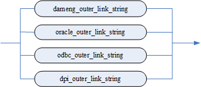

DPI 外部链接串（dpi\_outer\_link\_string）：

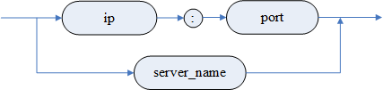

ODBC 外部链接串（odbc\_outer\_link\_string）：


GATEWAY 外部链接串（gateway\_outer\_link\_string）：


DAMENG 外部链接串（dameng\_outer\_link\_string）：

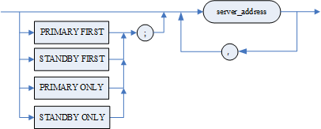

服务器地址（server\_address）：

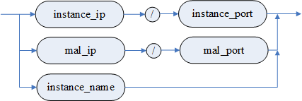

ORACLE 外部链接串（oracle\_outer\_link\_string）：

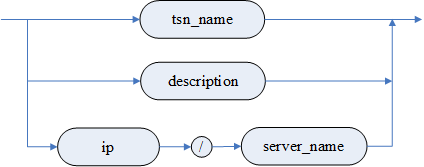

OPTION 子句（option\_clause）：

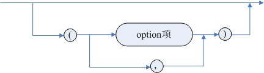

option 项（option\_item）： 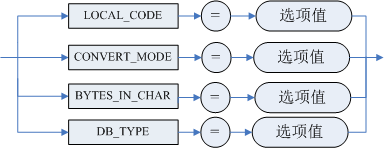

**语句功能**

创建一个外部链接。

**使用说明**

1. 当系统中已经有同名的数据库链接名时，若指定 OR REPLACE，则服务器会自动用新的代码覆盖原来的代码；若指定 IF NOT EXISTS，则服务器会忽略本次外部链接创建操作；若同时指定 OR REPLACE 和 IF NOT EXISTS，则按照 OR REPLACE 的策略执行；若均不指定，则报错；
2. 对于 DM-DM 的同构外部链接，推荐使用 DPI 外部链接串；
3. DPI 外部链接串可以使用 DPI 接口能够识别的 IP 地址和端口号，也可以使用 dm\_svc.conf 文件中配置的服务名。达梦服务器安装成功后自带 DPI 库，因此用户无需进行其他配置操作，即可使用 DPI 外部链接串链接到远程达梦服务器；
4. 当 DBLINK 链接的是多机系统且指定了多台服务器时，若所连接的服务器发生宕机等意外情况导致无法对外提供服务时，DBLINK 将根据设定的 < 连接类型 >，在剩余的服务器中挑选合适的服务器进行连接；
5. ODBC 外部链接用到第三方库文件 libodbc.so（Linux 环境），请用户自行从 UNIXODBC 官网下载，放置到本地目录，通过“环境变量-系统变量”配置后方可使用；Windows 环境下，DBLINK 用到的第三方库文件 odbc32.dll 为操作系统自带，无需用户配置；
6. 要创建 ORACLE 的外部链接，首先需要在当前机器安装 ORACLE 的 OCI 接口，且需要保证 OCI 接口与 DM 版本在 32 位/64 位保持一致。其次本功能将用到第三方库文件 libclntsh.so（Linux 环境）或 oci.dll(Windows 环境)，请用户自行从 ORACLE 官网下载，放置到本地目录，通过“环境变量-系统变量”进行配置；
7. 通过 LINK 对远程服务器所作的修改，由用户在本地服务器通过 commit 或 rollback 进行提交或回滚；
8. 只支持普通用户，不支持 SSL 和 Kerberos 认证；
9. 不支持连接自身实例的 LINK；
10. 支持在 CREATE SCHEMA 中 CREATE LINK，但是不支持 CREATE PUBLIC LINK；
11. 只有 DBA 和具有 CREATE LINK 或 CREATE ANY LINK 权限的用户可以创建外部链接。

**举例说明**

例 1 使用 DPI 外部链接串连接 DM 数据库，IP 地址为 192.168.0.31，端口号为 5369，登录到此站点使用的用户名为 USER01，密码为 DMsys\_123，dm\_svc.conf 文件中配置的服务名为 DMSERVER01。

```
CREATE PUBLIC LINK LINK1 CONNECT 'DPI' WITH USER01 IDENTIFIED BY DMsys_123 USING '192.168.0.31:5369';
```

或

```
CREATE PUBLIC LINK LINK1 CONNECT WITH USER01 IDENTIFIED BY DMsys_123 using 'DMSERVER01';  //DMSERVER01为服务名
```

例 2 使用 DM 数据库，创建一个连接到 IP 地址为 192.168.0.225 机器上的 oracle 数据库的外部链接。可以通过三种方式创建：一网络服务名 tsn\_name；二连接描述符 description；三 \<IP 地址 >/< 服务名 >。

（一） 通过网络服务名创建

首先介绍 Oracle 网络服务名的配置方法。网络服务名配置成功才能创建 DBLINK

配置本地的 Oracle 网络服务名 ORCL，连接 225 机器上的 orcl 实例。详细步骤如下：

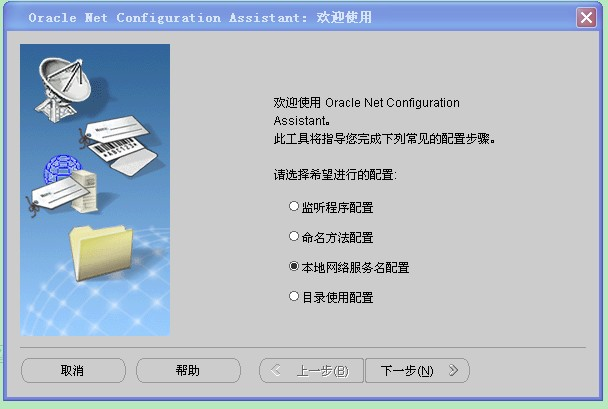

图16.1.1 步骤 一

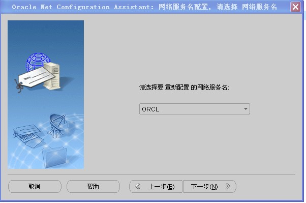

16.1.2 步骤 二

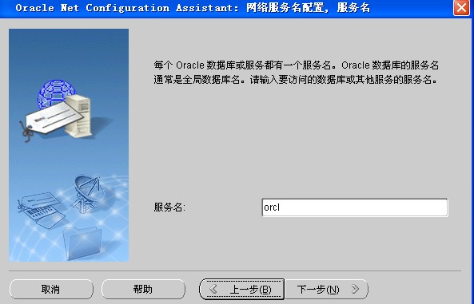

16.1.3 步骤 三

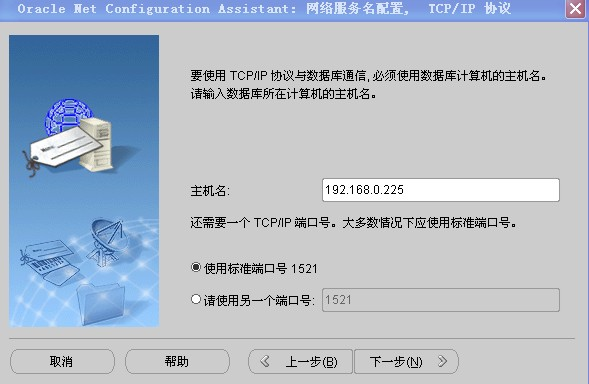

16.1.4 步骤 四

其次，创建 dblink。

网络服务名配置成功后，就可以使用网络服务名 ORCL 或网络连接描述符创建 DBLINK。

```
CREATE LINK LINK1 CONNECT 'ORACLE' WITH USER01 IDENTIFIED BY Oracle_123 USING 'ORCL';
```

（二） 通过连接描述符创建

```
CREATE OR REPLACE LINK LINK1 CONNECT 'ORACLE' WITH USER01 IDENTIFIED BY Oracle_123 USING '(DESCRIPTION =

  (ADDRESS_LIST = (ADDRESS = (PROTOCOL = TCP)(HOST = 192.168.0.225)(PORT = 1521)))

  (CONNECT_DATA = (SERVICE_NAME = orcl) )

 )';
```

（三） 通过 \<IP 地址 >/< 服务名 > 创建

```
CREATE LINK LINK1 CONNECT 'ORACLE' WITH USER01 IDENTIFIED BY Oracle_123 USING '192.168.0.225/orcl';
```

例 3 使用 DM 数据库，创建一个连接到实例名为 ORCL 的外部链接，登录到此站点使用的用户名为 USER01，设置登录口令为 Oracle\_123，设置使用本地字符集为 UTF-8，字符集转换模式为 1。

```
CREATE LINK LINK1 CONNECT 'ORACLE' WITH USER01 IDENTIFIED BY Oracle_123 USING 'ORCL' OPTION (LOCAL_CODE='UTF-8', CONVERT_MODE=1);
```

## 16.2 删除外部链接

删除一个外部链接。

**语法格式**

```
DROP [PUBLIC] LINK [IF EXISTS] [<模式名>.]<外部链接名>;
```

**参数**

1．< 模式名 > 指明被操作的外部链接属于哪个模式，缺省为当前模式；

2．< 外部链接名 > 指明被操作的外部链接的名称。

**图例**

删除外部链接

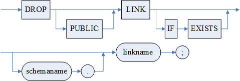

**语句功能**

删除一个外部链接。

**使用说明**

1. 删除不存在的外部链接会报错。若指定 IF EXISTS 关键字，删除不存在的外部链接，不会报错；
2. 只有 DBA 和具有 DROP LINK 或 DROP ANY LINK 权限的用户可以删除自己模式下的非 PUBLIC LINK 对象。DBA 和具有 DROP ANY LINK 权限的用户才可删除任何模式下的 PUBLIC LINK 对象。

**举例说明**

删除外部链接 LINK1。

```
DROP LINK LINK1;
```

## 16.3 使用外部链接

通过外部链接，可以对远程服务器的对象进行查询或进行增删改操作，可以调用远程的过程或函数。

使用外部链接进行查询或增删改的语法格式与普通格式基本一致，唯一的区别在于指定外部链接对象时需要使用如下格式：

```
<对象名> @ <外部链接名>
```

< 对象名 > 可以为远程服务器的表、视图、序列、存储过程或函数的名称。

**举例说明**

使用外部链接查询 LINK1 上的远程表进行查询

```
SELECT * FROM SYSOBJECTS@LINK1;
```

或对远程表进行插入数据：

```
INSERT INTO T1@LINK1 VALUES(1,2,3);
```

也可以查询本地表或其他链接的表对远程表进行操作，如

```
UPDATE T1@LINK1 SET C1 = C1+1 WHERE C2 NOT IN (SELECT ID FROM LOCAL_TABLE);
DELETE FROM T1@LINK1 WHERE C1 IN (SELECT ID FROM T2@LINK2);
```

使用外部链接调用远程的存储过程或函数时，存在以下约束：

1. 参数数据类型为 SQL 类型，不允许为 DMSQL 程序类型；
2. 参数数据类型不允许为复合类型。

若远程的存储过程或函数存在参数列表，则写法如下：

```
[<模式名>.][<包名>.]<过程/函数名> @ <外部链接名>(<参数列表>);
```

**使用限制**

外部链接的使用有以下限制：

1. DM-DM 的同构外部链接不支持 MPP 环境，DM 与异构数据库的外部链接支持 MPP 环境；
2. 不支持使用游标进行增删改操作；
3. 不支持操作远程表的复合类型列；
4. DBLINK 的本地库和远程库的大小写敏感参数 CASE\_SENSITIVE 应保持一致，若不一致，应用需保证 SQL 语句同时满足本地和远程服务器的解析要求，可以利用 CASE\_OPT 参数来调整发送到远程服务器 SQL 语句中的标识符大小写行为；
5. 禁止将源数据库作为 DBLINK 的目标数据库，若检测到源数据库实例与目标库实例一致，服务器将拒绝建立连接。

另外，DM 连接异构数据库的外部链接还有如下使用限制：

1. 数据类型以 DM 为基础，不支持 DM 没有的数据类型；
2. 语法以 DM 的语法为标准，不支持 DM 不兼容的语法；
3. 主键更新，如果是涉及到多个服务器的语句，不能保证更新操作一定成功；
4. 使用 CREATE VIEW view\_name(view\_col\_name) AS SELECT ITEM FROM T@LINK 方式创建的查询远程对象的本地视图，对于异构库，不能保证操作一定成功。对于查询异构库远程对象的本地视图，最好采用 CREATE VIEW AS SELECT ITEM AS alias\_name FROM T@LINK 方式创建。