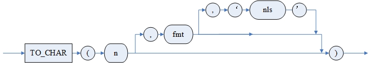
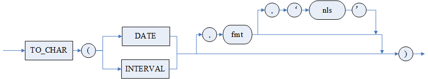

在值表达式中，除了可以使用常量、列名、集函数等之外，还可以使用函数作为组成成份。DM 中支持的函数分为数值函数、字符串函数、日期时间函数、空值判断函数、类型转换函数等。在这些函数中，对于字符串类型的参数或返回值，最大支持的长度为 32K-1。

本手册还给出了 DM 系统函数的详细介绍。下列各表列出了函数的简要说明。在本章各例中，如不特别说明，各例均使用示例库 BOOKSHOP，用户均为建表者 SYSDBA。

表8.1 数值函数

| **序号** | **函数名** | **功能简要说明** |
| --- | --- | --- |
| 01 | ABS(n) | 求数值 n 的绝对值 |
| 02 | ACOS(n) | 求数值 n 的反余弦值 |
| 03 | ASIN(n) | 求数值 n 的反正弦值 |
| 04 | ATAN(n) | 求数值 n 的反正切值 |
| 05 | ATAN2(n,m) | 求数值 n/m 的反正切值 |
| 06 | CEIL(n) | 求大于或等于数值 n 的最小整数 |
| 07 | CEILING(n) | 求大于或等于数值 n 的最小整数，等价于 CEIL(n) |
| 08 | COS(n) | 求数值 n 的余弦值 |
| 09 | COSH(n) | 求数值 n 的双曲余弦值 |
| 10 | COT(n) | 求数值 n 的余切值 |
| 11 | DEGREES(n) | 求弧度 n 对应的角度值 |
| 12 | EXP(n) | 求数值 n 的自然指数 |
| 13 | FLOOR(n) | 求小于或等于数值 n 的最大整数 |
| 14 | GREATEST(n {,n}) | 求一个或多个数中最大的一个 |
| 15 | GREAT(n1,n2) | 求 n1、n2 两个数中最大的一个 |
| 16 | LEAST(n {,n}) | 求一个或多个数中最小的一个 |
| 17 | LN(n) | 求数值 n 的自然对数 |
| 18 | LOG(m\[,n\]) | 求数值 n 以数值 m 为底的对数 |
| 19 | LOG10(n) | 求数值 n 以 10 为底的对数 |
| 20 | MOD(m,n) | 求数值 m 被数值 n 除的余数 |
| 21 | PI() | 得到常数 π |
| 22 | POWER(m,n)/POWER2(m,n) | 求 m 的 n 次幂 |
| 23 | RADIANS(n) | 求角度 n 对应的弧度值 |
| 24 | RAND(\[n\]) | 求一个 0 到 1 之间的随机浮点数 |
| 25 | ROUND(n\[,m\[,trunc\_flag\]\]) | 求四舍五入值或直接进行截断后的值 |
| 26 | SIGN(n) | 判断数值的数学符号 |
| 27 | SIN(n) | 求数值 n 的正弦值 |
| 28 | SINH(n) | 求数值 n 的双曲正弦值 |
| 29 | SQRT(n) | 求数值 n 的平方根 |
| 30 | TAN(n) | 求数值 n 的正切值 |
| 31 | TANH(n) | 求数值 n 的双曲正切值 |
| 32 | TO\_NUMBER(str \[,fmt \[, 'nls'\]\]) | 将 CHAR、VARCHAR、VARCHAR2、CLOB 等类型的字符串转换为 DECIMAL 类型的数值 |
| 33 | TRUNC(n \[,m\])或 TRUNC(str \[,m\]) | 截取数值函数，str 内只能为数字和'-'、'+'、'.'的组合 |
| 34 | TRUNCATE(n \[,m\])或 TRUNCATE(str \[,m\]) | 截取数值函数，等价于 TRUNC 函数 |
| 35 | TO\_CHAR(n \[, fmt \[, 'nls' \] \]) | 将数值类型的数据转换为 VARCHAR 类型输出 |
| 36 | BITAND(n1, n2) | 求两个数值型数值按位进行 AND 运算的结果 |
| 37 | NANVL(n1, n2) | 当 n1 为 NaN 时返回 n2，否则返回 n1。此函数功能仅能处理浮点数类型，处理其他数据类型时结果为 n1 |
| 38 | REMAINDER(n1, n2) | 计算 n1 除 n2 的余数，余数取绝对值更小的那一个 |
| 39 | TO\_BINARY\_FLOAT(n) | 将 number、real 或 double 类型数值转换成 float 类型 |
| 40 | TO\_BINARY\_DOUBLE(n) | 将 number、real 或 float 类型数值转换成 double 类型 |
| 41 | FOUND\_ROWS() | 获取查询语句的查询结果在被 \<LIMIT 限定条件 > 或 \<TOP 子句 > 筛选之前满足条件的总行数 |
| 42 | CONV(n, from\_base, to\_base) | 在不同进制之间转换数字 |
| 43 | FORMAT(x,d) | 将 x 四舍五入到 d 位，再将 x 按’#,###,###.##’格式返回 |

表8.2 字符串函数

| **序号** | **函数名** | **功能简要说明** |
| --- | --- | --- |
| 01 | ASCII(char) | 返回字符对应的整数 |
| 02 | ASCIISTR(char) | 将字符串 char 中，非 ASCII 的字符转成\\XXXX(UTF-16)格式，ASCII 字符保持不变 |
| 03 | BIT\_LENGTH(char) | 求字符串的位长度 |
| 04 | CHAR(n) | 返回整数 n 对应的数据库字符集所对应字符 |
| 05 | CHAR\_LENGTH(char)/ CHARACTER\_LENGTH(char) | 求字符串的串长度 |
| 06 | CHR(n) | 返回整数 n 对应的数据库字符集所对应字符。等价于 CHAR(n) |
| 07 | NCHR(n) | 返回整数 n 对应的数据库字符集所对应字符。等价于 CHAR(n) |
| 08 | CONCAT(char1,char2{,char3}) | 顺序联结多个字符串成为一个字符串 |
| 09 | DIFFERENCE(char1,char2) | 比较两个字符串的 SOUNDEX 值之差异，返回两个 SOUNDEX 值串同一位置出现相同字符的个数。 |
| 10 | INITCAP(char) | 将字符串中单词的首字符转换成大写的字符 |
| 11 | INS(char1,begin,n,char2) | 删除在字符串 char1 中以 begin 参数所指位置开始的 n 个字符, 再把 char2 插入到 char1 串的 begin 所指位置。当 begin 为 0 或负数时，会将 begin 的值调整为 1；当 n 为 0 时，表示不删除 char1 中的任何字符，将 char2 插入到 begin 指定的位置，当 n 为负数时，效果与 n=0 时相同 |
| 12 | INSERT(char1,n1,n2,char2) / INSSTR(char1,n1,n2,char2) | 将字符串 char1 从 n1 的位置开始删除 n2 个字符，并将 char2 插入到 char1 中 n1 的位置 |
| 13 | INSTR(str1,str2\[,n\[,m\]\]) | 从输入字符串 str1 的第 n 个字符开始查找字符串 str2 的第 m 次出现的位置，以字符计算 |
| 14 | INSTRB(char1,char2\[,n\[,m\]\]) | 从 char1 的第 n 个字节开始查找字符串 char2 的第 m 次出现的位置，以字节计算 |
| 15 | INSTRC(char1,char2\[,n\[,m\]\]) | 从 char1 的第 n 个字节开始查找字符串 char2 的第 m 次出现的位置，以完整字符计算 |
| 16 | LCASE(char) | 将大写的字符串转换为小写的字符串 |
| 17 | LEFT(char,n) / LEFTSTR(char,n) | 返回字符串最左边的 n 个字符组成的字符串 |
| 18 | LEN(char) | 返回给定字符串表达式的字符（而不是字节）个数（汉字为一个字符），其中不包含尾随空格 |
| 19 | LENGTH(str) | 返回给定字符串表达式的字符（而不是字节）个数（汉字为一个字符），其中不包含尾随空格 |
| 20 | LENGTHC(char) | 返回给定字符串表达式的字符（而不是字节）个数（汉字为一个字符），其中不包含尾随空格 |
| 21 | LENGTH2(char) | 返回给定字符串表达式的字符（而不是字节）个数（汉字为一个字符），其中不包含尾随空格 |
| 22 | LENGTH4(char) | 返回给定字符串表达式的字符（而不是字节）个数（汉字为一个字符），其中不包含尾随空格 |
| 23 | OCTET\_LENGTH(char) | 返回输入字符串的字节数 |
| 24 | LOCATE(char,str\[,n\]) | 返回 char 在 str 中首次出现的位置 |
| 25 | LOWER(char) | 将大写的字符串转换为小写的字符串 |
| 26 | LPAD(char1,length\[,char2\]) | 在字符串 char1 的左边，依次加入 char2 中的字符，直到总长度达到 length |
| 27 | LTRIM(str\[,set\]) | 删除字符串 str 左边起，出现在 set 中的任何字符，当遇到不在 set 中的第一个字符时返回结果 |
| 28 | POSITION(char1 IN char2) / POSITION(char1, char2) | 求串 1 在串 2 中第一次出现的位置 |
| 29 | REPEAT(char,n) / REPEATSTR(char,n) | 返回将字符串重复 n 次形成的字符串 |
| 30 | REPLACE(str, search \[,replace\]) | 将输入字符串 str 中所有出现的字符串 search 都替换成字符串 replace,其中 str 为 char、clob 或 text 类型 |
| 31 | REPLICATE(char,times) | 把字符串 char 自己复制 times 份 |
| 32 | REVERSE(char) | 将字符串反序 |
| 33 | RIGHT(char,n) / RIGHTSTR(char,n) | 返回字符串最右边 n 个字符组成的字符串 |
| 34 | RPAD(char1,length\[,char2\]) | 在字符串 char1 的右边，依次加入 char2 中的字符，直到总长度达到 length 个字节 |
| 35 | RTRIM(str\[,set\]) | 删除字符串 str 右边起出现的 set 中的任何字符，当遇到不在 set 中的第一个字符时返回结果 |
| 36 | SOUNDEX(char) | 返回一个表示字符串发音的字符串 |
| 37 | SPACE(n) | 返回一个包含 n 个空格的字符串 |
| 38 | STRPOSDEC(char) | 把字符串 char 中最后一个字节的值减一 |
| 39 | STRPOSDEC(char,pos) | 把字符串 char 中指定位置 pos 上的字节值减一 |
| 40 | STRPOSINC(char) | 把字符串 char 中最后一个字节的值加一 |
| 41 | STRPOSINC(char,pos) | 把字符串 char 中指定位置 pos 上的字节值加一 |
| 42 | STUFF(char1,begin,n,char2) | 删除在字符串 char1 中以 begin 参数所指位置开始的 n 个字符, 再把 char2 插入到 char1 串的 begin 所指位置 |
| 43 | SUBSTR(str\[,m\[,n\]\]) / SUBSTRING(char\[ from m \[ for n \]\]) / MID(str,m\[,n\]) | 返回 char 中从字符位置 m 开始的 n 个字符 |
| 44 | SUBSTRB(char,m\[,n\]) | SUBSTR 函数等价的单字节形式 |
| 45 | TO\_CHAR(str) | 将 VARCHAR、CLOB、TEXT 类型的数据转化为 VARCHAR 类型输出 |
| 46 | TRANSLATE(char,char\_from,char\_to) | 将所有出现在搜索字符集中的字符转换成字符集中的相应字符 |
| 47 | TRIM(\[<<LEADING\|TRAILING\|BOTH> \[char\] \| char> FROM\] str) | 删去字符串 str 中由 char 指定的字符 |
| 48 | UCASE(char) | 将小写的字符串转换为大写的字符串 |
| 49 | UPPER(char) | 将小写的字符串转换为大写的字符串 |
| 50 | NLS\_UPPER(char1 \[,nls\_sort=char2\]) | 将小写的字符串转换为大写的字符串 |
| 51 | NLS\_LOWER(char1 \[,nls\_sort=char2\]) | 将大写的字符串转换为小写的字符串 |
| 52 | REGEXP | 根据符合 POSIX 标准的正则表达式进行字符串匹配 |
| 53 | OVERLAY(char1 PLACING char2 FROM m \[ FOR n \]) | 字符串覆盖函数，用 char2 覆盖 char1 中指定的子串，返回修改后的 char1 |
| 54 | TEXT\_EQUAL(n1,n2) | 返回两个 LONGVARCHAR 类型的值的比较结果，相同返回 1，否则返回 0 |
| 55 | BLOB\_EQUAL(n1,n2) | 返回两个 LONGVARBINARY 类型的值的比较结果，相同返回 1，否则返回 0 |
| 56 | NLSSORT(char1 \[,nls\_sort=char2\]) | 返回对自然语言排序的编码 |
| 57 | GREATEST(char {,char}) | 求一个或多个字符串中最大的字符串 |
| 58 | GREAT(char1, char2) | 求 char 1、char 2 中最大的字符串 |
| 59 | TO\_SINGLE\_BYTE(char) | 将多字节形式的字符（串）转换为对应的单字节形式 |
| 60 | TO\_MULTI\_BYTE(char) | 将单字节形式的字符（串）转换为对应的多字节形式 |
| 61 | EMPTY\_CLOB() | 初始化 clob 字段 |
| 62 | EMPTY\_BLOB() | 初始化 blob 字段 |
| 63 | UNISTR(char) | 将字符串 char 中，ASCII 编码或 Unicode 编码（‘\\XXXX’4 个 16 进制字符格式）转成本地字符。对于其他字符保持不变。 |
| 64 | ISNULL(char) | 判断表达式是否为 NULL |
| 65 | CONCAT\_WS(delim, char1 {,char2}) | 顺序联结多个字符串成为一个字符串，并用 delim 分割 |
| 66 | SUBSTRING\_INDEX(char, char\_delim, count) | 按关键字截取字符串，截取到指定分隔符出现指定次数位置之前 |
| 67 | COMPOSE(char) | 在 UTF8 库下，将 char 以本地编码的形式返回 |
| 68 | FIND\_IN\_SET(char, charlist\[,separator\]) | 查询 charlist 中是否包含 char，返回 char 在 charlist 中第一次出现的位置或 NULL |
| 69 | TRUNC(char1, char2) | 截取字符串函数 |
| 70 | TO\_BASE64(R) | 将 VARBINARY、VARCHAR、CLOB 或 BLOB 格式的数据 R 编码成 base64 字符集格式，再以 CLOB 类型返回 |
| 71 | FROM\_BASE64(R) | 将 VARCHAR 表示的 base64 字符集的编码 R 解码成原始的 VARBINARY 类型数据；或将 CLOB 表示的 base64 字符集的编码 R 解码成原始的 BLOB 类型数据 |
| 72 | STR\_TO\_DATE(date\_string, format\_string) | 将字符串按指定格式转换为日期格式 |
| 73 | DATE(date) | 返回日期或日期/时间表达式的日期部分 |
| 74 | STRING\_TO\_ARRAY(str, delimiter) | 将源数据按照指定的分隔符分成若干子串，并以数组形式返回 |
| 75 | SUBSTRBB(binary, start, length) | 返回 binary 中从字节位置 start 开始的 length 个字节 |

表8.3 日期时间函数

| **序号** | **函数名** | **功能简要说明** |
| --- | --- | --- |
| 01 | ADD\_DAYS(date,n) | 返回日期加上 n 天后的新日期 |
| 02 | ADD\_MONTHS(date,n) | 在输入日期上加上指定的几个月返回一个新日期 |
| 03 | ADD\_WEEKS(date,n) | 返回日期加上 n 个星期后的新日期 |
| 04 | CURDATE() | 返回服务器当前日期 |
| 05 | CURTIME(n) | 返回服务器当前时间 |
| 06 | CURRENT\_DATE() | 返回服务器当前日期 |
| 07 | CURRENT\_TIME(n) | 返回服务器当前时间 |
| 08 | CURRENT\_TIMESTAMP(n) | 返回服务器当前带会话时区信息的时间戳 |
| 09 | DATEADD(datepart,n,date) | 向指定的日期加上一段时间 |
| 10 | DATEDIFF({datepart,}date1,date2)/ BIGDATEDIFF(datepart,date1,date2) | 返回跨两个指定日期的日期和时间边界数 |
| 11 | DATEPART(datepart,date) | 返回代表日期的指定部分的整数 |
| 12 | DAY(date) | 返回日期中的天数 |
| 13 | DAYNAME(date) | 返回日期的星期名称 |
| 14 | DAYOFMONTH(date) | 返回日期为所在月份中的第几天 |
| 15 | DAYOFWEEK(date) | 返回日期为所在星期中的第几天 |
| 16 | DAYOFYEAR(date) | 返回日期为所在年中的第几天 |
| 17 | DAYS\_BETWEEN(date1,date2) | 返回两个日期之间的天数 |
| 18 | EXTRACT(时间字段 FROM date) | 抽取日期时间或时间间隔类型中某一个字段的值 |
| 19 | GETDATE(n) | 返回系统当前时间戳 |
| 20 | GREATEST(date {,date}) | 求一个或多个日期中的最大日期 |
| 21 | GREAT(date1,date2) | 求 date1、date2 中的最大日期 |
| 22 | HOUR(time) | 返回时间中的小时分量 |
| 23 | LAST\_DAY(date) | 返回输入日期所在月份最后一天的日期 |
| 24 | LEAST(date {,date}) | 求一个或多个日期中的最小日期 |
| 25 | MINUTE(time) | 返回时间中的分钟分量 |
| 26 | MONTH(date) | 返回日期中的月份分量 |
| 27 | MONTHNAME(date) | 返回日期中月分量的名称 |
| 28 | MONTHS\_BETWEEN(date1,date2) | 返回两个日期之间的月份数 |
| 29 | NEXT\_DAY(date1,char2) | 返回输入日期指定若干天后的日期 |
| 30 | NOW(n) | 返回系统当前时间戳 |
| 31 | QUARTER(date) | 返回日期在所处年中的季节数 |
| 32 | SECOND(time) | 返回时间中的秒分量 |
| 33 | ROUND(date1\[, fmt\]) | 把日期四舍五入到最接近格式元素指定的形式 |
| 34 | TIMESTAMPADD(datepart,n,timestamp) | 返回时间戳 timestamp 加上 n 个 datepart 指定的时间段的结果 |
| 35 | TIMESTAMPDIFF(datepart,timeStamp1,timestamp2) | 返回一个表明 timestamp2 与 timestamp1 之间的指定 datepart 类型时间间隔的整数 |
| 36 | SYSDATE() | 返回系统当前的日期时间，为数据库服务器所在操作系统的日期时间 |
| 37 | TO\_DATE(CHAR\[,fmt\[,'nls'\]\]) /TO\_TIMESTAMP(CHAR\[,fmt\[,'nls'\]\]) / TO\_TIMESTAMP\_TZ(CHAR\[,fmt\[,'nls'\]\]) | 字符串转换为日期时间数据类型 |
| 38 | FROM\_TZ(timestamp,timezone\|\[tz\_name\]) | 将时间戳类型 timestamp 和时区类型 timezone（或时区名称 tz\_name）转化为 timestamp with time zone 类型 |
| 39 | TZ\_OFFSET(timezone\| \[tz\_name\]) | 返回给定的时区或时区名和标准时区(UTC)的偏移量 |
| 40 | TRUNC(date\[,fmt\]) | 把日期截断到最接近格式元素指定的形式 |
| 41 | WEEK(date) | 返回日期为所在年中的第几周 |
| 42 | WEEKDAY(date) | 返回当前日期的星期值 |
| 43 | WEEKS\_BETWEEN(date1,date2) | 返回两个日期之间相差周数 |
| 44 | YEAR(date) | 返回日期的年分量 |
| 45 | YEARS\_BETWEEN(date1,date2) | 返回两个日期之间相差年数 |
| 46 | LOCALTIME(n) | 返回系统当前时间 |
| 47 | LOCALTIMESTAMP(n) | 返回系统当前时间戳 |
| 48 | OVERLAPS | 返回两个时间段是否存在重叠 |
| 49 | TO\_CHAR(date\[,fmt\[,'nls'\]\]) | 将日期数据类型 DATE 转换为一个在日期语法 fmt 中指定语法的 VARCHAR 类型字符串。 |
| 50 | SYSTIMESTAMP(n) | 返回系统当前的时间戳，带有数据库服务器所在操作系统的时区信息 |
| 51 | NUMTODSINTERVAL(dec,interval\_unit) | 转换一个指定的 DEC 类型到 INTERVAL DAY TO SECOND |
| 52 | NUMTOYMINTERVAL(dec,interval\_unit) | 转换一个指定的 DEC 类型值到 INTERVAL YEAR TO MONTH |
| 53 | WEEK(date, mode) | 根据指定的 mode 计算日期为年中的第几周 |
| 54 | UNIX\_TIMESTAMP(datetime) | 返回自标准时区的'1970-01-01 00:00:00 +0:00'的到本地会话时区的指定时间的秒数差 |
| 55 | from\_unixtime(unixtime) | 返回将自'1970-01-01 00:00:00'的秒数差转成本地会话时区的时间戳类型 |
| 56 | from\_unixtime(unixtime, fmt) | 将自'1970-01-01 00:00:00'的秒数差转成本地会话时区的指定 fmt 格式的时间串 |
| 57 | SESSIONTIMEZONE | 返回当前会话的时区 |
| 58 | DBTIMEZONE | 返回当前数据库的时区 |
| 59 | DATE\_FORMAT(d, format) | 以不同的格式显示日期/时间数据 |
| 60 | TIME\_TO\_SEC(d) | 将时间换算成秒 |
| 61 | SEC\_TO\_TIME(sec) | 将秒换算成时间 |
| 62 | TO\_DAYS(timestamp) | 转换成公元 0 年 1 月 1 日的天数差 |
| 63 | DATE\_ADD(datetime, interval) | 返回一个日期或时间值加上一个时间间隔的时间值 |
| 64 | DATE\_SUB(datetime, interval) | 返回一个日期或时间值减去一个时间间隔的时间值 |
| 65 | SYS\_EXTRACT\_UTC(d timestamp) | 将所给时区信息转换为 UTC 时区信息 |
| 66 | TO\_DSINTERVAL(d char) | 将表示时间间隔的字符串转换为 INTERVAL DAY TO SECOND 类型 |
| 67 | TO\_YMINTERVAL(d char) | 将表示时间间隔的字符串转换为 INTERVAL YEAR TO MONTH 类型 |
| 68 | ADDTIME(expr1, expr2) | 在指定时间或日期时间值 expr1 上增加一个时间间隔值 expr2 |
| 69 | DATE\_PART(field,date) | 返回代表日期 date 的指定部分的浮点数值 |
| 70 | DATTE\_PART(date,datepart) | 返回代表日期 date 的指定部分的整数 |
| 71 | DATE\_PART(str1,str2) | 返回日期指定部分的浮点数值 |
| 72 | AGE(\[end\_dt, \]start\_dt) | 计算 end\_dt 减去 start\_dt 的结果，返回表示年龄的字符串 |

表8.4 空值判断函数

| **序号** | **函数名** | **功能简要说明** |
| --- | --- | --- |
| 01 | COALESCE(n1,n2,…,nx) | 返回第一个非空的值 |
| 02 | IFNULL(n1,n2) | 当 n1 为非空时，返回 n1；若 n1 为空，则返回 n2 |
| 03 | ISNULL(n1,n2) | 当 n1 为非空时，返回 n1；若 n1 为空，则返回 n2 |
| 04 | NULLIF(n1,n2) | 如果 n1=n2 返回 NULL，否则返回 n1 |
| 05 | NVL(n1,n2) | 返回第一个非空的值 |
| 06 | NULL\_EQU(n1,n2) | 返回两个类型相同的值的比较 |

表8.5 类型转换函数

| **序号** | **函数名** | **功能简要说明** |
| --- | --- | --- |
| 01 | CAST(value AS type) | 将参数 value 转换为 type 类型返回 |
| 02 | TREAT(\<expr> AS \[\<schema>.\]\<type>) | 用于在运行时检查表达式是否可以转换为另一个数据类型 |
| 03 | CONVERT(type,value \[,style\]);   CONVERT(char, dest\_char\_set \[,source\_char\_set \] ) | 用于当 INI 参数 ENABLE\_CS\_CVT=0 时，将 value 转换为指定的类型；   用于当 INI 参数 ENABLE\_CS\_CVT=1 时，将字符串从源串编码格式转换成目的编码格式 |
| 04 | HEXTORAW(string) | 将由 string 表示的二进制字符串转换为一个 varbinary 数值类型 |
| 05 | RAWTOHEX(binary) | 将 RAW 类数值 binary 转换为一个相应的十六进制表示的字符串 |
| 06 | BINTOCHAR(binary) | 将数值 binary 转换为字符串 |
| 07 | TO\_BLOB(varbinary) | 将数值 varbinary 转换为 BLOB 类型 |
| 08 | UNHEX(char) | 将十六进制的字符串转换为格式字符串或 VARBINARY |
| 09 | HEX(char) | 将字符串转换为一个相应的十六进制表示的字符串 |
| 10 | CHARTOBIN(char) | 将字符串转换为一个 binary 数值类型 |
| 11 | TRANSLATE(char USING CHAR\_CS/NCHAR\_CS) | 将 VARCHAR 类型的数值转换为 VARCHAR 类型输出 |

表8.6 杂类函数

| **序号** | **函数名** | **功能简要说明** |
| --- | --- | --- |
| 01 | DECODE(exp, search1, result1, … searchn, resultn\[,default\]) | 查表译码 |
| 02 | ISDATE(exp) | 判断表达式是否为有效的日期 |
| 03 | ISNUMERIC(exp) | 判断表达式是否为有效的数值 |
| 04 | DM\_HASH(exp) | 根据给定表达式生成 HASH 值 |
| 05 | LNNVL(condition) | 根据表达式计算结果返回布尔值 |
| 06 | LENGTHB(value) | 返回 value 的字节数 |
| 07 | FIELD(value, e1, e2, e3, e4...en) | 返回 value 在列表 e1, e2, e3, e4...en 中的位置序号，不在输入列表时则返回 0 |
| 08 | ORA\_HASH(exp \[,max\_bucket \[,seed\_value\]\]) | 为表达式 exp 生成 HASH 桶值 |
| 09 | IF(expr1,expr2,expr3) | 判断函数。expr1 为布尔表达式，如果其值为 TRUE，则返回 expr2 值，否则返回 expr3 值 |
| 10 | WIDTH\_BUCKET(expr,low\_value,high\_value,num\_buckets) | 将指定的范围\[low\_value,high\_value)划分为 num\_buckets 个等宽的直方图，每个桶的范围都是左闭右开的，返回指定表达式 expr 的值所属的桶序号 |
| 11 | OBJECT\_ID(\[schema\_name.\]object\_name\[, object\_type\]) | 返回对象的 ID |

## 8.1 数值函数

数值函数接受数值参数并返回数值作为结果。

**1.** **函数ABS**

```
语法：ABS(n)
```

功能：返回 n 的绝对值。n 必须是数值类型。

例 查询现价小于 10 元或大于 20 元的信息。

```
SELECT PRODUCTID,NAME FROM PRODUCTION.PRODUCT WHERE ABS(NOWPRICE-15)>5;
```

查询结果如下:

```
PRODUCTID   NAME
----------- -------------------------
3           老人与海
4           射雕英雄传(全四册)
6           长征
7           数据结构(C语言版)(附光盘)
10          噼里啪啦丛书(全7册)
```

**2.** **函数ACOS**

```
语法：ACOS(n)
```

功能：返回 n 的反余弦值。n 必须是数值类型，且取值在-1 到 1 之间，函数结果从 0 到 π。

例

```
SELECT acos(0);
```

查询结果为：1.570796326794897E+00

**3.** **函数ASIN**

```
语法：ASIN(n)
```

功能：返回 n 的反正弦值。 n 必须是数值类型， 且取值在-1 到 1 之间， 函数结果从-π/2 到 π/2。

例

```
SELECT asin(0);
```

查询结果为：0.000000000000000E+00

**4.** **函数ATAN**

```
语法：ATAN(n)
```

功能：返回 n 的反正切值。n 必须是数值类型，取值可以是任意大小，函数结果从-π/2 到 π/2。

例

```
SELECT atan(1);
```

查询结果为：7.853981633974483E-01

**5.** **函数ATAN2**

```
语法：ATAN2(n, m)
```

功能：返回 n/m 的 4 象限反正切值，返回值表示直角坐标轴中原点至点(m,n)的方位角，和点(m,n)所处象限有关。n 和 m 必须是数值类型，二者不能同时为 0，函数结果范围为(-π,π\]。

例

```
SELECT atan2(0.2,0.3);
```

查询结果为：5.880026035475676E-01

**6.** **函数CEIL**

```
语法：CEIL(n)
```

功能：返回大于等于 n 的最小整数。n 必须是数值类型。返回类型与 n 的类型相同。

例

```
SELECT CEIL(15.6);
```

查询结果为：16

```
SELECT CEIL(-16.23);
```

查询结果为：-16

**7.** **函数CEILING**

```
语法：CEILING(n)
```

功能：返回大于等于 n 的最小整数。等价于函数 CEIL(n)。

**8.** **函数COS**

```
语法：COS(n)
```

功能：返回 n 的余弦值。n 必须是数值类型，是用弧度表示的值。将角度乘以 π/180，可以转换为弧度值。

例

```
SELECT cos(14.78);
```

查询结果为：-5.994654261946543E-01

**9.** **函数COSH**

```
语法：COSH(n)
```

功能：返回 n 的双曲余弦值。

例

```
SELECT COSH(0)"Hyperbolic cosine of 0";
```

查询结果为：1.000000000000000E+00

**10.** **函数COT**

```
语法：COT(n)
```

功能：返回 n 的余切值。n 必须是数值类型，是用弧度表示的值。将角度乘以 π/180，可以转换为弧度值。

例

```
SELECT COT(20 * 3.1415926/180);
```

查询结果为：2.747477470356783E+00

**11.** **函数DEGREES**

```
语法：DEGREES(n)
```

功能：返回弧度 n 对应的角度值，返回值类型与 n 的类型相同。

例

```
SELECT DEGREES(1.0);
```

查询结果为：5.729577951308238E+01

**12.** **函数EXP**

```
语法：EXP(n)
```

功能：返回 e 的 n 次幂。函数 EXP 支持数据类型 DEC 与 DOUBLE。当输入参数的数据类型与 EXP 函数定义的数据类型不匹配时，系统会根据内部算法，自动转换为匹配度高的定义类型。

需要注意的是当计算溢出时，系统会自动报错。

例

```
SELECT EXP(4) "e to the 4th power";
```

查询结果为：54.59815003314423907811026120286087840308

**13.** **函数FLOOR**

```
语法：FLOOR(n)
```

功能：返回小于等于 n 的最大整数值。n 必须是数值类型。返回类型与 n 的类型相同。

例

```
SELECT FLOOR(15.6);
```

查询结果为：15

```
SELECT FLOOR(-16.23);
```

查询结果为：-17

**14.** **函数GREATEST**

```
语法：GREATEST(n {,n})
```

功能：求一个或多个数中最大的数。

例

```
SELECT GREATEST(1.2,3.4,2.1);
```

查询结果为：3.4

**15.** **函数GREAT**

```
语法：GREAT(n1,n2)
```

功能：求 n1、n2 中的最大的数。

例

```
SELECT GREAT(2, 4);
```

查询结果为：4

**16.** **函数LEAST**

```
语法：LEAST(n {,n})
```

功能：求一个或多个数中最小的一个。

例

```
SELECT LEAST(1.2,3.4,2.1);
```

查询结果为：1.2

**17.** **函数LN**

```
语法：LN(n)
```

功能：返回 n 的自然对数。n 为数值类型，且大于 0。

例

```
SELECT ln(95) "Natural log of 95";
```

查询结果为： 4.55387689160054083460978676511404117678

**18.** **函数LOG**

```
语法：LOG(m[,n])
```

功能：返回数值 n 以数值 m 为底的对数；若参数 m 省略，返回 n 的自然对数。m,n 为数值类型，m 大于 0 且不为 1。

例

```
SELECT LOG(10,100);
```

查询结果为：2.000000000000000E+00

```
SELECT LOG(95);
```

查询结果为：4.553876891600541E+00

**19.** **函数LOG10**

```
语法：LOG10(n)
```

功能：返回数值 n 以 10 为底的对数。n 为数值类型，且大于 0。

例

```
SELECT LOG10(100);
```

查询结果为：2.000000000000000E+00

**20.** **函数MOD**

```
语法：MOD(m,n)
```

功能：返回 m 除以 n 的余数，当 n 为 0 时直接返回 m。m,n 为数值类型。

例

```
SELECT ROUND(NOWPRICE),mod(ROUND(NOWPRICE),10) FROM PRODUCTION.PRODUCT;
```

查询结果如下：

```
ROUND(NOWPRICE) "MOD"(ROUND(NOWPRICE),10)
--------------- -------------------------
15              5
14              4
6               6
22              2
20              0
38              8
26              6
11              1
11              1
42              2
```

**21.** **函数PI**

```
语法：PI()
```

功能：返回常数 π。

例

```
SELECT PI();
```

查询结果为：3.141592653589793E+00

**22.** **函数POWER/POWER2**

```
语法：POWER(m,n) / POWER2(m,n)
```

功能：返回 m 的 n 次幂。m,n 为数值类型，其中 POWER 函数有如下限制：如果 m 为负数的话，n 必须为一个整数。POWER2 函数中支持 n 为负数。POWER()的返回值类型为 DOUBLE 或 DECIMAL，POWER2()的返回值类型为 DECIMAL。

例

```
SELECT POWER(3,2) "Raised";
```

查询结果为：9

```
SELECT POWER(-3,3) "Raised";
```

查询结果为：-27

**23.** **函数RADIANS**

```
语法：RADIANS(n)
```

功能：返回角度 n 对应的弧度值，返回值类型为 double 类型。

例

```
SELECT RADIANS(180.0);
```

查询结果为：3.141592653589790E+00

**24.** **函数RAND**

```
语法：RAND([n])
```

功能：返回一个\[0,1\]之间的随机浮点数。n 为数值类型，为生成随机数的种子，当 n 固定时，生成随机数固定，当 n 省略时，系统自动生成随机数种子。

例

```
SELECT RAND();
```

查询结果为一个随机生成的小数

```
SELECT RAND(314);
```

查询结果为：6.126518479112190E-02

**25.** **函数ROUND**

```
语法：ROUND(n[,m[,trunc_flag]])
```

功能：求一个数值类型进行四舍五入后的值，或直接进行截断后的值。

trunc\_flag 为标记是否四舍五入的数值类型参数，缺省值为 0。

当 trunc\_flag 取值为 0 或 NULL 时，返回四舍五入到小数点后面 m 位的 n 值。

当 trunc\_flag 取值为非 0 值时，返回直接进行截断后的到小数点后 m 位的 n 值。

m 应为一个整数，缺省值为 0，m 为负整数则四舍五入到小数点的左边，m 为正整数则四舍五入到小数点的右边。若 m 为小数，系统将自动将其转换为整数。

例 1 对 PRODUCTION.PRODUCT 表中的价格使用 ROUND 函数

```
SELECT NOWPRICE,ROUND(NOWPRICE) FROM PRODUCTION.PRODUCT;
```

查询结果如下：

```
NOWPRICE ROUND(NOWPRICE)
-------- ---------------
15.2  15
14.3  14
6.1   6
21.7  22
20  20
37.7  38
25.5  26
11.4  11
11.1  11
42  42
```

例 2 对数字使用 ROUND 函数

```
SELECT ROUND(15.163,-1);
```

查询结果为：20

```
SELECT ROUND(15.163);
```

查询结果为：15

例 3 对数字使用 ROUND 函数，设置 trunc\_flag 的值

```
SELECT  ROUND(15.163,1,5);
```

查询结果为：15.1

```
SELECT  ROUND(15.163,-1,-1);
```

查询结果为：10

```
SELECT  ROUND(15.163,-1,0);
```

查询结果为：20

**26.** **函数SIGN**

```
语法：SIGN(n)
```

功能：如果 n 为正数，SIGN(n)返回 1，如果 n 为负数，SIGN(n)返回-1，如果 n 为 0，SIGN(n)返回 0。

例

```
SELECT ROUND(NOWPRICE),SIGN(ROUND(NOWPRICE)-20) FROM PRODUCTION.PRODUCT;
```

查询结果如下：

```
ROUND(NOWPRICE) SIGN(ROUND(NOWPRICE)-20)
--------------- ------------------------
15                  -1
14                  -1
6                   -1
22                1
20                   0
38                   1
26                   1
11                  -1
11                  -1
42                   1
```

**27.** **函数SIN**

```
语法：SIN(n)
```

功能：返回 n 的正弦值。n 必须是数值类型，是用弧度表示的值。将角度乘以 π/180，可以转换为弧度值。

例

```
SELECT SIN(0);
```

查询结果为：0.000000000000000E+00

**28.** **函数SINH**

```
语法：SINH(n)
```

功能：返回 n 的双曲正弦值。

例

```
SELECT SINH(1);
```

查询结果为：1.175201193643801E+00

**29.** **函数SQRT**

```
语法：SQRT(n)
```

功能：返回 n 的平方根。n 为数值类型，且大于等于 0。

例

```
SELECT ROUND(NOWPRICE),SQRT(ROUND(NOWPRICE)) FROM PRODUCTION.PRODUCT;
```

查询结果如下：

```
ROUND(NOWPRICE) SQRT(ROUND(NOWPRICE))
--------------- -------------------------
15              3.872983346207417E+00
14              3.741657386773941E+00
6               2.449489742783178E+00
22              4.690415759823430E+00
20              4.472135954999580E+00
38              6.164414002968976E+00
26              5.099019513592785E+00
11              3.316624790355400E+00
11              3.316624790355400E+00
42              6.480740698407860E+00
```

**30.** **函数TAN**

```
语法：TAN(n)
```

功能：返回 n 的正切值。n 必须是数值类型，是用弧度表示的值。将角度乘以 π/180，可以转换为弧度值。

例

```
SELECT TAN(45 *Pi()/180);
```

查询结果为：9.999999999999999E-01

**31.** **函数TANH**

```
语法：TANH(n)
```

功能：返回 n 的双曲正切值。

例

```
SELECT TANH(0);
```

查询结果为：0.000000000000000E+00

**32.** **函数TO\_NUMBER**

```
语法：TO_NUMBER(str [,fmt [, 'nls']])
```

功能：将 CHAR、VARCHAR、VARCHAR2、CLOB 等类型的字符串转换为 DECIMAL 类型的数值。str 为待转换的字符串，fmt 为目标格式串。

若指定了 fmt 格式则转换后的 str 应该遵循相应的数字格式，若没有指定则直接转换成 DECIMAL。fmt 格式串一定要包容实际字符串的数据的格式，否则报错。无格式转换中只支持小数点和正负号。合法的 fmt 格式串字符如下表：

表8.1.1 合法的fmt格式串字符

| **元素** | **例子** | **说明** |
| --- | --- | --- |
| ,(逗号) | 9,999 | 指定位置处返回逗号 注意：1.逗号不能开头 2.不能在小数点右边 |
| .(小数点) | 99.99 | 指定位置处返回小数点 |
| $ | $9999 | 美元符号开头 |
| 0 | 0999 9990 | 以 0 开头，返回指定字符的数字 以 0 结尾，返回指定字符的数字 |
| 9 | 9999 | 返回指定字符的数字，如果不够正号以空格代替， 负号以-代替，0 开头也以空格代替。 |
| D | 99D99 | 返回小数点的指定位置，默认为’.’,格式串中最多能有一个 D |
| G | 9G999 | 返回指定位置处的组分隔符，可有多个，但不能出现在小数点右边 |
| S | S9999 9999S | 负值前面返回一个-号 正值前面不返回任何值 负值后面返回一个-号 正值后面不返回任何值 只能在格式串首尾出现 |
| X | XXXX xxxx | 返回指定字符的十六进制值，如果不是整数则四舍五入到整数， 如果为负数则返回错误。 |
| C | C9999 | 当前货币名称缩写 |
| B | B9999 | 返回指定字符的数字 |

在设置兼容 Postgres（即设置 INI 参数 COMPATIBLE\_MODE=7）后，fmt 格式串中指定了 G，支持待转换字符串中不加千分号（逗号,），或千分号与 G 的位置不对应。当待转换字符串中的千分号与 fmt 格式串中的 G 位置对应时，待转换字符串的数字位数不能多于格式串中 9 的位数。

nls 用来指定以下字符串中待转换的格式元素：

1. 小数点字符。和 fmt 中 D 对应的分隔符。
2. 组分隔符。和 fmt 中 G 对应的分隔符，用于分隔千、百万、十亿……之间的符号。
3. 本地货币符号。
4. 国际货币符号。

nls 书写形式如下：

```
NLS_NUMERIC_CHARACTERS = ''<小数点字符><组分隔符>''
NLS_CURRENCY = ''<本地化货币符号>''
NLS_ISO_CURRENCY =''<国际货币符号>'''
```

nls 参数字符串如果包含空格，要用单引号括起来；如果包含单引号，也要用单引号括起来，以对单引号进行转义。

NLS\_NUMERIC\_CHARACTERS 参数用于指定 fmt 中字符 D 和 G 代表小数点字符和组分隔符，必须用引号引起来。NLS\_NUMERIC\_CHARACTERS 串的长度只能是两个，并且这两个字符不能相同。

NLS\_CURRENCY 指定的字符串用来代替本地货币符号，例如 ￥、人民币等。当 fmt 的前缀或后缀中有 L 时有效（fmt 的具体说明请查看数值函数 to\_char），不能超过 10 个字符的长度。

NLS\_ISO\_CURRENCY 用来指定的字符串用来代替国际货币符号，仅当 FMT 的前缀中有 C 时有效，取值只能是表 8.1.9 中国际货币符号一列的值，得到的结果是缩写的内容，国际货币符号及货币名称释义中给出了国际货币符号和货币缩写的中文释义。

存在使用注意事项：

(1) to\_number 的 nls 支持由用户自定义，但暂不支持解析具有二义性的字符，即 to\_number 的 NLS\_NUMERIC\_CHARACTERS 和 NLS\_CURRENCY 暂不支持指定 0~9、<、>、+、-、E、e 等字符；

(2) 由于 DM 对于 to\_char 函数第三个参数 nls 不做(1)中的限制，故 to\_number 无法识别由指定了(1)中所述字符的 to\_char 函数转换出来的字符串；

(3) 对于 fmt 格式串存在限制如下：

- 若 fmt 格式串中没有指定元素"."或"D"，则即使 fmt 格式串中指定了元素","，在源串中对于千分号的匹配仍需要以 NLS\_NUMERIC\_CHARACTERS 指定的组分隔符为准；
- 若 fmt 中指定使用了元素"."，则在源串中解析千分号只能使用","，不能使用"G"；即在 fmt 中"."需要和","搭配使用，"D"需要和"G"搭配使用，两种方式不能混用；
- 若 fmt 中指定使用了元素"D"，则源串解析千分号只能使用 NLS\_NUMERIC\_CHARACTERS 指定的组分隔符。

例 1 使用 9、G、D 来转换字符串'2,222.22'。

```
SELECT TO_NUMBER('2,222.22', '9G999D99');
```

查询结果为：2222.22

例 2 使用 9、,(逗号)、.(小数点)来转换字符串'2,222.22'。

```
SELECT TO_NUMBER('2,222.22', '9,999.99');
```

查询结果为：2222.22

例 3 使用 9、G、.(小数点)，由于在 fmt 中混用了 G 和.(小数点)，转换时报错。

```
SELECT TO_NUMBER('2,222.22', '9G999.99');
```

查询结果报错：\[-6129\]:无效的数字格式掩码

例 4 使用$、9、,(逗号)、.(小数点)来转换字符串'2,222.22'。

```
SELECT TO_NUMBER('$2,222.22','$9G999D99');
```

查询结果为：2222.22

例 5 使用 S、9 和.(小数点)来转换字符串'2,222.22'。

```
SELECT TO_NUMBER('-1212.12','S9999.99');
```

查询结果为：-1212.12

例 6 使用 XXXX 来转换字符串'1,234'。

```
SELECT TO_NUMBER('1,234','XXXX');
```

查询结果为：4660

例 7 无格式转换。

```
SELECT TO_NUMBER('-123.4');
```

查询结果为：-123.4

例 8 设置兼容 Postgres，转换字符串'12454.8-'，字符串中不含千分号。

```
SELECT TO_NUMBER('12454.8-', '99G999D9S');
```

查询结果为：-12454.8

例 9 设置兼容 Postgres，转换字符串'124,54.8-'，字符串中千分号与 G 位置不对应。

```
SELECT TO_NUMBER('124,54.8-', '99G999D9S');
```

查询结果为：-12454.8

例 10 使用 9、L、G、'NLS\_NUMERIC\_CHARACTERS=''^#'''、'NLS\_CURRENCY = ''￥'''来转换字符串'￥12#699^2'。

```
SELECT TO_NUMBER('￥12#699^2', 'L99G999D99', 'NLS_NUMERIC_CHARACTERS=''^#'' NLS_CURRENCY = ''￥''') FROM DUAL;
```

查询结果为：12699.2

**33.** **函数TRUNC**

```
语法：TRUNC(n [,m])
    或
    TRUNC(str [,m]) //str内只能为数字和'-'、'+'、'.'的组合
```

功能：将数值 n 的小数点后第 m 位以后的数全部截去。当数值参数 m 为负数时表示将数值 n 小数点前的第 m 位后的所有数截去。当数值参数 m 省略时，m 缺省为 0。支持对带符号的数值或字符串类型数值进行操作，例如：+11.2、'-8.9'。对字符串类型数值使用 trunc 函数，结果的有效数字为 16 位；由于过程中会先将字符串类型数值转换为 double 类型，会发生精度丢失，截取后的第 16 位数字可能与预期有偏差。

特殊说明：当 m 为负数，其绝对值大于或等于 n 的整数位个数时，结果取 0；当 m 取正数，其值大于等于 n 的小数位个数时，结果取 n。

例 1 对 PRODUCTION.PRODUCT 表中的价格的平方根使用 TRUNC 函数

```
SELECT SQRT(NOWPRICE), TRUNC(SQRT(ROUND(NOWPRICE) ),1)FROM PRODUCTION.PRODUCT;
```

查询结果如下：

```
SQRT(NOWPRICE)            TRUNC(SQRT(ROUND(NOWPRICE)),1)
------------------------- ------------------------------
3.898717737923585E+00    3.8
3.781534080237808E+00    3.7
2.469817807045694E+00    2.4
4.658325879540846E+00    4.6
4.472135954999580E+00    4.4
6.140032573203500E+00    6.1
5.049752469181039E+00    5
3.376388603226827E+00    3.3
3.331666249791536E+00    3.3
6.480740698407860E+00    6.4
```

例 2 对数字使用 TRUNC 函数

```
SELECT TRUNC(15.167,-1);
```

查询结果为：10.000

例 3 对带符号字符串型数值'-14.1111'使用 TRUNC 函数

```
SELECT   TRUNC('-14.1111',-1);
```

查询结果为：-1.000000000000000E+01

**34.** **函数TRUNCATE**

```
语法：TRUNCATE(n [,m])
    或
    TRUNCATE(str [,m]) //str内只能为数字和'-'、'+'、'.'的组合
```

功能：等价于函数 TRUNC。将数值 n 的小数点后第 m 位以后的数全部截去。当数值参数 m 为负数时表示将数值 n 小数点前的第 m 位后的所有数截去。当数值参数 m 省略时，m 默认为 0。支持对带符号的数值或字符串类型数值进行操作，例如：+11.2、'-8.9'。

特殊说明：当 m 为负数，其绝对值大于或等于 n 的整数位个数时，结果取 0；当 m 取正数，其值大于等于 n 的小数位个数时，结果取 n。

例 1 对数值使用 TRUNCATE 函数

```
SELECT  TRUNCATE(123.456,1);
```

查询结果为：123.4

例 2 对带符号字符串型数值'-14.1111'使用 TRUNCATE 函数

```
SELECT  TRUNCATE('-14.1111',-1);
```

查询结果为：-1.000000000000000E+01

**35.** **函数TO\_CHAR**

```
语法：TO_CHAR(n [, fmt [, 'nls' ] ])
```

**图例**

函数 TO\_CHAR（数值类型）



**语句功能：**

将数值类型的数据转化为 VARCHAR 类型输出。其中：n 为数值类型的数据；fmt 为目标格式串。

fmt 中包含的格式控制符可分为三类：前缀标记、主体标记和后缀标记。前缀标记通常写在主体标记之前，执行产生的效果位于输入串之前；主体标记为必选项，通常产生的效果是为输入串增加格式效果，可与前缀标记和后缀标记组合使用；后缀标记通常写在主体标记之后，执行产生的效果位于输入串之后。

书写标记时，需要避免标记之间的冲突。冲突通常包括前缀之间的冲突、前缀与后缀之间的冲突、后缀与前缀之间的冲突、后缀之间的冲突四种。会产生冲突的情况将在下文中做出具体说明。建议用户按照标记的前后顺序书写：首先前缀标记，可选项；其次主体标记，必选项；最后后缀标记，可选项。例如：SELECT TO\_CHAR('-1997','$999999MI');执行结果为：$1997-。

三类标记中，主体标记可以单独使用，而前缀标记或后缀标记必须要与主体标记组合才能使用。例如：SELECT TO\_CHAR(-1234,'TME'),TO\_CHAR(-1234,'9999');执行结果分别为：-1.234E+03 和-1234。

fmt 缺省时，fmt 格式为数字的字符串本身。例如：SELECT TO\_CHAR(11.18);该语句的执行结果为：11.18。

主体标记包含的标记如表 8.1.2 所示。主体标记可单独使用，也可和其他类型标记组合使用。一个 fmt 中可包含一种或多种主体标记。

下表中，对 0 和 9 的使用需注意以下情况：

1）数据对齐：当 fmt 中没有点号（.）或 D 时，数据在舍弃小数部分后从右到左对齐，当 fmt 中存在点号（.）或 D 时，数据优先对齐小数点。

2）0/9 功能变化：对于点号（.）、D 和 V 与 0/9 合并使用时，在这些符号之前的 0/9 按照各自规则处理数据，在这些符号之后的 0/9，位数不足时统一按照 0 处理。另外，当 9 未填充且其前有 0 时，该位按照 0 处理。

表8.1.2 主体标记

| **格式控制符** | **说明** |
| --- | --- |
| 逗号（,） | 逗号可出现在整数部分（除了头部以外）的任意位置。例如：TO\_CHAR(1234, '9,99,9')， 结果为 1,23,4 |
| 点号（.） | 作为小数点分隔符，不足的位数由后面的掩码决定 |
| 0 | 返回指定位数的值，位数不足时用 0 补齐。如果原值为正，则另带一个前导空格，如果为负，则在数字部分之前带一个前导负号 |
| 9 | 返回指定位数的值，位数不足时用空格补齐。如果原值为正，则另带一个前导空格，如果为负，则在数字部分之前带一个前导负号 |
| D | 表示小数点字符。用法等同于点号. |
| G | 表示组分隔符。用法等同于逗号, |
| X | 表示 16 进制。X 前只能使用 0 或 FM，其它任何元素都会返回错误。   如果 X 前未使用 0 或 FM，位数不足时用空格补齐，在返回值的基础上补充一个前导空格。 |
| V | 表示数据 n 乘以 10 的 m 次方（如果乘积含有小数，将四舍五入到整数），其中 m 是 fmt 中在掩码 V 后的 9 或 0 的个数 |
| RN | 转换为大写的罗马数字 |
| rn | 转换为小写的罗马数字 |
| TM9 | 64 个字符内返回原数值，超过则返回科学计数值。TM9 仅可以分别与 S、FM 这 2 个前缀标记组合使用，例如：SELECT TO\_CHAR(1997,'STM9')。除此以外，TM9 不能与其它主体标记、后缀标记、主体和后缀标记组合使用，例如以下语句报错：SELECT TO\_CHAR(1997,'TM99999')，SELECT TO\_CHAR(1997,'TM9C')，SELECT TO\_CHAR(1997,'TM99999C') |
| TME | 返回科学计数值。TME 仅可以分别与 S、FM 这 2 个前缀标记组合使用，例如：SELECT TO\_CHAR(1997,'STME')。除此以外，TME 不能与其它主体标记、后缀标记、主体和后缀标记组合使用，例如以下语句报错：SELECT TO\_CHAR(1997,'TME9999')，SELECT TO\_CHAR(1997,'TMEC')，SELECT TO\_CHAR(1997,'TME9999C') |

前缀标记包含的标记如表 8.1.3 所示。前缀标记均需要和其他类型标记组合使用。一个 fmt 中可包含一种或多种前缀标记。例如：SELECT TO\_CHAR('-1997','S$9999');执行结果为：-$1997。

表8.1.3 前缀标记

| **格式控制符** | **说明** |
| --- | --- |
| FM | 去掉前置空格 |
| $ | 美元符号。只能有一个。在 fmt 书写时，$ 可写于主体标记的前面或后面。如 TO\_CHAR(1234, '$9999')， TO\_CHAR(1234, '9999$')，TO\_CHAR(-1234,'9999$PR')，以上语句的执行结果中$ 都位于数字主体之前 |
| B | 当整数部分的值为零时，返回空格 |
| S | 表示正负号， 如 TO\_CHAR(1234, 'S9999')结果为 +1234， TO\_CHAR(-1234,'S9999')结果为-1234 |
| C | 当前货币名称缩写 |
| L | 当前货币符号 |

后缀标记包含的标记如表 8.1.4 所示。后缀标记不可单独使用，必须和其他类型的标记组合使用（必须含有主体类型，前缀类型为可选项）。一个 fmt 中可包含一种或多种后缀标记。例如：SELECT TO\_CHAR('-1997','999999EEEEMI');执行结果为：2E+03-。

表8.1.4 后缀标记

| **格式控制符** | **说明** |
| --- | --- |
| EEEE | 科学计数符 |
| MI | 如'9999MI'，如果是负数，在尾部加上负号(-)； 如果是正数和 0，则尾部加上空格 |
| PR | 将负数放到尖括号 <> 中 |
| C | 当前货币名称缩写 |
| L | 当前货币符号 |
| S | 表示正负号 |

此外，正确书写 fmt 时，须避免标记之间冲突。三种标记之间的冲突主要包括以下几种：

1） 前缀之间的冲突；

2） 前缀与后缀的冲突；

3） 后缀与前缀的冲突；

4） 后缀之间的冲突。

前缀之间的冲突如表 8.1.5 所示。

表8.1.5 前缀之间的冲突

| **前缀** | **与指定前缀存在冲突的前缀** |
| --- | --- |
| $ | $、C、L |
| B | B |
| S | $、B、S、C、L |
| FM | $、B |
| C | $、C、L |
| L | $、C、L |

注：前缀之间的冲突指上表中第二列的前缀不能放在第一列的前缀之前。

如当使用前缀标记 S 时，S 之前不能再使用前缀标记$、B、S、C、L；而当使用前缀标记 $ 时，因为未列出前缀标记$ 与前缀标记 S 之间的冲突，所以$ 之前可以使用前缀标记 S。例如，语句 SELECT TO\_CHAR(1997,'$S9999');执行后报错；语句 SELECT TO\_CHAR(1997,'S$9999');执行后的结果为“+$1997”。

前缀与后缀之间的冲突如表 8.1.6 所示。

表8.1.6 前缀与后缀之间的冲突

| **前缀** | **与指定前缀存在冲突的后缀** |
| --- | --- |
| $ | C、L、MI、PR、S。其中，C、L 不能和$同时使用。MI、PR 以及 S 作为后缀标记时，不能出现在$之前，例如：SELECT TO\_CHAR('1977','9999S$'); |

后缀与前缀之间的冲突如表 8.1.7 所示。

表8.1.7 后缀与前缀之间的冲突

| **后缀** | **与指定后缀存在冲突的前缀** |
| --- | --- |
| L | L、C、$ |
| C | L、C、$ |
| S | S |
| PR | S |
| MI | S |

如当后缀为 C 时，前缀中不能还有 L、C、$ 等标记，如格式’L999C’等。

后缀之间的冲突如表 8.1.8 所示。

表8.1.8 后缀之间的冲突

| **后缀** | **与指定后缀存在冲突的后缀** |
| --- | --- |
| EEEE | S、EEEE、MI、PR |
| S | S、MI、PR |
| PR | S、MI、PR |
| MI | S、MI、PR |
| C | C、L、MI、PR、S、EEEE |
| L | C、L、MI、PR、S、EEEE |

注：后缀之间的冲突指上表中第二列的后缀不能放在第一列的后缀之前。

如当后缀为 L 时，后缀中不能还有 C、L、MI、PR、S、EEEE 等标记，即后缀 CL、LL、MIL、PRL、SL、EEEEL 不能在格式字符串中出现。

nls 用来指定以下数字格式元素返回的字符：

1. 小数点字符。和 FMT 中 D 对应的分隔符。
2. 组分隔符。和 FMT 中 G 对应的分隔符，用于分隔千、百万、十亿……之间的符号。
3. 本地货币符号。
4. 国际货币符号。

nls 书写形式如下：

'NLS\_NUMERIC\_CHARACTERS = ''< 小数点字符 >< 组分隔符 >''

NLS\_CURRENCY = ''< 本地化货币符号 >''

NLS\_ISO\_CURRENCY =''< 国际货币符号 >'''

nls 参数字符串如果包含空格，要用单引号括起来；如果包含单引号，也要用单引号括起来，以对单引号进行转义。

NLS\_NUMERIC\_CHARACTERS 参数用于指定 fmt 中字符 D 和 G 代表小数点字符和组分隔符，必须用引号引起来。NLS\_NUMERIC\_CHARACTERS 串的长度只能是两个，并且这两个字符不能相同。

NLS\_CURRENCY 指定的字符串用来代替本地货币符号，例如 ￥、人民币等。当 FMT 的前缀或后缀中有 L 时有效，不能超过 10 个字符的长度。

NLS\_ISO\_CURRENCY 用来指定的字符串用来代替国际货币符号，仅当 FMT 的前缀中有 C 时有效，取值只能是表 8.1.9 中国际货币符号一列的值，得到的结果是缩写的内容，国际货币符号及货币名称释义中给出了国际货币符号和货币缩写的中文释义。

表8.1.9 NLS\_ISO\_CURRENCY的值及缩写形式

| **国际货币符号** | **结果中显示的缩写形式** | **国际货币符号及货币名称释义** |
| --- | --- | --- |
| CHINA | CNY | 中国（人民币） |
| TAIWAN | TWD | 台湾（新台币） |
| AMERICA | USD | 美国（美元） |
| UNITED KINGDOM | GBP | 英国（英镑） |
| CANADA | CAD | 加拿大（加拿大元） |
| FRANCE | EUR | 法国（欧元） |
| GERMANY | EUR | 德国（欧元） |
| ITALY | EUR | 意大利（欧元） |
| JAPAN | JPY | 日本（日元） |
| KOREA | KRW | 韩国（韩国元） |
| BRAZIL | BRL | 巴西（巴西雷亚尔） |
| PORTUGAL | EUR | 葡萄牙（欧元） |

**举例说明**

例 1

```
SELECT TO_CHAR('01110' + 1);
```

查询结果如下：

```
行号    TO_CHAR('01110'+1)

---------- ------------------

1     1111
```

例 2

```
SELECT TO_CHAR(-10000,'L99G999D99MI') "Amount";
```

查询结果如下：

```
行号       Amount
---------- ------------
1          ￥10,000.00-
```

例 3

```
CREATE TABLE T_INT(C1 INT);
INSERT INTO T_INT VALUES(456),(0),(-213),(123456789);
SELECT TO_CHAR(C1,'L999G999G999D99PR','NLS_NUMERIC_CHARACTERS='':_''   NLS_CURRENCY = ''￥''') AS TO_CHAR FROM T_INT;
```

查询结果如下：

```
行号       TO_CHAR
---------- ------------------
1                   ￥456:00
2                      ￥:00
3                  <￥213:00>
4           ￥123_456_789:00
```

例 4

```
SELECT TO_CHAR(C1,'C999G999G999D99PR','NLS_NUMERIC_CHARACTERS='':_''  NLS_ISO_CURRENCY = ''CHINA''') AS TO_CHAR FROM T_INT;
```

查询结果如下：

```
行号       TO_CHAR
---------- -------------------
1                   CNY456:00
2                      CNY:00
3                  <CNY213:00>
4           CNY123_456_789:00
```

**36.** **函数BITAND**

```
语法：BITAND(n1, n2)
```

功能：返回两个数值型数值 n1 和 n2 按位进行 AND 运算后的结果。

特殊说明：当 n1 或 n2 是小数时，去掉小数点后做 AND 运算；如果 n1 或 n2 有一个是 0，则结果是 0；如果 n1 或 n2 有一个是 null，则结果是 null。

例

```
SELECT BITAND(-4, -5);
```

查询结果为：-8

**37.** **函数NANVL**

```
语法：NANVL(n1, n2)
```

功能：当 n1 为 NaN 时返回 n2，否则返回 n1。此函数功能仅能处理浮点数类型，处理其他数据类型时结果为 n1。

对于 n1 和 n2 的数据类型的转换，有如下规则：

1. 任一参数为 double 类型时，若另一参数不是 double 类型，转为 double;
2. 无 double 类型参数，任一参数为 real 类型时，若另一参数不是 real 类型，转为 real;
3. 剩余情形，都转为 decimal。

例 1 n1 不是 Nan，结果为 n1。

```
SQL> select nanvl(1e-1, 2e-1);

行号       NANVL(0.1,0.2)
---------- -------------------------
1          0.1
```

例 2 n1 是 Nan，结果为 n2，使用特殊值 Nan 需要将 ini 参数 FLOAT\_MODE 的取值置为 1。

```
SQL> select nanvl(cast('Nan' as double), 2e-1);

行号       NANVL(CAST('Nan'ASDOUBLE),0.2)
---------- -------------------------------
1          2.000000000000000E-01
```

**38.** **函数REMAINDER**

```
语法：REMAINDER(n1, n2)
```

功能：计算 n1 除 n2 的余数，余数取绝对值更小的那一个。

例

```
SELECT REMAINDER(11,4)FROM DUAL;
```

查询结果为：-1.000000000000000E+00

**39.** **函数TO\_BINARY\_FLOAT**

```
语法：TO_BINARY_FLOAT(n)
```

功能：将 number、real 或 double 类型数值转换成 float 类型。

例

```
SELECT TO_BINARY_FLOAT(12) FROM DUAL;
```

查询结果为：1.2000000E+01

**40.** **函数TO\_BINARY\_DOUBLE**

```
语法：TO_BINARY_DOUBLE(n)
```

功能：将 number、real 或 float 类型数值转换成 double 类型。

例

```
SELECT TO_BINARY_DOUBLE(12) FROM DUAL;
```

查询结果为：1.200000000000000E+01

**41.** **函数FOUND\_ROWS**

```
语法：FOUND_ROWS()
```

功能：获取查询语句的查询结果在被 \<LIMIT 限定条件 > 或 \<TOP 子句 > 筛选之前满足条件的总行数。FOUND\_ROWS 处理的对象是包含 \<LIMIT 限定条件 > 或 \<TOP 子句 > 的查询语句。\<LIMIT 限定条件 > 或 \<TOP 子句 > 用于对满足条件的记录做进一步筛选，并得到最终的查询结果。

FOUND\_ROWS 使用步骤：

一 必须和 SQL\_CALC\_FOUND\_ROWS 字段搭配使用，在查询语句中嵌入 SQL\_CALC\_FOUND\_ROWS 字段。使用 SQL\_CALC\_FOUND\_ROWS 之后，系统会记录该查询语句被筛选之前满足条件的记录总行数。

二 获取最近一次执行的查询语句数据。

使用 FOUND\_ROWS 获取最近一次执行的查询语句，被筛选之前满足条件的记录总行数。通常用于复杂的查询语句中，不需要再执行一条获取筛选之前总行数的查询语句即可获得数据，可提升查询性能。

例 使用 FOUND\_ROWS 函数查询记录数。

首先，数据准备。

```
DROP TABLE T;

CREATE TABLE T(ID int,SEC INT);

INSERT INTO T SELECT LEVEL,LEVEL*10 CONNECT BY LEVEL <=24;
```

其次，在查询语句中嵌入 SQL\_CALC\_FOUND\_ROWS 字段。查询语句必须是包含 \<LIMIT 限定条件 > 或 \<TOP 子句 > 的查询语句。下面语句的查询结果为 10 行。

```
SELECT SQL_CALC_FOUND_ROWS  *  FROM T WHERE ID > 10 LIMIT 10;

或

SELECT SQL_CALC_FOUND_ROWS  TOP 10 * FROM T WHERE ID > 10;
```

最后，使用 FOUND\_ROWS()查询。FOUND\_ROWS 记录了满足条件的查询结果未筛选（不执行 LIMIT 10 和 TOP 10）之前总行数，即等价于 SELECT COUNT(\*) FROM T WHERE ID > 10；。

```
SELECT FOUND_ROWS();
```

查询结果为：14

**42.** **函数CONV**

```
语法：CONV(N, FROM_BASE, TO_BASE)
```

功能：在不同进制之间转换数字。

对于输入参数 n，只支持整数和字符串类型，若强行使用其他数据类型，会尝试转为整数，若转换溢出则取最大值，结果不一定符合预期。若 n 为空串则返回 NULL，若 n 全为空格则返回 0。from\_base 和 to\_base 为整数类型，取值范围是\[2,36\]和\[-36,-2\]，不在此范围内时结果返回 NULL，from\_base 为正数则将 n 视为无符号数，反之视为有符号数；to\_base 为正数则转换结果为无符号数，反之为有符号数。函数中任意参数为 NULL 则返回 NULL。

当进制为 base 时，单个位上表示的范围应为\[0,abs(base)-1\]，若 base 的绝对值大于 10，则超过 9 的部分将用大小写字母’a’至’z’表示。例如当进制为 20 或-20 时，单个数值位上的有效字符为’0’到’9’，’a’到’j’，’A’到’J’。若 n 中的字符不为 from\_base 进制的有效字符，则仅使用无效字符之前的部分做转换。

在实际转换中，会先将 n 转换为 2 进制格式的中间数，该中间数的精度为 64 位，若转换后的数值大小超过了 64 位精度下能表示的范围，则使用当前精度的最大值/最小值。例如在 conv(n,-10,10)的情况下，中间数的最大值为 9223372036854775807（对应 64 个’1’），最小值为-9223372036854775808（对应 1 个’1’和 63 个’0’）。

若 n 的第一个字符为’-’，则将 n 视为负数。当 n 为有符号数而 from\_base 对应无符号数，则将 2 进制的中间数直接按无符号数的编码规则进行解析。例如对于 conv('-1',10,16)，-1 在 64 位的 2 进制下表示为’1111111111111111111111111111111111111111111111111111111111111111’，按无符号规则则代表十进制下的 18446744073709551615，故结果按十六进制输出返回’FFFFFFFFFFFFFFFF’。

例

```
SELECT CONV('A',16,2);
```

查询结果为：1010

```
SELECT CONV('99A',10,10);
```

查询结果为：99。十进制下’A’不作为有效字符，仅转换’99’部分

```
SELECT CONV('20000000000000000000',10,10);
```

查询结果为：18446744073709551615。from\_base 为正数，n 被视为无符号数，此时最大中间数的值为 18446744073709551615，再将该值转换为 to\_base 的 10 进制。

```
SELECT CONV('-1',10,10);
```

查询结果为：18446744073709551615

**43.** **函数FORMAT**

```
语法：FORMAT(x,d)
```

功能：将 x 四舍五入到 d 位，再将 x 按’#,###,###.##’格式返回。x 为 decimal 类型，d 为 int 类型。

例

```
SELECT FORMAT(1234.56789, 2);
```

查询结果为：1,234.57

```
SELECT FORMAT(1234.56789, 0);
```

查询结果为：1,235

## 8.2 字符串函数

字符串函数一般接受字符类型(包括 CHAR 和 VARCHAR)和数值类型的参数，返回值一般是字符类型或是数值类型。

**1.** **函数ASCII**

```
语法：ASCII(char)
```

功能：返回字符 char 对应的整数（ASCII 值）。

例

```
SELECT ASCII('B') ,ASCII('中');
```

查询结果为：66 54992

**2.** **函数ASCIISTR**

```
语法：ASCIISTR(char)
```

功能：将字符串 char 中，非 ASCII 的字符转成\\XXXX(UTF-16)格式，ASCII 字符保持不变。

例 非 unicode 库下，执行如下操作：

```
SELECT CHr(54992),ASCIISTR('中') ,ASCIISTR(CHr(54992));
```

查询结果为：中 \\4E2D \\4E2D

**3.** **函数BIT\_LENGTH**

```
语法：BIT_LENGTH(char)
```

功能：返回字符串的位(bit)长度。

例

```
SELECT BIT_LENGTH('ab');
```

查询结果为：16

**4.** **函数CHAR**

```
语法：CHAR(n)
```

功能：返回整数 n 对应的数据库字符集所对应字符。如果结果包含不完整的字符则会报错字符串不完整错误；如果结果包含多个字符则会报无效的参数错误。

例

```
SELECT CHAR(66),CHAR(67),CHAR(68) , CHAR(54992);
```

查询结果为：B C D 中

**5.** **函数CHAR\_LENGTH / CHARACTER\_LENGTH**

```
语法：CHAR_LENGTH(char) 或 CHARACTER_LENGTH(char)
```

功能：返回字符串 char 的长度，以字符作为计算单位，一个汉字作为一个字符计算。

字符串尾部的空格也计数。

例 1

```
SELECT NAME,CHAR_LENGTH(TRIM(BOTH ' ' FROM NAME))
FROM PRODUCTION.PRODUCT;
```

查询结果如下：

```
NAME                              CHAR_LENGTH(TRIM(BOTH''FROMNAME))
---------------------------  ---------------------------------
红楼梦                             3
水浒传                             3
老人与海                           4
射雕英雄传(全四册)                 10
鲁迅文集(小说、散文、杂文)全两册     17
长征                              2
数据结构(C语言版)(附光盘)           15
工作中无小事                       6
突破英文基础词汇                    8
噼里啪啦丛书(全7册)                 11
```

例 2

```
SELECT CHAR_LENGTH('我们');
```

查询结果为：2

**6.** **函数CHR**

```
语法：CHR(n)
```

功能：返回整数 n 对应的数据库字符集所对应字符。等价于 CHAR(n)。

**7.** **函数NCHR**

```
语法：NCHR(n)
```

功能：返回整数 n 对应的数据库字符集所对应字符。等价于 CHAR(n)。

**8.** **函数CONCAT**

```
语法：CONCAT(char1,char2{,char3})
```

功能：返回多个字符串顺序联结成的一个字符串，功能与连接符 || 相同。参数中有 NULL 时，将取值为 NULL 的参数当作空串，参数全为 NULL 时返回 NULL。

兼容以下规则：

1） SQL Server 规则：参数中有 NULL 时，将取值为 NULL 的参数当作空串，参数全为 NULL 时返回空串。

2）MySQL 规则：参数中有 NULL 时返回 NULL。

3）Oracle 规则：函数 CONCAT 支持两个及以上参数，参数中有 NULL 时，将取值为 NULL 的参数当作空串，参数全为 NULL 时返回 NULL。

4）PG 规则：参数中有 NULL 时，将取值为 NULL 的参数当作空串，参数全为 NULL 时返回空串。

例

```
SELECT PRODUCTID,NAME, PUBLISHER, CONCAT(PRODUCTID,NAME,PUBLISHER) FROM PRODUCTION.PRODUCT;
```

查询结果如下：

```
PRODUCTID NAME                  PUBLISHER CONCAT(PRODUCTID,NAME,PUBLISHER)
--------- -------------------  --------- ------------------------------
1         红楼梦                中华书局          1红楼梦中华书局
2         水浒传                中华书局          2水浒传中华书局
3         老人与海             上海出版社         3老人与海上海出版社
4         射雕英雄传(全四册)     广州出版社        4射雕英雄传(全四册)广州出版社
5         鲁迅文集(小说、散文、杂文)全两册            5鲁迅文集(小说、散文、杂文)全两册
6         长征                 人民文学出版社     6长征人民文学出版社
7         数据结构(C语言版)(附光盘)  清华大学出版社 7数据结构(C语言版)(附光盘)清华大学出版社
8         工作中无小事          机械工业出版社      8工作中无小事机械工业出版社
9         突破英文基础词汇      外语教学与研究出版社 9突破英文基础词汇外语教学与研究出版社
10        噼里啪啦丛书(全7册)   21世纪出版社        10噼里啪啦丛书(全7册)21世纪出版社
```

**9.** **函数DIFFERENCE()**

```
语法：DIFFERENCE(char1,char2)
```

功能：比较两个字符串的 SOUNDEX 值之间的差异，返回两个 SOUNDEX 值串同一位置出现相同字符的个数。

例

```
SELECT DIFFERENCE('she', 'he');
```

查询结果为：3

**10.** **函数INITCAP**

```
语法：INITCAP(char)
```

功能：返回句子字符串中，每一个单词的第一个字母改为大写，其他字母改为小写。单词用空格分隔，不是字母的字符不受影响。

例

```
SELECT INITCAP('hello world');
```

查询结果为：Hello World

**11.** **函数INS**

```
语法： INS(char1,begin,n,char2)
```

功能：删除在字符串 char1 中以 begin 参数所指位置开始的 n 个字符,再把 char2 插入到 char1 串的 begin 所指位置。当 begin 为 0 或负数时，会将 begin 的值调整为 1；当 n 为 0 时，表示不删除 char1 中的任何字符，将 char2 插入到 begin 指定的位置，当 n 为负数时，效果与 n=0 时相同。

例

```
SELECT INS('abcdefg',1,3, 'kkk') ;
```

查询结果为：kkkdefg

**12.** **函数INSERT / INSSTR**

```
语法： INSERT(char1,n1,n2,char2) / INSSTR(char1,n1,n2,char2)
```

功能：将字符串 char1 从 n1 的位置开始删除 n2 个字符，并将 char2 插入到 char1 中 n1 的位置。其中，INSERT 函数在 n1<=0 或者 n1>char1 的长度时返回原串；在 n2<0 时表示截断 n1 及其之后的字符。INSSTR 函数在 n1<=0 时，从第一个字符开始操作，等价于 n1 取 0；n1>char1 的长度时返回 char1+char2；在 n2<0 时不进行字符删除，等价于 n2 取 0。

例

```
SELECT INSERT('That is a cake',2,3, 'his') ;
```

查询结果为：This is a cake

**13.** **函数INSTR**

```
语法：INSTR(str1,str2[,n[,m]])
```

功能：返回 str1 中包含 str2 的特定位置。INSTR 从 str1 的左边开始搜索，开始位置是 n，如果 n 为负数，则搜索从 str1 的最右边开始，当搜索到 str2 的第 m 次出现时，返回所在位置。如果 m 为非正数，则进行报错处理。如果 n 为 0，则返回结果为 0。n 和 m 的缺省值都为 1，即返回 str1 中第一次出现 str2 的位置，这时与 POSITION 相类似。如果从 n 开始没有找到第 m 次出现的 str2，则返回 0。n 和 m 以字符作为计算单位，一个西文字符和一个汉字都作为一个字符计算。

此函数中 str1 和 str2 可以是 CHAR、VARCHAR 或 CLOB/TEXT 数据类型，n 和 m 是数值类型。输入参数为 CLOB 类型时，CLOB 的最大长度由 INI 参数 CLOB\_MAX\_CALC\_LEN 指定。

例

```
SELECT INSTR('CORPORATE FLOOR', 'OR', 3, 2) "Instring";
```

查询结果为：14

```
SELECT INSTR('我们的计算机', '计算机',1,1);
```

查询结果为：4

**14.** **函数INSTRB**

```
语法：INSTRB(char1,char2[,n[,m]])
```

功能：返回从 char1 的第 n 个字节开始查找字符串 char2 的第 m 次出现的位置。INSTRB 从 char1 的左边开始搜索，开始位置是 n，如果 n 为负数，则搜索从 char1 的最右边开始，当搜索到 char2 的第 m 次出现时，返回所在位置。如果 m 为非正数，则进行报错处理。如果 n 为 0，则返回结果为 0。n 和 m 的缺省值都为 1，即返回 char1 中第一次出现 char2 的位置，这时与 POSITION 相类似。如果从 n 开始没有找到第 m 次出现的 char2，则返回 0。以字节作为计算单位，一个汉字根据编码类型不同可能占据 2 个或多个字节。

此函数中 char1 和 char2 可以是 CHAR 或 VARCHAR 数据类型，n 和 m 是数值类型。

例

```
SELECT INSTRB('CORPORATE FLOOR', 'OR', 3, 2) "Instring";
```

查询结果为：14

```
SELECT INSTRB('我们的计算机', '计算机',1,1);
```

查询结果为：7

**15.** **函数 INSTRC**

```
语法：INSTRC(char1,char2[,n[,m]])
```

功能：返回从 char1 的第 n 个字节开始查找字符串 char2 的第 m 次出现的位置。INSTRC 从 char1 的左边开始搜索，开始位置是 n，如果 n 为负数，则搜索从 char1 的最右边开始，当搜索到 char2 的第 m 次出现时，返回所在位置。如果 m 为非正数，则进行报错处理。如果 n 为 0，则返回结果为 0。n 和 m 的缺省值都为 1，即返回 char1 中第一次出现 char2 的位置，这时与 POSITION 相类似。如果从 n 开始没有找到第 m 次出现的 char2，则返回 0。以完整字符作为计算单位，一个西文字符和一个汉字都作为一个字符计算（注：INSTRC 与 INSTR 表现完全相同，仅作兼容使用）。

此函数中 char1 和 char2 可以是 CHAR 或 VARCHAR 数据类型，n 和 m 是数值类型。

例

```
SELECT INSTRC('CORPORATE FLOOR', 'OR', 3, 2) "Instring";
```

查询结果为：14

```
SELECT INSTRC('我们的计算机', '计算机',1,1);
```

查询结果为：4

**16.** **函数LCASE**

```
语法：LCASE(char)
```

功能：返回字符串中，所有字母改为小写，不是字母的字符不受影响。

例

```
SELECT LCASE('ABC');
```

查询结果为：abc

**17.** **函数LEFT / LEFTSTR**

```
语法：LEFT(char,n) / LEFTSTR(char,n)
```

功能：当 n>0 时，返回字符串 char 最左边的 n 个字符组成的字符串；当 n<0 时，返回从 char 最左边开始的 length(char) + n 个字符，若 length(char) + n < 0 则返回空串。

特别的，当 INI 参数 COMPATIBLE\_MODE 取值为 4 时，n<0 时等价于 n=0 的情况。

例 1 对表 PRODUCTION.PRODUCT 的 NAME 列使用 LEFT 函数

```
SELECT NAME,LEFT(NAME,2) FROM PRODUCTION.PRODUCT;
```

查询结果如下：

```
NAME                             "LEFT"(NAME,2)
-------------------------------- --------------
长征                             长征
工作中无小事                      工作
红楼梦                           红楼
老人与海                         老人
鲁迅文集(小说、散文、杂文)全两册    鲁迅
射雕英雄传(全四册)                射雕
数据结构(C语言版)(附光盘)          数据
水浒传                           水浒
突破英文基础词汇                  突破
噼里啪啦丛书(全7册)               噼里
```

例 2 对字符串使用 LEFT 函数

```
SELECT LEFT('computer science',10);
```

查询结果为：computer s

例 3 对字符串使用 LEFT 函数，且 n<0

```
SELECT  LEFT('HELLO WORLD', -2);
```

查询结果为：HELLO WOR

```
SELECT  LEFT('HELLO WORLD', -100);
```

查询结果为：

**18.** **函数LEN**

```
语法：LEN(char)
```

功能：返回给定字符串表达式的字符（而不是字节）个数，其中不包含尾随空格。

例

```
SELECT LEN('hi,你好□□');
```

查询结果为：5

说明：□ 表示空格字符

**19.** **函数LENGTH**

```
语法：LENGTH(str)
```

功能： 返回给定字符串表达式的字符（而不是字节）个数（汉字为一个字符），其中不包含尾随空格。若输入内容为非字符串或 CLOB 类型，会隐式转换为字符串类型再进行计算。

例

```
SELECT LENGTH('hi,你好□□');
```

查询结果为：7

说明：□ 表示空格字符

**20.** **函数LENGTHC**

```
语法：LENGTHC(char)
```

功能： 返回给定字符串表达式的字符（而不是字节）个数，其中包含尾随空格。char 为字符串类型。

例

```
SELECT LENGTHC('123DMDPC');
```

查询结果为：8

**21.** **函数LENGTH2**

```
语法：LENGTH2(char)
```

功能：与函数 LENGTHC 相同。

例

```
SELECT LENGTH2('hi,world□□');
```

查询结果为：10

说明：□ 表示空格字符

**22.** **函数LENGTH4**

```
语法：LENGTH4(char)
```

功能： 与函数 LENGTHC 相同。

例

```
SELECT LENGTH4('□□hi,你好□□');
```

查询结果为：9

说明：□ 表示空格字符

**23.** **函数OCTET\_LENGTH**

```
语法：OCTET_LENGTH(char)
```

功能：返回字符串 char 的长度，以字节作为计算单位，一个汉字根据编码类型不同可能占据 2 个或多个字节。char 支持 VARBINARY 类型和 VARCHAR 类型。当输入的字符串为 INT 类型时，优先转换为 VARBINARY 类型进行计算，无法转换时才会转换为 VARCHAR 类型。

例

```
SELECT OCTET_LENGTH('大家好') "Length in bytes";
```

查询结果为：6

**24.** **函数LOCATE**

```
语法：LOCATE(char,str[,n])
```

功能：返回字符串 char 在 str 中从位置 n 开始首次出现的位置。当数值参数 n 省略时，则从 str 的最左边开始查找；当数值参数 n 小于或等于 0 时，则返回 0；当数值参数 n 为大于 0 的浮点数时，对其进行四舍五入取整操作后再进行查找。其中参数 str 可以为 CLOB/TEXT 数据类型，其中大字段类型的最大长度由 INI 参数 CLOB\_MAX\_CALC\_LEN 控制。

对于 NULL 和空串的处理如下：

- 当任意参数为 NULL 时，返回 NULL；
- 当设置参数 n 时：若 char 为空串，且 n 的取值在 `[0,str长度+1]` 范围内时，若 n 为整数，则返回 n，若 n 为浮点数，则对 n 进行四舍五入取整操作后返回，否则返回 0；
- 当未设置参数 n 时：若 char 为空串，则返回 1；当 char 不为空串且参数 char 不在参数 str 中出现时，则返回 0；当 char 不为空串时，若参数 char 在参数 str 中出现，则返回结果不为 0。

例

```
SELECT LOCATE('man', 'The manager is a man', 10);
```

查询结果为：18

```
SELECT LOCATE('man', 'The manager is a man');
```

查询结果为：5

**25.** **函数LOWER**

```
语法：LOWER(char)
```

功能：将字符串中的所有大写字母改为小写，其他字符不变。等价于 LCASE(char)。

**26.** **函数LPAD**

```
语法：LPAD(char1,length[,char2])
```

功能：在字符串 char1 的左边，依次加入 char2 中的字符，直到总长度达到 length，返回增加后的字符串。如果未指定 char2，缺省值为空格。length 应为正整数。如果 length 的长度比 char1 大，则返回 char2 的前(length-length(char1))个字节 +char1，总长度为 length。如果 length 比 char1 小，则返回 char1 的前 length 个字节。长度以字节作为计算单位，一个汉字作为二个字节计算。当任一参数为 NULL 时，结果为 NULL。

对于空串和 length 为非正数的情况，LPAD 函数的返回值与 INI 参数 COMPATIBLE\_MODE 的取值有关，具体返回值如下：

1. 当 COMPATIBLE\_MODE=4 时（长度以字符作为计算单位，一个汉字作为一个字符计算），length 为小于 0 的整数时返回 NULL；char2 为空串且 char1 的字符数小于 length 时返回空串；length 等于 0 或空串时返回空串；
2. 当 COMPATIBLE\_MODE=7 时（长度以字符作为计算单位，一个汉字作为一个字符计算），length 为小于或等于 0 的整数时返回空串；length 为空串时返回 NULL；char2 为空串且 char1 字符数小于 length 时不做填充，直接返回 char1；
3. 当 COMPATIBLE\_MODE 为其他取值时，若 length 为小于或等于 0 的整数或空串时，返回 NULL；若 char1 或 char2 为空串时返回 NULL。

例

```
SELECT LPAD(LPAD('FX',19,'Teacher'),22,'BIG') "LPAD example";
```

查询结果为：BIGTeacherTeacherTeaFX

```
SELECT LPAD('计算机',8, '我们的');
```

查询结果为：我计算机

**27.** **函数LTRIM**

```
语法：LTRIM(str[,set])
```

功能：str 支持字符串类型和 CLOB 类型，CLOB 的最大长度由 INI 参数 CLOB\_MAX\_CALC\_LEN 指定。删除字符串 str 左边起，出现在 set 中的任何字符，当遇到不在 set 中的第一个字符时返回结果。返回值类型与 str 类型保持一致。set 缺省为空格。当 set 为 NULL 时，LTRIM 返回 NULL。

例

```
SELECT LTRIM('xyyxxxXxyLAST WORD', 'xy') "LTRIM example";
```

查询结果为：XxyLAST WORD

```
SELECT LTRIM('我们的计算机', '我们');
```

查询结果为：的计算机

**28.** **函数POSITION**

```
语法：POSITION(char1 IN char2) / POSITION(char1, char2)
```

功能：返回在 char2 串中第一次出现的 char1 的位置，如果 char1 是一个零长度的字符串，POSITION 返回 1，如果 char2 中 char1 没有出现，则返回 0。以字节作为计算单位，一个汉字根据编码类型不同可能占据 2 个或多个字节。

例

```
SELECT POSITION('数' IN '达梦数据库');
```

查询结果为：5

**29.** **函数REPEAT / REPEATSTR**

```
语法：REPEAT(char,n) / REPEATSTR(char,n)
```

功能：返回将字符串重复 n 次形成的字符串。

例

```
SELECT REPEAT('Hello ',3);
```

查询结果为：Hello Hello Hello

**30.** **函数REPLACE**

```
语法：REPLACE(str, search [,replace])
```

功能：str 为 CHAR、CLOB 和 TEXT 类型，search 和 replace 为字符串类型。在 str 中找到字符串 search，替换成 replace。若 replace 为空，则在 str 中删除所有 search。

例

```
SELECT NAME,REPLACE(NAME, '地址', '地点') FROM PERSON.ADDRESS_TYPE;
```

查询结果如下：

```
NAME     REPLACE(NAME,'地址','地点')
-------- ---------------------------
发货地址  发货地点
送货地址  送货地点
家庭地址  家庭地点
公司地址  公司地点
```

**31.** **函数REPLICATE**

```
语法：REPLICATE(char,times)
```

功能：把字符串 char 自己复制 times 份。

例

```
SELECT REPLICATE('aaa',3);
```

查询结果为：aaaaaaaaa

**32.** **函数REVERSE**

```
语法：reverse(char)
```

功能：将输入字符串的字符顺序反转后返回。

例

```
SELECT REVERSE('abcd');
```

查询结果：dcba

**33.** **函数RIGHT / RIGHTSTR**

```
语法：RIGHT(char,n) / RIGHTSTR(char,n)
```

功能：当 n>0 时，返回字符串 char 最右边 n 个字符组成的字符串；当 n=0 时，返回空串；当 n<0 时，返回从 char 最右边开始的 length(char) + n 个字符，若 length(char) + n <= 0 则返回空串。

特别的，当 INI 参数 COMPATIBLE\_MODE 取值为 4 时，n<0 时等价于 n=0 的情况。

例 1 对表 PERSON.ADDRESS\_TYPE 的 NAME 列使用 RIGHT 函数

```
SELECT NAME, RIGHT(NAME,2) FROM PERSON.ADDRESS_TYPE;
```

查询结果如下：

```
NAME     "RIGHT"(NAME,2)
-------- ---------------
发货地址  地址
送货地址  地址
家庭地址  地址
公司地址  地址
```

例 2 对字符使用 RIGHT 函数

```
SELECT RIGHTSTR('computer',3);
```

查询结果为：ter

例 3 对字符串使用 RIGHT 函数，且 n<0

```
SELECT RIGHTSTR('HELLO WORLD',-3);
```

查询结果为：LO WORLD

```
SELECT RIGHTSTR('HELLO WORLD',-100);
```

查询结果为：

**34.** **函数RPAD**

```
语法：RPAD(char1,length[,char2])
```

功能：在字符串 char1 的右边，依次加入 char2 中的字符，直到总长度达到 length，返回增加后的字符串。如果未指定 char2，缺省值为空格。length 应为正整数。如果 length 的长度比 char1 大，则返回 char1+(char2 的前(length-length(char1))个字节)，总长度为 length。如果 length 比 char1 小，则返回 char1 的前 length 个字节。长度以字节作为计算单位，一个汉字作为二个字节计算。当任一参数为 NULL 时，结果为 NULL。

对于空串和 length 为非正数的情况，RPAD 函数的返回值与 INI 参数 COMPATIBLE\_MODE 的取值有关，具体返回值如下：

1. 当 COMPATIBLE\_MODE=4 时（长度以字符作为计算单位，一个汉字作为一个字符计算），length 为小于 0 的整数时返回 NULL；char2 为空串且 char1 的字符数小于 length 时返回空串；length 等于 0 或空串时返回空串；
2. 当 COMPATIBLE\_MODE=7 时（长度以字符作为计算单位，一个汉字作为一个字符计算），length 为小于或等于 0 的整数时返回空串；length 为空串时返回 NULL；char2 为空串且 char1 字符数小于 length 时不做填充，直接返回 char1；
3. 当 COMPATIBLE\_MODE 为其他取值时，若 length 为小于或等于 0 的整数或空串时，返回 NULL；若 char1 或 char2 为空串时返回 NULL。

例

```
SELECT RPAD('',11, 'BigBig') "RPAD example";
```

查询结果为：FUXINBigBig

```
SELECT RPAD('计算机',8, '我们的');
```

查询结果为：计算机我

**35.** **函数RTRIM**

```
语法：RTRIM(str[,set])
```

功能：str 支持字符串类型和 CLOB 类型，CLOB 的最大长度由 INI 参数 CLOB\_MAX\_CALC\_LEN 指定。删除字符串 str 右边起出现的 set 中的任何字符，当遇到不在 set 中的第一个字符时返回结果。返回值类型与 str 类型保持一致。set 缺省为空格。当 set 为 NULL 时，RTRIM 返回 NULL。

例

```
SELECT RTRIM('TURNERyXxxxyyyxy', 'xy') "RTRIM e.g.";
```

查询结果为：TURNERyX

```
SELECT RTRIM('我们的计算机','我计算机');
```

查询结果为：我们的

**36.** **函数SOUNDEX**

```
语法：SOUNDEX(char)
```

功能：

1. 返回一个表示英文字符串发音的字符串，结果形式为一个英文字符后跟若干数字;
2. 当 INI 参数 COMPATIBLE\_MODE=4 时，返回完整结果，其他情况下结果长度为定长 4，截取完整结果的前 4 个字符，完整结果不足 4 时在末尾补 0;
3. 参数为 NULL 时返回 NULL;
4. 对于原字符串中的非英文字符，当 INI 参数 COMPATIBLE\_MODE=3 时，遇到非英文字符则不再处理后续字符，其他情况下忽略原字符串中所有非英文字符；
5. 如果原字符串为空串或者不存在英文字符，当 INI 参数 COMPATIBLE\_MODE=0 或 2 时返回 NULL，当 COMPATIBLE\_MODE=3 时返回"0000"，当 INI 参数 COMPATIBLE\_MODE=4 时返回空串;

例

```
SELECT SOUNDEX('Hello');
```

查询结果为：H400

**37.** **函数SPACE**

```
语法：SPACE(n)
```

功能：返回一个包含 n 个空格的字符串。

例

```
SELECT SPACE(5);
```

查询结果为：□□□□□

```
SELECT CONCAT(CONCAT('Hello',SPACE(3)), 'world');
```

查询结果为：Hello□□□world

说明：□ 表示空格字符

**38.** **函数STRPOSDEC**

```
语法：STRPOSDEC(char)
```

功能：把字符串 char 中最后一个字节的值减一。

例

```
SELECT STRPOSDEC('hello');
```

查询结果为：helln

**39.** **函数STRPOSDEC**

```
语法：STRPOSDEC(char,pos)
```

功能：把字符串 char 中指定位置 pos 上的字节的值减一。

例

```
SELECT STRPOSDEC('hello',3);
```

查询结果为：heklo

**40.** **函数STRPOSINC**

```
语法：STRPOSINC(char)
```

功能：把字符串 char 中最后一个字节的值加一。

例

```
SELECT STRPOSINC('hello');
```

查询结果为：hellp

**41.** **函数STRPOSINC**

```
语法：STRPOSINC (char,pos)
```

功能：把字符串 char 中指定位置 pos 上的字节的值加一。

例

```
SELECT STRPOSINC('hello',3);
```

查询结果为：hemlo

**42.** **函数STUFF**

语法：STUFF(char1,begin,n,char2)

功能：删除在字符串 char1 中以 begin 参数所指位置开始的 n 个字符，再把 char2 插入到 char1 的 begin 所指位置。begin 与 n 为数值参数。当 begin<=0 或者 begin>char1 的长度或者 n<0 时，返回 NULL。

例

```
SELECT STUFF('ABCDEFG',1,3, 'OOO');
```

查询结果为：OOODEFG

**43.** **函数SUBSTR/SUBSTRING**

```
语法：SUBSTR(str[,m[,n]]) / SUBSTRING(char[ from m [ for n ]]) / MID(str,m[,n])
```

功能：返回 str/char 中从字符位置 m 开始的 n 个字符。若 m 为 0，则把 m 就当作 1 对待。若 m 为正数，则返回的字符串是从左边到右边计算的；反之，返回的字符是从 str/char 的结尾向左边进行计算的。如果没有给出 n，则返回 str/char 中从字符位置 m 开始的后续子串。如果 m 大于 str/char 的长度，返回空串；如果 n 小于 0，且 m 小于等于 str/char 的长度时，返回 NULL。如果 m 和 n 都没有给出，返回 str/char。函数以字符作为计算单位，一个西文字符和一个汉字都作为一个字符计算。其中 str 支持为字符串和 CLOB 类型。输入参数为 CLOB 类型时，CLOB 的最大长度由 INI 参数 CLOB\_MAX\_CALC\_LEN 指定。

例 1 对 PRODUCTION.PRODUCT 表中的 NAME 列使用 SUBSTRING 函数

```
SELECT NAME,SUBSTRING(NAME FROM 3 FOR 2) FROM PRODUCTION.PRODUCT;
```

查询结果如下：

```
NAME                          SUBSTRING(NAMEFROM3FOR2)
---------------------------  ------------------------
红楼梦                         梦
水浒传                         传
老人与海                       与海
射雕英雄传(全四册)              英雄
鲁迅文集(小说、散文、杂文)全两册  文集
长征
数据结构(C语言版)(附光盘)        结构
工作中无小事                    中无
突破英文基础词汇                  英文
噼里啪啦丛书(全7册)             啪啦
```

例 2 对字符串使用 SUBSTR 函数

```
SELECT SUBSTR('我们的计算机',3,4) "Subs";
```

查询结果为：的计算机

**44.** **函数SUBSTRB**

```
语法：SUBSTRB(string,m[,n])
```

功能：返回 char 中从第 m 字节位置开始的 n 个字节长度的字符串。若 m 为 0，则 m 就当作 1 对待。若 m 为正数，则返回的字符串是从左边到右边计算的；若 m 为负数，返回的字符是从 char 的结尾向左边进行计算的。若 m 大于字符串的长度，则返回空串。如果没有 n，则缺省的长度为整个字符串的长度。如果 n 等于 0，返回空串；如果 n 小于 0，则返回 NULL。

这里假设字符串 char 的长度为 len，如果 n 的值很大，超过 len – m，则返回的子串的长度为 len – m。

如果开始位置 m 不是一个正常的字符的开始位置，那么返回的结果是 k 个空格（k 的值等于下一个有效字符的开始位置和 m 的差），空格后面是有效字符；如果字符串的 m+n-1 的位置不是一个有效的字符，那么就以空格填充。也就是不截断字符。

例

```
SELECT SUBSTRB('达梦数据库有限公司',4,15);
```

查询结果为：□ 数据库有限公司

说明：□ 表示空格字符，下同。

字符串前面是一个空格，这是因为字符串'达梦数据库有限公司'的第 4 个字节不是一个完整的字符的开始，因此用空格代替。

```
SELECT SUBSTRB('我们的计算机',3,4) "Subs", LENGTHB(SUBSTRB('我们的计算机',3,4));
```

查询结果为：们的 4

```
SELECT SUBSTRB('ABCDEFG',3,3) "Subs";
```

查询结果为：CDE

注意：函数 SUBSTRB 字节作为计算单位，一个字符在不同的编码方式下的字节长度是不同的。

**45.** **函数TO\_CHAR**

```
语法： TO_CHAR(str)
```

**图例**

函数 TO\_CHAR（str 可为 VARCHAR、CLOB、TEXT 类型）


功能：将 VARCHAR、CLOB、TEXT 类型的数据转化为 VARCHAR 类型输出。VARCHAR 类型的长度不能超过 32767 个字节，CLOB、TEXT 类型的长度不能超过 32766 个字节。

当参数类型为 VARCHAR 时，还可指定 FMT 与 NLS，FMT 和 NLS 的具体意义和限制可参见 8.1 数值函数 的 TO\_CHAR 函数介绍。

例

```
SELECT TO_CHAR('0110');
```

查询结果为：0110

```
CREATE TABLE T2(C1 VARCHAR(4000));

INSERT INTO T2 VALUES('达梦数据库有限公司成立于2000年，为国有控股的基础软件企业，专业从事数据库管理系统研发、销售和服务。其前身是华中科技大学数据库与多媒体研究所，是国内最早从事数据库管理系统研发的科研机构。达梦数据库为中国数据库标准委员会组长单位，得到了国家各级政府的强力支持。');

SELECT TO_CHAR(C1) FROM T2;
```

查询结果为：达梦数据库有限公司成立于 2000 年，为国有控股的基础软件企业，专业从事数据库管理系统研发、销售和服务。其前身是华中科技大学数据库与多媒体研究所，是国内最早从事数据库管理系统研发的科研机构。达梦数据库为中国数据库标准委员会组长单位，得到了国家各级政府的强力支持。

**46.** **函数TRANSLATE**

```
语法：TRANSLATE(char,char_from,char_to)
```

功能：TRANSLATE 是一个字符替换函数。char、char\_from 和 char\_to 分别代表一字符串。对于 char 字符串，首先，查找 char 中是否含有 char\_from 字符串，如果找到，则将其含有的 char\_from 与 char\_to 中的字符一一匹配，并用 char\_to 中相应的字符替换，直至 char\_from 中的字符全部替换完毕。char\_to 中的不足或多余的字符，均视为空值。

例 1

```
SELECT TRANSLATE('我们的计算机', '我们的', '大世界');
```

查询结果为：大世界计算机 ('我'将被'大'替代,'们'将被'世'替代,'的'将被'界'替代)

```
SELECT TRANSLATE('我们的计算机', '我们的', '世界');
```

查询结果为：世界计算机 ('我'将被'世'替代,'们'将被'界'替代,'的'对应的是空值，将被移走)

```
SELECT TRANSLATE('我们的计算机', '我们的', '大大世界');
```

查询结果为：大大世计算机 ('我'将被'大'替代,'们'将被'大'替代,'的'将被'世'替代，'界'对应的是空值，将被忽略)

例 2

```
SELECT NAME,TRANSLATE(NAME,'发货','送货') FROM PERSON.ADDRESS_TYPE;
```

查询结果如下：

```
NAME          TRANSLATE(NAME,'发货','送货')
-------- -----------------------------
发货地址      送货地址
送货地址      送货地址
家庭地址      家庭地址
公司地址      公司地址
```

**47.** **函数TRIM**

```
语法：TRIM([<<LEADING|TRAILING|BOTH> [char] | char> FROM] str)
```

功能：str 支持字符串类型和 CLOB 类型，CLOB 的最大长度由 INI 参数 CLOB\_MAX\_CALC\_LEN 指定。TRIM 从 str 的首端(LEADING)或末端(TRAILING)或两端(BOTH)删除 char 指定的字符，如果任何一个变量是 NULL，则返回 NULL。默认的修剪方向为 BOTH，默认的修剪字符为空格。函数返回值类型与 str 类型保持一致。char 参数仅能有一个字符，否则报错。

例 1 对 PERSON.ADDRESS\_TYPE 表中的 NAME 列使用 TRIM 函数从末端删除’址’字符

```
SELECT NAME,TRIM(TRAILING '址' FROM NAME) FROM PERSON.ADDRESS_TYPE;
```

查询结果如下：

```
NAME     TRIM(TRAILING'址'FROMNAME)
-------- --------------------------
发货地址 发货地
送货地址 送货地
家庭地址 家庭地
公司地址 公司地
```

例 2 对字符串使用 TRIM 函数，默认修剪方向为 BOTH（两端）

```
SELECT TRIM( ' Hello World ');
```

查询结果为：Hello World

例 3 对字符串使用 TRIM 函数，修剪方向为 LEADING（首端）

```
SELECT TRIM(LEADING FROM ' Hello World ');
```

查询结果为：Hello World□□□

说明：□ 表示空格字符，下同。

例 4 对字符串使用 TRIM 函数，修剪方向为 TRAILING（末端）

```
SELECT TRIM(TRAILING FROM ' Hello World ');
```

查询结果为：□□□Hello World

例 5 对字符串使用 TRIM 函数，修剪方向为 BOTH（两端）

```
SELECT TRIM(BOTH FROM ' Hello World ');
```

查询结果为：Hello World

**48.** **函数UCASE**

```
语法：UCASE(char)
```

功能：返回字符串中，所有字母改为大写，不是字母的字符不受影响。

例

```
SELECT UCASE('hello world');
```

查询结果为：HELLO WORLD

**49.** **函数UPPER**

```
语法：UPPER(char)
```

功能：返回字符串中，所有字母改为大写，不是字母的字符不受影响。等价于 UCASE(char)。

**50.** **函数NLS\_UPPER**

```
语法：NLS_UPPER(char1 [,nls_sort=char2])
```

功能：将字符串 char1 中所有字母改为大写后返回，不是字母的字符不受影响。对于参数 char2，暂未支持相应功能，仅检查参数值的合法性，char2 参数的合法值与 NLSSORT 函数的 char2 参数相同，包括 BINARY、SCHINESE\_PINYIN\_M、SCHINESE\_STROKE\_M、SCHINESE\_RADICAL\_M、THAI\_CI\_AS 和 KOREAN\_M。若输入两个参数且至少其中一个参数为空，则返回空值。若输入两个参数且 char2 合法，则当 char1 为空串时返回空串，当 char1 为空格时返回同样数量的空格。

例

```
SELECT NLS_UPPER('abcd123') FROM DUAL;
```

查询结果为：ABCD123

**51.** **函数NLS\_LOWER**

```
语法：NLS_LOWER(char1 [,nls_sort=char2])
```

功能：将字符串 char1 中所有字母改为小写后返回，不是字母的字符不受影响。对于参数 char2，暂未支持相应功能，仅检查参数值的合法性，char2 参数的合法值与 NLSSORT 函数的 char2 参数相同，包括 BINARY、SCHINESE\_PINYIN\_M、SCHINESE\_STROKE\_M、SCHINESE\_RADICAL\_M、THAI\_CI\_AS 和 KOREAN\_M。若输入两个参数且至少其中一个参数为 NULL，则返回 NULL。若输入两个参数且 char2 合法，则当 char1 为空串时返回空串，当 char1 为空格时返回同样数量的空格。

例

```
SELECT NLS_LOWER('AB CDe123') FROM DUAL;
```

查询结果为：ab cde123

**52.** **函数REGEXP**

REGEXP 函数是根据符合 POSIX 标准的正则表达式进行字符串匹配操作的系统函数，是字符串处理函数的一种扩展。使用该函数时需要保证 DM 安装目录的 bin 子目录下存在 libregex.dll（windows）或 libregex.so（linux）库文件，否则报错。

达梦支持的匹配标准如下：

表8.2.1 符合POSIX标准的正则表达式

| **语法** | **说明** | **示例** |
| --- | --- | --- |
| . | 匹配任何除换行符之外的单个字符 | d.m 匹配“dameng” |
| \* | 匹配前面的字符任意次 | a\*b 匹配“bat”中的“b”和“about”中的“ab”。 |
| + | 匹配前面的字符一次或多次 | ac+ 匹配包含字母“a”和至少一个字母“c”的单词，如“race”和“ace”。 |
| ^ | 匹配行首 | ^car 仅当单词“car”显示为行中的第一组字符时匹配该单词 |
| $ | 匹配行尾 | end$ 仅当单词“end”显示为可能位于行尾的最后一组字符时匹配该单词 |
| \[\] | 字符集，匹配任何括号间的字符 | be\[n-t\] 匹配“between”中的“bet”、“beneath”中的“ben”和“beside”中的“bes”，但不匹配“below”中的“bel”。 |
| \[^\] | 排除字符集。匹配任何不在括号间的字符 | be\[n-t\] 匹配“before”中的“bef”、“behind”中的“beh”和“below”中的“bel”，但是不匹配“beneath”中的“ben”。 |
| (表达式) | 标记正则表达式中的子正则表达式 | (abc)+ 匹配“abcabcabc” |
| \| | 匹配 OR 符号 (\|) 之前或之后的表达式。最常用在分组中。 | (sponge\|mud) bath 匹配“sponge bath”和“mud bath”。 |
| \\ | 按原义匹配反斜杠 (\\) 之后的字符。这使您可以查找正则表达式表示法中使用的字符，如 { 和 ^。 | \\^ 搜索 ^ 字符 |
| {n\[,m\]} | 区间表达式，匹配在它之前的单个字符重现的次数区间。{n}指重复 n 次；{n,}为至少出现 n 次重复；{n,m}为重现 n 至 m 次 | zo{2} 匹配“zoone”中的“zoo”，但不匹配“zozo”。 |
| \[\[:alpha:\]\] | 表示任意字母(\[a-z\]+)\| (\[A-Z\]+) |  |
| \[\[:digit:\]\] | 表示任意数字\\d (\[0-9\]+) |  |
| \[\[:lower:\]\] | 表示任意小写字母 (\[a-z\]+) |  |
| \[\[:alnum:\]\] | 表示任意字母和数字(\[a-z0-9\]+) |  |
| \[\[:space:\]\] | 表示任意空格\\s |  |
| \[\[:upper:\]\] | 表示任意大写字母(\[A-Z\]+) |  |
| \[\[:punct:\]\] | 表示任意标点符号 |  |
| \[\[:xdigit:\]\] | 表示任意 16 进制数(\[0-9a-fA-F\]+) |  |
| \\w | 表示一个数字、字母、下划线或中文字符 |  |
| \\W | 表示一个非数字、字母、下划线或中文字符 |  |
| \\s | 表示一个空格字符 |  |
| \\S | 表示一个非空格字符 |  |
| \\d | 表示一个数字字符 |  |
| \\D | 表示一个非数字字符 |  |

值得注意的是，对于 Perl 规则的正则表达式达梦暂不支持：\[==\],{n}?, \\A, \\Z, \*?,+?,??, {n}?, {n,}?, {n,m}?。

DM8 支持的 REGEXP 函数如下表：

表8.2.2 REGEXP函数

| **序号** | **函数名** | **功能简要说明** |
| --- | --- | --- |
| 1 | REGEXP\_COUNT(str, pattern\[, position \[, match\_param\]\]) | 根据 pattern 正则表达式，从 str 字符串的第 position 个字符开始查找符合正则表达式的子串的个数，并符合匹配参数 match\_param |
| 2 | REGEXP\_LIKE(str, pattern \[, match\_param\]) | 根据 pattern 正则表达式，查找 str 字符串是否存在符合正则表达式的子串，并符合匹配参数 match\_param |
| 3 | REGEXP\_INSTR(str, pattern\[, position\[, occurrence \[, return\_opt \[, match\_param \[, subexpr\]\]\]\]\]) | 根据 pattern 正则表达式，从 str 字符串的第 position 个字符开始查找符合 subexpr 正则表达式的子串，如果 return\_opt 为 0，返回第 occurrence 次出现的位置，如果 return\_opt 为大于 0，则返回该出现位置的下一个字符位置，并符合匹配参数。Subexpr 指定匹配的子正则表达式 |
| 4 | REGEXP\_SUBSTR(str, pattern \[,position \[, occurrence \[,match\_param\[, subexpr\]\]\]\]) | 根据 pattern 正则表达式，从 str 字符串的第 position 个字符开始查找符合 subexpr 正则表达式的子串，返回第 occurrence 次出现的子串，并符合匹配参数 match\_param |
| 5 | REGEXP\_REPLACE(str, pattern \[, replace\_str \[, position \[, occurrence \[,match\_param\]\]\]\]) | 根据 pattern 正则表达式，从 str 字符串的第 position 个字符开始查找符合正则表达式的子串，并用 replace\_str 进行替换第 occurrence 次出现的子串，并符合匹配参数 match\_param |

**参数说明**

str：待匹配的字符串，支持字符串类型与 CLOB 类型，字符串最大长度为 32767 字节，CLOB 的最大长度由 INI 参数 CLOB\_MAX\_CALC\_LEN 指定；

pattern：符合 POSIX 标准的正则表达式，最大长度为 32767 字节；

position：匹配的源字符串的开始位置，正整数，默认为 1；小于或等于 0 时则报错；

occurrence：匹配次数，正整数，默认为 1；

match\_param：正则表达式的匹配参数，默认大小写敏感，如下表所示：

表8.2.3 匹配参数

| **值** | **说明** |
| --- | --- |
| c | 表示大小写敏感。例如：REGEXP\_COUNT('AbCd', 'abcd', 1, 'c')，结果为 0 |
| i | 表示大小写不敏感。例如：REGEXP\_COUNT('AbCd', 'abcd', 1, 'i')，结果为 1 |
| m | 将源字符串当成多行处理，默认当成一行。 例如：REGEXP\_COUNT('ab'\|\|CHR(10)\|\|'ac', '^a.', 1, 'm')，结果为 2 |
| n | 通配符（.）匹配换行符，默认不匹配。 例如：REGEXP\_COUNT('a'\|\|CHR(10)\|\|'d', 'a.d', 1, 'n')，结果为 1 |
| x | 忽略空格字符。例如：REGEXP\_COUNT('abcd', 'a b c d', 1, 'x')，结果为 1 |

return\_opt：正整数，返回匹配子串的位置。值为 0：表示返回子串的开始位置；值大于 0：表示返回子串结束位置的下一个字符位置；

subexpr：正整数，取值范围为：0~9，表示匹配 pattern 中的第 subexpr 个子正则表达式，子正则表达式必须是由括号标记的表达式。如果 subexpr=0，则表示匹配整个正则表达式；如果 subexpr > 0，则匹配对应的第 subexpr 个子正则表达式；如果 subexpr 大于子正则表达式个数或者 subexpr 为 NULL，则返回 NULL。

replace\_str：用于替换的字符串，最大长度为 512 字节。

DM 的 REGEXP 函数支持正则表达式的反向引用，通过“\\数字”的方式进行引用，如\\1 表示第一个匹配的子表达式。

如下详细介绍各函数：

1\. 函数 REGEXP\_COUNT

```
语法：REGEXP_COUNT(str, pattern[, position [, match_param]])
```

功能：根据 pattern 正则表达式，从 str 字符串的第 position 个字符开始查找符合正则表达式的子串的个数，并符合匹配参数 match\_param。如果 position 为空，则返回 NULL。pattern 必须符合正则表达式的规则，否则报错。match\_param 不合法，则报错。

返回值：如果 str 和 pattern 其中有一个为空串或 NULL，则返回 NULL。如果不匹配，返回 0；如果匹配，返回匹配的个数。

例

```
SELECT REGEXP_COUNT('AbCd', 'abcd', 1, 'i') FROM DUAL;
```

查询结果为：1

```
SELECT REGEXP_COUNT('AbCd', 'abcd', 1, 'c') FROM DUAL;
```

查询结果为：0

2\. 函数 REGEXP\_LIKE

```
语法：REGEXP_LIKE(str, pattern [, match_param])
```

功能：根据 pattern 正则表达式，查找 str 字符串是否存在符合正则表达式的子串，并符合匹配参数 match\_param。

返回值：如果匹配，则返回 1；否则返回 0。如果 str 和 pattern 中任一个为空串或 NULL，则返回 NULL；

例

```
SELECT 1 FROM DUAL WHERE REGEXP_LIKE('DM database V8', 'dm', 'c');
```

查询结果为：未选定行

```
SELECT 1 FROM DUAL WHERE REGEXP_LIKE('DM database V7', 'dm', 'i');
```

查询结果为：1

3\. 函数 REGEXP\_INSTR

```
语法：REGEXP_INSTR(str, pattern[, position[, occurrence [, return_opt [,match_param [, subexpr]]]]])
```

功能：根据 pattern 正则表达式，从 str 字符串的第 position 个字符开始查找符合 subexpr 正则表达式的子串，如果 return\_opt 为 0，返回第 occurrence 次出现的位置，如果 return\_opt 为大于 0，则返回该出现位置的下一个字符位置，并符合匹配参数。Subexpr 指定匹配的子正则表达式。

返回值：如果 str、pattern、position、occurrence、return\_opt 和 subexpr 中任一个为 NULL 或者空串时，则返回 NULL。否则返回符合条件的子串位置，如果没有找到，则返回 0。

例

```
SELECT REGEXP_INSTR('abcaaac','aa') FROM DUAL;
```

查询结果为：4

```
SELECT REGEXP_INSTR('abcaaac','aa',5) FROM DUAL;
```

查询结果为：5

```
SELECT REGEXP_INSTR('123%4567890', '(123)%(4(56)(78))', 1, 1, 0, 'i', 2) "REGEXP_INSTR" FROM DUAL;
```

查询结果为：5

4.函数 REGEXP\_SUBSTR

```
语法：REGEXP_SUBSTR(str, pattern [,position [, occurrence [,match_param[, subexpr]]]])
```

功能：根据 pattern 正则表达式，从 str 字符串的第 position 个字符开始查找符合 subexpr 正则表达式的子串，返回第 occurrence 次出现的子串，并符合匹配参数 match\_param。occurrence 默认为 1。如果 position 或 occurrence 的输入值不为正数，则报错。

返回值：如果 str、pattern、position、occurrence 和 subexpr 中任一个为 NULL，则返回 NULL。如果找到符合正则表达式的子串，则返回匹配的子串；如果没有找到，则返回 NULL。

例

```
SELECT REGEXP_SUBSTR('a为aa了aac','(a*)',2) FROM DUAL;
```

查询结果为：空

```
SELECT REGEXP_SUBSTR('a为aa了aac','(a+)',2) FROM DUAL;
```

查询结果为：aa

```
SELECT REGEXP_SUBSTR('500 DM8 DATABASE, SHANG HAI, CN', ', ([^,]+),', 5, 1, 'i', 1) "REGEXPR_SUBSTR"  FROM DUAL;
```

查询结果为：SHANG HAI

5\. 函数 REGEXP\_REPLACE

```
语法：REGEXP_REPLACE(str, pattern [, replace_str [, position [,occurrence [,match_param]]]])
```

功能：根据 pattern 正则表达式，从 str 字符串的第 position 个字符开始查找符合正则表达式的子串，并用 replace\_str 进行替换第 occurrence 次出现的子串，并符合匹配参数 match\_param。occurrence 默认为 0，替换所有出现的子串。replace\_str 默认为空串，在替换过程中，则相当于删除查找到的子串；position 默认值为 1，如果 position 的值不为正整数，则报错；

返回值：返回替换后的 str。如果 str、position 和 occurrence 中任一个为 NULL 或者空串时，则返回 NULL；如果 pattern 为 NULL，则返回 str；如果 str 中所有的字符都被空串替换，则返回 NULL，相当于删除所有的字符。

例

```
SELECT REGEXP_REPLACE('a为了aaac','aa','bb') FROM DUAL;
```

查询结果为：a 为了 bbac

```
SELECT REGEXP_REPLACE('a为了ac','aa','bb') FROM DUAL;
```

查询结果为：a 为了 ac

```
SELECT REGEXP_REPLACE('a为aa了aac','aa','bb') FROM DUAL;
```

查询结果为：a 为 bb 了 bbc

```
SELECT REGEXP_REPLACE('500 DM8 DATABASE, SHANG HAI, CN', ',[^,]+,', ', WU HAN,', 5, 1,'i') "REGEXPR_REPLACE" FROM DUAL;
```

查询结果：500 DM8 DATABASE, WU HAN, CN

```
SELECT REGEXP_REPLACE('www1234xxxx3q', '([[:alpha:]]+)', 'AAA\1') FROM DUAL;
```

此处使用了正则表达式的反向引用功能，查询结果为：AAAwww1234AAAxxxx3AAAq

**53.** **函数OVERLAY**

```
语法：OVERLAY(char1 PLACING char2 FROM m [ FOR n ])
```

功能：用串 char2（称为“替换字符串”）覆盖源串 char1 的指定子串，该子串是通过在源串中的给定起始位置的数值（m）和长度的数值（n）而指明，来修改一个串自变量。当子串长度为 0 时，不会从源串中移去任何串；当不指定 n 或指定 n 为 NULL 时，默认 n 为 char2 的长度。当指定 m<0 或 n<0 时，进行报错处理。m=0 等价于 m=1。指定 m>char1 的长度时，函数返回 char1+char2。函数的返回串是在源串的给定起始位置插入替换字符串所得的结果。当兼容 PG 时，即 COMPATIBLE\_MODE=7 时，有以下规则：当不指定 n 时，n 为 char2 的长度；当指定 n 为 NULL 时，返回 null；当指定 n<0 时，按照 n 为 char2 的长度进行拼接，拼接完成后将 char2 之后的部分进行替换，替换内容为 char1 自（m+n）位置到末尾的字段，若 m+n<=0，则取 char1 作为替换内容； 当指定 m<=0 时，进行报错处理；当指定 m>char1 的长度时，返回 char1+char2（若此时 n<0，则在末尾添加一段内容，添加内容的计算方式和上文中替换内容一致）。

例 1 对 PRODUCTION.PRODUCT 表的 NAME 列使用 OVERLAY 函数，将 NAME 列的数据从第三个字符开始的后两个字符替换成指定的’口’字符串

```
SELECT NAME,OVERLAY(NAME PLACING '口' FROM 3 FOR 2) FROM PRODUCTION.PRODUCT;
```

查询结果如下：

```
NAME                                   "OVERLAY"(NAME,'口',3,2)
-------------------------------- ------------------------------
红楼梦                                 红楼口
水浒传                                 水浒口
老人与海                               老人口
射雕英雄传(全四册)                     射雕口传(全四册)
鲁迅文集(小说、散文、杂文)全两册         鲁迅口(小说、散文、杂文)全两册
长征                                   长征口
数据结构(C语言版)(附光盘)                数据口(C语言版)(附光盘)
工作中无小事                            工作口小事
突破英文基础词汇                       突破口基础词汇
噼里啪啦丛书(全7册)                    噼里口丛书(全7册)
```

例 2 对字符串使用 OVERLAY 函数，将源串的从第二个字符开始的后四个字符替换成指定的’hom’字符串

```
SELECT OVERLAY('txxxxas' PLACING 'hom' FROM 2 FOR 4);
```

查询结果为：thomas

**54.** **函数TEXT\_EQUAL**

```
语法：TEXT_EQUAL(n1,n2)
```

功能：返回 n1，n2 的比较结果，完全相等，返回 1；否则返回 0。n1，n2 的类型为 CLOB、TEXT 或 LONGVARCHAR。如果 n1 或 n2 均为空串或 NULL，结果返回为 1；否则只有一个为空串或为 NULL，结果返回 0。不忽略结果空格和英文字母大小写。

例

```
SELECT TEXT_EQUAL('a', 'b');
```

查询结果为：0

```
SELECT TEXT_EQUAL('a','a');
```

查询结果为：1

**55.** **函数BLOB\_EQUAL**

```
语法：BLOB_EQUAL(n1,n2)
```

功能：返回 n1，n2 两个数的比较结果，完全相等，返回 1；否则返回 0。n1，n2 的类型为 BLOB、IMAGE 或 LONGVARBINARY。如果 n1 或 n2 均为空串或 NULL，结果返回为 1；否则只有一个为空串或为 NULL，结果返回 0。

例

```
SELECT BLOB_EQUAL(0xFFFEE, 0xEEEFF);
```

查询结果为：0

```
SELECT BLOB_EQUAL(0xFFFEE, 0xFFFEE);
```

查询结果为：1

**56.** **函数NLSSORT**

```
语法：NLSSORT(char1 [,nls_sort=char2])
```

功能：返回对自然语言排序的编码。当只有 char1 一个参数时，与 RAWTOHEX 类似，返回 16 进制字符串。char2 决定按哪种方式排序：BINARY 表示按默认字符集二进制编码排序；SCHINESE\_PINYIN\_M 表示按中文拼音排序；SCHINESE\_STROKE\_M 表示按中文笔画排序；SCHINESE\_RADICAL\_M 表示按中文部首排序；THAI\_CI\_AS 表示按泰文排序；KOREAN\_M 表示按韩文排序。当 char2 为 BINARY 时，忽略第二个参数，等价于 NLSSORT(char1)。仅字符集为 UTF-8 的数据库支持自然语言按泰文排序。

用户可以通过 ALTER SESSION 语法（具体请参考 3.14.4 自然语言排序方式）设置 nls\_sort 的参数值，修改后的参数值只对当前会话起作用，当函数 NLSSORT 只有 str1 一个参数时，当前会话默认使用 ALTER SESSION 设置的 nls\_sort 的参数值。

例 1 使用 NLSSORT 函数返回’abc’的 16 进制字符串

```
SELECT NLSSORT('abc') FROM DUAL;
```

查询结果为：61626300

例 2 例 2 使用 NLSSORT 函数对表中的字符串 C1 列按中文拼音排序

```
CREATE TABLE TEST(C1 VARCHAR2(200));
INSERT INTO TEST VALUES('啊');
INSERT INTO TEST VALUES('不');
INSERT INTO TEST VALUES('才');
INSERT INTO TEST VALUES('的');
INSERT INTO TEST VALUES('一');
INSERT INTO TEST VALUES('二');
INSERT INTO TEST VALUES('三');
INSERT INTO TEST VALUES('四');
INSERT INTO TEST VALUES('品');
INSERT INTO TEST VALUES('磊');
SELECT * FROM TEST ORDER BY NLSSORT(C1, 'NLS_SORT=SCHINESE_PINYIN_M');   
//拼音
```

查询结果如下：

```
行号          C1
---------- --
1            啊
2            不
3            才
4            的
5            二
6            磊
7            品
8            三
9            四
10           一
```

例 3 使用 NLSSORT 函数对表中的字符串 C1 列按中文笔画排序

```
SELECT * FROM TEST ORDER BY NLSSORT(C1, 'NLS_SORT=SCHINESE_STROKE_M'); 
//笔画
```

查询结果如下：

```
行号         C1
---------- --
1            一
2            二
3            三
4            才
5            不
6            四
7            的
8            品
9            啊
10           磊
```

例 4 使用 NLSSORT 函数对表中的字符串 C1 列按中文部首排序

```
SELECT * FROM TEST ORDER BY NLSSORT(C1, 'NLS_SORT=SCHINESE_RADICAL_M'); 
//部首
```

查询结果如下：

```
行号         C1
---------- --
1            一
2            二
3            三
4            不
5            品
6            啊
7            四
8            才
9            的
10           磊
```

例 5 使用 NLSSORT 函数对表中的字符串 C1 列按中文拼音排序，并返回 NLSSORT(C1)，NLSSORT(C1, 'NLS\_SORT=SCHINESE\_PINYIN\_M')

```
SELECT C1,NLSSORT(C1),NLSSORT(C1, 'NLS_SORT=SCHINESE_PINYIN_M') FROM TEST ORDER BY NLSSORT(C1, 'NLS_SORT=SCHINESE_PINYIN_M');
```

分别返回 c1，返回将 c1 转化后的 16 进制字符串，返回用来为汉字排序的编码。

查询结果如下：

```
C1     NLSSORT(C1) NLSSORT(C1,'NLS_SORT=SCHINESE_PINYIN_M')
--     ----------- ----------------------------------------
啊     B0A100          3B2C
不     B2BB00          4248
才     B2C500          4291
的     B5C400          4D8D
二     B6FE00          531D
磊     C0DA00          743E
品     C6B700          8898
三     C8FD00          932C
四     CBC400          996A
一     D2BB00          B310
```

例 6 使用 NLSSORT 函数对表中的字符串 C1 列按中文拼音排序，并返回 NLSSORT(C1, 'NLS\_SORT=BINARY')

```
SELECT C1,NLSSORT(C1, 'NLS_SORT=BINARY') FROM TEST ORDER BY NLSSORT(C1, 'NLS_SORT=SCHINESE_PINYIN_M');
```

NLSSORT(C1, 'NLS\_SORT=BINARY')等价于 NLSSORT(C1)。

查询结果如下：

```
C1     NLSSORT(C1,'NLS_SORT=BINARY')
--  -----------------------------
啊     B0A100
不     B2BB00
才     B2C500
的     B5C400
二     B6FE00
磊     C0DA00
品     C6B700
三     C8FD00
四     CBC400
一     D2BB00
```

例 7 使用 ALTER SESSION 语法设置 nls\_sort 的参数值为 schinese\_pinyin\_m，NLSSORT 函数使用 ALTER SESSION 设置的 nls\_sort 的参数值对 C1 进行排序，并返回 NLSSORT(C1)

```
ALTER SESSION SET NLS_SORT='SCHINESE_PINYIN_M';
SELECT C1,NLSSORT(C1) FROM TEST ORDER BY NLSSORT(C1);
```

查询结果如下：

```
C1     NLSSORT(C1)
--     -----------
啊     3B2C
不     4248
才     4291
的     4D8D
二     531D
磊     743E
品     8898
三     932C
四     996A
一     B310
```

例 8 使用 NLSSORT 函数对表中的字符串 C1 列按中文拼音排序，并返回 NLSSORT(C1, 'NLS\_SORT=SCHINESE\_PINYIN\_M')

```
SELECT C1,NLSSORT(C1, 'NLS_SORT=SCHINESE_PINYIN_M') FROM TEST ORDER BY NLSSORT(C1, 'NLS_SORT=SCHINESE_PINYIN_M');
```

查询结果如下：

```
C1     NLSSORT(C1,'NLS_SORT=SCHINESE_PINYIN_M')
--  ----------------------------------------
啊     3B2C
不     4248
才     4291
的     4D8D
二     531D
磊     743E
品     8898
三     932C
四     996A
一     B310
```

可以看出，上述两个 SQL 语句的查询结果一致。由于用 ALTER SESSION 语法设置 nls\_sort 的参数值为 schinese\_pinyin\_m，因此在当前会话中，当函数 NLSSORT 只有一个参数时，默认第二个参数 nls\_sort 的值为 schinese\_pinyin\_m。

**57.** **函数GREATEST**

```
语法：GREATEST(char {,char})
```

功能：求一个或多个字符串中最大的字符串。

例

```
SELECT GREATEST('abb','abd', 'abc');
```

查询结果为：abd

**58.** **函数GREAT**

```
语法：GREAT(char1, char2)
```

功能：求 char1、char2 中最大的字符串。

例

```
SELECT GREAT('abb','abd');
```

查询结果为：abd

**59.** **函数TO\_SINGLE\_BYTE**

```
语法：TO_SINGLE_BYTE(char)
```

功能：将多字节形式的字符（串）转换为对应的单字节形式

例

```
SELECT LENGTHB(TO_SINGLE_BYTE('aa'));
```

查询结果为：2

**60.** **函数TO\_MULTI\_BYTE**

```
语法：TO_MULTI_BYTE(char)
```

功能：将单字节形式的字符（串）转换为对应的多字节形式(不同的字符集转换结果不同)

例

```
SELECT LENGTHB(TO_MULTI_BYTE('aa'));
```

查询结果为：4

**61.** **函数EMPTY\_BLOB**

```
语法：EMPTY_BLOB()
```

功能：初始化 blob 字段

例

```
DROP TABLE TT;
CREATE TABLE TT(C1 BLOB, C2 INT);
INSERT INTO TT VALUES(EMPTY_BLOB(),1);
INSERT INTO TT VALUES(NULL,2);
INSERT INTO TT VALUES(0X123,3);
SELECT LENGTHB(C1) FROM TT;
```

查询结果为：

```
LENGTHB(C1)
-----------
0
NULL
2
```

**62.** **函数EMPTY\_CLOB**

```
语法：EMPTY_CLOB()
```

功能：初始化 clob 字段

例

```
DROP TABLE TT;
CREATE TABLE TT(C1 CLOB, C2 INT);
INSERT INTO TT VALUES(EMPTY_CLOB(),1);
INSERT INTO TT VALUES(NULL,2);
INSERT INTO TT VALUES('0X123',3);
SELECT LENGTHB(C1) FROM TT;
```

查询结果如下：

```
LENGTHB(C1)
-----------
0
NULL
5
```

**63.** **函数UNISTR**

```
语法：UNISTR(char)
```

功能：将字符串 char 中，ASCII 编码或 Unicode 编码（‘\\XXXX’4 个 16 进制字符格式）转成本地字符。对于其他字符保持不变。

例 在 GB18030 库下，执行如下操作：

```
SELECT UNISTR('\803F\55B5\55B5kind又\006e\0069\0063\0065') FROM DUAL;
```

查询结果为： 耿喵喵 kind 又 nice

**64.** **函数ISNULL**

```
语法：ISNULL(char)
```

功能：判断表达式是否为 NULL，为 NULL 返回 1，否则返回 0。

例 查询总经理的 MANAGERID 是否为空：

```
SELECT ISNULL(MANAGERID) FROM RESOURCES.EMPLOYEE WHERE TITLE='总经理';
```

查询结果为：1

**65.** **函数CONCAT\_WS**

```
语法：CONCAT_WS(delim, char1 {,char2})
```

功能：顺序联结多个字符串成为一个字符串，并用 delim 分割。

如果 delim 取值为 NULL，则返回 NULL。如果其它参数中存在 NULL，则在执行拼接过程中跳过取值为 NULL 的参数。如果其它参数全部为 NULL，则返回 NULL。

兼容以下规则：

1） SQL Server 规则：分隔符（delim）为 NULL 时，将分隔符当作空串，非分隔符中有取值为 NULL 的参数时，将该参数当作空串。

2） MySQL 规则：分隔符（delim）为 NULL 时，返回 NULL，非分隔符中有取值为 NULL 的参数时，将该参数当作空串。

3） PG 规则：分隔符（delim）为 NULL 时，返回 NULL，非分隔符中有取值为 NULL 的参数时，在执行拼接过程中跳过 NULL，非分隔符全部为 NULL 时，返回空串。

例

```
SELECT CONCAT_WS(',,','11','22','33');
```

查询结果为：11,,22,,33

**66.** **函数SUBSTRING\_INDEX**

```
语法：substring_index(char, char_delim, count)
```

功能：按关键字截取字符串，截取到指定分隔符出现指定次数位置之前。

在被截取的字符串中搜索关键字符串时，要求匹配到的子串之间不重叠。

char 为被截取的字符串，char\_delim 为关键字符串，count 为关键字出现的次数，为数值参数。如果 count 为负，则从后往前截取，截取到指定分隔符出现指定次数位置之后。

例

```
SELECT SUBSTRING_INDEX('blog.jb51.net', '.',2);
```

查询结果为：blog.jb51

```
SELECT SUBSTRING_INDEX('blog.jb51.net', '.',-2);
```

查询结果为：jb51.net

```
SELECT SUBSTRING_INDEX('aaabaaab','aa',2);
```

查询结果为：aaab

**67.** **函数COMPOSE**

```
语法：COMPOSE(char)
```

功能：用于在 UTF8 库下，将 char 以本地编码的形式返回。char 可为本地编码的字符串、UNISTR()函数的输出结果、或两者的组合值。

此外，将元音字符和 UNISTR()生成的特殊符号组合之后作为 char，经 COMPOSE()转化之后，会形成一个新的特殊字符。元音字符有：a、e、i、o、u、A、E、I、O、U。

使用 UNISTR()函数表示的特殊字符如下表所示。

表8.2.4 使用UNISTR()函数表示的特殊字符

| UNISTR()函数 | UNISTR()生成的特殊符号 |
| --- | --- |
| UNISTR('\\0300') | 沉音符 \` |
| UNISTR('\\0301') | 重音符' |
| UNISTR('\\0302') | 抑扬音符号 ^ |
| UNISTR('\\0303') | 颚化符号~ |
| UNISTR('\\0308') | 元音变音 ¨ |

只有 UTF8 库中，支持元音字符和 UNISTR()生成的特殊符号两两组合生成新的特殊字符。其它情况不能组合则两两相拼输出，则按当前库字符集输出。

可使用 MANAGER 或 DIsql 客户端工具演示下面的 COMPOSE()示例。用户需保证数据库采用的是 UTF-8 字符集和客户端工具使用的编码格式为 UTF8。数据库的 UTF-8 字符集通过 dminit 初始化库时指定 CHARSET/UNICODE\_FLAG 为 1 实现。客户端工具编码格式 UTF8 可在 dm\_svc.conf 文件中将 CHAR\_CODE 设置为 PG\_UTF8 实现。

例 1 在 UTF8 库中，将 da 和 meng 合并之后，以本地编码的形式输出。

```
select compose('da'||'meng') from dual;
```

查询结果为： dameng

例 2 在 UTF8 库中，将元音 a 和沉音符 \` 组合生成 à。

```
select compose('a'||unistr('\0300')) from dual;
```

查询结果为：à

例 3 在 UTF8 库中，将元音 u、元音变音 ¨ 和沉音符 \` 组合生成 ǜ。

```
select compose('u'||unistr('\0308') || unistr('\0300')) from dual;
```

查询结果为：ǜ

**68.** **函数FIND\_IN\_SET**

```
语法：FIND_IN_SET(char, charlist[,separator])
```

功能：查询 charlist 中是否包含 char，返回 str 在 strlist 中第一次出现的位置或 NULL。

str 为待查询的字符串，charlist 为字符串列表，separator 为分隔符，缺省为”,”。字符串列表由 N 个被分隔符分隔的字符串和分隔符组成，字符串可为空字符串。若 str 不在 charlist 中或 charlist 为空字符串，则返回 0；若任一参数为 NULL，则返回值为 NULL；否则返回位于 1 到 N 中的数值。

例

```
SELECT FIND_IN_SET('', '');
```

查询结果为：0

```
SELECT FIND_IN_SET(' ', ' ');
```

查询结果为：1

```
SELECT FIND_IN_SET('b', 'a,b,c');
```

查询结果为：2

```
SELECT FIND_IN_SET('', 'a,b,,');
```

查询结果为：3

```
SELECT FIND_IN_SET('ab', 'q8w8es8zcd8t8ab','8');
```

查询结果为：6

```
SELECT FIND_IN_SET(NULL, '');
```

查询结果为：NULL

**69.** **函数TRUNC**

```
语法：TRUNC(char1, char2)
```

功能：截取字符串函数。仅在以下两种情况下可以使用：

1. 当字符串 char2 解析成日期时间分量不成功时，解析成数字格式成功时，等价于数值函数 TRUNC(n\[,m\])，将 str1 当作小数数字，截取规则同数值函数 TRUNC(n\[,m\])，对 str1 中的数值进行截取。
2. 当字符串 char2 解析成日期时间分量成功时，将 char1 当作日期时间数字，将 char1 截断到最接近格式参数 m 指定的形式。等价于日期时间函数 TRUNC(date\[,fmt\])。

当字符串 char2 无法解析成日期时间分量或数字格式时，将会报错“无效的数字”。

例 1 char2 解析成数字格式成功

```
select trunc('108011524.122','-6') from dual;
```

查询结果如下：

```
行号        TRUNC('108011524.122','-6')
---------- --------------
1         108000000
```

例 2 char2 解析成日期时间分量成功

```
select trunc('2023-09-01 10:59:59','yyyy');
```

查询结果如下：

```
行号       TRUNC('2023-09-0110:59:59','yyyy')
---------- ----------------------------------
1          2023-01-01 00:00:00
```

**70.** **函数TO\_BASE64**

```
语法：TO_BASE64(R)
```

功能：将 VARBINARY、VARCHAR、CLOB 或 BLOB 格式的数据 R 编码成 base64 字符集格式，再以 CLOB 类型返回。

例

```
SELECT TO_BASE64('ABC') FROM DUAL;
```

查询结果为：QUJD

**71.** **函数FROM\_BASE64**

```
语法：FROM_BASE64(R)
```

功能：将 VARCHAR 表示的 base64 字符集的编码 R 解码成原始的 varbinary 类型数据；或将 CLOB 表示的 base64 字符集的编码 R 解码成原始的 BLOB 类型数据。

例

```
SELECT FROM_BASE64('QUJD') FROM DUAL;
```

查询结果为：0x414243

**72.** **函数STR\_TO\_DATE**

```
语法：STR_TO_DATE(date_string, format_string)
```

功能：将字符串 date\_string 按指定格式 format\_string 转换为日期格式，返回类型受 format\_string 影响，分为 DATE\\TIME\\DATETIME 三种，如果只有日期格式则返回 DATE 类型，如果只有时间格式则返回 TIME 类型，若都含有则返回 DATETIME 类型。日期格式请参考 DATE\_FORMAT 中的 format 格式（表 8.3.6），分隔符均需要严格匹配；存在部分分隔符的匹配规则与 DATE\_FORMAT 的规则有所不同：

1）%b、%M、%a、%W 在 STR\_TO\_DATE 中可以按无歧义的前缀（根据 date\_string 中的字符，可唯一确定缩写或完整的星期名或月名）进行匹配，且忽略大小写。当源串无法匹配格式符时，返回 NULL。对于无歧义前缀的进一步说明如下：

- 匹配 %W 时，可匹配源串中的"Sa"，因为"Sa"可确定是"Saturday"的前缀；而无法匹配"S"，因为存在歧义，无法确定指定的是"Saturday"还是"Sunday"。
- 匹配 %M 时，可匹配源串中的"JA"，因为"JA"可确定是"JANUARY"的前缀，而无法匹配"J"，因为存在歧义，无法确定指定的是"JANUARY"、"JUNE"还是"JULY"。
- 匹配 %a 时，可匹配源串中的"SA"，因为"SA"可确定是"Sat"的前缀，而无法匹配"S"，因为存在歧义，无法确定指定的是"Sat"还是"Sun"。
- 匹配 %b 时，可匹配源串中的"JA"，因为"JA"可确定是"JAN"的前缀，而无法匹配"J"，因为存在歧义，无法确定指定的是"JAN"、"JUN"还是"JUL"。

2）%D 在 STR\_TO\_DATE 中将对应匹配源串中的两位数字和数字后两个字节的任意数据（不要求数字后的两个字节为 st/nd/rd/th）；若 %D 对应的数字后面已没有数据，即源串已结束，仍认为进行了正确的匹配。

3）%V 与 %X、%v 与 %x 在 STR\_TO\_DATE 中必须搭配使用，且这两组格式符须与 %w 一起使用，否则会与源串数据匹配失败，返回 NULL。即须固定使用格式组合'%X-%V-%w'或'%x-%v-%w'。'%X-%V-%w'的处理规则为将星期日作为一周的第一天，'%x-%v-%w'的处理规则为将星期一作为一周的第一天；对于一年中的第一周的处理规则与 DATE\_FORMAT 一致。优先使用固定格式'%X-%V-%w'、'%x-%v-%w'匹配源串中的日期，若固定格式组合完整，仅返回使用格式组合确定的日期；若固定格式组合不完整，不能确定日期，则会返回使用 format\_string 中的其他格式符确定的日期。若 format\_string 中有多个 %V、%X、%v、%x，对于 %X/%x，后匹配的 %X/%x 会覆盖先匹配的 %X/%x；对于 %V/%v，后匹配的 %V/%v 会覆盖先匹配的 %V/%v。

4）%j 在 STR\_TO\_DATE 中最多匹配源串对应位置的前 3 位数据，支持匹配的数据范围为 1~999，不要求补足前导 0（即在 %j 对应的源串数据中 1 与 001 是等价的）。当 %j 对应的源串数据超过当前年的天数范围时，系统将使用对应的源串数据减去当前年的天数，并将年份加一，循环该计算直到 %j 对应的源串数据落在某一年的日期范围内。

例

```
SELECT STR_TO_DATE('2024-03-28', '%Y-%m-%d');
```

查询结果为：2024-03-28

```
SELECT STR_TO_DATE('3月 28, 2024 10:30:00 下午', '%b %d, %Y %h:%i:%s %p');
```

查询结果为： 2024-03-28 22:30:00.000000

```
ALTER SESSION SET NLS_DATE_LANGUAGE='ENGLISH';
SELECT STR_TO_DATE('2025-ja-05','%Y-%b-%d');
```

查询结果为：2025-01-05；前缀"ja"可以确定为缩写月名 JAN。

```
SELECT STR_TO_DATE('2025-JU-05','%Y-%M-%d');
```

查询结果为：NULL；前缀"JU"无法区分是六月 JUNE 还是七月 JULY，故返回 NULL。

```
SELECT STR_TO_DATE('2025-12@@-01','%Y-%D-%m');
```

查询结果为：2025-01-12

```
SELECT STR_TO_DATE('2025-12@-01','%Y-%D-%m');
```

查询结果为：NULL；'12@-'与 %D 匹配后，没有分隔符用来匹配格式串中的'-'了，故返回 NULL。

```
SELECT STR_TO_DATE('2025-02-5','%Y-%m-%D');
```

查询结果为：2025-02-05；%D 对应的源串中的'5'后面已没有数据，仍认为进行了正确的匹配。

确的匹配。

```
SELECT STR_TO_DATE('2026-1-1','%X-%V-%w');
```

查询结果为：2026-01-05；在"%X-%V-%w"的处理规则下，2026-01-01~2026-01-03 都算是 2025 年的日期，2026-01-05 为 2026 年的第一个星期一。

```
SELECT STR_TO_DATE('2026-1-1','%x-%v-%w');
```

查询结果为：2025-12-29；在"%x-%v-%w"的处理规则下，2025-12-29~2025-12-31 都算是 2026 年的日期，2025-12-29 为 2026 年的第一个星期一。

```
SELECT STR_TO_DATE('2026-12-11','%X-%v-%w');
```

查询结果为：NULL；未按照固定搭配使用 %V/%v 与 %X/%x。

```
SELECT STR_TO_DATE('2026-7-8 2025-11-5','%Y-%m-%d %X-%V-%w');
```

查询结果为：2025-03-21；优先使用固定格式'%X-%V-%w'匹配源串中的日期，同时忽略后续由其他格式符确定的日期。

```
SELECT STR_TO_DATE('2088-7-8 2025-11','%Y-%m-%d %X-%V');
```

查询结果为：2088-07-08；format\_string 中固定格式组合不完整，无法确定日期，使用格式串中的其他格式符确定日期。

```
SELECT STR_TO_DATE('2025-11-5','%X-%V-%w');
SELECT STR_TO_DATE('2088-26-1','%x-%v-%w');
SELECT STR_TO_DATE('2025-11-5 21-26-2088-1','%X-%V-%w %V-%v-%x-%w');
```

查询结果分别为：2025-03-21；2088-06-21；2088-06-21；format\_string 中先匹配的 %X 被后匹配的 %x 覆盖，先使用的 %V 被依次被后匹配的 %V 和 %v 覆盖。

```
SELECT STR_TO_DATE('2025-11-5 26-2088-18-1','%X-%V-%w %v-%x-%V-%w');
```

查询结果为：NULL；format\_string 中先匹配的 %X 被后匹配的 %x 覆盖，先匹配的 %V 依次被后匹配的 %v 和 %V 覆盖，但由于覆盖后的格式并非固定格式组合，返回 NULL。

```
SELECT STR_TO_DATE('2026-999','%Y-%j');
```

查询结果为：2028-09-25

**73.** **函数DATE**

```
语法：DATE(date)
```

功能：返回日期或日期/时间表达式的日期部分。

例

```
SELECT DATE('2023-12-29 16:25:46.635');
```

查询结果为：2023-12-29

74. **函数 STRING\_TO\_ARRAY**
```
语法：STRING_TO_ARRAY(str, delimiter)
```

功能：将源数据 str 按照指定的分隔符 delimiter 分成若干子串，并以数组形式返回。

str 为待处理的源数据，CLOB 类型。当 str 为 NULL 时，结果为只有一个 NULL 元素的数组；当 str 为空字符串时，结果为只有一个空字符串元素的数组。输入参数为 CLOB 类型时，CLOB 的最大长度由 INI 参数 CLOB\_MAX\_CALC\_LEN 指定。

delimiter 为分隔符，VARCHAR 类型。当 delimiter 为 NULL 时，str 将会被逐字符分割，str 中的每个字符成为结果数组中的一个元素；当 delimiter 为空字符串时，不分割 str，结果数组中只有 str 整体这一个元素。

在使用该函数前须先使用系统过程 SP\_CREATE\_SYSTEM\_PROCS()进行创建，

返回值：返回 TEXT 类型的数组，目前不支持通过 SELECT 语句直接查询整个数组。STRING\_TO\_ARRAY 常用于语句的过滤条件中，可以与表子查询配合使用，如：'exp < 比较算符 > ANY (array)'。

例

在查询语句的过滤条件中使用 STRING\_TO\_ARRAY 将字符串'a,b,c'分割为数组，并结合表子查询形成布尔表达式实现判断。

```
SELECT 1 FROM DUAL WHERE 'a' = ANY(STRING_TO_ARRAY('a,b,c', ','));
```

查询结果为：1

75. **函数 SUBSTRBB**
```
语法：SUBSTRBB(binary, start, length)
```

功能：返回 binary 中从字节位置 start 开始的 length 个字节。其中 binary 为 VARBINARY 类型，start 和 length 为 INT 类型。

若 binary 为 NULL 则返回 NULL；若 binary 为空串则报错。

若 start 为 NULL 则报错；若 start 的绝对值大于 binary 的字节长度则报错；若 start 为 0，则把 start 就当作 1 对待。若 start 小于 0，则字节位置是从 binary 的结尾向左边进行计算的。

length 小于或等于 0 则报错。若 length 为 NULL 则返回 binary 中从字节位置 start 开始的后续子串。

例

```
SELECT SUBSTRBB(0x2A3B4058,2,2);
```

查询结果为：0x3B40

```
SELECT SUBSTRBB(0x2A3B4058,-2,2);
```

查询结果为：0x4058

## 8.3 日期时间函数

日期时间函数的参数至少有一个是日期时间类型(TIME，DATE，TIMESTAMP)，返回值一般为日期时间类型和数值类型。对于日期时间类型数据的取值范围，请参考 1.4.2 日期时间数据类型和《DM8 系统管理员手册》2.1.1.1 中对 IFUN\_DATETIME\_MODE 的介绍，若日期时间类型的参数或返回值超过限制范围，则报错。

DM 支持儒略历，并考虑了历史上从儒略历转换至格里高利日期时的异常，将'1582-10-05'到'1582-10-14'之间的日期统一当做'1582-10-15'处理。

函数返回结果为日期时间类型的打印结果印格式可以通过设置当前会话的日期串格式的方式来进行调整，具体的使用说明请参考 3.14.3 日期串格式。

在函数 TO\_DATE/TO\_TIMESTAMP/TO\_TIMESTAMP\_TZ 中，且为两个参数形式时，若输入缺少时分秒信息时，结果补充为 00。若输入缺少年月日信息且没有 DATETIME 前缀时，年月缺省值为当前年月，日缺省值为 01；若输入缺少年月日信息且有 DATETIME 前缀时，年缺省值为 1900，月缺省值为 01，日缺省值为 01。

在其他日期函数中，当输入参数为 TIMESTAMP 类型时，若不指定日期部分，会使用缺省值'1900-01-01'；若不指定时间部分，会使用缺省值'00:00:00.000000'。

当输入格式为“TIME+ 时间串”时，若 TIME\_MODE=1，当 COMPATIBLE\_MODE=2 或者 4 时，则从小时开始解析，此时若缺少年月日信息，年月日缺省值为当前年月日；当 COMPATIBLE\_MODE 为其他值时，则从年开始解析，此时若输入缺少年月日信息时，年月日缺省值为'1900-01-01'。若 TIME\_MODE=0，则从年开始解析，此时若输入缺少年月日信息，当 COMPATIBLE\_MODE=2 或者 4 时，年月日缺省值为当前年月日；当 COMPATIBLE\_MODE 为其他值的情况时，年月日缺省值为'1900-01-01'。

**1.** **函数ADD\_DAYS**

```
语法：ADD_DAYS( date, n)
```

功能：返回日期 date 加上相应天数 n 后的日期值。n 可以是任意整数，date 是日期类型(DATE)或时间戳类型(TIMESTAMP)，返回值为日期类型(DATE)。

例

```
SELECT ADD_DAYS( DATE '2023-01-12',1);
```

查询结果为：2023-01-13

**2.** **函数ADD\_MONTHS**

```
语法：ADD_MONTHS(date,n)
```

功能：返回日期 date 加上 n 个月的日期时间值。n 可以是任意整数，date 可以是日期类型（DATE）或时间戳类型（TIMESTAMP）。当结果日期中月份所包含的天数比原日期中月份所包含的天数少或原日期是该月的最后一天时，返回的结果日期为该月最后一天。

当设置 ini 参数 COMPATIBLE\_MODE=0 时，返回类型均为日期类型（DATE）。

当设置 ini 参数 COMPATIBLE\_MODE=2 与 ORA\_DATE\_FMT=0 时，返回类型为 date 对应的类型。

当设置 ini 参数 COMPATIBLE\_MODE=2 与 ORA\_DATE\_FMT=1 时，返回类型均为日期类型（DATE），此时还可以通过调整参数 nls\_date\_format 或 DATETIME\_FMT\_MODE 来设置返回结果的日期格式。

对于参数 COMPATIBLE\_MODE 设置为其他值的情况，返回类型为参数 date 对应的类型。

例

```
SELECT ADD_MONTHS(DATE '2023-01-31',1);
```

查询结果为：2023-02-28

```
SELECT ADD_MONTHS(TIMESTAMP '2023-01-31 20:00:00',1);
```

查询结果为：2023-02-28

**3.** **函数ADD\_WEEKS**

```
语法：ADD_WEEKS( date, n)
```

功能：返回日期 date 加上相应星期数 n 后的日期值。n 可以是任意整数，date 是日期类型(DATE)或时间戳类型(TIMESTAMP)，返回类型固定为日期类型(DATE)。

例

```
SELECT ADD_WEEKS( DATE '2023-01-12',1);
```

查询结果为: 2023-01-19

**4.** **函数CURDATE**

```
语法：CURDATE()
```

功能：返回系统当前日期值，为数据库服务器所在操作系统的日期，结果类型为 DATE。

例

```
SELECT CURDATE();
```

查询结果为：执行此查询当天日期，如 2023-02-27

**5.** **函数CURTIME**

```
语法：CURTIME(n)
```

功能：返回系统当前时间值，为数据库服务器所在操作系统的时间，结果类型为 TIME WITH TIME ZONE。

参数：n：指定小数秒精度。取值范围 0~6，缺省为 6。

例

```
SELECT CURTIME();
```

查询结果为：执行此查询的当前时间，如 14:53:54.859000 +08:00

**6.** **函数CURRENT\_DATE**

```
语法：CURRENT_DATE()
```

功能：返回系统当前日期值，为数据库服务器所在操作系统的日期。

当设置 ini 参数 COMPATIBLE\_MODE=0 或 4 时，返回类型均为日期类型（DATE）。

当设置 ini 参数 COMPATIBLE\_MODE=2 与 ORA\_DATE\_FMT=0 时，返回类型为参数 date 对应的类型。

当设置 ini 参数 COMPATIBLE\_MODE=2 与 ORA\_DATE\_FMT=1 时，返回类型均为日期类型（DATE），此时还可以通过调整参数 nls\_date\_format 或 DATETIME\_FMT\_MODE 来设置返回结果的日期格式。

对于参数 COMPATIBLE\_MODE 设置为其他值的情况，返回类型为参数 date 对应的类型。

**7.** **函数CURRENT\_TIME**

```
语法：CURRENT_TIME(n)
```

功能：返回系统当前时间值，为数据库服务器所在操作系统的时间，结果类型为 TIME WITH TIME ZONE，等价于 CURTIME()。

参数：n：指定小数秒精度。取值范围 0~6，缺省为 6。

```
语法：CURRENT_TIMESTAMP(n)
```

功能：返回服务器当前带会话时区信息的时间戳，结果类型为 TIMESTAMP WITH TIME ZONE。

参数：n：指定小数秒精度。取值范围 0~9，缺省为 6。

例

```
SELECT CURRENT_TIMESTAMP();
```

查询结果为：执行此查询的当前日期时间，如 2023-12-27 13:03:56.000000 +08:00

**9.** **函数DATEADD**

```
语法：DATEADD(datepart,n,date)
```

功能：向指定的日期 date 加上 n 个 datepart 指定的时间段，返回新的 TIMESTAMP 值或 TIME 值。参数 date 支持为 TIME 和 TIMESTAMP 两种类型，当输入参数时未指定类型标记（即在字符串前指定 TIME 或 TIMESTAMP）时，会优先将该输入参数转换为 TIMESTAMP 类型处理。

支持的 datepart 取值见下表：

表8.3.1 datepart取值

| **datepart 取值** | **datepart 意义** |
| --- | --- |
| YEAR、YYYY、YY、SQL\_TSI\_YEAR | 年 |
| MONTH、MM、M、SQL\_TSI\_MONTH | 月 |
| DAY、DD、D、SQL\_TSI\_DAY | 日 |
| HOUR、HH、SQL\_TSI\_HOUR | 时 |
| MINUTE、MI、N、SQL\_TSI\_MINUTE | 分 |
| SECOND、S、SS、SQL\_TSI\_SECOND | 秒 |
| MILLISECOND、MS、SQL\_TSI\_FRAC\_SECOND | 毫秒 |
| MICROSECOND、US | 微秒 |
| QUARTER、QQ、Q、SQL\_TSI\_QUARTER | 所处的季度 |
| DAYOFYEAR、DY、Y | 在年份中所处的天数 |
| WEEK、WK、WW、SQL\_TSI\_WEEK | 在年份中所处的周数 |
| WEEKDAY、DW | 在一周中所处的天数 |

例

```
SELECT DATEADD(HH, 4, TIMESTAMP'2022-09-19 16:09:35');
```

查询结果为：2022-09-19 20:09:35.000000

```
SELECT DATEADD(SS, 10, TIME'14:05:47.555');
```

查询结果为：14:05:57.555000

```
SELECT DATEADD(WW, 15, DATE'2023-06-09');
```

查询结果为：2023-09-22 00:00:00.000000

**10.** **函数DATEDIFF/BIGDATEDIFF**

```
语法：DATEDIFF({datepart,}date1,date2)/BIGDATEDIFF(datepart,date1,date2)
```

功能：返回跨两个指定日期的日期和时间边界数。datepart 取值见表 8.3.1。对于 DATEDIFF 而言，当不指定 datepart 时，表示求两个指定日期的天数差异。

注：当结果超出整数值范围，DATEDIFF 会产生错误。对于微秒 MICROSECOND，最大数是 35 分 47.483647 秒；对于毫秒 MILLISECOND，最大数是 24 天 20 小时 31 分钟 23.647 秒；对于秒，最大数是 68 年。若想提高可以表示的范围，可以使用 BIGDATEDIFF，其使用方法与 DATEDIFF 函数一致，只是可以表示更广范围的微秒、毫秒和秒。QUARTER 间隔值的规则为每间隔 1 年即认为间隔了 4 个季度，1 年中每 3 月即是 1 个季度，比较的是日期所在的季度数；WEEK 间隔值的规则为周日是一周的起点，比较的是日期所在周的周数差。

例

```
SELECT DATEDIFF(QQ, '2024-06-01', DATE '2023-01-01');
```

查询结果为：-5

```
SELECT DATEDIFF(MONTH, '2023-06-01', DATE '2024-01-01');
```

查询结果为：7

```
SELECT DATEDIFF(WK, DATE '2003-02-07',DATE '2003-02-14');
```

查询结果为：1

```
SELECT DATEDIFF(MS,TIMESTAMP'2023-02-14 12:10:10.000',TIMESTAMP'2023-02-14 12:09:09.300');
```

查询结果为：-60700

```
SELECT DATEDIFF(DATE'2023-12-31', DATE'2023-01-01');
```

查询结果为：364

```
SELECT DATEDIFF(QUARTER,DATE'2023-6-30',DATE'2023-7-1');
```

查询结果为：1

```
SELECT DATEDIFF(WEEK,DATE '2024-6-28',DATE '2024-6-29');
```

查询结果为：0

**11.** **函数DATEPART/DATE\_PART**

```
语法：DATEPART(datepart,date)
```

功能：返回代表日期 date 的指定部分的整数。datepart 取值请参 DATEDIFF(datepart,date1,date2)的参数。

例

```
SELECT DATEPART(SECOND, DATETIME '2023-02-02 13:33:40.00');
```

查询结果为：40

```
SELECT DATEPART(DY,DATE'2023-02-02');
```

查询结果为：33

```
SELECT DATEPART(WEEKDAY, DATE'2023-02-02');
```

查询结果为：5

说明：日期函数：date\_part，其功能与 datepart 完全一样。但是写法有点不同：select datepart(year,'2023-10-10');如果用 date\_part，则要写成：select date\_part('2023-10-10','year')，即：参数顺序颠倒，同时指定要获取的日期部分的参数要带引号。

**12.** **函数DAY**

```
语法：DAY(date)
```

功能：返回指定日期在月份中的天数

例

```
SELECT DAY('2023-06-07');
```

查询结果为：7

**13.** **函数DAYNAME**

```
语法：DAYNAME(date)
```

功能：返回日期的星期名称。

例

```
SELECT DAYNAME(DATE '2023-01-01');
```

查询结果为：Sunday

**14.** **函数DAYOFMONTH**

```
语法：DAYOFMONTH(date)
```

功能：返回日期为所处月份中的第几天。

例

```
SELECT DAYOFMONTH(DATE'2023-01-03');
```

查询结果为：3

**15.** **函数DAYOFWEEK**

```
语法：DAYOFWEEK(date)
```

功能：返回日期为所处星期中的第几天。

例

```
SELECT DAYOFWEEK(DATE'2023-01-01');
```

查询结果为：1

**16.** **函数DAYOFYEAR**

```
语法：DAYOFYEAR(date)
```

功能：返回日期为所处年中的第几天。

例

```
SELECT DAYOFYEAR(DATE'2023-03-03');
```

查询结果为：62

**17.** **函数DAYS\_BETWEEN**

```
语法: DAYS_BETWEEN(dt1,dt2)
```

功能：返回两个日期之间相差的天数。

例

```
SELECT DAYS_BETWEEN(DATE'2022-06-01',DATE'2021-10-01');
```

查询结果为：243

**18.** **函数EXTRACT**

```
语法：EXTRACT(dtfield FROM date)
```

功能：EXTRACT 从日期时间类型或时间间隔类型的参数 date 中抽取 dtfield 对应的数值，并返回一个数字值。如果 date 是 NULL，则返回 NULL。dtfield 可以是 YEAR、MONTH、DAY、HOUR、MINUTE、SECOND、TIMEZONE\_HOUR、TIMEZONE\_MINUTE、WEEK（仅在 COMPATIBLE\_MODE=4 时支持指定为 WEEK）。对于 SECOND 之外的任何域，函数返回整数，对于 SECOND 返回小数。

例

```
SELECT EXTRACT(YEAR FROM DATE '2023-01-01');
```

查询结果为：2023

```
SELECT EXTRACT(DAY FROM DATE '2023-01-01');
```

查询结果为：1

```
SELECT EXTRACT(MINUTE FROM TIME '12:00:01.35');
```

查询结果为：0

```
SELECT EXTRACT(TIMEZONE_HOUR FROM TIME '12:00:01.35 +9:30');
```

查询结果为：9

```
SELECT EXTRACT(TIMEZONE_MINUTE FROM TIME '12:00:01.35 +9:30');
```

查询结果为：30

```
SELECT EXTRACT(SECOND FROM TIMESTAMP '2023-01-01 12:00:01.35');
```

查询结果为：1.350000000000000E+00

```
SELECT EXTRACT(SECOND FROM INTERVAL '-05:01:22.01' HOUR TO SECOND);
```

查询结果为：-2.201000000000000E+01

```
select EXTRACT(week from date'2024-12-11');  //在COMPATIBLE_MODE=4的情况下执行
```

查询结果为：49

**19.** **函数GETDATE**

```
语法：GETDATE(n)
```

功能：返回系统的当前时间戳。

参数：n：指定小数秒精度。取值范围 0~9，缺省为 6。

例

```
SELECT GETDATE();
```

查询结果为：返回系统的当前日期时间，如 2023-12-05 11:31:10.359000

**20.** **函数GREATEST**

```
语法：GREATEST(date {,date})
```

功能：求一个或多个日期中的最大日期。

例

```
SELECT GREATEST(date'2023-01-01',date'2022-01-01',date'2024-01-01');
```

查询结果为：2024-01-01

**21.** **函数GREAT**

```
语法：GREAT(date1,date2)
```

功能：求 date1、date2 中的最大日期。

例

```
SELECT GREAT(date'2023-01-01', date'2024-01-01');
```

查询结果为：2024-01-01

**22.** **函数HOUR**

```
语法：HOUR(time)
```

功能：返回时间中的小时分量。

例

```
SELECT HOUR(TIME '20:10:16');
```

查询结果为：20

**23.** **函数LAST\_DAY**

```
语法：LAST_DAY(date)
```

功能：返回 date 所在月最后一天的日期，date 可以是日期类型（DATE）或时间戳类型（TIMESTAMP），默认配置参数下返回类型均为日期类型（DATE）。

当设置 ini 参数 COMPATIBLE\_MODE=2 与 ORA\_DATE\_FMT=0 时，返回类型为 date 对应的类型；当设置 ini 参数 COMPATIBLE\_MODE=2 与 ORA\_DATE\_FMT=1 时，返回类型均为日期类型（DATE），此时还可以通过调整参数 DATETIME\_FMT\_MODE 来设置返回结果的日期时间格式。

当设置 INI 参数 COMPATIBLE\_MODE=4 时，返回日期类型（DATE）。

当设置 COMPATIBLE\_MODE 取其他值的情况下，返回类型为输入参数 date 对应的数据类型。

若需要返回结果展示为 TIMESTAMP 类型，可以通过 ALTER SESSION SET NLS\_DATE\_FORMAT='YYYY-MM-DD HH:MI:SS';设置返回结果的日期时间格式。

例

```
SELECT LAST_DAY(SYSDATE) "Days Left";
```

查询结果为：如：当前日期为 2023 年 2 月的某一天，则结果为 2023-02-28

```
SELECT LAST_DAY(TIMESTAMP '2023-01-11 12:00:00');
```

查询结果为：2023-01-31

**24.** **函数LEAST**

```
语法：LEAST(date {,date})
```

功能：求一个或多个日期中的最小日期。

例

```
SELECT LEAST(date'2023-01-01',date'2022-01-01',date'2024-01-01');
```

查询结果为：2022-01-01

**25.** **函数MINUTE**

```
语法：MINUTE(time)
```

功能：返回时间中的分钟分量。

例

```
SELECT MINUTE(TIME'20:10:16');
```

查询结果为：10

**26.** **函数MONTH**

```
语法：MONTH(date)
```

功能：返回日期中的月份分量。

例

```
SELECT MONTH(DATE'2022-11-12');
```

查询结果为：11

**27.** **函数MONTHNAME**

```
语法：MONTHNAME(date)
```

功能：返回日期中月份分量的名称。

例

```
SELECT MONTHNAME(DATE'2022-11-12');
```

查询结果为：November

**28.** **函数MONTHS\_BETWEEN**

```
语法：MONTHS_BETWEEN(date1,date2)
```

功能：返回 date1 和 date2 之间的月份值。如果 date1 比 date2 晚，返回正值，否则返回负值。如果 date1 和 date2 这两个日期为同一天，或者都是所在月的最后一天，则返回整数，否则返回值带有小数。date1 和 date2 是日期类型(DATE)或时间戳类型(TIMESTAMP)。

例

```
SELECT MONTHS_BETWEEN(DATE '2023-02-28', DATE '2023-01-31') "Months";
```

查询结果为：1

```
SELECT MONTHS_BETWEEN(TIMESTAMP '2023-03-28 12:00:00', TIMESTAMP '2023-01-31 12:00:00') "Months";
```

查询结果为：1.90322580645161（具体返回值可能因为小数点后面保留位数的不同而有细微差别）

**29.** **函数NEXT\_DAY**

```
语法：NEXT_DAY(date,char)
```

功能：返回在日期 date 之后满足由 char 给出的条件的第一天。date 可以是日期类型（DATE）或时间戳类型（TIMESTAMP），char 指定了一周中的某一个天(星期几)，char 是大小写无关的。

当设置 ini 参数 COMPATIBLE\_MODE=0 时，返回类型均为日期类型（DATE）。

当设置 ini 参数 COMPATIBLE\_MODE=2 与 ORA\_DATE\_FMT=0 时，返回类型为 date 对应的类型。

当设置 ini 参数 COMPATIBLE\_MODE=2 与 ORA\_DATE\_FMT=1 时，返回类型均为日期类型（DATE），此时还可以通过调整参数 nls\_date\_format 或 DATETIME\_FMT\_MODE 来设置返回结果的日期格式。

对于参数 COMPATIBLE\_MODE 设置为其他值的情况，返回类型为参数 date 对应的类型。

char 取值如表 8.3.2 所示。

表8.3.2 星期描述说明

<table><tbody><tr><td><b>输入值</b></td><td><b>含义</b></td></tr><tr><td>SUN</td><td rowspan="2">星期日</td></tr><tr><td>SUNDAY</td></tr><tr><td>MON</td><td rowspan="2">星期一</td></tr><tr><td>MONDAY</td></tr><tr><td>TUES</td><td rowspan="2">星期二</td></tr><tr><td>TUESDAY</td></tr><tr><td>WED</td><td rowspan="2">星期三</td></tr><tr><td>WEDNESDAY</td></tr><tr><td>THURS</td><td rowspan="2">星期四</td></tr><tr><td>THURSDAY</td></tr><tr><td>FRI</td><td rowspan="2">星期五</td></tr><tr><td>FRIDAY</td></tr><tr><td>SAT</td><td rowspan="2">星期六</td></tr><tr><td>SATURDAY</td></tr></tbody></table>

例

```
SELECT NEXT_DAY(DATE '2023-08-02', 'MONDAY');
```

查询结果为：2023-08-07

```
SELECT NEXT_DAY(TIMESTAMP'2023-08-02 12:00:00', 'FRI');
```

查询结果为：2023-08-04

**30.** **函数NOW**

```
语法：NOW(n)
```

功能：返回系统的当前时间戳。等价于 GETDATE()。

参数：n：指定小数秒精度。取值范围 0~9，缺省为 6。

**31.** **函数QUARTER**

```
语法：QUARTER(date)
```

功能：返回日期在所处年中的季度数。

例

```
SELECT QUARTER('2023-08-01');
```

查询结果为：3

**32.** **函数SECOND**

```
语法：SECOND(time)
```

功能：返回时间中的秒分量。

例

```
SELECT SECOND(TIME'08:10:25.300');
```

查询结果为：25

**33.** **函数ROUND**

```
语法：ROUND(date[, fmt])
```

功能：将日期时间 date 四舍五入到最接近格式参数 fmt 指定的形式。如果没有指定语法的话，到今天正午 12P.M.为止的时间舍取为今天的日期，之后的时间舍取为第二天 12A.M.。日期时间 12A.M.，为一天的初始时刻。参数 d 支持为 DATE、TIME、TIMESTAMP 类型，但应与 fmt 相匹配；当输入参数时未指定类型标记（即在字符串前指定 DATE 或 TIME 或 TIMESTAMP）时，会优先将该输入参数转换为 TIMESTAMP 类型处理。函数的返回结果的类型与参数 date 相同。

fmt 具体如下表所示：

表8.3.3 日期时间说明

| **fmt 的格式** | **含义** | **date 数据类型** |
| --- | --- | --- |
| cc, scc | 世纪，从 1950、2050 等年份的一月一号午夜凌晨起的日期，舍取至下个世纪的一月一号 | DATE TIMESTAMP |
| syear, syyy, y, yy, yyy, yyyy, year | 年，从七月一号午夜凌晨起的日期，舍取至下个年度的一月一号 | DATE TIMESTAMP |
| Q | 季度，从十六号午夜凌晨舍取到季度的第二个月，忽略月中的天数 | DATE TIMESTAMP |
| month,mon, mm, m, rm | 月，从十六号午夜凌晨舍取 | DATE TIMESTAMP |
| Ww | 舍取为与本年第一天星期数相同的最近的那一天 | DATE TIMESTAMP |
| W | 舍取为与本月第一天星期数相同的最近的一天 | DATE TIMESTAMP |
| iw | 舍取为最近的周一 | DATE TIMESTAMP |
| ddd, dd, j | 从正午起，舍取为下一天，默认值 | DATE TIMESTAMP |
| day, dy, d | 星期三正午起，舍取为下个星期天 | DATE TIMESTAMP |
| hh, hh12, hh24 | 在一个小时的 30 分 30 秒之后的时间舍取为下一小时 | DATE TIME TIMESTAMP |
| Mi | 在一个分钟 30 秒之后的时间舍取为下一分 | DATE TIME TIMESTAMP |

有关 ww 和 w 的计算进一步解释如下(下面的时间仅当 date 参数为时间戳时才有效)：

ww 产生与本年第一天星期数相同的最近的日期。因为每两个星期数相同日期之间相隔六天，这意味着舍取结果在给定日期之后三天以内。例如，如果本年第一天为星期二，若给定日期在星期五午夜 23:59:59 之前(包含星期五 23:59:59)，则舍取为本星期的星期二的日期；否则舍取为下星期的星期二的日期。

w 计算的方式类似，不是产生最近的星期一 00:00:00，而是产生与本月第一天相同的星期数的日期。

例

```
SELECT ROUND(DATE '2023-10-27', 'scc');
```

查询结果为：2001-01-01

```
SELECT ROUND(DATE '2023-10-27', 'YEAR') "FIRST OF THE YEAR";
```

查询结果为：2024-01-01

```
SELECT ROUND(DATE '2023-10-27', 'q');
```

查询结果为：2023-10-01

```
SELECT ROUND(DATE '2023-10-27', 'month');
```

查询结果为：2023-11-01

```
SELECT ROUND(TIMESTAMP '2023-10-27 11:00:00', 'ww');
```

查询结果为：2023-10-29 00:00:00.000000

```
SELECT ROUND(TIMESTAMP '2023-10-27 11:00:00', 'w');
```

查询结果为：2023-10-29 00:00:00.000000

```
SELECT ROUND(TIMESTAMP '2023-10-27 12:00:01', 'ddd');
```

查询结果为：2023-10-28 00:00:00.000000

```
SELECT ROUND(DATE '2023-10-27', 'day');
```

查询结果为：2023-10-29

```
SELECT ROUND(TIMESTAMP '2023-10-27 12:00:31', 'hh');
```

查询结果为：2023-10-27 12:00:00.000000

```
SELECT ROUND(TIMESTAMP '2023-10-27 12:00:31', 'mi');
```

查询结果为：2023-10-27 12:01:00.000000

```
语法：TIMESTAMPADD(datepart,n,timestamp)
```

功能：返回时间戳 timestamp 加上 n 个 datepart 指定的时间段的结果，datepart 取值见表 8.3.1。

例

```
SELECT TIMESTAMPADD(SQL_TSI_FRAC_SECOND, 5, TIMESTAMP'2023-02-10 08:12:20.300' );
```

查询结果为：2023-02-10 08:12:20.305000

```
SELECT TIMESTAMPADD(SQL_TSI_YEAR, 30, DATE '2023-01-01');
```

查询结果为：2053-01-01 00:00:00.000000

```
SELECT TIMESTAMPADD(SQL_TSI_QUARTER, 2, TIMESTAMP '2023-01-01 12:00:00');
```

查询结果为：2023-07-01 12:00:00.000000

```
SELECT TIMESTAMPADD(SQL_TSI_DAY, 40, TIMESTAMP'2023-12-01 12:00:00');
```

查询结果为：2024-01-10 12:00:00.000000

```
SELECT TIMESTAMPADD(SQL_TSI_WEEK, 1,DATA '2023-01-30');
```

查询结果为：2023-02-06 00:00:00.000000

```
语法：TIMESTAMPDIFF(datepart,timestamp1,timestamp2)
```

功能：返回一个表明 timestamp2 与 timestamp1 之间的指定 datepart 类型的时间间隔的整数，datepart 取值见表 8.3.1。

注：当结果超出整数值范围，TIMESTAMPDIFF 产生错误。对于秒级 SQL\_TSI\_SECOND，最大数是 68 年。QUARTER 间隔值的规则为每间隔 1 年即认为间隔了 4 个季度，每间隔 3 个月即认为间隔了 1 个季度；WEEK 间隔值的规则为每间隔 7 天即认为间隔了一周。

例

```
SELECT TIMESTAMPDIFF(SQL_TSI_FRAC_SECOND,
TIMESTAMP'2023-02-14 12:10:10.000', TIMESTAMP'2023-02-14 12:09:09.300');
```

查询结果为：-60700

```
SELECT TIMESTAMPDIFF(SQL_TSI_QUARTER, DATE'2024-06-01', DATE '2023-01-01');
```

查询结果为：-5

```
SELECT TIMESTAMPDIFF(SQL_TSI_MONTH, DATE'2023-06-01', DATE '2024-01-01');
```

查询结果为：7

```
SELECT TIMESTAMPDIFF(SQL_TSI_WEEK, DATE '2023-02-07',DATE '2023-02-14');
```

查询结果为：1

```
SELECT TIMESTAMPDIFF(QUARTER,DATE'2024-6-30',DATE'2024-7-1');
```

查询结果为：0

```
SELECT TIMESTAMPDIFF(WEEK,DATE '2024-6-28',DATE '2024-6-29');
```

查询结果为：0

**36.** **函数SYSDATE**

```
语法: SYSDATE()
```

功能： 获取系统当前的日期时间，为数据库服务器所在操作系统的日期时间（时区为当前会话时区）。需要注意的是，当机器时区调整时，需要管理员重启服务器，或先执行一次涉及 SYSTIMESTAMP 的调用，时区调整才会生效，SYSDATE 获取的日期时间才为调整后的日期时间。

例

```
SELECT SYSDATE();
```

查询结果为：当前系统时间，如 2024-10-17 15:58:54。

```
语法：TO_DATE(char [,fmt[,'nls']]) 
或
TO_TIMESTAMP(char [,fmt[,'nls']]) 
或
TO_TIMESTAMP_TZ(char [,fmt[,'nls']])
```

功能：将 CHAR 或者 VARCHAR 类型的值转换为 TIMESTAMP 数据类型。TO\_DATE 的结果不带小数秒精度；TO\_TIMESTAMP 的结果带小数秒精度；TO\_TIMESTAMP\_TZ 的结果带服务器的时区。

当设置 ini 参数 COMPATIBLE\_MODE=2 与 ORA\_DATE\_FMT=1 时，TO\_DATE 函数返回类型为 DATE 数据类型；当设置 ini 参数 COMPATIBLE\_MODE=2 与 ORA\_DATE\_FMT=0 时，TO\_DATE 函数返回类型为 TIMESTAMP 数据类型，可以通过调整参数 NLS\_DATE\_FORMAT 或 DATETIME\_FMT\_MODE 来设置返回结果的日期格式。对于参数 COMPATIBLE\_MODE 设置为其他值的情况，TO\_DATE 函数返回类型为 TIMESTAMP 数据类型。

当为两个参数形式时，若输入缺少时分秒信息时，结果补充为 00。若输入缺少年月日信息且没有 DATETIME 前缀时，年月缺省值为当前年月，日缺省值为 01；若输入缺少年月日信息且有 DATETIME 前缀时，年缺省值为 1900，月缺省值为 01，日缺省值为 01。

在函数 TO\_TIMESTAMP 和 TO\_DATE 中，当为两个参数形式时，若存在参数为空串则返回 NULL；当不指定第 2 个参数即为一个参数形式时，则不能是空串，串里面必须写日期。TO\_TIMESTAMP 一个参数形式的规则与 CAST 使用默认格式不同，其规则为不能出现前缀 TIME、年份必须为 4 位、其他分量必须为 2 位数字、分隔符只能是这些：'-' '/' '.' '@' '#' '$' '%' '\*' '&'。

参数：

NLS：指定日期时间串的语言类型，取值：AMERICAN、ENGLISH 或 SIMPLIFIED CHINESE，分别表示美式英语、英语和简体中文，其中 AMERICAN 和 ENGLISH 的效果相同。例如，当将日期时间串指定为 2022-DECEMBER-12 时，应将 NLS 设置为 AMERICAN 或 ENGLISH。缺省为 SIMPLIFIED CHINESE。 这个参数的使用形式是：'NLS\_DATE\_LANGUAGE=''语言类型'''。

FMT：日期格式。具体用法请参考日期格式。

例

```
SELECT TO_DATE('20230215 14.47.38','YYYY-MM-DD HH24:MI:SS');
```

查询结果为：2023-02-15 14:47:38

```
SELECT TO_TIMESTAMP('DECEMBER 15 2023 14.47.38','MONTH DD YYYY HH24:MI:SS','NLS_DATE_LANGUAGE=''AMERICAN''');
```

查询结果为：2023-12-15 14:47:38.000000

**日期格式**

日期格式在很多地方都会用到。例如，置当前会话的日期串格式和 TO\_DATE/TO\_TIMESTAMP/TO\_TIMESTAMP\_TZ 函数中，此处统一介绍用法。

日期格式有三种写法：DATE 格式、TIME 格式或 TIMESTAMP 格式。其中，DATE 格式为年月日、月日年或日月年。TIME 格式为时分或时分秒。TIMESTAMP 格式为 DATE 格式 +TIME 格式。日期格式各部分之间可以有分隔符或者没有分隔符。例如'YYYY/MM/DD'、'HH24:MI'、'YYYYMMDD HH24:MI:SS'，其中 YYYY、MM、DD、HH24、MI 和 SS 为格式符；/、:和空格为分隔符。DM 缺省的 TIMESTAMP 格式 FMT 为：'YYYY-MM-DD HH24:MI:SS.FF'。

日期格式书写需遵循特定的书写规则。日期格式由格式符、分隔符和 FX 固定格式器组成。其中 FX 固定格式器为可选项。下面分别介绍。

- **格式符**

日期格式 FMT 中的格式符由年、月、日、时、分、秒等元素组成，格式符中的字母不区分大小写。详细的元素介绍，参见下表。

表8.3.4 格式符

| **元素** | **说明** | **备注** |
| --- | --- | --- |
| D | 周中的某一天，星期天算起 |  |
| DD | 月中的某一天 |  |
| DDD | 年中的某一天 |  |
| HH/HH12 | 天中的时（01－12），12 小时制 |  |
| HH24 | 天中的时（00－23），24 小时制 |  |
| MI | 分（00－59） |  |
| MM | 月（数字。1-12） | 当 COMPATIBLE\_MODE=2 时，MM 会匹配数字或英文（例如 12，DEC，DECEMBER）；若需要匹配英文月必须设置英文环境 NLS\_DATE\_LANGUAGE=AMERICAN 或 ENGLISH |
| SS | 秒（00－59） |  |
| SSSSS | 一天从午夜开始的累积秒数（00000 - 86399），当累积秒数位数不足 5 位时，用前 置 0 补齐 5 位 |  |
| TZH | 时区中的小时，例如'HH:MI:SS FF TZH:TZM' | TZH 支持“+”或“-”；当使用 FX 时只能指定“-”表示负时区，或不指定表示正时区，不能指定“+”。当 COMPATIBLE\_MODE=2 时，只有目标数类型包含时区时才能指定此格式，如：TO\_TIMESTAMP\_TZ，否则报错 |
| TZM | 时区中的分钟 | TZM 虽然支持“+”或“-”，但被忽略，没有实际意义；当使用 FX 时指定“+”或“-”则报错。当 COMPATIBLE\_MODE=2 时，只有目标数类型包含时区时才能指定此格式，如：TO\_TIMESTAMP\_TZ，否则报错 |
| FF\[1…9\] | 小数秒精度。\[1…9\]指定小数秒精度，不指定时若 INI 参数 IFUN\_DATETIME\_MODE=0，则小数秒精度默认值为 6，否则为 9 | 当 COMPATIBLE\_MODE=2，ORA\_DATE\_FMT=1 时，TO\_DATE 结果不包含小数秒，不支持 FF 相关格式。当 COMPATIBLE\_MODE=2 时，若源串中小数秒精度大于 FF1-FF9 对应的位数，则报错。当 COMPATIBLE\_MODE=7 时，若指定 FF1-FF6 时，小数秒最大精度为 6 位，若源串中小数秒精度大于 6 位则报错，否则根据 FF1-FF6 读取对应小数秒，再对多余的部分进行四舍五入；暂不拦截 FF7-FF9，若指定 FF7-FF9 时，小数秒最大精度为 9 位，但最后只保留 6 位，对多余部分进行四舍五入。具体用法请参考下文中 FF\[1…9\]的用法 |
| X | X 匹配 NLS\_NUMERIC\_CHARACTERS=DG 中 D 指定的字符，默认情况下 D 指定的字符为“.” | 不适用于 TO\_DATE 中 |
| SYYYY | 四位的年份，S 前缀表示公元前 BC | SYYYY 支持指定“+”或“-”；当 COMPATIBLE\_MODE=2，TO\_DATE 函数使用 FX 时，需要指定“+”或“-”，否则报错；TO\_TIMESTAMP/TO\_TIMESTAMP\_TZ 函数使用 FX 时，只能指定“-” 表示负年，或不指定表示正年，不能指定“+” |
| YYYY | 四位的年份 | 当 COMPATIBLE\_MODE=2 时，若源串中数字位数不够四位：1）不指定 FX 时，YYYY 可能尝试当作 2 位年来解析：在 TO\_DATE 中会报错；在 TO\_TIMESTAMP/TO\_TIMESTAMP\_TZ 中会当 2 位年解析；由于 TO\_TIMESTAMP/TO\_TIMESTAMP\_TZ 处理规则不一样，返回结果不同；2）指定 FX 时：在 TO\_DATE 中不会将 YYYY 调整为 2 位年；在 TO\_TIMESTAMP 和 TO\_TIMESTAMP\_TZ 中会将 YYYY 调整为 2 位年处理，但 TO\_TIMESTAMP\_TZ 当 2 位年处理时等价于 YY，系统会自动使用'20'补全结果中年的高 2 位；而 TO\_TIMESTAMP 虽将 YYYY 当作 2 位年处理，但还是不会补全结果中年的高 2 位 |
| YYY | 年份的最后 3 位数字 |  |
| YY | 年份的最后 2 位数字 | 当 COMPATIBLE\_MODE=2，不指定 FX 时，若源串中数字位数过多，YY 可能尝试当作 4 位年解析，此规则对 TO\_DATE/TO\_TIMESTAMP/TO\_TIMESTAMP\_TZ 都有效；但存在差别：在 TO\_TIMESTAMP/TO\_TIMESTAMP\_TZ 中，若 YY 后面的分隔符为限定分隔符，则不调整 YY 当作 4 位年解析；在 TO\_DATE 中，若 YY 后面的分隔符为限定分隔符且以数字开头，可调整 YY 当作 4 位年解析，但要求匹配分隔符后对应的年的位数必须是 2 位或 4 位；否则，1 到 4 位年都可以匹配 |
| Y | 年份的最后 1 位数字 |  |
| AD/A.D. | 公元,不能为 0 | COMPATIBLE\_MODE=2 兼容 ORACLE 时，使用方式受 NLS\_DATE\_LANGUAGE 设置影响。NLS\_DATE\_LANGUAGE=ENGLISH 时，格式串中可以是 A.D.或 AD，源串中只能是 AD。NLS\_DATE\_LANGUAGE=AMERICAN 时，格式串和源串中可以是 A.D.或 AD，但二者需一致 |
| AM/A.M. | 上午 | 使用方式同 AD/A.D. |
| BC/B.C. | 公元前 | 使用方式同 AD/A.D. |
| CC/SCC | 世纪 | 不适用于 TO\_DATE 中 |
| DAY | 星期（如星期五或 FRIDAY） |  |
| DL | 返回长日期格式，包括年月日和星期几 |  |
| DS | 返回短日期格式，包括年月日 |  |
| DY | 星期的缩写形式（如星期五或 FRI） |  |
| IW | 星期数（当前日期所在星期是这一年的第几个星期，基于 ISO 标准） | 不适用于 TO\_DATE 中 |
| MON | 月份名称（如 12 月或 DEC 或 DECEMBER） |  |
| MONTH | 月份名称（如 12 月或 DEC 或 DECEMBER） |  |
| PM/P.M. | 下午 | 使用方式同 AD/A.D. |
| Q | 季度号（1、2、3、4） | 不适用于 TO\_DATE 中 |
| FM | 去除结果中的前导 0 | 供 TO\_CHAR 使用 |
| RR/RRRR | RR：输入参数年份的 2 位数字和数据库服务器上当前年的后 2 位数字（当年）共同确定   当指定的两位年份数字在 00~49 之间时：若当前年的后两位数字在 00~49 之间，则返回年份的前两位数字和当前年的前两位数字相同；若当前年的后两位数字在 50~99 之间，则返回年份的前两位数字为当前年的前两位数字加 1   当指定的两位年份数字在 50~99 之间时：若当前年份的后两位数字在 00~49 之间，则返回年份的前两位数字为当前年的前两位数字减 1；若当前年的后两位数字在 50~99 之间，则返回年份的前两位数字和当前年的前两位数字相同。   若不指定 FX 固定格式器，仅后面无其他分隔符且有其它格式符的情况才固定处理两位数字的年份，如：rrmm；当在 RR 前指定使用了 FX 固定格式器时，固定处理两位数字的年份   RRRR：如果输入参数只有两位，则同 RR，否则同 YYYY 作用 |  |
| WW | 星期数（当前日期所在星期是这一年的第几个星期，第一个星期从 1 月 1 日开始，到 1 月 7 日结束） | 不适用于 TO\_DATE 中 |
| W | 星期数（当前日期所在星期是这个月的第几个星期） | 不适用于 TO\_DATE 中 |
| Y,YYY | 带逗号的四位年份 | Y,YYY 中的逗号表示分组符，但不受 NLS\_NUMERIC\_CHARACTERS 中分组符的影响，只能是逗号。存在限制：源串中不能连续使用 2 个分组符，否则报错；源串中年份数字的个数不能大于 4，否则报错；使用 FX 固定格式时，源串有且仅需要 1 个分组符 |
| IYYY,IYY,IY,I | 最后倒数 4 位，3 位，2 位，1 位 ISO 标准年份。 ISO 标准认为日期是从周一到周日，按周计算。普通的标准则指定任何一年的一月一号都是周一 | 不适用于 TO\_DATE 中 |
| YEAR/SYEAR | 拼写出的年份（比如 TWENTY FIFTEEN）S 前缀表示负年 | 不适用于 TO\_DATE 中 |
| J | 儒略日，从公元前 4712 年 1 月 1 日到指定日期的天数 | TO\_DATE 对应源串的输入值范围为：1-5373484 |
| JSP | 儒略日，值与元素 J 相同，在 to\_char 中以英文单词的方式拼写。其中 JsP/Jsp 对应首字母大写，JSP/JSp 对应全字母大写，jsp/jsP/jSp/jSP 对应全字母小写 | 在 TO\_DATE 中和 J 的使用相同 |

**DATE 分隔符**

下面介绍 DATE 格式中用到的分隔符。分隔符分为两种：一是非限定分隔符，通常指除大小写字母、数字以及双引号之外的所有单字节字符且可打印的。例如:空格、回车键、tab 键、-、/、,、.、:、\*等标点符号。单个双引号"可以作为源串的分隔符，但是不能在 FMT 中作分隔符。二是限定分隔符，指由双引号括起来的任意长度串，比如中文。例如“年”“月”“日”里的年、月、日。

TO\_DATE/TO\_TIMESTAMP/TO\_TIMESTAMP\_TZ 函数目前支持的分隔符的规则如下：

**一** **分隔符中首空字符的处理方法**

空字符包括空格、TAB 键、回车符和换行符。首空字符是指位于分隔符（限定或非限定）最前端的空字符。在限定符和非限定符组合中，出现在组合最前端的空字符为首空字符。

当 FMT 中包含首空字符，且为非 FX 固定格式时，TO\_DATE 第一个限定分隔符内和之前的首空字符将被自动去除，第一个限定分隔符后的首空字符将被保留，包括其它限定或非限定分隔符；源串处理与分隔符处理机制一致。

当 FMT 中包含首空字符，且为非 FX 固定格式时，TO\_TIMESTAMP 和 TO\_TIMESTAMP\_TZ 与 TO\_DATE 不同，不论限定或非限定分隔符，首空字符均将被自动去除；源串处理与分隔符处理机制一致。同时 TO\_TIMESTAMP/TO\_TIMESTAMP\_TZ 在不指定 FX 时，会忽略两个限定分隔符之间的非限定分隔符。

例 1 在 TO\_DATE 的限定分隔符"□ 兔年"和非限制分隔符 □:中，首位的空格均为首空字符，将被直接去除。本节示例中 □ 代表空格。

```
SELECT TO_DATE('2023兔年10:10','YYYY" 兔年"MM :DD');
```

查询结果如下：

```
TO_DATE('2023兔年10:10','YYYY"兔年"MM:DD')
------------------------------------------
2023-10-10 00:00:00
```

例 2 在 TO\_DATE 的第一个限定分隔符"□ 兔年"中，TO\_DATE 第一个限定分隔符内的首空字符将自动去除；"□ 测试"为第一个限定分隔符后的限定分隔符，其首空字符将被保留。

```
SELECT TO_DATE('2023兔年  测试10:10','YYYY" 兔年" " 测试"MM:DD');
```

查询结果如下：

```
TO_DATE('2023兔年测试10:10','YYYY"兔年""测试"MM:DD')
----------------------------------------------------
2023-10-10 00:00:00
```

例 3 在 TO\_TIMESTAMP 的分隔符"□ 兔年"、"□ 测试"中，不管限定或非限定分隔符首空字符均将被自动去除。

```
SELECT TO_TIMESTAMP('2023兔年测试10:10','YYYY" 兔年" " 测试"MM:DD');
```

查询结果如下：

```
TO_TIMESTAMP('2023兔年测试10:10','YYYY"兔年""测试"MM:DD')
----------------------------------------------------
2023-10-10 00:00:00.000000
```

例 4 在"兔年"//"--"中，TO\_TIMESTAMP 中两个限定分隔符之间的非限定分隔符//会被忽略。

```
SELECT TO_TIMESTAMP('2023兔年--10:10','YYYY"兔年"//"--"MM:DD');
```

查询结果如下：

```
TO_TIMESTAMP('2023兔年--10:10','YYYY"兔年"//"--"MM:DD')
----------------------------------------------------
2023-10-10 00:00:00.000000
```

**二** **实际分隔符的处理方法**

实际分隔符是指根据 TO\_DATE/TO\_TIMESTAMP/TO\_TIMESTAMP\_TZ 的首空字符处理规则去除首空字符后的分隔符。

为非 FX 固定格式时，FMT 与源串对应位置的实际分隔符将按以下规则进行匹配：

1. 源串中对应位置非限定实际分隔符的个数必须小于或等于 FMT 中对应位置非限定实际分隔符的个数。如果 FMT 非限定实际分隔符数量为 m 个，则源串对应位置的非限定实际分隔符要小于等于 m 个，如果源串对应位置第 m 个之后的多余字符全是空字符，则忽略源串分隔符末尾空字符。

例 1 FMT 中只包含非限定分隔符-，源串对应位置的分隔符为:，匹配成功。

```
SELECT TO_DATE('2023:1010','YYYY-MMDD');
```

查询结果如下：

```
TO_DATE('2023:1010','YYYY-MMDD')
-----------------------------------------------
2023-10-10 00:00:00
```

例 2 FMT 中格式符 MM 与 DD 之间的分隔符为 3 个连续的：，那么源串对应位置的分隔符个数要小于等于 3 个。

```
SELECT TO_DATE('2023-10--10','YYYY:MM:::DD');
```

查询结果如下：

```
TO_DATE('2023-10--10','YYYY:MM:::DD')
-----------------------------------------------
2023-10-10 00:00:00
```

例 3 FMT 中格式符 MM 与 DD 之间的分隔符为 3 个连续的：，源串对应位置的分隔符为 2 个连续的-和 3 个连续的空格，忽略末尾 3 个空格，匹配成功。

```
SELECT TO_DATE('2023-10--  10','YYYY:MM:::DD');
```

查询结果如下：

```
TO_DATE('2023-10--10','YYYY:MM:::DD')
-----------------------------------------------
2023-10-10 00:00:00
```
2. 如果 FMT 的分隔符中存在限定分隔符，则源串对应位置的实际分隔符必须与 FMT 中的实际分隔符完全一致。若源串分隔符末尾存在空字符，则可以适当忽略末尾空字符使得分隔符能够匹配。

例 1 FMT 中指定了“□ 兔年”作为限定分隔符，去除掉首空字符后实际限定分隔符为“兔年”，那么源串中也要指定个数相同的“兔年”。

```
SELECT TO_DATE('2023兔年10月10日','YYYY" 兔年"MM"月"DD"日"');
```

查询结果如下：

```
TO_DATE('2023兔年10月10日','YYYY"兔年"MM"月"DD"日"')
----------------------------------------------------
2023-10-10 00:00:00
```

例 2 FMT 中指定了“兔年 □□”作为限定分隔符，源串中对应位置的分隔符为“兔年 □□□”，忽略源串分隔符末尾的一个空格，可以成功匹配。

```
SELECT TO_DATE('2023兔年  10月10日','YYYY"兔年 "MM"月"DD"日"');
```

查询结果如下：

```
TO_DATE('2023兔年10月10日','YYYY"兔年"MM"月"DD"日"')
---------- ----------------------------------------------------
2023-10-10 00:00:00
```
3. 当 FMT 分隔符中仅包含空字符时，如果 FMT 分隔符中包含限定分隔符，则去除所有空字符，最终的分隔符为空串；如果 FMT 分隔符中只包含非限定分隔符，则保留所有空字符。

例 1 FMT 中 YYYY 和 MM 之间的分隔符为"□□"□□，其中包含限定分隔符，因此去除所有空字符，最终的分隔符为空串""，源串对应位置可以没有分隔符。

```
SELECT TO_DATE('20231210','YYYY" " MMDD');
```

查询结果如下：

```
TO_DATE('20231210','YYYY""MMDD')
-----------------------------------------------
2023-12-10 00:00:00
```

例 2 FMT 中 YYYY 和 MM 之间的分隔符为 □□□□，只包含非限定分隔符，因此保留所有空字符，源串对应位置的分隔符要小于等于 4 个非限定分隔符。

```
SELECT TO_DATE('2023@--!1210','YYYY  MMDD');
```

查询结果如下：

```
TO_DATE('2023@--!1210','YYYYMMDD')
-------------------------------------------
2023-12-10 00:00:00
```
4. 如果 FMT 未设置分隔符，则源串对应位置不能有除空字符外的分隔符。

例 1 以下为 FMT 未设置分隔符的情况。

```
SELECT TO_DATE('202312   10','YYYYMMDD');
```

查询结果如下：

```
TO_DATE('20231210','YYYYMMDD')
---------------------------------------------
2023-12-10 00:00:00
```
5. X 规则：若分隔符 X 不在限定分隔符中，X 匹配 NLS\_NUMERIC\_CHARACTERS=DG 中 D 指定的字符，默认情况下 D 指定的字符为“.”。如果分隔符中存在限定分隔符，则当 X 前一个分隔符为非限定分隔符.时，忽略 X 前所有连续的.分隔符；如果分隔符中不存在限定分隔符，则忽略 X 前所有符号，最终分隔符为 X。

例 1 X 不在限定分隔符中，X 匹配 NLS\_NUMERIC\_CHARACTERS=DG 中 D 指定的字符。

```
SELECT TO_TIMESTAMP('10时^12', 'HH"时"XMI', 'NLS_NUMERIC_CHARACTERS=''^#''');
```

查询结果如下：

```
TO_TIMESTAMP('10时^12','HH"时"XMI','NLS_NUMERIC_CHARACTERS=''^#''')  
--------------------------------------------------------------------
2026-01-01 10:12:00.000000
```

例 2 X 不在限定分隔符中，分隔符中存在限定分隔符"秒"，并且因此忽略 X 前所有连续的.符号，最终分隔符为"秒"X，默认情况下可匹配源串中的“秒.”。

```
SELECT TO_TIMESTAMP('10秒.123000', 'SS"秒"...XFF');
```

查询结果如下：

```
TO_TIMESTAMP('10秒.123000','SS"秒"...XFF')
----------------------------------------------------
2024-05-01 00:00:10.123000
```

例 3 以下 FMT 分隔符为"秒..."...X，忽略 X 前所有连续的.非限定分隔符号，最终分隔符为"秒..."X，默认情况下可匹配源串中的“秒....”。

```
SELECT TO_TIMESTAMP('10秒.123000', 'SS"秒..."...XFF');
```

由于限定分隔符中的.无法被忽略，因此查询报错：

```
[-6130]:文字与格式字符串不匹配.
```

例 4 以下 FMT 分隔符为"秒..."X，由于 X 前不存在非限定分隔符.，因此不会忽略"秒..."中的.，最终分隔符为"秒..."X，默认情况下可匹配源串中的“秒....”。

```
SELECT TO_TIMESTAMP('10秒....123000', 'SS"秒..."XFF');
```

查询结果如下：

```
TO_TIMESTAMP('10秒....123000','SS"秒..."XFF')
----------------------------------------------------
2024-05-01 00:00:10.123000
```

例 5 以下 FMT 分隔符为--..-@-XFF，由于分隔符中不存在限定分隔符，因此忽略 X 前所有符号，最终分隔符为 X，默认情况下可匹配源串中的“.”。

```
SELECT TO_TIMESTAMP('10.123000', 'SS--..-@-XFF');
```

查询结果如下：

```
TO_TIMESTAMP('10.123000','SS--..-@-XFF')
----------------------------------------------------
2024-05-01 00:00:10.123000
```
6. 若分隔符后面的格式符可匹配正负号，且源串对应位置分隔符的末尾符号为正负号，则将该正负号匹配到后面的格式符上。

例 1 以下 YYYY 前面的分隔符为 @，因此源串中对应位置的分隔符不能超过一个，但是源串中对应位置的分隔符为 @@，因此匹配失败报错。

```
SELECT TO_DATE('@@2023-5-17','@YYYY-MM-DD');
```

查询结果报错：

```
[-6130]:文字与格式字符串不匹配.
```

而在下面的查询中，源串中对应位置的分隔符为 @+，末尾符号是正号，由于后面的格式符 YYYY 可以匹配正负号，即 +2023 与格式符 YYYY 匹配，因此源串中对应位置的分隔符变为 @，匹配成功。

```
SELECT TO_DATE('@+2023-5-17','@YYYY-MM-DD');
```

查询结果如下：

```
TO_DATE('@+2023-5-17','@YYYY-MM-DD')
------------------------------------
2023-05-17 00:00:00
```

7）源串还支持两个特殊的符号 T/t 和 Z/z。其使用方式分别如下：

（1）T/t：相当于空格分隔符，使用时需注意第一个字符不能是 T 之外的字母，或当分隔符全是空格时，T 可以在空格符的中间。针对两种格式 YYYY-MM-DD HH:MI:SS 和 YYYY-MM-DD HH:MI:SS.FF +tzh:tzm 原串中年和月之间可以允许出现字符 T 作为年月日与时分秒的分隔符。

例 使用 T 作为源串中的分隔符进行日期转换。

```
SELECT TO_DATE('2021-10-12T12:20:15') FROM DUAL;
```

结果如下：

```
TO_DATE('2021-10-12T12:20:15')
------------------------------
2021-10-12 12:20:15
```

（2）Z/z：是一个标记，代表使用 UTC 时区，可与 T 一起使用，也可放在空格中间。

例 使用 Z 标记该时间为 UTC 时区的时间。

```
SET TIME ZONE  '1:00';
SELECT CAST('2021-10-12 12:20:1.8z' AS  timestamp with time zone);
```

结果如下：

```
CAST('2021-10-1212:20:1.8z'ASTIMESTAMPWITHTIMEZONE)
---------------------------------------------------
2021-10-12 12:20:01.800000 +00:00
```
8. 兼容 PG 的分隔符匹配规则

当 COMPATBLE\_MODE=7 时，对源串中指定分隔符的匹配规则如下：

注：若需匹配英文月，需要先设置英文时间格式。

```
ALTER SESSION SET NLS_DATE_LANGUAGE = 'AMERICAN';
```

（1）若为 FX 固定格式时，不需要字符完全相同，只需要字符个数相同即可；

例 在 FX 固定格式中，a 与-字符不相同，但其个数相同，匹配成功。

```
SELECT TO_TIMESTAMP('2024aJUNE','FXYYYY-MON');
```

查询结果如下：

```
2024-06-01 00:00:00.000000
```

（2）若为限定分隔符时，不需要字符完全相同，只需要字符个数相同即可；

例 "-"为限定分隔符，a 与-字符不相同，但其个数相同，匹配成功。

```
SELECT TO_TIMESTAMP('2024aJUNE','YYYY"-"MON');
```

查询结果如下：

```
2024-06-01 00:00:00.000000
```

（3）当包含限定分隔符时，首空字符不能忽略；仅在不包含限定分隔符时，首空字符才会被忽略；

例 1 包含限定分隔符"□-"，首空字符不能忽略，则有 2024 匹配 YYYY，"-J"匹配"□-"，导致 UNE 与 MON 匹配不成功，报错。

```
SELECT TO_TIMESTAMP('2024-JUNE','YYYY" -"MON');
```

查询结果如下：

```
[-6186]:指定的月份无效.
```

例 2 源串中的"-□"与限定分隔符的"□-"匹配成功。

```
SELECT TO_TIMESTAMP('2024- JUNE','YYYY" -"MON');
```

查询结果如下：

```
2024-06-01 00:00:00.000000
```

（4）当不包含限定分隔符时，源串中分隔符的数量必须小于或等于格式串中分隔符的数量，否则会报错。

例 1 FMT 中格式符 YYYY 与 MON 之间的分隔符为 2 个连续的-，源串对应位置的分隔符为 3 个连续的-，源串中分隔符的数量大于格式串中分隔符的数量，报错。

```
SELECT TO_TIMESTAMP('2024---JUNE','YYYY--MON');
```

查询结果如下：

```
[-6186]:指定的月份无效.
```

例 2 FMT 中格式符 YYYY 与 MON 之间的分隔符为 2 个连续的-，源串对应位置的分隔符为 1 个-，源串中分隔符的数量小于格式串中分隔符的数量，匹配成功。

```
SELECT TO_TIMESTAMP('2024-JUNE','YYYY--MON');
```

查询结果如下：

```
2024-06-01 00:00:00.000000
```

**三** **数据的处理方法**

源串中所有数据的位数必须大于 0，且不能多于 FMT 中分隔符的位数。其中，源串结尾处的数据位数比较特殊，某些情况下，支持源串比格式串短，即当源串中没有数据与格式匹配时，该格式位使用默认的年月日时分秒值。例如：COMPATIBLE\_MODE=2，为非 FX 固定格式时，源串中没有数据对应 TO\_DATE/TO\_TIMESAMP/TO\_TIMESTAMP\_TZ 的格式 YYYY/YYY/YY/YMM/DD 时会报错；源串中没有数据对应 HH/MI/SS/FF 格式时，则会使用默认值。

- **FX 固定格式器**

FX 是 FMT 固定格式全局修改器。使用了 FX 之后，要求源串对应位置的内容必须和 FMT 中 FX 之后的格式严格匹配。FX 可以出现在任何分隔符可以出现的位置。

例 1 无 FX 情况下，源串格式和 FMT 不需要完全匹配（非限定分隔符个数少于等于源串、非限定分隔符内容不同、固定格式位数不一样等模糊匹配），也能执行成功。

```
SELECT TO_DATE('23年08月01','YYYY"年"MM"月"DD');
```

查询结果如下：

```
TO_DATE('23年08月01','YYYY"年"MM"月"DD')
----------------------------------------------------------
 23-08-01 00:00:00
```

例 2 有 FX 情况下，源串对应位置的内容必须和 FMT 中 FX 之后的格式严格匹配，才能执行成功。

以下语句中，FMT 中 FX 之后的格式为 YYYY"年"MM"月"DD，源串对应位置的内容必须严格匹配上述格式。

```
SELECT TO_DATE('2023年08月01','FXYYYY"年"MM"月"DD');
```

查询结果如下：

```
TO_DATE('2023年08月01','FXYYYY"年"MM"月"DD')
----------------------------------------------------------
2023-08-01 00:00:00
```

以下语句中，FMT 中 FX 之后的格式为 MM"月"DD，源串对应位置的内容必须严格匹配上述格式。

```
SELECT TO_DATE('23年08月01','YYYY"年"FXMM"月"DD');
```

查询结果如下：

```
TO_DATE('23年08月01','YYYY"年"FXMM"月"DD')
----------------------------------------------------------
23-08-01 00:00:00
```
- **FF\[1…9\]的用法**
1. 若没有指定 FMT 时

（1）当 COMPATIBLE\_MODE=2，IFUN\_DATETIME\_MODE=0 时，小数秒精度默认值为 6，对超过 6 位的部分进行截断，否则为 9。

例 COMPATIBLE\_MODE=2，IFUN\_DATETIME\_MODE=0 时，小数秒精度默认值为 6，对超过 6 位的部分进行截断。

```
SELECT TO_TIMESTAMP(TIMESTAMP'2024-04-11 13:10:29.6032353');
```

查询结果如下：

```
行号    TO_TIMESTAMP('2024-04-1113:10:29.6032353')
-----  ----------------------------------------
1      2024-04-11 13:10:29.603235
```

（2）当 COMPATIBLE\_MODE=4 或 COMPATIBLE\_MODE=7 时，小数秒精度最大为 6，处理时若源串中的小数秒超过 6 位，先四舍五入到 6 位，然后根据目标精度再次四舍五入。

例 源串中的小数秒为 9 位，先四舍五入到 6 位得到 123145，再按目标精度 5 位进行四舍五入得到 12315。

```
SELECT CAST(TIMESTAMP'2023-12-11 01:02:19.123144789' AS TIMESTAMP(5));
```

查询结果如下：

```
行号    CAST('2023-12-1101:02:19.123144789'ASTIMESTAMP(5))
-----   --------------------------------------------------
1       2023-12-11 01:02:19.12315
```

（3）其它情况，暂时与（1）保持一致。

2. 若指定 FMT 时

先根据格式 FF1-FF9 处理，再根据目标精度进行四舍五入。针对 FF1-FF9 格式的具体处理规则如下：

（1）默认情况下，当 COMPATIBLE\_MODE=0 时，根据 FF1-FF9 分别读取 1-9 位小数秒，多余的部分直接截断，而不进行四舍五入。

```
SELECT TO_TIMESTAMP('2024-04-11 13:10:29.60383546', 'yyyy-mm-dd hh24:mi:ss.ff3');
```

查询结果如下：

```
行号   TO_TIMESTAMP('2024-04-1113:10:29.60383546','yyyy-mm-ddhh24:mi:ss.ff3')
------ ---------------------------------------------------------------------
1      2024-04-11 13:10:29.603000
```

（2）当 COMPATIBLE\_MODE=2 时，根据 FF1-FF9 分别读取 1-9 位小数秒，若源串中小数秒精度大于 FF1-FF9 对应的位数，则报错。

例 1 源串中小数秒精度为 6 位，大于 ff3 对应的 3 位位数，所以报错。

```
SELECT TO_TIMESTAMP('2024-04-11 13:10:29.60383546', 'yyyy-mm-dd hh24:mi:ss.ff3');
```

查询结果如下：

```
[-6183]:日期格式图片在转换整个输入字符串之前结束.
```

例 2 根据 ff3 读取 3 位小数秒 603。

```
SELECT TO_TIMESTAMP('2024-04-11 13:10:29.603', 'yyyy-mm-dd hh24:mi:ss.ff3');
```

查询结果如下：

```
行号   TO_TIMESTAMP('2024-04-1113:10:29.603','yyyy-mm-ddhh24:mi:ss.ff3')
------ ---------------------------------------------------------------------
1      2024-04-11 13:10:29.603000
```

（3）当 COMPATIBLE\_MODE=7 时，小数秒精度最大为 6 位。注：最后一个格式结点后面允许有多余的字符。

i 若指定 FF1-FF6 时，小数秒最大精度为 6 位，若源串中小数秒精度大于 6 位则报错，否则根据 FF1-FF6 读取对应小数秒，再对多余的部分进行四舍五入。

例 1 因为指定 ff6 时，小数秒最大精度为 6 位，源串中的小数秒位数为 9 位，大于最大精度，报错。

```
SELECT TO_TIMESTAMP('2023-10-10 10:9:8.123456789', ' yyyy-mm-dd hh24:mi:ss.ff6');
```

查询结果如下：

```
[-6185]:数字值与格式项的长度不匹配.
```

例 2 根据 ff3 读取 3 位小数秒 603，对多余部分进行四舍五入，因为第四位小数秒为 5，所以最后四舍五入后小数秒为 604。

```
SELECT TO_TIMESTAMP('2023-04-11 13:10:29.603535', 'yyyy-mm-dd hh24:mi:ss.ff3');
```

查询结果如下：

```
行号   TO_TIMESTAMP('2023-04-11 13:10:29.603535', 'yyyy-mm-dd hh24:mi:ss.ff3')
------ ---------------------------------------------------------------------
1      2023-04-11 13:10:29.604000
```

ii 暂不拦截 FF7-FF9，若指定 FF7-FF9 时，小数秒最大精度为 9 位，若源串中小数秒精度大于 9 则报错，否则根据 FF7-FF9 读取对应小数秒，但最后只保留 6 位，对多余部分进行四舍五入。

例 根据 ff7 读取 7 位小数秒 1234567，由于最后只保留 6 位，对多余部分进行四舍五入，最后小数秒结果为 123457。

```
SELECT TO_TIMESTAMP('2023-10-10 10:9:8.123456789', ' yyyy-mm-dd hh24:mi:ss.ff7');
```

查询结果如下：

```
行号   TO_TIMESTAMP('2023-10-1010:9:8.123456789','yyyy-mm-ddhh24:mi:ss.ff7')
------ ---------------------------------------------------------------------
1      2023-10-10 10:09:08.123457
```

（4）当 COMPATIBLE\_MODE=4 时，小数秒最大精度为 6 位。注：STR\_TO\_DATE 最后一个格式结点后面允许有多余的字符。

i 函数 STR\_TO\_DATE 中 %f 对应 FF6 的规则，源串小数秒精度超过 6 位则出错返回 NULL；

例 1 函数 STR\_TO\_DATE 中 %f 对应 FF6 的规则，读取 6 位小数秒。

```
SELECT STR_TO_DATE('2024-2-1 11:11.123456.11', '%Y-%m-%d %H:%i.%f.%s');
```

查询结果如下：

```
行号   STR_TO_DATE('2024-2-111:11.123456.11','%Y-%m-%d%H:%i.%f.%s')
------ ---------------------------------------------------------------------
1      2024-02-01 11:11:11.123456
```

例 2 源串小数秒位数为 7 位，已超过 6 位则出错返回 NULL。

```
SELECT STR_TO_DATE('2024-2-1 11:11.1234567.11', '%Y-%m-%d %H:%i.%f.%s');
```

查询结果如下：

```
行号   STR_TO_DATE('2024-2-111:11.1234567.11','%Y-%m-%d%H:%i.%f.%s')
------ ---------------------------------------------------------------------
1       NULL
```

ii 函数 CAST 类似于当 COMPATIBLE\_MODE=2 时的处理规则，根据 FF1-FF9 分别读取 1-9 位，多余的部分直接截断，而不是四舍五入。

例 根据 ff5 读取五位小数秒 12344，直接截断，不四舍五入。

```
ALTER SESSION SET NLS_TIMESTAMP_FORMAT='yyyy-mm-dd hh24:mi:ss.ff5';
SELECT CAST('2024-04-11 13:10:29.123446' AS DATETIME);
```

查询结果如下：

```
行号   CAST('2024-04-1113:10:29.123446'ASDATETIME)
------ ---------------------------------------------------------------------
1     2024-04-11 13:10:29.12344
```

（5）当 COMPATIBLE\_MODE=2，ORA\_DATE\_FMT=1 时，TO\_DATE 结果不包含小数秒，不支持 FF 相关格式。

```
SELECT TO_DATE('2024-04-11 13:10:29.603', 'yyyy-mm-dd hh24:mi:ss.ff3');
```

查询结果如下：

```
[-6127]:无效的时间格式掩码.
```

（6）其它情况，按小数秒精度最大为 9 解析。

**38.** **函数FROM\_TZ**

```
语法：FROM_TZ(timestamp,timezone|[tz_name])
```

功能：将时间戳类型 timestamp 和时区类型 timezone（或时区名称 tz\_name）转化为 timestamp  
with time zone 类型 。

timestamp 缺省的日期语法为："YYYYMMDD HH:MI:SS"或者"YYYYMMDD "。

时区设置范围为：-12:59~+14:00。

时区名：ASIA/HONG\_KONG（即 +08:00）。

例 1 使用时区

```
SELECT FROM_TZ(TO_TIMESTAMP('20231101 09:10:21','YYYYMMDD HH:MI:SS '),'+09:00');
```

查询结果为：2023-11-01 09:10:21.000000 +09:00

例 2 使用时区名

```
SELECT FROM_TZ(TO_TIMESTAMP('20231101','YYYYMMDD'),'ASIA/HONG_KONG') ;
```

查询结果为：2023-11-01 00:00:00.000000 +08:00

例 3 不指定格式

```
SELECT FROM_TZ(DATE'20231101', 'ASIA/HONG_KONG');
```

查询结果为：2023-11-01 00:00:00.000000 +08:00

**39.** **函数TZ\_OFFSET**

```
语法：TZ_OFFSET(timezone|[tz_name])
```

功能：返回给定的时区和标准时区(UTC)的偏移量。

TZ\_OFFSET 的参数可以是：

1. 一个合法的时区名，支持下列时区：
	{"Asia/Hong\_kong", "+8:00"}：香港时间  
	{"US/Eastern", "-4:00"}：美国东部时间  
	{"Asia/Chongqing", "+08:00"}：重庆时间  
	{"Etc/GMT-8", "+08:00"}：东八区  
	{"Asia/Urumqi", "+08:00"}：乌鲁木齐时间  
	{"Asia/Taipei", "+08:00"}：台北时间  
	{"Asia/Macao", "+08:00"}：澳门时间  
	{"Asia/Kashgar", "+08:00"}：喀什时间  
	{"Asia/Harbin", "+08:00"}：哈尔滨时间  
	{"Singapore", "+08:00"}：新加坡时间  
	{"PRC", "+08:00"}：中国标准时间
2. 一个与 UTC 标准时区的时间间隔
3. SESSIONTIMEZONE 或 DBTIMEZONE

例 1 TZ\_OFFSET 的参数为 DBTIMEZONE

```
SELECT TZ_OFFSET(DBTIMEZONE);
```

查询结果为：+08:00

例 2 TZ\_OFFSET 的参数为 US/Eastern

```
SELECT TZ_OFFSET('US/Eastern');
```

查询结果为：-04:00

**40.** **函数TRUNC**

```
语法：TRUNC(date[, fmt])
```

功能：将日期时间 date 截断到最接近格式参数 fmt 指定的形式。若 fmt 缺省，则返回 date 参数指定的当天日期。语法与 ROUND 类似，但结果是直接截断，而不是四舍五入。参数及函数的返回类型与 ROUND 相同。参见 ROUND。

例

```
SELECT TRUNC(DATE '2024-10-27', 'scc');
```

查询结果为：2001-01-01

```
SELECT TRUNC(DATE '2023-10-27', 'YEAR') "FIRST OF THE YEAR";
```

查询结果为：2023-01-01

```
SELECT TRUNC(DATE '2023-10-27', 'q');
```

查询结果为：2023-10-01

```
SELECT TRUNC(DATE '2023-10-27', 'month');
```

查询结果为：2023-10-01

```
SELECT TRUNC(TIMESTAMP '2023-10-27 11:00:00', 'ww');
```

查询结果为：2023-10-22 00:00:00.000000

```
SELECT TRUNC(TIMESTAMP '2023-10-27 11:00:00', 'w');
```

查询结果为：2023-10-22 00:00:00.000000

```
SELECT TRUNC(TIMESTAMP '2023-10-27 12:00:01', 'ddd');
```

查询结果为：2023-10-27 00:00:00.000000

```
SELECT TRUNC(DATE '2023-10-27', 'day');
```

查询结果为：2023-10-22

```
SELECT TRUNC(TIMESTAMP '2023-10-27 12:00:31', 'hh');
```

查询结果为：2023-10-27 12:00:00.000000

```
SELECT TRUNC(TIMESTAMP '2023-10-27 12:00:31', 'mi');
```

查询结果为：2023-10-27 12:00:00.000000

**41.** **函数WEEK**

```
语法：WEEK(date)
```

功能：返回指定日期属于所在年中的第几周。

例

```
SELECT WEEK(DATE '2023-02-10');
```

查询结果为：6

**42.** **函数WEEKDAY**

```
语法：WEEKDAY(date)
```

功能：返回指定日期的星期值，如果是星期日则返回 0。

例

```
SELECT WEEKDAY(DATE '2023-10-26');
```

查询结果为：4

**43.** **函数WEEKS\_BETWEEN**

```
语法：WEEKS_BETWEEN(date1,date2)
```

功能：返回两个日期之间相差周数。

例

```
SELECT WEEKS_BETWEEN(DATE '2023-2-28', DATE '2023-10-31');
```

查询结果为：-35

**44.** **函数YEAR**

```
语法：YEAR(date)
```

功能：返回日期中的年分量。

例

```
SELECT YEAR(DATE '2023-05-12');
```

查询结果为：2023

**45.** **函数YEARS\_BETWEEN**

```
语法：YEARS_BETWEEN(date1,date2)
```

功能：返回两个日期之间相差年数。

例

```
SELECT YEARS_BETWEEN(DATE '2023-2-28', DATE '2024-10-31');
```

查询结果为： -1

**46.** **函数LOCALTIME**

```
语法：LOCALTIME(n)
```

功能：返回当前时间值，结果类型为 TIME。

参数：n：指定小数秒精度。取值范围 0~6，缺省为 6。

例

```
SELECT LOCALTIME();
```

查询结果为：当前时间值，结果类型为 TIME，如 16:02:45.794391。

```
语法：LOCALTIMESTAMP(n)
```

功能：返回当前日期时间值，结果类型为 TIMESTAMP。

参数：n：指定小数秒精度。取值范围 0~9，缺省为 6。

例

```
SELECT LOCALTIMESTAMP();
```

查询结果为：当前日期时间值，结果类型为 TIMESTAMP，如 2024-10-17 16:03:30.886407。

**48.** **函数OVERLAPS**

```
语法：OVERLAPS(date1,date2,date3,date4)
```

功能：返回两个时间段是否存在重叠，date1 为 datetime 类型、date2 可以为 datetime 类型也可以为 interval 类型，date3 为 datetime 类型，date4 可为 datetime 类型，也可以 interval 类型，判断(date1,date2),(date3,date4)有无重叠。其中 date2 与 date4 类型必须一致，如果 date2 为 interval  
year to month，date4 也必须是此类型。结果类型为 BIT，若两个时间段存在重叠返回 1，不重叠返回 0。

例 以下为 date1、date2、date3、date4 分别取 datetime 或 interval 类型的情况。

```
SELECT OVERLAPS(DATE'2023-10-3',DATE'2023-10-9',DATE'2023-10-6',DATE'2023-10-13');
```

查询结果为：1

```
SELECT OVERLAPS(DATE'2023-10-3',DATE'2023-10-9',DATE'2023-10-10',DATE'2023-10-11');
```

查询结果为：0

```
SELECT OVERLAPS(DATE'2023-10-3',INTERVAL '09 23' DAY TO HOUR,DATE'2023-10-10',INTERVAL'09 23' DAY TO HOUR);
```

查询结果为：1

```
SELECT OVERLAPS(DATE'2023-10-3',INTERVAL '01 23' DAY TO HOUR,DATE'2023-10-10',INTERVAL'09 23' DAY TO HOUR);
```

查询结果为：0

```
SELECT OVERLAPS(DATE'2023-10-3',INTERVAL '1' YEAR TO MONTH,DATE'2024-10-10',INTERVAL
'1-1' YEAR TO MONTH);
```

查询结果为：0

```
SELECT OVERLAPS(DATE'2023-10-3',INTERVAL '2' YEAR TO MONTH,DATE'2024-10-10',INTERVAL
'1-1' YEAR TO MONTH);
```

查询结果为：1

**49.** **函数TO\_CHAR**

```
语法：TO_CHAR(date[,fmt[,'nls']])
```

**图例**

函数 TO\_CHAR（日期数据类型）



功能：将日期数据类型 DATE 转换为一个在日期格式（FMT）中指定语法的 VARCHAR 类型字符串。FMT、NLS 的用法请参考函数 TO\_DATE/TO\_TIMESTAMP/TO\_TIMESTAMP\_TZ 用法。

转换规则如下：

1） 参数为单独字符串的日期时间数据类型

（1）若日期格式（FMT）中 FF 未指明列精度时，默认精度为 9；

（2）若日期格式（FMT）缺省，返回原字符串；

（3）若在日期格式（FMT）中指定'RR'，仅返回原字符串中年份的后两位。

2） 参数为带有 DATE、TIME 等关键字的日期时间数据类型  
（1）若日期格式（FMT）中 FF 未指明列精度时，TIME 默认精度为 6，TIME\_TZ，TIMESTAMP\_TZ 默认精度为 9，TIMESTAMP 在 ifun\_datetime\_mode=0 时，默认精度为 6，在 ifun\_datetime\_mode=1 时，默认精度为 9；  
（2）若日期格式（FMT）缺省：  
DATE 的 FMT 默认为'YYYY-MM-DD'；  
TIME 的 FMT 默认为'HH24:MI:SS.FF6'；  
TIMESTAMP\_TZ 的 FMT 默认为'YYYY-MM-DD HH24:MI:SS.FF TZH:TZM'；  
TIME\_TZ 的 FMT 默认为'HH24:MI:SS.FF TZH:TZM'；  
TIMESTAMP 在 ifun\_datetime\_mode=0 时，FMT 默认为'YYYY-MM-DD HH24:MI:SS.FF6'，在 ifun\_datetime\_mode=1 时，FMT 默认为'YYYY-MM-DD HH24:MI:SS.FF9'。

例 以下是将 DATE 类型数据分别转换为指定 FMT 格式的字符串的情况。

```
SELECT TO_CHAR(SYSDATE,'YYYYMMDD');  //SYSDATE为系统当前时间
```

查询结果为：20230321

```
SELECT TO_CHAR(SYSDATE,'YYYY/MM/DD');
```

查询结果为：2023/03/21

```
SELECT TO_CHAR(SYSDATE,'HH24:MI');
```

查询结果为：16:56

```
SELECT TO_CHAR(SYSDATE,'YYYYMMDD HH24:MI:SS');
```

查询结果为：20230321 16:56:19

```
SELECT TO_CHAR(SYSDATE,'YYYY-MM-DD HH24:MI:SS');
```

查询结果为：2023-03-21 16:56:28

```
SELECT TO_CHAR(INTERVAL '123-2' YEAR(3) TO MONTH) FROM DUAL;
```

查询结果为：INTERVAL '123-2' YEAR(3) TO MONTH

```
SELECT TO_CHAR(sysdate(), 'mon', 'NLS_DATE_LANGUAGE = ENGLISH');
```

查询结果为：DEC

```
SELECT TO_CHAR(sysdate(),'mon','NLS_DATE_LANGUAGE=''SIMPLIFIED CHINESE'' ');
```

查询结果为：12 月

```
语法：SYSTIMESTAMP(n)
```

功能：返回系统当前的时间戳，带有数据库服务器所在操作系统的时区信息。结果类型为 TIMESTAMP WITH TIME ZONE。当机器时区调整时，需要管理员重启服务器，或先执行一次涉及 systimestamp 的调用使其生效。

参数：n：指定小数秒精度。取值范围 0~9，缺省为 6

例

```
SELECT SYSTIMESTAMP();
```

查询结果为：2023-10-10 11:06:12.171000 +08:00

**51.** **函数NUMTODSINTERVAL**

```
语法：NUMTODSINTERVAL(number, interval_unit)
```

功能：转换一个指定的 DEC 类型到 INTERVAL DAY TO SECOND

参数：

number：任何 dec 类型的值或者可以转换到 dec 类型的表达式

interval\_unit：字符串限定 number 的类型： DAY、HOUR、MINUTE、SECOND

例

```
SELECT NUMTODSINTERVAL(2.5,'DAY');
```

查询结果为：INTERVAL '2 12:0:0.000000' DAY(9) TO SECOND(6)

**52.** **函数NUMTOYMINTERVAL**

```
语法：NUMTOYMINTERVAL(number, interval_unit)
```

功能：转换一个指定的 DEC 类型值到 INTERVAL YEAR TO MONTH

参数：

number：任何 dec 类型的值或者可以转换到 dec 类型的表达式

interval\_unit：字符串限定 number 的类型：YEAR 或 MONTH

例

```
SELECT NUMTOYMINTERVAL(2.5,'YEAR');
```

查询结果为：INTERVAL '2-6' YEAR(9) TO MONTH

**53.** **函数WEEK**

```
语法：WEEK(date, mode)
```

功能：根据指定的 mode 返回日期为所在年的第几周

其中 mode 可取值及其含义见下表。

表8.3.5 mode取值及其含义

| **mode 值** | **周起始** | **返回值范围** | **说明** |
| --- | --- | --- | --- |
| 0 | 周日 | 0~53 | 本年第一个周日开始为第 1 周，之前算本年第 0 周 |
| 1 | 周一 | 0~53 | 本年第一个周一之前如果超过 3 天则算第 1 周，否则算第 0 周 |
| 2 | 周日 | 1~53 | 本年第一个周日开始为第 1 周，之前算去年第 5x 周 |
| 3 | 周一 | 1~53 | 本年第一个周一之前如果超过 3 天则算第 1 周，否则算去年第 5x 周；年末不足 4 天算明年第 1 周 |
| 4 | 周日 | 0~53 | 本年第一个周日之前如果超过 3 天则算第 1 周，否则算第 0 周 |
| 5 | 周一 | 0~53 | 本年第一个周一开始为第 1 周，之前算本年第 0 周 |
| 6 | 周日 | 1~53 | 本年第一个周日之前如果超过 3 天则算第 1 周，否则算去年第 5x 周；年末不足 4 天算明年第 1 周 |
| 7 | 周一 | 1~53 | 本年第一个周一开始为第 1 周，之前算去年第 5x 周 |

mode 的取值范围为-2147483648~2147483647，但在系统处理时会取 mode= mode%8。

由于 DM 支持儒略历，并考虑了历史上从儒略历转换至格里高利日期时的异常，将'1582-10-05'到'1582-10-14'之间的日期统一当做'1582-10-15'处理，因此 WEEK 函数对于 1582-10-15 之前日期的计算结果不能保证正确性。

例 以下是根据指定的 mode 返回日期为所在年的第几周的情况

```
SELECT WEEK(DATE'2024-12-31',0);
```

查询结果为：52

```
SELECT WEEK(DATE'2024-12-31',1);
```

查询结果为：53

```
SELECT WEEK(DATE'2024-12-31',2);
```

查询结果为：52

```
SELECT WEEK(DATE'2024-12-31',3);
```

查询结果为：1

```
语法：UNIX_TIMESTAMP(d datetime)
```

功能：自标准时区的'1970-01-01 00:00:00 +0:00'到本地会话时区的指定时间的秒数差。如果为空，表示到当前时间。

参数：d 可以是一个 DATETIME、TIME、DATE、timestamp with time zone、timestamp with local time zone 类型（时区忽略，使用当前时区），也可以是一个字符串。或一个 YYYYMMDD、YYMMDD、YMMDD、YYYMMDD 格式的整型 BIGINT。

例

当前会话时区是 +8:00

```
SELECT UNIX_TIMESTAMP(timestamp '1970-01-01 08:00:00');
```

查询结果为：0

```
SELECT UNIX_TIMESTAMP(TIMESTAMP'1970-01-01 17:00:00');
```

查询结果为：32400

```
SELECT UNIX_TIMESTAMP( 20220608 );
```

查询结果为：1654617600

**55.** **函数FROM\_UNIXTIME**

```
语法1：FROM_UNIXTIME(unixtime number)
```

功能：将自'1970-01-01 00:00:00'的秒数差转成本地会话时区的时间戳类型。

unixtime 为需要处理的参数(该参数是 Unix 时间戳)，可以直接是 Unix 时间戳字符串。

例

```
SELECT FROM_UNIXTIME('539712061');
```

查询结果为：1987-02-08 00:01:01.000000

```
SELECT FROM_UNIXTIME(1654617600) ;
```

查询结果为：2022-06-08 00:00:00.000000

```
语法2：FROM_UNIXTIME(unixtime number,fmt varchar)
```

功能：将自'1970-01-01 00:00:00'的秒数差转成本地会话时区的指定 fmt 格式的时间串。

unixtime 为需要处理的参数(该参数是 Unix 时间戳)，可以直接是 Unix 时间戳字符串。

Fmt 见 DATE\_FORMAT 中的 format 格式。（表 8.3.6）

例 2 以下是将自'1970-01-01 00:00:00'的秒数差转成本地会话时区的指定 fmt 格式的时间串的查询结果。

```
SELECT FROM_UNIXTIME( 1249488000 ,'%D') ;
```

查询结果为：6th

**56.** **函数SESSIONTIMEZONE**

```
语法：SESSIONTIMEZONE
```

功能：查看当前会话的时区

例

```
SELECT SESSIONTIMEZONE FROM DUAL;
```

查询结果如下：

```
SESSIONTIMEZONE
---------------
+08:00
```

**57.** **函数DBTIMEZONE**

```
语法：DBTIMEZONE
```

功能：查看当前数据库时区，即安装数据库时操作系统的时区。

例

```
SELECT DBTIMEZONE FROM DUAL;
```

查询结果如下：

```
DBTIMEZONE
---------------
+08:00
```

**58.** **函数DATE\_FORMAT**

```
语法：DATE_FORMAT(d datetime, format varchar)
```

功能：以不同的格式显示日期/时间数据。对于非数值结果（例如：月份，星期，上/下午），受 NLS\_DATE\_LANGUAGE 影响，可能会有中文或英文两种输出。

参数：

d：可以是可以是一个 DATETIME、TIME、DATE、timestamp with time zone、timestamp with local time zone 类型（时区忽略，使用当前时区）。

format： 规定日期/时间的输出格式，具体见下表。

表8.3.6 format释义

| **format** | **释义** |
| --- | --- |
| %a | 缩写星期名。中文：星期一-星期日；英文：MON-SUN |
| %b | 缩写月名。中文：1 月-12 月；英文：JAN-DEC |
| %c | 月，数值(0-12) |
| %D | 带有英文后缀的月中的天(例如：1st、2nd、3rd、4th) |
| %d | 月的天，数值(00-31) |
| %e | 月的天，数值(0-31) |
| %f | 有效的小数秒 |
| %H | 小时，数值(00-23) |
| %h | 小时，数值(01-12) |
| %I | 小时，数值(01-12) |
| %i | 分钟，数值(00-59) |
| %j | 年的天，数值(001-366) |
| %k | 小时，数值(0-23) |
| %l | 小时，数值(1-12) |
| %M | 月名。中文：1 月-12 月；英文：JANUARY-DECEMBER |
| %m | 月，数值(00-12) |
| %p | 英文：AM/PM；中文：上午/下午 |
| %r | 时间，12 小时制(hh:mm:ss AM/PM 或 上午/下午) |
| %S | 秒，数值(00-59) |
| %s | 秒，数值(00-59) |
| %T | 时间，24 小时制(hh:mm:ss) |
| %U | 周，数值(00-53) ，星期日是一周的第一天 |
| %u | 星期，数值(00-53)，这里星期一是星期的第一天 |
| %W | 星期名字。中文：星期一-星期日；英文：MONDAY-SUNDAY |
| %w | 表示星期几的数字(0= SUNDAY、1= MONDAY、2= TUESDAY、3= WEDNESDAY、4= THURSDAY、5= FRIDAY、6= SATURDAY) |
| %Y | 年，数字，4 位 |
| %y | 年，数字，2 位 |
| %V | 周，数值(01-53)，星期日是一周的第一天。该年的第一周从第一个周日开始计算，第一个周日前的日期作为上一年的最后一周 |
| %X | 年，4 位数字，星期日是一周的第一天。该年从第一个周日开始计算，第一个周日前的日期作为上一年。 |
| %v | 周，数值(01-53)，星期一是一周的第一天；如果第一周超过三天则算第一周，否则算上年最后一周，年末不足 4 天的算明年第一周 |
| %x | 年，4 位数字，星期一是一周的第一天；如果第一周超过三天则算第一周，否则算上年最后一周，年末不足 4 天的算明年的第一周 |
| %% | 一个文字“%” |

格式符均是一个“%“和一个英文字母的格式，用以控制显示日期或时间数据的不同内容，其余 FORMAT 串中的内容均视为分隔符，直接显示。

例

```
SELECT DATE_FORMAT(timestamp '2024-1-1 1:1:1.123456789','%Y-%m-%d %H:%i:%s');
```

查询结果为：2024-01-01 01:01:01

**59.** **函数TIME\_TO\_SEC**

```
语法：TIME_TO_SEC(d datetime)
```

功能：将时间换算成秒

d 可以是一个 DATETIME、TIME、DATE、timestamp with time zone、timestamp with local time zone 类型（时区忽略，使用当前时区）。

例

```
SELECT TIME_TO_SEC(timestamp '1900-1-1 23:59:59 +8:00');
```

查询结果为：86399

```
SELECT TIME_TO_SEC(time '23:59:59');
```

查询结果为：86399

**60.** **函数SEC\_TO\_TIME**

```
语法：SEC_TO_TIME(sec numeric)
```

功能：将秒换算成时间，返回值范围为-838:59:59~838:59:59。

例

```
SELECT SEC_TO_TIME(104399);
```

查询结果： 28:59:59

**61.** **函数TO\_DAYS**

```
语法：TO_DAYS(d timestamp)
```

功能：转换成公元 0 年 1 月 1 日的天数差。

d 是要转换的日期时间类型。或一个 YYYYMMDD、YYMMDD、YMMDD、YYYMMDD 格式的日期字符串。

例 1

```
SELECT TO_DAYS(DATE'2021-11-11');
```

查询结果为： 738473

例 2 '20221212'为一个 YYYYMMDD 格式的日期字符串。

```
SELECT TO_DAYS('20221212');
```

查询结果为：738869

**62.** **函数DATE\_ADD**

```
语法：DATE_ADD(d datetime, expr interval)
```

功能：返回一个日期或时间值加上一个时间间隔的时间值。参数 d 支持为 DATE、TIME、TIMESTAMP 类型，当输入参数时未指定类型标记（即在字符串前指定 DATE 或 TIME 或 TIMESTAMP）时，会优先将该输入参数转换为 TIMESTAMP 类型处理。

对于 DATE\_ADD 计算结果类型的规则说明如下：

- 如果 d 是 NULL 则返回 NULL。
- 如果 d 是 TIMESTAMP 类型，则返回 TIMESTAMP 类型的结果。
- 如果 d 是 DATE 类型，并且计算仅涉及 YEAR 和 MONTH 日期部分（即不包含 DAY 和时间部分），则返回 DATE 类型的结果。
- 如果 d 是 DATE 类型，并且计算仅涉及 DAY 及 HOUR、MINUTE、SECOND 等时间部分（即不包含 YEAR、MONTH 部分），则返回 TIMESTAMP 类型的结果。
- 如果 d 是 TIME 类型，并且计算仅涉及 DAY 及 HOUR、MINUTE、SECOND 等时间部分（即不包含 YEAR、MONTH 部分），则返回 TIME 类型的结果。
- 如果 d 是 TIME 类型，并且计算仅涉及 YEAR、MONTH 部分（即不包含 DAY 和时间部分），则返回 NULL。

例

```
SELECT DATE_ADD(TIMESTAMP'2021-07-12 12:20:30', INTERVAL '2 1 ' DAY TO SECOND);
```

查询结果为：2021-07-14 13:20:30

```
SELECT DATE_ADD(DATE '2022-07-12', INTERVAL '2' YEAR);
```

查询结果为：2024-07-12

```
SELECT DATE_ADD(DATE '2022-07-12', INTERVAL '2 1 ' DAY TO HOUR);
```

查询结果为：2022-07-14 01:00:00.000000

```
SELECT DATE_ADD(TIME '12:20:30', INTERVAL '2 1 ' HOUR TO SECOND);
```

查询结果为：14:21:30.000000

```
SELECT DATE_ADD(TIME '12:20:30', INTERVAL '2' MONTH);
```

查询结果为：NULL

**63.** **函数DATE\_SUB**

```
语法：DATE_SUB(d datetime, expr interval)
```

功能：返回一个日期或时间值减去一个时间间隔的时间值。参数 d 支持为 DATE、TIME、TIMESTAMP 类型，当输入参数时未指定类型标记（即在字符串前指定 DATE 或 TIME 或 TIMESTAMP）时，会优先将该输入参数转换为 TIMESTAMP 类型处理。

DATE\_SUB 计算结果类型的规则与 DATE\_ADD 一致。

例

```
SELECT DATE_SUB(TIMESTAMP'2023-07-12 12:20:30', INTERVAL '2 1 ' DAY TO SECOND);
```

查询结果为：2023-07-10 11:20:30

```
SELECT DATE_SUB(DATE '2023-07-12', INTERVAL '2' YEAR);
```

查询结果为：2021-07-12

```
SELECT DATE_SUB(DATE '2023-07-12', INTERVAL '2 1 ' DAY TO HOUR);
```

查询结果为：2023-07-09 23:00:00.000000

```
SELECT DATE_SUB(TIME '12:20:30', INTERVAL '2 1 ' HOUR TO SECOND);
```

查询结果为：10:19:30.000000

```
SELECT DATE_SUB(TIME '12:20:30', INTERVAL '2' MONTH);
```

查询结果为：NULL

**64.** **函数SYS\_EXTRACT\_UTC**

```
语法：SYS_EXTRACT_UTC(d timestamp)
```

功能：提取 UTC 时区信息，将所给时区信息转换为 UTC 时区信息。

例

```
SELECT SYS_EXTRACT_UTC(TIMESTAMP'2023-03-28 11:30:00.00 -08:00') FROM DUAL;
```

查询结果为： 2023-03-28 19:30:00.000000

**65.** **函数TO\_DSINTERVAL**

```
语法：TO_DSINTERVAL(d char)
```

功能：将表示时间间隔的字符串转换为 INTERVAL DAY TO SECOND 类型。

例

```
SELECT TO_DSINTERVAL('100 00:00:00') FROM DUAL;
```

查询结果为：INTERVAL '100 0:0:0.000000' DAY(9) TO SECOND(6)

**66.** **函数TO\_YMINTERVAL**

```
语法：TO_YMINTERVAL(d char)
```

功能：将表示时间间隔的字符串转换为 INTERVAL YEAR TO MONTH 类型。

例

```
SELECT TO_YMINTERVAL('01-02') FROM DUAL;
```

查询结果为：INTERVAL '1-2' YEAR(9) TO MONTH

**67.** **函数ADDTIME**

```
语法：ADDTIME(expr1, expr2)
```

功能：在指定时间或日期时间值 expr1 上增加一个时间间隔值 expr2，返回新的时间或新的日期时间值，返回类型与 expr1 一致。expr1 参数支持为 TIME 和 TIMESTAMP 类型，当输入参数时未指定类型标记（即在字符串前指定 TIME 或 TIMESTAMP）时，会优先将该输入参数转换为 TIMESTAMP 类型处理。expr2 可以为有效的日-时间隔类数据（具体可见 [1.4.2 日期时间数据类型](dm_sql-introduction.md) 中的介绍），当指定为数值类型时会将该值转换为间隔秒。

当 expr1 为字符串类型时，DM 会优先将其转换为 TIMESTAMP 类型进行运算；若想返回结果为 TIME 类型，需要先对 expr1 进行类型转换或在字符串前指定类型标记 TIME。

expr2 须为小于等于 99.999999 的值，否则返回 NULL。

当 expr2 指定为形如'1 11'的表达式时，识别为间隔秒，'1 11'会作为 1.11 秒进行处理；当 expr2 指定为形如'1 1:11'的表达式时，识别为 DAY TO MINUTE 间隔，'1 1:11'会作为 1 天 1 小时 11 分钟进行处理。

例

```
SELECT ADDTIME(TIMESTAMP'00:00:00.999999', '99 23:59:59.999999');
```

查询结果为：1900-04-11 00:00:00.999998

```
SELECT ADDTIME(TIME '23:00:00.999999', '23:01:01.000099');
```

查询结果为：22:01:02.000098

```
SELECT ADDTIME(TIMESTAMP'2023-12-31 05:05:05.01', INTERVAL '09 23:56' DAY TO MINUTE);
```

查询结果为：2024-01-10 05:01:05.010000

```
SELECT ADDTIME(cast('12:0:0' as time),'5 50');
```

查询结果为：12:00:05.500000

**68.** **函数DATE\_PART**

```
语法：DATE_PART(field,date)
```

功能：返回代表日期 date 的指定部分的浮点数值。其中 date\_part(field,date)的 field 取值参考表 8.3.7，不区分大小写。

表8.3.7 field取值

| field **取值** | field **意义** |
| --- | --- |
| YEAR、Y | 年 |
| MONTH | 月 |
| DAY、D | 日 |
| HOUR | 时 |
| MINUTE、MM、M | 分 |
| SECOND、S | 秒 |
| MILLISECOND、MS | 毫秒 |
| MICROSECOND、US | 微秒 |
| QUARTER | 所处的季度 |
| DOY | 在年份中所处的天数 |
| WEEK、W | 在年份中所处的周数 |
| DOW | 在一周中所处的天数 |

例

```
SELECT DATE_PART('HOUR', timestamp'2022-09-19 16:09:35');
```

查询结果为：16

```
SELECT DATE_PART('DOY', timestamp'2022-09-19 16:09:35');
```

查询结果为：262

```
SELECT DATE_PART('WEEK', timestamp'2024-07-11 16:09:35');
```

查询结果为：28

```
SELECT DATE_PART('DOW', timestamp'2024-07-11 16:09:35');
```

查询结果为：4

```
SELECT DATE_PART('MILLISECOND', TIME'11:11:11.1237');
```

查询结果为：11123.7

**69.** **函数DATE\_PART**

```
语法：DATE_PART(date,datepart)
```

功能：返回代表日期 date 的指定部分的整数。datepart 取值请参考 DATEDIFF(datepart,date1,date2)的参数。

例

```
SELECT DATE_PART(DATETIME '2023-02-02 13:33:40.00','SECOND');
```

查询结果为：40

```
SELECT DATE_PART(DATE'2023-02-02','DY');
```

查询结果为：33

```
SELECT DATE_PART(DATE'2022-02-02','WEEKDAY');
```

查询结果为：4

**70.** **函数DATE\_PART**

```
语法：DATE_PART(str1,str2)
```

功能：返回日期指定部分的浮点数值。优先尝试按 date\_part(field,date)进行调用，即第一个参数用于指示应返回的时间部分，第二个参数进行向时间类型的隐式转换，field 取值参考表 8.3.7。

若第一个参数不能作为 field 的取值，则再尝试将第一个参数进行隐式转换为时间类型，第二个参数用于指示应返回的时间部分，若转换失败则报错。

例

```
SELECT DATE_PART('HOUR', '2022-09-19 16:09:35');
```

查询结果为：16

```
SELECT DATE_PART('DOY', '2022-09-19 16:09:35');
```

查询结果为：262

```
SELECT DATE_PART('WEEK', '2024-07-11 16:09:35');
```

查询结果为：28

```
SELECT DATE_PART('2024-07-11 16:09:35', 'DOW');
```

查询结果为：4

```
SELECT DATE_PART('11:11:11.1237','MILLISECOND');
```

查询结果为：11123.7

```
SELECT DATE_PART('11:11:11.1237','WRONG_FIELD');
```

查询结果为：\[-6860\]:\[DATE\_PART\]中的参数数据非法.

**71.函数 AGE**

```
语法：AGE([end_dt, ]start_dt)
```

功能：计算 end\_dt 减去 start\_dt 的结果，返回表示年龄的字符串，结果字符串格式为：xx years xx mons xx days xx:xx:xx.xxxxxx。

end\_dt、start\_dt 支持 TIMESTAMP 类型。

任一参数为 NULL 时返回 NULL，end\_dt 的日期时间可以在 start\_dt 之前，此时结果为负。当不指定 end\_dt 时，用系统当前日期值即 CURRENT\_DATE 函数的结果作为 end\_dt 的日期部分，end\_dt 的时间部分则全部置为 0。

此函数的结果字符串，可以作为 EXTRACT 函数的参数。

例

```
SELECT AGE(TIMESTAMP'2001-04-10', TIMESTAMP '1957-06-13');
```

查询结果为：43 years 9 mons 27 days

```
SELECT AGE (TIMESTAMP '2024-12-24 10:30:45.123456', TIMESTAMP '1990-05-15 09:15:30.654321');
```

查询结果为：34 years 7 mons 9 days 01:15:14.469135

```
SELECT AGE (TIMESTAMP '1990-01-01', TIMESTAMP '2000-01-01');
```

查询结果为：-10 years

```
SELECT EXTRACT (year FROM AGE(TIMESTAMP '2001-04-10', TIMESTAMP '1957-06-13'));
```

查询结果为：43

## 8.4 空值判断函数

空值判断函数用于判断参数是否为 NULL，或根据参数返回 NULL。

**1.** **函数COALESCE**

```
语法：COALESCE(n1,n2,…,nx)
```

功能：返回其参数中第一个非空的值，如果所有参数均为 NULL，则返回 NULL。参数数据类型不相同时，DM 会进行隐式数据类型转换。

例

```
SELECT COALESCE(1,NULL);
```

查询结果为：1

```
SELECT COALESCE(NULL,TIME '12:00:00',TIME '11:00:00');
```

查询结果为：12:00:00.000000

```
SELECT COALESCE(NULL,NULL,NULL,NULL);
```

查询结果为：NULL

**2.** **函数IFNULL**

```
语法：IFNULL(n1,n2)
```

功能：当表达式 n1 为非 NULL 时，返回 n1；若 n1 为 NULL，则返回表达式 n2 的值。若 n1 与 n2 为不同数据类型时，DM 会进行隐式数据类型转换，若数据类型转换出错，则会报错。

例

```
SELECT IFNULL(1,3);
```

查询结果为：1

```
SELECT IFNULL(NULL,3);
```

查询结果为：3

```
SELECT IFNULL(' ',2);
```

查询结果为：□。其中，□ 表示空格

**3.** **函数ISNULL**

```
语法：ISNULL(n1,n2)
```

功能：当表达式 n1 为非空时，返回 n1；若 n1 为空，则返回表达式 n2 的值。n2 的数据类型应能转为 n1 的数据类型，否则会报错。

例

```
SELECT ISNULL(1,3);
```

查询结果为：1

**4.** **函数NULLIF**

```
语法：NULLIF(n1,n2)
```

功能：如果 n1=n2，返回 NULL，否则返回 n1。

例

```
SELECT NULLIF(1,2);
```

查询结果为：1

```
SELECT NULLIF(1,1);
```

查询结果为：NULL

**5.** **函数NVL**

```
语法：NVL(n1,n2)
```

功能：返回第一个非空的值。若 n1 与 n2 为不同数据类型时，DM 会进行隐式数据类型转换，若数据类型转换出错，则会报错。当 n1/n2 都为 null 时，返回 null。

转换规则说明如下：

1. 当 n1 为确定性数据类型时，以 n1 为准；当 n1 的数据类型不确定时，以找到的第一个确定性数据类型为准；如果都为不确定数据类型时则定为 varchar 数据类型；
2. 若参数一个为精确浮点数另一个为不精确浮点数，结果为不精确浮点数，可能导致数据精度丢失；
3. 两个参数为不同数据类型时，结果为精度大的数据类型；
4. 参数若为字符串类型，不论是 char 还是 varchar，结果类型均为 varchar，精度以大的为准；
5. 参数类型都为时间日期类型时，结果类型为 n1 的类型；但若参数有 DATE 或 TIME 类型时，结果类型为 n1 和 n2 中精度较大的类型。

例

```
select nvl(1,1.123);
```

查询结果为：1（结果数据类型为 INT，精度为默认值 10）

```
create table t1(a int,b double);
insert into t1 values(1,2.111);
select nvl(a,b) from t1;
```

查询结果为：1.0（结果数据类型为 DOUBLE，精度为默认值 53）

```
create table t2(a double,b varchar);
insert into t2 values(1.111,'avcc');
select nvl(a,b) from t2;
```

查询结果报错：

```
[-6128]:无效的数字
```

**6.** **函数NULL\_EQU**

```
语法：NULL_EQU(n1,n2)
```

功能：返回两个类型相同的值的比较，当 n1=n2 或 n1、n2 两个值中出现 null 时，返回 1。类型可以是 INT、BIT、BIGINT、FLOAT、DOUBLE、DEC、VARCHAR、DATE、TIME、TIME ZONE、DATETIME、DATETIME ZONE、INTERVAL 等。

例

```
select null_equ(1,1);
```

查询结果为：1

```
select null_equ(1,3);
```

查询结果为：0

```
select null_equ(1,null);
```

查询结果为：1

## 8.5 类型转换函数

**1.** **函数CAST**

```
语法：CAST(value AS type)
```

功能：将参数 value 转换为 type 类型返回。类型之间转换的相容性如下表所示：表中，“允许”表示这种语法有效且不受限制，“－”表示语法无效，“受限”表示转换还受到具体参数值的影响。

数值类型为：精确数值类型和近似数值类型。

精确数值类型为：NUMERIC、NUMBER、DECIMAL、DEC、INTEGER、INT、PLS\_INTEGER、BIGINT、TINYINT、BYTE、SMALLINT。

近似数值类型为：FLOAT、REAL、DOUBLE PRECISION。

字符串为：变长字符串、固定字符串和 ROWID 类型。

变长字符串为：VARCHAR、VARCHAR2。

固定字符串为：CHAR、CHARACTER。

ROWID 类型：ROWID。

字符串大对象为：CLOB、TEXT。

二进制为：BINARY、VARBINARY、RAW。

二进制大对象为：BLOB、IMAGE。

判断类型为：BIT、BOOLEAN。

日期为：DATE。时间为：TIME。时间戳为：TIMESTAMP。

时间时区为：TIME WITH TIME ZONE。

时间戳时区为：TIMESTAMP WITH TIME ZONE。

年月时间间隔为：INTERVAL YEAR TO MONTH、INTERVAL YEAR、INTERVAL MONTH。

日时时间间隔为：INTERVAL DAY、INTERVAL DAY TO HOUR、INTERVAL DAY TO MINUTE、INTERVAL DAY TO SECOND、INTERVAL HOUR、INTERVAL HOUR TO MINUTE、INTERVAL HOUR TO SECOND、INTERVAL MINUTE、INTERVAL MINUTE TO SECOND、INTERVAL SECOND。

JSON 和 JSONB 数据类型：JSON、JSONB。CAST 函数关于 JSON、JSONB 的用法具体请参考 [第 18 章 JSON](json.md) 。

其中，NUMBER 向 BINARY 的转换受参数 DEC\_BIN\_CVT\_MODE 影响。

表8.5.1 CAST类型转换相容矩阵

<table><tbody><tr><td><b>Value</b></td><td colspan="16"><b>type数据类型</b></td></tr><tr><td>数据类型</td><td>数值类型</td><td>字符串</td><td>ROWID类型</td><td>字符串大对象</td><td>二进制</td><td>二进制大对象</td><td>判断类型</td><td>日期</td><td>时间</td><td>时间戳</td><td>时间时区</td><td>时间戳时区</td><td>年月时间间隔</td><td>日时时间间隔</td></tr><tr><td>数值类型</td><td>受限</td><td>受限</td><td>－</td><td>－</td><td>允许</td><td>－</td><td>允许</td><td>受限</td><td>受限</td><td>受限</td><td>－</td><td>－</td><td>受限</td><td>受限　</td></tr><tr><td>字符串</td><td>允许</td><td>允许</td><td>允许</td><td>允许</td><td>允许</td><td>允许</td><td>受限</td><td>受限</td><td>受限</td><td>受限</td><td>受限</td><td>受限</td><td>允许</td><td>允许</td></tr><tr><td>ROWID类型</td><td>受限</td><td>允许</td><td>允许</td><td>－</td><td>－</td><td>－</td><td>－</td><td>－</td><td>－</td><td>－</td><td>－</td><td>－</td><td>－</td><td>－</td></tr><tr><td>字符串大对象</td><td>－</td><td>允许</td><td>－</td><td>－</td><td>－</td><td>受限</td><td>－</td><td>－</td><td>－</td><td>－</td><td>－　</td><td>－　</td><td>－</td><td>－　</td></tr><tr><td>二进制</td><td>允许</td><td>允许</td><td>－</td><td>－</td><td>允许</td><td>允许</td><td>受限</td><td>－</td><td>－</td><td>－</td><td>－　</td><td>－　</td><td>－</td><td>－　</td></tr><tr><td>二进制大对象</td><td>－</td><td>受限</td><td>－</td><td>允许</td><td>－</td><td>允许</td><td>受限</td><td>－</td><td>－</td><td>－</td><td>－　</td><td>－　</td><td>－</td><td>－　</td></tr><tr><td>判断类型值（不支持判断类型表达式）</td><td>受限</td><td>允许</td><td>允许</td><td>允许</td><td>允许</td><td>-</td><td>允许</td><td>允许</td><td>允许</td><td>允许</td><td>－　</td><td>－　</td><td>受限</td><td>受限</td></tr><tr><td>日期</td><td>－</td><td>允许</td><td>－</td><td>允许</td><td>－</td><td>－</td><td>受限</td><td>允许</td><td>－</td><td>允许</td><td>－　</td><td>允许　</td><td>－</td><td>－　</td></tr><tr><td>时间</td><td>－</td><td>允许</td><td>－</td><td>允许</td><td>－</td><td>－</td><td>受限</td><td>－</td><td>允许</td><td>允许</td><td>允许</td><td>允许</td><td>－</td><td>－　</td></tr><tr><td>时间戳</td><td>－</td><td>允许</td><td>－</td><td>－</td><td>－</td><td>－</td><td>受限</td><td>允许</td><td>允许</td><td>允许</td><td>允许</td><td>允许</td><td>－</td><td>－　</td></tr><tr><td>时间时区</td><td>－</td><td>允许</td><td>－</td><td>－</td><td>－</td><td>－</td><td>受限</td><td>－</td><td>允许</td><td>允许</td><td>允许</td><td>－</td><td>－</td><td>－</td></tr><tr><td>时间戳时区</td><td>－</td><td>允许</td><td>－</td><td>－</td><td>－</td><td>－</td><td>受限</td><td>允许</td><td>允许</td><td>允许</td><td>－　</td><td>允许　</td><td>－</td><td>－　</td></tr><tr><td>年月时间间隔</td><td>－</td><td>允许</td><td>－</td><td>－</td><td>－</td><td>－　</td><td>－　</td><td>－　</td><td>－　</td><td>－　</td><td>－　</td><td>－　</td><td>受限　</td><td>－　</td></tr><tr><td>日时时间间隔</td><td>－　</td><td>允许</td><td>－　</td><td>－</td><td>－　</td><td>－　</td><td>－　</td><td>－　</td><td>－　</td><td>－　</td><td>－　</td><td>－　</td><td>－　</td><td>受限　</td></tr></tbody></table>

例

```
SELECT CAST(100.5678 AS NUMERIC(10,2));
```

查询结果为：100.57

```
SELECT CAST(100.5678 AS VARCHAR(8));
```

查询结果为：100.5678

```
SELECT CAST('100.5678' AS INTEGER);
```

查询结果为：101

```
SELECT CAST('2023-01-01 00:00:00.000000' AS BOOLEAN);
```

查询结果为：1

```
SELECT CAST(12345 AS char(5));
```

查询结果为：12345

**2.** **函数TREAT**

TREAT 函数用于在运行时检查表达式是否可以转换为另一个数据类型，通常用于检查自定义的父子类型之间的转换。TREAT 函数可以将一个父类对象指针指向一个子类对象并保留子类对象的精度信息，类似于一个指针引用。具体作用为：

1）改变变量类型，将子类型对象值赋值给父类型变量，即一个父类对象指针指向一个子类型对象实例。

2）获取行或列对应对象数据类型的子类型拥有的属性或者方法。

**语法格式**

```
TREAT(<expr> AS [<schema>.]<type>)
```

**参数**

\<expr>：变量表达式。

\<schema>：模式名。

\<type>：数据类型。

**说明**

TREAT 对于常规表的对象列无法获取子类对象的精度信息。

**举例说明**

```
--创建基类型，即父类型
CREATE OR REPLACE TYPE tp1 AS OBJECT(a INT) NOT FINAL
/
--第一个子类
CREATE OR REPLACE TYPE tp1_1 UNDER tp1(b INT);
/
--第二个子类
CREATE OR REPLACE TYPE tp1_2 UNDER tp1(c VARCHAR(120));
/
DECLARE
    tp1_v     tp1; --父类型变量1
    tp1_v1    tp1; --父类型变量2
    tp11_v    tp1_1; --第一子类型变量1
    tp11_v1   tp1_1; --第一子类型变量2
    tp12_v    tp1_2; --第二子类型变量
BEGIN
    tp1_v  := tp1(1);
    tp11_v := tp1_1(11, 2);
    tp12_v := tp1_2(12, 3);
--父类型变量转子类型，结果为空
    SELECT TREAT(tp1_v AS tp1_1) INTO tp11_v1 FROM DUAL;
    --子类型变量转父类型，成功
    SELECT TREAT(tp11_v AS tp1) INTO tp1_v1 FROM DUAL;
    --子类型变量转子类型，报错无法转换的数据类型
    SELECT TREAT(tp11_v AS tp1_2) INTO tp12_v FROM DUAL; 
    --父类型指针存放子类型对象，再转子类型，成功
    tp1_v1 := tp1_1(113, 4);
    SELECT TREAT(tp1_v1 AS tp1_1) INTO tp11_v1 FROM DUAL;
    DBMS_OUTPUT.PUT_LINE('a is : ' || tp11_v1.a);
    DBMS_OUTPUT.PUT_LINE('b is : ' || tp11_v1.b);
END;
/
```

**3.** **函数CONVERT**

```
语法1：CONVERT(type,value [,style])
```

功能：用于当 INI 参数 ENABLE\_CS\_CVT=0 时，将参数 value 转换为 type 类型返回，该情况下 CONVERT 函数转换为 CAST 函数执行，其类型转换相容矩阵与函数 CAST()的相同。

在 style 合法的前提下，若同时满足 type 为字符类型且 value 为日期时间类型数据，则日期时间数据可以通过 style 的值进行其对应的日期掩码转化。对于不是日期表达式转字符类型的情况，忽略 style 表达式。

style 为指定 CONVERT 函数如何转换日期时间表达式的整数表达式，默认为空，值对应的日期掩码如下表 8.5.2。在 COMPATIBLE\_MODE 取值为 0 的情况下，style=126 时，value 值不带时区会进行报错，带时区的输出结果是带时间格式 T 的；style=127 时，VALUE 值无论是否带时区都可以成功输出且都带时间格式 T，但是结果都不带时区。COMPATIBLE\_MODE 取 3 时（兼容 SQL SERVER），style=126 时所有时间类型的输出结果都带时间格式 T，对于带时区的数据类型输出时区；style=127 时都带 T，对于带时区的数据类型转化为标准时区后输出，并且带 Z，其余正常输出。DM 目前未支持回历，style 为 130 或 131 时不转换为回历日期。若 style 参数值取 NULL，则结果返回 NULL；除表中的其他值均作为非法值进行处理。

表8.5.2 style取值与对应日期掩码

| **style 取值** | **标准** | **日期掩码格式** |
| --- | --- | --- |
| 0 或 100 | datetime 和 smalldatetime 的默认值 | mon dd yyyy hh:mi 上午（或下午）tzh |
| 1 或 101 | 美国 | 1 = mm/dd/yy   101 = mm/dd/yyyy |
| 2 或 102 | ANSI | 2 = yy.mm.dd   102 = yyyy.mm.dd |
| 3 或 103 | 英国/法国 | 3 = dd/mm/yy   103 = dd/mm/yyyy |
| 4 或 104 | 德语 | 4 = dd.mm.yy   104 = dd.mm.yyyy |
| 5 或 105 | 意大利语 | 5 = dd-mm-yy   105 = dd-mm-yyyy |
| 6 或 106 | \- | 6 = dd mon yy   106 = dd mon yyyy |
| 7 或 107 | \- | 7 = Mon dd, yy   107 = Mon dd, yyyy |
| 8、24 或 108 | \- | hh:mi:ss tzh（24 小时制） |
| 9 或 109 | 默认格式 + 毫秒 | mon dd yyyy hh:mi:ss.mmm 上午（或 下午） |
| 10 或 110 | USA | 10 = mm-dd-yy   110 = mm-dd-yyyy |
| 11 或 111 | 日本 | 11 = yy/mm/dd   111 = yyyy/mm/dd |
| 12 或 112 | ISO | 12 = yymmdd   112 = yyyymmdd |
| 13 或 113 | 欧洲默认格式 + 毫秒 | dd mon yyyy hh:mi:ss.mmm（24 小时制） |
| 14 或 114 | \- | hh:mi:ss.mmm tzh（24 小时制） |
| 20 或 120 | ODBC 规范 | yyyy-mm-dd hh:mi:ss（24 小时制） |
| 21、25 或 121 | time、date、datetime2 和 datetimeoffset 的 ODBC 规范（用毫秒表示）默认值 | yyyy-mm-dd hh:mi:ss.mmm（24 小时制） |
| 22 | 美国 | mm/dd/yy hh:mi:ss 上午（或下午） |
| 23 | ISO8601 | yyyy-mm-dd |
| 126 | ISO8601 | yyyy-mm-ddThh24:mi:ss.mstzh:tzm |
| 127 | 包括时区 Z 的 ISO8601 | yyyy-mm-ddThh24:mi:ss.msz |
| 130 | 回历 5 | dd mon yyyy hh:mi:ss.mmm 上午（或 下午） |
| 131 | 回历 5 | dd/mm/yyyy hh:mi:ss.mmm 上午（或 下午） |

例

```
SELECT CONVERT(VARCHAR(8),100.5678);
```

查询结果为：100.5678

```
SELECT CONVERT(INTEGER, '100.5678');
```

查询结果为：101

```
SELECT CONVERT(CHAR(5),12345);
```

查询结果为：12345

```
SELECT CONVERT(CHAR(50), NOW, 120);
```

查询结果为：2023-05-08 11:01:18

```
SELECT CONVERT(CHAR(50),GETDATE(),14);
```

查询结果为：11:02:51.526

```
语法2：CONVERT(char, dest_char_set [,source_char_set ] )
```

功能：用于当 INI 参数 ENABLE\_CS\_CVT=1 时，将字符串 char 从源串字符集（source\_char\_set）转换成目的字符集（dest\_char\_set）。一般要求源串字符集与数据库服务器所在操作系统的字符集一致，否则转换结果会跟源串字符集与数据库服务器所在操作系统的字符集一致时不一样。如果没有指定源串字符集，默认为数据库服务器字符集。目前只支持 ZHS16GBK、AL32UTF8、UTF8 和 ZHS32GB18030 四种字符集。

例

```
Select convert('席ϻ', 'UTF8', 'ZHS16GBK') from dual;
```

查询结果为：甯?

**4.** **函数HEXTORAW**

```
语法：HEXTORAW (string)
```

功能：将由 string 表示的二进制字符串转换为一个 varbinary 数值类型。

例

```
SELECT HEXTORAW('abcdef');
```

查询结果为：0xABCDEF

```
SELECT HEXTORAW('B4EFC3CECAFDBEDDBFE2D3D0CFDEB9ABCBBE');
```

查询结果为：0xB4EFC3CECAFDBEDDBFE2D3D0CFDEB9ABCBBE

**5.** **函数RAWTOHEX**

```
语法：RAWTOHEX(binary)
```

功能：将 RAW 类数值 binary 转换为一个相应的十六进制表示的字符串。binary 中的每个字节都被转换为一个双字节的字符串。  
RAWTOHEX 和 HEXTORAW 是两个相反的函数。

例

```
SELECT RAWTOHEX('达梦数据库有限公司');
```

查询结果为：B4EFC3CECAFDBEDDBFE2D3D0CFDEB9ABCBBE

```
SELECT RAWTOHEX('13');
```

查询结果为：3133

**6.** **函数BINTOCHAR**

```
语法：BINTOCHAR(binary)
```

功能：将数值 binary 转换为字符串。

例

```
SELECT BINTOCHAR('0x61626364');
```

查询结果为：abcd

**7.** **函数TO\_BLOB**

```
语法：TO_BLOB(varbinary)
```

功能：将数值 varbinary 转换为 blob。

例

```
SELECT TO_BLOB(utl_raw.cast_to_raw('abcd'));
```

查询结果为：0x61626364

**8.** **函数UNHEX**

```
语法：UNHEX(char1)
```

功能：将十六进制格式的字符串转化为原来的格式字符串或 VARBINARY。当参数为空串时，返回空串；当参数为 NULL 时，返回 NULL。

返回值类型通过静态 INI 参数 BINARY\_AS\_HEX 控制，修改参数值并重启服务器后生效，缺省值为 1。当 BINARY\_AS\_HEX=0，返回值类型为 VARCHAR；当 BINARY\_AS\_HEX=1，返回值类型为 VARBINARY。

例 1 当 BINARY\_AS\_HEX=0 时。

```
SELECT UNHEX('616263');
```

查询结果为：abc

例 2 当 BINARY\_AS\_HEX=1 时。

```
SELECT UNHEX('616263');
```

查询结果为：0x616263

**9.** **函数HEX**

```
语法：HEX(char)
```

功能：当参数为 NULL 时，返回 NULL；当 value 数据类型为字符串时，将字符串转换为一个相应的十六进制表示的字符串，value 为空串时，返回空串；当 value 数据类型为 BIGINT 时，将其转为 16 进制形式，BIGINT 之外的各种数值类型的数据，会先转为 BIGINT，再传入 HEX 函数。

例 1 value 为字符串

```
SELECT HEX('abc');
```

查询结果为：616263

例 2 value 为整数

```
SELECT HEX(255);
```

查询结果为：FF

**10.** **函数CHARTOBIN**

```
语法：CHARTOBIN(char)
```

功能：将字符串转换为一个 binary 数值类型。当参数为 NULL 或空串时，返回 NULL。

例

```
SELECT CHARTOBIN('abcdef');
```

查询结果为：0x616263646566

**11.函数 TRANSLATE**

```
语法：TRANSLATE (char USING CHAR_CS/NCHAR_CS)
```

功能：将 VARCHAR 类型的数值转换为 VARCHAR 类型输出。当参数 char 为 NULL 时，返回 NULL。

例

```
SELECT TRANSLATE('123' USING NCHAR_CS) FROM DUAL;
```

查询结果为：123

## 8.6 杂类函数

**1.** **函数DECODE**

```
语法：DECODE(exp, search1, result1, … searchn, resultn[,default])
```

功能：查表译码，DECODE 函数将 exp 与 search1,search2, … searchn 相比较，如果等于 searchx，则返回 resultx，如果没有找到匹配项，则返回 default,如果未定义 default，返回 NULL。

例

```
SELECT DECODE(1, 1, 'A', 2, 'B');
```

查询结果为：A

```
SELECT DECODE(3, 1, 'A', 2, 'B');
```

查询结果为：NULL

```
SELECT DECODE(3, 1, 'A', 2, 'B', 'C');
```

查询结果为：C

**2.** **函数ISDATE**

```
语法：FIELD(value, e1, e2, e3, e4...en)
```

功能：判断给定表达式是否为有效的日期，是返回 1，否则返回 0。

功能：根据指定元素 value 在输入列表“e1、e2、e3、e4...en”中的位置返回相应的位置序号，不在输入列表时则返回 0。

例

```
SELECT ISDATE('2022-10-9');
```

查询结果为：1

```
SELECT ISDATE('2022-10-9 13:23:37');
```

查询结果为：1

```
SELECT ISDATE(100);
```

查询结果为：0

**3.** **函数ISNUMERIC**

```
语法：ISNUMERIC(exp)
```

功能：判断给定表达式是否为有效的数值，是返回 1，否则返回 0。默认输入参数类型为字符串类型。

例

```
SELECT ISNUMERIC(1.323E+100);
```

查询结果为：1

```
SELECT ISNUMERIC('2a');
```

查询结果为：0

```
create table t1(c1 varbinary);
insert into t1 values(0x2A3B4058);
select isnumeric(c1) from t1;;
```

查询结果为：0

**4.** **函数DM\_HASH**

```
语法：DM_HASH(exp)
```

功能：根据给定表达式生成 HASH 值，返回结果为整型。

例

```
SELECT DM_HASH('DM HASH VALUE');
```

查询结果为：3086393668

```
SELECT DM_HASH(101);
```

查询结果为：1653893674

**5.** **函数LNNVL**

```
语法：LNNVL(condition)
```

参数：condition 为布尔表达式。

功能：当 condition 表达式计算结果值为 FALSE 或者 UNKNOWN 时，返回 1；当计算结果值为 TRUE 时，返回 0。

例

```
SELECT LNNVL(1=0) ;
```

查询结果为：1

```
SELECT T1.NAME, T2.NAME 
FROM  PRODUCTION.PRODUCT_CATEGORY T1  RIGHT OUTER JOIN 
PRODUCTION.PRODUCT_SUBCATEGORY T2 
ON T1.PRODUCT_CATEGORYID = T2.PRODUCT_CATEGORYID WHERE LNNVL(T1.NAME<>'计算机');
```

查询结果如下：

```
NAME   NAME
------ --------------
NULL   历史
计算机  计算机理论
计算机  计算机体系结构
计算机  操作系统
计算机  程序设计
计算机  数据库
计算机  软件工程
计算机  信息安全
计算机  多媒体
```

**6.** **函数LENGTHB**

```
语法：LENGTHB(value)
```

参数：value 可为除 BFILE 外 DM\_SQL 支持的所有数据类型，具体数据类型介绍可见 [1.4 DM\_SQL 所支持的数据类型](dm_sql-introduction.md) 。

功能：返回 value 的字节数。当 value 为定长类型时，返回定义的字节长度；当 value 为 NULL 时，返回 NULL。

例

```
SELECT LENGTHB(0x1234567) "Length in bytes";
```

查询结果为：4

**7.** **函数FIELD**

```
语法：函数FIELD(value, e1, e2, e3, e4...en)
```

功能：根据指定元素 value 在输入列表“e1、e2、e3、e4...en”中的位置返回相应的位置序号，不在输入列表时则返回 0。

FIELD()一般用在 ORDER BY 子句之后，将获取到的结果集按照输入列表的顺序进行排序。value 不在输入列表的结果，排在结果集的前面。

例

1）查询 50 在后面列表 10、50、100 中的位置序号。

```
SELECT field(50,10,50,100);
```

查询结果为：2

2）按照列表中指定的顺序输出结果集。不符合条件的结果放在结果集前面。

```
select * from PERSON.ADDRESS order by field(city,'武汉市洪山区','武汉市汉阳区','武汉市武昌区','武汉市江汉区');
```

查询结果为：

```
ADDRESSID    ADDRESS1     ADDRESS2             CITY          POSTALCODE
3           青山区青翠苑1号                     武汉市青山区       430080
6           洪山区保利花园50-1-304              武汉市洪山区    430073
1           洪山区369号金地太阳城56-1-202        武汉市洪山区       430073
16           洪山区光谷软件园C1_501             武汉市洪山区       430073
13           洪山区关山春晓55-1-202              武汉市洪山区    430073
15           洪山区关山春晓11-1-202              武汉市洪山区    430073
7           洪山区保利花园51-1-702              武汉市洪山区    430073
8           洪山区关山春晓51-1-702              武汉市洪山区    430073
2           洪山区369号金地太阳城57-2-302         武汉市洪山区        430073
14           洪山区关山春晓10-1-202              武汉市洪山区     430073
5           汉阳大道熊家湾15号                 武汉市汉阳区        430050
11           武昌区武船新村1号                 武汉市武昌区        430063
4           武昌区武船新村115号                 武汉市武昌区        430063
12           江汉区发展大道423号                 武汉市江汉区        430023
10           江汉区发展大道555号                 武汉市江汉区        430023
9           江汉区发展大道561号                 武汉市江汉区        430023
```

**8.** **函数ORA\_HASH**

```
语法：ORA_HASH(exp [,max_bucket [,seed_value]])
```

功能：为表达式 exp 生成 HASH 桶值。根据 exp 和随机数 seed\_value 生成位于 0 到 max\_bucket（包括 0 和 max\_bucket）之间的 HASH 桶值，返回结果为整型。

参数：

exp：输入值。

max\_bucket：返回的 HASH 桶值的最大值。取值范围为 0~4294967295，缺省为 4294967295。

seed\_value：随机数。同一个 exp 搭配不同的 seed\_value 会返回不同的结果（偶尔也会有巧合，得到相同值）。取值范围为 0~4294967295。

使用说明：

只要参数存在 NULL 就返回 NULL。

例

```
SELECT ORA_HASH('ORA HASH VALUE');
```

查询结果为：1038192070

```
SELECT ORA_HASH('ORA HASH VALUE',5);
```

查询结果为：4

```
SELECT ORA_HASH('ORA HASH VALUE',5,100);
```

查询结果为：1

```
SELECT ORA_HASH('ORA HASH VALUE',5,200);
```

查询结果为：2

```
SELECT ORA_HASH('ORA HASH VALUE',88,100);
```

查询结果为：14

**9.** **函数IF**

```
语法：IF(expr1,expr2,expr3)
```

功能：expr1 为布尔表达式，如果其值为 TRUE，则返回 expr2 值，否则返回 expr3 值。若 expr2 与 expr3 为不同数据类型，则需要两者的数据类型可进行转换比较，否则报错。

参数：

expr1：布尔表达式，其值为 1 则为 TRUE，为 0 则为 FALSE。

expr2：输入值 1。

expr3：输入值 2。

例

```
SELECT IF(1, 2, 3);
```

查询结果为：2

```
SELECT IF(1, 'apple', 'banana');
```

查询结果为：apple

```
SELECT IF(0, 'apple', 'banana');
```

查询结果为：banana

**10.** **函数WIDTH\_BUCKET**

```
语法：WIDTH_BUCKET(expr,low_value,high_value,num_buckets)
```

功能：将指定的范围\[low\_value,high\_value)划分为 num\_buckets 个等宽的直方图，每个桶的范围都是左闭右开的，返回指定表达式 expr 的值所属的桶序号。整个坐标轴被划分为 num\_buckets+2 个区域，从左向右区域的序号从 0 依次到 num\_buckets+1；指定范围的左边界值也可以大于右边界值。

参数：

expr：指定表达式，此表达式的计算结果必须为数值类型、日期时间类型、INTERVAL YEAR TO MONTH 类型或 INTERVAL DAY TO SECOND 类型，或可以隐式转换为上述类型；当表达式计算结果为 NULL 时，函数返回 NULL。

low\_value：指定范围的左边界值，必须和 expr 的计算结果类型一致，且不能为 NULL。

high\_value：指定范围的右边界值，必须和 expr 的计算结果类型一致，且不能为 NULL。

num\_buckets：指定范围划分后的桶的个数，必须是正数，若不是整数，则向下取整，且不能为 NULL。

例

```
SELECT WIDTH_BUCKET(NULL,1,5,4);
```

查询结果为：NULL

```
SELECT WIDTH_BUCKET(0,1,5,4);
```

查询结果为：0

```
SELECT WIDTH_BUCKET(1,1,5,4);
```

查询结果为：1

```
SELECT WIDTH_BUCKET(5,1,5,4);
```

查询结果为：5

```
SELECT WIDTH_BUCKET(6,5,1,4);
```

查询结果为：0

```
SELECT WIDTH_BUCKET(5,5,1,4);
```

查询结果为：1

```
SELECT WIDTH_BUCKET(1,5,1,4);
```

查询结果为：5

```
SELECT WIDTH_BUCKET(DATE '2022-12-12 09:10:21',DATE '2025-2-5 10:5:6',DATE '2021-5-6 2:5:1',24);
```

查询结果为：14

**11.** **函数 OBJECT\_ID**

```
语法：OBJECT_ID([schema_name.]object_name[, object_type])
```

功能：返回对象的 ID。

参数：

object\_name：表示对象名称的字符串，支持模式名 schema\_name 前缀；不指定前缀的情况下，默认从当前用户的当前模式查找。

object\_type：表示对象类型的字符串，取值如下：

1）对象类型全称：表 TABLE、视图 VIEW、约束 CONSTRAINT、过程 PROCEDURE/函数 FUNCTION、同义词 SYNONYM、包 PACKAGE、序列 SEQUENCE、触发器 TRIGGER；其中 TABLE 包含 UTAB/STAB 两种；PACKAGE 包含 PKG/TYPE/CLASS/JCLASS 四种；

2）用于兼容的缩写 U/S、V、C/UQ/F/PK、P/FN、SN、SO、TR；其中 U 表示用户自定义表，S 表示系统表，V 表示视图，C 表示 CHECK 约束，UQ 表示 UNIQUE 约束，F 表示外键约束，PK 表示主键约束，P 表示过程，FN 表示函数，SN 表示同义词，SO 表示序列，TR 表示触发器；

3）DM 的 SYSOBJECTS 表的 SUBTYPE$ 列对应的缩写：UTAB/STAB、VIEW、CONS、PROC、SYNOM、PKG/TYPE/CLASS/JCLASS、SEQ、TRIG；其中 PROC 包含过程 PROCEDURE 和函数 FUNCTION 两种。

使用说明：

1）任意参数为 NULL 时，返回 NULL；

2）支持的对象类型包括：表、视图、约束、过程/函数、同义词、包、序列、触发器；输入不支持的对象类型时，返回 NULL，不支持的对象类型包括：列、模式、索引/全文索引、上下文、全局同义词、目录、外部链接等；

3）对象名与对象类型不匹配时，返回 NULL；

4）只要有权限就能查看所指定模式下的对象的 ID，其中需要注意的有：

a. 约束：当有表权限时可以查看约束；  
b. 表：若表是分区子表，检查的是分区根表的权限，且不限定于查询权限，可以是增删改查和引用中的任意权限；  
c. 视图：不限定于查询权限，可以是增删改查任意权限；  
d. 同义词：只允许查看用户当前模式下的同义词，或者有所指定的同义词对象的权限；  
e. 触发器：可以查看用户当前模式下的触发器，或者对触发器所在的表或视图有权限；

5）多模式时，查找非用户当前模式时，需要指定 schema\_name，如：模式名.约束名；

6）若存在同名对象，当查到第一个对象后，停止查找并返回对应 ID；且当同名时，表比约束的优先级高。

例

```
DROP TABLE T;
CREATE TABLE T(C1 INT);
SELECT OBJECT_ID('T');    //查询表对象ID
```

查询结果为：1017（查询结果以实际为准）

```
SELECT OBJECT_ID('T','VIEW');//object_type错误
```

查询结果为：NULL

```
SELECT OBJECT_ID('T.C1');//不支持的对象类型（列）
```
