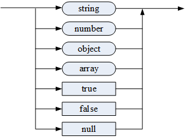
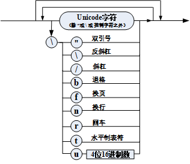
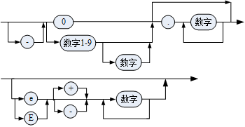
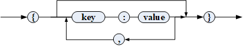
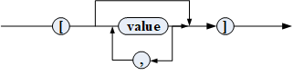
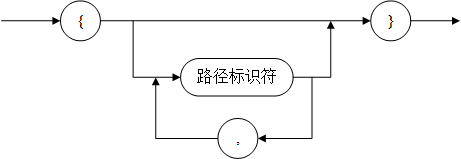

DM 支持 JSON（JavaScript Object Notation）和 JSONB（JavaScript Object Notation Binary）数据，JSON 和 JSONB 基本相似，二者的主要区别在于：其一，JSON 类型数据直接存储文本，最大长度为 2G-1 字节；JSONB 类型数据还需要存储 JSON 结构信息，以提高 JSONB 类型数据的处理速度，最大长度为 256M-1 字节。其二，JSON object 和 JSONB object 规则不同，具体规则由 DM.INI 参数 JSON\_MODE 决定，详细介绍请参考 18.1.5 object。除 object 数据类型外，JSON 和 JSONB 其余数据类型规则均相同。

本章中的例子，除了特殊说明之外，建表语句都请参考 18.8 应用实例。

## 18.1 数据类型

JSON 支持的数据类型包括：字符串 string、数字 number、布尔值 true 和 false、 null、对象 object 和数组 array。其中 string、number、true、false 和 null 为标量类型，object 和 array 为非标量类型。

JSON 数据支持 LAX 和 STRICT 两种数据格式，STRICT 数据格式比 LAX 要求更严格，两种数据格式对不同数据类型的具体要求参见各数据类型的详细介绍。JSON\_MODE 为 0 时采用 LAX 数据格式，JSON\_MODE 为 1 或 2 时采用 STRICT 数据格式。由于 JSON\_MODE 参数默认为 0，因此默认采用 LAX 数据格式。

DM 支持使用 VARCHAR 或 CLOB 作为载体处理 JSON 和 JSONB 数据，通过对字符串添加 CHECK 约束来保证数据符合 JSON 或 JSONB 标准，具体说明可以查看 18.5 CHECK 约束。

JSON 的各种数据类型可以嵌套使用。

**图例**

JSON 数据类型



### 18.1.1 string

字符串（string）长度需要大于等于 0，且以 a-z 或 A-Z 开头，后续字符可以包含 0-9，如果不符合该书写规则或者包含其他字符，则必须使用引号括起来，DM 支持双引号和单引号。可以为空串。

STRICT 和 LAX 格式对字符串的不同要求如下：

- STRICT 格式下，字符串必须使用引号括起来。
- LAX 格式下，字符串作为 object 中的 key 并且符合上述书写规则时，可以不用引号，但作为 value 时必须使用引号。

**图例**

JSON string



**图例中的第一个“\\”表示转义字符。**

**使用说明**

字符串必须以 a-z 或 A-Z 开始，后续字符可以包含 0-9；如果不遵守这个规则或者包含其他字符，则必须以引号括起。只有空格能够以“”的形式出现在字符串中，其他特殊字符则不可以。

**举例说明**

创建测试表。

```
drop table t_json_string CASCADE;

create table t_json_string (c1 json);
```

向表中插入数据。

```
insert into t_json_string values('{"a":"bc123"}');

insert into t_json_string values('{"":""}');
```

查询测试表。

```
select * from t_json_string;
```

查询结果如下：

```
行号   C1  

---------- -------------

1     {"a":"bc123"}

2     {"":""}
```

### 18.1.2 number

数字（number）不支持八进制和十六进制。支持数字作为 object 中的 value。

STRICT 和 LAX 格式对数字的不同要求如下：

- STRICT 格式下，正数不能以“+”或“.”开头，不能有前导 0（如 001），不能以“.”结尾。
- LAX 格式下没有上述限制。

**图例**

JSON number



**举例说明**

创建测试表。

```
drop table t_json_number CASCADE;

create table t_json_number (c1 json);
```

向表中插入数据。

```
insert into t_json_number values('{"a":123}');
```

查询测试表。

```
select * from t_json_number;
```

查询结果如下：

```
行号   C1  

---------- ---------

1     {"a":123}
```

### 18.1.3 true、false

true 和 false 代表布尔值，使用时不需要加引号。一般作为 object 中的 value。

STRICT 和 LAX 格式对布尔值的不同要求如下：

- STRICT 格式下，true 和 false 必须是小写，否则报错；
- LAX 格式下，在 JSON 列中插入数据时，true 和 false 不区分大小写，但在查询语句中必须是小写形式才能有返回值。
- 仅 LAX 格式下支持 true 和 false 作为 key，该用法较为特殊，正常情况下不建议将 true 和 false 作为 key。

**举例说明**

创建测试表。

```
drop table t_json_boolean CASCADE;

create table t_json_boolean(c1 json);
```

例 1 向表中插入数据。

```
insert into t_json_boolean values('{"a":true}');  

insert into t_json_boolean values('{"b":FALSE}');
```

查询测试表。

```
select * from t_json_boolean;
```

查询结果如下：

```
行号   C1  

---------- -----------

1     {"a":true}

2     {"b":false}
```

例 2 LAX 格式下支持将 true 或 false 作为 key。

```
insert into t_json_boolean values('{TRUE:1}');
```

查询测试表。

```
select * from t_json_boolean;
```

查询结果如下：

```
行号   C1  

---------- -----------

1     {"a":true}

2     {"b":false}

3     {"true":1}
```

### 18.1.4 null

null 代表 JSON 数据为空，它与 SQL 语句中的 NULL 值不同。null 使用时不需要加引号，一般作为 object 中的 value。

STRICT 和 LAX 格式对 null 的不同要求如下：

- STRICT 格式下，null 必须是小写，否则报错；
- LAX 格式下， 在 JSON 列中插入数据时，null 不区分大小写，但在查询语句中必须是小写形式才能有返回值。
- 仅 LAX 格式下支持 null 作为 key，该用法较为特殊，正常情况下不建议将 null 作为 key。

json\_value 时，null 以 SQL 语句中的值 NULL 的形式返回，此时无法区分是 SQL 的 NULL 还是 json 数据的 null；json\_query 时，null 必须以指定 WITH WRAPPER 的形式返回，如\[null\]，查询语句中必须以小写形式才能有返回值；

**举例说明**

创建测试表。

```
drop table t_json_null;

create table t_json_null(c1 json);
```

在表中插入数据。

```
insert into t_json_null values(null);    //SQL语句的null

insert into t_json_null values('{"a":null}'); //json数据的null
```

例 1 使用 json\_value 函数查询数据。

```
select json_value(c1, '$.a') from t_json_null;
```

查询结果如下：

```
行号   JSON_VALUE(C1,'$.a')

---------- --------------------

1     NULL

2     NULL
```

可以看到两行数据并无不同。

例 2 使用 json\_query 函数时，以指定 WITH WRAPPER 形式进行查询。

```
select json_query(c1, '$.a' WITH WRAPPER) from t_json_null;
```

查询结果如下：

```
行号   JSON_QUERY(C1,'$.a'WITHWRAPPER)

---------- -------------------------------

1     NULL

2     [null]
```

可以看出两行数据的不同，第 2 行为 json 数据。

### 18.1.5 object

对象（object）由 0 对或多对 key/value 组成，在{}中书写。key/value 的书写格式：\<key>:\<value>。

JSON object 和 JSONB object 规则由 DM.INI 参数 JSON\_MODE 决定，JSON\_MODE 缺省为 0：

- JSON\_MODE=0 时，JSON 和 JSONB 规则相同，二者均要求 object 中的 key 值不能重复，若重复则报错。当 VARCHAR 或 CLOB 表示的 JSON object 向 JSONB object 转换时，会检查 key 是否重复，若重复则报错。
- JSON\_MODE=1 时，JSON 和 JSONB 规则不同，JSON 对 object 中的 key 值没有限制，也不进行额外处理。而 JSONB 会自动对 object 中的 key 值进行去重排序，去重时仅保留输入的最后一对 key/value。当 VARCHAR 或 CLOB 表示的 JSON object 向 JSONB object 转换时，会自动对 key 进行去重与排序，去重时仅保留输入的最后一对 key/value。
- JSON\_MODE=2 时，JSON 和 JSONB 规则相同，二者均会自动对 object 中的 key 值进行去重排序，去重时仅保留输入的最后一对 key/value。当 VARCHAR 或 CLOB 表示的 JSON object 向 JSONB object 转换时，会自动对 key 进行去重与排序，去重时仅保留输入的最后一对 key/value。

STRICT 和 LAX 格式对 object 的不同要求如下：

- STRICT 格式下，object 的 key/value 链表后不能追加多余的逗号“,”。
- LAX 格式下没有上述限制。

**语法格式**

JSON object



\<key>：对象名称。支持的数据类型包括 string、true、false、null。

\<value>：对象值。支持本章节介绍的所有数据类型。

**举例说明**

例 1 JSON\_MODE=0，创建测试表。

```
drop table t_json_object_0 CASCADE;

create table t_json_object_0 (c1 json);
```

向测试表中插入 object 对象。

```
insert into t_json_object_0 values( '{"b":1, "a":2}');
```

查询测试表。

```
SELECT * FROM t_json_object_0 ;
```

结果如下。

```
行号   C1  

---------- -------------

1     {"b":1,"a":2}
```

如果插入的数据中 key 值重复，则报错

```
insert into t_json_object_0 values( '{"b":1, "b":2}');

[-3123]:JSON 对象中的键名重复.
```

例 2 JSON\_MODE=1，创建测试表。

```
drop table t_json_object_1 CASCADE;

create table t_json_object_1 (c1 json, c2 jsonb);
```

向测试表中插入 object 对象。

```
insert into t_json_object_1 values( '{"b":1, "b":2, "a":2}', '{"b":1, "b":2, "a":2}');
```

查询测试表。

```
SELECT * FROM t_json_object_1 ;
```

结果如下。

```
行号   C1         C2  

---------- ------------------- -------------

1     {"b":1,"b":2,"a":2} {"a":2,"b":2}
```

可以看到 JSON\_MODE=1 时，JSON 列对插入的 object 不进行额外处理，而 JSONB 列对 object 中的 key 进行了去重排序。

### 18.1.6 array

数组（array）是 value 的有序集合，数组在\[\]中书写。

STRICT 和 LAX 格式对 array 的不同要求如下：

- STRICT 格式下，array 的 value 链表后不能追加多余的逗号“,”。
- LAX 格式下没有上述限制。

**语法格式**

JSON array



\<value>：支持本章节介绍的所有数据类型。

**举例说明**

创建测试表。

```
drop table t_json_array CASCADE;

create table t_json_array (c1 json);
```

数组中的值支持本章节介绍的所有数据类型。

```
insert into t_json_array values('{a:["a",1,true,false,null,{b:2},[3,4]]}');
```

查询测试表。

```
SELECT * FROM t_json_array;
```

查询结果如下：

```
行号   C1           

---------- -------------------------------------------

1     {"a":["a",1,true,false,null,{"b":2},[3,4]]}
```

## 18.2 函数

为方便用户查阅，将 JSON 相关函数依据函数名称分为 JSON 函数、JSONB 函数以及其他函数三个章节。

部分 JSON 函数会自动对 object 对象 key/value 中的 key 进行去重排序，去重时保留输入的第一对或者最后一对 key/value，具体请参考各 JSON 函数的详细介绍。

所有 JSONB 函数均自动对 object 对象 key/value 中的 key 进行去重排序，去重时保留输入的最后一对 key/value。

### 18.2.1 JSON 函数

#### 18.2.1.1 to\_json

to\_json 将输入参数转换为 JSON 类型的数据。

**语法格式**

```
<to_json函数> ::= to_json(<exp>)

<to_jsonb函数> ::= to_jsonb(<exp>)
```

**参数**

\<exp>：待转换数据，对于不支持的数据类型将在执行后返回提示信息。

**返回值**

JSON 类型

**使用说明**

1. 当参数\<exp>为 NULL 时，返回 NULL；
2. 当参数\<exp>为字符串类型时，返回 String 类型的 JSON，其中特殊字符会被转义；
3. 参数\<exp>为数值类型时，返回 Number 类型的 JSON；
4. 参数\<exp>为布尔类型时，返回 JSON 类型中对应的 True 或 False。

**举例说明**

以下示例 to\_json(\<exp>)和 to\_jsonb(\<exp>)的查询结果均一致，仅以 to\_jsonb(\<exp>)为例进行举例说明。

例 1 参数\<exp> 为 NULL 时，返回 NULL。

```
select to_json(null);
```

查询结果如下：

```
行号   TO_JSON(NULL)

---------- --------------

1     NULL
```

例 2 参数\<exp> 为 TRUE 时，返回 true。

```
select to_jsonb(TRUE);
```

查询结果如下：

```
行号     TO_JSONB(TRUE)
---------- --------------
1          true
```

例 3 参数\<exp> 为 FALSE 时，返回 false。

```
select to_jsonb(FALSE);
```

查询结果如下：

```
行号     TO_JSONB(FALSE)
---------- ---------------
1          false
```

例 4 参数\<exp> 中包含转义字符时，将转义字符改写为“\\”表示的转义字符。

```
select to_json('{"b":1, "a":1, "a":3, "a":2}');
```

查询结果如下：

```
行号   TO_JSON('{"b":1,"a":1,"a":3,"a":2}')
---------- -------------------------------------
1     "{\"b\":1, \"a\":1, \"a\":3, \"a\":2}"
```

#### 18.2.1.2 json\_value

json\_value 函数获取 JSON 数据中给定路径下的值，本函数的策略在 INI 参数 JSON\_MODE 的不同取值下有差异。当 JSON\_MODE 值为 1 时，不支持 JSON\_VALUE 函数，执行 JSON\_VALUE 函数时报错，当 JSON\_MODE 值为 0 或 2 时都支持 JSON\_VALUE 函数，策略差异见下方使用说明。

**语法格式**

```
<json_value函数> ::= json_value(<json_exp>, <path_exp> [<RETURNING 项>] [ASCII] [<EMPTY项>][<ERROR项>])

<RETURNING 项> :: = RETURNING VARCHAR | VARCHAR2 | NUMBER | DATE | DATETIME | VARBINARY | CLOB | JSON

<EMPTY项> :: =  <NULL | ERROR | <DEFAULT项>> ON EMPTY

<ERROR项> :: =  <NULL | ERROR | <DEFAULT项>> ON ERROR  

<DEFAULT项> :: = DEFAULT  '<value>'
```

**参数**

<json\_exp>：待查找的 JSON 数据，数据类型可以是 JSON，JSONB，VARCHAR 或 CLOB。源数据不是 JSONB 时，其结构中的 object 可能有重复 key 且未经过排序，当 JSON\_MODE 值为 2 时，会先对 key/value 对进行排序和去重，再查找给定路径对应的数据，去重时，key 相同的 key/value 对仅保留最后一对。

<path\_exp>：路径表达式，请参考 18.3.1 路径表达式 。

\<RETURNING 项 >：返回值类型。当 JSON\_MODE 值为 0 时，默认为 VARCHAR(4000)；当 JSON\_MODE 值为 2 时，默认为 VARCHAR(512)。仅当 JSON\_MODE 值为 2 时可指定 RETURNING JSON。

ASCII：以\\uXXXX 十六进制的形式显示非 Unicode 字符，请参考 18.3.2 PRETTY 和 ASCII 。该选项仅在 JSON\_MODE=0 时支持。

\<EMPTY 项 >：指定当 <path\_exp> 指定的项不存在时的返回值，返回值策略与 \<ERROR 项 > 一致，请参考 18.3.4 ERROR 项 。当 JSON\_MODE 值为 0 时，若未指定 \<EMPTY 项 >，则默认按照 \<ERROR 项 > 决定指定项不存在时的返回值；当 JSON\_MODE 值为 2 时，若未指定 \<EMPTY 项 >，则默认为 NULL ON EMPTY。

\<ERROR 项 >：指定出错时的返回值，请参考 18.3.4 ERROR 项 。

\<DEFAULT 项 >：返回值需要与 \<RETURNING 项 > 中定义的类型匹配。当 RETURNING 字符串时，默认值可以是数字或字符串。返回值类型和 \<RETURNING 项 > 中定义的类型不匹配时，处理策略受 JSON\_MODE 取值影响。JSON\_MODE=0 时，兼容 ORACLE，直接进行报错处理；JSON\_MODE=2 时，兼容 MYSQL，尝试将返回值类型转化为 \<RETURNING 项 > 中定义的类型，转化失败时才进行报错。

**使用说明**

1. <json\_exp> 为 NULL 时，返回空结果集；
2. 数据类型中的 NUMBER 对应 DM 的 dec 类型，可以有多种写法，如：DECIMAL，也可以指写精度，例如:DEC(10,5)；
3. 当 JSON\_MODE 值为 0 时，路径表达式指定的项必须为标量类型数据，否则按照 \<ERROR 项 > 策略返回；当 JSON\_MODE 值为 2 时，无上述限制。

**举例说明**

例 创建测试表并插入数据。

```
create table t_json_value (c1 json);

insert into t_json_value(c1) values('{"b":2}');

insert into t_json_value(c1) values('{"c":2}');

insert into t_json_value(c1) values('{"c":"3"}');

insert into t_json_value(c1) values('{"c":null}');

insert into t_json_value(c1) values('{"c":true}');

insert into t_json_value(c1) values('{"c":10,"d":20}'); 

insert into t_json_value(c1) values('{"c":"a\tb"}');  

insert into t_json_value(c1) values('{"c":[1, 2]}');

insert into t_json_value(c1) values('[1,"a",true]');

insert into t_json_value(c1) values('[null,[1, 2],{"a":1}]');
```

例 1 JSON\_MODE=0，使用 json\_value 查询对象的值。

```
SELECT json_value(c1, '$.c') FROM t_json_value;
```

查询结果如下：

```
行号   JSON_VALUE(C1,'$.c')

---------- --------------------

1     NULL

2     2

3     3

4     NULL

5     true

6     10

7     a b

8     NULL

9     NULL

10     NULL
```

例 2 JSON\_MODE=2，使用 json\_value 查询对象的值。

```
SELECT json_value(c1, '$.c') FROM t_json_value;
```

查询结果如下：

```
行号   JSON_VALUE(C1,'$.c')

---------- --------------------

1     NULL

2     2

3     3

4     NULL

5     true

6     10

7     a b

8     [1,2]

9     NULL

10     NULL
```

例 3 JSON\_MODE=0，使用 json\_value 查询数组的值。

```
SELECT json_value(c1, '$[1]') FROM t_json_value;
```

查询结果如下：

```
行号   JSON_VALUE(C1,'$[1]')

---------- ---------------------

1     NULL

2     NULL

3     NULL

4      NULL

5      NULL

6     NULL

7     NULL

8     NULL

9     a

10    NULL
```

例 4 JSON\_MODE=2，使用 json\_value 查询数组的值。

```
SELECT json_value(c1, '$[1]') FROM t_json_value;
```

查询结果如下：

```
行号   JSON_VALUE(C1,'$[1]')

---------- ---------------------

1      NULL

2     NULL

3     NULL

4     NULL

5     NULL

6     NULL

7     NULL

8     NULL

9     a

10    [1,2]
```

#### 18.2.1.3 json\_query

json\_query 函数获取 JSON 数据中给定路径下的值，获取结果可以为 1 个或多个 JSON 数据。

**语法格式**

```
<json_query函数> ::= json_query(<json_exp>, <path_exp> [<RETURNING项>] [PRETTY] [ASCII] [<WRAPPER项>] [<ERROR项>])

<RETURNING 项> :: = RETURNING VARCHAR |
                    VARCHAR2 | 
                    VARBINARY |                                     BLOB | 
                    JSON

<WRAPPER项> :: = WITH[CONDITIONAL|UNCONDITIONAL][ARRAY] WRAPPER| 

                 WITHOUT[ARRAY]WRAPPER
                  
<ERROR项> :: =  < NULL | ERROR | EMPTY>  ON ERROR
```

**参数**

<json\_exp>：待查找的 JSON 数据，数据类型可以是 JSON，JSONB，VARCHAR 或 CLOB。当 <json\_exp> 为 NULL 时，返回空结果集。

<path\_exp>：路径表达式，请参考 18.3.1 路径表达式 。

\<RETURNING 项 >：返回值类型，当 <json\_exp> 是 JSONB 类型数据时，默认为 RETURNING JSON，其他情况默认为 RETURNING VARCHAR(4000)。

PRETTY：以缩进的形式显示字符，请参考 18.3.2 PRETTY 和 ASCII 。

ASCII：以\\uXXXX 十六进制的形式显示非 Unicode 字符，请参考 18.3.2 PRETTY 和 ASCII 。

\<WRAPPER 项 >：指定查询结果的返回形式，请参考 18.3.3 WRAPPER 项 。单值返回时，标量类型必须指定 WITH WRAPPER；多值返回时必须指定 WITH WRAPPER。

\<ERROR 项 >：指定出错时的返回值，请参考 18.3.4 ERROR 项 。

**举例说明**

例 创建测试表并插入数据。

```
create table t_json_query (c1 json);

insert into t_json_query(c1) values('{"b":2}');

insert into t_json_query(c1) values('{"c":2}');

insert into t_json_query(c1) values('{"c":"3"}');

insert into t_json_query(c1) values('{"c":{"a":1}}');

insert into t_json_query(c1) values('{"c":[1,true]}');

insert into t_json_query(c1) values('{"c":[1,2],"d":{"a":3}}');
```

使用 json\_query，以数组的形式返回 JSON 数据。

```
SELECT json_query(c1, '$.c' returning varchar2 with wrapper) FROM t_json_query;
```

查询结果如下：

```
行号   JSON_QUERY(C1,'$.c'WITHWRAPPER)

---------- -------------------------------

1     NULL

2     [2]

3     ["3"]

4     [{"a":1}]

5     [[1,true]]

6     [[1,2]]
```

#### 18.2.1.4 json\_table

json\_table 函数获取 array 数组或 object 对象中指定项的值，返回结果为表记录。JSON\_MODE=1 时不支持 json\_table，JSON\_MODE=2 时，兼容 MySQL 的表现。

**语法格式**

```
<json_table函数> ::= json_table(<json_exp>, <path_exp1> [<EMPTY项_1>] [<ERROR项_1>] <json_columns_clause>
<json_columns_clause>::= COLUMNS (<column_clause>{,<column_clause>}))
<column_clause>::=
    <json_value_col> |
    <json_exists_col>|
    <json_query_col>|
    <json_nested_col>|
    <ordinality_col>
<json_value_col>::=<column_name> <datatype> PATH <path_exp2> [<EMPTY项_1>] [<ERROR项_1>]
<json_exists_col>::=<column_name> <datatype> EXISTS PATH <path_exp2> [<EMPTY项_2>] [<ERROR项_2>]
<json_query_col>::=<column_name> <datatype> FORMAT JSON PATH <path_exp2> [<EMPTY项_3>] [<ERROR项_3>]
<json_nested_col>::= NESTED PATH <path_exp2> <json_columns_clause>
<ordinality_col>::=<column_name> FOR ORDINALITY
<EMPTY项_1> :: = <NULL | ERROR | <DEFAULT项>> ON EMPTY
<ERROR项_1> :: = <NULL | ERROR | <DEFAULT项>> ON ERROR   
<DEFAULT项> :: = DEFAULT '<value>'
<EMPTY项_2>:: = <ERROR | TRUE | FALSE > ON EMPTY
<ERROR项_2>:: = <ERROR | TRUE | FALSE> ON ERROR
<EMPTY项_3>:: = <ERROR | NULL | EMPTY | EMPTY ARRAY | EMPTY OBJECT> ON EMPTY
<ERROR项_3>:: = <ERROR | NULL | EMPTY | EMPTY ARRAY | EMPTY OBJECT> ON ERROR
```

**参数**

<json\_exp>：待查找的 JSON 数据，数据类型可以是 JSON，JSONB，VARCHAR 或 CLOB。当 <json\_exp> 为 NULL 时，返回空结果集。<json\_exp> 可以是表列，当列来自于与 json\_table 同层的表时，则需要开启 ENABLE\_TABLE\_EXP\_REF\_FLAG 参数，DMDPC 场景下 json\_table 暂不支持对同层表列的引用。

<path\_exp1>：路径表达式，表示 <json\_exp> 中的数据查询路径。请参考 18.3.1 路径表达式 。

<column\_clause>：列定义语句，支持 <json\_value\_col>、<json\_exists\_col>、<json\_query\_col>、<json\_nested\_col> 和 <ordinality\_col> 五种格式的列定义语句。

<json\_value\_col>：将 <path\_exp2> 路径下的数据作为该列的值。其中，<path\_exp2> 路径下的数据为 JSON 标量。该语句中的参数含义如下：

<json\_exists\_col>：检查 <path\_exp2> 路径下存在数据，若存在则该列返回 1/true，否则返回 0/false(字符串类型时返回 true/false)。若查询过程返回空值或者出错，则按照 \<EMPTY 项\_2> 或 \<ERROR 项\_2> 处理。该语句中的其余参数含义与 <json\_value\_col> 相同。

<json\_query\_col>：将 <path\_exp2> 路径下的数据作为该列的值。其中，<path\_exp2> 路径下的数据为 JSON ARRAY 或 JSON OBJECT。该语句中的参数含义如下：

- \<datatype>：列的数据类型。支持 VARCHAR 和 CLOB。
- 其他参数含义与 <json\_value\_col> 相同。

<json\_nested\_col>：嵌套查询。<path\_exp2> 路径下的数据为 JSON ARRAY 或 JSON OBJECT，后续指定的 <json\_columns\_clause> 可以针对 <path\_exp2> 路径下的数据进行嵌套查询。

<ordinality\_col>：当前遍历的 JSON 数组中的元素序号（从 1 开始递增），或者当前遍历的 JSON 对象中的 key/value 序号（从 1 开始递增）。

**返回值**

表记录。

**使用说明**

1．<json\_exp> 为 NULL 时，返回空结果集；

2．各个列值需要先进行 <path\_exp1> 查询，随后进行 <path\_exp2> 查询。

**举例说明**

例 1 按照 <json\_value\_col> 语句查询指定路径下的值。

```
SELECT * FROM JSON_TABLE('{ "a":100, "b":200, "c":{"d":300, "e":400}}', '$.c' COLUMNS(C1 DEC PATH '$.d', C2 DEC PATH '$.e'));
```

其中，“$.c”是所有列共有的路径，而“$.d”是 C1 列的路径，“$.e”是 C2 列的路径，两列的数据类型均为 DEC 类型。

查询结果如下：

```
行号    C1 C2

----- --- ---

1     300 400
```

其中，“$.c”是所有列共有的路径，而“$.d”是 C1 列的路径，“$.e”是 C2 列的路径，两列的数据类型均为 NUMBER 类型。

例 2 按照 <json\_exists\_col> 语句查询指定路径下是否存在数据，若存在则返回 1，若不存在则根据指定的 EMPTY 项返回。

```
SELECT * FROM JSON_TABLE('{a:100, b:200, c:{d:300, e:400}}', '$.c' COLUMNS(C1 INT EXISTS PATH '$.d' FALSE ON EMPTY, C2 INT EXISTS PATH '$.f' FALSE ON EMPTY));
```

查询结果如下：

```
行号      C1 C2

---------- --- ---

1        1  0
```

例 3 按照 <json\_query\_col> 语句查询指定路径下的 JSON OBJECT。

```
SELECT * FROM JSON_TABLE('[{a:100, b:200, c:{d:300, e:400}},{a:500, b:600, c:{d:700, e:800}}]', '$[*]' COLUMNS(C1 VARCHAR2(20) FORMAT JSON PATH '$.c'));
```

查询结果如下：

```
行号      C1 

---------- -------

1        {"d":300,"e":400}

2       {"d":700,"e":800}
```

例 4 按照 <json\_nested\_col> 语句进行嵌套查询。

```
SELECT * FROM JSON_TABLE('{ "a":100, "b":200, "c":{"d":300, "e":400}}', '$' COLUMNS(NESTED PATH '$.c' COLUMNS(C1 INT PATH '$.d', C2 INT PATH '$.e')));
```

查询结果如下：

```
行号   C1     C2   

---------- ----------- -----------

1     300     400
```

例 5 按照 <ordinality\_col> 语句输出当前遍历的 JSON 数组中的元素序号（从 1 开始递增）。

```
SELECT * FROM JSON_TABLE('[{a:100, b:200, c:{d:300, e:400}},{a:500, b:600, c:{d:700, e:800}}]', '$[*]' COLUMNS(ID FOR ORDINALITY, C1 VARCHAR2(20) FORMAT JSON PATH '$.c'));
```

查询结果如下：

```
行号   ID    C1  

---------- -- -----------------

1     1   {"d":300,"e":400}

2     2   {"d":700,"e":800}
```

#### 18.2.1.5 json\_overlaps

json\_overlaps 检查两个 JSON 数据是否存在交集。

如果 JSON 数据中包含 object 对象，则对 key/value 中的 key 进行去重后再检查两个 JSON 数据是否存在交集，去重时仅保留输入的最后一对 key/value。

**语法格式**

```
<json_overlaps函数> ::= json_overlaps(<json_exp1>, <json_exp2>)
```

**参数**

<json\_exp1>：表示 JSON 数据，数据类型为 JSON，JSONB，VARCHAR 或 CLOB。

<json\_exp2>：表示 JSON 数据，数据类型为 JSON，JSONB，VARCHAR 或 CLOB。

**返回值**

0：不存在交集；

1：存在交集。

**使用说明**

1. 若 <json\_exp1> 或 <json\_exp2> 为 NULL，则返回 NULL；
2. 若 JSON 数据存在嵌套情况，例如 array 中包含 object 或 array 等各种类型的数据，仅检查最外层 JSON 数据是否存在交集。

**举例说明**

例 1 <json\_exp1> 和 <json\_exp2> 均为 NULL，返回 NULL。

```
SELECT JSON_OVERLAPS(NULL,NULL);
```

查询结果如下：

```
行号   JSON_OVERLAPS(NULL,NULL)

---------- ------------------------

1     NULL
```

例 2 <json\_exp1> 的 JSON 数据类型为 object，首先对 object 对象 key/value 中的 key 进行去重后检查是否存在交集。

在语句中查询{"a":1}。

```
SELECT JSON_OVERLAPS('{"a":1,"a":2,"a":3,"b":4}', '{"a":1}');
```

查询结果如下：

```
行号   JSON_OVERLAPS('{"a":1,"a":2,"a":3,"b":4}','{"a":1}')

---------- ----------------------------------------------------

1     0
```

在语句中查询{"a":3}。

```
SELECT JSON_OVERLAPS('{"a":1,"a":2,"a":3,"b":4}', '{"a":3}');
```

查询结果如下：

```
行号   JSON_OVERLAPS('{"a":1,"a":2,"a":3,"b":4}','{"a":3}')

---------- ----------------------------------------------------

1     1
```

本例中，首先对 <json\_exp1> 中的 object 进行去重，去重时仅保留输入的最后一对 key/value，<json\_exp1> 去重后为“{"a":3,"b":4}”。

例 3 <json\_exp1> 的 JSON 数据类型为 object，并且 key/value 中的 value 也为 object，则对该 value 也将进行去重操作。

在语句中查询{"a":{"b":2}}。

```
SELECT JSON_OVERLAPS('{"a":{"b":2,"b":3}}', '{"a":{"b":2}}');
```

查询结果如下：

```
行号   JSON_OVERLAPS('{"a":{"b":2,"b":3}}','{"a":{"b":2}}')

---------- ----------------------------------------------------

1     0
```

在语句中查询{"a":{"b":3}}。

```
SELECT JSON_OVERLAPS('{"a":{"b":2,"b":3}}', '{"a":{"b":3}}');
```

查询结果如下：

```
行号   JSON_OVERLAPS('{"a":{"b":2,"b":3}}','{"a":{"b":3}}')

---------- ----------------------------------------------------

1     1
```

例 4 <json\_exp1> 的 JSON 数据类型为 array，并且 array 中包含 object，则对该 object 对象 key/value 中的 key 也将进行去重操作。

在语句中查找{"a":2}。

```
SELECT JSON_OVERLAPS('[1,{"a":2,"a":3}]','{"a":2}');
```

查询结果如下：

```
行号   JSON_OVERLAPS('[1,{"a":2,"a":3}]','{"a":2}')

---------- --------------------------------------------

1     0
```

在语句中查找{"a":3}。

```
SELECT JSON_OVERLAPS('[1,{"a":2,"a":3}]','{"a":3}');
```

查询结果如下：

```
行号   JSON_OVERLAPS('[1,{"a":2,"a":3}]','{"a":3}')

---------- --------------------------------------------

1     1
```

例 5 <json\_exp1> 的 JSON 数据类型为 array，仅检查最外层 JSON 数据是否存在交集。

在语句中查找 1。

```
SELECT JSON_OVERLAPS('[1,[2,3],{"a":2,"b":4}]','1');
```

查询结果如下：

```
行号   JSON_OVERLAPS('[1,[2,3],{"a":2,"b":4}]','1')

---------- --------------------------------------------

1     1
```

在语句中查找 2。

```
SELECT JSON_OVERLAPS('[1,[2,3],{"a":2,"b":4}]','2');
```

查询结果如下：

```
行号   JSON_OVERLAPS('[1,[2,3],{"a":2,"b":4}]','2')

---------- --------------------------------------------

1     0
```

在语句中查询\[2,3\]。

```
SELECT JSON_OVERLAPS('[1,[2,3],{"a":2,"b":4}]','[2,3]');
```

查询结果如下：

```
行号   JSON_OVERLAPS('[1,[2,3],{"a":2,"b":4}]','[2,3]')

---------- ------------------------------------------------

1     0
```

在语句中查询\[\[2,3\]\]。

```
SELECT JSON_OVERLAPS('[1,[2,3],{"a":2,"b":4}]','[[2,3]]');
```

查询结果如下：

```
行号   JSON_OVERLAPS('[1,[2,3],{"a":2,"b":4}]','[[2,3]]')

---------- --------------------------------------------------

1     1
```

在语句中查找\[\[3,2\]\]。

```
SELECT JSON_OVERLAPS('[1,[2,3],{"a":2,"b":4}]','[[3,2]]');
```

查询结果如下：

```
行号   JSON_OVERLAPS('[1,[2,3],{"a":2,"b":4}]','[[3,2]]')

---------- --------------------------------------------------

1     0
```

在语句中查找{"a":2}。

```
SELECT JSON_OVERLAPS('[1,[2,3],{"a":2,"b":4}]','{"a":2}');
```

查询结果如下：

```
行号   JSON_OVERLAPS('[1,[2,3],{"a":2,"b":4}]','{"a":2}')

---------- --------------------------------------------------

1     0
```

在语句中查找{"a":2,"b":4}。

```
SELECT JSON_OVERLAPS('[1,[2,3],{"a":2,"b":4}]','{"a":2,"b":4}');
```

查询结果如下：

```
行号   JSON_OVERLAPS('[1,[2,3],{"a":2,"b":4}]','{"a":2,"b":4}')

---------- --------------------------------------------------------

1     1
```

本例中，<json\_exp1> 中共包含三个数组元素，即 number 类型数据“1”，array 类型数据“\[2,3\]”以及 object 类型数据“{"a":2,"b":4}”，因此仅当 <json\_exp2> 中至少包含上述三个数据中的任意一个时，<json\_exp1> 和 <json\_exp2> 才会存在交集。

#### 18.2.1.6 json\_set

json\_set 替换或新增 JSON 数据中用户指定的项。  
如果 JSON 数据中包含 object 对象，则自动对输入的 object 对象 key/value 中的 key 进行去重排序，去重时仅保留输入的最后一对 key/value。向 JSON 数据中新增 object 对象时，自动查找合适的位置插入 key/value 以保证 key 有序。

**语法格式**

```
<json_set函数> ::= json_set(<json_exp>, <path_exp>, <value_exp>{, <path_exp>, <value_exp>})
```

**参数**

<json\_exp>：表示目标 JSON 字符串，数据类型为 VARCHAR 或 CLOB。

<path\_exp>：路径表达式，具体书写规则请参考 18.3.1 路径表达式 。

1） 若 <path\_exp> 最后一级为 ARRAY 下标，下标不为 0，但定位到的 JSON 不是 ARRAY 类型时，会在该位置创建新的 ARRAY，元素为原有 JSON 和待加入的 JSON。

2） <path\_exp> 不支持使用通配符或指定多个元素。

3） 当 <path\_exp> 指定的项存在时，替换指定项的值；当 <path\_exp> 指定的项不存在时，新增 <path\_exp> 指定的项，并将值设为 <value\_exp>。

<value\_exp>：指定替换后的值或新增项的值，数据类型为 NUMBER、VARCHAR、TRUE 或 FALSE。

**返回值**

JSON 数据，为 JSONB 类型。

**使用说明**

1. 当 <json\_exp> 为 NULL 时，返回 NULL；
2. 支持同时替换或新增 JSON 数据中的多项。

**举例说明**

例 1 参数 <json\_exp> 为 NULL。

```
select json_set(NULL,'$.f1.a',15);
```

查询结果如下：

```
行号   JSON_SET(NULL,'$.f1.a',15)

---------- --------------------------

1     NULL
```

例 2 替换 JSON 数据中的一项，参数 <value\_exp> 的数据类型为 NUMBER。

```
select json_set('{"f1":{"a":1}}','$.f1.a',15);
```

查询结果如下：

```
行号   JSON_SET('{"f1":{"a":1}}','$.f1.a',15)

---------- --------------------------------------

1     {"f1":{"a":15}}
```

例 3 替换 JSON 数据中的一项，参数 <value\_exp> 的数据类型为 VARCHAR。

```
select json_set('{"f1":{"a":1}}','$.f1.a','str');
```

查询结果如下：

```
行号   JSON_SET('{"f1":{"a":1}}','$.f1.a','str')

---------- -----------------------------------------

1     {"f1":{"a":"str"}}
```

例 4 替换 JSON 数据中的一项，参数 <value\_exp> 为 TRUE。

```
select json_set('[{"f1":{"a":1}}]','$[0]',TRUE);
```

查询结果如下：

```
行号   JSON_SET('[{"f1":{"a":1}}]','$[0]',TRUE)

---------- ----------------------------------------

1     [true]
```

例 5 同时替换 JSON 数据中的多项。

```
select json_set('[{"f1":{"a":1}},2,"b"]','$[0].f1.a',15,'$[1]','c');
```

查询结果如下：

```
行号   JSON_SET('[{"f1":{"a":1}},2,"b"]','$[0].f1.a',15,'$[1]','c')

---------- ------------------------------------------------------------

1     [{"f1":{"a":15}},"c","b"]
```

例 6 <path\_exp> 指定的项不存在时，新增 <path\_exp> 指定的项，并将值设为 <value\_exp>。

```
select json_set('{"f1":{"a":1}}','$.f1.b',15);
```

查询结果如下：

```
行号   JSON_SET('{"f1":{"a":1}}','$.f1.b',15)

---------- --------------------------------------

1     {"f1":{"a":1,"b":15}}
```

例 7 json\_set 函数创建新的 ARRAY，并在指定位置增加指定值 2。

```
select json_set('{"a":1}','$.a[1]',2);
```

查询结果如下：

```
行号    JSON_SET('{"a":1}','$.a[1]',2)

---------- ------------------------------

1     {"a":[1,2]}
```

例 8 使用通配符或指定多个元素时会报错。

```
select json_set('["abc"]','$.*','de');
```

查询结果报错：

```
[-3113]:JSON 处理错误.
```

#### 18.2.1.7 json\_replace

json\_replace 替换 JSON 数据中用户指定的项。

如果 JSON 数据中包含 object 对象，则自动对输入的 object 对象 key/value 中的 key 进行去重排序，去重时仅保留输入的最后一对 key/value。

**语法格式**

```
<json_replace函数> ::= json_replace(<json_exp>, <path_exp>, <value_exp>{, <path_exp>, <value_exp>})
```

**参数**

<json\_exp>：表示目标 JSON 数据，数据类型为 JSON，JSONB，VARCHAR 或 CLOB。

<path\_exp>：路径表达式，具体书写规则请参考 18.3.1 路径表达式 。

<value\_exp>：指定替换后的值，数据类型为 NUMBER、VARCHAR、TRUE 或 FALSE。

**返回值**

JSON 数据，为 JSONB 类型。

**使用说明**

1. 当 <json\_exp> 为 NULL 时，返回 NULL；
2. 当 <path\_exp> 指定的项不存在时，则不进行替换；
3. 支持同时替换 JSON 数据中的多项。

**举例说明**

例 替换 JSON 数据中的多项。

```
select json_replace('[{"f1":{"a":1}},2,"b"]','$[0].f1.a',15,'$[1]','c');
```

查询结果如下：

```
行号   JSON_REPLACE('[{"f1":{"a":1}},2,"b"]','$[0].f1.a',15,'$[1]','c')

---------- ----------------------------------------------------------------

1      [{"f1":{"a":15}},"c","b"]
```

#### 18.2.1.8 json\_insert

json\_insert 新增 JSON 数据中用户指定的项。

如果 JSON 数据中包含 object 对象，则自动对输入的 object 对象 key/value 中的 key 进行去重排序，去重时仅保留输入的最后一对 key/value。

**语法格式**

```
<json_insert函数> ::= json_insert(<json_exp>, <path_exp>, <value_exp>{, <path_exp>, <value_exp>})
```

**参数**

<json\_exp>：表示目标 JSON 数据，数据类型为 JSON，JSONB，VARCHAR 或 CLOB。

<path\_exp>：路径表达式，具体书写规则请参考 18.3.1 路径表达式 。

<value\_exp>：指定新增项的值，数据类型为 NUMBER、VARCHAR、TRUE 或 FALSE。

**返回值**

JSON 数据，为 JSONB 类型。

**使用说明**

1. 当 <json\_exp> 为 NULL 时，返回 NULL；
2. 当 <path\_exp> 指定的项不存在时，则不进行替换；
3. 支持同时替换 JSON 数据中的多项。

**举例说明**

例 新增 JSON 数据中的多项。

```
select json_insert('[{"f1":{"a":1}},2,"b"]','$[0].f1.a[1]',2,'$[3]','c');
```

查询结果如下：

```
行号   JSON_INSERT('[{"f1":{"a":1}},2,"b"]','$[0].f1.a[1]',2,'$[3]','c')

---------- -----------------------------------------------------------------

1      [{"f1":{"a":[1,2]}},2,"b","c"]
```

#### 18.2.1.9 json\_extract

json\_extract 获取 JSON 数据中若干个给定路径下的值。

**语法格式**

```
<json_extract函数> ::= json_extract(<json_exp>, <path_exp>{, <path_exp>})
```

**参数**

<json\_exp>：目标 JSON 数据，数据类型可以是 JSON，JSONB，VARCHAR 或 CLOB，源数据不是 JSONB 时，其结构中的 object 可能有重复 key 且未经过排序，执行前会先对 key/value 对进行排序和去重，去重时，key 相同的 key/value 对仅保留最后一对。

<path\_exp>：路径表达式，具体书写规则请参考 18.3.1 路径表达式 。

**返回值**

JSONB 类型数据。

**使用说明**

1. 当根据给定路径查找不到数据时，返回 NULL；
2. 路径中有多值过滤路径(通配符和数组下标范围)时，或查找到的结果不止一个时，需将结果包装为 JSONB ARRAY 形式。

**举例说明**

例 1 多值过滤路径。

```
SQL> SELECT JSON_EXTRACT('{"c": [{"a":1, "b":"2"}]}', '$.c[*].b' );
行号       JSON_EXTRACT('{"c":[{"a":1,"b":"2"}]}','$.c[*].b')
---------- --------------------------------------------------
1          ["2"]
```

例 2 返回多个结果。

```
SQL> SELECT JSON_EXTRACT('{"c": [{"a":1, "b":"2"}]}', '$.c[0].a', '$.c[0].b');
行号       JSON_EXTRACT('{"c":[{"a":1,"b":"2"}]}','$.c[0].a','$.c[0].b')
---------- -------------------------------------------------------------
1          [1,"2"]
```

#### 18.2.1.10 json\_unquote

json\_unquote 取消指定的 string 类型的 JSON 数据外层的双引号，并将结果作为字符串返回。

**语法格式**

```
<json_unquote函数> ::= json_unquote(<json_value>)
```

**参数**

<json\_value>：表示 JSON 数据，数据类型为 JSON，JSONB，VARCHAR 或 CLOB。

**返回值**

TEXT 类型。

**使用说明**

1. 当 <json\_value> 为 NULL 时，返回 NULL；
2. 当 <json\_value> 是 STRING 类型的 JSON 数据，去掉其双引号然后作为结果返回，其中包含转义字符时，对转义字符进行转义后输出；
3. 当 <json\_value> 不是 STRING 类型的 JSON 数据，或是一个不表示合法 JSON 数据的字符串时，直接将输入参数作为结果返回。

**举例说明**

例 创建测试表并插入数据。

```
create table t_json_unquote (c1 json);

insert into t_json_unquote(c1) values('{"b":2}');

insert into t_json_unquote(c1) values('{"c":2}');

insert into t_json_unquote(c1) values('{"c":"3"}');

insert into t_json_unquote(c1) values('{"c":null}');

insert into t_json_unquote(c1) values('{"c":true}');

insert into t_json_unquote(c1) values('{"c":10,"d":20}');

insert into t_json_unquote(c1) values('{"c":"a\tb"}');  

insert into t_json_unquote(c1) values('{"c":"abc"}');

insert into t_json_unquote(c1) values('{"c":[1,2]}');

insert into t_json_unquote(c1) values('{"c":{"a":2,"b":3}}');
```

json\_unquote 可以搭配 json\_extract 一起使用，首先利用 json\_extract 函数获取 key/value 中的 value，然后利用 json\_unquote 函数去掉 value 外层的双引号。

```
select json_unquote(json_extract(c1,'$.c')) from t_json_unquote;
```

查询结果如下：

```
行号     JSON_UNQUOTE(JSON_EXTRACT(C1,'$.c'))
---------- ------------------------------------
1          NULL
2          2
3          3
4          null
5          true
6          10
7          a    b
8          abc
9          [1,2]
10         {"a":2,"b":3}
```

#### 18.2.1.11 json\_array

json\_array 从可变的参数列表（可以为空）中创建 array 数组并返回。

**语法格式**

```
<json_array函数> ::= json_array([<value_exp>[, <value_exp>]...])
```

**参数**

<value\_exp>：传入的参数列表。可以传入任意类型的任意数量的参数。

**返回值**

JSON 数据，为 JSONB 类型。

**使用说明**

若参数列表中的任一参数不能转化成数字、字符串、布尔值、数组、对象、NULL 等 JSON 类型则报错。

**举例说明**

例 使用 json\_array 函数创建 array 数组。

```
SELECT JSON_ARRAY(1,'1',FALSE,NULL,'[1,2]','{SS:1600}');
```

查询结果如下：

```
行号       JSON_ARRAY(1,'1',FALSE,NULL,'[1,2]','{SS:1600}')
---------- ------------------------------------------------
1          [1,"1",false,null,"[1,2]","{SS:1600}"]
```

#### 18.2.1.12 json\_object

json\_object 返回一个用给定 key/value 创建的 object 对象。

返回的 object 对象自动对 key/value 中的 key 进行去重排序，去重时仅保留输入的最后一对 key/value。

**语法格式**

```
<json_object函数> ::= json_object([<key_exp>, <value_exp>[, <key_exp>, <value_exp>]...])
```

**参数**

<key\_exp>：字符串、数字或布尔值，函数会自动将其转化成字符串。

<value\_exp>：任意类型。

**返回值**

JSON 数据，为 JSONB 类型。

**使用说明**

1．传入参数需为偶数个，若传入奇数个参数则报错；

2．如果作为 key 的参数不是字符串、数字、布尔值；或者作为 value 的参数不能转化成数字、字符串、布尔值、数组、对象、null 等 JSON 类型则报错。作为 key 的参数的布尔值将被转换为"0"/"1"。

**举例说明**

例 1 参数的 key 为字符串、数字、布尔值时，使用 json\_object 函数。

```
SELECT JSON_OBJECT('A',2,3,4,TRUE,5);
```

查询结果如下：

```
行号       JSON_OBJECT('A',2,3,4,TRUE,5)
---------- -----------------------------
1          {"1":5,"3":4,"A":2}
```

例 2 参数的 key 为其他类型时，使用 json\_object 函数。

```
SELECT JSON_OBJECT([1,2],5);
```

查询结果报错：

```
[-2007]: 语法分析出错.
```

例 3 传入参数为奇数个。

```
SELECT JSON_OBJECT('1',false,5);
```

查询结果报错：

```
[-5402]:参数个数不匹配.
```

#### 18.2.1.13 json\_keys

json\_keys 将 object 对象的最外层 key 以 array 数组形式返回，若指定了 path 参数，则将给定 path 查找到的 object 对象的最外层 key 以 array 数组形式返回。

该函数自动对输入的 object 对象 key/value 中的 key 进行去重排序，去重时仅保留输入的最后一对 key/value。

**语法格式**

```
<json_key函数> ::= json_keys(<json_exp>[, <path_exp>])
```

**参数**

<json\_exp>：表示 JSON 数据，数据类型为 JSON，JSONB，VARCHAR 或 CLOB。

<path\_exp>：路径表达式，具体书写规则请参考 18.3.1 路径表达式 。

**返回值**

JSON 数据，为 JSONB 类型。

**使用说明**

1．任一参数为 NULL，或 json\_doc 不是 object 对象，或给定 path 查找到的不是 object 对象时返回 NULL；

2．若 json\_doc 不是合法 JSON；或 path 参数不是合法 path 表达式或含有\*和\*\*通配符时报错。

**举例说明**

例 1 不指定 path 参数。

```
SELECT JSON_KEYS('{"a":1, "b":{"c":2, "d":3}}');
```

查询结果如下：

```
行号    JSON_KEYS('{"a":1,"b":{"c":2,"d":3}}')

---------- --------------------------------------

1     ["a","b"]
```

例 2 指定 path 参数。

```
SELECT JSON_KEYS('{"a":1, "b":{"c":2, "d":3}}', '$.b');
```

查询结果如下：

```
行号    JSON_KEYS('{"a":1,"b":{"c":2,"d":3}}','$.b')

---------- --------------------------------------------

1     ["c","d"]
```

例 3 path 不合法。

```
SELECT JSON_KEYS('{"a":1, "b":{"c":2, "d":3}}', 'b');
```

查询结果报错：

```
[-3102]: JSON路径表达式语法错误.
```

#### 18.2.1.14 json\_object\_keys

json\_object\_keys 返回顶层 object 对象 key 的集合。

该函数不会对 object 对象 key/value 中的 key 进行去重排序。

**语法格式**

```
<json_object_keys函数> ::= json_object_keys(<json_exp>)
```

**参数**

<json\_exp>：JSON 类型的数据或表示合法 JSON 的字符串。

**返回值**

字符串集合。

**使用说明**

1．此函数在查询中须位于 from 项。

2．参数表示的不是 object 对象时报错。

**举例说明**

例 1 使用 json\_object\_keys 返回 object 对象 key 的集合。

```
SELECT * FROM JSON_OBJECT_KEYS('{"F1":"ABC","F2":{"F3":"A","F4":"B"}}');
```

查询结果如下：

```
行号       JSON_OBJECT_KEYS
---------- ----------------
1          F1
2          F2
```

例 2 json\_object\_keys 的参数不是 object 对象。

```
SELECT * FROM JSON_OBJECT_KEYS('[1,2,3]');
```

查询结果报错：

```
[-3117]: 只能在对象上调用此函数.
```

例 3 在查询项中使用 json\_object\_keys。

```
SELECT JSON_OBJECT_KEYS('{"f1":"abc","f2":{"f3":"a","f4":"b"}}');
```

查询结果报错：

```
[-2207]:无法解析的成员访问表达式[JSON_OBJECT_KEYS].
```

#### 18.2.1.15 json\_contains

json\_contains 函数判断 json 间的包含关系。判断根据路径 <path\_exp> 在 <json\_exp1> 中查找到的 JSON 是否包含 <json\_exp2>，未给定 <path\_exp> 参数时，判断 <json\_exp1> 是否包含 <json\_exp2>。

若输入的 JSON 数据中包含 object 对象，则首先对 object 对象 key/value 中的 key 进行去重后再判断包含关系，去重时仅保留输入的最后一对 key/value。

**语法格式**

```
<json_contains函数> ::= json_contains(<json_exp1>, <json_exp2>[, <path_exp>])
```

**参数**

<json\_exp1>：表示 JSON 的数据，数据类型为 VARCHAR 或 CLOB。

<json\_exp2>：表示 JSON 的数据，数据类型为 VARCHAR 或 CLOB。

<path\_exp>：路径表达式，具体书写规则请参考 18.3.1 路径表达式 。

**返回值**

返回值为数值类型，1 表示包含，0 表示不包含。

**使用说明**

1. 参数 <json\_exp1> 或 <json\_exp2> 不是表示合法 JSON 的字符串时，报错；
2. 任一参数为 NULL，或 <path\_exp> 在 <json\_exp1> 中无法查找到数据时，返回 NULL；
3. path 表达式含有多重路径，例如：通配符、数组下标范围时报错；
4. 两标量在当且仅当它们可比较且相等时可视为包含；可比较的情况：JSON 类型相同可比较，json\_int64 和 json\_decimal 可比较；
5. 下述为视为包含关系的情况，除下述情况外均不是包含关系：
1. 一个 array 数组包含于另一个 array 数组，当且仅当前者每个元素都被后者的某个元素包含；
2. 一个非数组 JSON 包含于一个 array 数组，当且仅当前者被后者的某个元素包含；
3. 一个 object 对象包含于另一个 object 对象，当且仅当前者的所有 key 都在后者中有同名的 key，且前者 key 对应的 value，均包含于后者相应 key 对应的 value。

**举例说明**

例 1 任一参数为 NULL 时，返回 NULL。

```
SELECT JSON_CONTAINS('1','1',NULL);
```

查询结果如下：

```
行号    JSON_CONTAINS('1','1',NULL)

---------- ---------------------------

1     NULL
```

例 2 标量间的包含关系。

```
SELECT JSON_CONTAINS('1.0', '1');
```

查询结果如下：

```
行号    JSON_CONTAINS('1.0','1')

---------- ------------------------

1      1
```

例 3 非标量间的包含关系。

```
SELECT JSON_CONTAINS('{"a":[{"b":[1]}, ["c"]]}', '[{"b":1}, "c"]', '$.a');
```

查询结果如下：

```
行号    JSON_CONTAINS('{"a":[{"b":[1]},["c"]]}','[{"b":1},"c"]','$.a')

---------- --------------------------------------------------------------

1      1
```

#### 18.2.1.16 json\_contains\_path

json\_contains\_path 返回是否能根据给定的路径在 JSON 中查找到数据。

若输入的 JSON 数据中包含 object 对象，则首先对 object 对象 key/value 中的 key 进行去重后再进行查找，去重时仅保留输入的最后一对 key/value。

**语法格式**

```
<json_contains_path函数> ::= json_contains_path(<json_exp>, <one_or_all项>, <path_exp>[, <path_exp>] ...)

<one_or_all项> :: = 'ONE' | 'ALL'
```

**参数**

<json\_exp>：表示 JSON 的数据，数据类型为 JSON，JSONB，VARCHAR 或 CLOB。

<one\_or\_all 项 >：指定'ONE'表示给定的 path 中存在一个能查找到即可返回 1(true)；指定'ALL'表示给定的 path 需要全部查找到才可返回 1(true)。

<path\_exp>：路径表达式，具体书写规则请参考 18.3.1 路径表达式 。

**返回值**

返回 1 或 0。

**使用说明**

任一参数为 NULL 时返回 NULL。

**举例说明**

例 1 <one\_or\_all 项 > 取'ONE'。

```
SELECT JSON_CONTAINS_PATH('{"a":1,"b":2,"c":{"d":4}}', 'one', '$.a', '$.e');
```

查询结果如下：

```
行号    JSON_CONTAINS_PATH('{"a":1,"b":2,"c":{"d":4}}','one','$.a','$.e')

---------- -----------------------------------------------------------------

1     1
```

例 2 <one\_or\_all 项 > 取'ALL'。

```
SELECT JSON_CONTAINS_PATH('{"a":1,"b":2,"c":{"d":4}}', 'all', '$.a', '$.e');
```

查询结果如下：

```
行号    JSON_CONTAINS_PATH('{"a":1,"b":2,"c":{"d":4}}','all','$.a','$.e')

---------- -----------------------------------------------------------------

1     0
```

例 3 <one\_or\_all 项 > 取其他值。

```
SELECT JSON_CONTAINS_PATH('{"a":1,"b":2,"c":{"d":4}}', 'any', '$.a', '$.e');
```

查询结果报错：

```
[-6803]:非法的参数数据.
```

#### 18.2.1.17 json\_build\_array

json\_build\_array 从可变的参数列表（可以为空）中创建 array 数组并返回。

**语法格式**

```
<json_build_array函数> ::= json_build_array(<exp>)
```

**参数**

\<exp>：传入的参数列表。可以传入任意类型的任意数量的参数。

**返回值**

array 类型的 JSON。

**使用说明**

任一参数不能转化成数字、字符串、布尔值、数组、对象、null 等 JSON 类型则报错。

**举例说明**

例 使用 json\_build\_array 函数创建 array 数组。

```
SELECT JSON_BUILD_ARRAY(1,'1',FALSE,NULL,'[1,2]','{ss:1600}');
```

查询结果如下：

```
行号       JSON_BUILD_ARRAY(1,'1',FALSE,NULL,'[1,2]','{ss:1600}')
---------- ------------------------------------------------------
1          [1,"1",false,null,"[1,2]","{ss:1600}"]
```

#### 18.2.1.18 json\_build\_object

json\_build\_object 从可变的参数列表（可以为空）中创建 object 对象并返回。

该函数不会对 object 对象 key/value 中的 key 进行去重排序。

**语法格式**

```
<json_build_object函数> ::= json_build_object([<key_exp>, <value_exp>[, <key_exp>, <value_exp>]...])
```

**参数**

<key\_exp>：字符串，还可以是数字或布尔值，函数会将其转化成字符串。

<value\_exp>：任意类型。

**返回值**

object 类型的 JSON。

**使用说明**

1．传入参数需为偶数个，若传入奇数个参数则报错。

2．取作 key 的参数不是字符串、数字、布尔值；或取作 value 的参数不能转化成数字、字符串、布尔值、数组、对象、null 等 JSON 类型则报错。作为 key 的参数的布尔值将被转换为"1"/"0"。

**举例说明**

例 1 参数的 key 为字符串、数字、布尔值时，使用 json\_build\_object 函数。

```
SELECT JSON_BUILD_OBJECT('a',2,3,4,true,5);
```

查询结果如下：

```
行号    JSON_BUILD_OBJECT('a',2,3,4,TRUE,5)

---------- -----------------------------------

1     {"a":2,"3":4,"1":5}
```

例 2 参数的 key 为其他类型时，使用 json\_build\_object 函数。

```
SELECT json_build_object([1,2],5);
```

查询结果报错：

```
[-2007]: 语法分析出错.
```

例 3 传入参数为奇数个。

```
SELECT JSON_BUILD_OBJECT('1',false,5);
```

查询结果报错：

```
[-5402]: 参数个数不匹配.
```

#### 18.2.1.19 json\_type

json\_type 返回指定 JSON 数据的 JSON 类型。

**语法格式**

```
<json_type函数> ::= json_type(<json_exp>)
```

**参数**

<json\_exp>：表示 JSON 数据，数据类型为 JSON，JSONB，VARCHAR 或 CLOB。

**返回值**

返回 <json\_exp> 对应的 JSON 类型。

**使用说明**

1．当 <json\_exp> 为 NULL 时，返回 NULL；

2．当 <json\_exp> 为'null'时，返回 NULL；

3．当 <json\_exp> 为'NULL'时，报错返回；

4．当 <json\_exp> 表示整数时，返回 INTEGER；

5．当 <json\_exp> 表示小数时，返回 DOUBLE；

6．当 <json\_exp> 为非法的 JSON 数据时，报错返回。

**举例说明**

例 1 <json\_exp> 为 NULL 或者'NULL'。

```
SELECT JSON_TYPE(NULL);

--查询结果如下

行号   JSON_TYPE(NULL)

---------- ---------------

1     NULL

SELECT JSON_TYPE('null');

--查询结果如下

行号   JSON_TYPE('null')

---------- -----------------

1     NULL

SELECT JSON_TYPE('NULL');

[-3105]: JSON值语法错误.
```

例 2 <json\_exp> 表示数值类型。

```
SELECT JSON_TYPE('1');

--查询结果如下

行号   JSON_TYPE('1')

---------- --------------

1     INTEGER

SELECT JSON_TYPE('1.23');

--查询结果如下

行号   JSON_TYPE('1.23')

---------- -----------------

1     DOUBLE
```

例 3 <json\_exp> 表示字符串、布尔类型、object、array。

```
SELECT JSON_TYPE('"abc"');

--查询结果如下

行号   JSON_TYPE('"abc"')

---------- ------------------

1      STRING

 

SELECT JSON_TYPE('true');

--查询结果如下

行号   JSON_TYPE('true')

---------- -----------------

1     BOOLEAN

 

SELECT JSON_TYPE('{"a":1}');

--查询结果如下

行号   JSON_TYPE('{"a":1}')

---------- --------------------

1     OBJECT

 

SELECT JSON_TYPE('[1,2,3]');

--查询结果如下

行号   JSON_TYPE('[1,2,3]')

---------- --------------------

1     ARRAY
```

例 4 <json\_exp> 为非法的 JSON 数据时，报错返回。

```
SELECT JSON_TYPE('abc');

[-3105]: JSON值语法错误.
```

#### 18.2.1.20 json\_typeof

json\_typeof 返回指定 JSON 数据的 JSON 类型。

**语法格式**

```
<json_typeof函数> ::= json_typeof(<json_exp>)
```

**参数**

<json\_exp>：JSON 类型的数据或表示合法 JSON 的字符串。

**返回值**

返回 <json\_exp> 对应的 JSON 类型。

**使用说明**

1．当 <json\_exp> 为 NULL 时，返回 NULL；

2．当 <json\_exp> 为'null'时，返回 null；

3．当 <json\_exp> 为'NULL'时，报错返回；

4．当 <json\_exp> 表示整数或者小数时，均返回 number；

5．当 <json\_exp> 为非法的 JSON 数据时，报错返回。

**举例说明**

例 1 <json\_exp> 为 NULL 或者'NULL'。

```
SELECT JSON_TYPEOF(NULL);

//查询结果如下

行号   JSON_TYPEOF(NULL)

---------- -----------------

1     NULL

 

SELECT JSON_TYPEOF('null');

//查询结果如下

行号   JSON_TYPEOF('null')

---------- -------------------

1     null

 

SELECT JSON_TYPEOF('NULL');

[-3105]: JSON值语法错误.
```

例 2 <json\_exp> 表示数值类型。

```
SELECT JSON_TYPEOF('1');

//查询结果如下

行号   JSON_TYPEOF('1')

---------- ----------------

1     number

 

SELECT JSON_TYPEOF('1.23');

//查询结果如下

行号   JSON_TYPEOF('1.23')

---------- -------------------

1     number
```

例 3 <json\_exp> 表示字符串、布尔类型、object、array。

```
SELECT JSON_TYPEOF('"abc"');

//查询结果如下

行号   JSON_TYPEOF('"abc"')

---------- --------------------

1     string

 

SELECT JSON_TYPEOF('true');

//查询结果如下

行号   JSON_TYPEOF('true')

---------- -------------------

1     boolean

 

SELECT JSON_TYPEOF('{"a":1}');

//查询结果如下

行号   JSON_TYPEOF('{"a":1}')

---------- ----------------------

1     object

 

SELECT JSON_TYPEOF('[1,2,3]');

//查询结果如下

行号   JSON_TYPEOF('[1,2,3]')

---------- ----------------------

1     array
```

例 4 <json\_exp> 为非法的 JSON 数据时，报错返回。

```
SELECT JSON_TYPEOF('abc');

[-3105]: JSON值语法错误.
```

#### 18.2.1.21 json\_concat

json\_concat 将两个 JSON 数据合并成一个 JSON 数据。

**语法格式**

```
<json_concat函数> ::= json_concat(<json_exp1>,<json_exp2>)
```

**参数**

<json\_exp1>：JSON 类型的数据或表示合法 JSON 的字符串。

<json\_exp2>：JSON 类型的数据或表示合法 JSON 的字符串。

**返回值**

JSON 类型。

**使用说明**

1. 当参数 <json\_exp1> 或 <json\_exp2> 为 NULL 时，则返回 NULL；
2. 当参数 <json\_exp1> 或 <jsonb\_exp2> 不是 JSON 数据时，则报错；
3. 合并两个 OBJECT 时，返回 OBJECT，结果包含两个 OBJECT 的所有 key:value 对，不递归合并，只处理最外层 key:value；
4. 合并两个 ARRAY 时，返回 ARRAY，结果包含两个 ARRAY 的所有元素；
5. ARRAY 与非 ARRAY 合并以及两个非 ARRAY 合并，将非 ARRAY 包装为单元素 ARRAY，然后当成两个 ARRAY 合并，返回 ARRAY。

**举例说明**

例 对两个 JSON 数据进行合并。本例结果和 jsonb\_concat 不同，没有排序和去重。

```
select JSON_CONCAT('{"A":1,"A":2,"a":3}','{"A":4,"A":5}');

//结果如下

{"A":1,"A":2,"a":3,"A":4,"A":5}
```

#### 18.2.1.22 json\_valid

json\_valid 函数用于检查输入参数是否为合法的 JSON 数据。

**语法格式**

```
<json_valid函数> ::= json_valid(<exp>)
```

**参数**

\<exp>：支持任意数据类型。

**返回值**

0：\<exp> 为非法的 JSON 数据；

1：\<exp> 为合法的 JSON 数据。

**使用说明**

1. 当\<exp>为 NULL 时，返回 NULL；
2. 当\<exp>为 JSON 或 JSONB 类型数据时，返回 1；
3. 当\<exp>为表示合法 JSON 的字符串数据时，返回 1。

**举例说明**

例 创建测试表并插入数据。

```
create table t_json_valid (c1 varchar(50));

insert into t_json_valid values(null);

insert into t_json_valid values('abc');

insert into t_json_valid values('[1');

insert into t_json_valid values('[1,true]');

insert into t_json_valid values('{"a":1,"b":2}');
```

使用 json\_valid 函数判断输入参数是否为合法的 JSON 数据。

```
select json_valid(c1) from t_json_valid;
```

查询结果如下：

```
行号   JSON_VALID(C1)

---------- --------------

1     NULL

2     0

3     0

4     1

5     1
```

#### 18.2.1.23 row\_to\_json

row\_to\_json 将传入的每一条数据转换成 JSON。可以传入表名，将整个表中的数据都转换为 JSON；或仅对指定的一列或多列中的数据进行转换。

**语法格式**

```
<row_to_json函数> ::= row_to_json (<exp>)
```

**参数**

\<exp>：可为表名或为 ROW 构造函数对象。

**返回值**

JSON 数据类型。

**使用说明**

需要与对应表的 from 项一起使用。转换指定的列时，需要配合 ROW()构造函数进行查询，ROW()中的参数可为一个或多个列的列名；或使用别名方式对表列进行查询。

**举例说明**

例 1 使用 row\_to\_json 转换整个表 T 中的数据。

```
CREATE TABLE T(
id INT NOT NULL,
name VARCHAR(100),
age INT,
NOT CLUSTER PRIMARY KEY(id)
) ;

INSERT INTO T(id, name, age) VALUES (1, 'john doe', 25);
INSERT INTO T(id, name, age) VALUES (2, 'jane smith', 30);
INSERT INTO T(id, name, age) VALUES (3, 'bob johnson', 22);
COMMIT;

SELECT row_to_json(T) FROM T;
//查询结果如下
行号       ROW_TO_JSON(T)
---------- --------------------------------------
1          {"ID":1,"NAME":"john doe","AGE":25}
2          {"ID":2,"NAME":"jane smith","AGE":30}
3          {"ID":3,"NAME":"bob johnson","AGE":22}
```

例 2 使用 row\_to\_json 转换表 T 中 ID 列、ID 列和 NAME 列里的数据，且支持通过别名方式查询。

```
//转换ID列
SELECT row_to_json(row(id)) FROM T;
//查询结果如下
行号       ROW_TO_JSON("ROW"(ID))
---------- ----------------------
1          {"f1":1}
2          {"f1":2}
3          {"f1":3}

//转换ID和NAME列
SELECT row_to_json(row(id, name)) FROM T;
//查询结果如下
行号       ROW_TO_JSON("ROW"(ID,NAME))
---------- ---------------------------
1          {"f1":1,"f2":"john doe"}
2          {"f1":2,"f2":"jane smith"}
3          {"f1":3,"f2":"bob johnson"}

//通过别名进行查询
SELECT row_to_json(b) AS id FROM (SELECT id FROM T) b;
//查询结果如下
行号       ID
---------- --------
1          {"ID":1}
2          {"ID":2}
3          {"ID":3}
```

### 18.2.2 JSONB 函数

#### 18.2.2.1 to\_jsonb

to\_jsonb 将输入参数转换为 JSONB 数据。

**语法格式**

```
<to_jsonb函数> ::= to_jsonb(<exp>)
```

**参数**

\<exp>：待转换数据，对于不支持的数据类型将在执行后返回提示信息。

**返回值**

JSONB 类型

**使用说明**

1. 当参数\<exp> 为 NULL 时，返回 NULL；
2. 当参数\<exp> 为字符串类型时，返回 String 类型的 JSONB，其中特殊字符会被转义；
3. 参数\<exp> 为数值类型时，返回 Number 类型的 JSONB；
4. 参数\<exp> 为布尔类型时，返回 JSONB 类型中对应的 True 或 False。

**举例说明**

例 1 参数\<exp> 为 NULL 时，返回 NULL。

```
select to_jsonb(null);
```

查询结果如下：

```
行号   TO_JSONB(NULL)
---------- --------------
1     NULL
```

例 2 参数\<exp> 为 TRUE 时，返回 true。

```
select to_jsonb(TRUE);
```

查询结果如下：

```
行号       TO_JSONB(TRUE)
---------- --------------
1          true
```

例 3 参数\<exp> 为 FALSE 时，返回 false。

```
select to_jsonb(FALSE);
```

查询结果如下：

```
行号     TO_JSONB(FALSE)
---------- ---------------
1          false
```

例 4 参数\<exp> 中包含转义字符时，将转义字符改写为“\\”表示的转义字符。

```
select to_jsonb('{"b":1, "a":1, "a":3, "a":2}');
```

查询结果如下：

```
行号   TO_JSONB('{"b":1,"a":1,"a":3,"a":2}')
---------- -------------------------------------
1     "{\"b\":1, \"a\":1, \"a\":3, \"a\":2}"
```

例 5 to\_jsonb 函数与 <json\_exp>::JSONB 配合使用，即 to\_jsonb(<json\_exp>::JSONB) ，功能等同于单独使用 <json\_exp>::JSONB。

```
select to_jsonb('-12.3'::jsonb);
行号     TO_JSONB('-12.3'::JSONB)
---------- ------------------------
1          -12.3

select to_jsonb('true'::jsonb);
行号     TO_JSONB('true'::JSONB)
---------- -----------------------
1          true

select to_jsonb('"str"'::jsonb);
行号     TO_JSONB('"str"'::JSONB)
---------- ------------------------
1          "str"

select to_jsonb('{"b":1,"a":1,"a":3,"a":2}'::jsonb);
行号     TO_JSONB('{"b":1,"a":1,"a":3,"a":2}'::JSONB)
---------- --------------------------------------------
1          {"a":2,"b":1}
```

#### 18.2.2.2 jsonb\_each

jsonb\_each 将最外层 object 对象扩展为一组 key/value。

**语法格式**

```
<jsonb_each函数> ::= jsonb_each(<json_exp>)
```

**参数**

<json\_exp>：JSONB 类型的数据或表示合法 JSON 的字符串。

**返回值**

返回值表的结构为（key，value）。

key：object 对象 key/value 键值对中的键 key，数据类型为 CLOB。  
value：object 对象 key/value 键值对中的值 value，数据类型为 JSONB。

**使用说明**

1. 当参数 <json\_exp> 为 NULL 时，返回的结果集为空集；
2. 参数 <json\_exp> 对应的 JSON 数据类型必须为 OBJECT，否则报错。

**举例说明**

例 1 使用 jsonb\_each，将最外层 object 对象扩展为 key/value。

```
select * from jsonb_each('{"a":1,"b":true,"c":null,"d":"str\ttest","e":[1,2,3],"f":{"name1":"aaa\ttest","name2":"bbb\ttest"}}');
```

查询结果如下 ：

```
行号       KEY VALUE
---------- --- -----------------------------------------
  1          a   1
  2          b   true
  3          c   null
  4          d   "str\ttest"
  5          e   [1,2,3]
  6          f   {"name1":"aaa\ttest","name2":"bbb\ttest"}
```

例 2 当参数 <JSON\_exp1> 为 NULL 时，返回的结果集为空集。

```
select * from jsonb_each(null);
```

查询结果如下：

```
未选定行
```

例 3 当参数 <JSON\_exp1> 对应的 JSON 数据类型不是 OBJECT 时，报错。

```
select * from jsonb_each('[1,2,3]');
```

查询结果报错：

```
[-3117]:只能在对象上调用此函数.
```

#### 18.2.2.3 jsonb\_each\_text

jsonb\_each\_text 将最外层 object 对象扩展为一组 key/value。

**语法格式**

```
<jsonb_each_text函数> ::= jsonb_each_text(<json_exp>)
```

**参数**

<json\_exp>：JSONB 类型的数据或表示合法 JSON 的字符串。

**返回值**

返回值表的结构为（key，value）。

key：object 对象 key/value 键值对中的键 key，数据类型为 CLOB。

value：object 对象 key/value 键值对中的值 value，数据类型为 CLOB。

**使用说明**

jsonb\_each\_text 与 jsonb\_each 的区别仅在于：jsonb\_each\_text 当 value 的返回结果为 JSON STRING 类型时，将其转换为相应值的字符串，例如将其中的转义字符“\\t”转换为 tab 键。

**举例说明**

例 使用 jsonb\_each\_text，将最外层 object 对象扩展为 key/value。

```
select * from jsonb_each_text('{"a":1,"b":true,"c":null,"d":"str\ttest","e":[1,2,3],"f":{"name1":"aaa\ttest","name2":"bbb\ttest"}}');
```

查询结果如下：

```
行号       KEY VALUE
---------- --- -----------------------------------------
  1          a   1
  2          b   true
  3          c   null
  4          d   str test
  5          e   [1,2,3]
  6          f   {"name1":"aaa\ttest","name2":"bbb\ttest"}
```

其中，对于字符串“str\\ttest”，字符串中的转义字符“\\t”被改写成了对应的 tab 键。

#### 18.2.2.4 jsonb\_array\_elements

jsonb\_array\_elements 将 array 数组扩展为值的集合。

**语法格式**

```
<jsonb_array_elements函数> ::= jsonb_array_elements(<json_exp>)
```

**参数**

<json\_exp>：JSONB 类型的数据或表示合法 JSON 的字符串。

**返回值**

返回值表的结构为（value）。

value：array 中的各元素，数据类型为 JSONB。

**使用说明**

1. 当参数 <json\_exp> 为 NULL 时，返回的结果集为空集；
2. 参数 <json\_exp> 对应的 JSON 数据类型必须为 ARRAY，否则报错。

**举例说明**

例 1 使用 jsonb\_array\_elements，将 array 数组扩展为值的集合。

```
select * from jsonb_array_elements('[1, true, null, "str\ttest", [1,2,3], {"name1":"aaa\ttest","name2":"bbb\ttest"}]');
```

查询结果如下：

```
行号     VALUE   
---------- -----------------------------------------
  1          1
  2          true
  3          null
  4          "str\ttest"
  5          [1,2,3]
  6          {"name1":"aaa\ttest","name2":"bbb\ttest"}
```

例 2 当参数 <json\_exp> 为 NULL 时，返回的结果集为空集。

```
select * from jsonb_array_elements(null);
```

查询结果如下：

```
未选定行
```

例 3 当参数 <json\_exp> 对应的 JSON 数据类型不是 ARRAY 时，报错。

```
select * from jsonb_array_elements('1');
```

查询结果如下：

```
[-3118]:只能从数组中提取元素.
```

#### 18.2.2.5 jsonb\_array\_elements\_text

jsonb\_array\_elements\_text 将 array 数组扩展为值的集合。

**语法格式**

```
<jsonb_array_elements_text函数> ::= jsonb_array_elements_text(<json_exp>)
```

**参数**

<json\_exp>：JSONB 类型的数据或表示合法 JSON 的字符串。

**返回值**

返回值表的结构为（value）。

value：array 中的各元素，数据类型为 CLOB。

**使用说明**

jsonb\_array\_elements\_text 与 jsonb\_array\_elements 的区别仅在于：jsonb\_array\_elements\_text 当 value 的返回结果为 JSON STRING 类型时，将其转换为相应值的字符串，例如将其中的转义字符“\\t”转换为 tab 键。

**举例说明**

例 使用 jsonb\_array\_elements\_text，将 array 数组扩展为值的集合。

```
select * from jsonb_array_elements_text('[1, true, null, "str\ttest", [1,2,3], {"name1":"aaa\ttest","name2":"bbb\ttest"}]');
```

查询结果如下：

```
行号     VALUE  
---------- -----------------------------------------
  1          1
  2          true
  3          null
  4          str test
  5          [1,2,3]
  6          {"name1":"aaa\ttest","name2":"bbb\ttest"}
```

其中，对于字符串“str\\ttest”，字符串中的转义字符“\\t”被改写成了对应的 tab 键。

#### 18.2.2.6 jsonb\_strip\_nulls

当 object 对象 key/value 中的 value 为 NULL 时，jsonb\_strip\_nulls 忽略该 key/value，并返回处理后的 JSON 字符串。

**语法格式**

```
<jsonb_strip_nulls函数> ::= jsonb_strip_nulls(<json_exp>)
```

**参数**

<json\_exp>：JSONB 类型的数据或表示合法 JSON 的字符串。

**返回值**

JSONB 类型。

**使用说明**

1. 当参数 <json\_exp> 为 NULL 时，返回 NULL；
2. 该函数不会忽略除 OBJECT 类型外其他 JSON 数据类型中的 NULL 值。

**举例说明**

例 1 使用 jsonb\_strip\_nulls，忽略 value 为 NULL 的 key/value。

```
select jsonb_strip_nulls('[1, null, "str", [1,2,null], {"a":null}, {"b":2, "c":null}]') from dual;
```

查询结果如下：

```
行号      JSONB_STRIP_NULLS('[1,null,"str",[1,2,null],{"a":null},{"b":2,"c":null}]')
---------- --------------------------------------------------------------
  1        [1,null,"str",[1,2,null],{},{"b":2}]
```

例 2 当参数 <json\_exp> 为 NULL 时，返回 NULL。

```
select jsonb_strip_nulls(null) from dual;
```

查询结果如下：

```
行号     JSONB_STRIP_NULLS(NULL)
---------- -----------------------
  1          NULL
```

#### 18.2.2.7 jsonb\_set

jsonb\_set 函数设置 JSONB 中给定路径下的值。

**语法格式**

```
<jsonb_set函数> ::= jsonb_set(<jsonb_exp1>, <path_exp>, <jsonb_exp2>[, <exp>])
```

**参数**

<json\_exp>：JSONB 类型的数据或表示合法 JSON 的字符串。

<path\_exp>：路径表达式，以“{”开始，并以“}”结束。函数通过 <path\_exp> 指定的路径在 <jsonb\_exp1> 中查找相应的项并进行替换。该路径表达式的语法图如下：




“路径标识符”表示 array 数组的下标，或者 object 对象的 key/value 的 key。当“路径标识符”表示 array 数组的下标且为负整数时，表示从 array 数组的末尾开始计数，-1 表示数组末尾的第一位。路径表达式中可以包含多个“路径标识符”，以“,”分隔。

<jsonb\_exp2>：表示新替换 JSONB 的字符串，数据类型为 JSON，JSONB，VARCHAR 或 CLOB。

\<exp>：表示当 <path\_exp> 指定的项不存在时，是否新增 <path\_exp> 指定的项，并将值设为 <jsonb\_exp2>，取值为 TRUE（是）、FALSE（否），缺省为 TRUE。

**返回值**

设置完成后的数据，JSONB 类型。

**使用说明**

1. 当参数 <jsonb\_exp1> 为 NULL 时，返回 NULL；
2. 当参数 <path\_exp> 的“路径标识符”对应项的 JSONB 类型是 ARRAY 时，该“路径标识符”必须为整数，否则报错；
3. 当参数 <path\_exp> 的“路径标识符”对应项的 JSONB 类型是 OBJECT 时，该“路径标识符”无论是数值还是字符串都将作为 key/value 中的 key 处理；
4. 当 key/value 中 key 包含转义字符时，“路径标识符”描述该 key 时需要将转义字符改写为相应字符。例如 key 为“a\\tb”，“路径标识符”需要写成“a b”（中间为 tab 键），才能成功查找到指定项。

**举例说明**

例 1 使用 jsonb\_set，替换 JSONB 数据中的一项。

1.替换为 NUMBER 类型

```
select jsonb_set('[{"f1":{"a":1}}]','{0,f1,a}','15');
```

查询结果如下：

```
行号     JSONB_SET('[{"f1":{"a":1}}]','{0,f1,a}','15')
---------- ---------------------------------------------
1          [{"f1":{"a":15}}]
```

2.替换为 STRING 类型

```
select jsonb_set('[{"f1":{"a":1}}]','{0,f1,a}','"str"');
```

查询结果如下：

```
行号     JSONB_SET('[{"f1":{"a":1}}]','{0,f1,a}','"str"')
---------- ------------------------------------------------
1          [{"f1":{"a":"str"}}]
```

3.<path\_exp> 指定项不存在，且\<exp> 为 TRUE，则 <jsonb\_exp1> 新增一项

```
select jsonb_set('[{"f1":{"a":1}}]','{0,f1,b}','15',true);
```

查询结果如下：

```
行号     JSONB_SET('[{"f1":{"a":1}}]','{0,f1,b}','15',TRUE)
---------- --------------------------------------------------
1          [{"f1":{"a":1,"b":15}}]
```
4. <path\_exp> 指定项不存在，且\<exp> 为 FALSE，则 <jsonb\_exp1> 保持不变
```
select jsonb_set('[{"f1":{"a":1}}]','{0,f1,b}','15',false);
```

查询结果如下：

```
行号     JSONB_SET('[{"f1":{"a":1}}]','{0,f1,b}','15',FALSE)
---------- ---------------------------------------------------
1          [{"f1":{"a":1}}]
```

例 2 当参数 <jsonb\_exp1> 为 NULL 时，返回 NULL。

```
select jsonb_set(null,'{0,f1,a}','15');
```

查询结果如下：

```
行号     JSONB_SET(NULL,'{0,f1,a}','15')
---------- -------------------------------
  1          NULL
```

例 3 当参数 <jsonb\_exp1> 对应的 JSONB 数据类型不是 OBJECT 或 ARRAY 时，报错。

```
select jsonb_set('1','{}','15');
```

查询结果如下：

```
[-3114]:无法在标量中设置路径.
```

#### 18.2.2.8 jsonb\_object\_agg

jsonb\_object\_agg 将两个参数聚合成一个 object 对象。

**语法格式**

```
<jsonb_object_agg函数> ::= jsonb_object_agg(<name>, <value>)
```

**参数**

\<name>：作为 object 对象 key/value 键值对中的键 key，数据类型为 VARCHAR。  
\<value>：作为 object 对象 key/value 键值对中的值 value，支持的数据类型与 TO\_JSONB 函数支持的数据类型相同。

**返回值**

聚合成的 object，数据类型为 JSONB。

**使用说明**

1. 参数\<name> 不能为 NULL，否则报错；
2. 如果参数\<name> 或\<value> 中包含转义字符，则函数将转义字符改写为“\\”表示的转义字符。例如\<value> 的值为“a b”（中间为 tab 键），则聚合时改写为“a\\tb”。

**举例说明**

例 1 使用 jsonb\_object\_agg，将表中的两列聚合成 object 对象。

```
drop table test;
create table test(c1 varchar(20),c2 varchar(20));
insert into test values('a',1);
insert into test values('b','true');
insert into test values('c',null);
insert into test values('d','[1,2,3]');
insert into test values('e','str\ttest');
insert into test values('f','"str    test"');
insert into test values('str    test','{"name":"str    test"}');
select jsonb_object_agg(c1,c2) from test;
```

查询结果如下：

```
行号     JSONB_OBJECT_AGG(C1,C2)
---------- -------------------------------
1          {"a":"1","b":"true","c":null,"d":"[1,2,3]","e":"str\\ttest","f":"\"str\ttest\"","str\ttest":"{\"name\":\"str\ttest\"}"}
```

可以看出，c1 和 c2 列中的“\\”、“"”以及 tab 键聚合时分别被改写成了“\\\\”、“"”以及“\\t”。

例 2 参数\<name> 为 NULL，报错。

```
SQL>   drop table test;
SQL>   create table test(c1 varchar(20),c2 varchar(20));
SQL>   insert into test values(null,1);
SQL>   select jsonb_object_agg(c1,c2) from test;
[-3116]:字段名能为空.
```

#### 18.2.2.9 jsonb\_concat

jsonb\_concat 将两个 JSONB 数据合并成一个 JSONB 数据。

**语法格式**

```
<jsonb_concat函数> ::= jsonb_concat(<jsonb_exp1>,<jsonb_exp2>)
```

**参数**

<json\_exp1>：JSONB 类型的数据或表示合法 JSON 的字符串。

<json\_exp2>：JSONB 类型的数据或表示合法 JSON 的字符串。

**返回值**

JSONB 类型

**使用说明**

1. 当参数 <jsonb\_exp1> 或 <jsonb\_exp2> 为 NULL 时，则返回 NULL；
2. 当参数 <jsonb\_exp1> 或 <jsonb\_exp2> 不是 JSON 数据时，则报错；
3. 合并两个 OBJECT 时，返回 OBJECT，结果包含两个 OBJECT 的所有 key:value 对，有相同 key 时取第二个 OBJECT 中的 value，不递归合并，只处理最外层 key:value；
4. 合并两个 ARRAY 时，返回 ARRAY，结果包含两个 ARRAY 的所有元素；
5. ARRAY 与非 ARRAY 合并以及两个非 ARRAY 合并，将非 ARRAY 包装为单元素 ARRAY，然后当成两个 ARRAY 合并，返回 ARRAY。

**举例说明**

例 1 参数 <jsonb\_exp1> 为 NULL 时，返回 NULL。

```
select jsonb_concat(null,'1');
```

查询结果如下：

```
行号   JSONB_CONCAT(NULL,'1')
---------- ----------------------
1     NULL
```

例 2 标量类型数据与标量类型数据的合并结果类型为 ARRAY。

```
select jsonb_concat('1','"abc"');
```

查询结果如下：

```
行号   JSONB_CONCAT('1','"abc"')
---------- -------------------------
1     [1,"abc"]
```

例 3 标量类型数据与 OBJECT 类型数据的合并结果类型为 ARRAY。

```
select jsonb_concat('1','{"b":2}');
```

查询结果如下：

```
行号       JSONB_CONCAT('1','{"b":2}')
---------- ---------------------------
1          [1,{"b":2}]
```

例 4 jsonb\_concat 函数与 jsonb\_object\_agg 函数配合使用。

1. jsonb\_concat 函数的结果作为 jsonb\_object\_agg 函数的参数
```
//jsonb_concat函数的结果作为jsonb_object_agg函数的参数
select jsonb_object_agg('a',jsonb_concat('1', '2'));
```

查询结果如下：

```
行号   JSONB_OBJECT_AGG('a',JSONB_CONCAT('1','2'))
---------- -------------------------------------------
1     {"a":[1,2]}
```
2. 普通字符串作为 jsonb\_object\_agg 函数的参数
```
//普通字符串作为jsonb_object_agg函数的参数
select jsonb_object_agg('a','[1,2]');
```

查询结果如下：

```
行号   JSONB_OBJECT_AGG('a','[1,2]')
---------- -----------------------------
1     {"a":"[1,2]"}
```

可以看到，将 jsonb\_concat 函数的结果作为 jsonb\_object\_agg 函数的 参数时，返回结果 object 对象 key/value 中的 value 没有双引号。

#### 18.2.2.10 jsonb\_build\_object

jsonb\_build\_object 根据指定的 key 和 value 创建 object 对象。

**语法格式**

```
<jsonb_build_object函数> ::= jsonb_build_object(<exp1>, <exp2> {, <exp3>, <exp4>})
```

**参数**

\<exp1>：指定 key，数据类型为 VARCHAR。

\<exp2>：指定 value，支持的数据类型与 TO\_JSONB 函数支持的数据类型相同。

**返回值**

生成的 object，数据类型为 JSONB。

**使用说明**

支持指定多个 key 和 value，jsonb\_build\_object 参数的个数必须为偶数。

**举例说明**

例 根据表 TEST\_JSONB\_BUILD\_OBJECT 中的各列数据创建 object 对象。

```
DROP TABLE TEST_JSONB_BUILD_OBJECT CASCADE;
CREATE TABLE TEST_JSONB_BUILD_OBJECT(NAME VARCHAR, AGE INT, CLASS VARCHAR);
INSERT INTO TEST_JSONB_BUILD_OBJECT VALUES('张三', 10, '一班');
INSERT INTO TEST_JSONB_BUILD_OBJECT VALUES('李四', 11, '一班');
INSERT INTO TEST_JSONB_BUILD_OBJECT VALUES('王五', 11, '二班');
INSERT INTO TEST_JSONB_BUILD_OBJECT VALUES('赵六', 9, '三班');
SELECT JSONB_BUILD_OBJECT('NAME', NAME, 'AGE', AGE, 'CLASS', CLASS) FROM TEST_JSONB_BUILD_OBJECT;
```

查询结果如下：

```
行号   JSONB_BUILD_OBJECT('NAME',NAME,'AGE',AGE,'CLASS',"CLASS")
---------- ---------------------------------------------------------
1     {"AGE":10,"NAME":"张三","CLASS":"一班"}
2     {"AGE":11,"NAME":"李四","CLASS":"一班"}
3     {"AGE":11,"NAME":"王五","CLASS":"二班"}
4     {"AGE":9,"NAME":"赵六","CLASS":"三班"}
```

#### 18.2.2.11 jsonb\_agg

jsonb\_agg 为集函数，将指定数据聚合成一个 array 数组。

**语法格式**

```
<jsonb_agg函数> ::= jsonb_agg(<exp>)
```

**参数**

\<exp>：指定数据，支持的数据类型与 TO\_JSONB 函数支持的数据类型相同。

**返回值**

聚合成的 array，数据类型为 JSONB。

**使用说明**

1. 支持在\<exp> 参数前指定 DISTINCT 关键字，即 jsonb\_agg(DISTINCT \<exp>)，表示对\<exp> 进行去重操作。
2. 支持通过结合 GROUP BY 子句实现分组聚合，但不支持通过结合 ORDER BY 子句进行排序聚合。

**举例说明**

例 1 将表 TEST\_JSONB\_AGG 中的 NAME 列数据聚合成一个 array 数组。

```
DROP TABLE TEST_JSONB_AGG CASCADE;
CREATE TABLE TEST_JSONB_AGG(NAME VARCHAR, AGE INT, CLASS VARCHAR);
INSERT INTO TEST_JSONB_AGG VALUES('张三', 10, '一班');
INSERT INTO TEST_JSONB_AGG VALUES('李四', 11, '一班');
INSERT INTO TEST_JSONB_AGG VALUES('王五', 11, '二班');
INSERT INTO TEST_JSONB_AGG VALUES('赵六', 9, '三班');
SELECT JSONB_AGG(NAME) FROM TEST_JSONB_AGG;
```

查询结果如下：

```
行号   JSONB_AGG(NAME)   
---------- -------------------------------------
1     ["张三","李四","王五","赵六"]
```

例 2 通过结合 GROUP BY 子句，将表 TEST\_JSONB\_AGG 中的 NAME 列数据按照 AGE 列分组聚合成三个 array 数组。

```
SELECT JSONB_AGG(NAME) FROM TEST_JSONB_AGG GROUP BY AGE;
```

查询结果如下：

```
行号       JSONB_AGG(NAME)
---------- ---------------
1          ["赵六"]
2          ["张三"]
3          ["王五","李四"]
```

例 3 将表 TEST\_JSONB\_AGG 中的 CLASS 列数据聚合成一个 array 数组，并通过指定 DISTINCT 关键字对 CLASS 列数据进行去重。

```
SELECT JSONB_AGG(DISTINCT CLASS) FROM TEST_JSONB_AGG;
```

查询结果如下：

```
行号   JSONB_AGG(DISTINCT"CLASS") 
---------- ----------------------------
1     ["一班","二班","三班"]
```

例 4 jsonb\_agg 和 jsonb\_build\_object 函数配合使用，将 jsonb\_build\_object 返回的 object 对象聚合成一个 array 数组。

```
SELECT JSONB_AGG(JSONB_BUILD_OBJECT('NAME', NAME, 'AGE', AGE, 'CLASS', CLASS)) FROM TEST_JSONB_AGG;
```

查询结果如下：

```
行号   JSONB_AGG(JSONB_BUILD_OBJECT('NAME',NAME,'AGE',AGE,'CLASS',"CLASS"))  --------------------------------------------------------------------------
1   [{"AGE":10,"NAME":"张三","CLASS":"一班"},{"AGE":11,"NAME":"李四","CLASS":"一班"},{"AGE":11,"NAME":"王五","CLASS":"二班"},{"AGE":9,"NAME":"赵六","CLASS":"三班"}]
```

#### 18.2.2.12 jsonb\_build\_array

json\_build\_array 从可变的参数列表（可以为空）中创建 array 数组并返回。

**语法格式**

```
<json_build_array函数> ::= json_build_array (<exp>)
```

**参数**

\<exp>：传入的参数列表。可以传入任意数量的参数，支持的数据类型与 TO\_JSONB 函数支持的数据类型相同。

**返回值**

生成的 array，数据类型为 JSONB。

**使用说明**

jsonb\_build\_array 函数与 json\_build\_array 函数功能一致，故可参考 18.2.1.17 json\_build\_array 小节。

#### 18.2.2.13 jsonb\_object\_keys

jsonb\_object\_keys 返回顶层 object 对象 key 的集合。

**语法格式**

```
<jsonb_object_keys函数> ::= JSONB_OBJECT_KEYS(<jsonb_exp>)
```

**参数**

<jsonb\_exp>：JSONB 类型的数据或表示合法 JSON 的字符串。

**返回值**

字符串集合。

**使用说明**

1．此函数在查询中须位于 from 项。

2．参数表示的不是 object 对象时报错。

3．jsonb\_object\_keys 相比于 json\_object\_keys 会对 key 进行去重和排序。

**举例说明**

例 使用 jsonb\_object\_keys 返回 object 对象 key 的集合。会对结果的 key 进行去重和排序。

```
SELECT * FROM JSONB_OBJECT_KEYS('{"F2":"ABC","F1":{"F3":"A","F4":"B"},"F2":"D"}');
```

查询结果如下：

```
行号       JSONB_OBJECT_KEYS
---------- -----------------
1          F1
2          F2
```

其余示例与 json\_object\_keys 函数类似，可以参考 18.2.1.14 json\_object\_keys 小节。

#### 18.2.2.14 jsonb\_typeof

jsonb\_typeof 返回指定 JSONB 数据的类型。

**语法格式**

```
<jsonb_typeof函数> ::= JSONB_TYPEOF(<json_exp>)
```

**参数**

<jsonb\_exp>：JSONB 类型的数据或表示合法 JSON 的字符串。

**返回值**

返回 <jsonb\_exp> 对应的 JSON 类型。

**使用说明**

jsonb\_typeof 的用法以及示例与 json\_typeof 一致，请参考 18.2.1.20 json\_typeof 。

### 18.2.3 CAST

用户可使用 CAST 函数来实现 JSON/JSONB 数据和其他类型数据间的类型转换。

**语法格式**

```
CAST(value AS type)
```

其中，参数 type 可以是 JSON、JSONB 或其他数据类型，CAST 也可以写成等效的::运算符。语法如下：

```
value :: type
```

**参数**

value：指定参数。  
type：待转换的类型。

**返回值**

返回 <json\_exp> 对应的 JSON 类型。

**使用说明**

可以和 JSON/JSONB 类型数据进行类型转换的数据类型有：字符串类型(如 CHAR、VARCHAR)，CLOB 类型，数值类型(如 INTEGER、DECIMAL)，日期时间类型(如 DATE、TIME)。其中与字符串类型的互相转换不受限，与其他类型的转换受限，值得注意的是，INI 参数 JSON\_MODE 的不同取值对应了不同策略。

**举例说明**

例 1 将其他类型数据转为 JSON/JSONB 数据类型时，数据需要是合法 JSON 格式，否则报错。

执行如下语句：

```
SQL> select cast('{"a":1}' as jsonb);
```

运行结果如下：

```
行号    CAST('{"a":1}'ASJSONB)
---------- ----------------------
1     {"a":1}
```

执行如下语句：

```
SQL> select cast('{"a":1' as jsonb);
```

运行结果如下：

```
select cast('{"a":1' as jsonb);
[-3105]: JSON值语法错误.
```

例 2 JSON\_MODE = 0 时，JSON 关键字对应服务器内部的 JSONB 类型。此时语句 CAST(value AS JSON)和 CAST(value AS JSONB)没有区别，将其他类型数据转为 JSONB 数据类型时，object 中不能有重复 key，否则报错。

执行如下语句：

```
SQL> select cast('{"a":1, "a":2}' as json);
```

运行结果如下：

```
select cast('{"a":1, "a":2}' as json);
[-3123]:JSON 对象中的键名重复.
```

执行如下语句：

```
SQL> select cast('{"a":1, "b":2}' as json);
```

运行结果如下：

```
行号    CAST('{"a":1,"b":2}'ASJSON)
---------- ---------------------------
1     {"a":1,"b":2}
```

例 3 JSON\_MODE = 1 时，JSON 关键字对应服务器内部的 JSON 类型。此时执行将其他类型数据转为 JSON/JSONB 数据类型的操作，转为 JSON 数据类型时，对 object 中的 key 没有要求；转为 JSONB 数据类型时，要求 key 有序无重复，会自动对其进行排序去重，去重时保留相同 key 的最后一个 value。

执行如下语句：

```
SQL> select cast('{"a":1, "a":2}' as json);
```

运行结果如下：

```
行号    CAST('{"a":1,"a":2}'ASJSON)
---------- ---------------------------
1     {"a":1,"a":2}
```

执行如下语句：

```
SQL> select cast('{"a":1, "a":2}' as jsonb);
```

运行结果如下：

```
行号    CAST('{"a":1,"a":2}'ASJSONB)
---------- ----------------------------
1     {"a":2}
```

例 4 JSON\_MODE = 2 时，JSON 关键字对应服务器内部的 JSONB 类型。此时语句 CAST(value AS JSON)和 CAST(value AS JSONB)没有区别，将其他类型数据转为 JSONB 数据类型时，要求 key 有序无重复，会自动对其进行排序去重，去重时保留相同 key 的最后一个 value。

执行如下语句：

```
SQL> select cast('{"a":1, "a":2}' as json);
```

运行结果如下：

```
行号    CAST('{"a":1,"a":2}'ASJSON)
---------- ---------------------------
1     {"a":2}
```

## 18.3 函数参数详解

### 18.3.1 路径表达式

JSON 数据的查询需要使用路径表达式。路径表达式为 object 和 array 范围。使用规则如下：

1. object 和 array 必须以“$”开始；
2. object 紧跟“.”，则表明对象是 object，且需要指定\<key>；
3. object 的“.”后紧跟通配符“\*”，则表示 object 的所有\<key>；
4. \<key>为字符串类型，需要遵循\[18.1.1 string\](#18.1.1 string)中的使用约束；
5. array 紧跟“\[”，以“\]”结束，可以使用通配符“\[\*\]”查找数组所有\<value>；
6. array 索引可以是 0, 1, 2,…，起始值为 0；
7. array 中的范围必须非递减，例如：\[3, 8 to 10, 12\]、\[1,2,3,3 to 3,3\]；
8. 对于不是 array 的数据，$\[0\]表示本身。

例 1 使用通配符“\[\*\]”，定位 ARRAY 所有元素。

```
select json_query('[0,1,2,3,4]', '$[*]' with wrapper);
```

查询结果如下：

```
行号       JSON_QUERY('[0,1,2,3,4]','$[*]'WITHWRAPPER)
---------- -------------------------------------------
1          [0,1,2,3,4]
```

例 2 ARRAY 下标范围定位多个元素。

```
select json_query('[0,1,2,3,4]', '$[0, 2 to 3]' with wrapper);
```

查询结果如下：

```
行号       JSON_QUERY('[0,1,2,3,4]','$[0,2to3]'WITHWRAPPER)
---------- ------------------------------------------------
1          [0,2,3]
```

例 3 通配符“\*”，则表示 object 的所有\<key>。

```
select json_query('{"a":1, "b":2}', '$.*[0]' with wrapper);
```

查询结果如下：

```
行号       JSON_QUERY('{"a":1,"b":2}','$.*[0]'WITHWRAPPER)
---------- -----------------------------------------------
1          [1,2]
```

### 18.3.2 PRETTY 和 ASCII

PRETTY 以缩进的形式显示字符，ASCII 以\\uXXXX 十六进制的形式显示非 Unicode 字符，使用原则如下：

1. 默认为非 PRETTY；
2. 两者一起使用时，PRETTY 必须在 ASCII 之前；
3. json\_value 和 json\_query 都可以使用 ASCII；
4. 只有 json\_query 可以使用 PRETTY。

**举例说明**

```
SET KEEPDATA ON
//返回结果中的换行符不用空格替代

//j_purchaseorder表的创建语句以及数据插入语句请参考18.8应用实例
SELECT json_query(po_document,'$.ShippingInstructions' RETURNING VARCHAR PRETTY WITH WRAPPER ERROR ON ERROR) from j_purchaseorder;
```

查询结果如下：

```
json_query(PO_DOCUMENT,'$.ShippingInstructions'PRETTYWITHWRAPPERERROR
 ONERROR)
---------- ------------------------------------------------------------
[
    {
      "name" : "Alexis Bull",
      "Address" :
      {
        "street" : "200 Sporting Green",
        "city" : "South San Francisco",
        "state" : "CA",
        "zipCode" : 99236,
        "country" : "United States of America"
      },
      "Phone" :
      [
        {
          "type" : "Office",
          "number" : "909-555-7307"
        },
        {
          "type" : "Mobile",
          "number" : "415-555-1234"
        }
      ]
    }
  ]
```

### 18.3.3 WRAPPER 项

只有 json\_query 可以使用 \<WRAPPER 项 >。缺省为 WITHOUT WRAPPER。

- WITH WRAPPER：以 array 的形式返回字符串，显示匹配路径表达式下的所有 JSON 数据，array 元素的顺序不是固定的；
- WITHOUT WRAPPER：只返回匹配路径表达式的单个 object 或 array。如果是标量类型或多于 1 条数据则报错返回；
- WITH CONDITIONAL WRAPPER：单个 object 或 array 时，等价于 WITHOUT WRAPPER；其他情况等价于 WITH WRAPPER；
- WITH UNCONDITIONAL WRAPPER 和 WITH WRAPPER 是等价的；
- ARRAY 关键字可以省略，省略和不省略意义一样。

表18.3.1 对比< WRAPPER项 >中不同组合情况

| **路径表达式** | **WITH WRAPPER** | **WITHOUT WRAPPER** | **WITH CONDITIONALWRAPPER** |
| --- | --- | --- | --- |
| {"id": 38327} | **\[**{"id": 38327}**\]** | {"id": 38327} | {"id": 38327} |
| \[42, "a", true\] | **\[**\[42, "a", true\]**\]** | \[42, "a", true\] | \[42, "a", true\] |
| 42 | **\[**42**\]** | **Error** | **\[**42**\]** |
| 42, "a", true | **\[**42, "a", true**\]** | **Error** | **\[**42, "a", true**\]** |
| none | \[\] | **Error** | \[\] |

**举例说明**

使用 WITH WRAPPER 关键字，以数组的形式返回查询结果。

```
//j_purchaseorder表的创建语句以及数据插入语句请参考18.8应用实例
SELECT json_query(po_document, '$.ShippingInstructions.Phone[*].type' WITH WRAPPER) FROM j_purchaseorder;
```

查询结果如下：

```
JSON_QUERY(PO_DOCUMENT,'$.ShippingInstructions.Phone[*].type'WITHWRAPPER)
----------------------------------------------------------------------
["Office","Mobile"]
```

### 18.3.4 ERROR 项

JSON 函数和条件表达式的错误处理。只有路径表达式语法正确时，ERROR 语句才有效。缺省为 NULL ON ERROR。

- ERROR ON ERROR：出错时则返回该错误；
- NULL ON ERROR：出错时返回 NULL；
- EMPTY ON ERROR：出错时返回\[\]，只有 json\_query 可以用；
- DEFAULT '\<value>' ON ERROR：出错时返回指定的值，且\<value> 必须是字符串或者数值类型常量。布尔类型有两种表示方法：一是返回'true'或'false'（VARCHAR 类型），二是返回 1 或 0（NUMBER 类型）。

**举例说明**

展示 \<ERROR 项 > 的使用效果。

例 1 返回错误的信息

```
SELECT JSON_VALUE('[1,2]','$[0,1]' ERROR ON ERROR) FROM DUAL;
```

查询结果报错：

```
[-3107]:JSON_VALUE 求值为多个值
```

例 2 返回错误的信息

```
SELECT JSON_VALUE('[[1]]','$[0]' ERROR ON ERROR) FROM DUAL;
```

查询结果报错：

```
[-3106]:JSON_VALUE 的计算结果为非标量值
```

例 3 用 DEFAULT '\<value>' ON ERROR 返回错误时指定的值，此例返回值类型与值不对应

```
SELECT JSON_VALUE('[1]','$[1]' RETURNING VARCHAR DEFAULT 1 ON ERROR) FROM DUAL;
```

json\_mode 取值为 0 时，查询结果报错：

```
[-3109]:默认值不匹配在 RETURNING 子句中定义的类型
```

json\_mode 取值为 2 时，默认 \<EMPTY 项 > 的 DEFAULT NULL ON EMPTY，且 DEFAULT 1 ON ERROR 中的默认值 1 成功转换为 RETURNING 中的 VARCHAR 类型，不会报错。查询结果输出如下：

```
JSON_VALUE('[1]','$[1]'RETURNINGVARCHAR2(32767)DEFAULT1ONERROR)
---------------------------------------------------------------
NULL
```

例 4 用 DEFAULT '\<value>' ON ERROR 返回错误时指定的值

```
SELECT JSON_VALUE('[aa]','$[0]' RETURNING number default '1' on error) FROM DUAL;
```

查询结果如下：

```
JSON_VALUE('[aa]','$[0]'RETURNINGNUMBERDEFAULT'1'ONERROR)
---------------------------------------------------------
1
```

## 18.4 运算符

JSON 运算符->、->> 和 @> 为系统自定义运算符，新建库第一次启动服务器时会自动创建系统自定义运算符，用户也可调用系统过程 SP\_CREATE\_SYSTEM\_OPERATORS()来创建或删除系统自定义运算符。

### 18.4.1 <json\_exp> -> \<exp>

<json\_exp> -> \<exp> 获取 array 数组元素或者 object 对象指定 key 的 value。

**语法格式**

```
<json_exp> -> <exp>
```

**参数**

<json\_exp>：待查找的 JSON 数据，数据类型为 JSON 或 JSONB。

\<exp>：指定数组元素或对象 key。该参数的书写规则与 INI 参数 JSON\_MODE 的取值有关，具体规则如下：

当 JSON\_MODE=1 时，\<exp>为 array 数组的索引号或 object 对象的 key。array 数组元素索引从 0 开始，数据类型为数值类型（如：INT、BIGINT、NUMBER）；object 对象的 key 为字符串，对应数据类型为 VARCHAR。

当 JSON\_MODE=2 时，\<exp>为路径表达式，请参考 18.3.1 路径表达式 。

**返回值**

返回 array 数组元素或者 object 对象指定 key 的 value。返回值数据类型与参数 <json\_exp> 的数据类型一致。

**使用说明**

1. 当参数 <json\_exp> 为 NULL 时，返回 NULL；
2. 当前运算符仅支持 JSON\_MODE 取值 1 或 2，当 JSON\_MODE 取值为 0 时，将报错。

**举例说明**

例 1 JSON\_MODE=1，查询 array 数组元素。

```
SELECT '[1,true,"abc"]'::JSON->0;

--查询结果如下

行号    CAST('[1,true,"abc"]'ASJSON)OPERATOR("->")0

---------- -------------------------

1     1

 

SELECT '[1,true,"abc"]'::JSON->1;

--查询结果如下

行号   CAST('[1,true,"abc"]'ASJSON)OPERATOR("->")1

---------- -------------------------

1     true

 

SELECT '[1,true,"abc"]'::JSON->2;

--查询结果如下

行号   CAST('[1,true,"abc"]'ASJSON)OPERATOR("->")2

---------- -------------------------

1     "abc"
```

例 2 JSON\_MODE=1，查询 object 对象指定 key 的 value。

```
SELECT '{"a":"bcd","e":[1,2,3]}'::JSON->'a';

--查询结果如下

行号    CAST('{"a":"bcd","e":[1,2,3]}'ASJSON)OPERATOR("->")'a'

---------- ------------------------------------

1     "bcd"

 

SELECT '{"a":"bcd","e":[1,2,3]}'::JSON->'e';

--查询结果如下

行号   CAST('{"a":"bcd","e":[1,2,3]}'ASJSON)OPERATOR("->")'e'

---------- ------------------------------------

1     [1,2,3]
```

例 3 JSON\_MODE=2，查询 array 数组元素。

```
SELECT '[1,true,"abc"]'::JSON->'$[0]';

--查询结果如下

行号   CAST('[1,true,"abc"]'ASJSON)OPERATOR("->")'$[0]'

---------- -------------------------------

1     1

 

SELECT '[1,true,"abc"]'::JSON->'$[1]';

--查询结果如下

行号    CAST('[1,true,"abc"]'ASJSON)OPERATOR("->")'$[1]'

---------- ------------------------------

1     true

 

SELECT '[1,true,"abc"]'::JSON->'$[2]';

--查询结果如下

行号   CAST('[1,true,"abc"]'ASJSON)OPERATOR("->")'$[2]'

---------- ------------------------------

1     "abc"
```

例 4 JSON\_MODE=2，查询 object 对象指定 key 的 value。

```
SELECT '{"a":"bcd","e":[1,2,3]}'::JSON->'$.a';

--查询结果如下

行号   CAST('{"a":"bcd","e":[1,2,3]}'ASJSON)OPERATOR("->")'$.a'

---------- --------------------------------------

1     "bcd"

 

SELECT '{"a":"bcd","e":[1,2,3]}'::JSON->'$.e';

--查询结果如下

行号   CAST('{"a":"bcd","e":[1,2,3]}'ASJSON)OPERATOR("->")'$.e'

---------- --------------------------------------

1     [1,2,3]
```

### 18.4.2 <json\_exp> ->> \<exp>

<json\_exp> ->> \<exp>获取 array 数组元素或者 object 对象指定 key 的 value，并取消数组元素或 value 外层的双引号。

**语法格式**

```
<json_exp> ->> <exp>
```

**参数**

<json\_exp>：待查找的 JSON 数据，数据类型为 JSON 或 JSONB。

\<exp>：指定数组元素或对象 key。该参数的书写规则与 INI 参数 JSON\_MODE 的取值有关，具体规则如下：

当 JSON\_MODE=1 时，\<exp>为 array 数组的索引号或 object 对象的 key。array 数组元素索引从 0 开始，数据类型为数值类型（如：INT、BIGINT、NUMBER）；object 对象的 key 为字符串，对应数据类型为 VARCHAR。

当 JSON\_MODE=2 时，\<exp>为路径表达式，请参考 18.3.1 路径表达式 。

**返回值**

返回 array 数组元素或者 object 对象指定 key 的 value。数据类型为 TEXT。

**使用说明**

1. 当参数 <json\_exp> 为 NULL 时，返回 NULL；
2. 当前运算符仅支持 JSON\_MODE 取值 1 或 2，当 JSON\_MODE 取值为 0 时，将报错。

**举例说明**

例 1 JSON\_MODE=1，查询 array 数组元素，取消数组元素外层的双引号。

```
SELECT '[1,true,"abc"]'::JSON->>0;

--查询结果如下

行号   CAST('[1,true,"abc"]'ASJSON)OPERATOR("->>")0

---------- --------------------------

1     1

 

SELECT '[1,true,"abc"]'::JSON->>1;

--查询结果如下

行号   CAST('[1,true,"abc"]'ASJSON)OPERATOR("->>")1

---------- --------------------------

1     true

 

SELECT '[1,true,"abc"]'::JSON->>2;

--查询结果如下

行号    CAST('[1,true,"abc"]'ASJSON)OPERATOR("->>")2

---------- --------------------------

1     abc
```

例 2 JSON\_MODE=1，查询 object 对象指定 key 的 value，取消 value 外层的双引号。

```
SELECT '{"a":"bcd","e":[1,2,3]}'::JSON->>'a';

--查询结果如下

行号    CAST('{"a":"bcd","e":[1,2,3]}'ASJSON)OPERATOR("->>")'a'

---------- -------------------------------------

1     bcd

 

SELECT '{"a":"bcd","e":[1,2,3]}'::JSON->>'e';

--查询结果如下

行号    CAST('{"a":"bcd","e":[1,2,3]}'ASJSON)OPERATOR("->>")'e'

---------- -------------------------------------

1     [1,2,3]
```

例 3 JSON\_MODE=2，查询 array 数组元素，取消数组元素外层的双引号。

```
SELECT '[1,true,"abc"]'::JSON->>'$[0]';

--查询结果如下

行号   CAST('[1,true,"abc"]'ASJSON)OPERATOR("->>")'$[0]'

---------- -------------------------------

1     1

 

SELECT '[1,true,"abc"]'::JSON->>'$[1]';

--查询结果如下

行号   CAST('[1,true,"abc"]'ASJSON)OPERATOR("->>")'$[1]'

---------- -------------------------------

1     true

 

SELECT '[1,true,"abc"]'::JSON->>'$[2]';

--查询结果如下

行号  CAST('[1,true,"abc"]'ASJSON)OPERATOR("->>")'$[2]'

---------- -------------------------------

1     abc
```

例 4 JSON\_MODE=2，查询 object 对象指定 key 的 value，取消 value 外层的双引号。

```
SELECT '{"a":"bcd","e":[1,2,3]}'::JSON->>'$.a';

--查询结果如下

行号   CAST('{"a":"bcd","e":[1,2,3]}'ASJSON)OPERATOR("->>")'$.a'

---------- ---------------------------------------

1     bcd

 

SELECT '{"a":"bcd","e":[1,2,3]}'::JSON->>'$.e';

--查询结果如下

行号   CAST('{"a":"bcd","e":[1,2,3]}'ASJSON)OPERATOR("->>")'$.e'

---------- ---------------------------------------

1     [1,2,3]
```

### 18.4.3 <json\_exp> - \<exp>

<json\_exp> - \<exp>删除 JSONB 数据中指定 key 的 key/value，或指定下标的数组元素。

**语法格式**

```
<json_exp> - <exp>
```

**参数**

<json\_exp>：待处理的 JSONB 数据，数据类型为 JSONB。

\<exp>：当 <json\_exp> 为 OBJECT 类型数据时，\<exp> 必须为字符串，用于指定待删除 key/value 中的 key；当 <json\_exp> 为 ARRAY 类型数据时，\<exp> 必须为整数，用于指定待删除数组元素的下标。

**返回值**

删除指定 key/value 或数组元素后的 JSONB 数据。

**使用说明**

1. 若 <json\_exp> 或\<exp> 为 NULL，则返回 NULL；
2. 若 <json\_exp> 为 OBJECT 类型数据，且\<exp> 为整数，则报错；
3. 若 <json\_exp> 为 ARRAY 类型数据，且\<exp> 为字符串，检查 TO\_JSONB(\<exp>)是否是 ARRAY 中的元素，如果是，删除该元素后返回，如果不是，返回<json\_exp>。
4. 当前运算符仅支持 JSON\_MODE 取值 1，当 JSON\_MODE 取值为 0 或 2 时，将报错。

**举例说明**

例 1 参数\<exp> 为 NULL 时，返回 NULL。

```
select '{"a":1, "b":2}'::jsonb-null;
```

查询结果如下：

```
行号   CAST('{"a":1,"b":2}'ASJSONB)-NULL

---------- ---------------------------

1     NULL
```

例 2 删除指定 key 的 key/value。

```
select '{"a":1, "b":2}'::jsonb-'a';
```

查询结果如下：

```
行号   CAST('{"a":1,"b":2}'ASJSONB)-'a'

---------- --------------------------

1     {"b":2}
```

例 3 当 <json\_exp> 为 OBJECT 类型数据，且\<exp> 为整数时，报错。

```
select '{"a":1, "b":2}'::jsonb-1;
```

查询结果报错：

```
[-3118]:只能从数组中提取元素.
```

例 4 删除指定下标的数组元素。

```
select '[1,{"a":1, "b":2},"c"]'::jsonb-1;
```

查询结果如下：

```
行号   '[1,{"a":1,"b":2},"c"]'::JSONB-1
---------- --------------------------------
1     [1,"c"]
```

例 5 当 <json\_exp> 为 ARRAY 类型数据，且\<exp> 为字符串时，返回 <json\_exp>:: JSONB。

```
select '[1,{"a":1, "b":2},"c"]'::jsonb-'a';
```

查询结果如下：

```
行号   CAST('[1,{"a":1,"b":2},"c"]'ASJSONB)-'a'
---------- ----------------------------------
1     [1,{"a":1,"b":2},"c"]
```

### 18.4.4 <jsonb\_exp1> @> <jsonb\_exp2>

<jsonb\_exp1> @> <jsonb\_exp2> 判断左边的 JSONB 是否包含右边的 JSONB。

**语法格式**

```
<jsonb_exp1> @> <jsonb_exp2>
```

**参数**

<jsonb\_exp1>：JSONB 或表示 JSONB 的字符串，JSON，JSONB，VARCHAR 或 CLOB。

<jsonb\_exp2>：JSONB 或表示 JSONB 的字符串，JSON，JSONB，VARCHAR 或 CLOB。

**返回值**

返回值为数值类型，1 表示包含，0 表示不包含。

**使用说明：**

1. 该运算符仅支持 JSONB 类型数据使用，不支持 JSON 类型数据。
2. 两个参数中如果有一个是 JSONB 类型，另一个参数也可以是字符串类型，它会被转化为 JSONB 类型。但不允许两个参数均为字符串类型。

**举例说明**

例 1 两参数均为 JSONB 类型。

```
SELECT '{"a":1, "b":2}'::JSONB @> '{"b":2}'::JSONB;
```

查询结果如下：

```
行号   CAST('{"a":1,"b":2}'ASJSONB)OPERATOR("@>")CAST('{"b":2}'ASJSONB)
---------- ----------------------------------------
1     1
```

例 2 一参数为 JSONB 类型，一参数为字符串，字符串被转化为 JSONB 类型。

```
SELECT '{"a":1, "b":2}'::JSONB @> '{"b":2, "b":2}';
```

查询结果如下（转化为 JSONB 去除了重复 key/value）：

```
行号    CAST('{"a":1,"b":2}'ASJSONB)OPERATOR("@>")'{"b":2,"b":2}'
---------- ---------------------------------------
1     1
```

例 3 不支持 JSON 类型。仅 json\_mode 取值为 1 时，JSON 关键字对应 JSON 类型，所以本例中 json\_mode=1。

```
SELECT '{"a":1, "b":2}'::JSONB @> '{"b":2}'::JSON;
```

查询结果报错：

```
SELECT '{"a":1, "b":2}'::JSONB @> '{"b":2}'::JSON;
第1 行附近出现错误[-5403]:参数不兼容.
```

例 4 不允许两个参数均为字符串。

```
SELECT '{"a":1, "b":2}' @> '{"b":2}';
```

查询结果报错：

```
SELECT '{"a":1, "b":2}' @> '{"b":2}';
第1 行附近出现错误[-5403]:参数不兼容.
```

### 18.4.5 <jsonb\_exp1> || <jsonb\_exp2>

<jsonb\_exp1> || <jsonb\_exp2> 连接两个 JSONB。

**语法格式**

```
<jsonb_exp1> || <jsonb_exp2>

等价于

jsonb_concat(<jsonb_exp1>, <jsonb_exp2>)
```

**参数**

<jsonb\_exp1>：待连接的 JSONB。

<jsonb\_exp2>：待连接的 JSONB。

**返回值**

返回值为 JSONB 类型

**使用说明**

该运算符仅在 ini 参数 json\_mode=1 时可用，连接规则与 jsonb\_concat 函数相同，json\_mode 取其他值时，对 JSONB 数据使用 || 运算符，会先将其转为字符串类型数据，再进行连接。

**举例说明**

```
SQL> select '[1,2]'::jsonb || '3'::jsonb;

行号    CAST('[1,2]'ASJSONB)||CAST('3'ASJSONB)
---------- --------------------------------------
1     [1,2,3]
```

## 18.5 CHECK 约束

DM 支持使用 VARCHAR 或 CLOB 为载体处理 JSON 或 JSONB 数据，通过对字符串添加 CHECK 约束来保证数据符合 JSON 或 JSONB 标准。

JSON 和 JSONB 的 CHECK 约束用法完全一致，本章节将以 JSON 为例进行说明。

CHECK 约束语法如下：

```
CHECK (<IS_JSON_clause>)

<IS_JSON_clause>::=

    IS [NOT] JSON [(STRICT | LAX)] [<unique_clause>]

<unique_clause>::=

    WITH UNIQUE KEYS |

    WITHOUT UNIQUE KEYS
```

**参数**

1. IS JSON/IS NOT JSON：用于保证字符串符合/不符合 JSON 标准。当对字符串使用该约束时，插入速度较慢。当能够保证 JSON 数据的合法性时，可以 DISABLE 该约束，建议不要 DROP 该约束。
2. STRICT/LAX 用于指定 JSON 数据格式。STRICT 数据格式比 LAX 要求更严格，二者对不同数据类型的具体要求请参考\[18.1 数据类型\](#18.1 数据类型)。缺省为 LAX。
3. WITH UNIQUE KEYS/ WITHOUT UNIQUE KEYS：与 IS JSON 一起使用。具体使用规则如下：
1. 使用 WITH UNIQUE KEYS 时，对象中不可以有同名的 key，即 key 必须唯一。
2. 使用 WITHOUT UNIQUE KEYS 时，对象中可以有同名的 key，但是查询时只会随机选择其中一个，DM 默认选择第一个。
3. 缺省为使用 WITHOUT UNIQUE KEYS。

**举例说明**

例 1 在 CHECK 中使用 IS JSON，保证插入的数据符合 JSON 标准。

```
drop table json_is_json cascade;
CREATE TABLE json_is_json
(id int NOT NULL,
po_document CLOB
CONSTRAINT is_json_con CHECK (po_document IS JSON));
//创建成功
INSERT INTO json_is_json VALUES (1,'{"PONumber" : 1600, "PONumber" : 1800}');
//插入成功
INSERT INTO json_is_json VALUES (2,'OK');        //不是JSON数据，报错违反CHECK约束
INSERT INTO json_is_json VALUES (3,NULL);        //IS JSON可以成功插入NULL，IS NOT JSON时也可以成功插入NULL。
```

例 2 在插入语句中使用 IS JSON，保证从其他表中拷入的数据是符合 JSON 标准的。

```
drop table j_purchaseorder_insert;
//第一步：创建表
CREATE TABLE j_purchaseorder_insert
(c1 int NOT NULL,
c2 TIMESTAMP (6) WITH TIME ZONE,
c3 VARCHAR);
//第二步：插入数据
//j_purchaseorder表的创建语句以及数据插入语句请参考18.8应用实例
INSERT INTO j_purchaseorder_insert select id, date_loaded, po_document from j_purchaseorder where po_document IS JSON;
```

例 3 在 CHECK 约束中使用 is json with unique keys，保证插入的数据没有重复。

```
DROP TABLE json_unique CASCADE;
CREATE TABLE json_unique
(id int NOT NULL,
date_loaded TIMESTAMP (6) WITH TIME ZONE,
po_document CLOB
CONSTRAINT ensure_json_unique CHECK (po_document IS JSON with unique keys));
//创建成功
INSERT INTO json_unique VALUES (
111,SYSTIMESTAMP,'{"PONumber" : 1600, "PONumber" : 1800}');
```

执行结果报错：

```
[-6604]:违反CHECK约束条件 (ENSURE_JSON_UNIQUE)
```

## 18.6 比较规则

当前支持根据 JSON\_MODE 的取值来确定 JSON 和 JSONB 类型之间的比较规则。

### 18.6.1 JSON\_MODE=1 时

当 JSON\_MODE=1 时，支持 JSONB 类型之间使用比较符进行比较。要求比较符两边都是 JSONB 类型数据，才会使用该小节所述的比较规则才会使用该小节所述的比较规则，一边是 JSONB 数据另一边不是则会报错。

该比较规则的适用对象需要为 JSONB 类型，可以是 JSONB 类型列中的数据，可以是显式转为 JSONB 类型的数据，如 CAST(EXP AS JSONB);也可以是返回值为 JSONB 数据的函数的结果，如 JSONB\_SET 函数的结果。

需要注意的是，有 CHECK IS JSON 约束的列数据不满足这一条件，IS JSON 的检查规则与 JSONB 数据类型要求并不完全相同。

**比较规则**

1. 不同的 JSON 类型的大小比较顺序为：JSON Object > JSON Array > JSON Boolean（true>false） > JSON Number > JSON String > JSON Null；
2. JSON Object 之间，key/value 对数量决定大小关系，数量相等时，依次比较第一个 key、第一个 value、第二个 key、第二个 value，以此类推；
3. JSON Array 之间，元素数量决定大小关系，当数量相等时，依次比较各个元素；
4. 同类型 JSON 标量间的比较：两个 JSON Null 相等；JSON Boolean 间 true > false；JSON Number 间比较数值大小；JSON String 间与字符串比较方法一致，且大小写敏感；
5. 特殊情况有：没有父对象的空 JSON Array '\[\]' 视作比较中的最小对象，但当其作为 JSON Object 中的 value 和 JSON Array 中的元素时按常规方式进行比较，例如：
	CAST('NULL' AS JSONB) > CAST('\[\]' AS JSONB)
	CAST('{"A": \[\]}' AS JSONB) > CAST('{"A": NULL}' AS JSONB)

**举例说明**

例

```
create table t_json_1(c1 jsonb);
insert into t_json_1 values('1');
insert into t_json_1 values('1.000');
insert into t_json_1 values('"a"');
insert into t_json_1 values('{"a":1}');
insert into t_json_1 values('[]');
insert into t_json_1 values('[1,2,3]');
insert into t_json_1 values('false');
insert into t_json_1 values('true');
insert into t_json_1 values('null');

select c1, json_type(c1) from t_json_1 where c1 > cast('null' as jsonb);
--查询结果如下
行号       C1      JSON_TYPE(C1)
---------- ------- -------------
1          1       INTEGER
2          1.000   DOUBLE
3          "a"     STRING
4          {"a":1} OBJECT
5          [1,2,3] ARRAY
6          false   BOOLEAN
7          true    BOOLEAN

select c1, json_type(c1) from t_json_1 where c1 = cast('null' as jsonb);
--查询结果如下
行号       C1   JSON_TYPE(C1)
---------- ---- -------------
1          null NULL

select c1, json_type(c1) from t_json_1 where c1 < cast('"b"' as jsonb); 
--查询结果如下
行号       C1   JSON_TYPE(C1)
---------- ---- -------------
1          "a"  STRING
2          []   ARRAY
3          null NULL
```

### 18.6.2 JSON\_MODE=2 时

JSON\_MODE=2 时，支持 JSON 之间，JSON 与其他数据类型使用比较符进行比较。只要比较符的两边有一边是 JSON 数据就会使用该小节的比较规则。

该比较规则的适用对象需要为 JSON 类型，可以是 JSON 类型列中的数据，可以是显式转为 JSON 类型的数据，如 CAST(EXP AS JSON)；也可以是返回值为 JSON 数据的函数的结果，如 JSON\_EXTRACT 函数的结果。

需要注意的是，有 CHECK IS JSON 约束的列数据不满足这一条件，IS JSON 的检查规则与 JSON\_MODE=2 时的 JSON 数据类型要求并不完全相同。

**JSON 之间的比较规则：**

1. 不同的 JSON 类型的大小比较顺序为：JSON Boolean（true>false） > JSON Array > JSON Object > JSON String > JSON Number > JSON null
2. JSON Object 之间，key/value 对数量决定大小关系，数量相等时，依次比较第一个 key、第一个 value、第二个 key、第二个 value，以此类推；
3. JSON Array 之间，从前往后依次比较各个元素，若不相等即为结果，若相等则继续比较；元素都相等时由元素数量决定大小关系，仅元素数量和每个元素都相等时结果为相等;
4. 同类型 JSON 标量间比较：两个 JSON Null 相等，JSON Boolean 间 true > false，JSON Number 间比较数值大小，JSON String 间与字符串比较方法一致，且大小写敏感。

**JSON 与其他数据类型的比较规则：**

对于 JSON 与其他数据类型，会先将其他数据类型转化为对应的 JSON 类型，再使用上述规则比较。布尔类型数据转化为 JSON Boolean，字符串类型数据转化为 JSON String，数值类型转化为 JSON Number。需要注意的是 NULL 并不会转化为 JSON Null，当比较符任意一边是 NULL 时，处理策略与普通的数据比较时相同，比较结果为 UNKNOWN。

**举例说明**

例

```
create table t_json_2(c1 varchar(50));
insert into t_json_2 values('1');
insert into t_json_2 values('1.000');
insert into t_json_2 values('"a"');
insert into t_json_2 values('{"a":1}');
insert into t_json_2 values('[]');
insert into t_json_2 values('[1,2,3]');
insert into t_json_2 values('false');
insert into t_json_2 values('true');
insert into t_json_2 values('null');

select c1, json_type(c1) from t_json_2 where cast(c1 as json) = 1.0;
--查询结果如下
行号       C1    JSON_TYPE(C1)
---------- ----- -------------
1          1     INTEGER
2          1.000 DOUBLE

select c1, json_type(c1) from t_json_2 where cast(c1 as json) < 'b';
--查询结果如下
行号       C1    JSON_TYPE(C1)
---------- ----- -------------
1          1     INTEGER
2          1.000 DOUBLE
3          "a"   STRING
4          null  NULL

select c1, json_type(c1) from t_json_2 where cast(c1 as json) > cast('{}' as json);
--查询结果如下
行号       C1      JSON_TYPE(C1)
---------- ------- -------------
1          {"a":1} OBJECT
2          []      ARRAY
3          [1,2,3] ARRAY
4          false   BOOLEAN
5          true    BOOLEAN
```

## 18.7 视图

JSON 数据信息都存储在 DBA\_JSON\_COLUMNS、USER\_JSON\_COLUMNS 和 ALL\_JSON\_COLUMNS 视图中，下面进行详细介绍。

### 18.7.1 视图使用说明

1. 当 JSON 列的 IS JSON 约束被失效后，该列仍然在视图中显示；
2. 当 IS JSON 涉及多列时，则所有涉及的列均在视图中显示。例如： c1||c2 is json ，则 c1 和 c2 列均在视图中显示；
3. 如果 IS JSON 与其他约束进行”与”（AND）运算时，则所有涉及的列均在视图中显示。例如： c1 = '1' and c2 is json ；
4. 如果 IS JSON 与其他约束进行”或”（OR）运算时，则所有列均不在视图中显示。例如： c1 is json OR c2 < 1000 ，即使是 c1 is json OR c2 is json 也不行；
5. 如果 IS NOT JSON 作为 CHECK 约束时，则该列不在视图中显示。例如： c1 is not json 。同理： c1||c2 is not json ，则 c1 和 c2 均不能在下列视图中显示；
6. 如果 NOT IS JSON 作为 CHECK 约束时，则该列也不能在下列视图中显示。例如： not( c2 is json ) 。

### 18.7.2 DBA\_JSON\_COLUMNS

显示数据库中所有的 JSON 数据信息。

表18.7.1 数据库中所有的JSON数据信息

| **列名** | **数据类型** | **说明** |
| --- | --- | --- |
| OWNER | VARCHAR(128) | 模式名 |
| TABLE\_NAME | VARCHAR(128) | 表名 |
| COLUMN\_NAME | VARCHAR(128) | 列名 |
| FORMAT | VARCHAR(6) | 格式化。取值由 DATA\_TYPE 字段确定 |
| DATA\_TYPE | VARCHAR(11) | 列的数据类型。可能的取值：VARCHAR2、CLOB、LONGVARCHAR、TEXT、JSON、JSONB、UNDEFINED(对于 CHAR 类型) |

### 18.7.3 USER\_JSON\_COLUMNS

显示当前用户所拥有的 JSON 数据信息。该视图比 DBA\_JSON\_COLUMNS 视图少了一列 OWNER。

### 18.7.4 ALL\_JSON\_COLUMNS

显示当前用户有权访问的 JSON 数据信息。该视图列与 DBA\_JSON\_COLUMNS 完全相同。

## 18.8 应用实例

在数据库表中插入 JSON 数据，并查询它。

第一步，创建表并插入数据。

```
drop table j_purchaseorder;
//创建表
CREATE TABLE j_purchaseorder
(id int NOT NULL,
date_loaded TIMESTAMP (6) WITH TIME ZONE,
po_document JSON);

//插入数据。插入po_document列的就是JSON数据，也可以使用dmfldr工具导入数据。
INSERT INTO j_purchaseorder VALUES (1,SYSTIMESTAMP,'{
"PONumber" : 1600,
"Reference" : "ABULL-20140421",
"Requestor" : "Alexis Bull",
"User" : "ABULL",
"CostCenter" : "A50",
"ShippingInstructions" : {"name" : "Alexis Bull",
      "Address": {"street" : "200 Sporting Green",
      "city" : "South San Francisco",
      "state" : "CA",
      "zipCode" : 99236,
      "country" : "United States of America"},
      "Phone" : [{"type" : "Office", "number" : "909-555-7307"},
                  {"type" : "Mobile", "number" : "415-555-1234"}]},
"Special Instructions" : null,
"AllowPartialShipment" : true,
"LineItems" : [{"ItemNumber" : 1,
                  "Part" : {"Description" : "One Magic Christmas",
                              "UnitPrice" : 19.95,
                              "UPCCode" : 13131092899},
                  "Quantity" : 9.0},
              {"ItemNumber" : 2,
              "Part" : {"Description" : "Lethal Weapon",
                      "UnitPrice" : 19.95,
                      "UPCCode" : 85391628927},
              "Quantity" : 5.0}]}');
```

第二步，查询表中的数据。

```
SELECT json_query(po_document,'$.*'  RETURNING VARCHAR PRETTY WITH WRAPPER ERROR ON ERROR) from j_purchaseorder;
```

查询结果如下：

```
行号    json_query(PO_DOCUMENT,'$.*'PRETTYWITHWRAPPERERRORONERROR)
------------------------------------------------------------------------
  1            [
        1600,
        "ABULL-20140421",
        "Alexis Bull",
        "ABULL",
        "A50",
        {
          "name" : "Alexis Bull",
          "Address" :
          {
            "street" : "200 Sporting Green",
            "city" : "South San Francisco",
            "state" : "CA",
            "zipCode" : 99236,
            "country" : "United States of America"
          },
          "Phone" :
          [
            {
              "type" : "Office",
              "number" : "909-555-7307"
            },
            {
              "type" : "Mobile",
              "number" : "415-555-1234"
            }
          ]
        },
      null,
      true,
        [
          {
            "ItemNumber" : 1,
            "Part" :
            {
              "Description" : "One Magic Christmas",
              "UnitPrice" : 19.95,
              "UPCCode" : 13131092899
            },
            "Quantity" : 9.0
          },
          {
            "ItemNumber" : 2,
            "Part" :
            {
              "Description" : "Lethal Weapon",
              "UnitPrice" : 19.95,
              "UPCCode" : 85391628927
            },
            "Quantity" : 5.0
          }
        ]
      ]
```
