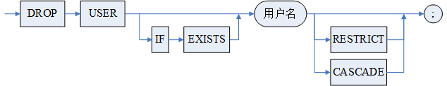
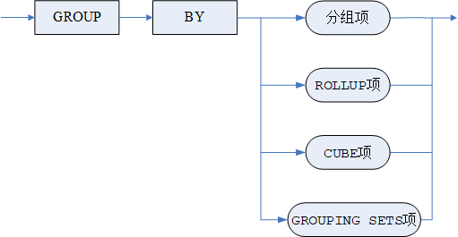
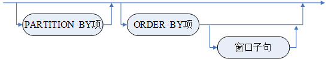
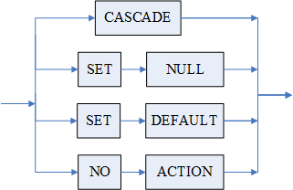
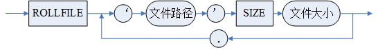
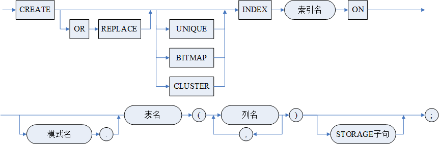
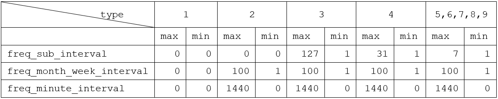

## 附录 1 关键字和保留字

以下不带\*号的为关键字， 带\*号的为系统保留字。

DM 还将保留字进一步划分为 SQL 保留字、DMSQL 程序保留字、模式保留字、变量保留字和别名保留字。对于关键字和保留字的详细信息请查询系统视图 V$RESERVED\_WORDS。

注意：关键字 ROWID、TRXID、VERSIONS\_STARTTIME、VERSIONS\_ENDTIME、VERSIONS\_STARTTRXID、VERSIONS\_ENDTRXID 和 VERSIONS\_OPERATION 不能作为表的列名，即使加上双引号也不行。

```
A
ABORT、ABSENT、ABSOLUTE*、ABSTRACT*、ACCESSED、ACCOUNT、ACCURACY、ACROSS、ACTION、ADD*、ADMIN*、ADVANCED、AFTER、AGGREGATE、ALL*、ALLOW、ALLOW_DATETIME、ALLOW_IP、ALTER*、ANALYZE、AND*、ANY*、APPEND、APPLY、APPROX、APPROXIMATE、APR、ARCHIVE、ARCHIVEDIR、ARCHIVELOG、ARCHIVESTYLE、ARRAY*、ARRAYLEN*、AS*、ASC*、ASCII、ASENSITIVE、ASSIGN*、ASYNCHRONOUS、AT、ATTACH、AUDIT*、AUG、AUTHID、AUTHORIZATION*、AUTO、AUTOEXTEND、AUTOMATIC、AUTONOMOUS_TRANSACTION、AUTO_INCREMENT*、AUTO_OVERWRITE、AVG
B
BACKED、BACKUP、BACKUPDIR、BACKUPINFO、BACKUPNAME、BACKUPSET、BADFILE、BAKFILE、BASE、BATCH、BCT、BEFORE、BEGIN*、BETWEEN*、BIGDATEDIFF*、BIGINT、BINARY*、BIT、BITMAP、BLOB、BLOCK、BOOL*、BOOLEAN、BOTH*、BRANCH、BREADTH、BREAK*、BSTRING*、BTREE、BUFFER、BUILD、BULK、BY*、BYDAY、BYHOUR、BYMINUTE、BYMONTH、BYMONTHDAY、BYSECOND、BYTE*、BYWEEKNO、BYYEARDAY
C
CACHE、CALCULATE、CALL*、CASCADE、CASCADED、CASE*、CASE_SENSITIVE、CAST*、CATALOG、CATCH*、CHAIN、CHANGE、CHANNEL、CHAR*、CHARACTER、CHARACTERISTICS、CHECK*、CHECKPOINT、CIPHER、CLASS*、CLEAR、CLOB、CLOSE、CLUSTER*、CLUSTERBTR*、CLU_REC_ADDR、COLLATE、COLLATION*、COLLECT、COLUMN*、COLUMNS、COMMENT*、COMMIT*、COMMITTED、COMMITWORK*、COMPILE、COMPLETE、COMPRESS、COMPRESSED、CONFIGURE、CONNECT*、CONNECT_BY_ISCYCLE、CONNECT_BY_ISLEAF、CONNECT_BY_ROOT*、CONNECT_IDLE_TIME、CONNECT_TIME、CONST*、CONSTANT、CONSTRAINT*、CONSTRAINTS、CONSTRUCTOR、CONTAINS*、CONTENT、CONTEXT*、CONTINUE*、CONTROLFILE、CONVERT*、COPY、CORRESPONDING*、CORRUPT、COUNT、COUNTER、CPU_PER_CALL、CPU_PER_SESSION、CRC、CREATE*、CREATION、CROSS*、CRYPTO*、CTLFILE、CUBE*、CUMULATIVE、CURRENT*、CURRENT_DATE*、CURRENT_SCHEMA、CURRENT_TIMESTAMP*、CURRENT_USER、CURSOR*、CYCLE、CHAR_CS
D
DAILY、DANGLING、DATA、DATABASE、DATAFILE、DATE、DATEADD*、DATEDIFF*、DATEPART*、DATETIME、DAY、DBA_RECYCLEBIN、DBFILE、DBTIMEZONE*、DB_FILE_NAME_CONVERT、DB_PORT、DDL、DDL_CLONE、DEBUG、DEC、DECIMAL*、DECLARE*、DECODE*、DECREMENT、DEFAULT*、DEFAULTS、DEFERRABLE、DEFERRED、DEFINER、DELETE*、DELETING、DELIMITED、DELTA、DEMAND、DENSE_RANK、DEPTH、DEREF、DESC*、DESTINATION、DETACH、DETERMINISTIC、DEVICE、DIAGNOSTICS、DICTIONARY、DIMENSION*、DIRECTORY、DISABLE*、DISALLOW、DISCONNECT、DISKGROUP、DISKSPACE*、DISTANCE*、DISTINCT*、DISTRIBUTED*、DML、DO*、DOCUMENT、DOMAIN*、DOUBLE*、DOWN、DROP*、DUMP、DUPLICATE
E
EACH、EDITIONABLE、EFCONSTRUCTION*、EFSEARCH、ELSE*、ELSEIF*、ELSIF*、EMPTY、ENABLE*、ENCLOSED、ENCODING、ENCRYPT、ENCRYPTION、END*、EQU*、ERROR、ERRORS、ESCAPE、ESCAPED、EVALNAME、EVENTINFO、EVENTS、EXCEPT、EXCEPTION、EXCEPTIONS、EXCEPTION_INIT、EXCHANGE*、EXCLUDE、EXCLUDING、EXCLUSIVE、EXEC*、EXECUTE*、EXISTING、EXISTS*、EXIT*、EXPIRE、EXPLAIN*、EXTENDS、EXTERN*、EXTERNAL、EXTERNALLY、EXTRACT*
F
FAILED_LOGIN_ATTEMPS、FAILED_LOGIN_ATTEMPTS、FAST、FEB、FETCH*、FIELDS、FILE、FILEGROUP、FILESIZE、FILLFACTOR、FINAL*、FINALLY*、FIRST*、FLASHBACK*、FLOAT*、FOLLOWING、FOLLOWS、FOR*、FORALL、FORCE、FOREIGN*、FORMAT、FREQ、FREQUENCE、FRI、FROM*、FULL*、FULLY*、FUNCTION*
G
GENERATED、GET*、GLOBAL、GLOBALLY、GLOBAL_SESSION_PER_USER、GOTO*、GRANT*、GRAPH、GREAT、GROUP*、GROUPING*
H
HASH、HASHPARTMAP、HAVING*、HEXTORAW、HIDE、HIGH、HNSW、HOLD、HOUR、HOURLY、HUGE
I
IDENTIFIED、IDENTIFIER、IDENTITY*、IDENTITY_INSERT、IF*、IFNULL*、IGNORE、IGNORE_ROW_ON_DUPKEY_INDEX、IMAGE、IMMEDIATE*、IN*、INACTIVE_ACCOUNT_TIME、INCLUDE、INCLUDING、INCREASE、INCREMENT、INDENT、INDEX*、INDEXES、INDICES、INHERIT、INITIAL、INITIALIZED、INITIALLY、INLINE*、INNER*、INNERID、INPUT、INSENSITIVE、INSERT*、INSERTING、INSTANCE、INSTANTIABLE、INSTEAD、INT*、INTEGER、INTENT、INTERSECT*、INTERVAL*、INTO*、INVISIBLE、IS*、ISOLATION、ITERATE、IVF
J
JAN、JAVA、JOB、JOIN*、JSON、JSON_ARRAYAGG*、JSON_TABLE*、JSON_TRANSFORM*、JUL、JUN
K
KEEP*、KEY、KEYS
L
LABEL、LARGE*、LAST、LAX、LEADING*、LEFT*、LEFTARG、LESS*、LEVEL、LEVELS、LEXER*、LIKE*、LIMIT、LINES、LINK、LIST*、LNNVL*、LOB、LOCAL、LOCALLY、LOCALTIMESTAMP*、LOCAL_OBJECT、LOCATION、LOCK、LOCKED、LOG、LOGFILE、LOGGING、LOGIN*、LOGOFF、LOGON、LOGOUT、LONG、LONGVARBINARY、LONGVARCHAR、LOOP*、LSN
M
MAIN、MANUAL、MAP、MAPPED、MAR、MATCH、MATCHED、MATERIALIZED、MAX、MAXPIECESIZE、MAXSIZE、MAXVALUE、MAX_RUN_DURATION、MAY、MEASURES、MEMBER*、MEMORY、MEM_SPACE、MERGE、MICRO、MIN、MINEXTENTS、MINUS*、MINUTE、MINUTELY、MINVALUE、MIRROR、MISMATCH、MISSING、MOD、MODE、MODEL*、MODIFY、MON、MONEY、MONITOR、MONITORING、MONTH、MONTHLY、MOUNT、MOVE、MOVEMENT、MULTISET*
N
NATIONAL、NATURAL*、NAV、NCHAR、NCHARACTER、NEIGHBOR、NEIGHBORS、NEVER、NEW*、NEXT*、NO、NOARCHIVELOG、NOAUDIT、NOBRANCH、NOCACHE、NOCOPY*、NOCYCLE*、NODE、NOLOGGING、NOMAXVALUE、NOMINVALUE、NOMONITORING、NONE、NONEDITIONABLE、NOORDER、NOPARALLEL、NORMAL、NOROWDEPENDENCIES、NOSORT*、NOT*、NOT_ALLOW_DATETIME、NOT_ALLOW_IP、NOV、NOVALIDATE、NOWAIT、NULL*、NULLS、NUMBER、NUMERIC、NCHAR_CS
O
OBJECT*、OCT、OF*、OFF、OFFLINE、OFFSET、OID、OIDINDEX、OLD、ON*、ONCE、ONLINE、ONLY、OPEN、OPERATOR、OPTIMIZE*、OPTION、OPTIONALLY、OR*、ORDER*、ORDINALITY、ORGANIZATION、OUT*、OUTER、OUTFILE、OVER*、OVERFLOW、OVERLAPS、OVERLAY*、OVERRIDE*、OVERRIDING
P
PACKAGE、PAD、PAGE、PARALLEL、PARALLEL_ENABLE、PARAMETERS*、PARMS、PARTIAL、PARTITION*、PARTITIONS、PASSING、PASSWORD、PASSWORD_GRACE_TIME、PASSWORD_LIFE_TIME、PASSWORD_LOCK_TIME、PASSWORD_POLICY、PASSWORD_REUSE_MAX、PASSWORD_REUSE_TIME、PATH、PENDANT*、PERCENT*、PIPE*、PIPELINED、PIVOT、PLACING、PLS_INTEGER、PLUGGABLE、POLICY、POOL、PRAGMA、PREBUILT、PRECEDES、PRECEDING、PRECISION、PRESENT、PRESERVE、PRETTY、PRIMARY*、PRINT*、PRIOR*、PRIVATE*、PRIVILEGE、PRIVILEGES*、PROBES、PROCEDURE*、PROFILE、PROTECTED*、PUBLIC*、PURGE
Q
QUERY、QUERY_REWRITE_INTEGRITY、QUOTA
R
RADIUS、RAISE*、RANDOMLY、RANGE、RAWTOHEX、READ、READONLY、READ_PER_CALL、READ_PER_SESSION、REAL、REBUILD、RECORD*、RECORDS、RECYCLEBIN、REDUCED、REF*、REFERENCE*、REFERENCES*、REFERENCING*、REFRESH、REGEXP_SPLIT_TO_TABLE*、REJECT、RELATED、RELATIVE*、RELEASE、REMOVE、RENAME、REPEAT*、REPEATABLE、REPLACE、REPLAY、REPLICATE*、RESIZE、RESTORE、RESTRICT、RESTRICT_REFERENCES、RESULT、RESULT_CACHE、RETURN*、RETURNING*、REVERSE*、REVOKE*、RIGHT*、RIGHTARG、ROLE、ROLLBACK*、ROLLFILE、ROLLUP*、ROOT、ROW*、ROWCOUNT、ROWDEPENDENCIES、ROWID、ROWNUM*、ROWS*、RULE、RULES
S
SALT、SAMPLE、SAT、SAVE、SAVEPOINT*、SBT、SBYTE*、SCALARS、SCHEMA*、SCHEMABINDING、SCN、SCOPE、SCROLL、SEALED*、SEARCH、SECOND、SECONDLY、SECTION*、SEED、SEGMENT、SELECT*、SELF、SENSITIVE、SEP、SEQUENCE、SEQUENTIAL、SERERR、SERIALIZABLE、SERVER、SESSION、SESSIONTIMEZONE*、SESSION_PER_USER、SET*、SETS*、SHADOW、SHARD、SHARE、SHORT*、SHOW、SHUTDOWN、SIBLINGS、SIMPLE、SINCE、SINGLE、SIZE、SIZEOF*、SKIP、SMALLINT、SNAPSHOT、SOME*、SOUND、SPACE、SPAN、SPATIAL、SPEED、SPFILE、SPLIT、SQL、SQL_CALC_FOUND_ROWS*、STANDBY、STARTING、STARTUP、STAT、STATEMENT、STATIC*、STDDEV、STOP、STORAGE、STORE、STRICT、STRING、STRIPING、STRUCT*、STYLE、SUBPARTITION*、SUBPARTITIONS、SUBSCRIBE、SUBSTITUTABLE、SUBSTRING、SUBTYPE、SUCCESSFUL、SUM、SUN、SUSPEND、SWITCH*、SYNC、SYNCHRONOUS、SYNONYM*、SYSAUDITOR_PWD、SYSDATE*、SYSDBA_PWD、SYSDBO_PWD、SYSSSO_PWD、SYSTEM、SYSTIMESTAMP*、SYS_CONNECT_BY_PATH
T
TABLE*、TABLESPACE、TARGET、TASK、TEMPLATE、TEMPORARY、TERMINATED、TEXT、THAN*、THEN、THREAD、THROUGH、THROW*、THU、TIES、TIME、TIMER、TIMES、TIMESTAMP、TIMESTAMPADD*、TIMESTAMPDIFF*、TIME_ZONE、TINYINT、TO*、TOP*、TO_VECTOR*、TRACE、TRACKING、TRAILING*、TRANSACTION、TRANSACTIONAL、TREAT*、TRIGGER*、TRIGGERS、TRIM*、TRUNCATE*、TRUNCSIZE、TRXID、TRY*、TUE、TYPE、TYPEDEF*、TYPEOF*
U
UINT*、ULONG*、UNBOUNDED、UNCOMMITTED、UNDER、UNION*、UNIQUE*、UNLIMITED、UNLOCK、UNPIVOT、UNTIL*、UNUSABLE、UP、UPDATE*、UPDATED、UPDATING、UPSERT、USAGE、USER*、USE_HASH、USE_MERGE、USE_NL、USE_NL_WITH_INDEX、USHORT*、USING*
V
VALIDATE、VALUE、VALUES*、VARBINARY、VARCHAR、VARCHAR2、VARIANCE、VARRAY*、VARYING、VECTOR、VERIFY*、VERSION、VERSIONS*、VERSIONS_ENDTIME、VERSIONS_ENDTRXID、VERSIONS_OPERATION、VERSIONS_STARTTIME、VERSIONS_STARTTRXID、VERTICAL、VIEW*、VIRTUAL*、VISIBLE、VOID*、VSIZE
W
WAIT、WED、WEEK、WEEKLY、WELLFORMED、WHEN*、WHENEVER*、WHERE*、WHILE*、WINDOW*、WITH*、WITHIN*、WITHOUT*、WORK、WRAPPED、WRAPPER、WRITE
X
X、XML*、XMLAGG*、XMLATTRIBUTES*、XMLCAST*、XMLELEMENT*、XMLNAMESPACES*、XMLPARSE*、XMLQUERY*、XMLSERIALIZE*、XMLTABLE*
Y
YEAR、YEARLY
Z
ZONE
```

## 附录 2 SQL 语法书写规则

**一** **SQL 语法符号**

下面分别介绍各 SQL 语法符号的含义：

< > 表示一个语法对象，但是小括号本身不能出现在语句中。

::= 定义符，用来定义一个语法对象。定义符左边为语法对象，右边为相应的语法描述。

| 或者符，或者符限定的语法选项在实际的语句中只能出现一个。

{ } 大括号指明大括号内的语法选项在实际的语句中可以出现 0…N 次(N 为大于 0 的自然数)，但是大括号本身不能出现在语句中。

\[ \] 中括号指明中括号内的语法选项在实际的语句中可以出现 0…1 次，但是中括号本身不能出现在语句中。

关键字 关键字在 DM\_SQL 语言中具有特殊意义，在 SQL 语法描述中，关键字以大写形式出现。但在实际书写 SQL 语句时，关键字可以为大写也可以为小写。

**二 SQL 语法图的说明**

SQL 语法图是用来帮助用户正确地理解和使用 DM SQL 语法的图形。阅读语法图时，请按照从上到下，从左到右的方式，依箭头所指方向进行阅读。

SQL 命令、语法关键字等终结符以全大写方式在长方形框内显示，使用时直接输入这些内容；语法参数或语法子句等非终结符的名称以全小写方式在圆角框内显示；各类标点符号显示在圆圈之中。注：如果小写参数中不带下划线\_，则表示是由用户输入的参数，带下划线则表示是还需要进一步解释的子句或语法对象，如果在前面已解释过，则未重复列出。

1. **必须关键字和参数**

1）必须关键字和参数出现在语法参考图的主干路径上，也就是说，出现在当前阅读的水平线上。

例 以用户删除语句为例。DROP、USER、< 用户名 > 和;为必选内容。

用户删除语句语法：

```
DROP USER <用户名> [RESTRICT | CASCADE];
```

用户删除语句语法图：



这里 DROP、USER、username 和;都是语句必须的。

2）如果多个关键字或参数并行地出现在从主路径延伸出的多条可选路径中，则只选择其中的一个即可。

例 以 \<GROUP BY 子句 > 为例。<group\_by 项 > 有四种形式，可以任选一种。如果存在 GROUP BY 子句，则必须从 <group\_by 项 > 中选择一种。

\<GROUP BY 子句 > 语法：

```
<GROUP BY 子句> ::= GROUP BY <group_by项>{,<group_by项>}
<group_by项>::=<分组项> | <ROLLUP项> | <CUBE项> | <GROUPING SETS项>
```

\<GROUP BY 子句 > 语法图：



2. **可选关键字和参数**

如果关键字或参数并行地出现在主路径下方，而主路径是一条直线，则这些关键字和参数是可选的。

例 1 以用户删除语句为例。IF EXISTS、RESTRICT、CASCADE 均是可选项。IF EXISTS 和主干道是二选一的关系；RESTRICT、CASCADE 和主干道是三选一的关系。

用户删除语句语法：

```
DROP USER [IF EXISTS] <用户名> [RESTRICT | CASCADE];
```

用户删除语句语法图：


例 2 以 < 分析子句 > 为例。\<PARTITION BY 项 >、\<ORDER BY 项 > 和 < 窗口子句 > 都是可选的，但出现的前后顺序不能颠倒。

分析函数的 < 分析子句 > 语法：

```
<分析子句> ::= [<PARTITION BY项>] [<ORDER BY项> ] [<窗口子句>]
```

用语法图表示 < 分析子句 >：



3. **多条路径**

如果一张语法参考图有一条以上的路径，可以从任意一条路径进行阅读。如果可以选择多个关键字、操作符、参数或者语法子句，这些选项将被并行地列出。

例 以 < 引用动作 > 为例。引用动作可以选择这四条路径的任一种。

< 引用动作 > 语法：

```
<引用动作> ::= CASCADE | 
            SET NULL | 
            SET DEFAULT | 
            NO ACTION
```

< 引用动作 > 语法图：



从语法图可以看出，引用动作可以选择这四种的任一种。

4. **循环语法**

循环语法表示可以按照需要，使用循环内的语法一次或者多次。

例 以 < 回滚文件子句 > 为例。通过逗号隔开，可以重复语法对象 ‘filepath’ SIZE filesize 多个。

< 回滚文件子句 > 语法：

```
<回滚文件子句> ::= ROLLFILE <文件说明子句>,{<文件说明子句>}

<文件说明子句> ::= <文件路径> SIZE <文件大小>
```

< 回滚文件子句 > 语法图：



5. **多行语法图**

由于有些 SQL 语句的语法十分复杂，生成的语法参考图无法完整地显示在一行之内，于是将其分行显示。阅读此类图形时，请从上至下，从左至右地进行。

例 以索引定义语句为例。索引定义的语法被分成了两行显示。

索引定义语句语法：

```
CREATE [OR REPLACE] [UNIQUE | BITMAP | CLUSTER] INDEX <索引名>

ON [<模式名>.]<表名>(<列名>{,<列名>}) [<STORAGE子句>];
```

索引定义语句语法图：



## 附录 3 系统存储过程和函数

以下为达梦数据库所用到的系统存储过程和函数。

注：函数名右上角有“\*”标记的，表示此过程/函数的使用有下面两点限制：

- 此过程/函数不能在 MPP 全局模式下的存储过程中直接调用，在 MPP LOCAL 模式下可在存储过程中直接调用；
- 此过程/函数不能在存储过程中带参数进行动态调用。

### 1\. INI 参数管理

1）SF\_GET\_PARA\_VALUE

**定义：**

BIGINT

SF\_GET\_PARA\_VALUE (

scope int,

paraname varchar(256)

)

**功能说明：**

返回 DM.INI 文件中整型的参数值。

**参数说明：**

scope： 取值为 1、2 。 1 表示从 DM.INI 文件中读取；2 表示从内存中读取。当取值为 1，且 DM.INI 文件中该参数值设置为非法值时，若设置值与参数类型不兼容，则返回默认值；若设置值小于参数取值范围的最小值，则返回最小值；若设置值大于参数取值范围的最大值，则返回最大值。

paraname：DM.INI 文件中的参数名。

**返回值：**

当前 DM.INI 文件中对应的参数值。

**举例说明：**

获得 DM.INI 文件中 BUFFER 参数值：

```
SELECT SF_GET_PARA_VALUE (1, 'BUFFER');
```

2）SP\_SET\_PARA\_VALUE

**定义：**

SP\_SET\_PARA\_VALUE (  
scope int,  
paraname varchar(256)  
value bigint  
)  
或  
SP\_SET\_PARA\_VALUE (  
bro\_flag int,  
scope int,  
paraname varchar(256)  
value bigint  
)  
或  
SP\_SET\_PARA\_VALUE(  
inst\_name varchar(128),  
scope int,  
paraname varchar(256),  
value bigint  
)

**功能说明：**

供具有 DBA 权限的用户设置 DM.INI 文件中整型的参数值。DSC 环境下，对于需要在各节点保持一致的参数，设置的参数值会在 OK 节点上同步。

**参数说明：**

scope：取值为 0、1、2 。0 表示修改内存中的动态配置参数值；1 表示 DM.INI 文件和内存参数都修改，不需要重启服务器；2 表示修改 DM.INI 文件的参数值或不在 DM.INI 中的 INI 配置项（具体可参看《DM8 系统管理员手册》2.1.1.1.26 节），修改后需重启服务器生效。

paraname：DM.INI 文件中的参数名。

value：设置的值。

bro\_flag：广播标记，取值为 0、1、2、3。0 表示不广播；1 表示广播至 MP 节点；2 表示广播至 BP 节点；3 表示广播至 SP 节点。该参数仅在 DMDPC 集群环境下指定有效。

inst\_name：用于指定实例名，该函数重载用于 DPC 环境下修改指定实例的静态或动态配置参数，被修改的配置参数不能是必须同步的参数。

**返回值：**

无

**举例说明：**

将 DM.INI 文件中 HFS\_CACHE\_SIZE 参数值设置为 320：

```
SP_SET_PARA_VALUE (1,'HFS_CACHE_SIZE',320);
```

3）SF\_GET\_PARA\_DOUBLE\_VALUE

**定义：**

DOUBLE

SF\_GET\_PARA\_DOUBLE\_VALUE (

scope int,

paraname varchar(256)

)

**功能说明：**

返回 DM.INI 文件中参数中浮点型的参数值。

**参数说明：**

scope：取值为 1、2 。1 表示从 DM.INI 文件中读取，不在 DM.INI 中的参数不能读取；2 表示从内存中读取；

paraname：DM.INI 文件中的参数名。

**返回值：**

当前 DM.INI 文件中对应的参数值。

**举例说明：**

获得 DM.INI 中 CKPT\_FLUSH\_RATE 的参数值：

```
SELECT SF_GET_PARA_DOUBLE_VALUE (1, 'CKPT_FLUSH_RATE');

SELECT SF_GET_PARA_DOUBLE_VALUE (2, 'CKPT_FLUSH_RATE');
```

4）SP\_SET\_PARA\_DOUBLE\_VALUE

**定义：**

void  
SP\_SET\_PARA\_DOUBLE\_VALUE (  
scope int,  
paraname varchar(256),  
value double  
)  
或  
SP\_SET\_PARA\_DOUBLE\_VALUE (  
bro\_flag int,  
scope int,  
paraname varchar(256),  
value double  
)  
或  
SP\_SET\_PARA\_DOUBLE\_VALUE (  
inst\_name varchar(128),  
scope int,  
paraname varchar(256),  
value double  
)

**功能说明：**

供具有 DBA 权限的用户设置 DM.INI 参数中浮点型的参数值。DSC 环境下，除了特殊参数以外，其他参数值会在 OK 节点上同步。关于特殊参数的介绍请参考函数 SP\_SET\_PARA\_VALUE 的功能说明。

**参数说明：**

scope：取值为 0、1、2。0 表示修改内存中的动态配置参数值；1 表示 DM.INI 文件和内存参数都修改，不需要重启服务器；2 表示只可修改 DM.INI 文件，服务器重启后生效。

paraname：DM.INI 文件中的参数名。

value：设置的值。

bro\_flag：广播标记，取值为 0、1、2、3。0 表示不广播；1 表示广播至 MP 节点；2 表示广播至 BP 节点；3 表示广播至 SP 节点。该参数仅在 DMDPC 集群环境下指定有效。  
inst\_name：用于指定实例名，该函数重载用于 DPC 环境下修改指定实例的静态或动态配置参数，被修改的配置参数不能是必须同步的参数。

**返回值：**

无

**举例说明：**

将 DM.INI 文件中 INDEX\_SKIP\_SCAN\_RATE 参数值设置为 0.2：

```
SP_SET_PARA_DOUBLE_VALUE(1,'INDEX_SKIP_SCAN_RATE',0.2);
```

5）SF\_GET\_PARA\_STRING\_VALUE

**定义：**

VARCHAR

SF\_GET\_PARA\_STRING\_VALUE (

scope int,

paraname varchar(256)

)

**功能说明：**

返回 DM.INI 文件中字符串类型的参数值。

**参数说明：**

scope： 取值为 1、2 。 1 表示从 DM.INI 文件中读取；2 表示从内存中读取。

paraname：DM.INI 文件中的参数名。

**返回值：**

当前 DM.INI 文件中对应的参数值。

**举例说明：**

获得 DM.INI 文件中 TEMP\_PATH 参数值：

```
SELECT SF_GET_PARA_STRING_VALUE (1, 'TEMP_PATH');
```

6）SP\_SET\_PARA\_STRING\_VALUE

**定义：**

SP\_SET\_PARA\_STRING\_VALUE (

scope int,

paraname varchar(256),

value varchar(32767)

)

或

SP\_SET\_PARA\_STRING\_VALUE (

bro\_flag int,

scope int,

paraname varchar(256),

value varchar(32767)

)

或

SP\_SET\_PARA\_STRING\_VALUE (

inst\_name varchar(128),

scope int,

paraname varchar(256),

value varchar(32767)

)

**功能说明：**

供具有 DBA 权限的用户设置 DM.INI 文件中的字符串型参数值。DSC 环境下，除了特殊参数以外，其他参数值会在 OK 节点上同步。关于特殊参数的介绍请参考函数 SP\_SET\_PARA\_VALUE 的功能说明。

**参数说明：**

scope：取值为 0、1、2 。0 表示修改内存中的动态配置参数值；1 表示 DM.INI 文件和内存参数都修改，不需要重启服务器；2 表示只修改 DM.INI 文件，服务器重启后生效。

paraname：DM.INI 文件中的参数名。

value：设置的字符串的值。

bro\_flag：广播标记，取值为 0、1、2、3。0 表示不广播；1 表示广播至 MP 节点；2 表示广播至 BP 节点；3 表示广播至 SP 节点。该参数仅在 DMDPC 集群环境下指定有效。  
inst\_name：用于指定实例名，该函数重载用于 DPC 环境下修改指定实例的静态或动态配置参数，被修改的配置参数不能是必须同步的参数。

**返回值：**

无

**举例说明：**

将 DM.INI 文件中 COMMIT\_WRITE 参数值设置为 WAIT：

```
SP_SET_PARA_STRING_VALUE(1,'COMMIT_WRITE','WAIT');
```

7）SF\_SET\_SESSION\_PARA\_VALUE

**定义：**

void

SF\_SET\_SESSION\_PARA\_VALUE (

paraname varchar(256),

value bigint

)

**功能说明：**

设置会话级 INI 参数在当前会话上的值。

**参数说明：**

paraname： 会话级 INI 参数的参数名。

value：要设置的新值。

**返回值：**

无

**举例说明：**

将会话级 INI 参数 JOIN\_HASH\_SIZE 在当前会话上的值设置为 2000：

```
SF_SET_SESSION_PARA_VALUE ('JOIN_HASH_SIZE', 2000);
```

8）SP\_RESET\_SESSION\_PARA\_VALUE

**定义：**

void

SP\_RESET\_SESSION\_PARA\_VALUE (

paraname varchar(256)

)

**功能说明：**

重置会话级 INI 参数在当前会话上的值，使得当前会话的参数值和全局值一致。

**参数说明：**

paraname：会话级 INI 参数的参数名。

**返回值：**

无

**举例说明：**

重置会话级 INI 参数 JOIN\_HASH\_SIZE 在当前会话上的值：

```
SP_RESET_SESSION_PARA_VALUE ('JOIN_HASH_SIZE');
```

9）SF\_GET\_SESSION\_PARA\_VALUE

**定义：**

INT

SF\_GET\_SESSION\_PARA\_VALUE (

paraname varchar(256)

)

**功能说明：**

获得整型的会话级 INI 参数的值。

**参数说明：**

paraname：会话级 INI 参数的参数名。

**返回值：**

整型的会话级 INI 参数的值。

**举例说明：**

获取会话级 INI 参数 JOIN\_HASH\_SIZE 的值：

```
SELECT SF_GET_SESSION_PARA_VALUE ('JOIN_HASH_SIZE');
```

10）SF\_GET\_SESSION\_PARA\_DOUBLE\_VALUE

**定义：**

DOUBLE

SF\_GET\_SESSION\_PARA\_DOUBLE\_VALUE (

paraname varchar(256)

)

**功能说明：**

获得浮点型的会话级 INI 参数的值。

**参数说明：**

paraname：会话级 INI 参数的参数名。

**返回值：**

浮点型会话级 INI 参数的值。

**举例说明：**

获取会话级 INI 参数 SEL\_RATE\_SINGLE 的值：

```
SELECT SF_GET_SESSION_PARA_DOUBLE_VALUE ('SEL_RATE_SINGLE');
```

11）SF\_GET\_SESSION\_PARA\_STRING\_VALUE

**定义：**

VARCHAR

SF\_GET\_SESSION\_PARA\_STRING\_VALUE (

paraname varchar(256)

)

**功能说明：**

获得字符串类型的会话级 INI 参数的值。

**参数说明：**

paraname：会话级 INI 参数的参数名。

**返回值：**

字符串类型的会话级 INI 参数的值。

**举例说明：**

获取会话级 INI 参数 SQLTUNE\_CATEGORY 的值：

```
SELECT SF_GET_SESSION_PARA_STRING_VALUE ('SQLTUNE_CATEGORY');
```

12）SF\_SET\_SYSTEM\_PARA\_VALUE

**定义：**

```
SF_SET_SYSTEM_PARA_VALUE (

   paraname varchar(256),

   value bigint/double/varchar(256),

   deferred int,

   scope int

   )

   或

   SF_SET_SYSTEM_PARA_VALUE (

   bro_flag    int,

   paraname  varchar(256), 

   value  bigint/double/varchar(256),

   deferred  int, 

   scope  int

   )

或

   SF_SET_SYSTEM_PARA_VALUE (

   inst_name     varchar(128),

   paraname    varchar(256), 

   value     bigint/double/varchar(256),

   deferred  int, 

   scope    int

   )
```

**功能说明：**

修改整型、double、varchar 的静态配置参数或动态配置参数。DSC 环境下，除了特殊参数以外，其他参数值会在 OK 节点上同步。关 SF\_SET\_SQL\_LOG 于特殊参数的介绍请参考函数 SP\_SET\_PARA\_VALUE 的功能说明。

**参数说明：**

paraname：INI 参数的参数名。

value：要设置的新值。

deferred：供动态会话级参数（指定了 MEMORY 或 BOTH 的情况下）使用，是否同步修改当前会话参数值。0 修改，1 不修改。此外，对于静态参数或使用了 SPFILE 的动态会话级参数，无论 defered 为 0 或 1，均不修改当前会话值。对于动态系统级参数，无论 defered 为 0 或 1，系统均同步修改当前会话值。

scope：取值为 0、1、2 。0 表示修改内存中的动态的配置参数值；1 表示修改 DM.INI 文件或不在 DM.INI 总中的 INI 配置项中的静态或动态参数之后，需重启服务器生效。

bro\_flag：广播标记，取值为 0、1、2、3。0 表示不广播；1 表示广播至 MP 节点；2 表示广播至 BP 节点；3 表示广播至 SP 节点。该参数仅在 DMDPC 集群环境下指定有效。  
inst\_name：用于指定实例名，该函数重载用于 DPC 环境下修改指定实例的静态或动态配置参数，被修改的配置参数不能是必须同步的参数。

**返回值：**

无

**举例说明：**

修改 INI 参数 JOIN\_HASH\_SIZE 的值：

```
SF_SET_SYSTEM_PARA_VALUE ('JOIN_HASH_SIZE',50,1,1);
```

13）SF\_SET\_SQL\_LOG

**定义：**

INT

SF\_SET\_SQL\_LOG (

svrlog int,

svrmsk varchar(1000)

)

**功能说明：**

设置服务器日志相关 INI 参数 SVR\_LOG 和 SQL\_TRACE\_MASK。

**参数说明：**

svrlog：INI 参数 SVR\_LOG 的设置值。

svrmsk：INI 参数 SQL\_TRACE\_MASK 的设置值。

**返回值：**

是否成功。

**举例说明：**

设置服务器日志相关 INI 参数：

```
SELECT SF_SET_SQL_LOG(1, '3:5:7');
```

14）SF\_SYNC\_INI

**定义：**

INT

SF\_SYNC\_INI(

level int

)

**功能说明：**

用于备库从主库同步 DM.INI 参数。直连备库执行，只对当前的备库有效，不同的备库需要分别单独执行。

关于参数同步时，同步内存值还是文件值，同步规则如下：

1. 静态 INI 参数：仅同步 dm.ini 文件值，不同步内存值，备库需要重启才能使用新的参数值；
2. 系统级动态 INI 参数：同时同步 dm.ini 文件值与内存值；
3. 会话级动态 INI 参数：同步全局内存值，不同步会话上的 INI 参数值；

4）同步的两个节点须同为 V8.1.3.31 之前的版本，或同为大于等于 V8.1.3.31 的版本。若在小于 V8.1.3.31 和大于等于 V8.1.3.31 的两个版本间执行，不会真正同步，而是直接返回成功。

5. 只读的参数（PARA\_TYPE 为 READ\_ONLY），不支持动态修改，不会参与同步。

**参数说明：**

level：同步级别，取值 0 和 1。

0：表示同步所属环境下必须同步的参数。目前在非 DPC 环境下，主备库间没有必须保持一致的参数，因此非 DPC 执行 SF\_SYNC\_INI(0)不会同步任何参数。DPC 环境下，MP 主备、BP 主备间存在一批必须保持一致的参数，这些参数中的非只读参数会在执行 SF\_SYNC\_INI(0)时进行同步，这些参数如下：USE\_PLN\_POOL、MPP\_MOTION\_SYNC、ENABLE\_INJECT\_HINT、SLCT\_ERR\_PROCESS\_FLAG、AUTO\_STAT\_OBJ、MAX\_SESSION\_STATEMENT、MAX\_EP\_SITES、COMPRESS\_MODE、PK\_WITH\_CLUSTER、BDTA\_SIZE、PARALLEL\_POLICY、LIST\_TABLE、DECIMAL\_FIX\_STORAGE、ENABLE\_HUGE\_SECIND、ENABLE\_FLASHBACK、UNDO\_RETENTION、FORCE\_CERTIFICATE\_ENCRYPTION、COMPATIBLE\_MODE、ORA\_DATE\_FMT、JSON\_MODE、DATETIME\_FMT\_MODE、COUNT\_64BIT、CALC\_AS\_DECIMAL、CAST\_VARCHAR\_MODE、SPACE\_COMPARE\_MODE、NUMBER\_MODE、ALTER\_TABLE\_OPT、ID\_RECYCLE\_FLAG、ENABLE\_VERTICAL\_TABLE、ENABLE\_RLS、DPC\_SYNC\_STEP、DPC\_SYNC\_TOTAL、STMT\_XBOX\_REUSE、HUGE\_ENABLE\_DEL\_UPD、ENABLE\_CS\_CVT、ALLOWED\_CLIENT\_VERSIONS、SELECT\_LOCK\_MODE、LIST\_TABLE\_BRANCH、LIST\_TABLE\_NON\_BRANCH、HFI\_HP\_MODE、VIEW\_ACCESS\_MODE、TRUNC\_CHECK\_MODE、PL\_SQL\_STRIP、WM\_CONCAT\_LOB、FLOAT\_MODE、CTI\_SCORE\_MODE、CAST\_CLOB\_MODE、BINDDATA\_COLTYPE、VIEW\_AUTHID\_CHECK、ENET\_MODE、RECYCLEBIN、ORA\_REVERSE\_MODE、BF\_SIZE、USE\_JSON\_DATATYPE、TSMV\_FCOPY\_STEP。

1：表示同步主备间所有可以同步的参数。若需要确认一个 INI 参数是否可以进行主备间同步，可以通过查询 V$DM\_INI 中 PRIMARY\_SYNC 列的值确认。值为“Y”表示会进行主备同步，为“N”表示不会进行主备同步。

**返回值：**

0：执行成功。

<0：执行失败。

100：未执行同步，对方 MAL 消息版本过低或 INI 版本一致无需同步。

**举例说明：**

在备库上执行，同步主库上所有可以同步的 INI 参数：

```
SELECT SF_SYNC_INI (1);
```

15）SF\_DSC\_SYNC\_INI

**定义：**

INT

SF\_DSC\_SYNC\_INI(

level int

)

**功能说明：**

用于普通节点从控制节点同步 DM.INI 参数。仅 DMDSC 集群节点生效。函数直连 DMDSC 普通节点执行。只对当前普通节点有效。不同的普通节点需要分别单独执行。在控制节点执行会报错。

仅同步 INI 参数的内存值及 DM.INI 文件值。对于某个会话上的 INI 参数修改，不进行同步。

同步的两个节点须同为 V8.1.3.31 之前的版本，或同为大于等于 V8.1.3.31 的版本。若在小于 V8.1.3.31 和大于等于 V8.1.3.31 的两个版本间执行，不会真正同步，而是直接返回成功。

**参数说明：**

level：同步级别。取值 0 和 1。

0：表示同步 DSC 节点间必须保持一致的部分参数。这些参数是：BUFFER、BUFFER\_POOLS、BUFFER\_MODE、FAST\_POOL\_PAGES、FAST\_ROLL\_PAGES、KEEP、RECYCLE、RECYCLE\_POOLS、ROLLSEG、ROLLSEG\_POOLS、MULTI\_PAGE\_GET\_NUM、ENABLE\_INJECT\_HINT、ORDER\_BY\_NULLS\_FLAG、OPTIMIZER\_MODE、DIRECT\_IO、MAX\_SESSIOS、TRX\_VIEW\_MODE、FAST\_LOGIN、TS\_RESERVED\_EXTENTS、TS\_SAFE\_FREE\_EXTENTS、TS\_MAX\_ID、TS\_FIL\_MAX\_ID、RLOG\_APPEND\_LOGIC、ISOLATION\_LEVEL、LOCK\_DICT\_OPT、BACKSLASH\_ESCAPE、STR\_LIKE\_IGNORE\_MATCH\_END\_SPACE、MS\_PARSE\_PERMIT、COMPATIBLE\_MODE、JSON\_MODE、CASE\_COMPATIBLE\_MODE、COUNT\_64BIT、CALC\_AS\_DECIMAL、CMP\_AS\_DECIMAL、CAST\_VARCHAR\_MODE、PL\_SQLCODE\_COMPATIBLE、LEGACY\_SEQUENCE、DM6\_TODATE\_FMT、DROP\_CASCADE\_VIEW、ENABLE\_FREQROOTS、ENABLE\_OFFLINE\_TS、DSC\_N\_CTLS、DSC\_TRX\_VIEW\_SYNC、DSC\_REMOTE\_READ\_MODE、CHECK\_SVR\_VERSION、COMMIT\_WRITE、PARAM\_DOUBLE\_TO\_DEC、RLOG\_SYNC\_MODE、DSC\_NTP\_MAX\_DIFFTIME、DSC\_NTP\_POLICY、DSC\_REQUEST\_TIMEOUT、PAGE\_FLUSH\_CHECK、DSC\_SLOT\_WAIT\_TIMEOUT、BINDDATA\_COLTYPE、USE\_JSON\_DATATYPE

1：表示同步所有可以同步的参数。若需要确认一个 INI 参数是否可以进行 DSC 节点间同步，可以通过查询 V$DM\_INI 中 DSC\_SYNC 列的值确认。取值为’Y’表示参数会进行 DSC 节点间同步，取值为’N’表示参数不会进行 DSC 节点间同步。

**返回值：**

0：执行成功。

<0：执行失败。

100：对方 MAL 消息版本过低或 INI 版本一致无需同步。

**举例说明：**

在普通节点上执行，同步控制节点上所有可以同步的 INI 参数：

```
SELECT SF_DSC_SYNC_INI (1);
```

16）SP\_SET\_SQLLOG\_INI

**定义** ：

SP\_SET\_SQLLOG\_INI(

raft\_id int,

sqllog\_config varchar(24575)

)

或

SP\_SET\_SQLLOG\_INI(

sqllog\_config varchar(24575)

)

或

SP\_SET\_SQLLOG\_INI\_ALL(

sqllog\_config varchar(24575)

)

**功能说明：**

修改 SQLLOG.INI 文件的内容，SP\_SET\_SQLLOG\_INI\_ALL 代表 DPC 环境下广播给所有节点进行修改。

**参数说明：**

raft\_id：要修改的 SQLLOG.INI 文件所在的服务器站点号。无此参数表示修改本地的 SQLLOG.INI 文件。

sqllog\_config：要修改的内容，模式名用’\[\]’标出，配置项之间用’;’分隔；若模式名已存在，则修改其配置，对于未设置的配置项，继承原值；对于不存在的模式名，新增模式。当不指定模式名时，认为是全局配置区，全局配置区的模式内配置项只有写在配置串开头时才认为其合法。

**返回值：**

无。

**举例说明：**

新增模式 SLOG\_CONFIG1 和 SLOG\_CONFIG2。

```
SP_SET_SQLLOG_INI('[SLOG_CONFIG1]FILE_PATH=../log;PART_STOR=0;[SLOG_CONFIG2]SWITCH_MODE=2;SWITCH_LIMIT=128');
```

17）SP\_DELETE\_SQLLOG\_INI\_MODE

**定义** ：

SP\_DELETE\_SQLLOG\_INI\_MODE(

raft\_id int,

mode\_name varchar(128)

)

或

SP\_DELETE\_SQLLOG\_INI\_MODE(

mode\_name varchar(128)

)

或

SP\_DELETE\_SQLLOG\_INI\_MODE\_ALL(

mode\_name varchar(128)

)

**功能说明：**

删除 SQLLOG.INI 文件中的模式，SP\_DELETE\_SQLLOG\_INI\_MODE\_ALL 代表广播给所有节点删除。

**参数说明：**

raft\_id：要修改的 SQLLOG.INI 文件所在的服务器站点号。无此参数表示修改本地的 SQLLOG.INI 文件。

mode\_name：要删除的模式名。

**返回值：**

无。

**举例说明：**

删除模式名为 SLOG\_ALL 的 SQL 日志模式。

```
SP_DELETE_SQLLOG_INI_MODE('SLOG_ALL');
```

18）SP\_SET\_PARAM\_IN\_SESSION

**定义** ：

SP\_SET\_PARAM\_IN\_SESSION (

SESS\_ID BIGINT,

SESS\_SEQ INT,

PARANAME VARCHAR(256),

VALUE BIGINT

)

**功能说明：**

用于设置指定会话的会话级 INI 参数的值。调用此系统过程需要管理员权限。

**参数说明：**

SESS\_ID：会话 ID。

SESS\_SEQ：会话序列号。

PARANAME：会话级 INI 参数的参数名。

VALUE：要设置的新值。

**返回值：**

无

**举例说明：**

查看当前已存在的会话 ID 和序列号等信息：

```
SELECT SESS_ID, SESS_SEQ FROM V$SESSIONS;
行号       SESS_ID              SESS_SEQ
---------- -------------------- -----------
1          12429400             6
2          13518936             7
```

设置会话 id 为 13518936 的会话级 INI 参数 JOIN\_HASH\_SIZE 的值为 2000：

```
SP_SET_PARAM_IN_SESSION (13518936, 7, 'JOIN_HASH_SIZE', 2000);
```

19）SP\_SET\_INI\_PARA\_VALUE\*

**定义：**

SP\_SET\_INI\_PARA\_VALUE (

scope int,

paraname varchar(256),

value varchar(32767)

)

**功能说明：**

设置 DM.INI 文件中的整型，浮点型，字符串型参数值。DSC 环境下，除了特殊参数以外，其他参数值会在 OK 节点上同步。关于特殊参数的介绍请参考函数 SP\_SET\_PARA\_VALUE 的功能说明。

**参数说明：**

scope：取值为 0、1、2。0 表示修改内存中的动态配置参数值；1 表示 DM.INI 文件和内存参数都修改，不需要重启服务器；2 表示只修改 DM.INI 文件，服务器重启后生效。

paraname：DM.INI 文件中的参数名。

value：设置的字符串的值。

**返回值：**

无。

**举例说明：**

将 DM.INI 文件中 HFS\_CACHE\_SIZE 参数值设置为 320：

```
SP_SET_INI_PARA_VALUE (1,'HFS_CACHE_SIZE',320);
```

将 DM.INI 文件中 SEL\_RATE\_EQU 参数值设置为 0.3：

```
SP_SET_INI_PARA_VALUE(1, 'SEL_RATE_EQU', 0.3);
```

将 DM.INI 文件中 COMMIT\_WRITE 参数值设置为 WAIT：

```
SP_SET_INI_PARA_VALUE(1,'COMMIT_WRITE','WAIT');
```

### 2\. 系统信息管理

1）SP\_SET\_SESSION\_READONLY

**定义：**

SP\_SET\_SESSION\_READONLY (

readonly int

)

**功能说明：**

设置当前会话的只读模式。当 INI 参数 USER\_READ\_ONLY\_MODE 的取值为 1（禁止只读用户设置会话为非只读）时，只读用户不能通过 SP\_SET\_SESSION\_READONLY(0)命令取消会话的只读限制。

**参数说明：**

取值 1 或 0。1 表示对数据库只读；0 表示对数据库为读写。

**返回值：**

无。

**举例说明：**

设置当前会话为只读模式：

```
SP_SET_SESSION_READONLY (1);
```

2）SP\_CLOSE\_SESSION

**定义：**

```
SP_CLOSE_SESSION (

session_id    bigint

)

或

SP_CLOSE_SESSION (

ep_seqno      int,

session_id    bigint

)

或

SP_CLOSE_SESSION (

session_id    bigint,

force_commit  boolean

)
```

**功能说明：**

停止一个活动的会话，会话 ID 可通过 V$SESSIONS 或 GV$SESSIONS 查询，DM 系统创建的内部 SESSION（PORT\_TYPE = 12，但 CONNECTED = 1 的 SESSION）也可通过 V$SESSIONS 或 GV$SESSIONS 查询到。

SP\_CLOSE\_SESSION()会回滚会话上的当前操作并释放会话，但 SP\_CLOSE\_SESSION()并不会等待会话真正释放后才返回。

当设置 force\_commit 为 TRUE 时，会进行强制会话提交。仅单机和 DSC 环境支持指定 force\_commit=true，DPC/MPP 环境执行会报错。如果会话在执行 DDL 类型语句、快速装载或者 XA 分布式事务，指定 force\_commit=true 不会强制事务提交，依然进行回滚事务。

中断会话，强制事务提交可能导致事务不一致，用户要能接受可能的不一致，或者说有其他手段恢复事务不一致。

需要注意的是，对于任意会话 sess，假设其会话 ID 为 sess\_id，如果先执行 SP\_CLOSE\_SESSION (sess\_id)或者 SP\_CLOSE\_SESSION (sess\_id, false)，或者 sess 客户端主动断开，sess 事务已经开始回滚，再执行 SP\_CLOSE\_SESSION (sess1\_id, true)是不能强制事务提交的。

**参数说明：**

session\_id：指定会话 ID。

ep\_seqno：指定会话所在的 DMDSC 集群节点的节点号，或者 DMDPC 集群的 RAFT\_ID。

force\_commit：指定是否强制提交事务，true 为强制提交，false 为回滚。

**举例说明：**

例 1 停止 ID 为 510180488 的会话。

```
SP_CLOSE_SESSION (510180488);
```

例 2 强制提交事务。

```
//假设会话SESS1的ID为510180489，且其中对表test1，test2有如下操作
update test1 set count=count+100 where id=100;
update test2 set count=count-100 where id=100;
//对SESS1执行强制事务提交
SP_CLOSE_SESSION (510180489, true);
//查看两表数据，则有可能发现test1和test2的数据无法满足事务一致性，如test1的数据部分更新了，但是test2的数据都还没有更新。
select * from test1;
select * from test2;
```

3）SF\_GET\_CASE\_SENSITIVE\_FLAG/ CASE\_SENSITIVE

**定义：**

INT

SF\_GET\_CASE\_SENSITIVE\_FLAG()

或者

INT

CASE\_SENSITIVE ()

**功能说明：**

返回大小写敏感信息。

**参数说明：**

无

**返回值：**

1：敏感。

0：不敏感。

**举例说明：**

获得大小写敏感信息：

```
SELECT SF_GET_CASE_SENSITIVE_FLAG();
```
4. SESS\_CASE\_SENSITIVE

**定义：**

INT

SESS\_CASE\_SENSITIVE ()

**功能说明：**

返回会话级大小写敏感信息。

**参数说明：**

```
无
```

**返回值：**

1：敏感。

0：不敏感。

**举例说明：**

获得会话级大小写敏感信息：

```
SELECT  SESS_CASE_SENSITIVE();
```

5）SF\_GET\_EXTENT\_SIZE

**定义：**

INT

SF\_GET\_EXTENT\_SIZE()

**功能说明：**

返回簇大小。

**参数说明：**

无

**返回值：**

系统建库时指定的簇大小。

**举例说明：**

获得系统建库时指定的簇大小：

```
SELECT SF_GET_EXTENT_SIZE ();
```

6）SF\_GET\_PAGE\_SIZE/PAGE

**定义：**

INT

SF\_GET\_PAGE\_SIZE()

或者

INT

PAGE()

**功能说明：**

返回页大小。

**参数说明：**

无

**返回值：**

系统建库时指定的页大小。

**举例说明：**

获得系统建库时指定的页大小：

```
SELECT SF_GET_PAGE_SIZE ();
```

**补充说明：**

获得系统建库时指定的页大小也可使用：

```
SELECT PAGE();
```

7）SF\_GET\_FILE\_BYTES\_SIZE

**定义：**

BIGINT

SF\_GET\_FILE\_BYTES\_SIZE (

groupid int,

fileid int

)

**功能说明：**

获取文件字节长度。

**参数说明：**

groupid：所属的表空间 ID。

fileid：数据库文件 ID。

**返回值：**

文件字节长度。

**举例说明：**

获取 0 号文件组中 0 号文件的字节长度：

```
SELECT SF_GET_FILE_BYTES_SIZE (0,0);
```

8）SF\_GET\_UNICODE\_FLAG/UNICODE

**定义：**

INT

SF\_GET\_UNICODE\_FLAG()

或者

INT

UNICODE ()

**功能说明：**

返回建库时指定的字符集。

**参数说明：**

无

**返回值：**

0 表示 GB18030，1 表示 UTF-8，2 表示 EUC-KR。

**举例说明：**

获得系统建库时指定字符集：

```
SELECT SF_GET_UNICODE_FLAG ();
```

9）SF\_GET\_SGUID

**定义：**

INT

SF\_GET\_SGUID ()

**功能说明：**

返回数据库唯一标志 sguid。

**参数说明：**

无

**返回值：**

返回数据库唯一标志 sguid。

**举例说明：**

获取数据库唯一标志 sguid：

```
SELECT SF_GET_SGUID();
```

10）GUID()

**定义：**

VARCHAR

GUID ()

**功能说明：**

生成一个唯一编码串（32 个字符）。

**返回值：**

返回一个唯一编码串。

**举例说明：**

获取一个唯一编码串：

```
SELECT GUID();
```

11）NEWID()

**定义：**

VARCHAR

NEWID ()

**功能说明：**

生成一个 SQLSERVER 格式的 guid 字符串，格式为 xxxxxxxx-xxxx-xxxx-xxxx-xxxxxxxxxxxx，字符串中字母为大写。

**返回值：**

返回一个 SQLSERVER 格式的唯一编码串。

**举例说明：**

获取一个唯一编码串：

```
SELECT NEWID();
```

12）UUID()

**定义：**

VARCHAR

UUID()

**功能说明：**

生成一个 MYSQL 格式的 guid 字符串，格式为 xxxxxxxx-xxxx-xxxx-xxxx-xxxxxxxxxxxx，字符串中字母为小写。

**返回值：**

返回一个 MYSQL 格式的唯一编码串。

**举例说明：**

获取一个唯一编码串：

```
SELECT UUID();
```

13）SESSID()

**定义：**

BIGINT

SESSID ( )

**功能说明：**

获取当前连接的 id。

**返回值：**

返回当前连接 id。

**举例说明：**

返回当前连接 id：

```
SELECT SESSID ();
```

14）CHECK\_INDEX

**定义：**

INT

CHECK\_INDEX (

schname varchar,

indexid int

)

**功能说明：**

检查一个索引的合法性（正确性和有效性）。检查过程中，会使用 S+IX 锁来封锁索引对应的表对象，如果封锁失败，会忽略索引检查，并记录相关日志到 DMServer 的 log 文件中。

**参数说明：**

schname：模式名。

indexid：索引 id。

**返回值：**

0：表示不合法；1：表示合法；2：表示存在未校验的索引。

**举例说明：**

```
CREATE INDEX PRODUCT_IND ON PRODUCTION.PRODUCT(PRODUCTID);
//查询系统表得到索引ID
select name, id from sysobjects where name='PRODUCT_IND' and subtype$='INDEX';
select CHECK_INDEX ('PRODUCTION',33555531);
```

15）CHECK\_DB\_INDEX

**定义：**

INT

CHECK\_DB\_INDEX ()

**功能说明：**

检查数据库中所有索引的合法性（正确性和有效性）。检查过程中，会使用 S+IX 锁来封锁索引对应的表对象，如果封锁失败，会忽略索引检查，并记录相关日志到 DMServer 的 log 文件中。

**返回值：**

0：表示不合法；1：表示合法；2：表示除未能检查的索引外，其它索引都合法。

**举例说明：**

```
SELECT CHECK_DB_INDEX ();
```

16）UID

**定义：**

INT

UID ()

**功能说明：**

返回当前用户 ID。

**参数说明：**

无

**返回值：**

返回当前用户 ID。

**举例说明：**

返回当前用户 ID：

```
SELECT UID();
```

17）USER

**定义：**

VARCHAR

USER ()

**功能说明：**

返回当前用户名。

**参数说明：**

无

**返回值：**

返回当前用户名：

**举例说明：**

返回当前用户名

```
SELECT USER();
```

18）CUR\_DATABASE

**定义：**

VARCHAR

CUR\_DATABASE ()

**功能说明：**

返回数据库名。

**参数说明：**

无

**返回值：**

返回数据库名。

**举例说明：**

获取数据库名：

```
SELECT CUR_DATABASE();
```

19）VSIZE

**定义：**

INT

VSIZE(n)

**功能说明：**

返回 n 的核心内部表示的字节数。如果 n 为 NULL，则返回 NULL。

**参数说明：**

n：待求字节数的参数，可以为任意数据类型。

**返回值：**

n 占用的字节数。

**举例说明：**

```
SELECT VSIZE(256);  //整数类型
```

查询结果为：4

```
SELECT VSIZE('数据库');  //中文字符
```

查询结果为：6

20）SP\_RECLAIM\_TS\_FREE\_EXTENTS

**定义：**

SP\_RECLAIM\_TS\_FREE\_EXTENTS (

tsname varchar(128)

)

**功能说明：**

重组表空间空闲簇。

**参数说明：**

tsname：表空间名。

**返回值：**

无

**举例说明：**

重组表空间空闲簇：

```
SP_RECLAIM_TS_FREE_EXTENTS('SYSTEM');
```

21）SP\_CLEAR\_PLAN\_CACHE

**定义：**

SP\_CLEAR\_PLAN\_CACHE()

**功能说明：**

清空当前站点的执行缓存信息。

**参数说明：**

无

**返回值：**

无

**举例说明：**

清空当前站点的执行缓存信息：

```
CALL SP_CLEAR_PLAN_CACHE();
```

22）SP\_CLEAR\_PLAN\_CACHE

**定义：**

SP\_CLEAR\_PLAN\_CACHE(

plan\_id bigint

)

**功能说明：**

清空当前站点指定的执行缓存信息。

**参数说明：**

plan\_id：指定计划 ID，其值可以从动态视图 V$CACHEPLN 中的 CACHE\_ITEM 列获得。

**返回值：**

无

**举例说明：**

清空当前站点 ID 为 139688237135984 的执行缓存信息：

```
SP_CLEAR_PLAN_CACHE(139688237135984);
```

23）SP\_CLEAR\_PLAN\_CACHE

**定义：**

SP\_CLEAR\_PLAN\_CACHE(

plan\_id bigint,

hash\_value int

)

**功能说明：**

清空当前站点指定的执行缓存信息。

**参数说明：**

plan\_id：指定计划 ID，其值可以从动态视图 V$CACHEPLN 中的 CACHE\_ITEM 列获得。

hash\_value：指定缓存项的 HASH 值，其值可以从动态视图 V$CACHEPLN 中的 HASH\_VALUE 列获得。

**返回值：**

无

**举例说明：**

清空当前站点 ID 为 139688237144176，HASH 值为 1719382609 的执行缓存信息：

```
SP_CLEAR_PLAN_CACHE(139688237144176,1719382609);
```

24）SP\_SET\_PLN\_RS\_CACHE

**定义：**

SP\_SET\_PLN\_RS\_CACHE(

plan\_id bigint,

to\_cache int

)

**功能说明：**

强制设置指定计划结果集缓存的生效及失效。

**参数说明：**

plan\_id：指定计划 ID，其值可以从动态视图 V$CACHEPLN 中的 CACHE\_ITEM 列获得。

to\_cache：指定缓存与否，0：不缓存；1：缓存。

**返回值：**

无

**举例说明：**

设置计划 ID 为 139688237234288 的计划结果集缓存生效：

```
SP_SET_PLN_RS_CACHE(139688237234288, 1);
```

25）SP\_SET\_PLN\_RS\_CACHE

**定义：**

SP\_SET\_PLN\_RS\_CACHE(

plan\_id bigint,

hash\_value int,

to\_cache int

)

**功能说明：**

强制设置指定计划结果集缓存的生效及失效。

**参数说明：**

plan\_id：指定计划 ID，其值可以从动态视图 V$CACHEPLN 中的 CACHE\_ITEM 列获得。

hash\_value：指定缓存项的 HASH 值，其值可以从动态视图 V$CACHEPLN 中的 HASH\_VALUE 列获得。

to\_cache：指定缓存与否，0：不缓存；1：缓存。

**返回值：**

无

**举例说明：**

设置计划 ID 为 139688237234288，HASH 值为 1140234264 的计划结果集缓存失效

```
SP_SET_PLN_RS_CACHE(139688237234288, 1140234264,0);
```

26）CUR\_TICK\_TIME

**定义：**

VARCHAR

CUR\_TICK\_TIME ()

**功能说明：**

获取系统当前时钟记数。

**参数说明：**

无

**返回值：**

时钟记数的字符串。

**举例说明：**

获取系统当前时钟记数：

```
SELECT CUR_TICK_TIME();
```

27）SP\_SET\_LONG\_TIME

**定义：**

SP\_SET\_LONG\_TIME (

long\_exec\_time int

)

**功能说明：**

设置 V$LONG\_EXEC\_SQLS 和 V$SYSTEM\_LONG\_EXEC\_SQLS 动态视图中监控 SQL 语句的最短执行时间预定值，以毫秒为单位，取值范围 50~3600000。仅 INI 参数 ENABLE\_MONITOR=1 时设置有效。仅 DBA 有权限操作该过程。

**参数说明：**

无

**返回值：**

无

**举例说明：**

监控执行时间超过 5 秒的 SQL 语句：

```
CALL SP_SET_LONG_TIME(5000);
```

28）SF\_GET\_LONG\_TIME

**定义：**

INT

SF\_GET\_LONG\_TIME ()

**功能说明：**

返回 V$LONG\_EXEC\_SQLS 和 V$SYSTEM\_LONG\_EXEC\_SQLS 动态视图中监控的最短执行时间预定值，以毫秒为单位。仅 DBA 有权限操作该过程。

**参数说明：**

无

**返回值：**

V$LONG\_EXEC\_SQLS 和 V$SYSTEM\_LONG\_EXEC\_SQLS 所监控的最短执行时间预定值。

**举例说明：**

查看 V$LONG\_EXEC\_SQLS 监控的最短执行时间预定值：

```
SELECT SF_GET_LONG_TIME();
```

29）PERMANENT\_MAGIC

**定义：**

INT

PERMANENT\_MAGIC ()

**功能说明：**

返回数据库永久魔数。

**参数说明：**

无

**返回值：**

返回整型值：永久魔数。

**举例说明：**

获取数据库永久魔数：

```
SELECT PERMANENT_MAGIC();
```

30）SP\_CANCEL\_SESSION\_OPERATION

**定义：**

SP\_CANCEL\_SESSION\_OPERATION (

session\_id bigint

)

或

SP\_CANCEL\_SESSION\_OPERATION (

ep\_seqno int,

session\_id bigint

)

**功能说明：**

终止指定会话的操作。

**参数说明：**

session\_id：指定会话 ID，可通过 V$SESSIONS 或 GV$SESSIONS 查询。

ep\_seqno：指定会话所在的 DMDSC 集群节点的节点号。

**返回值：**

无

**举例说明：**

终止 ID 为 310509680 的会话的操作：

```
SP_CANCEL_SESSION_OPERATION (310509680);
```

31）SP\_PURGE\_TS

**定义：**

SP\_PURGE\_TS(

timeout int

)

**功能说明：**

清理已提交事务回滚记录。

调用该过程需要 DBA 权限。

**参数说明：**

timeout：超时等待时间，单位秒，指的是当存在其他 purge 清理操作并发时，本操作需要等待其他 purge 操作完成的超时等待时间。当等待超过 timeout 设定时间，其他 purge 操作还未完成时，报错处理。

**返回值：**

无

**举例说明：**

清理已提交事务回滚记录。如果等待并发 purge 清理操作超过 5 秒还未完成时，报错。

```
SP_PURGE_TS(5);
```

32）SF\_GET\_SESSION\_SQL

**定义：**

CLOB

SF\_GET\_SESSION\_SQL (

sess\_id bigint

)

或

CLOB

SF\_GET\_SESSION\_SQL (

ep\_seqno int,

sess\_id bigint

)

**功能说明：**

返回指定会话上最近处理的完整的 SQL 语句。

**参数说明：**

sess\_id：指定会话 ID，可通过 V$SESSIONS 或 GV$SESSIONS 查询。

ep\_seqno：指定会话所在的 DMDSC 集群节点的节点号，或者 DMDPC 集群的 RAFT\_ID。

**返回值：**

指定会话上最近处理的完整的 SQL 语句。

**举例说明：**

在 ID 为 96710784 的会话上执行如下语句：

```
CREATE OR REPLACE PROCEDURE xx AS

BEGIN

SELECT SF_GET_SESSION_SQL(96710784);

EXCEPTION

WHEN OTHERS THEN NULL;

END;

/
```

重新打开一个会话，调用 xx 过程。可以查看到 ID 为 96710784 的会话上的最后一次执行的 SQL 语句。

```
SQL> call xx;
```

执行结果如下：

```
行号    SF_GET_SESSION_SQL(96710784)

---------- --------------------------------------

1     CREATE OR REPLACE PROCEDURE xx AS

BEGIN

SELECT SF_GET_SESSION_SQL(96710784);

EXCEPTION

WHEN OTHERS THEN NULL;

END;
```

33）SF\_CLOB\_LEN\_IS\_VALID

**定义：**

INT

SF\_CLOB\_LEN\_IS\_VALID (

clob

)

**功能说明：**

检查系统存储的 clob 字符长度是否正常。

**参数说明：**

clob：clob 对象。

**返回值：**

0：不正常，1：正常。

**举例说明：**

```
select SF_CLOB_LEN_IS_VALID ('PRODUCTION.PRODUCT.DESCRIPTION');
```

34）SP\_VALIDATE\_CLOB\_LEN

**定义：**

SP\_VALIDATE\_CLOB\_LEN(

clob

)

**功能说明：**

修复系统存储的 clob 字符长度。

**参数说明：**

clob：clob 对象。

**举例说明：**

```
SP_VALIDATE_CLOB_LEN ('PRODUCTION.PRODUCT.DESCRIPTION');
```

35）CHECK\_INDEX\_PAGE\_USED

**定义：**

INT

CHECK\_INDEX\_PAGE\_USED (

indexid int

)

**功能说明：**

检查 ID 为 indexid 的索引数据页（包含 BLOB 字段）分配是否与对应的簇分配情况一致。

**参数说明：**

indexid：索引 ID，如果不是数据库中的索引 ID 或者为空，则报错。

**返回值：**

1：一致。

0：不一致。

**举例说明：**

```
DROP TABLE T1_CHECK;

CREATE TABLE T1_CHECK(c1 INT);

SELECT CHECK_INDEX_PAGE_USED(a.id) FROM sysobjects a WHERE a.subtype$='INDEX' AND a.pid IN(SELECT id FROM sysobjects WHERE name = 'T1_CHECK');
```

36）SF\_FILE\_SYS\_CHECK\_REPORT

**定义：**

INT

SF\_FILE\_SYS\_CHECK\_REPORT(

ts\_id int

)

**功能说明：**

校验检查指定表空间的簇是否正常。

**参数说明：**

ts\_id：指定检测的表空间，如果表空间不存在则返回 0。

**返回值：**

1：表示表空间的簇都是正常的。

0：表空间中存在检验不通过的簇，问题的详细描述输出到服务器的运行日志中。

**举例说明：**

```
SELECT SF_FILE_SYS_CHECK_REPORT(4);
```

37）SP\_LOAD\_LIC\_INFO()

**定义：**

VOID

SP\_LOAD\_LIC\_INFO()

**功能说明：**

进行 DM 服务器的 LICENSE 校验，检查 LICENSE 与当前 DM 版本及系统运行环境是否一致。一致则执行成功；不一致则 DM 服务器主动退出。

**参数说明：**

无

**返回值：**

无

**举例说明：**

```
SP_LOAD_LIC_INFO();
```

38）SF\_PROXY\_USER()

**定义：**

VARCHAR

SF\_PROXY\_USER()

**功能说明：**

返回当前代理用户名。

**参数说明：**

无

**返回值：**

返回当前代理用户名。

**举例说明：**

返回当前代理用户名：

```
SELECT SF_PROXY_USER();
```

39）SP\_CLEAR\_PLAN\_CACHE\_BY\_DICT()

**定义：**

VOID

SP\_CLEAR\_PLAN\_CACHE\_BY\_DICT(

dict\_id int

)

**功能说明：**

清除涉及指定字典对象的缓存计划。

**参数说明：**

dict\_id：指定字典对象的 ID 值。

**返回值：**

无

**举例说明：**

清除涉及 ID 值为 1250 的字典对象的缓存计划：

```
SP_CLEAR_PLAN_CACHE_BY_DICT(1250);
```

40）SF\_GET\_LOGIN\_ID

**定义：**

INT

SF\_GET\_LOGIN\_ID()

**功能说明：**

获取当前登录用户 ID，功能同系统函数 UID()。

**参数说明：**

无

**返回值：**

当前登录用户 ID。

**举例说明：**

获取当前登录用户 ID：

```
SELECT SF_GET_LOGIN_ID();
```

41）SF\_GET\_LOGIN\_IP

**定义：**

VARCHAR

SF\_GET\_LOGIN\_IP()

**功能说明：**

获取当前执行登录操作的 IP 地址。

**参数说明：**

无

**返回值：**

当前执行登录操作的 IP 地址。

**举例说明：**

获取当前执行登录操作的 IP 地址：

```
SELECT SF_GET_LOGIN_IP();
```

42）SF\_GET\_LOGIN\_APP

**定义：**

VARCHAR

SF\_GET\_LOGIN\_APP()

**功能说明：**

获取当前执行登录操作的应用名。

**参数说明：**

无

**返回值：**

当前执行登录操作的应用名。

**举例说明：**

获取当前执行登录操作的应用名：

```
SELECT SF_GET_LOGIN_APP();
```

43）SF\_LOGIN\_SUCCESS

**定义：**

DMBOOL

SF\_LOGIN\_SUCCESS()

**功能说明：**

判断当前会话是否登录成功，一般在 LOGIN/LOGON 触发器中使用。

**参数说明：**

无

**返回值：**

0：登录失败；

1：登录成功。

**举例说明：**

判断当前会话是否登录成功：

```
SELECT SF_LOGIN_SUCCESS();
```

44）SF\_GET\_TABLE\_GROUP\_INFO

**定义：**

CLOB

SF\_GET\_TABLE\_GROUP\_INFO(

schname varchar(128)

tabname varchar(128)

group\_count int

)

**功能说明：**

按照数据页分布对表数据进行分组。不支持堆表、HUGE 表和分区主表。

**参数说明：**

schname：模式名。

tabname：表名。

group\_count：指定分组数，取值范围 1~1000。实际分组时由于数据页分布不同，返回结果分组数可能小于指定分组数。

**返回值：**

返回表数据分组信息，各字段含义如下：

COLUMN：分组列。如果表中存在 CLUSTER KEY，则根据 CLUSTER KEY 分组；否则根据 ROWID 分组。  
GROUP\_NO：组别编号，从 1 开始依次递增。  
START：当前组的起始分组列值，“-”表示当前组无起始值。  
END：当前组的终止分组列值，“-”表示当前组无终止值。  
COUNT：当前组的表记录行数。

**举例说明：**

准备数据：

```
DROP TABLE TEST;

CREATE TABLE TEST(C1 INT CLUSTER KEY, C2 INT);

INSERT INTO TEST SELECT LEVEL,LEVEL FROM DUAL CONNECT BY LEVEL <=20000;

COMMIT;
```

将表 TEST 数据按照数据页分布分组，指定分组数为 4：

```
SELECT SF_GET_TABLE_GROUP_INFO('SYSDBA','TEST',4);
```

执行结果如下：

```
COLUMN: C1

GROUP_NO  START  END    COUNT

1         1     5040   5040 

2        5041   10080   5040 

3        10081   15120   5040

4        15121    20000  4880
```

45）SF\_GET\_TABLE\_GROUP\_INFO\_BY\_ROWS/SP\_GET\_TABLE\_GROUP\_INFO\_BY\_ROWS

**定义：**

CLOB

SF\_GET\_TABLE\_GROUP\_INFO\_BY\_ROWS(

schname varchar(128)

tabname varchar(128)

row\_count int

)

或

SP\_GET\_TABLE\_GROUP\_INFO\_BY\_ROWS(

schname varchar(128)

tabname varchar(128)

row\_count int  
)

**功能说明：**

按照数据页分布对表数据进行分组。不支持堆表、HUGE 表和分区主表。

**参数说明：**

schname：模式名。

tabname：表名。

row\_count：指定行数，除最后一组外每组需要达到的最小行数。

**返回值：**

返回表数据分组信息，各字段含义如下：

COLUMN：分组列。如果表中存在 CLUSTER KEY，则根据 CLUSTER KEY 分组；否则根据 ROWID 分组。

GROUP\_NO：组别编号，从 1 开始依次递增。

START：当前组的起始分组列值，“-”表示当前组无起始值。

END：当前组的终止分组列值，“-”表示当前组无终止值。

COUNT：当前组的表记录行数。

**举例说明：**

准备数据：

```
DROP TABLE TEST;

CREATE TABLE TEST(C1 INT CLUSTER KEY, C2 INT);

INSERT INTO TEST SELECT LEVEL,LEVEL FROM DUAL CONNECT BY LEVEL <=20000;

COMMIT;
```

使用系统函数 SF\_GET\_TABLE\_GROUP\_INFO\_BY\_ROWS 将表 TEST 数据按照数据页分布分组，指定除最后一组外，其余每组需要至少包含 4000 行记录：

```
SELECT SF_GET_TABLE_GROUP_INFO_BY_ROWS('SYSDBA','TEST',4000);
```

执行结果如下：

```
COLUMN: C1

GROUP_NO  START  END    COUNT

1         1     4032   4032 

2        4033   8064   4032 

3        8065   12096   4032 

4        12097   16128   4032

5        16129   20000  3872
```

使用系统过程 SP\_GET\_TABLE\_GROUP\_INFO\_BY\_ROWS 将表 TEST 数据按照数据页分布分组，指定除最后一组外，其余每组需要至少包含 4000 行记录：

```
SP_GET_TABLE_GROUP_INFO_BY_ROWS('SYSDBA','TEST',4000);
```

执行结果如下：

```
GROUP_NO   COLUMN START   END    COUNT

----------- -------- ------- -------- -----

1         C1    1      4032   4032

2         C1     4033   8064   4032

3         C1     8065   12096   4032 

4         C1    12097    16128    4032 

5         C1     16129   20000   3872
```

46）SP\_CLOSE\_LSNR

**定义：**

SP\_CLOSE\_LSNR()

**功能说明：**

关闭 DMServer 监听端口。

**参数说明：**

无。

**返回值：**

无。

**举例说明：**

关闭当前连接 DMServer 的监听端口：

```
SP_CLOSE_LSNR();
```

执行结果如下：

```
DMSQL 过程已成功完成
```

执行成功后，客户端再次连接服务器：

```
disql V8
用户名:
密码:
[-70028]:创建SOCKET连接失败.
```

47）SP\_OPEN\_LSNR

**定义：**

SP\_OPEN\_LSNR()

**功能说明：**

打开 DMServer 监听端口。

**参数说明：**

无。

**返回值：**

无。

**举例说明：**

打开当前连接 DMServer 的监听端口：

```
SP_OPEN_LSNR();
```

执行结果如下：

```
DMSQL 过程已成功完成
```

执行成功后，客户端再次连接服务器：

```
服务器[LOCALHOST:5236]:处于普通打开状态
```

Linux 系统可以通过给 DMServer 进程发送 SIGUSR2 信号来打开监听端口。当用户关闭监听端口并退出客户端，无法重新连接时，可以通过该方式打开监听端口并连接服务器。操作如下：

```
kill -SIGUSR2 [dmserver进程号]
```

48）SP\_CLEAR\_RAFT\_PLAN\_CACHE

**定义：**

```
SP_CLEAR_RAFT_PLAN_CACHE(

raft_id     INT

)
```

**功能说明：**

清空指定站点的执行缓存信息。

**参数说明：**

raft\_id：站点号。如果站点号为 NULL，就清除所有站点的执行缓存信息；否则清理指定站点的执行缓存信息。非 DPC 环境忽略站点号。

**返回值：**

无。

**举例说明：**

清空所有站点的执行缓存信息：

```
SP_CLEAR_RAFT_PLAN_CACHE(NULL);
```

49）SP\_CLEAR\_RAFT\_PLAN\_CACHE

**定义：**

```
SP_CLEAR_RAFT_PLAN_CACHE(

    plan_id     BIGINT,

    raft_id     INT

)
```

**功能说明：**

清空指定站点的指定执行缓存信息。

**参数说明：**

plan\_id：指定计划 ID，其值可以从动态视图 V$CACHEPLN 中的 CACHE\_ITEM 列获得。

raft\_id：站点号。如果站点号为 NULL，就清除所有站点指定 ID 的执行缓存信息；否则清理指定站点指定 ID 的执行缓存信息。非 DPC 环境忽略站点号。

**返回值：**

无。

**举例说明：**

在所有站点中查找并清空 ID 为 139688237135984 的执行缓存信息：

```
SP_CLEAR_RAFT_PLAN_CACHE(139688237135984，NULL);
```

在站点 3 中清空 ID 为 139688237135984 的执行缓存信息：

```
SP_CLEAR_RAFT_PLAN_CACHE(139688237135984，3);
```

50）SP\_CLEAR\_RAFT\_PLAN\_CACHE

**定义：**

```
SP_CLEAR_RAFT_PLAN_CACHE(

plan_id    BIGINT,

hash_value     INT,

raft_id     INT

)
```

**功能说明：**

清空指定站点的指定执行缓存信息。

**参数说明：**

plan\_id：指定计划 ID，其值可以从动态视图 V$CACHEPLN 中的 CACHE\_ITEM 列获得。

hash\_value：指定缓存项的 HASH 值，其值可以从动态视图 V$CACHEPLN 中的 HASH\_VALUE 列获得。

raft\_id：站点号。如果站点号为 NULL，就在所有站点上查找并清除指定的执行缓存信息；否则清理指定站点的指定执行缓存信息。非 DPC 环境忽略站点号。

**返回值：**

无。

**举例说明：**

清空 ID 为 139688237144176，HASH 值为 1719382609 的执行缓存信息：

```
SP_CLEAR_RAFT_PLAN_CACHE(139688237144176,1719382609, NULL);
```

DPC 环境下某 SP 站点号为 3，清空此站点 ID 为 139688237135984，HASH 值为 1719382609 的执行缓存信息：

```
SP_CLEAR_RAFT_PLAN_CACHE(139688237135984，1719382609, 3);
```

51）SP\_CLEAR\_OS\_MEM\_INFO

**定义：**

SP\_CLEAR\_OS\_MEM\_INFO (

raft\_id int

)

**功能说明：**

清除所有或指定节点上的操作系统内存分配释放信息。

**参数说明：**

raft\_id：站点号。如果站点号为 NULL，就清除所有站点上的内存信息；否则清理指定站点的内存信息。

**返回值：**

```
无
```

**举例说明：**

清理所有站点上的内存信息。

```
SP_CLEAR_OS_MEM_INFO(NULL);
```

52）SF\_CLEAR\_DICT\_CACHE

**定义：**

INT

SF\_CLEAR\_DICT\_CACHE()

或

INT

SF\_CLEAR\_DICT\_CACHE(

OBJID INT,

CASCADE INT,

TYPE VARCHAR(128),

SUBTYPE VARCHAR(128)

)

**功能说明：**

不指定任何参数时，清理所有字典缓存，指定对象时，清理指定对象 ID 的字典缓存。

**参数说明：**

OBJID：对象 ID。

CASCADE：是否级联删除。

TYPE：类型，对应 SYSOBJECTS 的 TYPE$。

SUBTYPE：子类型，对应 SYSOBJECTS 的 SUBTYPE$。

**返回值：**

清理的字典个数。

**举例说明：**

例 1 清理所有字典信息。

```
SELECT SF_CLEAR_DICT_CACHE();
```

例 2 清理对象 ID 为 1024 的字典缓存

```
SELECT SF_CLEAR_DICT_CACHE(1024,1,'SCHOBJ','UTAB');
```

**定义 2**

INT

SF\_CLEAR\_DICT\_CACHE(

RAFT\_ID INT

)

或

INT

SF\_CLEAR\_DICT\_CACHE(

RAFT\_ID INT,

OBJID INT,

CASCADE INT,

TYPE VARCHAR(128),

SUBTYPE VARCHAR(128)

)

**功能说明：**

DPC 下使用，其他环境清理当前节点。广播到指定节点，如果不指定对象 ID，清理所有字典缓存，否则清理指定 ID 的字典缓存。

**参数说明：**

RAFT\_ID：广播的目标节点号。

OBJID：对象 ID。

CASCADE：是否级联删除。

TYPE：类型，对应 SYSOBJECTS 的 TYPE$。

SUBTYPE：子类型，对应 SYSOBJECTS 的 SUBTYPE$。

**返回值：**

清理的字典个数。

**举例说明：**

例 1 清理目标节点号为 1 的所有字典信息。

```
SELECT SF_CLEAR_DICT_CACHE(1);
```

例 2 清理目标节点号为 1，对象 ID 为 1024 的字典缓存

```
SELECT SF_CLEAR_DICT_CACHE(1,1024,1,'SCHOBJ','UTAB');
```

53）SP\_CREATE\_SYSTEM\_VIEWS

**定义：**

VOID

SP\_CREATE\_SYSTEM\_VIEWS(

CREATE\_FLAG INT

)

或

VOID

SP\_CREATE\_SYSTEM\_VIEWS(

CREATE\_FLAG INT,

VIEWNAME VARCHAR(128)

)

**功能说明：**

用于删除或创建所有系统视图，也支持删除指定的系统视图。

**参数说明：**

CREATE\_FLAG：为 1 时表示创建所有的系统视图，为 0 时表示删除所有的系统视图。

VIEWNAME：系统视图名称。当 CREATE\_FLAG 为 0 时，可以对该参数赋值，表示删除指定的系统视图。

**返回值：**

无。

**举例说明：**

```
SP_CREATE_SYSTEM_VIEWS(1);
```

54）SP\_DROP\_OLD\_DYNAMIC\_TAB

**定义：**

SP\_DROP\_OLD\_DYNAMIC\_TAB();

**功能说明：**

用于升级后删除老版本库中系统表残留的动态视图定义。DM8 的 8.1.1.189 版本之前的库中，动态性能视图相关定义保存在系统表中，升级后残留的定义会在部分特殊场景导致崩溃，故提供此系统过程。

该系统过程需要 DBA 权限执行，执行后影响执行码降级。

**参数说明：**

无。

**返回值：**

无。

**举例说明：**

清理老版本中动态性能视图在系统表中的字典信息。

```
SP_DROP_OLD_DYNAMIC_TAB();
```

55）SP\_CLEAR\_INVALID\_QUOTA

**定义：**

VOID

SP\_CLEAR\_INVALID\_QUOTA(

TS\_ID SMALLINT

);

**功能说明：**

用于删除用户后清理用户在表空间设置的配额信息。部分场景下删除用户时，用户在表空间设置的配额信息不会被及时清理（如表空间 OFFLINE 或是 DPC 环境中 BP 节点下线），通常情况下服务器会在后续运行中自动清理此类已经无效的表空间配额信息，用户不必为此费心，但也允许用户主动调用此系统过程清理。

**参数说明：**

TS\_ID：表空间 ID，smallint 类型。

**返回值：**

无。

**举例说明：**

清理 MAIN 表空间无效的配额信息。

```
--通过V$TABLESPACE查询MAIN表空间对应ID
SELECT ID FROM V$TABLESPACE WHERE NAME ='MAIN';

行号     ID   
---------- -----------
1          4
--使用SP_CLEAR_INVALID_QUOTA清理MAIN表空间
SP_CLEAR_INVALID_QUOTA(4);
```

56）SP\_FIX\_SOI\_PRIVS

**定义：**

VOID SP\_FIX\_SOI\_PRIVS();

**功能说明：**

DM8 的 8.1.1.21 版本之前的库，升级后可能缺失 SOI 相关角色，可手动调用此过程修复问题。

调用该过程需要 DBA 权限。

**参数说明：**

无。

**返回值：**

无。

**举例说明：**

DM8 8.1.1.21 版本之前的库，升级后执行此过程，可以再次使用 SOI 角色。

```
SP_FIX_SOI_PRIVS();
```

57）SP\_CLEAR\_ALL\_CACHEITEMS

**定义：**

SP\_CLEAR\_ALL\_CACHEITEMS();

**功能说明：**

清空当前站点的所有缓存项信息，即令所有缓存项失效。注意，不能失效未构造完成的包信息缓存和仍被引用的 SQL 语句缓存。

**参数说明：**

无。

**返回值：**

无。

**举例说明：**

清空当前站点的所有缓存项信息。

```
SP_CLEAR_ALL_CACHEITEMS ();
```

58）SP\_CLEAR\_RAFT\_ALL\_CACHEITEMS

**定义：**

SP\_CLEAR\_RAFT\_ALL\_CACHEITEMS(

raft\_id INT

);

**功能说明：**

清空指定站点的所有缓存项信息，即令所有缓存项失效。注意，不能失效未构造完成的包信息缓存和仍被引用的 SQL 语句缓存。

**参数说明：**

raft\_id：站点号，非 DMDPC 环境下忽略站点号。如果站点号为 NULL，则清除所有站点的执行缓存信息；否则清理指定站点的执行缓存信息。

**返回值：**

无。

**举例说明：**

清空所有站点的执行缓存信息。

```
SP_CLEAR_RAFT_ALL_CACHEITEMS (NULL);
```

59）SP\_RESET\_MPOOL\_PEAK\_SIZE();

**定义：**

SP\_RESET\_MPOOL\_PEAK\_SIZE();

**功能说明：**

重置各内存池的峰值为当前 TOTAL\_SIZE。

**参数说明：**

无。

**返回值：**

无。

**举例说明：**

重置各内存池的峰值为当前 TOTAL\_SIZE。TOTAL\_SIZE 可通过 V$MEM\_POOL 查看。

```
SP_RESET_MPOOL_PEAK_SIZE();
```
60. SP\_PSEG\_ITEMS\_RECLAIM

**定义：**

SP\_PSEG\_ITEMS\_RECLAIM(

n\_pages int

);

**功能说明：**

回收各 pseg\_item 空闲堆栈中的回滚页。执行时，会先将 pseg\_item 的半满回滚页队列中因 purge 产生的空白页放回空闲堆栈，然后再回收空闲堆栈中的回滚页。DSC 环境下，会通知所有节点进行回收。

调用该过程需要 DBA 权限。

**参数说明：**

n\_pages：每个 pseg\_item 空闲堆栈要回收的页数。取值范围-1~2147483647。取值为-1 时表示将空闲回滚页全部回收。取值不为-1 时，如果堆栈中剩余的页数小于 INI 参数 UNDO\_EXTENT\_NUM 指定的簇个数包含的页数，则停止回收。空闲堆栈中页数足够且不存在并发时，回收后页数=回收前页数 + 半满回滚页队列中的空白页数-n\_pages。

**返回值：**

无

**举例说明：**

回收各 pseg\_item 堆栈中 10000 个空闲回滚页。

```
SP_PSEG_ITEMS_RECLAIM(10000);
```
61. SP\_CREATE\_SYSTEM\_PROCS

**定义：**

SP\_CREATE\_SYSTEM\_PROCS(

CREATE\_FLAG INT

)

或

SP\_CREATE\_SYSTEM\_PROCS(

CREATE\_FLAG INT,

PROC\_NAME VARCHAR(128)

);

**功能说明：**

用于删除或创建拓展的系统过程/函数。

**参数说明：**

CREATE\_FLAG：为 1 时表示创建系统过程/函数；为 0 时表示删除系统过程/函数。

PROC\_NAME：系统过程/函数名称。当不指定 PROC\_NAME 参数时，创建或删除所有拓展的系统过程/函数；当指定 PROC\_NAME 参数时，创建或删除指定的系统过程/函数。当前仅支持指定字符串函数'STRING\_TO\_ARRAY'。

**返回值：**

无

**举例说明：**

创建所有拓展的系统过程/函数。

```
SP_CREATE_SYSTEM_PROCS(1);
```
62. SP\_BUILD\_PKG\_PLN

**定义：**

SP\_BUILD\_PKG\_PLN(

SCH\_NAME VARCHAR(128)，

PKG\_NAME VARCHAR(128)

);

**功能说明：**

解析输入执行的包，并尝试缓存其计划，用于预热包的执行。

执行需要有输入包的执行权限。

**参数说明：**

SCH\_NAME：模式名。

PKG\_NAME：包名。

**返回值：**

无

**举例说明：**

预热系统包的执行。

```
SP_BUILD_PKG_PLN('SYS', 'DBMS_OUTPUT');
```

### 3\. 备份恢复管理

1）SF\_BAKSET\_BACKUP\_DIR\_ADD

**定义：**

INT

SF\_BAKSET\_BACKUP\_DIR\_ADD(

device\_type varchar,

backup\_dir varchar(256)

)

**功能说明：**

添加备份目录。若添加目录已经存在或者为库默认备份路径，则认为已经存在，系统不添加但也不报错。

**参数说明：**

device\_type：待添加的备份目录对应存储介质类型，DISK 或者 TAPE。目前，无论指定介质类型为 DISK 或者 TAPE，都会同时搜索两种类型的备份集。

backup\_dir：待添加的备份目录。

**返回值：**

1：目录添加成功；其它情况下报错。

**举例说明：**

```
SELECT SF_BAKSET_BACKUP_DIR_ADD('DISK','/home/dm_bak');
```

2）SF\_BAKSET\_BACKUP\_DIR\_REMOVE

**定义：**

INT

SF\_BAKSET\_BACKUP\_DIR\_REMOVE (

device\_type varchar,

backup\_dir varchar(256)

)

**功能说明：**

删除备份目录。若删除目录为库默认备份路径，不进行删除，认为删除失败。若指定目录存在于记录的合法目录中，则删除；不存在或者为空则跳过，正常返回。

**参数说明：**

device\_type：待删除的备份目录对应存储介质类型。待删除的备份目录对应存储介质类型，DISK 或者 TAPE。

backup\_dir：待删除的备份目录。

**返回值：**

1：目录删除成功、目录不存在或者目录为空；0：目录为库默认备份路径；其他情况报错。

**举例说明：**

```
SELECT SF_BAKSET_BACKUP_DIR_REMOVE('DISK','/home/dm_bak');
```

3）SF\_BAKSET\_BACKUP\_DIR\_REMOVE\_ALL

**定义：**

INT

SF\_BAKSET\_BACKUP\_DIR\_REMOVE\_ALL()

**功能说明：**

清理全部备份目录，默认备份目录除外。

**返回值：**

1：目录全部清理成功；其它情况下报错。

**举例说明：**

```
SELECT SF_BAKSET_BACKUP_DIR_REMOVE_ALL();
```

4）SF\_BAKSET\_CHECK

**定义：**

INT

SF\_BAKSET\_CHECK(

device\_type varchar,

bakset\_path varchar(256)

)

**功能说明：**

对备份集进行校验。仅拥有 DBA 权限的用户才能执行。

**参数说明：**

device\_type：设备类型，disk 或 tape。

bakset\_path：待校验的备份集目录。

**返回值：**

1：备份集目录存在且合法；否则报错。

**举例说明：**

```
BACKUP DATABASE FULL BACKUPSET '/home/dm_bak/db_bak_for_check';
SELECT SF_BAKSET_CHECK('DISK','/home/dm_bak/ db_bak_for_check');
```

5）SF\_BAKSET\_REMOVE

**定义：**

INT

SF\_BAKSET\_REMOVE (

device\_type varchar,

backsetpath varchar(256),

option integer

)

**功能说明：**

删除指定设备类型和指定备份集目录的备份集。一次只检查一个合法.meta 文件，然后删除对应备份集；若存在非法或非正常备份的.meta 文件，则报错或直接返回，不会接着检查下一个.meta 文件；若同一个备份集下还存在其它备份文件或备份集，则只删除备份文件，不会删除整个备份集。

**参数说明：**

device\_type：设备类型，disk 或 tape。

backsetpath：待删除的备份集目录。

option：删除备份集选项，0 默认删除，1 级联删除。可选参数。并行备份集中子备份集不允许单独删除；目标备份集被其他备份集引用为基备份的，默认删除，报错；级联删除情况下，会递归将相关的增量备份也删除。

**返回值：**

1：备份集目录删除成功；其它情况下报错。

**举例说明：**

例 1

```
BACKUP DATABASE FULL BACKUPSET '/home/dm_bak/db_bak_for_remove';
BACKUP DATABASE INCREMENT BACKUPSET '/home/dm_bak/db_bak_for_remove_incr';
SELECT SF_BAKSET_REMOVE('DISK','/home/dm_bak/db_bak_for_remove');
```

执行结果如下：

```
[-8202]:[/home/dm_bak/db_bak_for_remove_incr]的基备份，不能删除.
```

例 2

```
SELECT SF_BAKSET_REMOVE('DISK','/home/dm_bak/db_bak_for_remove',1);
```

执行结果如下：

```
1
```

6）SF\_BAKSET\_REMOVE\_BATCH

**定义：**

INT

SF\_BAKSET\_REMOVE\_BATCH (

device\_type varchar,

end\_time datetime,

range int,

obj\_name varchar(257),

option int,

count int

)

**功能说明：**

批量删除满足指定条件的所有备份集。

**参数说明：**

device\_type：设备类型，disk 或 tape。指定 NULL，则忽略存储设备的区分。

end\_time：删除备份集生成的结束时间，仅删除 end\_time 之前的备份集，必须指定。

range：指定删除备份的级别。1 代表库级；2 代表表空间级；3 代表表级；4 代表归档备份。若指定 NULL，则忽略备份集备份级别的区分。

obj\_name：待删除备份集中备份对象的名称，仅表空间级和表级有效。若为表级备份删除，则需指定完整的表名（模式.表名）。否则，将认为删除会话当前模式下的表备份。若指定为 NULL，则忽略备份集中备份对象名称区分。

option：删除备份集选项，0 表示普通删除，2 表示强制删除。可选参数，默认为 0。强制删除标记在三种场景下生效：

（1）删除并行备份生成的备份集时，如果删除过程中只收集到主备份集而未收集到子备份集，非强制删除会报错子备份集缺失，而强制删除则能够删除收集到的备份集，忽略未收集到的子备份集；

（2）删除镜像副本时，非强制删除镜像副本，只会删除.meta 和.bak 文件，强制删除还会删除备份集中的镜像文件；

**返回值：**

1：备份集目录删除成功；其它情况下报错。

（3）删除备份集的过程中，忽略删除文件产生的报错，并将报错文件记录到 BAKRES 日志中，继续删除剩余文件。

count：指定保留的库级完全备份集个数。指定时，会跳过删除最新的 count 个库级完全备份集。当指定为 NULL 时，默认保留一个备份时间最新的库级完全备份集，指定为 0 时，则不保留任何备份集。

**返回值：**

1：备份集目录删除成功；其它情况下报错。

**举例说明：**

SF\_BAKSET\_REMOVE\_BATCH 将保留库级完全备份 db\_bak\_for\_remove\_s\_2、db\_bak\_for\_remove\_s\_3，删除其余三个备份集。

```
BACKUP DATABASE FULL BACKUPSET '/home/dm_bak/db_bak_for_remove_s_1';
BACKUP DATABASE FULL BACKUPSET '/home/dm_bak/db_bak_for_remove_s_2';
BACKUP DATABASE FULL BACKUPSET '/home/dm_bak/db_bak_for_remove_s_3';
BACKUP TABLESPACE MAIN FULL BACKUPSET '/home/dm_bak/ts_bak_for_remove_s_1';
BACKUP TABLESPACE MAIN FULL BACKUPSET '/home/dm_bak/ts_bak_for_remove_s_2';
SELECT SF_BAKSET_REMOVE_BATCH ('DISK', now(), NULL, NULL, 2, 2);
```

7）SP\_DB\_BAKSET\_REMOVE\_BATCH

**定义：**

SP\_DB\_BAKSET\_REMOVE\_BATCH (

device\_type varchar,

end\_time datetime

)

**功能说明：**

批量删除指定时间之前的数据库备份集。使用该方法前，需要先使用 SF\_BAKSET\_BACKUP\_DIR\_ADD 添加将要删除的备份集目录，否则只删除默认备份路径下的备份集。

**参数说明：**

device\_type：设备类型，disk 或 tape。指定 NULL，则忽略存储设备的区分。

end\_time：删除备份集生成的结束时间，仅删除 end\_time 之前的备份集，必须指定。

**举例说明：**

```
BACKUP DATABASE FULL BACKUPSET '/home/dm_bak/db_bak_for_batch_del';
SELECT SF_BAKSET_BACKUP_DIR_ADD('DISK','/home/dm_bak');
SP_DB_BAKSET_REMOVE_BATCH('DISK', NOW());
```

8）SP\_TS\_BAKSET\_REMOVE\_BATCH

**定义：**

SP\_TS\_BAKSET\_REMOVE\_BATCH (

device\_type varchar,

end\_time datetime,

ts\_name varchar(128)

)

**功能说明：**

批量删除指定表空间对象及指定时间之前的表空间备份集。使用该方法前，需要先使用 SF\_BAKSET\_BACKUP\_DIR\_ADD 添加将要删除的备份集目录，否则只删除默认备份路径下的备份集。

**参数说明：**

device\_type：设备类型，disk 或 tape。指定 NULL，则忽略存储设备的区分。

end\_time：删除备份集生成的结束时间，仅删除 end\_time 之前的备份集，必须指定。

ts\_name：表空间名，若未指定，则认为删除所有满足条件的表空间备份集。

**举例说明：**

```
BACKUP TABLESPACE MAIN BACKUPSET '/home/dm_bak/ts_bak_for_batch_del';
SELECT SF_BAKSET_BACKUP_DIR_ADD('DISK','/home/dm_bak');
SP_TS_BAKSET_REMOVE_BATCH('DISK',NOW(),'MAIN');
```

9）SP\_TAB\_BAKSET\_REMOVE\_BATCH

**定义：**

SP\_TAB\_BAKSET\_REMOVE\_BATCH (

device\_type varchar,

end\_time datetime,

sch\_name varchar(128),

tab\_name varchar(128)

)

**功能说明：**

批量删除指定表对象及指定时间之前的表备份集。使用该方法前，需要先使用 SF\_BAKSET\_BACKUP\_DIR\_ADD 添加将要删除的备份集目录，否则只删除默认备份路径下的备份集。

**参数说明：**

device\_type：设备类型，disk 或 tape。指定 NULL，则忽略存储设备的区分。

end\_time：删除备份集生成的结束时间，仅删除 end\_time 之前的备份集，必须指定。

sch\_name：表所属的模式名。

tab\_name：表名，只要模式名和表名有一个指定，就认为需要匹配目标；若均指定为 NULL，则认为删除满足条件的所有表备份。

**举例说明：**

```
CREATE TABLE TAB_FOR_BATCH_DEL(C1 INT);
BACKUP TABLE TAB_FOR_BATCH_DEL BACKUPSET'/home/dm_bak/tab_bak_for_batch_del';
SELECT SF_BAKSET_BACKUP_DIR_ADD('DISK','/home/dm_bak');
SP_TAB_BAKSET_REMOVE_BATCH('DISK',NOW(),'SYSDBA','TAB_FOR_BATCH_DEL');
```

10）SP\_ARCH\_BAKSET\_REMOVE\_BATCH

**定义：**

SP\_ARCH\_BAKSET\_REMOVE\_BATCH (

device\_type varchar,

end\_time datetime

)

**功能说明：**

批量删除指定时间之前的归档备份集。使用该方法前，需要先使用 SF\_BAKSET\_BACKUP\_DIR\_ADD 添加将要删除的备份集目录，否则只删除默认备份路径下的备份集。

**参数说明：**

device\_type：设备类型，disk 或 tape。指定 NULL，则忽略存储设备的区分。

end\_time：删除备份集生成的结束时间，仅删除 end\_time 之前的备份集，必须指定。

**举例说明：**

```
BACKUP ARCHIVELOG BACKUPSET '/home/dm_bak/arch_bak_for_batch_del';
SELECT SF_BAKSET_BACKUP_DIR_ADD('DISK','/home/dm_bak');
SP_ARCH_BAKSET_REMOVE_BATCH('DISK', NOW());
```

### 4\. 定时器管理

1）SP\_ADD\_TIMER

**定义一：**

SP\_ADD\_TIMER(

timer\_name varchar(128),

type int,

freq\_month\_week\_interval int,

freq\_sub\_interval int,

freq\_minute\_interval int,

start\_time time,

end\_time time,

during\_start\_date datetime(0),

during\_end\_time datetime(0),

no\_end\_date\_flag bool,

describe varchar(128),

is\_valid bool

)

**功能说明：**

创建一个定时器。

**参数说明：**

timer\_name：定时器名称，应使用普通标识符，包含特殊符号可能导致无法正常使用。

type：定时器调度类型，取值范围为：1~9；1：执行一次；2：按日执行；3：按周执行；4：按月执行的第几天；5：按月执行的第一周；6：按月执行的第二周；7：按月执行的第三周；8：按月执行的第四周； 9：按月执行的最后一周。

freq\_month\_week\_interval：间隔的月/周/天（调度类型决定）数。

freq\_sub\_interval：第几天/星期几/一个星期中的某些天。

freq\_minute\_interval：间隔的分钟数。

start\_time：开始时间。

end\_time：结束时间。

during\_start\_date：有效日期时间段的开始日期时间。只有当前时间大于该字段时，该定时器才有效。

during\_end\_date：有效日期时间段的结束日期时间。

no\_end\_date\_flag：是否无结束日期（0：有结束日期；1：无结束日期）。

describe：描述。

is\_valid：定时器是否有效。

**返回值：**  
无

**说明：**

1. type = 1 时，只有 during\_start\_date 有意义；freq\_sub\_interval、freq\_month\_week\_interval、freq\_minute\_interval、start\_time、end\_time、during\_end\_date 无效，no\_end\_date\_flag 会被自动调整为 FALSE，during\_end\_date 会被自动调整为 during\_start\_date 的下一分钟。
2. type = 2 时，freq\_month\_week\_interval 有效，表示相隔几天，取值范围为 1~100；freq\_sub\_interval 无效；freq\_minute\_interval <=24\* 60 有效。
	a) 当 freq\_minute\_interval = 0 时，当天只执行一次。end\_time 无效；
	b) 当 0<freq\_minute\_interval <=24\*60 时，表示当天从 start\_time 时间开始，每隔 freq\_minute\_interval 分钟执行一次；
	c) 当 freq\_minute\_interval > 24\* 60 时，非法。
3. type = 3 时，意思是每隔多少周开始工作（从开始日期算起）。计算方法为：(当前日期和开始日期的天数之差/7)% freq\_month\_week\_interval =0 且当前是星期 freq\_sub\_interval，其中 freq\_sub\_interval 的八位如下表所示：
	| 8 | 7 | 6 | 5 | 4 | 3 | 2 | 1 |
	| --- | --- | --- | --- | --- | --- | --- | --- |
	1-7 位分别代表星期天，星期一、星期二…、星期六，第 8 位无意义。这几位 为 1 表示满足条件，为 0 表示不满足条件。
	a) 1<=freq\_month\_week\_interval<=100，代表每隔多少周；
	b) 1<=freq\_sub\_interval<=127 代表星期中的某些天；
	c) freq\_minute\_interval 代表分钟数。
	当 freq\_minute\_interval = 0 时，当天只执行一次。end\_time 无效；当 freq\_minute\_interval > 0 且，表示当天可执行多次；当 freq\_minute\_interval > 24\* 60 时，非法。
4. type = 4 时，每 freq\_month\_week\_interval 个月的第 freq\_sub\_interval 日开始工作。其中，是否满足 freq\_month\_week\_interval 个月的判断条件是：(月份的差 +(日期的差 >=15|| 日期的差 <= -15)?1:0 ) % freq\_month\_week\_interval = 0 且当前是当月的 freq\_sub\_interval 日，表示满足条件；否则不满足。其中，“月份的差” 和 “日期的差”分别指的是系统当前时间和字段“during\_start\_date”中的月份差值和日期差值。
	a) 1<=freq\_sub\_interval<31，代表第几日；
	b) 1<=freq\_month\_week\_interval<=100，代表每隔多少个月；
	c) freq\_minute\_interval 代表分钟数。
	当 freq\_minute\_interval = 0 时，当天只执行一次。end\_time 无效；当 freq\_minute\_interval > 0 且，表示当天可执行多次；当 freq\_minute\_interval >24\* 60 时，非法。
5. type = 5，6，7，8，9 时，每 freq\_month\_week\_interval 个月的第 type-4 周的周 freq\_sub\_interval 开始工作。其中，是否满足 freq\_month\_week\_interval 个月的判断条件是：(月份的差 + 日期的差/15) % freq\_month\_week\_interval = 0 且当前是当月的第 type-4 周的周 freq\_sub\_interval，表示满足条件；否则不满足。
	a) 1<=freq\_sub\_interval<=7，代表星期天到星期六（星期天是一个星期的第一天）；
	b) 1<=freq\_month\_week\_interval<=100，代表每隔多少个月；
	c) freq\_minute\_interval 代表分钟数。
	当 freq\_minute\_interval = 0 时，当天只执行一次。end\_time 无效；当 freq\_minute\_interval > 0 且，表示当天可执行多次；当 freq\_minute\_interval > 24\* 60 时，非法。
6. 如果 no\_end\_date\_flag = TRUE：表示永远不结束，一直存在下去。
7. 如果 is\_valid= TRUE：表示定时器创建时就有效。
8. 总结 type 取值 1~9 时，freq\_sub\_interval、freq\_month\_week\_interval 和 freq\_minute\_interval 各自对应的有效值范围如下表所示：



**举例说明：**

创建一个定时器，每天 02：00 进行调度，开始日期：2023-02-01，结束日期：2023-09-01，间隔天数 1 天，每隔一分钟循环执行：

```
CALL SP_ADD_TIMER('TIMER1', 2, 1, 0, 1, '02:00:00', '20:00:00', '2023-02-01 14:30:34', '2023-09-01', 0, '每天凌晨两点进行调度', 1);
```
2. SP\_ADD\_TIMER\*\*\*\*\*

**定义二**

SP\_ADD\_TIMER(

timer\_name varchar(128),

repeat\_interval varchar(128),

start\_time time,

end\_time time,

during\_start\_date datetime(0),

during\_end\_date datetime(0),

no\_end\_date\_flag bool,

describe varchar(128),

is\_valid bool

)

**功能说明**

创建一个定时器, 按 REPEAT\_INTERVAL 指定的日历表达式的频率进行。

**参数说明**

timer\_name：定时器名称，应使用普通标识符，包含特殊符号可能导致无法正常使用。

repeat\_interval:指定日历表达式，语法详见《DM8 系统包使用手册》DBMS\_SCHEDULER 包中关于 REPEAT\_INTERVAL 的介绍

start\_time：开始时间。

end\_time：结束时间。

during\_start\_date：有效日期时间段的开始日期时间。只有当前时间大于该字段时，该定时器才有效。

during\_end\_date：有效日期时间段的结束日期时间。

no\_end\_date\_flag：是否无结束日期（0：有结束日期；1：无结束日期）。

describe：描述。

is\_valid：定时器是否有效。

**返回值**

无。

**举例说明**

```
SP_ADD_TIMER('TIMER1', ' FREQ=SECONDLY;INTERVAL=1', '02:00:00', '20:00:00', '2023-02-01 14:30:34', '2023-09-01', 0, '每天凌晨两点进行调度', 1);
```

3）SP\_DROP\_TIMER\*\*\*\*\*

**定义：**

SP\_DROP\_TIMER (

timer\_name varchar(128)

)

**功能说明：**

删除一个定时器。

**参数说明：**

timer\_name：定时器名。

**返回值：**

无

**举例说明：**

删除定时器 TIMER1：

```
SP_DROP_TIMER('TIMER1');
```

4）SP\_OPEN\_TIMER\*\*\*\*\*

**定义：**

SP\_OPEN\_TIMER (

timer\_name varchar(128)

)

**功能说明：**

打开一个定时器。仅在内存中生效。

**参数说明：**

timer\_name：定时器名。

**返回值：**

无

**举例说明：**

打开定时器 TIMER1：

```
SP_OPEN_TIMER('TIMER1');
```

5）SP\_CLOSE\_TIMER

**定义：**

SP\_CLOSE\_TIMER (

timer\_name varchar(128)

)

**功能说明：**

关闭一个定时器。仅在内存中生效。

**参数说明：**

timer\_name：定时器名。

**返回值：**

无

**举例说明：**

关闭定时器 TIMER1：

```
SP_CLOSE_TIMER('TIMER1');
```
6. SP\_MODIFY\_TIMER\*\*\*\*\*

**定义：**

SP\_MODIFY\_TIMER (

timer\_name varchar(128),

para\_name varchar(128),

para\_value varchar(128)

)

**功能说明：**

修改一个定时器的字符串类型的配置项。

**参数说明：**

timer\_name：待修改的定时器的名称。

para\_name：需要修改的定时器配置项的名称。支持修改的配置项为：start\_time、end\_time、during\_start\_date、during\_end\_date、repeat\_interval、describe。

para\_value：需要修改的定时器配置项的值。

**使用说明：**

1. 当修改 start\_time 或 end\_time 时，若输入的 para\_value 为空或空格（' '），则使用默认值'00:00:00'。且需要注意修改后 start\_time 的值应小于 end\_time 的值。
2. 当修改 during\_start\_date 或 during\_end\_date 时，若输入的 para\_value 为空或空格，则使用默认值'1900-01-01 00:00:00'；若输入的 para\_value 只有日期部分，没有指定时间，则时间部分使用默认值'00:00:00'；若输入的 para\_value 只有时间部分，没有指定日期，则日期部分使用默认值'1900-01-01'。需要注意修改后 during\_start\_date 的值应小于 during\_end\_date 的值。
3. 当触发器的参数 no\_end\_date\_flag 为 1 时不能修改 during\_end\_date 的值。
4. 当触发器的参数 type 为 1 时 during\_end\_date 没有实际意义，故此时不能修改 during\_end\_date 的值；此时如果修改 during\_start\_date 的值，during\_end\_date 会被同步修改为 during\_start\_date 的下一分钟。

**返回值：**

无

**举例说明：**

将定时器 TIMER1 的 during\_start\_date 配置项修改为 2025-08-09 15:40:00：

```
SP_MODIFY_TIMER('TIMER1', 'DURING_START_DATE', '2025-08-09 15:40:00');
```
2. SP\_MODIFY\_TIMER\*\*\*\*\*

**定义：**

SP\_MODIFY\_TIMER (

timer\_name varchar(128),

para\_name varchar(128),

para\_value int

)

**功能说明：**

修改一个定时器的数值类型的配置项。

**参数说明：**

timer\_name：待修改的定时器的名称。

para\_name：需要修改的定时器配置项的名称。支持修改的配置项为：type、freq\_month\_week\_interval、freq\_sub\_interval、freq\_minute\_interval、no\_end\_date\_flag、is\_valid。

para\_value：需要修改的定时器配置项的值。

**使用说明：**

1. 将 no\_end\_date\_flag 从 0 修改为 1 时，during\_end\_date 的文件值会被同步修改为默认值'9999-12-31 23:59:59'，该修改重启后生效，与此时 V$DM\_TIMER\_INI 中显示的内存值不同，因不进行重启内存值不改变。
2. 当 type 为 1 时，no\_end\_date\_flag 和 during\_end\_date 均没有实际意义，故此时不能修改 no\_end\_date\_flag 和 during\_end\_date 的值。
3. 当将 type 修改为 1，此时 start\_time、end\_time、during\_end\_date、no\_end\_date\_flag 均没有实际意义，所以 no\_end\_date\_flag 会被同步修改为 0，during\_end\_date 会被同步修改为 during\_start\_date 的下一分钟。

**返回值：**

无

**举例说明：**

将定时器 TIMER1 的 TYPE 配置项修改为 1：

```
SP_MODIFY_TIMER('TIMER1', 'TYPE',1);
```

### 5\. 模式对象相关信息管理

用户必须拥有相应对象的权限才可以获取到相关信息。

1）SP\_TABLEDEF

**定义：**

SP\_TABLEDEF (

schname varchar(128),

tablename varchar(128)

)

**功能说明：**

以结果集的形式返回表的定义，当表定义过长时，会以多行返回。当水平分区表的 hash 分区超过 30 个时，则使用 PARTITIONS n\_subs 代替完整定义，避免子表过多展示不全。

**参数说明：**

schname：模式名。

tablename：表名。

**返回值：**

无

**举例说明：**

```
CALL SP_TABLEDEF('PRODUCTION','PRODUCT');
```
2. TABLEDEF

**定义：**

```
TEXT
```
```
TABLEDEF (
```
```
username  varchar(128),
```
```
tablename varchar(128)
```
```
)
```

**功能说明：**

```
以结果集的形式返回表的定义，当表定义过长时，会以多行返回。当水平分区表的hash分区超过30个时，则使用PARTITIONS n_subs代替完整定义，避免子表过多展示不全。
```

**参数说明：**

```
username：模式名。
```
```
tablename：表名。
```

**返回值：**

```
表的定义
```

**举例说明：**

```
TABLEDEF('PERSON','PERSON');
```

3）SF\_VIEW\_EXPIRED

**定义：**

INT

SF\_VIEW\_EXPIRED(

schname varchar(128),

viewname varchar(128)

)

**功能说明：**

检查当前系统表中视图列定义是否有效。

**返回值：**

返回 0 或 1。0 表示有效；1 表示无效。

**举例说明：**

```
CREATE TABLE T_01_VIEW_DEFINE_00(C1 INT,C2 INT);
CREATE VIEW TEST_T_01_VIEW_DEFINE_00 AS SELECT* FROM T_01_VIEW_DEFINE_00;
select sf_view_expired('SYSDBA','TEST_T_01_VIEW_DEFINE_00');
//查询结果为0
ALTER TABLE T_01_VIEW_DEFINE_00 DROP COLUMN C1 CASCADE ;
select sf_view_expired('SYSDBA','TEST_T_01_VIEW_DEFINE_00');
//查询结果为1
```

4）CHECKDEF

**定义：**

VARCHAR

CHECKDEF (

consid int,

preflag int

)

**功能说明：**

获得 check 约束的定义。

**参数说明：**

consid：check 约束 id 号。

preflag：对象前缀个数。1 表示导出模式名；0 表示只导出对象名。

**返回值：**

check 约束的定义。

**举例说明：**

```
CREATE TABLE TEST_CHECKDEF(C1 INT CHECK(C1>10));
//通过查询系统表
select a.name, a.id from sysobjects a, sysobjects b where b.name='TEST_CHECKDEF' and a.pid=b.id and a.subtype$='CONS';
//得到约束ID为134217770
SELECT CHECKDEF(134217770,1);
```

5）CONSDEF

**定义：**

VARCHAR

CONSDEF (

indexid int,

preflag int

)

**功能说明：**

获取 unique 约束的定义。

**参数说明：**

indexid：索引号数字字符串。

preflag：对象前缀个数。1 表示导出模式名；0 表示只导出对象名。

**返回值：**

unique 约束的定义。

**举例说明：**

```
CREATE TABLE TEST_CONSDEF(C1 INT PRIMARY ,, CONSTRAINT CONS1 UNIQUE(C2));
//通过查询系统表
SELECT C.INDEXID FROM SYSOBJECTS O,SYSCONS C WHERE O.NAME='CONS1' AND O.ID=C.ID;
//系统生成C2上的INDEX为33555481
SELECT CONSDEF(33555481,1);
```

6）INDEXDEF

**定义：**

VARCHAR

INDEXDEF (

indexid int,

preflag int

)

**功能说明：**

获取 INDEX 的创建定义。

**参数说明：**

indexid：索引 ID。

preflag：对象前缀个数。1 表示导出模式名；0 表示只导出对象名。

**返回值：**

索引的创建定义。

**举例说明：**

```
CREATE INDEX PRODUCT_IND ON PRODUCTION.PRODUCT(PRODUCTID);
//查询系统表得到索引ID
SELECT NAME, ID FROM SYSOBJECTS WHERE NAME='PRODUCT_IND' AND SUBTYPE$='INDEX';
SELECT indexdef(33555530,1);
```

7）SP\_REORGANIZE\_INDEX

**定义：**

SP\_REORGANIZE\_INDEX (

schname varchar(128),

indexname varchar(128)

)

**功能说明：**

对指定索引进行空间整理。拥有 DBA/DB\_OBJECT\_ADMIN 角色权限的用户才能对其他模式下的索引进行空间整理，普通用户仅能对自己模式下的索引进行空间整理。

**参数说明：**

schname：模式名。

indexname：索引名。

**返回值：**

无

**举例说明：**

```
CREATE INDEX PRODUCT_IND ON PRODUCTION.PRODUCT(PRODUCTID);
SP_REORGANIZE_INDEX('PRODUCTION','PRODUCT_IND');
```

8）SP\_REBUILD\_INDEX

**定义：**

SP\_REBUILD\_INDEX (

schname varchar(128),

indexid int

)

**功能说明：**

重建索引。约束：1. 水平分区子表、临时表和系统表上建的索引不支持重建；2. 虚索引和聚集索引不支持重建。

只有拥有 DBA/DB\_OBJECT\_ADMIN 角色权限的用户才能重建其他模式下的索引，普通用户仅能重建自己模式下的索引。

**参数说明：**

schname：模式名。

indexid：索引 ID。

**返回值：**

无

**举例说明：**

```
CREATE INDEX PRODUCT_IND ON PRODUCTION.PRODUCT(PRODUCTID);
SELECT ID FROM SYS.SYSOBJECTS WHERE NAME='PRODUCT_IND';//查询系统表SYSOBJECTS得到索引ID（33555595）
SP_REBUILD_INDEX('PRODUCTION', 33555595);
```

9）CONTEXT\_INDEX\_DEF

**定义：**

VARCHAR

CONTEXT\_INDEX\_DEF (

indexid int,

preflag int

)

**功能说明：**

获取全文索引的创建定义。

**参数说明：**

indexid：全文索引 ID。

preflag：对象前缀个数。1 表示导出模式名；0 表示只导出对象名。

**返回值：**

全文索引的创建定义。

**举例说明：**

```
create context index product_cind on production.product(name) LEXER DEFAULT_LEXER;
//查询系统表得到全文索引ID
select name, id from sysobjects where name='PRODUCT_CINd';
select context_index_def(33555531, 1);
```

10）SYNONYMDEF

**定义：**

VARCHAR

SYNONYMDEF (

username varchar(128),

synname varchar(128),

type int,

preflag int

)

**功能说明：**

获取同义词的创建定义。

**参数说明：**

username：用户名。

synname：同义词名。

type：同义词类型。 0，public 1，user。

preflag：对象前缀个数。1 表示导出模式名；0 表示只导出对象名。

**返回值：**

同义词的创建定义。

**举例说明：**

```
SELECT SYNONYMDEF('SYSDBA', 'SYSOBJECTS',0,1);
```

11）SEQDEF

**定义：**

VARCHAR

SEQDEF (

seqid int,

preflag int

)

**功能说明：**

获取序列的创建定义。

**参数说明：**

seqid：序列 id 号。

preflag：对象前缀个数。1 表示导出模式名；0 表示只导出对象名。

**返回值：**

序列的创建定义。

**举例说明：**

```
CREATE SEQUENCE SEQ1;
SELECT ID FROM SYSOBJECTS WHERE NAME='SEQ1'; //查出id为167772160
SELECT SEQDEF(167772160, 1);
```

12）IDENT\_CURRENT

**定义：**

INT

IDENT\_CURRENT (

fulltablename varchar(261)

)

**功能说明：**

获取自增列当前值，不能用于 AUTO\_INCREMENT 自增列。

**参数说明：**

fulltablename：表全名；格式为“模式名.表名”。

**返回值：**

自增列当前值。

**举例说明：**

```
SELECT IDENT_CURRENT('PRODUCTION.PRODUCT');
```

13）IDENT\_SEED

**定义：**

INT

IDENT\_SEED (

fulltablename varchar(261)

)

**功能说明：**

获取自增列种子，不能用于 AUTO\_INCREMENT 自增列。

**参数说明：**

fulltablename：表全名；格式为“模式名.表名”。

**返回值：**

自增列种子。

**举例说明：**

```
select ident_seed('PRODUCTION.PRODUCT');
```

14）IDENT\_INCR

**定义：**

INT

IDENT\_INCR (

fulltablename varchar(261)

)

**功能说明：**

获取自增列增量值 increment，不能用于 AUTO\_INCREMENT 自增列。

**参数说明：**

fulltablename：表全名；格式为“模式名.表名”。

**返回值：**

自增列增量值 increment。

**举例说明：**

```
select ident_incr('PRODUCTION.PRODUCT');
```

15）SCOPE\_IDENTITY

**定义：**

INT

SCOPE\_IDENTITY ();

**功能说明：**

返回插入到同一作用域中的 identity 列内的最后一个 identity 值。

**返回值：**

RVAL：函数返回值，长度为 8。

**举例说明：**

详见 GLOBAL\_IDENTITY 例子。

16）GLOBAL\_IDENTITY

**定义：**

INT

GLOBAL\_IDENTITY();

**功能说明：**

返回在当前会话中的任何表内所生成的最后一个标识值，不受限于特定的作用域。一个作用域就是一个模块：存储过程、触发器、函数或批处理，若两个语句处于同一个存储过程、函数或批处理中，则它们位于相同的作用域中。

**返回值：**

RVAL：函数返回值，长度为 8。

**举例说明：**

```
DROP TABLE T1;
DROP TABLE T2;
CREATE TABLE T1(C1 INT IDENTITY(1,1), C2 CHAR);
CREATE TABLE T2(C1 INT IDENTITY(1,1), C2 CHAR);
INSERT INTO T1(C2) VALUES('a');
INSERT INTO T1(C2) VALUES('b');
INSERT INTO T1(C2) VALUES('c');
COMMIT;
SELECT SCOPE_IDENTITY();
////返回值：3
SELECT GLOBAL_IDENTITY();
//返回值：3
CREATE OR REPLACE TRIGGER TRI1 AFTER INSERT ON T1
BEGIN
    INSERT INTO T2(C2) VALUES('a');
END;
/

INSERT INTO T1(C2) VALUES('d');
COMMIT;

SELECT SCOPE_IDENTITY();
//返回值：4
SELECT GLOBAL_IDENTITY();
//返回值：1
```

17）SF\_CUR\_SQL\_STR

**定义：**

CLOB

SF\_CUR\_SQL\_STR (

is\_top int

)

**功能说明：**

用于并行环境中，获取当前执行的 SQL 语句。

**参数说明：**

is\_top：取 0 时返回当前层计划执行的语句；取 1 时返回顶层计划语句。

**返回值：**

sql 语句。

**举例说明：**

```
SELECT SF_CUR_SQL_STR(0);
```

18）SF\_COL\_IS\_CHECK\_KEY

**定义：**

INT

SF\_COL\_IS\_CHECK\_KEY (

key\_num int,

key\_info varchar(32767),

col\_id int

)

**功能说明：**

判断一个列是否为 CHECK 约束列。

**参数说明：**

key\_num：约束列总数。

key\_info：约束列信息。

col\_id：列 id。

**返回值：**

返回 1 表示该列是 check 约束列，否则返回 0。

**举例说明：**

```
CREATE TABLE TC (C1 INT, C2 DOUBLE, C3 DATE, C4 VARCHAR, CHECK(C1 < 100 AND C4 IS NOT NULL));
SELECT TBLS.NAME, COLS.NAME, COLS.COLID, COLS.TYPE$, COLS.LENGTH$, COLS.SCALE, COLS.NULLABLE$, COLS.DEFVAL
FROM (SELECT ID, NAME FROM SYS.SYSOBJECTS WHERE NAME = 'TC' AND TYPE$ = 'SCHOBJ' AND SUBTYPE$ = 'UTAB' AND SCHID = (SELECT ID FROM SYS.SYSOBJECTS WHERE NAME = 'SYSDBA' AND TYPE$ = 'SCH')) AS TBLS,
(SELECT ID, PID, INFO1, INFO6 FROM SYS.SYSOBJECTS WHERE TYPE$ = 'TABOBJ' AND SUBTYPE$ = 'CONS') AS CONS_OBJ,SYS.SYSCOLUMNS AS COLS,SYS.SYSCONS AS CONS WHERE TBLS.ID = CONS_OBJ.PID AND TBLS.ID = COLS.ID AND SF_COL_IS_CHECK_KEY(CONS_OBJ.INFO1, CONS_OBJ.INFO6, COLS.COLID) = 1 AND CONS.TABLEID = TBLS.ID AND CONS.TYPE$ = 'C';
```

19）SF\_REPAIR\_HFS\_TABLE

**定义：**

INT

SF\_REPAIR\_HFS\_TABLE (

schname varchar(128),

tabname varchar(128)

)

**功能说明：**

HUGE 表日志属性为 LOG NONE 时，如果系统出现故障，导致该表数据不一致，则通过该函数修复表数据，保证数据的一致性。

**参数说明：**

schname：模式名。

tabname：表名。

**返回值：**

成功返回 0，否则报错。

**举例说明：**

```
CREATE HUGE TABLE T_DM(C1 INT, C2 VARCHAR(20)) LOG NONE;
INSERT INTO T_DM VALUES(99, 'DM8');
COMMIT;
UPDATE T_DM SET C1 = 100;//系统故障
SF_REPAIR_HFS_TABLE('SYSDBA','T_DM');
```

20）SP\_ENABLE\_EVT\_TRIGGER

**定义：**

SP\_ENABLE\_EVT\_TRIGGER (

schname varchar(128),

triname varchar(128),

enable bool

)

**功能说明：**

禁用/启用指定的事件触发器。

**参数说明：**

schname：模式名。

triname：触发器名。

enable：1 表示启用，0 表示禁用。

**返回值：**

无

**举例说明：**

```
SP_ENABLE_EVT_TRIGGER('SYSDBA', 'TRI_1', 1);
SP_ENABLE_EVT_TRIGGER('SYSDBA', 'TRI_1', 0);
```

21）SP\_ENABLE\_ALL\_EVT\_TRIGGER

**定义：**

SP\_ENABLE\_ALL\_EVT\_TRIGGER (

enable bool

)

或

SP\_ENABLE\_ALL\_EVT\_TRIGGER (

enable bool,

event\_type varchar(128)

）

**功能说明：**

禁用/启用数据库上的指定类型的事件触发器或所有事件触发器。

**参数说明：**

ENABLE：1 表示启用，0 表示禁用。

EVENT\_TYPE：指定事件类型，可取值 DDL，AUDIT，PRIV，LOGIN，SERERR，BACK，TIMER，STARTUP， CKPT。若缺省，则是指数据库的所有事件触发器。不同取值含义分别介绍如下：

DDL：DDL 事件，即 CREATE、ALTER、DROP、TRUNCATE、COMMENT；

AUDIT：审计事件，即 AUDIT、NOAUDIT；

PRIV：授权事件，即 GRANT、REVOKE；

LOGIN：登录/登出事件，即 LOGIN/LOGON、LOGOUT/LOGOFF；

SERERR：服务器错误事件；

BACK：备份/还原事件，即 BACKUP DATABASE、RESTORE DATABASE；

TIMER：定时器事件；

STARTUP：服务器启动/关闭事件，即 STARTUP、SHUTDOWN；

CKPT：检查点事件。

**返回值：**

无

**举例说明：**

```
SP_ENABLE_ALL_EVT_TRIGGER(1);
SP_ENABLE_ALL_EVT_TRIGGER(0);
SP_ENABLE_ALL_EVT_TRIGGER(1, 'TIMER');
SP_ENABLE_ALL_EVT_TRIGGER(0,'DDL');
```

22）SF\_GET\_TRIG\_DEPENDS

**定义：**

BINARY

SF\_GET\_TRIG\_DEPENDS(

trigid int

)

**功能说明：**

查看触发器的依赖项。

**参数说明：**

trigid：触发器 id。

**返回值：**

触发器的依赖项。

**举例说明：**

```
CREATE TABLE T1_TRI_10000(OBJECTTYPE VARCHAR);
CREATE TRIGGER TRI1_TRI_10000 BEFORE CREATE ON DATABASE BEGIN INSERT INTO T1_TRI_10000 VALUES(:EVENTINFO.OBJECTTYPE); END;
SELECT SF_GET_TRIG_DEPENDS((SELECT ID FROM SYSOBJECTS WHERE NAME LIKE 'TRI1_TRI_10000'));
```

23）SF\_GET\_PROC\_DEPENDS

**定义：**

BINARY

SF\_GET\_PROC\_DEPENDS(

procid int

)

**功能说明：**

查看过程/函数的依赖项。

**参数说明：**

procid：过程/函数 id。

**返回值：**

过程/函数的依赖项。

**举例说明：**

```
CREATE OR REPLACE FUNCTION FUN1 (A INT) RETURN INT AS
    S INT;
BEGIN
  S:=A*A;
  RETURN S;
EXCEPTION
  WHEN OTHERS THEN NULL;
END;
/

CREATE OR REPLACE FUNCTION FUN2 (A INT, B INT) RETURN INT AS
    S INT;
BEGIN
  S:=A+B+FUN1(A);
  RETURN S;
EXCEPTION
  WHEN OTHERS THEN NULL;
END;
/

SELECT SF_GET_PROC_DEPENDS((SELECT ID FROM SYSOBJECTS WHERE NAME LIKE 'FUN2'));
```

24）SP\_TMP\_TABLE\_CLEAR

**定义：**

SP\_TMP\_TABLE\_CLEAR(

schname varchar(128),

tablename varchar(128)

)

**功能说明：**

清除指定的临时表中的数据，本操作不会改变事务的状态，但无论事务后续提交或回滚，临时表清除操作都被永久化。

**参数说明：**

schname：模式名。

tablename：临时表名。

**返回值：**

无

**举例说明：**

SYSDBA 用户创建临时表 T1，之后清除临时表 T1 的数据：

```
CREATE TEMPORARY TABLE T1(c1 int);
INSERT INTO T1 VALUES(1);
SP_TMP_TABLE_CLEAR('SYSDBA','T1');
```

25）SF\_GET\_VIEW\_DEPEND\_OBJINFO

**定义：**

SF\_GET\_VIEW\_DEPEND\_OBJINFO (

schname varchar(128),

viewname varchar(128),

col\_seq int

depend\_flag int

)

**功能说明：**

获取 viewname 视图所依赖的对象信息。只支持视图查询项表达式为列类型情况，经过表达式计算得来的视图列不支持。

**参数说明：**

schname：模式名。

viewname：视图名。

col\_seq： 视图的列序号。0 表示返回视图中所有列依赖的基表列信息。N 表示返回视图中第 N 列所依赖的基表列信息。

depend\_flag:需要返回对象类型标记。目前只支持 1 返回基表对象信息。

**返回值：**

视图依赖的对象信息。

**举例说明：**

返回 V1 中第二列 CITY 所依赖的基表列信息。

```
create view V1 AS select ADDRESS1,CITY from PERSON.ADDRESS;
select SF_GET_VIEW_DEPEND_OBJINFO ('SYSDBA','V1',2,1);
```

返回 V2 中第一列 ADDRESS1+10 所依赖的基表列信息，表达式不支持，显示为 UNKOWN。

```
create view V2 AS select ADDRESS1,CITY from PERSON.ADDRESS;
select SF_GET_VIEW_DEPEND_OBJINFO ('SYSDBA','V2',1,1);
```

26）SP\_GET\_MV\_DEPEND\_COLS\_INFO

**定义：**

SP\_GET\_MV\_DEPEND\_COLS\_INFO (

schname varchar(128),

mv\_name varchar(128)

)

**功能说明：**

获取 mv\_name 物化视图的列所直接依赖的对象列信息。当前用户必须对物化视图具有查询权限，否则不支持。

**参数说明：**

schname：模式名。

mv\_name：物化视图名。

**返回值：**

物化视图依赖的对象列信息。

**举例说明：**

返回 MV1 所依赖的基表 T1 的列信息。

```
CREATE TABLE T1(C1 INT, C2 INT);

CREATE MATERIALIZED VIEW MV1 REFRESH ON COMMIT AS SELECT C1, C2 FROM T1;

SP_GET_MV_DEPEND_COLS_INFO('SYSDBA','MV1');
```

返回 MV2 所依赖的基视图 V1 的列信息。

```
create view V1 AS select c1, c2 from T1;

CREATE MATERIALIZED VIEW MV2 REFRESH ON COMMIT AS SELECT C1, C2 FROM v1;

SP_GET_MV_DEPEND_COLS_INFO('SYSDBA','MV2');
```
27. SP\_INIT\_LIMITED\_USER\_QUOTA

**定义：**

SP\_INIT\_LIMITED\_USER\_QUOTA()

**功能说明：**

重新加载所有用户的表空间配额限制。

**参数说明：**

无

**返回值：**

无

**举例说明：**

重新加载所有用户的表空间配额限制。

```
SP_INIT_LIMITED_USER_QUOTA();
```
28. SP\_SWITCH\_SYSVIEW

**定义：**

SP\_SWITCH\_SYSVIEW (

flag int

)

**功能说明：**

对 DPC 环境下涉及分区相关的系统视图查询进行优化，使查询优化后的视图耗时降低，在数据量大时推荐切换为优化后的视图进行查询。

通过使用该存储过程可以在视图的原始定义和针对 DPC 优化后的视图定义之间切换，支持切换的系统视图包括：分区子表信息相关的 DBA\_TAB\_SUBPARTITIONS、ALL\_TAB\_SUBPARTITIONS、USER\_TAB\_SUBPARTITIONS；分区列信息相关的 USER\_SUBPART\_KEY\_COLUMNS、ALL\_SUBPART\_KEY\_COLUMNS。

DPC 环境默认使用优化后的视图。且本存储过程为 DPC 环境专用，在非 DPC 环境下使用时报错。

**参数说明：**

flag：取值 0 表示同义词指向原始视图定义，取值 1 表示使用优化后视图定义；缺省为 1。

**返回值：**

无

**举例说明：**

DPC 环境下，设置使用原始系统视图定义。

```
SP_SWITCH_SYSVIEW(0);
```
29. SF\_GET\_EXTFUN\_REF\_NAME

**定义：**

VARCHAR

SF\_GET\_EXTFUN\_REF\_NAME (

proc\_id int

)

**功能说明：**

获取外部函数的引用函数名。

**参数说明：**

proc\_id：外部函数 id。

**返回值：**

外部函数的引用函数名。

**举例说明：**

查询 SYSDBA 模式下 JAVA 外部函数 MY\_INT 的引用函数名。

```
SELECT SF_GET_EXTFUN_REF_NAME(ID) FROM SYSTEXTS WHERE ID = (SELECT ID  FROM SYSOBJECTS WHERE NAME LIKE 'MY_INT' AND SCHID = (SELECT ID FROM SYSOBJECTS WHERE NAME LIKE 'SYSDBA' AND TYPE$='SCH'));
```
30. SF\_XBOX\_SYS\_DUMP\_LEN

**定义：**

BIGINT

SF\_XBOX\_SYS\_DUMP\_LEN()

**功能说明：**

获取实例上所有 XBOX 临时文件保存的邮件总量，单位 BYTE。在 DMDPC 环境下需要直连实例所在的节点执行。

**参数说明：**

无

**返回值：**

实例上所有 XBOX 临时文件保存的邮件总量。

**举例说明：**

```
SELECT SF_XBOX_SYS_DUMP_LEN();
```

31）RESET\_ATTRINFO\_BY\_ID

**定义：**

RESET\_ATTRINFO\_BY\_ID (

objid int,

)

**功能说明：**

根据传入的对象 ID，将其属性信息在系统表 SYSTYPEATTRINFO 中重置。

**参数说明：**

objid：需要重置的对象 ID。

**返回值：**

无

**举例说明：**

```
CREATE OR REPLACE TYPE TP1 AS OBJECT (
    A INT, 
    B VARCHAR2(100)
);
SELECT ID FROM SYSOBJECTS WHERE NAME = 'TP1';
--根据查询到的对象ID，调用系统函数
RESET_ATTRINFO_BY_ID(234882104)；
```

32）RESET\_ATTRINFO\_BY\_NAME

**定义：**

RESET\_ATTRINFO\_BY\_NAME (

schname varchar(128),

objname varchar(128)

)

**功能说明：**

根据传入的 schname 和 objname 定位对象，并将系统表 SYSTYPEATTRINFO 中的对象属性信息重置。

**参数说明：**

schname：对象所属模式名。

objname：对象名。

**返回值：**

无

**举例说明：**

```
CREATE OR REPLACE TYPE SYSDBA.TP1 AS OBJECT (
    A INT, 
    B VARCHAR2(100)
);
RESET_ATTRINFO_BY_NAME('SYSDBA', 'TP1');
```

33）SF\_HUGE\_CHECK\_SECIND

**定义：**

SF\_HUGE\_CHECK\_SECIND(

schname varchar(128),

tabname varchar(128)

)

**功能说明：**

检查 huge 表所有二级索引中数据是否与列存数据一致。

**参数说明：**

schname：对象所属模式名。

tabname：表名。

**返回值：**

二级索引数据一致时返回 1，不一致时返回 0，出错返回错误码。

**举例说明：**

```
CREATE HUGE TABLE HTAB_SECIND(C1 INT, C2 VARCHAR);
CREATE INDEX HTAB_SECIND_1 ON HTAB_SECIND(C1);
SELECT SF_HUGE-CHECK_SECIND('SYSDBA','HTAB_SECIND');
```

34）SF\_GET\_USER\_DEFAULT\_TS\_GROUP

**定义：**

VARCHAR(128)

SF\_GET\_USER\_DEFAULT\_TS\_GROUP

(

USER\_NAME VARCHAR(128)

)

**功能说明：**

获取指定用户的默认表空间组名。如果此用户未指定默认表空间组，返回 NULL。

**参数说明：**

USER\_NAME: 用户名。

**返回值：**

指定用户的默认表空间组名。

**举例说明：**

获取用户 USER1 的默认表空间组名。

```
SELECT SF_GET_USER_DEFAULT_TS_GROUP(‘USER1’);
```

35. SP\_INIT\_SYSLOCVARS\_SYS

**定义：**

SP\_INIT\_SYSLOCVARS\_SYS

(

CREATEFLAG INT

)

**功能说明：**

创建系统包 SYS.SYSLOCVARS，包含包变量索引表 TAB，辅助对兼容 MYSQL 模式下用户自定义变量'@i'的表达式解析支持，预期'@i'将转变为调用 SYS.SYSLOCVARS.TAB('@i')实现。

**参数说明：**

CREATE\_FLAG：取值为 1 表示创建该系统包；取值为 0 表示销毁该系统包。

**返回值：**

无。

**举例说明：**

执行系统包 SYSLOCVARS 的创建。

```
SP_INIT_SYSLOCVARS_SYS(1);
```

执行系统包 SYSLOCVARS 的销毁。

```
SP_INIT_SYSLOCVARS_SYS(0);
```

### 6\. 数据守护管理

本小节的存储过程都与 DM 的数据守护功能相关，关于数据守护的概念和相关环境配置与操作可以参考《DM8 数据守护与读写分离集群 V4.0》相关章节。

1）SP\_SET\_OGUID

**定义：**

SP\_SET\_OGUID (

oguid int

)

**功能说明：**

设置主备库监控组的 ID 号。

**参数说明：**

oguid：oguid。

**返回值：**

无

**举例说明：**

```
SP_SET_OGUID (451245);
```

2）SF\_GET\_BROADCAST\_ADDRESS

**定义：**

VARCHAR

SF\_GET\_BROADCAST\_ADDRESS (

ip\_addr varchar,

subnet\_mask varchar

)

**功能说明：**

根据 IPv4 的 IP 地址以及子网掩码计算广播地址。

**参数说明：**

ip\_addr：输入的 IP 地址。

subnet\_mask：子网掩码地址。

**返回值：**

广播地址。

**举例说明：**

```
select sf_get_broadcast_address('15.16.193.6','255.255.248.0');
```

3）SP\_SET\_RT\_ARCH\_VALID

**定义：**

SP\_SET\_RT\_ARCH\_VALID ()

**功能说明：**

设置实时归档有效。

**参数说明：**

无

**返回值：**

无

**举例说明：**

```
SP_SET_RT_ARCH_VALID ();
```

4）SP\_SET\_RT\_ARCH\_INVALID

**定义：**

SP\_SET\_RT\_ARCH\_INVALID ()

**功能说明：**

设置实时归档无效。

**参数说明：**

无

**返回值：**

无

**举例说明：**

```
SP_SET_RT_ARCH_INVALID ();
```

5）SF\_GET\_RT\_ARCH\_STATUS

**定义：**

VARCHAR

SF\_GET\_RT\_ARCH\_STATUS ()

**功能说明：**

获取实时归档状态。

**参数说明：**

无

**返回值：**

有效：VALID。

无效：INVALID。

**举例说明：**

```
SELECT SF_GET_RT_ARCH_STATUS ();
```

6）SP\_SET\_ARCH\_STATUS

**定义：**

SP\_SET\_ARCH\_STATUS (

arch\_dest varchar,

arch\_status int

)

**功能说明：**

设置指定归档目标的归档状态。

如果主库是 DSC 集群，则将备库的归档状态置为无效后，需要连接对应备库执行 SP\_CLEAR\_PKG\_DEPENDS 清理正在等待依赖包的待重演日志包，避免备库上的重演操作卡住。

**参数说明：**

arch\_dest：归档目标名称。

arch\_status：要设置的归档状态，取值 0 或 1，0 表示有效状态，1 表示无效状态。

**返回值：**

无

**举例说明：**

```
SP_SET_ARCH_STATUS('DM1', 1);
```

7）SP\_SET\_ALL\_ARCH\_STATUS

**定义：**

SP\_SET\_ALL\_ARCH\_STATUS (

arch\_status int

)

**功能说明：**

设置所有归档目标的归档状态。

如果主库是 DSC 集群，且要将备库的归档状态置为无效时，要求主库的各节点都处于 SUSPEND 状态。

**参数说明：**

arch\_status：要设置的归档状态，取值 0 或 1，0 表示有效状态，1 表示无效状态。

**返回值：**

无

**举例说明：**

```
SP_SET_ALL_ARCH_STATUS(1);
```

8）SP\_APPLY\_KEEP\_PKG

**定义：**

SP\_APPLY\_KEEP\_PKG()

**功能说明：**

APPLY 备库的 KEEP\_PKG 数据。

**参数说明：**

无

**返回值：**

无

**举例说明：**

```
SP_APPLY_KEEP_PKG();
```

9）SP\_DISCARD\_KEEP\_PKG

**定义：**

SP\_DISCARD\_KEEP\_PKG()

**功能说明：**

丢弃备库的 KEEP\_PKG 数据。

**参数说明：**

无

**返回值：**

无

**举例说明：**

```
SP_DISCARD_KEEP_PKG();
```

10）SP\_CLEAR\_ARCH\_SEND\_INFO

**定义一：**

SP\_CLEAR\_ARCH\_SEND\_INFO()

或

SP\_CLEAR\_ARCH\_SEND\_INFO(inst\_name varchar)

**功能说明：**

此系统函数在主库上执行有效，用于清理到备库最近 N 次的归档发送信息。保留总的归档发送信息和最大发送信息。

如果不指定 inst\_name，则清理所有备库最近 N 次的归档发送信息。

N 值为 V$ARCH\_SEND\_INFO 中的 RECNT\_SEND\_CNT 值。

**参数说明：**

inst\_name：备库实例名。

**返回值：**

无

**举例说明：**

```
SP_CLEAR_ARCH_SEND_INFO();
SP_CLEAR_ARCH_SEND_INFO('GRP1_RWW_02');
```

**定义二：**

SP\_CLEAR\_ARCH\_SEND\_INFO(

clear\_all int

)

**功能说明：**

此系统函数在主库上执行有效，用于清理到所有备库最近 N 次的归档发送信息。

可以通过指定 clear\_all 判断是否需要清理总的归档发送信息和最大发送信息。

N 值为 V$ARCH\_SEND\_INFO 中的 RECNT\_SEND\_CNT 值。

**参数说明：**

clear\_all：用于设置是否清理总的归档发送信息和最大发送信息。取值 0 或 1，若 clear\_all 指定为 0，则不清理总的发送信息和最大发送信息；若 clear\_all 指定为 1，则清理总的发送信息和最大发送信息。

**返回值：**

无

**举例说明：**

```
SP_CLEAR_ARCH_SEND_INFO(0);
SP_CLEAR_ARCH_SEND_INFO(1);
```

**定义三：**

SP\_CLEAR\_ARCH\_SEND\_INFO(

inst\_name varchar,

clear\_all int

)

**功能说明：**

此系统函数在主库上执行有效，用于清理到指定备库 inst\_name 最近 N 次的归档发送信息。

可以通过指定 clear\_all 判断是否需要清理总的归档发送信息和最大发送信息。N 值为 V$ARCH\_SEND\_INFO 中的 RECNT\_SEND\_CNT 值。

**参数说明：**

inst\_name：备库实例名。该参数可不指定，不指定则和定义二一致。

clear\_all：用于设置是否清理总的归档发送信息和最大发送信息。取值 0 或 1，若 clear\_all 指定为 0，则不清理总的归档发送信息和最大发送信息；若 clear\_all 指定为 1，则清理总的归档发送信息和最大发送信息。

**返回值：**

无

**举例说明：**

```
SP_CLEAR_ARCH_SEND_INFO('RT_02',0);
SP_CLEAR_ARCH_SEND_INFO('RT_03', 1);
```

11）SP\_CLEAR\_RAPPLY\_STAT

**定义：**

SP\_CLEAR\_RAPPLY\_STAT()

**功能说明：**

此系统函数在备库上执行有效，用于清理此备库最近 N 次的日志重演信息。

N 值为 V$RAPPLY\_STAT 中的 RECNT\_APPLY\_NUM 值。

**参数说明：**

无

**返回值：**

无

**举例说明：**

```
SP_CLEAR_RAPPLY_STAT();
```

12）SP\_ADD\_TIMELY\_ARCH(

**定义：**

SP\_ADD\_TIMELY\_ARCH(

inst\_name varchar

)

**功能说明：**

OPEN 状态下动态扩展 TIMELY 归档。

**参数说明：**

inst\_name：TIMELY 归档的目标实例名。

**返回值：**

无

**举例说明：**

```
SP_ADD_TIMELY_ARCH('DB3');
```

13）SF\_MAL\_CONFIG

**定义：**

SF\_MAL\_CONFIG(

cfg\_flag int,

bro\_flag int

)

**功能说明：**

设置 MAL 配置状态。使用前需开启 MAL\_INI。

需要进入配置状态后才可以执行 SF\_MAL\_INST\_ADD 和 SF\_MAL\_CONFIG\_APPLY。

**参数说明：**

cfg\_flag：1，设置配置状态；0 取消配置状态。

bro\_flag：1，多节点广播设置；0 本地设置。若为 1，会广播通知 MAL 配置中的所有实例设置 cfg\_flag。若广播失败，返回报错"MAL 配置修改广播给远程节点失败"，但本节点配置状态已修改成功且不会重置。若为 0，仅会修改本地的 MAL 配置状态。

**返回值：**

无

**举例说明：**

```
SF_MAL_CONFIG(1,0); --设置本地MAL配置状态
SF_MAL_CONFIG(0,0); --取消本地MAL配置状态
SF_MAL_CONFIG(1,1); --设置本地MAL配置状态并广播
SF_MAL_CONFIG(0,1); --取消本地MAL配置状态并广播
```

14）SF\_MAL\_INST\_ADD

**定义：**

SF\_MAL\_INST\_ADD(

item\_name varchar,

inst\_name varchar,

mal\_ip varchar,

mal\_port int,

mal\_inst\_ip varchar,

mal\_inst\_port int,

dw\_port int,

link\_magic int,

inst\_dw\_port int

)

**功能说明：**

增加 MAL 配置项。需要在配置状态下才可以执行该函数，使用前需开启 MAL\_INI。适用于数据守护集群的场景下。

若使用本函数增加 dblink 下的 mal 配置项，且 dblink 需要使用新增的配置项，需要用户创建新的 dblink 连接或者修改旧 dblink 连接串重新创建新的连接串。

**参数说明：**

item\_name：配置项名称。必须配置。

inst\_name：实例名。必须配置。

mal\_ip：MAL IP 地址。必须配置。

mal\_port：MAL 端口。必须配置。

mal\_inst\_ip：实例 IP 地址。

mal\_inst\_port：实例端口。

dw\_port：守护进程端口，用于和远程守护进程/或者监视器通信。

link\_magic：链路魔数。

inst\_dw\_port：实例和本地守护进程通信的端口。

**举例说明：**

```
SF_MAL_CONFIG(1,0); --进入MAL配置状态
SF_MAL_INST_ADD('MAL_INST3','GRP1_RT_DSC01','192.168.0.143',8338,'192.168.1.133',31431, 3567,0, 4567); --增加一个MAL配置
SF_MAL_CONFIG_APPLY(); --将增加的MAL配置生效
SF_MAL_CONFIG(0,0); --退出MAL配置状态
```

15）SF\_MAL\_CONFIG\_APPLY

**定义：**

SF\_MAL\_CONFIG\_APPLY()

**功能说明：**

将未生效的 MAL 配置生效。需要在配置状态下才可以执行该函数，使用前需开启 MAL\_INI。

**参数说明：**

无

**举例说明：**

```
SF_MAL_CONFIG(1,0); --进入MAL配置状态
SF_MAL_INST_ADD('MAL_INST3','GRP1_RT_DSC01','192.168.0.143',8338,'192.168.1.133',31431, 3567,0, 4567); --增加一个MAL配置
SF_MAL_CONFIG_APPLY(); --将增加的MAL配置生效
SF_MAL_CONFIG(0,0); --退出MAL配置状态
```

16）SP\_SET\_ARCH\_SEND\_UNTIL\_TIME

**定义：**

SP\_SET\_ARCH\_SEND\_UNTIL\_TIME(

dest varchar,

until\_time varchar

)

**功能说明：**

设置异步备库重演到指定时间。

**参数说明：**

dest：异步归档目标库实例名。

until\_time：重演到指定时间点。若为空串，则表示取消重演到指定时间点。

**举例说明：**

```
SP_SET_ARCH_SEND_UNTIL_TIME('EP01', '2022-09-14 10:00:00');
```

取消重演到指定时间点：

```
SP_SET_ARCH_SEND_UNTIL_TIME('EP01', '');
```

17）SP\_GET\_ARCH\_SEND\_UNTIL\_TIME

**定义：**

VARCHAR

SF\_GET\_ARCH\_SEND\_UNTIL\_TIME(

dest varchar

)

**功能说明：**

获取异步备库的重演指定时间。

**参数说明：**

dest：异步归档目标库实例名。

**举例说明：**

```
SP_GET_ARCH_SEND_UNTIL_TIME('EP01');
```

18）SP\_NOTIFY\_ARCH\_SEND

**定义：**

SP\_NOTIFY\_ARCH\_SEND(

dest varchar

)

**功能说明：**

通知源库立即发送归档到指定异步备库。

**参数说明：**

dest：异步归档目标库实例名。

**举例说明：**

```
SP_NOTIFY_ARCH_SEND('EP01');
```

19）SF\_GET\_ARCHIVE\_SIZE

**定义：**

BIGINT

SF\_GET\_ARCHIVE\_SIZE(

dsc\_seqno int,

type int,

start bigint

)

**功能说明：**

根据指定的节点号、比较方式和起始位置，计算出该节点上从起始位置开始的剩余归档日志量。

此系统函数主要用于备库归档无效场景下计算主备相差的日志量。在备库归档有效（和主库保持实时同步）的情况下，主库很可能会因为日志包还未归档导致无法计算日志量。

**参数说明：**

dsc\_seqno：指定 DMDSC 节点号。若调用该函数的数据库为单节点库，则该字段需要传入 0。

type：比较方式。取值范围 0 或 1。0：使用全局包序号 G\_SEQNO 进行比较；1：使用 LSN 进行比较。

start：起始位置。若 type 输入值为 0，则此字段需要传入起始的 G\_SEQNO；若 type 为 1，则该字段需要传入起始 LSN。

**返回值：**

返回从 start 指定位置开始的剩余归档日志量，单位为字节（Byte）。

**举例说明：**

查询 0 号节点上从 G\_SEQNO=8000 开始的剩余归档日志量：

```
SELECT SF_GET_ARCHIVE_SIZE(0, 0, 8000);
```

查询 1 号节点上从 LSN=40000 开始的剩余归档日志量：

```
SELECT SF_GET_ARCHIVE_SIZE(1, 1, 40000);
```

20）SP\_SET\_STANDBY\_DETACH

**定义：**

SP\_SET\_STANDBY\_DETACH(

dest varchar,

clear\_flag int

)

**功能说明：**

向数据库中插入或删除一条 DETACH 记录，用于将指定备库 DETACH 出集群或者 ATTACH 回集群。

此过程只允许在主库上执行。若主库是 DSC，则只允许在控制节点上执行。

此过程只允许具有 DBA 权限的用户执行，并且要求系统状态为 OPEN。

可通过参数 ALTER\_MODE\_STATUS 控制，建议在 ALTER\_MODE\_STATUS=0 或 1 时执行：

ALTER\_MODE\_STATUS=0 时不允许直连数据库执行。

ALTER\_MODE\_STATUS=1 时仅允许在 watcher 故障的情况下直连执行。

ALTER\_MODE\_STATUS=2 时允许直连数据库执行，不考虑 dmwatcher 是否存活。

建议通过监视器 DETACH 命令执行，若正在 RECOVERY，监视器命令会自动中断 RECOVERY 流程。

**参数说明：**

dest：需要 DETACH 或 ATTACH 的备库实例名。若备库是 DSC，则指定 DSC 集群内任一节点的实例名即可。在 clear\_flag 为 1 的情况下，此参数允许传空。

clear\_flag：是插入还是删除指定备库的 DETACH 记录，取值 0 或 1。

0：插入一条指向 dest 指定库的 DETACH 记录，要求 dest 指定库的归档状态为 INVALID。最多能够插入 8 条 DETACH 记录。

1：删除指向 dest 指定库的 DETACH 记录。若 dest 为空，则删除所有已登记的 DETACH 记录。

**返回值：**

无

**举例说明：**

插入一条指向 DM1 备库的 DETACH 记录：

```
SP_SET_STANDBY_DETACH('DM1', 0);
```

删除指向 DM2 备库的 DETACH 记录：

```
SP_SET_STANDBY_DETACH('DM2', 1);
```

删除已登记的所有 DETACH 记录：

```
SP_SET_STANDBY_DETACH('',1);
```

21）SP\_CLEAR\_PKG\_DEPENDS

**定义：**

SP\_CLEAR\_PKG\_DEPENDS()

**功能说明：**

适用于 DMDSC 主库的数据守护环境，在备库上执行，用于清理备库上正在等待依赖包的待重演日志包，并截断日志。

该系统过程建议和 SP\_SET\_ARCH\_STATUS 搭配使用，先在主库上执行 SP\_SET\_ARCH\_STATUS 将备库的归档状态置为无效，之后再在备库上执行 SP\_CLEAR\_PKG\_DEPENDS 清理日志包并截断日志，否则可能导致备库后续无法进行故障恢复。

执行该系统过程要求备库处于 OPEN 状态。如果备库是 DMDSC 集群，则只需在备库控制节点上执行该系统过程即可。

**参数说明：**

无

**返回值：**

无

**举例说明：**

```
SP_CLEAR_PKG_DEPENDS();
```

22）SP\_MAL\_INST\_MODIFY

**定义一：**

SP\_MAL\_INST\_MODIFY(

inst\_name varchar(128),

para\_name varchar(256),

para\_value int

)

**功能说明：**

修改 MAL 配置项，目前仅用于将 normal 模式的 DSC 动态扩展为 DSC 主备集群，但 DSC 集群已有的 dmmal.ini 中没有配置 MAL\_INST\_PORT、MAL\_DW\_PORT、MAL\_INST\_DW\_PORT 时使用。其他场景暂时不支持，避免用户误操作导致通信异常。

该函数使用时需要注意：

1.在执行 DSC 动态拓展为 DSC 主备集群的流程中，DSC 各节点的 dmmal.ini 修改完成之前，不允许启动守护进程，避免守护进程使用到配置过程中的信息导致异常。

2.此系统函数仅支持将 MAL\_INST\_PORT、MAL\_DW\_PORT、MAL\_INST\_DW\_PORT 从 0 值修改为非 0 值，若配置错误，只能手动修改 dmmal.ini 并重启集群，因此操作前需要确认参数值正确、并且端口号没有被占用。

3.修改前需要保证 MAL\_INI 已开启。

4.在修改 MAL\_INST\_PORT 时，指定的 MAL\_INST\_PORT 需要和每个节点各自 dm.ini 中的 PORT\_NUM 保持一致，若指定的 inst\_name 为当前连接的节点实例，则在不一致时会进行检查报错。

5.使用本函数修改 dblink 下的 mal 配置项，且 dblink 需要使用修改后的配置项，需要用户创建新的 dblink 连接或者修改旧 dblink 连接串重新创建新的连接串。

**参数说明：**

inst\_name：实例名。必须配置。

para\_name：待修改的参数名。必须配置。

para\_value：待修改的参数值。必须配置。

**举例说明：**

```
--为DSC01配置MAL_INST_PORT
SP_MAL_INST_MODIFY('DSC01', 'MAL_INST_PORT', 9001);
```

**定义二：**

SP\_MAL\_INST\_MODIFY(

```
inst_name     varchar(128),
```
```
para_name       varchar(256),
```
```
para_value    varchar(128)
```

)

**功能说明：**

修改 MAL 配置项，目前仅用于将 normal 模式的 DSC 动态扩展为 DSC 主备集群，但 DSC 集群已有的 dmmal.ini 中没有配置 MAL\_INST\_HOST 时使用。其他场景暂时不支持，避免用户误操作导致通信异常。

该函数使用时需要注意：

1.在执行 DSC 动态扩展为 DSC 主备集群的流程中，DSC 各节点的 dmmal.ini 修改完成之前，不允许启动守护进程，避免守护进程使用到配置过程中的信息导致异常。

2.此系统函数仅支持将 MAL\_INST\_HOST 从空值修改为非空值，若配置错误，只能手动修改 dmmal.ini 并重启集群，因此操作前需要确认参数值正确。

3.修改前需要保证 MAL\_INI 已开启。

**参数说明：**

inst\_name：实例名。必须配置。

para\_name：待修改的参数名。必须配置。

para\_value：待修改的参数值。必须配置。

**举例说明：**

```
--为DSC01配置MAL_INST_HOST
SP_MAL_INST_MODIFY('DSC01', 'MAL_INST_HOST', '192.168.1.68');
```

### 7\. MPP 管理

1）SP\_SET\_SESSION\_MPP\_SELECT\_LOCAL

**定义：**

SP\_SET\_SESSION\_MPP\_SELECT\_LOCAL (

local\_flag int

)

**功能说明：**

MPP 系统下设置当前会话是否只查询本节点数据。如果不设置，表示可以查询全部节点数据。

**参数说明：**

local\_flag：设置标记。1 代表只查询本节点数据；0 代表查询全部节点数据。

**返回值：**

无

**举例说明：**

```
SP_SET_SESSION_MPP_SELECT_LOCAL(1);
```

2）SF\_GET\_SESSION\_MPP\_SELECT\_LOCAL

**定义：**

INT

SF\_GET\_SESSION\_MPP\_SELECT\_LOCAL ()

**功能说明：**

查询 MPP 系统下当前会话是否只查询本节点数据。

**参数说明：**

无

**返回值：**

1 代表只查询本节点数据，0 查询全部节点数据。

**举例说明：**

```
SELECT SF_GET_SESSION_MPP_SELECT_LOCAL();
```

3）SP\_SET\_SESSION\_LOCAL\_TYPE

**定义：**

SP\_SET\_SESSION\_LOCAL\_TYPE (

ddl\_flag int

)

**功能说明：**

MPP 下本地登录时，设置本会话上是否允许 DDL 操作。本地登录默认不允许 DDL 操作。

**参数说明：**

ddl\_flag：为 1 时表示允许当前本地会话执行 DDL 操作，为 0 时则不允许。

**返回值：**

无

**举例说明：**

MPP 下本地登录会话：

```
SP_SET_SESSION_LOCAL_TYPE (1);
CREATE TABLE TEST(C1 INT);
SP_SET_SESSION_LOCAL_TYPE (0);
```

4）SF\_GET\_SELF\_EP\_SEQNO

**定义：**

INT

SF\_GET\_SELF\_EP\_SEQNO ()

**功能说明：**

获取本会话连接的 EP 站点序号。

**参数说明：**

无

**返回值：**

获取本会话连接的 EP 站点序号。

**举例说明：**

```
select SF_GET_SELF_EP_SEQNO();
```

5）SP\_GET\_EP\_COUNT

**定义** ：

INT

SP\_GET\_EP\_COUNT (

sch\_name varchar(128),

tab\_name varchar(128)

);

**功能说明：**

统计 MPP 环境下表在各个站点的数据行数。

**参数说明：**

sch\_name：表所在模式名。

tab\_name：表名。

**举例说明：**

```
SP_GET_EP_COUNT('SYSDBA','T');
```

6）SF\_MPP\_INST\_ADD

**定义：**

SF\_MPP\_INST\_ADD(

item\_name varchar,

inst\_name varchar

)

**功能说明：**

增加 MPP 实例配置。

**参数说明：**

item\_name：配置项名称。

inst\_name：实例名。

**举例说明：**

```
SF_MPP_INST_ADD(' service_name3', 'EP03');
```

7）SF\_MPP\_INST\_REMOVE

**定义：**

SF\_MPP\_INST\_REMOVE(

inst\_name varchar

)

**功能说明：**

删除 MPP 实例。

**参数说明：**

inst\_name：实例名。

**举例说明：**

```
SF_MPP_INST_REMOVE('EP03');
```

### 8\. 日志与检查点管理

1）CHECKPOINT

**定义** ：

INT

CHECKPOINT (

rate int

)

**功能说明：**

设置检查点。需要注意的是：在 DSC 环境下，OK 节点个数大于 1 时，MOUNT 状态下调用该函数不会生效。

**参数说明：**

rate：刷脏页百分比，取值范围：1~100。

**返回值：**

检查点是否成功，0 表示成功，非 0 表示失败。

**举例说明：**

设置刷脏页百分比为 30% 的检查点：

```
SELECT CHECKPOINT(30);
```

2）SF\_ARCHIVELOG\_DELETE\_BEFORE\_TIME

**定义** ：

INT

SF\_ARCHIVELOG\_DELETE\_BEFORE\_TIME (

time datetime

)

或

INT

SF\_ARCHIVELOG\_DELETE\_BEFORE\_TIME (

time datetime,

dest\_name varchar(128)

)

**功能说明：**

数据库以归档模式打开的情况下，删除指定时间之前的本地归档日志文件。待删除的文件必须处于未被使用状态。在 DSC 集群中，本地归档会共享为其他节点的远程节点，连接任一节点执行 SF\_ARCHIVELOG\_DELETE\_BEFORE\_TIME，会删除该节点本地归档及远程归档中指定时间之前的归档文件，即删除 DSC 集群中所有节点在指定时间之前的本地归档。在 DPC 环境下，可删除全部节点的本地归档日志文件，也可通过指定 dest\_name 参数删除某个 RAFT 组的归档日志

**参数说明：**

time：指定删除的最大关闭时间，若大于当前使用归档日志文件的创建时间，则从当前使用归档文件之前的归档日志文件开始删除。

dest\_name：DPC 环境下指定某个 RAFT 组。

**返回值：**

删除归档日志文件数，-1 表示出错。在 DPC 环境下的返回值为某一个节点的删除个数，并不会返回所有节点删除归档日志文件数的总和。

**举例说明：**

删除三天之前的归档日志：

```
SELECT SF_ARCHIVELOG_DELETE_BEFORE_TIME(SYSDATE - 3);
```

3）SF\_ARCHIVELOG\_DELETE\_BEFORE\_LSN

**定义** ：

INT

SF\_ARCHIVELOG\_DELETE\_BEFORE\_LSN (

lsn bigint

)

或

INT

SF\_ARCHIVELOG\_DELETE\_BEFORE\_LSN (

lsn bigint,

dest\_name varchar(128)

)

**功能说明：**

数据库以归档模式打开的情况下，删除小于指定 LSN 值的本地归档日志文件。待删除的文件必须处于未被使用状态。DPC 环境下，既可以删除全部节点中符合条件的归档日志文件，也可以通过设置 dest\_name 删除指定 RAFT 组的归档日志文件。

**参数说明：**

lsn：指定删除的最大 LSN 值文件，若指定 lsn 值大于当前正在使用归档日志的起始 LSN（arch\_lsn），则从当前使用归档文件之前的文件开始删除。

dest\_name：RAFT 组名，DPC 环境下可指定。

**返回值：**

删除归档日志文件数，-1 表示出错。在 DPC 环境下的返回值为某一个节点的删除个数，并不会返回所有节点删除归档日志文件数的总和。

**举例说明：**

删除 LSN 值小于 95560 的归档日志文件：

```
SELECT SF_ARCHIVELOG_DELETE_BEFORE_LSN(95560);
```

4）SF\_ARCHIVELOG\_DELETE

**定义** ：

```
INT
```
```
SF_ARCHIVELOG_DELETE (
```
```
path  varchar(256)
```
```
)
```

**功能说明：**

```
数据库以归档模式打开的情况下，删除指定的本地归档日志文件。待删除的文件必须处于未被使用状态。
```

**参数说明：**

```
path：指定的归档文件路径。
```

**返回值：**

```
无
```

**举例说明：**

```
删除归档日志文件'/home/dm_arch/ARCHIVE_LOCAL1_0x2C506D23_EP0_2025-07-31_08-45-00.log'。
```
```
SF_ARCHIVELOG_DELETE('/home/dm_arch/ARCHIVE_LOCAL1_0x2C506D23_EP0_2025-07-31_08-45-00.log');
```

5） SP\_ELOG\_FILE\_DELETE

**定义** ：

SP\_ELOG\_FILE\_DELETE (

\[SITE\_ID INT,\]

FILE\_NAME VARCHAR(128)

)

**功能说明：**

支持删除当前实例生成的 ELOG 日志文件。将删除日志文件的功能给角色 SYSDBA。

**参数说明：**

SITE\_ID：要删除的 ELOG 日志文件所在的服务器站点号，不设置时删除本地的 ELOG 日志文件，并且不设置时支持直连多副本系统中的备库或影子库执行。

FILE\_NAME：要删除的 ELOG 日志文件名，包含文件后缀，不包含文件路径。

**返回值：**

无。

**举例说明：**

删除文件名为”dm\_DMSEVER\_202209.log”的本地日志文件：

```
SP_ELOG_FILE_DELETE('DM_DMSEVER_202209.LOG');
```

6）SP\_REFRESH\_SVR\_LOG\_CONFIG

**定义** ：

SP\_REFRESH\_SVR\_LOG\_CONFIG(

)

或

SP\_REFRESH\_SVR\_LOG\_CONFIG(

raft\_id int

)

或

SP\_REFRESH\_SVR\_LOG\_CONFIG\_ALL(

)

**功能说明：**

重新加载 SQL 日志模块，使 SQLLOG.INI 中新修改的值生效，SP\_REFRESH\_SVR\_LOG\_ALL 代表广播给所有节点更新。

**参数说明：**

raft\_id：要修改的 SQLLOG.INI 文件所在的服务器站点号。无此参数表示修改本地的 SQLLOG.INI 文件。

**返回值：**

无。

**举例说明：**

```
SP_REFRESH_SVR_LOG_CONFIG();
```

### 9\. 统计信息

达梦数据库的统计数据对象分三种：表统计信息、列统计信息和索引统计信息。使用表、索引统计信息相关的过程需要具有表查询权限；使用列统计信息相关的过程需要具有列查询权限。

以下对象不支持统计信息：1. 外部表、DBLINK 远程表、动态视图、局部临时表、全局临时表；2. 所在表空间为 OFFLINE 的对象；3. 位图索引、位图连接索引、虚索引、空间索引、数组索引、无效的索引、对象表的对象类型列对应的索引、复制表副本的索引、向量 ivfflat 索引、hnsw 向量索引；4. BLOB、IMAGE、LONGVARBINARY、CLOB、TEXT、LONGVARCHAR 等列类型；5.ROWID、ROWNUM 等特殊列。

1）SP\_TAB\_INDEX\_STAT\_INIT

**定义：**

SP\_TAB\_INDEX\_STAT\_INIT (

schname varchar(128),

tablename varchar(128)

)

**功能说明：**

对表上所有的索引生成统计信息，同时会生成表统计信息。

**参数说明：**

schname：模式名。

tablename：表名。

**举例说明：**

对 SYSOBJECTS 表上所有的索引生成统计信息：

```
SP_TAB_INDEX_STAT_INIT ('SYS', 'SYSOBJECTS');
```

2）SP\_TAB\_INDEX\_STAT\_INIT

**定义**

SP\_TAB\_INDEX\_STAT\_INIT (  
schname varchar(128),  
tablename varchar(128)，  
estimate\_percent double  
)

**功能说明：**

对表上所有的索引生成统计信息，同时会生成表统计信息。

**参数说明：**

schname：模式名。

tablename：表名。

estimate\_percent: 收集的百分比，范围为 0~100，低于 0.000001 时按 0.000001 计算。设置为 NULL 表示默认，由系统自定义，系统内部算法将根据表行数提供合适的收集百分比。。

**举例说明**

对 SYSOBJECTS 表上所有的索引按照 50% 的采样比例生成统计信息：

```
SP_TAB_INDEX_STAT_INIT ('SYS', 'SYSOBJECTS', 50);
```

3）SP\_DB\_STAT\_INIT

**定义：**

SP\_DB\_STAT\_INIT (

)

**功能说明：**

对库上所有模式下的所有用户表以及表上的所有索引生成统计信息。

**举例说明：**

对库上所有模式下的所有用户表以及表上的所有索引生成统计信息：

```
CALL SP_DB_STAT_INIT ();
```

4）SP\_DB\_STAT\_INIT

**定义**  
SP\_DB\_STAT\_INIT (  
estimate\_percent double,  
flag int default 1  
)

**功能说明**

对库上所有模式下的所有用户表以及表上的所有索引生成统计信息。

**参数说明**

estimate\_percent: 收集的百分比，范围为 0~100，低于 0.000001 时按 0.000001 计算。设置为 NULL 表示默认，由系统自定义，系统内部算法将根据表行数提供合适的收集百分比。

flag: 是否收集列统计信息的标记，flag=0 表示不收集列的统计信息，flag= 1 表示收集列的统计信息。默认收集列的统计信息。

**举例说明：**

例 1 对库上所有模式下的所有用户表、表上的所有索引、表上所有列按照 50% 的采样百分比生成统计信息：

```
SP_DB_STAT_INIT (50, 1);
```

例 2 对库上所有模式下的所有用户表、表上的所有索引、表上所有列按照系统自定义的采样百分比生成统计信息：

```
SP_DB_STAT_INIT (NULL, 1);
```

例 3 对库上所有模式下的所有用户表、表上的所有索引按照系统 50% 的采样百分比生成统计信息：

```
SP_DB_STAT_INIT (50, 0);
```

5）SP\_INDEX\_STAT\_INIT

**定义一：**

SP\_INDEX\_STAT\_INIT (

schname varchar(128),

indexname varchar(128)

)

**功能说明：**

对指定的索引生成统计信息。

**参数说明：**

schname：模式名。

indexname：索引名。

**举例说明：**

对指定的索引 IND 生成统计信息：

```
SP_INDEX_STAT_INIT ('SYSDBA', 'IND');
```

**定义二：**

SP\_INDEX\_STAT\_INIT (

schname varchar(128),

indexname varchar(128)，

estimate\_percent double

)

**功能说明：**

对指定的索引按照指定采样比例生成统计信息。

**参数说明：**

schname：模式名。

indexname：索引名。

estimate\_percent: 收集的百分比，范围为 0~100，低于 0.000001 时按 0.000001 计算。默认系统自定。

**举例说明：**

对指定的索引 IND 按照 50% 的采样比例生成统计信息。

```
SP_INDEX_STAT_INIT ('SYSDBA', 'IND', 50);
```

6）SP\_COL\_STAT\_INIT

**定义：**

SP\_COL\_STAT\_INIT (

schname varchar(128),

tablename varchar(128),

colname varchar(128)

)

**功能说明：**

对指定的列生成统计信息，不支持大字段列和虚拟列。

**参数说明：**

schname：模式名。

tablename：表名。

colname：列名。

**举例说明：**

对表 SYSOBJECTS 的 ID 列生成统计信息：

```
SP_COL_STAT_INIT ('SYS', 'SYSOBJECTS', 'ID');
```

7）SP\_TAB\_COL\_STAT\_INIT

**定义：**

SP\_TAB\_COL\_STAT\_INIT (

schname varchar(128),

tablename varchar(128)

)

**功能说明：**

对某个表上所有的列生成统计信息，同时会生成表统计信息。

**参数说明：**

schname：模式名。

tablename：表名。

**举例说明：**

对'SYSOBJECTS'表上所有的列生成统计信息：

```
SP_TAB_COL_STAT_INIT ('SYS', 'SYSOBJECTS');
```

8）SP\_STAT\_ON\_TABLE\_COLS

**定义：**

SP\_STAT\_ON\_TABLE\_COLS(

schname varchar(128),

tablename varchar(128),

percent int

)

**功能说明：**

对某个表上所有的列，按照指定的采样率生成统计信息。

**参数说明：**

schname：模式名。

tablename：表名。

percent：采样率（0-100\]。

**举例说明：**

对'SYSOBJECTS'表上所有的列生成统计信息，采样率 90：

```
SP_STAT_ON_TABLE_COLS ('SYS','SYSOBJECTS',90);
```

9）SP\_TAB\_STAT\_INIT

**定义：**

SP\_TAB\_STAT\_INIT (

schname varchar(128),

tablename varchar(128)

)

**功能说明：**

对某张表生成统计信息。

**参数说明：**

schname：模式名。

tablename：表名。

**举例说明：**

对表 SYSOBJECTS 生成统计信息：

```
SP_TAB_STAT_INIT ('SYS', 'SYSOBJECTS');
```

10）SP\_SQL\_STAT\_INIT

**定义：**

SP\_SQL\_STAT\_INIT (

sql varchar(32767)

)

**功能说明：**

对某个 SQL 查询语句中涉及的所有表、索引以及过滤条件中的列(不包括大字段、ROWID)生成统计信息。

可能返回的错误提示：

- 语法分析出错，sql 语句语法错误；
- 对象不支持统计信息，统计的表或者列不存在，或者不允许被统计。

**参数说明：**

sql：sql 语句。

**举例说明：**

对'SELECT \* FROM SYSOBJECTS'语句涉及的所有表生成统计信息：

```
SP_SQL_STAT_INIT ('SELECT * FROM SYSOBJECTS');
SP_SQL_STAT_INIT ('SELECT * FROM SYSOBJECTS',10);
```

**定义二：**

SP\_SQL\_STAT\_INIT (

sql varchar(32767),

estimate\_percent double

)

**功能说明：**

对某个 SQL 查询语句中涉及的所有表、索引以及过滤条件中的列(不包括大字段、ROWID)按照指定采样比例生成统计 信息。

可能返回的错误提示：

1） 语法分析出错，sql 语句语法错误；

2） 对象不支持统计信息，统计的表或者列不存在，或者不允许被统计；

**参数说明：**

sql：sql 语句。

estimate\_percent: 收集的百分比，范围为 0~100，低于 0.000001 时按 0.000001 计算。默认系统自定。

**举例说明：**

对'SELECT \* FROM SYSOBJECTS'语句涉及的所有表按照 50% 的采样比例生成统计信息：

```
SP_SQL_STAT_INIT ('SELECT * FROM SYSOBJECTS'，50);
```

11）SP\_INDEX\_STAT\_DEINIT

**定义：**

SP\_INDEX\_STAT\_DEINIT (

schname varchar(128),

indexname varchar(128)

)

**功能说明：**

清空指定索引的统计信息。

**参数说明：**

schname：模式名。

indexname：索引名。

**举例说明：**

清空索引 IND 的统计信息：

```
SP_INDEX_STAT_DEINIT ('SYSDBA', 'IND');
```

12）SP\_COL\_STAT\_DEINIT

**定义：**

SP\_COL\_STAT\_DEINIT (

schname varchar(128),

tabname varchar(128),

colname varchar(128)

)

**功能说明：**

删除指定列的统计信息。

**参数说明：**

schname：模式名。

tabname：表名。

colname：列名。

**举例说明：**

删除 SYSOBJECTS 的 ID 列的统计信息：

```
SP_COL_STAT_DEINIT ('SYS', 'SYSOBJECTS', 'ID');
```

13）SP\_TAB\_COL\_STAT\_DEINIT

**定义：**

SP\_TAB\_COL\_STAT\_DEINIT (

schname varchar(128),

tablename varchar(128)

)

**功能说明：**

删除表和表上所有列的统计信息。

**参数说明：**

schname：模式名。

tablename：表名。

**举例说明：**

删除 SYSOBJECTS 表和表上所有列的统计信息：

```
SP_TAB_COL_STAT_DEINIT ('SYS', 'SYSOBJECTS');
```

14）SP\_TAB\_STAT\_DEINIT

**定义：**

SP\_TAB\_STAT\_DEINIT (

schname varchar(128),

tablename varchar(128)

)

**功能说明：**

删除某张表的统计信息。

**参数说明：**

schname：模式名。

tablename：表名。

**举例说明：**

删除表 SYSOBECTS 的统计信息：

```
SP_TAB_STAT_DEINIT ('SYS', 'SYSOBJECTS');
```

15）ET

**定义** ：

ET(

id\_in bigint

)

**功能说明：**

统计执行 ID 为 ID\_IN 的所有操作符的执行时间。需设置 INI 参数 ENABLE\_MONITOR=1 和 MONITOR\_SQL\_EXEC=1。

**参数说明：**

id\_in：SQL 语句的执行 ID。

**举例说明：**

```
select count(*) from sysobjects where name='SYSDBA';
行号    COUNT(*)
---------- --------------------
1          2

已用时间: 14.641(毫秒). 执行号:26.
```

可以得到执行号为 26。

```
et(26);
```

执行结果如下：

```
OP    TIME(US)             PERCENT RANK                 SEQ         N_ENTER     MEM_USED(KB)
----- -------------------- ------- -------------------- ----------- ----------- --------------------
DISK_USED(KB)        HASH_USED_CELLS      HASH_CONFLICT        DHASH3_USED_CELLS DHASH3_CONFLICT HASH_SAME_VALUE
-------------------- -------------------- -------------------- ----------------- --------------- --------------------
PRJT2 5                    2.30%   4                    2           4            0
0                    0                    0                    NULL              NULL            0

AAGR2 33                   15.21%  3                    3           4            0
0                    0                    0                    NULL              NULL            0

NSET2 59                   27.19%  2                    1           3            0
0                    0                    0                    NULL              NULL            0

SSEK2 120                  55.30%  1                    4           2            0
0                    0                    0                    NULL              NULL            0
```

结果中每一行对应一个操作符，每一列对应的解释如下：

| **列名** | **含义** |
| --- | --- |
| OP | 操作符名称 |
| TIME(US) | 执行耗时，单位：微秒 |
| PERCENT | 在整个计划中用时占比 |
| RANK | 执行耗时排名，由高到低正序排序 |
| SEQ | 计划中的序号 |
| N\_ENTER | 操作符进入的次数 |
| MEM\_USED(KB) | 操作符使用的内存空间，单位：KB |
| DISK\_USED(KB) | 操作符使用的磁盘空间，单位：KB |
| HASH\_USED\_CELLS | 哈希表使用的槽数 |
| HASH\_CONFLICT | 哈希表存在冲突的记录数 |
| DHASH3\_USED\_CELLS | 动态哈希表中使用的槽数 |
| DHASH3\_CONFLICT | 动态哈希表中的冲突情况 |
| HASH\_SAME\_VALUE | 开启哈希相同值挂链优化时，记录哈希表中相同值的总数，唯一值不纳入计数。例如：哈希表中存在一个 0 和两个相同值链 1—1—1、3—3，此时 HASH\_SAME\_VALUE=5 |

如果某些操作符并没有真正执行或者耗时很短，则不会在 ET 中显示。另外，结果中出现了 EXPLAIN 计划中没有的 DLCK 操作符，它是用来对字典对象的上锁处理，通常情况下可以忽略。

16）SP\_UPDATE\_SYSSTATS

**定义：**

SP\_UPDATE\_SYSSTATS（

flag int

)

**功能说明：**

用以升级及迁移统计信息。7.1.5.173 及之后的版本支持该功能。

**参数说明：**

flag：标记，取值 0、1、2、3、4、99。 0：回退版本；1：创建统计信息升级辅助表； 2：升级 SYS.SYSSTATS 表结构； 3：导入 SYS.SYSSTATS 表数据； 4：删除升级辅助表；参数 99：理想状态下使用，集合了参数 1、2、3、4 的功能。

**举例说明：**

如果想要将老库升级，需要手动升级，升级步骤如下：

```
SP_UPDATE_SYSSTATS(99);
或者
SP_UPDATE_SYSSTATS(1);
SP_UPDATE_SYSSTATS(2);
SP_UPDATE_SYSSTATS(3);
SP_UPDATE_SYSSTATS(4);
```

如果想使用老库，且使用了之前的加列版本服务器且升级失败，那么需要先回退版本，再升级：

```
SP_UPDATE_SYSSTATS(0);
SP_UPDATE_SYSSTATS(99);
```

17）SP\_TAB\_MSTAT\_DEINIT

**定义：**

SP\_TAB\_MSTAT\_DEINIT(

schname varchar(128),

tablename varchar(128)

)

**功能说明：**

删除一个表的多维统计信息。

**参数说明：**

schname：模式名。

tablename：表名。

**举例说明：**

删除表 SYSDBA.L1 上所有的多维统计信息：

```
SP_TAB_MSTAT_DEINIT('SYSDBA','L1');
```

18）SF\_GET\_MD\_COL\_STR

**定义：**

SF\_GET\_MD\_COL\_STR(

tabid int,

col\_info varbinary(4096),

col\_num int

)

**功能说明：**

获取表上建多维统计信息的列信息。

**参数说明：**

tabid：表 id。

col\_info：多维的维度信息。

col\_num：维度。

**返回值：**

多维统计信息的列信息。

**举例说明：**

获取表 L1 上建的多维统计信息的列信息：

```
SELECT SF_GET_MD_COL_STR(ID, MCOLID, N_DIMENSION) FROM SYS.SYSMSTATS WHERE ID IN (SELECT ID FROM SYSOBJECTS WHERE NAME='L1');
```

19）SP\_CREATE\_AUTO\_STAT\_TRIGGER

**定义：**

SP\_CREATE\_AUTO\_STAT\_TRIGGER(

type int,

freq\_interval int,

freq\_sub\_interval int,

freq\_minute\_interval int,

starttime varchar(128),

during\_start\_date varchar(128),

max\_run\_duration int,

enable int

)

**功能说明：**

INI 参数 AUTO\_STAT\_OBJ 开启时，启用自动收集统计信息功能。

**参数说明：**

type：指定调度类型。可取值 1、2、3、4、5、6、7、8，缺省为 1，不同取值意义分别介绍如下：  
1：按天的频率来执行；  
2：按周的频率来执行；  
3：在一个月的某一天执行；  
4：在一个月的第一周第几天执行；  
5：在一个月的第二周的第几天执行；  
6：在一个月的第三周的第几天执行；  
7：在一个月的第四周的第几天执行；  
8：在一个月的最后一周的第几天执行。  
freq\_interval：与 type 有关，表示不同调度类型下的发生频率，默认为 1。具体说明如下：  
当 type=1 时，表示每几天执行，取值范围为 1~100；  
当 type=2 时，表示每几个星期执行，取值范围为 1~100；  
当 type=3 时，表示每几个月中的某一天执行，取值范围为 1~100；  
当 type=4 时，表示每几个月的第一周执行，取值范围为 1~100；  
当 type=5 时，表示每几个月的第二周执行，取值范围为 1~100；  
当 type=6 时，表示每几个月的第三周执行，取值范围为 1~100；  
当 type=7 时，表示每几个月的第四周执行，取值范围为 1~100；  
当 type=8 时，表示每几个月的最后一周执行，取值范围为 1~100。  
freq\_sub\_interval：与 type 和 freq\_interval 有关，表示不同 type 的执行频率，在 freq\_interval 基础上，继续指定更为精准的频率，缺省为 1。具体说明如下：  
当 type=1 时，这个值无效，系统不做检查；  
当 type=2 时，表示某一个星期的星期几执行，可以同时选中七天中的任意几天，取值范围 1~127。具体可参考如下规则：因为每周有七天，所以 DM 数据库系统内部用七位二进制来表示选中的日子，从最低位开始算起，依次表示周日、周一到周五、周六。选中周几，就将该位置 1，否则置 0。例如，选中周二和周六，7 位二进制就是 1000100，转化成十进制就是 68，所以 FREQ\_SUB\_INTERVAL 取值 68；  
当 type=3 时，表示将在一个月的第几天执行，取值范围 1~31；  
当 type 为 4、5、6、7 或 8 时，都表示将在某一周内第几天执行，取值范围 1~7，分别表示从周一到周日。  
freq\_minute\_interval：开始时间后，当天每隔几分钟再次执行，取值范围为 1~1439，缺省为 1439。  
starttime：开始时间，缺省为 22:00。  
during\_start\_date：有效日期时间段的开始日期时间，只有当前时间大于该参数值时，该定时器才有效，缺省为 1900/1/1。  
max\_run\_duration：收集统计信息触发器最大执行时间，单位秒，0 表示不限制，缺省为 0。  
enable：定时器的操作。0：使触发器无效；1：使触发器有效；2：删除触发器。缺省为 1。

**举例说明：**

示例请参考《DM8 系统管理员手册》的 22.5 统计信息章节。

20）SYSDBA.GET\_AUTO\_STAT\_INFO\_FUNC

**定义：**

```
CREATE OR REPLACE PROCEDURE SYSDBA.GET_AUTO_STAT_INFO_FUNC(

    task_id INT,

    total_stat INT,

    table_id INT, 

    sch_name varchar(24), 

    table_name varchar(24),

    curr_gath_tab_id INT, 

    curr_gath_sch_name varchar(24), 

    curr_gath_tab_name varchar(24),

    success_stat INT,

    fail_stat INT,

    task_start_time DATETIME, 

    task_end_time DATETIME,

    gather_tbl_start_time DATETIME,

    gather_tbl_end_time DATETIME

) as

BEGIN

    /\*用户自定义如何使用统计信息的代码*/

END;

/
```

**功能说明：**

支持对自动收集统计信息的过程进行监控。

通过创建确定的过程 SYSDBA.GET\_AUTO\_STAT\_INFO\_FUNC，用以接收服务器在自动收集统计信息时的相关信息。该过程的模块体为开放式，用户可以根据自己的需求来编写如何使用统计信息的代码。

**参数说明：**

task\_id： 任务 id，同一个任务的 task\_id 相同。

total\_stat： 一次任务需要收集的表的总个数。

table\_id： 收集完成的一个表 table 的 id，每收集完一个表的统计信息，就会调用一次 SYSDBA.GET\_AUTO\_STAT\_INFO\_FUNC，传出一次数据，用户可自定义该过程，自定义处理接收到的数据。

sch\_name： 对应 table\_id 的模式名。

table\_name： 对应 table\_id 的表名。

curr\_gath\_tab\_id： 当前正在收集的表 id。收集完一个表 table 后，传出数据时，该字段为接下来要收集的表 id，也是服务器当前正要或正在收集的表。

curr\_gath\_sch\_name： 对应 curr\_gath\_tab\_id 的模式名。

curr\_gath\_tab\_name： 对应 curr\_gath\_tab\_id 的表名。

success\_stat： 截止到目前这次收集任务一共成功收集了多少张表。

fail\_stat： 截止到目前这次收集任务一共失败收集了多少张表。

task\_start\_time： 这次任务的开始时间。

task\_end\_time： 这次任务的结束时间，未结束为 NULL。

gather\_tbl\_start\_time： 收集完一个表 table 时，该表收集的开始时间。

gather\_tbl\_end\_time： 收集完一个表 table 时，该表收集的结束时间，收集失败，则结束时间为 NULL。

**举例说明：**

示例请参考《DM8 系统管理员手册》的 22.5 统计信息章节。

21）SP\_FLUSH\_MODIFICATIONS\_INFO

**定义：**

SP\_FLUSH\_MODIFICATIONS\_INFO ()

**功能说明：**

更新系统表 SYSMODIFICATIONS 中的数据，将内存中表对象的监控信息记录到系统表 SYSMODIFICATIONS 中。

**举例说明：**

将内存中表对象的监控信息记录到系统表 SYSMODIFICATIONS 中。

```
SP_FLUSH_MODIFICATIONS_INFO();
```

22）SP\_CLEAN\_MODIFICATIONS

**定义：**

SP\_CLEAN\_MODIFICATIONS ()

**功能说明：**

清理系统表 SYSMODIFICATIONS 中的冗余数据，将已经不存在的对象从该系统表中清除。

**举例说明：**

清除系统表 SYSMODIFICATIONS 中已经不存在的对象：

```
SP_CLEAN_MODIFICATIONS();
```

### 10\. 资源监测

1）SP\_CHECK\_IDLE\_MEM

**定义：**

SP\_CHECK\_IDLE\_MEM ()

**功能说明：**

对可用内存空间进行检测，并在低于阈值（对应 INI 参数 IDLE\_MEM\_THRESHOLD）的情况下打印报警记录到日志，同时报内存不足的异常。

**举例说明：**

监测当前系统的内存空间是否低于阈值：

```
SP_CHECK_IDLE_MEM ();
```

2）SP\_CHECK\_IDLE\_DISK

**定义：**

SP\_CHECK\_IDLE\_DISK (

path varchar(256)

)

**功能说明：**

对指定位置的磁盘空间进行检测，并在低于阈值（对应 INI 参数 IDLE\_DISK\_THRESHOLD）的情况下打印报警记录到日志，同时报磁盘空间不足的异常。

**参数说明：**

path：监测的路径。

**举例说明：**

监测 d:\\data 路径下的磁盘空间是否低于阈值：

```
SP_CHECK_IDLE_DISK ('d:\data');
```

3）SF\_GET\_CMD\_RESPONSE\_TIME

**定义：**

SF\_GET\_CMD\_RESPONSE\_TIME()

**功能说明：**

查看 DM 服务器对用户命令的平均响应时间。

**返回值：**

命令的平均响应时间，单位秒。

**举例说明：**

在 DM.INI 中 ENABLE\_MONITOR=1 的前提下执行：

```
SELECT SYS.SF_GET_CMD_RESPONSE_TIME();
```

4）SF\_GET\_TRX\_RESPONSE\_TIME

**定义：**

SF\_GET\_TRX\_RESPONSE\_TIME()

**功能说明：**

查看事务的平均响应时间。

**返回值：**

事务的平均响应时间，单位秒。

**举例说明：**

在 DM.INI 中 ENABLE\_MONITOR=1 的前提下执行：

```
SELECT SYS.SF_GET_TRX_RESPONSE_TIME();
```

5）SF\_GET\_DATABASE\_TIME\_PER\_SEC

**定义：**

SF\_GET\_DATABASE\_TIME\_PER\_SEC()

**功能说明：**

查看数据库中用户态时间占总处理时间的比值。

**返回值：**

用户态时间占总处理时间的比值，该比值越大表明用于 IO、事务等待等耗费的时间越少。

**举例说明：**

在 DM.INI 中 ENABLE\_MONITOR=1 的前提下执行：

```
SELECT SYS.SF_GET_DATABASE_TIME_PER_SEC();
```

6）TABLE\_USED\_SPACE

**定义：**

BIGINT

TABLE\_USED\_SPACE (

schname varchar(256);

tabname varchar(256)

)

**功能说明：**

获取指定表所占用的页数。

**参数说明：**

schname：模式名，必须大写。

tabname：表名，必须大写。

**返回值：**

表所占用的页数。

**举例说明：**

查看 SYSOJBECTS 的所占用的页数：

```
SELECT TABLE_USED_SPACE ('SYS','SYSOBJECTS');
```

查询结果如下：

```
32
```

7）HUGE\_TABLE\_USED\_SPACE

**定义：**

BIGINT

HUGE\_TABLE\_USED\_SPACE (

schname varchar(256);

tabname varchar(256)  
)

**功能说明：**

获取指定 HUGE 表所占用的大小。

**参数说明：**

schname：模式名，必须大写。

tabname：huge 表名，必须大写。

**返回值：**

HUGE 表所占用的大小，单位：MB。

**举例说明：**

查看 huge 表 test 所占用的大小：

```
CREATE  HUGE TABLE TEST(A INT);
INSERT INTO TEST SELECT LEVEL FROM DUAL CONNECT BY LEVEL <=5000000;
SELECT  HUGE_TABLE_USED_SPACE ('SYSDBA','TEST');
```

查询结果如下：

```
20
```

8）USER\_USED\_SPACE

**定义：**

BIGINT

USER\_USED\_SPACE (

username varchar(256)  
)

**功能说明：**

获取指定用户所占用的页数，不包括用户占用的 HUGE 表页数。

**参数说明：**

username：用户名。

**返回值：**

用户所占用的页数。

**举例说明：**

查看 SYSDBA 的所占用的页数：

```
SELECT USER_USED_SPACE ('SYSDBA');
```

查询结果如下：

```
64
```

9）TS\_USED\_SPACE

**定义：**

BIGINT

TS\_USED\_SPACE (

tsname varchar(256)

）

**功能说明：**

获取指定表空间所有文件所占用的页数之和。RLOG 和 ROLL 表空间不支持。

**参数说明：**

tsname：表空间名。

**返回值：**

表空间占用的页数。

**举例说明：**

查看 MAIN 表空间所有文件占用的页数之和：

```
SELECT TS_USED_SPACE ('MAIN');
```

查询结果如下：

```
16384
```

10）DB\_USED\_SPACE

**定义：**

BIGINT

DB\_USED\_SPACE ()

**功能说明：**

获取整个数据库占用的页数。

**返回值：**

整个数据库占用的页数。

**举例说明：**

查看数据库所占用的页数：

```
SELECT DB_USED_SPACE ();
```

查询结果如下：

```
19712
```

11）INDEX\_USED\_SPACE

**定义 1：**

BIGINT

INDEX\_USED\_SPACE (

indexid int

）

**功能说明：**

根据索引 ID，获取指定索引所占用的页数。

**参数说明：**

indexid：索引 ID。

**返回值：**

索引占用的页数。

**举例说明：**

查看索引号为 33554540 的索引所占用的页数：

```
SELECT INDEX_USED_SPACE (33554540);
```

查询结果如下：

```
32
```

**定义 2：**

BIGINT

INDEX\_USED\_SPACE (

schname varchar(256),

indexname varchar(256)

）

**功能说明：**

根据索引名获取指定索引占用的页数。

**参数说明：**

schname：模式名。

indexname：索引名。

**返回值：**

索引占用的页数。

**举例说明：**

查看 SYSDBA 模式下索引名为 INDEX\_TEST 的索引占用的页数：

```
SELECT INDEX_USED_SPACE ('SYSDBA', 'INDEX_TEST');
```

查询结果如下：

```
14
```

**定义 3：**

BIGINT

INDEX\_USED\_SPACE (

schname varchar(256),

tablename varchar(256),

nth\_index int  
）

**功能说明：**

获取表指定序号的索引占用的页数。

**参数说明：**

schname：模式名。

tablename：表名。

nth\_index：要获取表的第几个索引。

**返回值：**

索引占用的页数。

**举例说明：**

查看 SYSDBA 模式下，TEST 表的第二个索引占用的页数：

```
SELECT INDEX_USED_SPACE ('SYSDBA', 'TEST', 2);
```

查询结果如下：

```
14
```

12）INDEX\_USED\_PAGES

**定义 1：**

BIGINT

INDEX\_USED\_PAGES (

indexid int

）

**功能说明：**

根据索引 id，获取指定索引已使用的页数，为估算值。

**参数说明：**

indexid：索引 ID。

**返回值：**

索引已使用的页数。

**举例说明：**

查看索引号为 33554540 的索引已使用的页数：

```
SELECT INDEX_USED_PAGES (33554540);
```

查询结果如下：

```
14
```

**定义 2：**

BIGINT

INDEX\_USED\_PAGES (

schema\_name varchar(128),

index\_name varchar(128)

)

**功能说明：**

根据模式下的索引名获取指定索引已使用的页数，为估算值。

**参数说明：**

schema\_name：模式名。

index\_name：索引名。

**返回值：**

指定索引已使用的页数。

**举例说明：**

查看模式 SYSDBA 下索引名为 IDX1 的索引已使用的页数：

```
SELECT INDEX_USED_PAGES('SYSDBA','IDX1');
```

查询结果如下：

```
2
```

**定义 3：**

BIGINT

INDEX\_USED\_PAGES (

schema\_name varchar(128),

table\_name varchar(128),

index\_no int

)

**功能说明：**

根据模式下的指定表的第 index\_no 个索引获取该索引使用的页数，为估算值。

**参数说明：**

schema\_name：模式名。

table\_name：表名。

index\_no：索引序号(从 1 开始)。

**返回值：**

指定索引已使用的页数。

**举例说明：**

查看模式 SYSDBA 下表名为 TAB1 的第一个索引已使用的页数：

```
SELECT INDEX_USED_PAGES('SYSDBA','TAB1',1);
```

13）TABLE\_USED\_PAGES

**定义：**

BIGINT

TABLE\_USED\_PAGES (

schname varchar(256);

tabname varchar(256)

)

**功能说明：**

获取指定表已使用的页数，为估算值。

**参数说明：**

schname：模式名。

tabname：表名。

**返回值：**  
表已使用的页数。

**举例说明：**

查看 SYSOJBECTS 已使用的页数：

```
SELECT TABLE_USED_PAGES('SYS','SYSOBJECTS');
```

查询结果如下：

```
14
```

14）TS\_FREE\_SPACE

**定义：**

INT

TS\_FREE\_SPACE (

tsname varchar(256)

）

**功能说明：**

获取指定表空间可分配的空闲页数。RLOG 和 ROLL 表空间不支持。

**参数说明：**

tsname：表空间名。

**返回值：**

表空间可分配的空闲页数，包含 TS\_RESERVED\_SPACE()的预留页数。

**举例说明：**

查看 MAIN 表空间可分配的空闲页数：

```
SELECT TS_FREE_SPACE ('MAIN');
```

查询结果如下：

```
8192
```

15）TS\_RESERVED\_SPACE

**定义：**

INT

TS\_RESERVED\_SPACE (

tsname varchar(256)

）

**功能说明：**

获取指定表空间系统预留的页数。RLOG 和 ROLL 表空间不支持。系统启动时根据 dm.ini 参数 TS\_RESERVED\_EXTENTS 预留部分空间，避免 ROLLBACK/PURGE 等操作过程中分配数据页失败，这些预留空间用户无法使用。

**参数说明：**

tsname：表空间名。

**返回值：**

表空间系统预留的页数。

**举例说明：**

查看 MAIN 表空间系统预留的页数：

```
SELECT TS_RESERVED_SPACE ('MAIN');
```

查询结果如下：

```
512
```

16）TS\_FREE\_SPACE\_CALC

**定义：**

INT

TS\_FREE\_SPACE\_CALC (

tsname varchar(256)

```
）
```

**功能说明：**

重新计算指定表空间可分配的空闲页数。RLOG 和 ROLL 表空间不支持。

**参数说明：**

tsname：表空间名。

**返回值：**

表空间可分配的空闲页数，包含 TS\_RESERVED\_SPACE 的预留页数。

**举例说明：**

重新计算 MAIN 表空间可分配的空闲页数：

```
SELECT TS_FREE_SPACE_CALC('MAIN');
```

查询结果如下：

```
8192
```

17）TABLE\_USED\_LOB\_PAGES

**定义：**

BIGINT

TABLE\_USED\_LOB\_PAGES (

schname varchar(256);

tabname varchar(256)

)

**功能说明：**

获取指定表已使用的 lob 页数，包括大字段列使用的行外数据 lob 页和指定了 USING LONG ROW 存储选项时变长字符串列使用的行外数据 lob 页。返回值为估算值。

**参数说明：**

schname：模式名。

tabname：表名。

**返回值：**

表已使用的 lob 页数。

**举例说明：**

查看 SYS.SYSTEXTS 表已使用的 lob 页数：

```
SELECT TABLE_USED_LOB_PAGES('SYS','SYSTEXTS');
```

查询结果如下：

```
139
```

18）TABLE\_FREE\_LOB\_PAGES

**定义：**

BIGINT

TABLE\_FREE\_LOB\_PAGES(

schema\_name in varchar,

table\_name in varchar

)

**功能说明：**

获取指定表的大字段的段首页登记的空闲页个数。

**参数说明：**

schema\_name：表所在模式名。  
table\_name：表名。

**返回值：**

失败则报错，成功返回空闲页个数。

**举例说明：**

查询 T\_CLOB 表的大字段的段首页登记的空闲页个数：

```
SELECT TABLE_FREE_LOB_PAGES('SYSDBA','T_CLOB');
```

19）SP\_TABLE\_LOB\_RECLAIM

**定义：**

SP\_TABLE\_LOB\_RECLAIM(

schema\_name in varchar,

table\_name in varchar

)

**功能说明：**

清理指定表的大字段的段首页登记的空闲页。

**参数说明：**

schema\_name：表所在模式名。  
table\_name：表名。

**返回值：**

无

**举例说明：**

清理表 T\_CLOB 的大字段的段首页登记的空闲页：

```
SP_TABLE_LOB_RECLAIM('SYSDBA','T_CLOB');
```

20）SP\_SET\_SQL\_STAT\_THRESHOLD

**定义：**

SP\_SET\_SQL\_STAT\_THRESHOLD(

name varchar,

val int64)

**功能说明：**

设置语句级资源监控，SQL 监控项生成的条件阈值，当资源大于设置的阈值时才生成统计项。可以设置的监控项为 V$SQL\_STAT/V$SQL\_STAT\_HISTORY 视图中的 5~62、64 和 66 列。该过程只有 DBA 权限才能执行。

**参数说明：**

name：允许为 NULL。需要设置阈值的监控项名字，可选名字为 V$SQL\_STAT/V$SQL\_STAT\_HISTORY 视图中第 5~62、64 和 66 列的列名。当 name 为 NULL 时，val 只能设置为 0 或者-1。0 表示无条件生成历史监控项，-1 表示不生成历史监控项。  
val：不允许为 NULL 且必须大于等于 0。表示需要设置的阈值。

**返回值：**

无

**举例说明：**

```
SP_SET_SQL_STAT_THRESHOLD('INS_IN_PL_CNT', 60000);
```

21）TABLE\_ROWCOUNT

**定义：**

INT

TABLE\_ROWCOUNT (

schema\_name varchar(128),

table\_name varchar(128)

)

**功能说明：**

获取指定模式下指定表的总行数。

**参数说明：**

schema\_name：模式名。

table\_name：表名。

**返回值：**

指定表的总行数。

**举例说明：**

查看模式 SYSDBA 下表 TAB1 的总行数：

```
SELECT TABLE_ROWCOUNT('SYSDBA','TAB1');
```
22. TABLE\_FREE\_PAGE\_STACK\_USED\_SPACE

**定义：**

BIGINT

TABLE\_FREE\_PAGE\_STACK\_USED\_SPACE (

schname varchar(256)，

tabname varchar(256)

)

**功能说明：**

获取指定模式下指定表的 B 树空闲页堆栈所占用的页数。

**参数说明：**

schname：模式名，必须大写。

tabname：表名，必须大写。

**返回值：**

指定表的 B 树空闲页堆栈所占用的页数。

**举例说明：**

将 dm.ini 中 BTR\_FREE\_PAGE\_STACK 设为 1，开启空闲页堆栈，查看表 test 空闲页堆栈所占用的页数。

```
CREATE TABLE TEST(A INT);
INSERT INTO TEST SELECT LEVEL FROM DUAL CONNECT BY LEVEL <= 10000;
SELECT TABLE_FREE_PAGE_STACK_USED_SPACE('SYSDBA', 'TEST');
```
23. SP\_TABLE\_LOB\_CHECK

**定义：**

SP\_TABLE\_LOB\_CHECK(

schema\_name in varchar,

table\_name in varchar

)

**功能说明：**

检查表的 LOB 段是否合法。DPC 环境下不可用。

**参数说明：**

schema\_name：表所在模式名。

table\_name：表名。

**返回值：**

无。失败则报错，若表的 LOB 段不合法，如其中有不属于该段的页，则返回-6035 非法的段。

**举例说明：**

检查表 T\_CLOB 的 LOB 段：

```
SP_TABLE_LOB_CHECK('SYSDBA','T_CLOB');
```

24. SP\_CLEAR\_MEM\_FREE\_LIST

**定义：**

SP\_CLEAR\_MEM\_FREE\_LIST(

name VARCHAR(128)

);

**功能说明：**

清理指定模块内存的 FREE\_LIST 空闲链表中可清理的空闲对象。

可通过动态视图 V$MEM\_FREE\_LST 获取 FREE\_LIST 空闲链表所属的模块名及空闲对象数。

**参数说明：**

name：FREE\_LIST 空闲链表所属模块名。若 name 指定为 NULL，则清理所有模块的 FREE\_LIST 空闲链表中可清理的空闲对象。

**返回值：**

无。

**举例说明**

例 1 清理 MAL SYS 模块空闲链表中的空闲对象。

```
SP_CLEAR_MEM_FREE_LIST('MAL SYS');
```

例 2 清理所有模块空闲链表中的空闲对象。

```
SP_CLEAR_MEM_FREE_LIST(NULL);
```
25. TABLE\_SHRINK\_USED\_SPACE

**定义：**

```
TABLE_SHRINK_USED_SPACE(
schname VARCHAR(256),
tabname VARCHAR(256)
)
```

**功能说明：**

从表的空闲页堆栈回收空闲数据页放回文件系统。

**参数说明：**

schname：表所在模式名。

tabname：表名。

**返回值：**

无

**举例说明：**

回收表 TEST 空闲页堆栈的空闲数据页

```
TABLE_SHRINK_USED_SPACE('SYSDBA', 'TEST');
```

### 11\. 类型别名

DM 支持用户对各种基础数据类型定义类型别名，定义的别名可以在 SQL 语句和 DMSQL 程序中使用。

1）SP\_INIT\_DTYPE\_SYS

**定义：**

SP\_INIT\_DTYPE\_SYS (

create\_flag int

)SELECT SF\_CHECK\_SYSTEM\_PACKAGES

**功能说明：**

初始化或清除类型别名运行环境。

**参数说明：**

create\_flag：1 表示创建，并创建系统表 SYSDTYPEALIAS；0 表示删除。

**返回值：**

无

**举例说明：**

初始化类型别名运行环境：

```
SP_INIT_DTYPE_SYS(1);
```

2）SF\_CHECK\_DTYPE\_SYS

**定义：**

INT

SF\_CHECK\_DTYPE\_SYS ()

**功能说明：**

系统类型别名系统的启用状态检测。

**返回值：**

0：未启用；1：已启用。

**举例说明：**

获得系统类型别名系统的启用状态：

```
SELECT SF_CHECK_DTYPE_SYS;
```

3）SP\_DTYPE\_CREATE

**定义：**

SP\_DTYPE\_CREATE (

name varchar(32),

base\_name varchar(32),

len int,

scale int

)

**功能说明：**

创建一个类型别名。最多只能创建 100 个类型别名。仅 DBA 有权限调用此过程。

**参数说明：**

name：类型别名的名称。

base\_name：基础数据类型名。

len：基础数据类型长度，当为固定精度类型时，应该设置为 NULL。

scale：基础数据类型刻度。当基础数据类型为 CHAR/VARCHAR 时，若指定为 1，则表示字符长度；否则忽略，表示字节长度。

**返回值：**

无

**举例说明：**

创建 VARCHAR(100)的类型别名‘STR’：

```
SP_DTYPE_CREATE('STR', 'VARCHAR', 100, NULL);
```

4）SP\_DTYPE\_DELETE

**定义：**

SP\_DTYPE\_DELETE (

name varchar(32)

)

**功能说明：**

删除一个类型别名。仅 DBA 有权限调用此过程。

**参数说明：**

name：类型别名的名称。

**返回值：**

无

**举例说明：**

删除类型别名‘STR’：

```
SP_DTYPE_DELETE('STR');
```

### 12\. 杂类函数/过程

1）TO\_DATETIME

**定义：**

DATETIME

TO\_DATETIME(

year int,

month int,

day int,

hour int,

minute int

）

**功能说明：**

将 int 类型值组合并转换成日期时间类型。

**参数说明：**

year：年份，必须介于-4713 和 +9999 之间，且不为 0。

month：月份。

day：日。

hour：小时。

minute：分钟。

**返回值：**

日期时间值。

**举例说明：**

将整型数 2023，2，2，5，5 转换成日期时间类型：

```
SELECT TO_DATETIME (2023,2,2,5,5);
```

查询结果如下：

```
2023-02-02 05:05:00.000000
```

2）SP\_SET\_ROLE\*\*\*\*\*

**定义：**

SP\_SET\_ROLE (

role\_name varchar(128),

enable int

)

**功能说明：**

设置角色启用禁用。

**参数说明：**

role\_name: 角色名。

enable：0/1 (0：禁用 1：启用)。

**返回值：**

无

**举例说明：**

禁用角色 ROLE1：

```
SP_SET_ROLE ( 'ROLE1', 0);
```

3）SF\_CHECK\_SYSTEM\_VIEWS

**定义：**

INT

SF\_CHECK\_SYSTEM\_VIEWS()

**功能说明：**

系统视图的启用状态检测。

**返回值：**

0：未启用；1：已启用。

**举例说明：**

获得系统视图的启用状态：

```
SELECT SF_CHECK_SYSTEM_VIEWS;
```

4）SP\_DYNAMIC\_VIEW\_DATA\_CLEAR

**定义：**

SP\_DYNAMIC\_VIEW\_DATA\_CLEAR (

view\_name varchar(128)

)

**功能说明：**

清空动态性能视图的历史数据，仅对存放历史记录的动态视图起作用。

**参数说明：**

view\_name：动态性能视图名。

**返回值：**

无

**举例说明：**

清空动态性能视图 V$SQL\_HISTORY 的历史数据：

```
SP_DYNAMIC_VIEW_DATA_CLEAR('V$SQL_HISTORY');
```

5）SP\_INIT\_INFOSCH

**定义：**

SP\_INIT\_INFOSCH (

create\_flag int

)

**功能说明：**

创建或删除信息模式。

**参数说明：**

create\_flag：为 1 时表示创建信息模式；为 0 表示删除信息模式。

**举例说明：**

创建信息模式：

```
SP_INIT_INFOSCH (1);
```

6）SF\_CHECK\_INFOSCH

**定义：**

INT

SF\_CHECK\_INFOSCH ()

**功能说明：**

系统的信息模式启用状态检测。

**返回值：**

0：未启用；1：已启用。

**举例说明：**

获得系统信息模式的启用状态：

```
SELECT SF_CHECK_INFOSCH;
```

7）SP\_INIT\_CPT\_SYS

**定义：**

int

SP\_INIT\_CPT\_SYS (

flag int

)

**功能说明：**

初始化数据捕获环境。

**参数说明：**

flag： 1 表示初始化环境；0 表示删除环境。

**举例说明：**

初始化数据捕获环境：

```
SP_INIT_CPT_SYS(1);
```

8）SF\_CHECK\_CPT\_SYS

**定义：**

INT

SF\_CHECK\_CPT\_SYS ()

**功能说明：**

系统的数据捕获环境启用状态检测。

**返回值：**

0：未启用；1：已启用。

**举例说明：**

获得系统数据捕获环境的启用状态：

```
SELECT SF_CHECK_CPT_SYS;
```

9）SF\_SI

**定义：**

VARCHAR

SF\_SI(

index\_sql varchar

)

**功能说明：**

输入索引创建语句或索引重建语句，查看预计的执行信息。

**参数说明：**

INDEX\_SQL： 指定的索引创建语句。

**返回值：**

索引创建的统计信息，排序区大小的建议值。

**举例说明：**

```
--输入索引创建语句
SELECT SF_SI('CREATE INDEX idx_t1 ON t1(c1,c2);');
--输入索引重建语句
SELECT SF_SI('ALTER INDEX idx_t1 REBUILD ONLINE;');
--索引重建语句支持系统过程
SELECT SF_SI('SP_REBUILD_INDEX(''SYSDBA'', 33555473);');
```

10）SP\_UNLOCK\_USER

**语法：**

SP\_UNLOCK\_USER(

user\_name varchar(128) not null

)

**参数说明：**

user\_name：需要解锁的用户名。

**功能说明：**

为指定的用户解锁。

**举例说明：**

```
CREATE USER USER123 IDENTIFIED BY DMsys_123456;
//错误登录3次，导致用户被锁
SQL>LOGIN
服务名:
用户名:USER123
密码:
SSL路径:
SSL密码:
UKEY名称:
UKEY PIN码:
MPP类型:
是否读写分离(y/n):
协议类型:
[-2501]:用户名或密码错误. 

//解锁
//SYSDBA用户登录：
SP_UNLOCK_USER('USER123');
```

11）DUMP 函数

**定义：**

VARCHAR

DUMP（

exp int/bigint/dec/double/float/varbinary/ varchar/date/time/datetime/time with time zone/timestamp with time zone/interval year/interval day/blob/clob/rowid,

fmt int,

start int,

len int

）

**功能说明：**

获得表达式的内部存储字节。

**参数说明：**

exp：输入参数，必选。可以是任何基本数据类型。

fmt：输出格式进制，可选，缺省为 10。8：以八进制的形式返回结果集；10：以十进制的形式返回结果集；16：以十六进制的形式返回结果集；17：以字符的形式返回结果集；1000+N: 以上四种加上 1000，表示在返回值中加上当前字符集名称，N 为 8、10、16 或 17。

start：开始进行返回的字节的位置。可选。

len：需要返回的字节长度。可选。

**返回值：**

依次是数据类型代码、字节长度、表达式在系统内部存储字节。其中，数据类型代码有：2 代表 VARCHAR、7 代表 INT、8 代表 BIGINT、9 代表 DEC、10 代表 FLOAT、11 代表 DOUBLE、12 代表 BLOB、14 代表 DATE、15 代表 TIME、16 代表 DATETIME、18 代表 VARBINARY、19 代表 CLOB、20 代表 INTERVAL YEAR MONTH、21 代表 INTERVAL DAY TIME、22 代表 TIME WITH TIME ZONE、23 代表 TIMESTAMP WITH TIME ZONE、28 代表 ROWID。

**举例说明：**

例 1 查询字符串’an’的存储字节，显示字符集，显示成字符：

```
select dump('an',1017);
```

查询结果如下：

```
Typ=2 Len=2 CharacterSet=GBK: a,n
```

例 2 查询日期类型'2024-01-01'的默认字节，默认进制显示：

```
select dump(date '2024-01-01' ) ;
```

该结果受 INI 参数 COMPATIBLE\_MODE 和 ORA\_DATE\_FMT 影响，参数缺省时查询结果如下：

```
Typ=14 Len=13: 232,7,1,1,0,0,0,0,0,0,232,3,0
```

例 3 查询数字 1234567890 的从第 2 个字节开始的 4 个字节，以 16 进制显示：

```
select dump(1234567890,16,2,4);
```

查询结果如下：

```
Typ=7 Len=4: 2,96,49
```

例 4 查询 clob 类型的默认字节，默认进制显示。

```
create table testdump(c1 clob);
insert into testdump values('adbca');
insert into testdump values('1.曹雪芹，是中国文学史上最伟大也是最复杂的作家，《红楼梦》也是中国文学史上最伟大而又最复杂的作品。《红楼梦》写的是封建贵族的青年贾宝玉、林黛玉、薛宝钗之间的恋爱和婚姻悲剧，而且以此为中心，写出了当时具有代表性的贾、王、史、薛四大家族的兴衰，其中又以贾府为中心，揭露了封建社会后期的种种黑暗和罪恶，及其不可克服的内在矛盾，对腐朽的封建统治阶级和行将崩溃的封建制度作了有力的批判，使读者预感到它必然要走向覆灭的命运。本书是一部具有高度思想性和高度艺术性的伟大作品，从本书反映的思想倾向来看，作者具有初步的民主主义思想，他对现实社会包括宫廷及官场的黑暗，封建贵族阶级及其家庭的腐朽，封建的科举制度、婚姻制度、奴婢制度、等级制度，以及与此相适应的社会统治思想即孔孟之道和程朱理学、社会道德观念等等，都进行了深刻的批判并且提出了朦胧的带有初步民主主义性质的理想和主张。这些理想和主张正是当时正在滋长的资本主义经济萌芽因素的曲折反映。2.曹雪芹，是中国文学史上最伟大也是最复杂的作家，《红楼梦》也是中国文学史上最伟大而又最复杂的作品。《红楼梦》写的是封建贵族的青年贾宝玉、林黛玉、薛宝钗之间的恋爱和婚姻悲剧，而且以此为中心，写出了当时具有代表性的贾、王、史、薛四大家族的兴衰，其中又以贾府为中心，揭露了封建社会后期的种种黑暗和罪恶，及其不可克服的内在矛盾，对腐朽的封建统治阶级和行将崩溃的封建制度作了有力的批判，使读者预感到它必然要走向覆灭的命运。本书是一部具有高度思想性和高度艺术性的伟大作品，从本书反映的思想倾向来看，作者具有初步的民主主义思想，他对现实社会包括宫廷及官场的黑暗，封建贵族阶级及其家庭的腐朽，封建的科举制度、婚姻制度、奴婢制度、等级制度，以及与此相适应的社会统治思想即孔孟之道和程朱理学、社会道德观念等等，都进行了深刻的批判并且提出了朦胧的带有初步民主主义性质的理想和主张。这些理想和主张正是当时正在滋长的资本主义经济萌芽因素的曲折反映。');
select dump(c1) from testdump;
```

查询结果如下：

```
DUMP(C1)
--------------------------------------------------------------------------------------------------------------------------------
Typ=19 Len=52: 1,104,2,0,0,0,0,0,0,5,0,0,0,0,0,0,0,0,0,0,0,146,4,0,0,0,0,0,0,0,0,0,0,0,0,0,0,0,1,0,0,0,0,0,0,0,0,97,100,98,99,97
Typ=19 Len=47: 2,105,2,0,0,0,0,0,0,108,6,0,0,4,0,0,0,86,0,0,0,146,4,0,0,0,0,0,0,0,0,0,0,0,0,0,0,0,2,0,0,0,0,0,0,0,0
```

例 5 查询 ROWID 类型数据内部存储字节。

```
select DUMP(cast('AAACAAAAAAAAAAAAAC'AS ROWID));
```

查询结果如下：

```
DUMP(CAST('AAACAAAAAAAAAAAAAC'ASROWID))
---------------------------------------
Typ=28 Len=12: 0,2,0,0,0,0,0,0,0,0,0,2
```

12）SP\_CLOSE\_DBLINK

**定义：**

SP\_CLOSE\_DBLINK(

dblink varchar(128)

)

**功能说明：**

关闭系统缓冲区中指定的空闲的外部链接，若指定的外部链接不处于空闲状态（可通过 V$DBLINK 查询），则不关闭。

**参数说明：**

dblink ：指定的待关闭的外部链接名。

**返回值：**

无

**举例说明：**

关闭之前创建的外部链接 LINK1：

```
SP_CLOSE_DBLINK('LINK1');
```

13）SP\_XA\_TRX\_PROCESS

**定义：**

SP\_XA\_TRX\_PROCESS(

trxid bigint,

flag boolean

)

**功能说明：**

指定提交或回滚 TRXID 对应的 XA TRX。指定的 TRXID 对应的 TRX 必须是 XA TRX，且已经通过接口执行过 xa\_end 或 xa\_prepare 操作，否则报错。

TRXID 可通过 V$TRX 中的 ID 查询。

**参数说明：**

trxid：事务的 ID 号。

flag：false 表示回滚，true 表示提交。

**返回值：**

无

14）GETUTCDATE

**定义：**

DATETIME

GETUTCDATE ()

**功能说明：**

获取当前 UTC 时间。

**返回值：**

当前 UTC 时间。

**举例说明：**

获取当前 UTC 时间：

```
SELECT GETUTCDATE();
```

15）SLEEP

**定义：**

SLEEP(time dec)

**功能说明：**

表示让一个线程进入睡眠状态，等待一段时间 time 之后，该线程自动醒来进入到可运行状态。

**参数说明：**

time：睡眠时间，单位秒。

**返回值：**

无

**举例说明：**

让一个线程睡眠 1 秒钟之后，再醒过来继续运行：

```
sleep(1);
```

16）SF\_GET\_TRIG\_EP\_SEQ

**定义：**

INT

SF\_GET\_TRIG\_EP\_SEQ(id int)

**功能说明：**

获取 DMDSC 环境下时间触发器执行节点号。

**参数说明：**

id：时间触发器 id。

**返回值：**

执行节点号。

**举例说明：**

```
SELECT SF_GET_TRIG_EP_SEQ(117440523);
```

17）SF\_EXTRACT\_BIND\_DATA

**定义：**

VARCHAR

SF\_EXTRACT\_BIND\_DATA(

binddata varbinary,

nth integer,

attr integer

)

**功能说明：**

获取绑定参数的信息。

**参数说明：**

binddata：绑定的参数数据。

nth：指定参数序号，从 1 开始以 1 为单位递增。

attr：为 1 时表示获取参数类型，对于小数类型，不显示精度和标度；为 2 时表示获取参数内容。

**返回值：**

指定参数的参数类型或参数内容。若 binddata 为 NULL 或空值，则返回 NULL；若 nth 大于实际绑定的参数个数且小于等于绑定语句中的参数个数，则返回字符串“NO DATA”；若 nth<=0 或大于绑定语句中的参数个数，则报错；若 attr 不为 1 或 2，则报错。

**举例说明：**

获取执行号为 1701 的绑定语句中绑定的第 3 个参数的参数类型和参数内容：

```
SELECT SF_EXTRACT_BIND_DATA(BINDDATA, 3, 1), SF_EXTRACT_BIND_DATA(BINDDATA, 3, 2) FROM V$SQL_BINDDATA_HISTORY WHERE EXEC_ID=1701;
```

查询结果如下：

```
DEC 123456789.123
```

18）SF\_EXTRACT\_BIND\_DATA\_NUM

**定义：**

INT

SF\_EXTRACT\_BIND\_DATA\_NUM(

binddata varbinary,

num int

)

**功能说明：**

获取绑定参数的个数。

**参数说明：**

binddata：绑定的参数数据。

num：为 1 时表示获取实际绑定的参数个数；为 2 时表示获取绑定语句中的参数个数。

**返回值：**

参数个数。

**举例说明：**

获取执行号为 1701 的绑定语句实际绑定的参数个数：

```
SELECT SF_EXTRACT_BIND_DATA_NUM(BINDDATA, 1) FROM V$SQL_BINDDATA_HISTORY WHERE EXEC_ID=1701;
```

查询结果如下：

```
17
```

19）SP\_CREATE\_SYS\_OBJTYPE

**定义：**

SP\_CREATE\_SYS\_OBJTYPE(

create\_flag int

)

**功能说明：**

创建或删除内置对象(ODCI 相关)。  
需要注意的是，由于新旧版本系统初始化时对某些 ODCI 相关系统类型有不同的处理，可能对该函数有不同的使用需求。  
V8.1.3.97 到 V8.1.4.65 之间的版本系统初始化的时候默认存在 ODCINUMBERLIST 系统类型，表现为动态数组，最大容量为 20。此时执行 SP\_CREATE\_SYS\_OBJTYPE(1)重建 ODCI 相关的全局系统类型，重建后 ODCINUMBERLIST 表现为嵌套表。v8.1.4.65 及其之后的版本系统初始化不存在 ODCI 相关系统类型，如果用到了 ODCI 相关数据类型需要先手动执行 SP\_CREATE\_SYS\_OBJTYPE(1)，创建后 ODCINUMBERLIST 表现为嵌套表。  
重建 ODCI 系统类型时，如果已经基于动态数组的 ODCINUMBERLIST 创建了表，需要先执行 SP\_CREATE\_SYS\_OBJTYPE(0)级联删除 ODCI 相关系统类型以及关联的表，再执行 SP\_CREATE\_SYS\_OBJTYPE(1)进行重建

**参数说明：**

create\_flag：1 表示创建，0 表示删除。

**返回值：**

无

**举例说明：**

创建内置对象(ODCI 相关)：

```
SP_CREATE_SYS_OBJTYPE(1);
```

20）SP\_SET\_PLN\_BINDED

**定义 1：**

SP\_SET\_PLN\_BINDED(

sql\_text varchar(32767),

schname varchar(128),

type varchar(12),

binded int

)

或者

SP\_SET\_PLN\_BINDED(

hash\_value int,

schid int,

type varchar(12),

binded int

)

或者

SP\_SET\_PLN\_BINDED(

sql\_text varchar(32767),

schid int,

type varchar(12),

binded int

)

或者

SP\_SET\_PLN\_BINDED(

hash\_value int,

schname 　　varchar(128),

type varchar(12),

binded int

)

**功能说明 1：**

绑定或解绑指定的执行计划。

**参数说明 1：**

sql\_text：执行计划对应的 SQL 语句，该语句可以从动态视图 V$SQL\_PLAN 中的 SQLSTR 列获得。

schname：执行计划的模式名。

type：执行计划的类型，可取值：SQL：查询语句类型；PL/OBJ：存储过程或触发器类型。

binded：是否绑定执行计划，可取值：0、1、2。0：解除内存中绑定；1：内存中绑定；2：持久化绑定。持久化绑定的计划当且仅当参数 LOAD\_BINDED\_PLN 开启且计划缓存池中没有该 SQL 对应的执行计划时才会被启用。解除持久化绑定可以通过系统过程函数 SP\_REMOVE\_STORE\_PLN 完成。对于长度超过 1000 字节的 SQL 语句建议使用内存中绑定。由于持久化绑定只保存 SQL 语句的前 1000 字节，通过执行计划哈希值以及前 1000 字节字符共同校验以查找计划，故可能存在 SQL 语句不同但哈希值相同的情况，导致查找到错误的计划。

hash\_value：执行计划的哈希值，其值可以从动态视图 V$SQL\_PLAN 中的 HASH\_VALUE 列获得。

schid：执行计划的模式 ID。

**返回值 1：**

无

**举例说明 1：**

绑定 SQL 语句“SELECT \* FROM T1”对应的执行计划：

```
SP_SET_PLN_BINDED('SELECT * FROM T1;', 'SYSDBA', 'SQL', 1);
```

**定义 2：**

SP\_SET\_PLN\_BINDED(

sql\_text varchar(32767),

sqlstr varchar(32767),

schid int,

type varchar(12),

binded int

)

或者

SP\_SET\_PLN\_BINDED(

sql\_text varchar(32767),

hash\_value int,

schid int,

type varchar(12),

binded int

)

或者

SP\_SET\_PLN\_BINDED(

sql\_text varchar(32767),

sqlstr varchar(32767),

schname varchar(128),

type varchar(12),

binded int

)

或者

SP\_SET\_PLN\_BINDED(

sql\_text varchar(32767),

hash\_value int,

schname varchar(128),

type varchar(12),

binded int

)

**功能说明 2：**

持久化绑定非相关的、不等价的 SQL 语句。

**参数说明 2：**

sql\_text：待绑定计划的 SQL 语句。

sqlstr：执行计划对应的非相关 SQL 语句，该语句可以从动态视图 V$SQL\_PLAN 中的 SQLSTR 列获得。

hash\_value：执行计划的哈希值，其值可以从动态视图 V$SQL\_PLAN 中的 HASH\_VALUE 列获得。

schname：执行计划的模式名。

schid：执行计划的模式 ID。

type：执行计划的类型，可取值：SQL：查询语句类型；

binded：是否绑定执行计划，可取值：0、1、2。0：sql\_text 参数无效，用法同定义 1 中情况，解除内存中绑定；1：sql\_text 参数无效，用法同定义 1 中情况，内存中绑定；2：持久化绑定。

**返回值 2：**

无

**举例说明 2：**

将 SQL 语句“SELECT C1 FROM T1 WHERE C1 >=10;”绑定到非相关 SQL 语句“SELECT C1 FROM T1;”对应的执行计划。

```
CREATE TABLE T1(C1 INT, C2 INT);
SELECT C1 FROM T1;
SP_SET_PLN_BINDED('SELECT C1 FROM T1 WHERE C1 >=10;', 'SELECT C1 FROM T1;', 'SYSDBA', 'SQL', 2);
```

21）SP\_SET\_PLN\_DISABLED

**定义：**

SP\_SET\_PLN\_DISABLED(

pln\_id bigint,

disabled int

)

**功能说明：**

设置绑定执行计划为禁用或启用。

**参数说明：**

pln\_id：绑定执行计划 ID，对应于系统表 SYSPLNINFO 的 PLN\_ID 列。系统表 SYSPLNINFO 请参考《DM8 系统管理员手册》中的附录 1。

disabled：是否禁用执行计划。取值为 0、1。0 表示启用；1 表示禁用。

**返回值：**

无

**举例说明：**

禁用系统表 SYSPLNINFO 中 PLN\_ID 为 1 的执行计划：

```
SP_SET_PLN_DISABLED(1, 1);
```

22）SF\_GET\_PLN\_VERSION

**定义：**

SF\_GET\_PLN\_VERSION(

type int

)

**功能说明：**

获取执行计划指定类型的版本号。

**参数说明：**

type：版本号类型。取值为 0、1。0 表示指令版本号；1 表示格式版本号。

**返回值：**

执行计划指定类型的版本号。

**举例说明：**

获取执行计划的指令版本号：

```
SELECT SF_GET_PLN_VERSION(0);
```

23）SP\_REMOVE\_STORE\_PLN

**定义：**

SP\_REMOVE\_STORE\_PLN(

pln\_id bigint

)

**功能说明：**

移除持久化绑定的执行计划。

**参数说明：**

pln\_id：绑定执行计划 ID，对应于系统表 SYSPLNINFO 的 PLN\_ID 列。系统表 SYSPLNINFO 请参考《DM8 系统管理员手册》中的附录 1。

**返回值：**

无

**举例说明：**

移除系统表 SYSPLNINFO 中 PLN\_ID 为 1 的执行计划：

```
SP_REMOVE_STORE_PLN(1);
```

24）$$PLSQL\_UNIT

**定义：**

$$PLSQL\_UNIT

**功能说明：**

获取当前方法所在 DMSQL 程序名称。其中，语句块因为无名称所以不显示。

**返回值：**

DMSQL 程序名称。

**举例说明：**

使用$$PLSQL\_UNIT 获取当前方法所在的 DMSQL 程序名称。

```
create or replace package test_dm
  is
   procedure test_plsql_prc;
   function test_plsql_fnc return varchar;
end test_dm;
create or replace package body test_dm is
  procedure test_plsql_prc IS
   i pls_integer;
   begin
     DBMS_OUTPUT.PUT_LINE('Inside test_plsql_prc');
     i := $$PLSQL_LINE;
     DBMS_OUTPUT.PUT_LINE('i = ' || i);
     DBMS_OUTPUT.PUT_LINE('$$PLSQL_LINE = ' || $$PLSQL_LINE);
     DBMS_OUTPUT.PUT_LINE('$$PLSQL_UNIT = ' || $$PLSQL_UNIT);
   end test_plsql_prc;
  function test_plsql_fnc return varchar
  IS
   j   pls_integer;
   res  varchar(100);
   begin
     DBMS_OUTPUT.PUT_LINE('Inside test_plsql_fnc');
     j := $$PLSQL_LINE;
     res := $$PLSQL_UNIT;
     DBMS_OUTPUT.PUT_LINE('j = ' || j);
     DBMS_OUTPUT.PUT_LINE('$$PLSQL_LINE = ' || $$PLSQL_LINE);
     DBMS_OUTPUT.PUT_LINE('$$PLSQL_UNIT = ' || $$PLSQL_UNIT);
     return (res);
   end test_plsql_fnc;
end test_dm;

declare
  res varchar(100);
  begin
     res := test_dm.test_plsql_fnc;
     DBMS_OUTPUT.PUT_LINE('$$PLSQL_UNIT2 = ' || res);
  end;
```

打印结果如下：

```
Inside test_plsql_fnc
j = 17
$$PLSQL_LINE = 20
$$PLSQL_UNIT = TEST_DM
$$PLSQL_UNIT2 = TEST_DM
```

25）$$PLSQL\_LINE

**定义：**

$$PLSQL\_LINE

**功能说明：**

获取当前方法在 DMSQL 程序中的行号。

**返回值：**

行号。

**举例说明：**

使用$$PLSQL\_LINE 获取当前方法在 DMSQL 程序中的行号。

```
CREATE OR REPLACE PROCEDURE p
IS
  i pls_integer;
   c varchar(100);
BEGIN
  DBMS_OUTPUT.PUT_LINE('Inside p');
  i := $$PLSQL_LINE;
  DBMS_OUTPUT.PUT_LINE('i = ' || i);
  DBMS_OUTPUT.PUT_LINE('$$PLSQL_LINE = ' || $$PLSQL_LINE);
  DBMS_OUTPUT.PUT_LINE('$$PLSQL_UNIT = ' || $$PLSQL_UNIT);
END;

BEGIN
   DBMS_OUTPUT.PUT_LINE('当前块中的信息：');
   DBMS_OUTPUT.PUT_LINE($$PLSQL_LINE);
   DBMS_OUTPUT.PUT_LINE('$$PLSQL_LINE = ' || $$PLSQL_LINE);
   DBMS_OUTPUT.PUT_LINE('P中的信息：');
   p;
END;
```

打印结果如下：

```
当前块中的信息：
3
$$PLSQL_LINE = 4
P中的信息：
Inside p
i = 7
$$PLSQL_LINE = 9
$$PLSQL_UNIT = P
```

26）SP\_SESSION\_BT

**定义：**

SP\_SESSION\_BT (

session\_id bigint

)

**功能说明：**

打开 INI 监控参数 ENABLE\_MONITOR=1、MONITOR\_SQL\_EXEC=1，SP\_SESSION\_BT()才有效。

通过指定会话 ID，查询该会话虚拟机当前执行的堆栈信息，DPC 环境下只能指定当前节点的会话。如果输入的会话处于空闲状态，则本过程不输出信息。例如：当会话 X 执行了一个复杂存储过程，长时间没有结束，此时 DBA 可在另一个活动的会话 Y 中执行 SP\_SESSION\_BT(X 会话 ID)，来查询会话 X 中的长耗过程的信息（过程名、代码行及对应的 SQL 文本片段等），便于诊断性能问题。

**参数说明：**

session\_id：指定的会话 ID。

**返回值：**

无

**举例说明：**

准备数据：

```
CREATE TABLE TEST1(ID INT);
CREATE TABLE TEST2(ID INT);
INSERT INTO TEST1 SELECT LEVEL FROM DUAL CONNECT BY LEVEL <=20000;
INSERT INTO TEST2  SELECT LEVEL FROM DUAL CONNECT BY LEVEL <=20000;
COMMIT;
--创建系统过程PROC_1
CREATE OR REPLACE PROCEDURE PROC_1() AS
V_SQL VARCHAR2(2000);
BEGIN
V_SQL := 'SELECT /*+USE_NL(A,B)*/ COUNT(*) FROM TEST1 A, TEST2 B WHERE A.ID=B.ID';
EXECUTE IMMEDIATE V_SQL;
END;
/
--开启ENABLE_MONITOR和MONITOR_SQL_EXEC参数
SP_SET_PARA_VALUE(1,'ENABLE_MONITOR',1);
SP_SET_PARA_VALUE(1,'MONITOR_SQL_EXEC',1);
```

开启两个会话，会话 1 和会话 2。

在会话 1 中获取会话 ID，然后执行系统过程 PROC\_1。

```
SQL> SELECT SESSID();
行号     SESSID()        
---------- --------------------
1          139929502562720

SQL> CALL PROC_1();
```

在会话 1 执行 PROC\_1 期间，在会话 2 中调用 SP\_SESSION\_BT，查询会话 1 当前堆栈信息，包括当前执行的过程名、代码行、SQL 文本和 sql\_id 等信息。

```
SQL> SP_SESSION_BT(139929502562720);
行号  METHOD_NAME  LINE_NO  CMD                                                  
---------- -------------- ----------- -------------------------------------
1          0x7f43e0bf01a0 1
           SELECT /*+USE_NL(A,B)*/ COUNT(*) FROM TEST1 A, TEST2 B WHERE A.ID=B.ID
2          SYSDBA.PROC_1  5
           EXEC IMMEDIATE, pln:5c832688 sql_id:1972
3          $$TOP_METHOD   1
```

对于具体的执行计划，可以通过 sql\_id 查询 V$PLN\_HISTORY 视图来获取。

```
SQL>  SELECT * FROM V$PLN_HISTORY WHERE SQL_ID = 1972;
LINEID     SQL_ID      TOP_SQL_TEXT      SQL_PLAN         SQL_TEXT_ID          
---------- ----------- ---------- ----------------------------------
1          1972        SELECT /*+USE_NL(A,B)*/ COUNT(*) FROM TEST1 A, TEST2 B WHERE A.ID=B.ID
1   #NSET2: [667883600, 1, 8] 
2     #PRJT2: [667883600, 1, 8]; exp_num(1), is_atom(FALSE); INFO_BITS(0); spl_info(NULL)
3       #AAGR2: [667883600, 1, 8]; grp_num(0), sfun_num(1), distinct_flag[0]; slave_empty(0)
4         #SLCT2: [667883600, 3920399, 8]; A.ID = B.ID; slct_pushdown(0); spl_info(NULL); flt_batch_exec(1)
5           #NEST LOOP INNER JOIN2: [667883600, 3920399, 8] 
6             #CSCN2: [2, 20000, 4]; INDEX33555572(TEST1 as A); btr_scan(1); need_slct(0); prejudge_iescn(0)
7             #CSCN2: [2, 20000, 4]; INDEX33555573(TEST2 as B); btr_scan(1); need_slct(0); prejudge_iescn(0)
Predicate Information (identified by operation id):
---------------------------------------------------
4 - filter(A.ID = B.ID)
           twzllpty6w5po
```

若会话 1 中 PROC\_1 过程执行结束，则在会话 2 上调用 SP\_SESSION\_BT 查询会话 1 的堆栈信息时不会输出任何信息。

```
SQL> SP_SESSION_BT(139929502562720);
DMSQL 过程已成功完成
```

27）SF\_WHO\_CALLED\_ME

**定义：**

SF\_WHO\_CALLED\_ME(

owner\_name varchar2,

caller\_name varchar2,

line\_num number,

caller\_type varchar2

)

**功能说明：**

获取上层语句块对当前语句块的调用信息。

**参数说明：**

owner\_name：输出参数，上层语句块所属模式名。

caller\_name：输出参数，上层语句块的过程名或函数名。

line\_num：输出参数，上层语句块调用当前语句块的行号。

caller\_type：输出参数，上层语句块类型，取值包括：ANONYMOUS BLOCK：匿名块；PROCEDURE：过程；FUNCTION：函数。当上层语句块非过程或函数时，语句块类型为 ANONYMOUS BLOCK，此时参数 owner\_name 和 caller\_name 均为空串。

**返回值：**

无

**举例说明：**

创建过程 CHILD\_PROC 和 PARENT\_PROC，PARENT\_PROC 调用 CHILD\_PROC，使用系统函数 SF\_WHO\_CALLED\_ME 获取 PARENT\_PROC 对 CHILD\_PROC 的调用信息。

```
//创建过程CHILD_PROC
CREATE OR REPLACE PROCEDURE CHILD_PROC(ID NUMBER)
AS
  OWNER_NAME VARCHAR2(100);
  CALLER_NAME VARCHAR2(100);
  LINE_NUMBER NUMBER;
  CALLER_TYPE VARCHAR2(100);
BEGIN
  SF_WHO_CALLED_ME(OWNER_NAME, CALLER_NAME, LINE_NUMBER, CALLER_TYPE);
  DBMS_OUTPUT.PUT_LINE('[ID:] ' || ID || ' [CALLER_TYPE:] ' || CALLER_TYPE || ' [OWNER_NAME:] ' || OWNER_NAME || ' [CALLER_NAME:] ' || CALLER_NAME || ' [LINE_NUMBER:] ' || LINE_NUMBER);
END;
/
 
//创建过程PARENT_PROC
CREATE OR REPLACE PROCEDURE PARENT_PROC
AS
  V_CHILD_PROC VARCHAR2(100) := 'BEGIN SYSDBA.CHILD_PROC (1); END;';
BEGIN
  EXECUTE IMMEDIATE V_CHILD_PROC;
  SYSDBA.CHILD_PROC(2);
END;
/

//调用过程PARENT_PROC
CALL PARENT_PROC();
```

执行结果如下：

```
[ID:] 1 [CALLER_TYPE:] ANONYMOUS BLOCK [OWNER_NAME:] [CALLER_NAME:] [LINE_NUMBER:] 1

[ID:] 2 [CALLER_TYPE:] PROCEDURE [OWNER_NAME:] SYSDBA [CALLER_NAME:] PARENT_PROC [LINE_NUMBER:] 6
```
28. SP\_CREATE\_SYSTEM\_OPERATORS

**定义：**

SP\_CREATE\_SYSTEM\_OPERATORS (

create\_flag int

)

**功能说明：**

创建或删除所有系统自定义运算符。

**参数说明：**

create\_flag：为 1 时表示创建所有系统自定义运算符；为 0 表示删除所有系统自定义运算符。

**返回值：**

无

**举例说明：**  
创建所有系统自定义运算符：

```
SP_CREATE_SYSTEM_OPERATORS(1);
```
29. LSN\_TO\_TIMESTAMP

**定义：**

DATETIME

LSN\_TO\_TIMESTAMP(

lsn bigint

)

**功能说明：**  
将 LSN 转换为对应时间戳，返回的时间戳为通过 V$LSN\_TIME 估算的结果，可能存在一定误差。

**参数说明：**  
lsn：需要转换为时间戳的 LSN 值，可通过 V$LSN\_TIME 查询 LSN 和时间的映射关系，对于在\[V$LSN\_TIME 查询结果中最小的 LSN,系统 CUR\_LSN\]范围之间的 LSN 值，都能返回其对应时间戳。

**返回值：**  
指定 LSN 值对应的时间戳。

**举例说明：**

例 此处输入的 52317 仅为示例，实际需根据 V$LSN\_TIME 中的 LSN 记录范围输入。

```
SELECT LSN_to_TIMESTAMP(52317);
```
30. TIMESTAMP\_TO\_LSN

**定义：**

BIGINT

TIMESTAMP\_TO\_LSN(

d timestamp

)

**功能说明：**  
将时间戳转换为对应 LSN，返回的 LSN 为通过 V$LSN\_TIME 估算的结果，可能存在一定误差。

**参数说明：**  
d：需要转换为 LSN 值的时间戳，可通过 V$LSN\_TIME 查询 LSN 和时间戳的映射关系，对于在\[V$LSN\_TIME 查询结果中最小的 TIME\_DP,系统 CURRENT\_TIMESTAMP\]范围之间的时间戳，都能返回其对应的 LSN。

**返回值：**  
指定时间戳对应的 LSN 值。

**举例说明：**

例 此处输入的'2025-12-17 17:16:23'仅为示例，实际需根据 V$LSN\_TIME 中的 TIME\_DP 记录范围输入。

```
SELECT TIMESTAMP_to_LSN('2025-12-17 17:16:23');
```
31. MD5

**定义：**

MD5(

src varchar

)

**功能说明：**

计算并返回源串的 MD5 散列值。

**参数说明：**

src：源串，字符串类型，长度小于 32767。

**返回值：**

源串的 MD5 值。

返回值类型通过静态 INI 参数 MD5\_TYPE 控制，修改参数值并重启服务器后生效，缺省值为 0。当 MD5\_TYPE=0，返回值类型为 VARBINARY；当 MD5\_TYPE=1，返回值类型为 VARCHAR。

**举例说明：**  
例 1 当 MD5\_TYPE=0 时。

```
SELECT MD5('ABC');
```

查询结果如下：

```
行号       MD5('ABC')
---------- ----------------------------------
1          0X902FBDD2B1DF0C4F70B4A5D23525E932
```

例 2 当 MD5\_TYPE=1 时。

```
SELECT MD5('ABC');
```

查询结果如下：

```
行号       MD5('ABC')
---------- --------------------------------
1          902FBDD2B1DF0C4F70B4A5D23525E932
```
32. SP\_FLUSH\_HIST\_PLAN

**定义：**

SP\_FLUSH\_HIST\_PLAN()

**功能说明：**

将内存中暂存的执行计划历史信息主动记录到系统表 SYS.SYSPLANHIST 中。不支持 DMDPC 环境。

**举例说明：**

首先，启用执行计划历史信息功能，随后重启数据库使修改的静态参数生效。

```
SP_SET_PARA_VALUE(2, 'ENABLE_MONITOR_PLNHIST', 1);
SP_SET_PARA_VALUE(2, 'USE_PLN_POOL', 1);
```

其次，执行查询语句。

```
SELECT 1 FROM DUAL;
```

接着，运行 SP\_FLUSH\_HIST\_PLAN()将暂存执行计划历史信息主动记录到系统表 SYS.SYSPLANHIST 中。

```
SP_FLUSH_HIST_PLAN();
```

然后，使用 DBMS-xplan 系统包相关包方法查看对应的执行计划历史信息。

```
DBMS_XPLAN.DISPLAY_PLANHIST('SELECT 1 FROM DUAL;');
```

查询结果如下：

```
行号       SHOW_STR
--------- ------------------------------------------------------------------
1          SELECT 1 FROM DUAL;
2          HASH VALUE: 2008063664
3      
1   #NSET2: [1, 1, 1] 
2     #PRJT2: [1, 1, 1]; exp_num(1), is_atom(FALSE); INFO_BITS(0); prjt_batch_exec(0); spl_info(NULL)
3       #CSCN2: [1, 1, 1]; SYSINDEXSYSDUAL2(SYSDUAL2 as DUAL); btr_scan(1); need_slct(0); prejudge_iescn(0)
4          PLAN_ADDR: 0X00007F487C00B430
5          TIME: 2026-04-14 10:56:37
```
33. AES\_ENCRYPT

**定义：**

VARBINARY

AES\_ENCRYPT(

str varchar,

key varchar,

iv varchar,

kdf\_name varchar,

salt varchar,

info varchar

)

**参数说明：**

str：待加密的字符串。

key：密钥。

iv：初始化向量。当 ini 参数 BLOCK\_ENCRYPTION\_MODE 取值中包含 CBC、CFB、OFB、CFB1 或 CFB8 时，必须指定 iv，如果 iv 为空或者长度不足则会报错。

kdf\_name：保留参数，无实际作用，可指定为 NULL。

salt：保留参数，无实际作用，可指定为 NULL。

info：保留参数，无实际作用，可指定为 NULL。

**功能说明：**

使用指定的密钥对字符串进行 AES 加密。加密算法由 ini 参数 BLOCK\_ENCRYPTION\_MODE 指定。

**返回值：**

加密后的二进制数据。

**举例说明：**

首先，通过 ini 参数 BLOCK\_ENCRYPTION\_MODE 设置加密算法。

```
SP_SET_PARA_STRING_VALUE(0, 'BLOCK_ENCRYPTION_MODE', 'AES-256-OFB');
```

然后，使用 AES\_ENCRYPT 函数对字符串“aaa”进行 AES 加密。

```
SELECT AES_ENCRYPT('aaa','AAAAAAAAAAAAAAAABBBBBBBBBBBBBBBB', '1234567890123456', NULL, NULL, NULL);
```

返回结果如下：

```
行号    AES_ENCRYPT('aaa','AAAAAAAAAAAAAAAABBBBBBBBBBBBBBBB','1234567890123456',NULL,NULL,NULL)

------------------------------------------------------------------------------

1     0xE860F8
```
34. AES\_DECRYPT

**定义：**

VARCHAR

AES\_DECRYPT(

crypt\_str varbinary,

key varchar,

iv varchar,

kdf\_name varchar,

salt varchar,

info varchar

)

**参数说明：**

crypt\_str：待解密的二进制数据。

key：密钥。和 AES\_ENCRYPT 加密时使用的密钥相同。

iv：初始化向量。和 AES\_ENCRYPT 加密时使用的初始化向量相同。

kdf\_name：保留参数，无实际作用，可指定为 NULL。

salt：保留参数，无实际作用，可指定为 NULL。

info：保留参数，无实际作用，可指定为 NULL。

**功能说明：**

使用加密时相同的密钥对二进制数据进行 AES 解密。加密算法由 ini 参数 BLOCK\_ENCRYPTION\_MODE 指定。

**返回值：**

解密后的明文数据。

**举例说明：**

首先，通过 ini 参数 BLOCK\_ENCRYPTION\_MODE 设置加密算法。

```
SP_SET_PARA_STRING_VALUE(0, 'BLOCK_ENCRYPTION_MODE', 'AES-256-OFB');
```

然后，使用 AES\_DECRYPT 函数对二进制数据 0xE860F8 进行 AES 解密。

```
SELECT AES_DECRYPT('0xE860F8','AAAAAAAAAAAAAAAABBBBBBBBBBBBBBBB', '1234567890123456', NULL, NULL, NULL);
```

返回结果如下：

```
行号    AES_DECRYPT('0xE860F8','AAAAAAAAAAAAAAAABBBBBBBBBBBBBBBB','1234567890123456',NULL,NULL,NULL)

------------------------------------------------------------------------------

1     aaa
```
35. SP\_UPGRADE\_SELECT\_CATALOG\_ROLE

**定义：**

VOID

SP\_UPGRADE\_SELECT\_CATALOG\_ROLE();

**功能说明：**

V8.1.4.149 版本之前的库在使用最新执行码并且绕过自动升级的情况下，可手动调用此过程增加 SELECT\_CATALOG\_ROLE 角色。

**参数说明：**

无。

**返回值：**

无。

**举例说明：**

调用此过程增加 SELECT\_CATALOG\_ROLE 角色。

```
SP_UPGRADE_SELECT_CATALOG_ROLE();

DMSQL 过程已成功完成
```

若重复执行则报错。

```
SP_UPGRADE_SELECT_CATALOG_ROLE();
[-7027]:对象已存在.
已用时间: 00:00:01.940. 执行号:0.
```
36. USPEND\_TRX\_PROCESS

**定义：**

SUSPEND\_TRX\_PROCESS(

trxid bigint

)

**功能说明：**

指定回滚 trxid 对应的事务。trxid 可通过 V$TRX 中查询 status 为 ROLLING\_SUSPEND 的事务的 ID。

**参数说明：**

trxid：事务的 ID 号。

**返回值：**

无

37. SF\_GET\_SQL\_TEXT\_ID

**定义：**

VARCHAR

SF\_GET\_SQL\_TEXT\_ID (

sql\_text text

)

**功能说明：**

根据传入 SQL 查询对应的 SQL\_TEXT\_ID。

**参数说明：**

sql\_text：待查询的 sql 语句。

**返回值：**

传入 SQL 的对应的 SQL\_TEXT\_ID。

**举例说明：**

获取 SQL 的对应 SQL\_TEXT\_ID：

```
SELECT SF_GET_SQL_TEXT_ID('SELECT * FROM DUAL');
```

38. SF\_SQL\_INVOKE\_IN\_BATCH

**定义：**

INT

SF\_SQL\_INVOKE\_IN\_BATCH (

)

**功能说明：**

判断当前函数是否处于批量执行状态。

**参数说明：**

无。

**返回值：**

是否处于批量执行阶段，是返回 1，否则返回 0。

**举例说明：**

在 SQL\_INVOKE\_BATCH 参数开启状态下执行以下命令：

```
create table SFUNC_BAT_F1_T1(c1 int);
insert into SFUNC_BAT_F1_T1 select level from dual connect by level<=10;
commit;
create or replace function SFUNC_BAT_F1_F1(c1 int) return int as
begin
print 'SFUNC_BAT_F1_invoke:'||sf_sql_invoke_in_batch();
return c1+1;
end;
```

执行如下语句并查看结果。

```
select  SFUNC_BAT_F1_F1(c1)  from  SFUNC_BAT_F1_T1  where  rownum <=1;
```

结果如下：

```
SFUNC_BAT_F1_invoke:1

行号     SFUNC_BAT_F1_F1(C1)
---------- -------------------
1          2
```

### 13\. 编目函数调用的系统函数

1）SF\_GET\_DATA\_TYPE

**定义：**

INT

SF\_GET\_DATA\_TYPE(

name varchar,

scale int,

version int

)

**参数说明：**

name：某列数据类型名，数据类型为 VARCHAR。

scale：时间间隔类型刻度，INT 类型。

version：版本号，INT 类型。

**功能说明：**

根据数据类型关键字获取对应的 SQL 数据类型。

**返回值：**

数据类型值，数据类型为 INT。

**举例说明：**

```
SELECT SF_GET_DATA_TYPE('VARCHAR',3,2);
```

查询结果如下：

```
12
```

2）SF\_GET\_DATE\_TIME\_SUB

**定义：**

INT

SF\_GET\_DATE\_TIME\_SUB(

name varchar,

scale int

)

**参数说明：**

name：某列数据类型名，数据类型为 VARCHAR。

scale：类型刻度，INT 类型。

**功能说明：**

获得时间类型的子类型。

**返回值：**

时间类型子类型值，数据类型为 INT。

**举例说明：**

```
SELECT SF_GET_DATE_TIME_SUB('datetime',2);
```

查询结果如下：

```
3
```

3）SF\_GET\_DECIMAL\_DIGITS

**定义：**

INT

SF\_GET\_DECIMAL\_DIGITS(

name varchar,

scale int

)

**参数说明：**

name：某列数据类型名，数据类型为 VARCHAR。

scale：预期类型刻度，INT 类型。

**功能说明：**

根据某数据类型名和预期的刻度获取该数据类型的实际刻度。

**返回值：**

类型实际刻度值，数据类型为 INT。

**举例说明：**

```
SELECT SF_GET_DECIMAL_DIGITS('INT',2);
```

查询结果如下：

```
0
```

4）SF\_GET\_SQL\_DATA\_TYPE

**定义：**

INT

SF\_GET\_SQL\_DATA\_TYPE(

name varchar

)

**参数说明：**

name：某列数据类型名，数据类型为 VARCHAR。

**功能说明：**

根据某数据类型名返回该数据类型的 SQL 数据类型值。

**返回值：**

SQL 数据类型值，数据类型为 INT。

**举例说明：**

```
SELECT SF_GET_SQL_DATA_TYPE('INT');
```

查询结果如下：

```
4
```

5）SF\_GET\_SYS\_PRIV

**定义：**

VARCHAR

SF\_GET\_SYS\_PRIV(

privid int

)

**参数说明：**

privid：数据类型为 INT。取值范围：数据库权限为 4096~4304，对象权限 8192~8205，黑名单权限 24576~24588。

**功能说明：**

获得 privid 所代表的权限操作。

**返回值：**

privid 所代表的权限名称，数据类型为 VARCHAR。如果返回 UNKNOWN，则表示此 privid 不代表任何权限操作。

**举例说明：**

```
SELECT SF_GET_SYS_PRIV(4097);
SELECT SF_GET_SYS_PRIV(4304);
```

查询结果如下：

```
ALTER DATABASE
GRANT LIBRARY
```

6）SF\_GET\_OCT\_LENGTH

**定义：**

INT

SF\_GET\_OCT\_LENGTH(

name varchar,

length int

)

**参数说明：**

name：数据类型名，数据类型为 VARCHAR。

length：类型长度，INT 类型。

**功能说明：**

返回变长数据类型的长度。

**返回值：**

类型长度，数据类型为 INT。

**举例说明：**

```
SELECT SF_GET_OCT_LENGTH('VARCHAR',3);
```

查询结果如下：

```
3
```

7）SF\_GET\_TABLES\_TYPE

**定义：**

VARCHAR

SF\_GET\_TABLES\_TYPE(

type varchar

)

**参数说明：**

type：表的类型名，数据类型为 VARCHAR。

**功能说明：**

返回表类型名。

**返回值：**

表类型名，数据类型为 VARCHAR。

**举例说明：**

```
SELECT SF_GET_TABLES_TYPE('UTAB');
```

查询结果如下：

```
TABLE
```

8）CURRENT\_SCHID

**定义：**

INT

CURRENT\_SCHID()

**参数说明：**

无

**功能说明：**

返回当前会话的当前模式 ID。

**返回值：**

当前会话的当前模式 ID。

**举例说明：**

```
SELECT CURRENT_SCHID();
```

查询结果如下：

```
150994945
```

9）SF\_GET\_SCHEMA\_NAME\_BY\_ID

**定义：**

VARCHAR

SF\_GET\_SCHEMA\_NAME\_BY\_ID(

schid int

)

**参数说明：**

schid：模式 ID，INT 类型。

**功能说明：**

根据模式 ID 返回模式名。

**返回值：**

模式名，数据类型为 VARCHAR。

**举例说明：**

```
SELECT SF_GET_SCHEMA_NAME_BY_ID(150994945);
```

查询结果如下：

```
SYSDBA
```

10）SF\_COL\_IS\_IDX\_KEY

**定义：**

INT

SF\_COL\_IS\_IDX\_KEY(

key\_num int,

key\_info varbinary,

col\_id int

)

**参数说明：**

key\_num：键值个数，数据类型为 INT。

key\_info：键值信息，数据类型为 VARBINARY。

col\_id：列 ID，INT 类型。

**功能说明：**

判断所给的 colid 是否是 index key。

**返回值：**

是否索引键，数据类型为 INT。

**举例说明：**

```
CREATE TABLE TT1(C1 INT);
CREATE INDEX ID1 ON TT1(C1);
SELECT ID FROM SYSOBJECTS WHERE NAME LIKE 'TT1';//1334
SELECT INDS.KEYNUM, INDS.KEYINFO, SF_COL_IS_IDX_KEY(INDS.KEYNUM, INDS.KEYINFO, COLS.COLID) FROM (SELECT ID,PID,NAME FROM SYSOBJECTS WHERE SUBTYPE$='INDEX') AS OBJ_INDS, SYSCOLUMNS AS COLS, SYSINDEXES AS INDS WHERE COLS.ID = 1334 AND OBJ_INDS.PID = 1334 AND INDS.ID = OBJ_INDS.ID;
```

查询结果如下：

```
1        000041    1    //ID1
0                0    //聚集索引
```

11）SF\_COL\_IS\_IDX\_KEY

**定义：**

INT

SF\_COL\_IS\_IDX\_KEY(

key\_num int,

key\_info varbinary,

col\_id int,

idx\_type int

)

**参数说明：**

key\_num：键值个数，数据类型为 INT。

key\_info：键值信息，数据类型为 VARBINARY。

col\_id：列 ID，INT 类型。

idx\_type：索引类型，0/1/2 分别表示聚集索引（也叫聚簇索引）/函数索引/位图索引。

**功能说明：**

判断所给的 colid 是否是指定索引类型的 index key。

**返回值：**

是否是指定索引类型的索引键，数据类型为 INT。

**举例说明：**

```
DROP INDEX IDX1;
DROP TABLE TAB2;
DROP TABLE TAB1;

CREATE TABLE TAB1(
    C1 INT IDENTITY(1,1) PRIMARY KEY ,
    C2 INT NOT NULL);

CREATE TABLE TAB2(
    C3 INT IDENTITY(1,1) PRIMARY KEY,
    C4 INT NOT NULL REFERENCES TAB1(C1));

//创建位图索引：
CREATE BITMAP INDEX IDX1 ON TAB2(TAB1.C2)
    FROM   TAB1, TAB2
    WHERE  TAB1.C1 = TAB2.C4;

SELECT 
    distinct OBJ_INDS.NAME, COLS.NAME, INDS.TYPE$, COLS.COLID
FROM 
(SELECT * FROM SYSINDEXES) INDS,
SYSCOLUMNS AS COLS,
(SELECT * FROM SYSOBJECTS WHERE SYSOBJECTS.NAME='TAB1') OBJ_TAB1,
(SELECT * FROM SYSOBJECTS WHERE SYSOBJECTS.SUBTYPE$='INDEX') OBJ_INDS
WHERE 
    COLS.ID=OBJ_TAB1.ID
    AND OBJ_TAB1.ID=OBJ_INDS.PID
    AND SF_COL_IS_IDX_KEY(INDS.KEYNUM, INDS.KEYINFO, COLS.COLID,2)=1
    AND INDS.TYPE$='BM';
```

查询结果如下：

```
行号       NAME           NAME TYPE$ COLID
---------- -------------- ---- ----- -----------
1          INDEX33556047  C2   BM    1
2          INDEX33556048  C2   BM    1
3          IDX1_1371_1370 C2   BM    1
```

12）SF\_GET\_INDEX\_KEY\_ORDER

**定义：**

VARCHAR

SF\_GET\_INDEX\_KEY\_ORDER(

key\_num int,

key\_info varbinary,

col\_id int

)

**参数说明：**

key\_num：索引键个数，数据类型为 INT。

key\_info：键值信息，数据类型为 VARBINARY。

col\_id：列 ID，INT 类型。

**功能说明：**

获得当前 column 的 key 的排序。

**返回值：**

类型长度，数据类型为 VARCHAR。

**举例说明：**

```
CREATE TABLE TT1(C1 INT);
CREATE INDEX ID1 ON TT1(C1);
SELECT ID FROM SYSOBJECTS WHERE NAME LIKE 'TT1';//1135
SELECT SF_GET_INDEX_KEY_ORDER(INDS.KEYNUM, INDS.KEYINFO, COLS.COLID) FROM (SELECT ID,PID,NAME FROM SYSOBJECTS WHERE SUBTYPE$='INDEX') AS OBJ_INDS, SYSCOLUMNS AS COLS, SYSINDEXES AS INDS WHERE COLS.ID = 1135 AND OBJ_INDS.PID = 1135 AND INDS.ID = OBJ_INDS.ID;
```

查询结果：

```
A
NULL
```

13）SF\_GET\_INDEX\_KEY\_SEQ

**定义：**

INT

SF\_GET\_INDEX\_KEY\_SEQ(

key\_num int,

key\_info varbinary,

col\_id int

)

**参数说明：**

key\_num：索引键个数，数据类型为 INT。

key\_info：键值信息，数据类型为 VARBINARY。

col\_id：列 ID，INT 类型。

**功能说明：**

获得当前 column 所在的 key 序号。

**返回值：**

当前列 KEY 序号，数据类型为 INT。

**举例说明：**

```
CREATE TABLE TT1(C1 INT);
CREATE INDEX ID1 ON TT1(C1);
SELECT ID FROM SYSOBJECTS WHERE NAME LIKE 'TT1';//1135
SELECT SF_GET_INDEX_KEY_SEQ(INDS.KEYNUM, INDS.KEYINFO, COLS.COLID) FROM (SELECT ID,PID,NAME FROM SYSOBJECTS WHERE SUBTYPE$='INDEX') AS OBJ_INDS, SYSCOLUMNS AS COLS, SYSINDEXES AS INDS WHERE COLS.ID = 1135 AND OBJ_INDS.PID = 1135 AND INDS.ID = OBJ_INDS.ID;
```

查询结果如下：

```
1
-1
```

14）SF\_GET\_UPD\_RULE

**定义：**

INT

SF\_GET\_UPD\_RULE(

rule varchar(2)

)

**参数说明：**

rule：规则名，数据类型为 VARCHAR。rule 参数只会用到 rule\[0\]，取值为''/'C'/'N'/'D'，分别表示 no act/cascade/set null/set default。

**功能说明：**

解析在 SYSCONS 中 faction 中保存的外键更新规则。

**返回值：**

外键更新规则值，数据类型为 INT。

**举例说明：**

```
SELECT SF_GET_UPD_RULE('C');
```

查询结果如下：

```
0
```

15）SF\_GET\_DEL\_RULE

**定义：**

INT

SF\_GET\_DEL\_RULE(

rule varchar(2)

)

**参数说明：**

rule：规则名，数据类型为 VARCHAR，rule 参数只会用到 rule\[1\]，取值为''/'C'/'N'/'D'，分别表示 no act/cascade/set null/set default。

**功能说明：**

解析在 SYSCONS 中 faction 中保存的外键删除规则。

**返回值：**

外键删除规则值，数据类型为 INT。

**举例说明：**

```
SELECT SF_GET_DEL_RULE('AC');
```

查询结果如下：

```
0
```

16）SF\_GET\_OLEDB\_TYPE

**定义：**

INT

SF\_GET\_OLEDB\_TYPE(

name varchar

)

**参数说明：**

name：类型名，数据类型为 VARCHAR。

**功能说明：**

获得 OLEDB 的数据类型长度。

**返回值：**

数据类型值，数据类型为 INT。

**举例说明：**

```
SELECT SF_GET_OLEDB_TYPE('INT');
```

查询结果如下：

```
3
```

17）SF\_GET\_OLEDB\_TYPE\_PREC

**定义：**

INT

SF\_GET\_OLEDB\_TYPE\_PREC(

name varchar,

length int )

**参数说明：**

name：类型名，数据类型为 VARCHAR。

length：类型长度，数据类型为 INT。

**功能说明：**

获得 OLEDB 的数据类型的精度。

**返回值：**

数据类型的精度值，数据类型为 INT。

**举例说明：**

```
SELECT SF_GET_OLEDB_TYPE_PREC('INT',2);
```

查询结果如下：

```
10
```

18）SP\_GET\_TABLE\_COUNT

**定义：**

BIGINT

SP\_GET\_TABLE\_COUNT(

table\_id int

)

**参数说明：**

table\_id：表 id，数据类型为 INT。

**功能说明：**

获得表行数。

**返回值：**

表的行数，数据类型为 BIGINT。

**举例说明：**

```
SELECT SP_GET_TABLE_COUNT(1097);
```

查询结果如下：

```
69
```

19）SF\_GET\_TABLE\_COUNT

**定义：**

BIGINT

SF\_GET\_TABLE\_COUNT(

schema\_name varchar(128),

table\_name varchar(128))

**参数说明：**

schema\_name：模式名，数据类型为 varchar。

table\_name：表名，数据类型为 varchar。

**功能说明：**

获得表行数。功能和 SP\_GET\_TABLE\_COUNT 一样，但本函数获取的表行数结果与 ini 参数 STAT\_ALL 取值相关。由于 DM 实现了估算分区表行数的功能，默认使用不采样所有分区子表的估算方式（STAT\_ALL=0），当分区表行数较多时会返回估算的表行数，按 ini 参数 HP\_STAT\_SAMPLE\_COUNT 设置的值为最大采样数对水平分区子表进行统计信息的采集与估算。

当 ini 参数 STAT\_ALL 包含取值 1 时，对所有分区子表进行采样，此时返回的表行数为实际的表行数。

**返回值：**

表的行数，数据类型为 BIGINT。

**举例说明：**

```
SELECT SF_GET_TABLE_COUNT('SYSDBA','T');
```

查询结果如下：

```
69
```

20）SF\_GET\_TYPE\_OWNER

**定义：**

VARCHAR

SF\_GET\_TYPE\_OWNER(

data\_type varchar

)

**参数说明：**

data\_type：数据类型名。

**功能说明：**

根据自定义数据类型名返回其所属模式。

**返回值：**

模式名，数据类型为 VARCHAR。

**举例说明：**

```
CREATE OR REPLACE TYPE TYP_EMP_ADDRESS AS OBJECT(STREET VARCHAR(100));
CREATE TABLE TAB_TYPE(C1 TYP_EMP_ADDRESS);
SELECT DATA_TYPE_OWNER FROM DBA_TAB_COLUMNS WHERE TABLE_NAME= 'TAB_TYPE';
```

查询结果如下：

```
SYSDBA
```

### 14\. BFILE

1. BFILENAME

**定义：**

BFILE

BFILENAME(

dir varchar,

filename varchar

)

**参数说明：**

dir：数据库的目录对象名，字符串中不能包含“:”。

filename：操作系统文件名，字符串中不能包含“:”。

**功能说明：**

生成一个 BFILE 类型数据。

**返回值：**

BFILE 数据类型对象。

### 15\. 定制会话级 INI 参数

提供用户定制会话级 ini 参数默认值的功能。定制以后，当用户再次登录时无需复杂的设置就可以在当前会话中使用定制的会话级 ini 参数，并且使无法设置参数的 B/S 或者 C/S 应用也能使用特定的会话级 ini 参数。

定制后的 ini 参数值可以通过数据字典 SYSUSERINI 查看。

使用时有以下限制：

1. 用户对会话级参数的定制和取消对于当前会话不会立刻生效，也不会影响当前已经连接的该用户的其他会话。该用户新登录的会话会使用定制的值作为默认值。
2. MPP 环境下，参数的定制在整个 MPP 环境所有的服务器节点生效。
3. 对于一个会话级 ini 参数，其取值优先级顺序为： 会话中设置的值 > 用户定制的值 > INI 文件中匹配的值。
4. DBA 用户拥有定制、查询和删除所有用户 ini 的权限；普通用户拥有定制、查询和删除自身 ini 的权限。

对于不同数据类型的参数要使用不同的系统过程。ini 参数的 VALUE 有三种类型：INT、VARCHAR 和 DOUBLE，分别对应三个系统过程：

1）SP\_SET\_USER\_INI

**定义：**

SP\_SET\_USER\_INI(

user varchar,

para\_name varchar,

value int

)

**功能说明：**

定制 INT 类型的 ini 参数。

**参数说明：**

user：用户名。

para\_name：参数名。

value：INT 类型参数值。

**举例说明：**

```
SP_SET_USER_INI('USER1','SORT_BUF_SIZE','1234');
```

2）SP\_SET\_USER\_STRING\_INI

**定义：**

SP\_SET\_USER\_STRING\_INI(

user varchar,

para\_name varchar,

value varchar

)

**功能说明：**

定制 VARCHAR 类型的 ini 参数。

**参数说明：**

user：用户名。

para\_name：参数名。

value：VARCHAR 类型参数值。

3）SP\_SET\_USER\_DOUBLE\_INI

**定义**

SP\_SET\_USER\_STRING\_INI(

user varchar,

para\_name varchar,

value varchar

)

**功能说明：**

定制 DOUBLE 类型的 ini 参数。

**参数说明：**

user：用户名。

para\_name：参数名。

value：DOUBLE 类型参数值。

**举例说明：**

```
SP_SET_USER_DOUBLE_INI('USER2','INDEX_SKIP_SCAN_RATE','0.0035');
```

4）SP\_CLEAR\_USER\_INI

**定义**

SP\_CLEAR\_USER\_INI(

user varchar,

para\_name varchar

)

**功能说明：**

清除用户 USER 的 PARA\_NAME 的参数定制。当 USER 和 PARA\_NAME 都等于 NULL 时，表示清除所有用户的所有定制；当 PARA\_NAME 为 NULL 时，表示清除用户 USER 的所有定制。不支持 USER 为 NULL，PARA\_NAME 不为 NULL 的情况。

**参数说明：**

user：用户名。

para\_name：参数名。

**举例说明：**

```
SP_CLEAR_USER_INI('USER2',NULL);
```

### 16\. 为 SQL 注入 HINT 规则

为 SQL 语句注入 HINT 规则，是指无需修改 SQL 语句，通过 SF\_INJECT\_HINT 为该 SQL 注入 HINT 规则，随后该 SQL 按照注入的 HINT 规则运行的功能。通过 SF\_INJECT\_HINT 注入的 HINT 称为 INJECT HINT。

使用方法：

**第一步，DM.INI 参数 ENABLE\_INJECT\_HINT 设置为 1** 。

**第二步，通过 SF\_INJECT\_HINT 为 SQL 注入 HINT 规则。**

HINT 规则一经注入，就全局存在。HINT 规则名称必须全局唯一。HINT 规则的名称是指 SF\_INJECT\_HINT 中 name 参数指定的名称或 name 参数为 NULL 时系统自动创建的名称。

SF\_INJECT\_HINT 方法创建的 HINT 规则默认无生效类别限制。如果需要为该 HINT 规则设置生效类别，可通过 SF\_ALTER\_HINT 过程修改。

**第三步，使用 SF\_ALTER\_HINT 修改指定 HINT 规则的属性。**

本步骤为可选项，需要修改 HINT 规则时使用。

对于指定 SQL，在一个指定生效类别下，精确匹配 HINT 规则至多指定一个，模糊匹配 HINT 规则可以一个或多个。当指定 SQL 已经存在无生效类别限制的精确匹配 HINT 规则时，无法再为该 SQL 指定新的精确匹配 HINT 规则。在符合 SQL 匹配条件的 HINT 规则同时存在多个时，精确匹配总是优先于模糊匹配，且 SQL 匹配方式（精确/模糊匹配）相同时，有生效类别限制的优先。

**第四步，改变当前会话的 HINT 规则。**

本步骤为可选项，需要改变当前会话的 HINT 规则时使用。

当某 HINT 规则存在生效类别限制，且其和 DM.INI 参数 SQLTUNE\_CATEGORY 的会话值不一致时，该 HINT 规则在本会话范围内将不生效。因此，可以通过设置 SQLTUNE\_CATEGORY 的会话值，让 HINT 规则在指定会话中达到不生效的目的。

**第五步，验证是否指定成功。**

通过 SYSINJECTHINT 视图查看 SQL 语句及其注入的 HINT 规则信息。

**第六步，使用 SF\_DEINJECT\_HINT 删除 SQL 的 HINT 规则。**

本步骤为可选项，需要删除 SQL 的 HINT 规则时使用。

下面详细介绍为 SQL 注入 HINT 规则的相关系统函数：

1. SF\_INJECT\_HINT

**定义：**

定义 1：

VARCHAR

SF\_INJECT\_HINT (

sql\_text text,

hint\_text text,

name varchar(128),

description varchar(256),

validate boolean

)

或者

定义 2：

VARCHAR

SF\_INJECT\_HINT (

sql\_text text,

hint\_text text,

name varchar(128),

description varchar(256),

validate boolean,

fuzzy boolean

)

或者

定义 3：

VARCHAR

SF\_INJECT\_HINT (

sql\_text text,

hint\_text text,

name varchar(128),

description varchar(256),

validate boolean,

fuzzy boolean,

need\_clear boolean

)

或者

定义 4：

VARCHAR

SF\_INJECT\_HINT (

sql\_text text,

hint\_text text,

name varchar(128),

description varchar(256),

validate boolean,

fuzzy int

)

或者

定义 5：

VARCHAR

SF\_INJECT\_HINT (

sql\_text text,

hint\_text text,

name varchar(128),

description varchar(256),

validate boolean,

fuzzy int,

need\_clear boolean

)

或者

定义 6：

VARCHAR

SF\_INJECT\_HINT (

sql\_text text,

hint\_text text,

name varchar(128),

description varchar(256),

validate boolean,

fuzzy boolean,

need\_clear int

)

或者

定义 7：

VARCHAR

SF\_INJECT\_HINT (

sql\_text text,

hint\_text text,

name varchar(128),

description varchar(256),

validate boolean,

fuzzy int,

need\_clear int

)

**功能说明：**

为 SQL 注入 HINT 规则。SF\_INJECT\_HINT 方法创建的 HINT 规则无生效类别限制，如果需要为该 HINT 规则设置生效类别，可通过 SF\_ALTER\_HINT 过程修改实现。

**参数说明：**

sql\_text：待注入 HINT 规则的 SQL 语句。fuzzy 参数类型为 INT 时，值为 2 表示支持通过 sql\_text\_id 指定待注入的 SQL 语句，sql\_text\_id 字段可通过 V$SQLTEXT 视图进行查询。

hint\_text：待注入的 HINT 规则，必须指定为非 NULL 值。

name：HINT 规则的名称，指定为 NULL 值时系统为其命名。

description：对 HINT 规则的详细描述。

validate：HINT 规则是否生效。TRUE 是；FALSE 否。

fuzzy：指定 SQL 的匹配规则为精准匹配或模糊匹配，该参数值不能为 NULL。当该参数缺省时，表示使用定义 1 的语法，仅支持精准匹配。指定该参数时：

- 该参数类型为 BOOLEAN 时，使用定义 2 或定义 3 的语法，值为 TRUE 时，为模糊匹配；值为 FALSE 时，为精准匹配。精准匹配时，待注入 HINT 规则的 SQL 语句必须为语法正确的 INSERT/DELETE/UPDATE/SELECT/MERGE INTO 语句（语句以 EXPLAIN/EXPLAIN FOR 开头时，去掉 EXPLAIN/EXPLAIN FOR 后的语句必须完全正确），精准匹配要求 SQL 语句完全匹配，不支持 SQL 语句中的子查询匹配；模糊匹配时，待注入 HINT 规则的 SQL 语句应为非 NULL 值。
- 该参数类型为 INT 时，使用定义 4 或定义 5 的语法，值为 0 表示精确匹配，值为 1 表示模糊匹配，值为 2 表示通过 sql\_text\_id 精确匹配。fuzzy 取值为 2 时，参数 sql\_text 应该输入长度为 13 的 sql\_text\_id 字段，如果 fuzzy 取值为 2 但参数 sql\_text 依旧输入 SQL 语句，预期会报错。

need\_clear：是否同步清空所有缓存的计划，该参数值不能为 NULL。当该参数缺省时，表示使用定义 1、定义 2 或定义 4 的语法，此时默认不清空缓存的计划。指定该参数时：

- 该参数类型为 BOOLEAN 时，使用定义 3 或定义 5 的语法，值为 TRUE 时，清空缓存的计划；值为 FALSE 时，模糊匹配和通过 sql\_text\_id 匹配时，不清空缓存的计划，需要手动清除对应 SQL 的计划后，指定的 HINT 才能生效，精确匹配时，默认会删除受影响 SQL 的计划缓存。
- 该参数类型为 INT 时，使用定义 6 或定义 7 的语法，值为 0 时，不清空缓存的计划；值为 1 时，清空缓存的计划；值为 2 时，只清空相关 SQL 的计划缓存，具体规则为：（1）对于精确匹配，除了调用 SF\_ALTER\_HINT 函数仅修改 HINT 规则描述的情况不清空计划缓存，其余情况均清空对应 SQL 的计划缓存；（2）对于模糊匹配，除了调用 SF\_ALTER\_HINT 函数仅修改 HINT 规则描述的情况不清空计划缓存，其余情况，对于计划缓存池中的所有 SQL，只要其包含了 HINT 指定的子串，就删除其计划缓存；（3）对于通过 SQL\_TEXT\_ID 进行匹配的情况，不删相关 SQL 的计划缓存，与 need\_clear 为 0 时表现一样。

**返回值：**

执行成功返回名称，执行失败报错误信息。

**举例说明：**

进行建表操作。

```
DROP TABLE A;

CREATE TABLE A(C1 INT,C2 CHAR(20));
```

在指定 HINT 前，LIKE\_OPT\_FLAG 默认为 127，将对 LIKE 表达式进行优化处理。执行下列语句：

```
EXPLAIN SELECT * FROM A WHERE C2 LIKE '%DM%';
```

对 LIKE 表达式进行优化处理，执行结果如下：

```
1   #NSET2: [1, 1, 64] 
2     #PRJT2: [1, 1, 64]; exp_num(3), is_atom(FALSE); INFO_BITS(0); spl_info(NULL)
3       #SLCT2: [1, 1, 64]; exp11 > 0; slct_pushdown(0); spl_info(NULL); flt_batch_exec(1)
4         #CSCN2: [1, 1, 64]; INDEX33555476(A); btr_scan(1); need_slct(0); prejudge_iescn(0)

Predicate Information (identified by operation id):
---------------------------------------------------
3 - filter(exp11 > 0)
```

通过以下语句指定 HINT 为 LIKE\_OPT\_FLAG=0 的精准匹配规则，此时将不对 LIKE 表达式进行优化处理。

```
SF_INJECT_HINT('SELECT * FROM A WHERE C2 LIKE ''%DM%'';', 'LIKE_OPT_FLAG(0)', 'TEST_INJECT', 'to test function of injecting hint', TRUE);

或者：

SF_INJECT_HINT('SELECT * FROM A WHERE C2 LIKE ''%DM%'';', 'LIKE_OPT_FLAG(0)', 'TEST_INJECT', 'to test function of injecting hint', TRUE, FALSE);
```

在指定 HINT 为 LIKE\_OPT\_FLAG=0 的精准匹配规则后，执行下列语句：

```
EXPLAIN SELECT * FROM A WHERE C2 LIKE '%DM%';
```

此时不对 LIKE 表达式进行优化处理，规则生效，执行结果如下：

```
1   #NSET2: [1, 1, 64] 
2     #PRJT2: [1, 1, 64]; exp_num(3), is_atom(FALSE); INFO_BITS(0); spl_info(NULL)
3       #SLCT2: [1, 1, 64]; A.C2 LIKE '%DM%'; slct_pushdown(1); spl_info(NULL); flt_batch_exec(1)
4         #CSCN2: [1, 1, 64]; INDEX33555476(A); btr_scan(1); need_slct(1); prejudge_iescn(0)

Predicate Information (identified by operation id):
---------------------------------------------------
3 - filter(A.C2 LIKE '%DM%')
```

通过以下语句指定 HINT 为 LIKE\_OPT\_FLAG=0 的模糊匹配规则：

```
SF_INJECT_HINT('SELECT * FROM A WHERE C2 LIKE ''%DM%'';', 'LIKE_OPT_FLAG(0)', 'TEST_INJECT', 'to test function of injecting hint', TRUE, TRUE);
```

通过以下语句指定 HINT 为 LIKE\_OPT\_FLAG=0 的模糊匹配规则，且不清空缓存的计划：

```
SF_INJECT_HINT('SELECT * FROM A WHERE C2 LIKE ''%DM%'';', 'LIKE_OPT_FLAG(0)', 'TEST_INJECT', 'to test function of injecting hint', TRUE, TRUE, FALSE);
```
2. SF\_ALTER\_HINT

**定义:**

定义 1：

INT

SF\_ALTER\_HINT (

name varchar(128),

attribute\_name varchar(12),

attribute\_value varchar(256)

)

或者

定义 2：

INT

SF\_ALTER\_HINT (

name varchar(128),

attribute\_name varchar(12),

attribute\_value varchar(256),

need\_clear boolean

)

或者

定义 3：

INT

SF\_ALTER\_HINT (

name varchar(128),

attribute\_name varchar(12),

attribute\_value varchar(256),

need\_clear int

)

**功能说明：**

修改 HINT 规则的属性。

**参数说明：**

name： 要修改的规则名称，必须指定为非 NULL 值。

attribute\_name：要修改的属性名，必须指定为非 NULL 值。支持的可修改的属性名和属性值包括：属性名 NAME，属性值为修改后的规则名；属性名 DESCRIPTION，属性值为修改后的规则描述；属性名 STATUS，属性值为 ENABLED/DISABLED；属性名 CATEGORY，属性值为修改后的 HINT 的生效类别（由于 SF\_INJECT\_HINT 方法仅能注入无类别限制的 HINT，若需要注入带生效类别的 HINT，则还需要再调用一次 SF\_ALTER\_HINT 更改其生效类别）。

attribute\_value：设置的属性值，必须指定为非 NULL 值。

need\_clear：是否同步清空所有缓存的计划。当该参数缺省时，表示使用定义 1 的语法，此时默认不清空缓存的计划。指定该参数时：

- 该参数类型为 BOOLEAN 时，使用定义 2 的语法，值为 TRUE 时，清空缓存的计划；值为 FALSE 时，模糊匹配时，不清空缓存的计划，需要手动清除对应 SQL 的计划后，指定的 HINT 才能生效，精确匹配时，默认会删除受影响 SQL 的计划缓存。需要特别注意的是，若 need\_clear 为 FALSE，调用 SF\_ALTER\_HINT 仅修改 HINT 规则的名字，并不会删除相应 SQL 的计划缓存。
- 该参数类型为 INT 时，使用定义 3 的语法，值为 0 时，不清空缓存的计划；值为 1 时，清空缓存的计划；值为 2 时，只清空相关 SQL 的计划缓存，具体规则为：（1）对于精确匹配，除了调用 SF\_ALTER\_HINT 函数仅修改 HINT 规则描述的情况不清空计划缓存，其余情况均清空对应 SQL 的计划缓存；（2）对于模糊匹配，除了调用 SF\_ALTER\_HINT 函数仅修改 HINT 规则描述的情况不清空计划缓存，其余情况，对于计划缓存池中的所有 SQL，只要其包含了 HINT 指定的子串，就删除其计划缓存；（3）对于通过 SQL\_TEXT\_ID 进行匹配的情况，不删相关 SQL 的计划缓存，与 need\_clear 为 0 时表现一样。

**返回值：**

执行成功返回 0，执行失败返回错误码。

**举例说明：**

让指定的 HINT 规则失效：

```
SF_ALTER_HINT('TEST_INJECT', 'STATUS', 'DISABLED');
```

修改规则名，且不清空缓存的计划：

```
SF_ALTER_HINT('TEST_INJECT', 'NAME', 'TEST_INJECT1', FALSE);
```
3. SF\_DEINJECT\_HINT

**定义:**

定义 1：

INT

SF\_DEINJECT\_HINT (

name varchar(128)

)

或者

定义 2

INT

SF\_DEINJECT\_HINT (

name varchar(128),

need\_clear boolean

)

或者

定义 3：

INT

SF\_DEINJECT\_HINT (

name varchar(128),

need\_clear int

)

**功能说明：**

删除 SQL 中已注入的 HINT 规则。

**参数说明：**

name： 要删除的规则名称，必须指定为非 NULL 值。

need\_clear：是否同步清空所有缓存的计划。当该参数缺省时，表示使用定义 1 的语法，此时默认不清空缓存计划。指定该参数时：

- 该参数类型为 BOOLEAN 时，使用定义 2 的语法，值为 TRUE 时，清空缓存的计划；值为 FALSE 时，模糊匹配时，不清空缓存的计划，需要手动清除对应 SQL 的计划后，指定的 HINT 才能生效，精确匹配时，默认会删除受影响 SQL 的计划缓存。
- 该参数类型为 INT 时，使用定义 3 的语法，值为 0 时，不清空缓存的计划；值为 1 时，清空缓存的计划；值为 2 时，只清空相关 SQL 的计划缓存，具体规则为：（1）对于精确匹配，除了调用 SF\_ALTER\_HINT 函数仅修改 HINT 规则描述的情况不清空计划缓存，其余情况均清空对应 SQL 的计划缓存；（2）对于模糊匹配，除了调用 SF\_ALTER\_HINT 函数仅修改 HINT 规则描述的情况不清空计划缓存，其余情况，对于计划缓存池中的所有 SQL，只要其包含了 HINT 指定的子串，就删除其计划缓存；（3）对于通过 SQL\_TEXT\_ID 进行匹配的情况，不删相关 SQL 的计划缓存，与 need\_clear 为 0 时表现一样。

**返回值：**

执行成功返回 0，执行失败返回错误码。

**举例说明：**

为 SQL 删除已注入的 HINT 规则：

```
SF_DEINJECT_HINT('TEST_INJECT');
```

为 SQL 删除已注入的 HINT 规则，且不清空缓存的计划：

```
SF_DEINJECT_HINT('TEST_INJECT', FALSE);
```

### 17\. 时区设置

本小节的过程与函数都是用来设置时区相关信息。

1）SP\_SET\_TIME\_ZONE

**定义:**

SP\_SET\_TIME\_ZONE(interval day)

SP\_SET\_TIME\_ZONE(interval day to hour)

SP\_SET\_TIME\_ZONE(interval day to minute)

SP\_SET\_TIME\_ZONE(interval day to second)

SP\_SET\_TIME\_ZONE(interval hour)

SP\_SET\_TIME\_ZONE(interval hour to minute)

SP\_SET\_TIME\_ZONE(interval hour to second)

**功能说明：**

设置时区为标准时区加上 interval day 中的小时和分钟。

**返回值：**

无

**举例说明：**

```
SP_SET_TIME_ZONE(INTERVAL '12 3:9' hour to second);
drop table ttime;
create table ttime (c2 timestamp with time zone);
insert into ttime values('2023-01-10 8:0:0');
select * from ttime;
```

查询结果如下：

```
2023-01-10 08:00:00.000000 +12:03
```

2）SP\_SET\_TIME\_ZONE\_STRING

**定义:**

SP\_SET\_TIME\_ZONE\_STRING(

varchar

)

**功能说明：**

设置时区为标准时区加上 varchar 的 interval hour。varchar 只能是 interval hour 或 hour to minute。

**返回值：**

无。

**举例说明：**

```
SP_SET_TIME_ZONE_string('7 3');
drop table ttime;
create table ttime (c2 timestamp with local time zone);
insert into ttime values('2023-01-10 8:0:0 +4:00');
select * from ttime;
```

查询结果如下：

```
2023-01-10 11:03:00.000000
```

3）SP\_SET\_TIME\_ZONE\_LOCAL

**定义:**

SP\_SET\_TIME\_ZONE\_LOCAL()

**功能说明：**

设置时区为当前服务器的时区。

**返回值：**

无。

**举例说明：**

```
SP_SET_TIME_ZONE_LOCAL();
drop table ttime;
create table ttime (c2 timestamp with local time zone);
insert into ttime values('2023-01-10 8:0:0 +3:00');
select * from ttime;
```

查询结果如下：

```
2023-01-10 13:00:00.000000
```

4）SF\_TIME\_ADD\_TIME\_ZONE\_INTERVAL/ SF\_DATETIME\_ADD\_TIME\_ZONE\_INTERVAL

**定义:**

DATETIME SF\_TIME\_ADD\_TIME\_ZONE\_INTERVAL(time)

或

DATETIME SF\_DATETIME\_ADD\_TIME\_ZONE\_INTERVAL(datetime)

**功能说明：**

将指定时间加上 LOCAL 时区时间。调用 SF\_TIME\_ADD\_TIME\_ZONE\_INTERVAL 时，日期将被强制设置为 1900-01-01。

**返回值：**

无

**举例说明：**

```
select SF_TIME_ADD_TIME_ZONE_INTERVAL('2:00:36'); 
或
select SF_DATETIME_ADD_TIME_ZONE_INTERVAL('2023-01-01 2:00:36');
```

查询结果如下：

```
1900-01-01 10:00:36 +00:00 
或
2023-01-01 10:00:36 +00:00
```

### 18\. IP

本小节的过程与函数都是用来进行 IP 地址比较的。

1）SF\_INET\_EQUAL

**定义:**

INT

SF\_INET\_EQUAL(

ip1 varchar(256),

ip2 varchar(256)

)

**功能说明：**

比较两个 IP 地址是否相等。

**参数说明：**

ip1：进行比较的第一个 IP 地址。

ip2：进行比较的第二个 IP 地址。

**返回值：**

是否相等，1 表示相等，0 表示不相等。

**举例说明：**

```
SELECT SF_INET_EQUAL('192.168.1.1', '192.168.2.1') FROM DUAL;
```

查询结果如下：

```
0
```

2）SF\_INET\_NEQUAL

**定义:**

INT

SF\_INET\_NEQUAL(

ip1 varchar(256),

ip2 varchar(256)

)

**功能说明：**

比较两个 IP 地址是否不等。

**参数说明：**

ip1：进行比较的第一个 IP 地址。

ip2：进行比较的第二个 IP 地址。

**返回值：**

是否不等，1 表示不等，0 表示相等。

**举例说明：**

```
SELECT SF_INET_EQUAL('192.168.1.1', '192.168.2.1') FROM DUAL;
```

查询结果如下：

```
1
```

3）SF\_INET\_LESS

**定义:**

INT

SF\_INET\_LESS(

ip1 varchar(256),

ip2 varchar(256)

)

**功能说明：**

比较第一个 IP 地址是否小于第二个 IP 地址。

**参数说明：**

ip1：进行比较的第一个 IP 地址。

ip2：进行比较的第二个 IP 地址。

**返回值：**

比较结果。

**举例说明：**

```
SELECT SF_INET_LESS('192.168.1.1', '192.168.2.1') FROM DUAL;
```

查询结果如下：

```
1
```

4）SF\_INET\_LESS\_EQUAL

**定义:**

INT

SF\_INET\_LESS\_EQUAL(

ip1 varchar(256),

ip2 varchar(256)

)

**功能说明：**

比较第一个 IP 地址是否小于等于第二个 IP 地址。

**参数说明：**

ip1：进行比较的第一个 IP 地址。

ip2：进行比较的第二个 IP 地址。

**返回值：**

比较结果。

**举例说明：**

```
SELECT SF_INET_LESS_EQUAL('192.168.1.1', '192.168.2.1') FROM DUAL;
```

查询结果如下：

```
1
```

5）SF\_INET\_GREAT

**定义:**

INT

SF\_INET\_GREAT(

ip1 varchar(256),

ip2 varchar(256)

)

**功能说明：**

比较第一个 IP 地址是否大于第二个 IP 地址。

**参数说明：**

ip1：进行比较的第一个 IP 地址。

ip2：进行比较的第二个 IP 地址。

**返回值：**

比较结果。

**举例说明：**

```
SELECT SF_INET_GREAT('192.168.1.1', '192.168.2.1') FROM DUAL;
```

查询结果如下：

```
0
```

6）SF\_INET\_GREAT\_EQUAL

**定义:**

INT

SF\_INET\_GREAT\_EQUAL(

ip1 varchar(256),

ip2 varchar(256)

)

**功能说明：**

比较第一个 IP 地址是否大于等于第二个 IP 地址。

**参数说明：**

ip1：进行比较的第一个 IP 地址。

ip2：进行比较的第二个 IP 地址。

**返回值：**

比较结果。

**举例说明：**

```
SELECT SF_INET_GREAT_EQUAL('192.168.1.1', '192.168.2.1') FROM DUAL;
```

查询结果如下：

```
0
```

7）SF\_INET\_CONTAIN

**定义:**

INT

SF\_INET\_CONTAIN(

ip1 varchar(256),

ip2 varchar(256)

)

**功能说明：**

比较第一个 IP 地址是否包含第二个 IP 地址。

**参数说明：**

ip1：进行比较的第一个 IP 地址。

ip2：进行比较的第二个 IP 地址。

**返回值：**

比较结果，1 表示包含，0 表示不包含。

**举例说明：**

```
SELECT SF_INET_CONTAIN('145.13.255.1/16', '145.13.176.1/16') FROM DUAL;
```

查询结果如下：

```
0
```

8）SF\_INET\_CONTAIN\_EQUAL

**定义:**

INT

SF\_INET\_CONTAIN\_EQUAL(

ip1 varchar2(256),

ip2 varchar2(256)

)

**功能说明：**

比较第一个 IP 地址是否包含或等于第二个 IP 地址。

**参数说明：**

ip1：进行比较的第一个 IP 地址。

ip2：进行比较的第二个 IP 地址。

**返回值：**

比较结果，1 表示包含或等于，0 表示不包含且不等于。

**举例说明：**

```
SELECT SF_INET_CONTAIN_EQUAL('145.13.255.1/16', '145.13.176.1/16')  FROM DUAL;
```

查询结果如下：

```
1
```

9）SF\_INET\_BECONTAINED

**定义:**

INT

SF\_INET\_BECONTAINED(

ip1 varchar(256),

ip2 varchar(256)

)

**功能说明：**

比较第一个 IP 地址是否被第二个 IP 地址包含。

**参数说明：**

ip1：进行比较的第一个 IP 地址。

ip2：进行比较的第二个 IP 地址。

**返回值：**

比较结果，1 表示包含，0 表示不包含。

**举例说明：**

```
SELECT SF_INET_BECONTAINED('145.13.255.1/16', '145.13.176.1/16')  FROM DUAL;
```

查询结果如下：

```
0
```

10）SF\_INET\_BECONTAINED\_EQUAL

**定义:**

INT

SF\_INET\_BECONTAINED\_EQUAL(

ip1 varchar(256),

ip2 varchar(256)

)

**功能说明：**

比较第一个 IP 地址是否被包含或等于第二个 IP 地址。

**参数说明：**

ip1：进行比较的第一个 IP 地址。

ip2：进行比较的第二个 IP 地址。

**返回值：**

比较结果，1 表示包含或等于，0 表示不包含且不等于。

**举例说明：**

```
SELECT SF_INET_BECONTAINED_EQUAL('145.13.255.1/16', '145.13.176.1/16') FROM DUAL;
```

查询结果如下：

```
1
```

11）SF\_INET\_SORT

**定义:**

VARCHAR

SF\_INET\_SORT(

ip varchar2,

)

**功能说明：**

将 IP 转换成一个可用来比较的字符串值。

**参数说明：**

ip：待转换的 IP 串，IP 串中的子网掩码为可选项。

**返回值：**

转换后的字符串。

**举例说明：**

将 IP 地址 192.168.100.2/12 转换成可比较的字符串值，其中/12 为子网掩码。

```
SELECT SF_INET_SORT ('192.168.100.2/12') FROM DUAL;
```

查询结果如下：

```
A192160000000012192168100002
```

### 19\. ROWID

1）ROWIDTOCHAR

**定义：**

VARCHAR(18)  
ROWIDTOCHAR (

rowid rowid

)

**功能说明：**

将 ROWID 类型的 ROWID 值转换成 BASE64 编码的定长为 18 字节的字符串。

**参数说明：**

rowid：ROWID 类型的数据。

**返回值：**

以 BASE64 编码的定长为 18 字节的字符串。

**举例说明：**

查询 TEST 表中的 ROWIDTOCHAR(ROWID)和 ROWID：

```
CREATE TABLE TEST(C1 INT);
INSERT INTO TEST VALUES(10);
INSERT INTO TEST VALUES(11);
SELECT ROWIDTOCHAR(ROWID),ROWID FROM TEST;
```

查询结果如下：

```
ROWIDTOCHAR(ROWID) ROWID
------------------ ------------------
AAAAAAAAAAAAAAAAAB AAAAAAAAAAAAAAAAAB
AAAAAAAAAAAAAAAAAC AAAAAAAAAAAAAAAAAC
```

2）CHARTOROWID

**定义：**

ROWID  
CHARTOROWID (

c1 varchar(18)

)

**功能说明：**

将 BASE64 编码的定长 18 字节的字符串 STR 转换成 ROWID 数据类型。

**参数说明：**

C1：BASE64 编码的定长 18 字节的字符串，可为 NULL 或空串。

**返回值：**

ROWID 类型的值，参数为 NULL 或空串时返回 NULL。

**举例说明：**

将 BASE64 编码的定长 18 字节的字符串转换成 ROWID 类型的值：

```
CREATE TABLE T1(C1 INT);
CREATE TABLE T2(D1 ROWID,D2 VARCHAR(18));
INSERT INTO T1 SELECT LEVEL FROM DUAL CONNECT BY LEVEL<=5;
INSERT INTO T2(D1,D2) SELECT ROWID,ROWIDTOCHAR(ROWID) FROM T1;
SELECT D1,D2,CHARTOROWID(D2) FROM T2;
```

查询结果如下：

```
D1         D2         CHARTOROWID(D2)
------------------ ------------------ ------------------
AAAAAAAAAAAAAAAAAB AAAAAAAAAAAAAAAAAB AAAAAAAAAAAAAAAAAB
AAAAAAAAAAAAAAAAAC AAAAAAAAAAAAAAAAAC AAAAAAAAAAAAAAAAAC
AAAAAAAAAAAAAAAAAD AAAAAAAAAAAAAAAAAD AAAAAAAAAAAAAAAAAD
AAAAAAAAAAAAAAAAAE AAAAAAAAAAAAAAAAAE AAAAAAAAAAAAAAAAAE
AAAAAAAAAAAAAAAAAF AAAAAAAAAAAAAAAAAF AAAAAAAAAAAAAAAAAF
```

3）SF\_BUILD\_ROWID

**定义：**

ROWID  
SF\_BUILD\_ROWID(

epno int,

partno bigint,

real\_rowid bigint

)

**功能说明：**

根据站点号、分区号和数据在表中的物理行号构造一个 ROWID 类型的数据。

**参数说明：**

epno：站点号。取值范围 0~65535。

partno：分区号。取值范围 0~65534。

real\_rowid：数据在表中的物理行号。取值范围 1~281474976710655。

**返回值：**

一个 ROWID 类型的数据。

**举例说明：**

假定站点号为 1，分区号为 2，数据的物理行号为 50。使用 SF\_BUILD\_ROWID 函数构造出一个 ROWID 类型数据。

```
SELECT SF_BUILD_ROWID(1,2,50);
```

查询结果如下：

```
AAABAAAAACAAAAAAAy
```

其中，AAAB 为站点号、AAAAAC 为分区号、AAAAAAAy 为 ROWID 值。

4）SF\_GET\_EP\_SEQNO

**定义：**

INT  
SF\_GET\_EP\_SEQNO(

rowid rowid

)

**功能说明：**

在 DSC 环境下返回配置的站点号；MPP 或者 DPC 环境下返回 ROWID 上的站点号；否则返回 0。

**参数说明：**

rowid：ROWID 类型的数据。

**返回值：**

EP 站点号。

**举例说明：**

```
SELECT  SF_GET_EP_SEQNO('AAABAAAAACAAAAAAAy');
```

查询结果如下：

```
0
```

5）SF\_ROWID\_GET\_EP\_SEQNO

**定义：**

INT  
SF\_GET\_EP\_SEQNO(

rowid rowid

)

**功能说明：**

根据 ROWID 数据类型获取本条数据来自哪个 EP 站点。本函数不适用于堆表的 ROWID。

**参数说明：**

rowid：ROWID 类型的数据。

**返回值：**

EP 站点号。

**举例说明：**

```
SELECT  SF_ROWID_GET_EP_SEQNO('AAABAAAAACAAAAAAAy');
```

查询结果如下：

```
1
```

6）SF\_ROWID\_GET\_PARTNO

**定义：**

INT  
SF\_ROWID\_GET\_PARTNO(

rowid rowid

)

**功能说明：**

根据 ROWID 数据类型获取本条数据的分区号。本函数不适用于堆表的 ROWID。

**参数说明：**

rowid：ROWID 类型的数据。

**返回值：**

分区号。

**举例说明：**

```
SELECT SF_ROWID_GET_PARTNO('AAABAAAAACAAAAAAAy');
```

查询结果如下：

```
2
```

7）SF\_GET\_REAL\_ROWID

**定义：**

BIGINT  
SF\_GET\_REAL\_ROWID(

rowid rowid

)

**功能说明：**

根据 ROWID 数据类型获取本条数据的物理行号。本函数不适用于堆表的 ROWID。

**参数说明：**

rowid：ROWID 类型的数据。

**返回值：**

物理行号。

**举例说明：**

```
SELECT SF_GET_REAL_ROWID('AAABAAAAACAAAAAAAy');
```

查询结果如下：

```
50
```
8. SF\_GET\_ROWID\_BY\_PAGE

**定义：**

CBLOB

SF\_GET\_ROWID\_BY\_PAGE (

ts\_id int,

file\_id int,

page\_no int

)

**功能说明：**

获取目标页页内记录的所有 ROWID，仅限于包含数据的叶子节点页。

**参数说明：**

ts\_id：指定目标页的表空间，如果表空间不存在则报错。

file\_id：指定目标页的文件，如果文件不存在则报错。

page\_no：指定目标页的编号，如果编号超出文件范围则报错。

**返回值：**

rowid：数据在表中的一系列物理行号，用空格隔开，范围 1~281474976710655。

**举例说明：**

本例中的参数值需根据实际情况进行指定。

```
SELECT SF_GET_ROWID_BY_PAGE(5, 0, 52);
```

查询结果如下：

```
5762 5763 5764 5765 5766 5767 5768 5769 5770 5771 5772 5773 5774 5775 5776 5777 ...... 6035 6036 6037 6038 6039 6040 6041 6042 6043 6044 6045 6046 6047 6048
```

### 20\. 系统包

本小节的过程与函数都与系统包相关。

1. SP\_INIT\_DBG\_SYS

**定义：**

SP\_INIT\_DBG\_SYS(

create\_flag int

)

**功能说明：**

创建或删除 DBMS\_DBG 系统包。DBMS\_DBG 属于系统内部系统包，并未在《DM8 系统包使用手册》中进行介绍，若用户需要使用 dmdbg 调试工具，则必须首先创建 DBMS\_DBG 系统包。关于 dmdbg 调试工具的介绍可以参考《DM8\_SQL 程序设计》。

**参数说明：**

create\_flag：为 1 时表示创建 DBMS\_DBG 包；为 0 表示删除该系统包。

**返回值：**

无

**举例说明：**

创建 DBMS\_DBG 系统包：

```
SP_INIT_DBG_SYS(1);
```
2. SF\_CHECK\_DBG\_SYS

**定义：**

INT

SF\_CHECK\_DBG\_SYS ()

**功能说明：**

DBMS\_DBG 系统包启用状态检测。

**返回值：**

0：未启用；1：已启用。

**举例说明：**

获得 DBMS\_DBG 系统包的启用状态：

```
SELECT SF_CHECK_DBG_SYS;
```
3. SP\_CREATE\_SYSTEM\_PACKAGES\*\*\*\*\*

**定义：**

SP\_CREATE\_SYSTEM\_PACKAGES (

create\_flag int

)

**功能说明：**

创建或删除所有系统包，其中不包含 DBMS\_JOB、DBMS\_WORKLOAD\_REPOSITORY 和 DBMS\_SCHEDULER 包。若在创建过程中某个系统包由于特定原因未能创建成功，会跳过继续创建后续的系统包。关于系统包的详细介绍可参考《DM8 系统包使用手册》。

**参数说明：**

create\_flag：为 1 时表示创建所有系统包；为 0 表示删除这些系统包。

**返回值：**

无

**举例说明：**

创建所有系统包：

```
SP_CREATE_SYSTEM_PACKAGES (1);
```
4. SP\_CREATE\_SYSTEM\_PACKAGES\*\*\*\*\*

**定义：**

SP\_CREATE\_SYSTEM\_PACKAGES (

create\_flag int,

pkgname varchar(128)

)

**功能说明：**

创建或删除指定的系统包。不支持 DBMS\_JOB、DBMS\_WORKLOAD\_REPOSITORY 和 DBMS\_SCHEDULER 系统包。关于系统包的详细介绍可参考《DM8 系统包使用手册》。

**参数说明：**

create\_flag：为 1 时表示创建指定的系统包；为 0 表示删除这个系统包。

pkgname：指定要创建的包名。

**返回值：**

无

**举例说明：**

创建 DBMS\_LOB 系统包：

```
SP_CREATE_SYSTEM_PACKAGES(1, 'DBMS_LOB');
```
5. SF\_CHECK\_SYSTEM\_PACKAGES

**定义：**

INT

SF\_CHECK\_SYSTEM\_PACKAGES（）

**功能说明：**

系统包的启用状态检测。

**返回值：**

0：未启用；1：已启用。

**举例说明：**

获得系统包的启用状态：

```
SELECT SF_CHECK_SYSTEM_PACKAGES;
```
6. SF\_CHECK\_SYSTEM\_PACKAGE

**定义：**

INT

SF\_CHECK\_SYSTEM\_PACKAGE（

package\_name varchar(128)

）

**功能说明：**

检测指定系统包的启用状态。

**参数说明：**

package\_name： 指定的系统包名。

**返回值：**

0：未启用；1：已启用。

**举例说明：**

获得系统包 DBMS\_SCHEDULER 的启用状态：

```
SELECT SF_CHECK_SYSTEM_PACKAGE('DBMS_SCHEDULER');
```
7. SP\_INIT\_JOB\_SYS\*\*\*\*\*

**定义：**

SP\_INIT\_JOB\_SYS(

create\_flag int

)

**功能说明：**

创建或删除 DBMS\_JOB 系统包。

**参数说明：**

create\_flag：为 0 时表示删除 DBMS\_JOB 系统包；为 1 时表示创建 DBMS\_JOB 系统包；为 2 时表示重建 DBMS\_JOB 包中的相关方法，一般用于版本升级后，包中方法发生了改变的情况下使用。

**返回值：**

无

**举例说明：**

创建 DBMS\_JOB 系统包：

```
SP_INIT_JOB_SYS(1);
```
10. SP\_INIT\_AWR\_SYS\*\*\*\*\*

**定义：**

SP\_INIT\_AWR\_SYS(

create\_flag int

)

**功能说明：**

创建或删除 DBMS\_WORKLOAD\_REPOSITORY 系统包。

**参数说明：**

create\_flag：为 1 时表示创建 DBMS\_WORKLOAD\_REPOSITORY 系统包；为 0 表示删除该系统包。

**返回值：**

无

**举例说明：**

创建 DBMS\_WORKLOAD\_REPOSITORY 系统包：

```
SP_INIT_AWR_SYS(1);
```
11. SF\_CHECK\_AWR\_SYS

**定义：**

INT

SF\_CHECK\_AWR\_SYS()

**功能说明：**

系统的 DBMS\_WORKLOAD\_REPOSITORY 系统包启用状态检测。

**返回值：**

```
0：未启用；1：已启用。
```

**举例说明：**

获得 DBMS\_WORKLOAD\_REPOSITORY 系统包的启用状态：

```
SELECT SF_CHECK_AWR_SYS;
```
12. SP\_INIT\_DBMS\_SCHEDULER\_SYS\*\*\*\*\*

**定义：**

SP\_INIT\_DBMS\_SCHEDULER\_SYS(

create\_flag int

```
)
```

**功能说明：**

创建或删除 DBMS\_SCHEDULER 系统包。

**参数说明：**

create\_flag：为 1 时表示创建 DBMS\_SCHEDULER 系统包；为 0 表示删除该系统包。

**返回值：**

无

**举例说明：**

创建 DBMS\_SCHEDULER 系统包：

```
SP_INIT_DBMS_SCHEDULER_SYS(1);
```
13. SP\_INIT\_RLS\_SYS\*\*\*\*\*

**定义：**

SP\_INIT\_RLS\_SYS(

create\_flag int

)

**功能说明：**

创建或删除 DBMS\_RLS 系统包。

为兼容 V8.4.1.113 之前的版本，依旧支持通过 SP\_CREATE\_SYSTEM\_PACKAGES(create\_flag int, pkgname varchar(128))函数创建或删除 DBMS\_RLS 系统包，但建议使用本函数进行创建或删除 DBMS\_RLS 系统包。

**参数说明：**

create\_flag：为 1 时表示创建 DBMS\_RLS 系统包；为 0 表示删除该系统包。

**返回值：**

无

**举例说明：**

创建 DBMS\_RLS 系统包：

```
SP_INIT_RLS_SYS(1);
```

## 21\. 用户自定义分词词库

本小节的过程均与全文索引相关。

1. SP\_WORD\_LIB\_CREATE

**定义：**

SP\_WORD\_LIB\_CREATE(

lib\_dir varchar(256),

lib\_name varchar(256)

)

**功能说明：**

创建用户自定义的分词词库文件。

**参数说明：**

lib\_dir：表示目录对象名。

lib\_name：表示词库文件名。

**返回值：**

无

2. SP\_WORD\_LIB\_ADD\_WORD

**定义：**

SP\_WORD\_LIB\_ADD\_WORD(

lib\_dir varchar(256),

lib\_name varchar(256),

word varchar(48)

)

**功能说明：**  
向指定的自定义分词词库添加新的分词。

**参数说明：**

lib\_dir：表示目录对象名。

lib\_name：表示词库文件名。

word：表示新增的分词词语，最长不超过 48 字节。

**返回值：**

无

3. SP\_WORD\_LIB\_DELETE\_WORD

**定义：**

SP\_WORD\_LIB\_DELETE\_WORD(

lib\_dir varchar(256),

lib\_name varchar(256),

word varchar(48)

)

**功能说明：**

向指定的自定义分词词库删除一个分词。

**参数说明：**

lib\_dir：表示目录对象名。

lib\_name：表示词库文件名。

word：表示待删除的分词词语。

**返回值：**

无

4. SP\_WORD\_LIB\_MODIFY\_WORD

**定义：**

SP\_WORD\_LIB\_MODIFY\_WORD(

lib\_dir varchar(256),

lib\_name varchar(256),

old\_word varchar(48),

new\_word varchar(48)

)

**功能说明：**

将用户自定义的分词词库文件中的旧分词用新分词替换。

**参数说明：**

lib\_dir：表示目录对象名。

lib\_name：表示词库文件名。

old\_word：旧分词。

new\_word：新分词。

**返回值：**

无

5. SP\_WORD\_LIB\_DELETE

**定义：**

SP\_WORD\_LIB\_DELETE(

lib\_dir varchar(256),

lib\_name varchar(256)

)

**功能说明：**

删除用户自定义的分词词库文件。

**参数说明：**

lib\_dir：表示目录对象名。

lib\_name：表示词库文件名。

**返回值：**

无

6. SP\_WORD\_LIB\_CLEAR

**定义：**

SP\_WORD\_LIB\_CLEAR(

lib\_dir varchar(256),

lib\_name varchar(256)

)

**功能说明：**

清空用户自定义的分词词库文件中的全部分词词语。

**参数说明：**

lib\_dir：表示目录对象名。

lib\_name：表示词库文件名。

**返回值：**

无

7. SP\_WORD\_LIB\_BATCH\_ADD\_WORDS

**定义：**

SP\_WORD\_LIB\_BATCH\_ADD\_WORDS(

lib\_dir varchar(256),

lib\_name varchar(256),

words\_path varchar(256)

)

**功能说明：**

向用户自定义的分词词库文件批量添加分词词语。

**参数说明：**

lib\_dir：表示目录对象名。

lib\_name：表示词库文件名。

word\_path：为用户自定义词语所在文件路径，文件内词语按换行分隔。

**返回值：**

无

8. SP\_WORD\_LIB\_BATCH\_DELETE\_WORDS

**定义：**

SP\_WORD\_LIB\_BATCH\_DELETE\_WORDS(

lib\_dir varchar(256),

lib\_name varchar(256),

words\_path varchar(256)

)

**功能说明：**

向用户自定义的分词词库文件批量删除分词词语。

**参数说明：**

lib\_dir：表示目录对象名。

lib\_name：表示词库文件名。

word\_path：为用户自定义词语所在文件路径，文件内词语按换行分隔。

**返回值：**

无