XML（Xtended Markup Language，可扩展标记语言）是一种基于文本、用于结构化可标记文档的格式语言，是一种轻便的、可扩展的、标准且简学易懂的保存数据的语言，起源于 SGML，并可模拟为树型。DM 提供了一些过程与函数用来解析和查询 XML 数据，目前 DM 支持解析的 XML 数据大小不得超过 500MB。

后文基于功能的不同，将 XML 相关的方法进行了分类：数据构造章节提供了基础的 XML 构造方法，用于存储和初始化 XML 数据；数据查询章节的方法能够查询 XML 数据指定路径下的结点或者值；数据修改章节提供的方法支持用户更新、插入或删除 XML 文档中的结点或属性；数据转换章节提供的方法将 XML 转换为其他格式，或对 XML 数据进行格式化处理。

## 22.1 数据构造

### 22.1.1 XMLTYPE

**语法格式**

```
XMLTYPE(<XMLdata>)
```

**图例**

**功能说明**

XMLTYPE 函数，将数据转换为 xmltype 类型数据，如果参数 xmldata 的数据不符合 XML 格式要求将报错。

DM 的 xmltype 数据类型基于 CLOB 数据类型封装实现，可用于存储、查询和操作 XML 数据。

**参数说明**

xmldata：待转换的数据。

**举例说明**

```
SELECT xmltype('<Envelope>abc</Envelope>') FROM DUAL;
```

查询结果如下：

```
<Envelope>abc</Envelope>
```

### 22.1.2 XMLELEMENT

**语法格式**

```
XMLELEMENT(<identifier> | EVALNAME <exp> [, XMLATTRIBUTES (<exp> [AS EVALNAME <exp>] | 
[[AS] c_alias] {, AS EVALNAME <exp> | [AS] c_alias})][, {, }])
```

**图例**

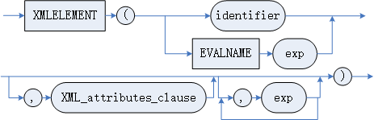

XML\_attributes\_clause

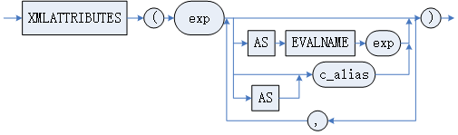

**功能说明**

XMLELEMENT 用于将 exp 构建成 xml 数据类型元素，返回 xmltype 类型数据。当前将 XMLELEMENT 的功能拆分为三个子函数进行调用：XMLELEMENT：一个输入参数，用于创建 XML 元素结点；XMLATTRIBUTE：用于向 XML 元素结点添加属性；XMLCHILD：用于向 XML 元素结点添加孩子。

**参数说明**

identifier：标识符。

exp：字符串类型的数据。

c\_alias：列别名。

**举例说明**

```
SELECT XMLELEMENT(DM, 'TXT1', 'TXT2') FROM DUAL;
```

查询结果如下：

```
行号    XMLCHILD(XMLCHILD(XMLELEMENT(DM),'TXT1',0),'TXT2',0)
---------- ----------------------------------------------------
1     <DM>TXT1TXT2</DM>
```

使用 XMLATTRIBUTES 子句。

```
CREATE TABLE TABLE1 (ID NUMBER(10), COL1 VARCHAR2(5));
INSERT INTO TABLE1 VALUES (1,'HELLO');
INSERT INTO TABLE1 VALUES (2,NULL);
COMMIT; 

SELECT
  XMLELEMENT("OUTER",
    XMLFOREST(ID AS "ID"),
    (CASE NVL(COL1,'NULL')
      WHEN 'NULL' THEN XMLELEMENT(COL1, XMLATTRIBUTES('TRUE' AS "XSI:NIL"), NULL)
      ELSE XMLFOREST(COL1 AS "COL1")
      END)
  )AS XML_TESTTEMP
FROM TABLE1
/
```

查询结果如下：

```
行号    XML_TESTTEMP
---------- ------------------------------------------------------
1     <OUTER>
           <ID>1</ID>
           <COL1>HELLO</COL1>
</OUTER>
2     <OUTER>
            <ID>2</ID>
           <COL1 XSI:NIL="TRUE"/>
</OUTER>
```

### 22.1.3 XMLFOREST

**语法格式**

```
XMLFOREST(<exp> [AS <identifier>] {,<exp> [AS <identifier>]})
```

**图例**

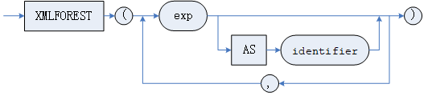

**功能说明**

XMLFOREST 用于将 exp 构建成 xml 数据类型元素，返回 xmltype 类型数据。当 exp 为列名时，可以省略标识符，此时将列名作为标识符，并将该列的查询结果作为字符串类型数据，其他情况不能省略标识符。

**参数说明**

exp：字符串类型的数据。

identifier：标识符。

**举例说明**

exp 不为列名，不能省略标识符：

```
SELECT XMLFOREST('TXT1' AS A, 'TXT2' AS B) FROM DUAL;
```

查询结果如下：

```
行号    XMLFOREST('TXT1'ASA,'TXT2'ASB)
---------- --------------------
1     <A>TXT1</A><B>TXT2
```

exp 为列名，可以省略标识符，省略后将列名作为标识符：

```
CREATE TABLE TEST(C1 INT,C2 VARCHAR);
INSERT INTO TEST VALUES(1, 'TXT');
SELECT XMLFOREST(C1,C2) FROM TEST;
```

查询结果如下：

```
行号    XMLFOREST(C1,C2)
---------- --------------------
1     <C1>1</C1><C2>TXT</C2>
```

### 22.1.4 XMLAGG

**语法格式：**

```
XMLAGG(<XMLdata>[<ORDER BY 子句>])
```

**图例：**

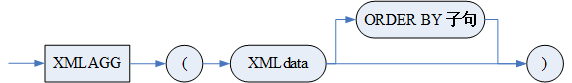

**功能说明：**

XMLAGG 函数，拼接 xml 数据。

当使用 XMLAGG 函数与 XMLPARSE 组合时，如果 XMLPARSE 中指定选项为 CONTENT，XMLAGG 将不会添加换行符作为分隔符；如果 XMLPARSE 中指定选项为 DOCUMENT，XMLAGG 将添加换行符作为分隔符。

**参数说明：**

XMLdata：待拼接的数据。需要注意的是，当 INI 参数 COMPATIBLE\_MODE=2 时，XMLdata 参数仅允许为 xmltype 类型。

ORDER BY 子句：请参考 第 4 章 数据查询语句 。

**举例说明：**

例 1 拼接非 xml 类型数据（即普通字符串），XMLPARSE 中指定选项 CONTENT。

```
CREATE TABLE X (A varchar(10),B int);
INSERT INTO X values('aaa',3);
INSERT INTO X values('bb',2);
insert into X values('c',1);
select XMLAGG(XMLPARSE(content A WELLFORMED) order by B) from X;
```

查询结果如下：

```
cbbaaa
```

例 2 拼接 xml 数据，XMLPARSE 中指定选项 DOCUMENT。

```
CREATE TABLE X_1 (C_INT1 INT,C_XMLTYPE XMLTYPE);
INSERT INTO X_1 VALUES(20, '<LineItems><Reference>DUSTIN12345</Reference><SpecialItem>Counter</SpecialItem></LineItems>');
INSERT INTO X_1 VALUES(21,'<Deptment>产品测试</Deptment>');
SELECT XMLAGG(XMLPARSE(DOCUMENT C_XMLTYPE WELLFORMED)) FROM X_1;
```

查询结果如下：

```
<LineItems>
  <Reference>DUSTIN12345</Reference>
  <SpecialItem>Counter</SpecialItem>
</LineItems>
<Deptment>产品测试</Deptment>
```

### 22.1.5 XMLPARSE

**语法格式**

```
XMLPARSE ({DOCUMENT|CONTENT}<value_expr>[WELLFORMED])
```

**图例**

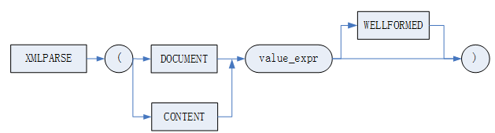

**功能说明**

XMLPARSE 用于解析 XMLTYPE 类型数据，亦即 value\_expr 的值。当指定为 DOCUMENT 时，value\_expr 被解析为只有一个根结点的标准 XML 文档；当指定为 CONTENT 时，value\_expr 被解析为有效的 XML 值，value\_expr 可以没有 XML 申明部分。若指定了 WELLFORMED 参数，则不对 XML 内容进行检查，否则会对内容的合法性进行检查，内容不合法则报错。

**举例说明**

```
SELECT XMLPARSE(DOCUMENT '<a>good</a>' WELLFORMED);
```

查询结果如下：

```
<a>good</a>
```

### 22.1.6 FOR XML PATH

**语法格式：**

```
FOR XML PATH (<exp>)
```

**图例：**

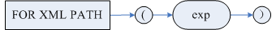

**功能说明：**

FOR XML PATH 用于将 SQL 查询结果转换为 XML 格式，用户可指定行结点名称，并通过列别名定义元素结点。

**参数说明：**

\<exp>：字符串类型的数据。

**举例说明：**

例 1 通过 PATH('row')指定行结点名称，元素结点默认使用列名：

```
CREATE TABLE test_forxmlpath(id INT ,name VARCHAR);
INSERT INTO test_forxmlpath VALUES(1 ,'aaa');
INSERT INTO test_forxmlpath VALUES(2 ,'bbb');
SELECT * FROM test_forxmlpath FOR XML PATH('row');
```

查询结果如下：

```
行号       ##TMP_COL_FOR_XML_PATH
---- ----------------------------------------------------------------------
1          <row>
  <ID>1</ID>
  <NAME>aaa</NAME>
</row><row>
  <ID>2</ID>
  <NAME>bbb</NAME>
</row>
```

例 2 通过列别名定义元素结点：

```
CREATE TABLE test_forxmlpath_1(id int ,name varchar);
INSERT INTO test_forxmlpath_1 VALUES(1 ,'aaa');
INSERT INTO test_forxmlpath_1 VALUES(2 ,'bbb');
SELECT id AS "id_num", name AS "name_str" FROM test_forxmlpath_1 FOR XML PATH('row');
```

查询结果如下：

```
行号       ##TMP_COL_FOR_XML_PATH
------ -------------------------------------------------------------
1          <row>
  <id_num>1</id_num>
  <name_str>aaa</name_str>
</row><row>
  <id_num>2</id_num>
  <name_str>bbb</name_str>
</row>
```

## 22.2 数据查询

### 22.2.1 SF\_XMLQUERY

**定义：**

CLOB

SF\_XMLQUERY(

xmldata clob,

xpath clob

)

**功能说明：**

解析 xmldata 并查询指定路径 xpath 下的数据。本方法的功能可由 XMLQUERY 代替，不再推荐使用。

**参数说明：**

xmldata：待解析的 XML 数据。需要注意的是，当 INI 参数 COMPATIBLE\_MODE=2 时，xmldata 参数仅允许为 xmltype 类型。

xpath：XML 路径。

**返回值：**

解析得到的 XML 数据。xmldata 或 xpath 为 NULL 的情况下一律返回 NULL。

**举例说明：**

```
SELECT SF_XMLQUERY(XMLTYPE('<a><b>b</b></a>'), '/a');
```

查询结果如下：

```
<a>
 <b>b</b>
</a>
```

### 22.2.2 XMLQUERY

**定义：**

CLOB

XMLQUERY(

xmldata clob,

xpath varchar

)

**功能说明：**

解析 xmldata 并查询指定路径 xpath 下的数据。

**参数说明：**

xmldata：待解析的 XML 数据。需要注意的是，当 INI 参数 COMPATIBLE\_MODE=2 时，xmldata 参数仅允许为 xmltype 类型。

xpath：XML 路径。

**返回值：**

解析得到的 XML 数据。xmldata 或 xpath 为 NULL 的情况下一律返回 NULL。

**举例说明：**

```
SELECT XMLQUERY(xmltype('<a><b>b</b></a>'), '/a');
```

查询结果如下：

```
<a>
 <b>b</b>
</a>
```

### 22.2.3 XMLTABLE

**语法格式：**

```
XMLTABLE([<namespace_clause>,]<xmlpath> PASSING <xmldata> [COLUMNS <xmlcoldef_lst>])
<namespace_clause>::=XMLNAMESPACE( <string> AS "<id>"{, <string> AS "<id>"})
```

**图例：**

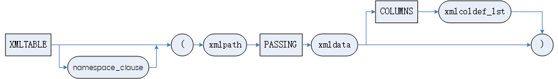

<namespace\_clause>

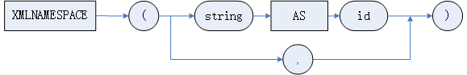

**功能说明：**

查询 XML 数据在指定路径下的结点，并将结果按照关系表的方式展示。

需要注意的是，当 INI 参数 COMPATIBLE\_MODE 不为 2 时，输出的 XML 数据结果将会自动换行；当 INI 参数 COMPATIBLE\_MODE=2 时，输出的 XML 数据结果将不会自动换行。

**参数说明：**

namespaces：表示命名空间。

string：表示字符串类型数据。

id：表示标识符。

xmlpath：XML 数据的路径。

xmldata：XMLTYPE 类型数据。需要注意的是，当 INI 参数 COMPATIBLE\_MODE=2 时，xmldata 参数仅允许为 xmltype 类型。

xmlcoldef\_lst：列定义列表。

**举例说明：**

例 1 获取 XML 数据在指定路径下的结点。

```
CREATE TABLE T3(C1 VARCHAR);
SF_SET_SESSION_PARA_VALUE('ENABLE_TABLE_EXP_REF_FLAG', 1);  //开启同层列引用参数。SELECT语句中T3.C引用了同层表T3的列。
INSERT INTO T3 VALUES('<A><标签 属性="属性名">HELLO</标签></A>');
SELECT X1,X2 FROM T3, XMLTABLE('/A/标签' PASSING XMLTYPE（T3.C1） COLUMNS X1 VARCHAR(12) PATH '@属性', X2 VARCHAR(12) PATH 'text()');
```

查询结果如下：

```
行号    X1   X2
------- ------ -----
1     属性名 HELLO
```

支持多个命名空间。

```
SELECT * FROM XMLTABLE(XMLNAMESPACES('hxtp://www.a.com' AS "d",'hxtp://www.a.com' AS "f"), '/a' PASSING XMLTYPE('<a ibm:id="123"  xmlns:ibm="hxtp://www.a.com" ><ibm:b>textaaa</ibm:b></a>') columns id varchar(20) path '/a/f:b');
```

查询结果如下：

```
行号    ID
---------- -------
1     textaaa
```

例 2 对比在 INI 参数 COMPATIBLE\_MODE 为 2 与非 2 情况下的返回结果。

```
SELECT * FROM XMLTABLE('/wor/ins'
PASSING XMLtype('<wor>
 <ins>
   <joi id="15">
     <result id="39" s="38">
     </result>
   </joi>
   <joi id="55">
     <result id="58" s="22">
     </result>
   </joi>
 </ins>
</wor>
') COLUMNS result XMLtype PATH 'joi');
```

当 INI 参数 COMPATIBLE\_MODE=0 时，查询结果如下：

```
RESULT
-------------------
<joi id="15">
  <result id="39" s="38">
     </result>
</joi>
<joi id="55">
  <result id="58" s="22">
     </result>
</joi>
```

当 INI 参数 COMPATIBLE\_MODE=2 时， 查询结果如下：

```
RESULT
-------------------
<joi id="15"><result id="39" s="38">
     </result></joi><joi id="55"><result id="58" s="22">
     </result></joi>
```

### 22.2.4 EXISTSNODE

**定义：**

INT

EXISTSNODE(

xmldata clob,

xpath varchar

)

或

INT

EXISTSNODE(

xmldata clob,

xpath varchar,

xmlns varchar

)

**功能说明：**

xmldata 中是否存在指定的路径结点，若存在则返回 1，不存在返回 0。

**参数说明：**

xmldata：待解析的 XML 数据。需要注意的是，当 INI 参数 COMPATIBLE\_MODE=2 时，xmldata 参数仅允许为 xmltype 类型。  
xpath：XML 路径。  
xmlns: XML 命名空间。

**返回值：**

1 代表结点存在，0 代表结点不存在。xmldata 为 NULL 的情况下一律返回 0，xpath 为 NULL 的情况下一律返回 NULL。

**举例说明：**

例 1 指定 xmldata 和 xpath 参数执行 EXISTSNODE。

```
SELECT EXISTSNODE(XMLTYPE('<a><b>b</b></a>'), '/a');
```

查询结果如下：

```
1
```

例 2 指定 xmldata、xpath 和 xmlns 参数执行 EXISTSNODE。

```
SELECT EXISTSNODE(XMLTYPE('<a xmlns:ns1="http://localhost:8080/source">
<ns1:b>First-202503172548153</ns1:b></a>'),
'/a/ns1:b', 
'xmlns:ns1="http://localhost:8080/source"');
```

查询结果如下：

```
1
```

### 22.2.5 EXTRACTVALUE

**定义：**

VARCHAR

EXTRACTVALUE(

xmldata clob,

xpath varchar

)

或

VARCHAR

EXTRACTVALUE(

xmldata clob,

xpath varchar,

xmlns varchar

)

**功能说明：**

获取 xmldata 中指定路径下的结点值，若路径下不止一个结点，或者结点不是叶子结点，将报错处理。

**参数说明：**

xmldata：待解析的 XML 数据。需要注意的是，当 INI 参数 COMPATIBLE\_MODE=2 时，xmldata 参数仅允许为 xmltype 类型。  
xpath：XML 路径。  
xmlns：XML 命名空间。

**返回值：**

获取的结点值。xmldata 或 xpath 为 NULL 的情况下一律返回 NULL。

**举例说明：**

例 1 指定 xmldata 和 xpath 参数执行 EXTRACTVALUE 函数获取指定结点路径下的值。

```
SELECT EXTRACTVALUE(XMLTYPE('<a><b>b</b></a>'), '/a/b');
```

查询结果如下：

```
b
```

例 2 指定 xmldata、xpath 和 xmlns 参数执行 EXTRACTVALUE 函数获取指定结点路径下的值。

```
SELECT EXTRACTVALUE(XMLTYPE('<a xmlns:ns1="http://localhost:8080/source">
<ns1:b>First-202503172548153</ns1:b></a>'),
'/a/ns1:b', 
'xmlns:ns1="http://localhost:8080/source"');
```

查询结果如下：

```
First-202503172548153
```

### 22.2.6 XMLSEQUENCE

**语法格式：**

```
XMLSEQUENCE (EXTRACT ( <xmldata>, <xmlpath> [, <xmlnamespace>]) )
```

**图例：**

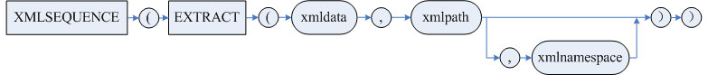

**功能说明：**

XMLSEQUENCE 用于获取指定路径 xmlpath 下不同结点的 XML 数据，并将结点数据集合转换为行集合，通常与 TABLE 函数和 EXTRACT 函数结合使用。

**参数说明：**

xmlpath：XML 数据的路径。

xmldata：XMLTYPE 类型数据。需要注意的是，当 INI 参数 COMPATIBLE\_MODE=2 时，xmldata 参数仅允许为 xmltype 类型。

xmlnamespace：表示命名空间，通常为字符串类型数据。

**举例说明：**

例 1 指定 XMLDATA 和 XPATH 参数执行 XMLSEQUENCE。

```
SELECT TAB.* FROM TABLE(XMLSEQUENCE(EXTRACT(XMLTYPE('<a><b>First-202503172548153</b></a>'), '/a/b'))) TAB;
```

查询结果如下：

```
行号       COLUMN_VALUE
---------- ----------------------------
1          <b>First-202503172548153</b>
```

例 2 指定 xmldata、xpath 参数执行 XMLSEQUENCE，如果 xpath 存在命名空间且未指定命名空间参数将报错。

```
SELECT TAB.* FROM TABLE(XMLSEQUENCE(EXTRACT(XMLTYPE('<a xmlns:ns1="http://localhost:8080/source"><ns1:b>First-202503172548153</ns1:b></a>'), '/a/ns1:b'))) TAB;
```

查询结果报错：

```
-9903: XML执行异常 [Undefined namespace prefix]
```

例 3 指定 xmldata、xpath、xmlnamespace 参数执行 XMLSEQUENCE，。

```
SELECT TAB.* FROM TABLE(XMLSEQUENCE(EXTRACT(XMLTYPE('<a xmlns:ns1="http://localhost:8080/source"><ns1:b>First-202503172548153</ns1:b></a>'), '/a/ns1:b', 'xmlns:ns1="http://localhost:8080/source"'))) TAB;
```

查询结果如下：

```
行号       COLUMN_VALUE
-----  ---------------------------------------------------------------
1          <ns1:b xmlns:ns1="http://localhost:8080/source">First-202503172548153</ns1:b>
```

### 22.2.7 EXTRACT

**语法格式：**

**语法 1：**

```
EXTRACT (<xmldata>, <xmlpath>[, <xmlnamespace>] )
```

**语法 2：**

```
<xmldata>.EXTRACT(<xmlpath>[, <xmlnamespace>] )
```

**图例：**

语法 1：

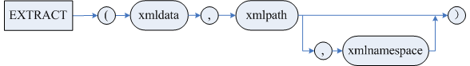

语法 2：

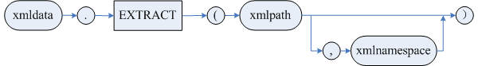

**功能说明：**

EXTRACT 用于从 XML 文档中提取符合 xpath 表达式的结点或片段，如果 xpath 中存在命名空间，则需要指定命名空间。

**参数说明：**

xmlpath：XML 数据的路径。

xmldata：XMLTYPE 类型数据。

xmlnamespace：表示命名空间，通常为字符串类型数据。

**举例说明：**

例 1 指定 xmldata 和 xpath 参数执行 EXTRACT，以下两种调用方式获得的结果一致。

```
//使用语法1
SELECT EXTRACT(XMLTYPE('<?xml version="1.0" encoding="utf-8"?><Envelope><Body><root><result></result></root></Body></Envelope>'),'/Envelope/Body') AS RESULT FROM DUAL;
//使用语法2
SELECT XMLTYPE('<?xml version="1.0" encoding="utf-8"?><Envelope><Body><root><result></result></root></Body></Envelope>').EXTRACT('/Envelope/Body') AS RESULT FROM DUAL;
```

查询结果如下：

```
行号       RESULT
---------- -----------------------------------------------
1          <Body>
              <root>
                    <result/>
              </root>
          </Body>
```

例 2 指定 xmldata、xpath、xmlnamespace 参数执行 EXTRACT，以下两种方式均可获得结果。

```
//使用语法1
SELECT EXTRACT(XMLTYPE('<?xml version="1.0" encoding="utf-8"?><soapenv:Envelope xmlns:soapenv="http://schemas.xmlsoap.org/soap/envelope/"><Body><ns1:root xmlns:ns1="http://imageCenter.web.com"><result></result></ns1:root></Body></soapenv:Envelope>'),'/soapenv:Envelope/Body', 'xmlns:soapenv="http://schemas.xmlsoap.org/soap/envelope/"') AS RESULT FROM DUAL;
//使用语法2
SELECT XMLTYPE('<?xml version="1.0" encoding="utf-8"?><soapenv:Envelope xmlns:soapenv="http://schemas.xmlsoap.org/soap/envelope/"><Body><ns1:root xmlns:ns1="http://imageCenter.web.com"><result></result></ns1:root></Body></soapenv:Envelope>').EXTRACT('/soapenv:Envelope/Body', 'xmlns:soapenv="http://schemas.xmlsoap.org/soap/envelope/"') AS RESULT FROM DUAL;
```

查询结果如下：

```
行号       RESULT
-----------------------------------------------------------------------
1          <Body>
              <ns1:root xmlns:ns1="http://imageCenter.web.com">
                    <result/>
              </ns1:root>
           </Body>
```

## 22.3 数据修改

### 22.3.1 DELETEXML

**定义：**

CLOB

DELETEXML(

xmldata clob,

xpath varchar

)

或

CLOB

DELETEXML(

xmldata clob,

xpath varchar,

xmlns varchar

)

**功能说明：**

从 xmldata 中删除 xpath 路径下的结点。

**参数说明：**

xmldata：XML 数据。需要注意的是，当 INI 参数 COMPATIBLE\_MODE=2 时，xmldata 参数仅允许为 xmltype 类型。  
xpath：XML 路径。  
xmlns：XML 命名空间。

**返回值：**

删除结点后的 XML 数据。xmldata 或 xpath 为 NULL 的情况下一律返回 NULL。

例 1 指定 xmldata 和 xpath 参数执行 DELETEXML，删除指定路径下的内容。

```
SELECT  deleteXML(XMLTYPE('<a><b2>地方<c>d</c></b2><b2>dd</b2></a>'), 'a/b2/c');
```

查询结果如下：

```
<a>
 <b2>地方</b2>
 <b2>dd</b2>
</a>
```

例 2 指定 xmldata、xpath 和 xmlns 参数执行 DELETEXML，删除指定路径下的内容。

```
SELECT deleteXML(XMLTYPE('<xsl:a xmlns:xsl="http://www.w3.org/1999/XSL/Transform"><b2>地方<c>d</c></b2><b2>dd</b2></xsl:a>'), 'xsl:a/b2/c', 'xmlns:xsl="http://www.w3.org/1999/XSL/Transform"');
```

查询结果如下：

```
<xsl:a xmlns:xsl="http://www.w3.org/1999/XSL/Transform">
  <b2>地方</b2>
  <b2>dd</b2>
</xsl:a>
```

### 22.3.2 APPENDCHILDXML

**定义：**

CLOB

APPENDCHILDXML(

xmldata clob,

xpath varchar,

child clob

)

或

CLOB

APPENDCHILDXML(

xmldata clob,

xpath varchar,

child clob,

xmlns varchar

)

**功能说明：**

将 child 结点插入到 xmldata 的 xpath 下的结点中，并将插入结点后的新 xmldata 返回。

**参数说明：**

xmldata：源 XML 数据。需要注意的是，当 INI 参数 COMPATIBLE\_MODE=2 时，xmldata 参数仅允许为 xmltype 类型。  
xpath：XML 路径。  
child：指定的待插入结点。  
xmlns：XML 命名空间。

**返回值：**

插入结点后的新 XML 数据。xmldata 或 xpath 为 NULL 的情况下一律返回 NULL。如果 child 为 NULL 则不会进行添加子结点操作。

当 INI 参数 COMPATIBLE\_MODE=2 时，当且仅当 child 参数为 xmltype 类型时返回运算后的 xmldata，否则将返回原始 xmldata。

**举例说明**

例 1 指定 xmldata、xpath 和 child 参数执行 APPENDCHILDXML，在指定路径下添加 child 结点；如果路径下存在多个孩子节点，则添加到最后一个。

```
SELECT APPENDCHILDXML(XMLTYPE('<a><b>b</b></a>'),'/a', XMLTYPE('<d>xxx</d>'));
```

查询结果如下：

```
<a>
  <b>b</b>
  <d>xxx</d>
</a>
```

例 2 指定 xmldata、xpath、child 和 xmlns 参数执行 APPENDCHILDXML，在指定路径下添加 child 结点；如果路径下存在多个孩子节点，则添加到最后一个。

```
SELECT APPENDCHILDXML(XMLTYPE('<xsl:a xmlns:xsl="http://www.w3.org/1999/XSL/Transform"><b>b</b></xsl:a>'), '/xsl:a', xmltype('<d>xxx</d>'), 'xmlns:xsl="http://www.w3.org/1999/XSL/Transform"');
```

查询结果如下：

```
<xsl:a xmlns:xsl="http://www.w3.org/1999/XSL/Transform">
  <b>b</b>
  <d>xxx</d>
</xsl:a>
```

### 22.3.3 INSERTCHILDXML

**定义：**

CLOB

INSERTCHILDXML(

xmldata clob,

xpath varchar,

exp varchar,

insnode clob

)

或

CLOB

INSERTCHILDXML(

xmldata clob,

xpath varchar,

exp varchar,

insnode clob,

xmlns varchar

)

**功能说明：**

将 insnode 结点插入到 xmldata 的 xpath 路径下，其中 insnode 结点名必须与 exp 保持一致。

**参数说明：**

xmldata：XML 数据。需要注意的是，当 INI 参数 COMPATIBLE\_MODE=2 时，xmldata 参数仅允许为 xmltype 类型。

xpath：XML 路径。

exp：结点名。

insnode：待插入的 XML 结点。

xmlns：XML 命名空间。

**返回值：**

已插入结点后的 XML 数据。xmldata 或 xpath 为 NULL 的情况下一律返回 NULL。如果 exp 或 insnode 为 NULL 将报错参数非法。

当 INI 参数 COMPATIBLE\_MODE=2 时，当且仅当 insnode 参数为 xmltype 类型时返回运算后的 xmldata，否则将报错。

**举例说明**

例 1 指定 xmldata、xpath、exp 和 insnode 参数执行 INSERTCHILDXML，在指定路径下添加 insnode 的内容。

```
SELECT  INSERTchildXML(XMLTYPE('<a><b2>地方</b2><b2>dd</b2></a>'), 'a/b2','c', XMLTYPE('<c>china</c>'));
```

查询结果如下：

```
<a>
 <b2>地方<c>china</c></b2>
 <b2>dd<c>china</c></b2>
</a>
```

例 2 指定 xmldata、xpath、exp、insnode 和 xmlns 参数执行 INSERTCHILDXML，在指定路径下添加 insnode 的内容。

```
SELECT  INSERTchildXML(XMLTYPE('<xsl:a xmlns:xsl="http://www.w3.org/1999/XSL/Transform"><b2>地方</b2><b2>dd</b2></xsl:a>'), 'xsl:a/b2','c', xmltype('<c>china</c>'), 'xmlns:xsl="http://www.w3.org/1999/XSL/Transform"');
```

查询结果如下：

```
<xsl:a xmlns:xsl="http://www.w3.org/1999/XSL/Transform">
  <b2>地方<c>china</c></b2>
  <b2>dd<c>china</c></b2>
</xsl:a>
```

### 22.3.4 INSERTCHILDXMLAFTER

**定义：**

CLOB

INSERTCHILDXMLAFTER(

xmldata clob,

xpath varchar,

exp varchar,

insnode clob

)

或

CLOB

INSERTCHILDXMLAFTER(

xmldata clob,

xpath varchar,

exp varchar,

insnode clob,

xmlns varchar

)

**功能说明：**

将 insnode 结点插入到 xmldata 的 xpath 路径下 exp 子结点后面。

**参数说明：**

xmldata：XML 数据。需要注意的是，当 INI 参数 COMPATIBLE\_MODE=2 时，xmldata 参数仅允许为 xmltype 类型。

xpath：XML 路径。

exp：xpath 下的子结点名，insnode 在此结点之后插入。

insnode：待插入的 XML 结点。

xmlns：XML 命名空间。

**返回值：**

已插入结点后的 XML 数据。xmldata 或 xpath 为 NULL 的情况下一律返回 NULL。如果 exp 为 NULL 将报错参数非法。如果 insnode 为 NULL 则不会进行插入子结点操作。

当 INI 参数 COMPATIBLE\_MODE=2 时，当且仅当 insnode 为 xmltype 类型时返回运算后的 xmldata，否则将报错。

**举例说明**

例 1 指定 xmldata、xpath、exp 和 insnode 参数执行 INSERTCHILDXMLAFTER，在 xpath 指定路径下添加 insnode 结点到 exp 指定结点名后。

```
SELECT  INSERTchildXMLafter(XMLTYPE('<a><b2>地方</b2><b2>dd</b2></a>'), 'a/','b2', XMLTYPE('<c>china</c>'));
```

查询结果如下：

```
<a>
 <b2>地方</b2>
 <c>china</c>
 <b2>dd</b2>
 <c>china</c>
</a>
```

例 2 指定 xmldata、xpath、exp、insnode 和 xmlns 参数执行 INSERTCHILDXMLAFTER，在 xpath 指定路径下添加 insnode 结点到 exp 指定结点名后。

```
SELECT  INSERTchildXMLafter(XMLTYPE('<xsl:a xmlns:xsl="http://www.w3.org/1999/XSL/Transform"><b2>地方</b2><b2>dd</b2></xsl:a>'), 'xsl:a/','b2', xmltype('<c>china</c>'), 'xmlns:xsl="http://www.w3.org/1999/XSL/Transform"');
```

查询结果如下：

```
<xsl:a xmlns:xsl="http://www.w3.org/1999/XSL/Transform">
  <b2>地方</b2>
  <c>china</c>
  <b2>dd</b2>
  <c>china</c>
</xsl:a>
```

### 22.3.5 INSERTCHILDXMLBEFORE

**定义：**

CLOB

INSERTCHILDXMLBEFORE (

xmldata clob,

xpath varchar,

exp varchar,

insnode clob

)

或

CLOB

INSERTCHILDXMLBEFORE (

xmldata clob,

xpath varchar,

exp varchar,

insnode clob,

xmlns varchar

)

**功能说明：**

将 insnode 结点插入到 xmldata 的 xpath 路径下 exp 子结点前面。

**参数说明：**

xmldata：XML 数据。需要注意的是，当 INI 参数 COMPATIBLE\_MODE=2 时，xmldata 参数仅允许为 xmltype 类型。

xpath：XML 路径。

exp：xpath 下的子结点名，insnode 在此结点之前插入。

insnode：待插入的 XML 结点。

xmlns：XML 命名空间。

**返回值：**

已插入结点后的 XML 数据。xmldata 或 xpath 为 NULL 的情况下一律返回 NULL。如果 exp 为 NULL 将报错参数非法。如果 insnode 为 NULL 则不会进行插入子结点操作。

当 INI 参数 COMPATIBLE\_MODE=2 时，当且仅当 insnode 为 xmltype 类型时返回运算后的 xmldata，否则将报错。

**举例说明**

例 1 指定 xmldata、xpath、exp 和 insnode 参数执行 INSERTCHILDXMLBEFORE，在 xpath 指定路径下添加 insnode 结点到 exp 指定结点名前。

```
SELECT  INSERTchildXMLbefore(XMLTYPE('<a><b2>地方</b2><b2>dd</b2></a>'), 'a/','b2', XMLTYPE('<c>china</c>'));
```

查询结果如下：

```
<a>
 <c>china</c>
 <b2>地方</b2>
 <c>china</c>
 <b2>dd</b2>
</a>
```

例 2 指定 xmldata、xpath、exp、insnode 和 xmlns 参数执行 INSERTCHILDXMLBEFORE，在 xpath 指定路径下添加 insnode 结点到 exp 指定结点名前。

```
SELECT  INSERTchildXMLbefore(XMLTYPE('<xsl:a xmlns:xsl="http://www.w3.org/1999/XSL/Transform"><b2>地方</b2><b2>dd</b2></xsl:a>'), 'xsl:a/','b2', xmltype('<c>china</c>'), 'xmlns:xsl="http://www.w3.org/1999/XSL/Transform"');
```

查询结果如下：

```
<xsl:a xmlns:xsl="http://www.w3.org/1999/XSL/Transform">
  <c>china</c>
  <b2>地方</b2>
  <c>china</c>
  <b2>dd</b2>
</xsl:a>
```

### 22.3.6 INSERTXMLBEFORE

**定义：**

CLOB

INSERTXMLBEFORE(

xmldata clob,

xpath varchar,

insnode clob

)

或

CLOB

INSERTXMLBEFORE(

xmldata clob,

xpath varchar,

insnode clob,

xmlns varchar

)

**功能说明：**

将 insnode 结点插入到 xmldata 的 xpath 路径结点之前。

**参数说明：**

xmldata：XML 数据。需要注意的是，当 INI 参数 COMPATIBLE\_MODE=2 时，xmldata 参数仅允许为 xmltype 类型。

xpath：XML 路径。

insnode：待插入的 XML 结点。

xmlns：XML 命名空间。

**返回值：**

已插入结点后的 XML 数据。xmldata 或 xpath 为 NULL 的情况下一律返回 NULL。如果 insnode 为 NULL 则不会进行插入子结点操作。

当 INI 参数 COMPATIBLE\_MODE=2 时，当且仅当 insnode 为 xmltype 类型时返回运算后的 xmldata，否则将返回原始 xmldata。

**举例说明**

例 1 指定 xmldata、xpath 和 insnode 参数执行 INSERTXMLBEFORE，在 xpath 指定路径下添加 insnode 结点到指定路径结点前。

```
SELECT  INSERTXMLbefore(XMLTYPE('<a><b2>hello</b2><b2>dd</b2></a>'), '/a/b2[1]', XMLTYPE('<c>china</c>'));
```

查询结果如下：

```
<a>
 <c>china</c>
 <b2>hello</b2>
 <b2>dd</b2>
</a>
```

例 2 指定 xmldata、xpath、insnode 和 xmlns 参数执行 INSERTXMLBEFORE，在 xpath 指定路径下添加 insnode 结点到指定路径结点前。

```
SELECT  INSERTXMLbefore(XMLTYPE('<xsl:a xmlns:xsl="http://www.w3.org/1999/XSL/Transform"><b2>hello</b2><b2>dd</b2></xsl:a>'), '/xsl:a/b2[1]', xmltype('<c>china</c>'), 'xmlns:xsl="http://www.w3.org/1999/XSL/Transform"');
```

查询结果如下：

```
<xsl:a xmlns:xsl="http://www.w3.org/1999/XSL/Transform">
  <c>china</c>
  <b2>hello</b2>
  <b2>dd</b2>
</xsl:a>
```

### 22.3.7 INSERTXMLAFTER

**定义：**

CLOB

INSERTXMLAFTER(

xmldata clob,

xpath varchar,

insnode clob

)

或  
CLOB  
INSERTXMLAFTER(  
xmldata clob,  
xpath varchar,  
insnode clob,  
xmlns varchar  
)

**功能说明：**

将 insnode 结点插入到 xmldata 的 xpath 路径结点之后。

**参数说明：**

xmldata：XML 数据。需要注意的是，当 INI 参数 COMPATIBLE\_MODE=2 时，xmldata 参数仅允许为 xmltype 类型。

xpath：XML 路径。

insnode：待插入的 XML 结点。

xmlns：XML 命名空间。

**返回值：**

已插入结点后的 XML 数据。xmldata 或 xpath 为 NULL 的情况下一律返回 NULL。如果 insnode 为 NULL 则不会进行插入子结点操作。

当 INI 参数 COMPATIBLE\_MODE=2 时，当且仅当 insnode 为 xmltype 类型时返回运算后的 xmldata，否则将返回原始 xmldata。

**举例说明**

例 1 指定 xmldata、xpath 和 insnode 参数执行 INSERTXMLAFTER，在 xpath 指定路径下添加 insnode 结点到指定路径结点后。

```
SELECT INSERTXMLAFTER(xmltype('<a><b2>地方</b2><b2>dd</b2></a>'), 'a/b2', xmltype('<c>china</c>'));
```

查询结果如下：

```
<a>
 <b2>地方</b2>
 <c>china</c>
 <b2>dd</b2>
 <c>china</c>
</a>
```

例 2 指定 xmldata、xpath、insnode 和 xmlns 参数执行 INSERTXMLAFTER，在 xpath 指定路径下添加 insnode 结点到指定路径结点后。

```
SELECT  INSERTXMLAFTER(xmltype('<xsl:a xmlns:xsl="http://www.w3.org/1999/XSL/Transform"><b2>地方</b2><b2>dd</b2></xsl:a>'), 'xsl:a/b2', xmltype('<c>china</c>'),  'xmlns:xsl="http://www.w3.org/1999/XSL/Transform"');
```

查询结果如下：

```
<xsl:a xmlns:xsl="http://www.w3.org/1999/XSL/Transform">
  <b2>地方</b2>
  <c>china</c>
  <b2>dd</b2>
  <c>china</c>
</xsl:a>
```

### 22.3.8 UPDATEXML

**定义：**

CLOB

UPDATEXML(

xmldata clob,

xpath varchar,

updnode clob

)

或

CLOB

UPDATEXML(

xmldata clob,

xpath varchar,

updnode clob,

xmlns varchar

)

**功能说明：**

用 updnode 替换 xmldata 的 xpath 路径下结点。

**参数说明：**

xmldata：XML 数据。需要注意的是，当 INI 参数 COMPATIBLE\_MODE=2 时，xmldata 参数仅允许为 xmltype 类型。

xpath：XML 路径。

updnode：用于替换的 XML 结点。

xmlns：XML 命名空间。

**返回值：**

更新结点后的 XML 数据。xmldata 或 xpath 为 NULL 的情况下一律返回 NULL。如果 updnode 为 NULL 会将指定路径下结点的子结点替换为空结点。

当 INI 参数 COMPATIBLE\_MODE=2 时，当且仅当 updnode 为 xmltype 类型时返回运算后的 xmldata，否则将返回原始 xmldata。

**举例说明**

例 1 指定 xmldata、xpath 和 updnode 参数执行 UPDATEXML，替换 xpath 指定路径下节点为 updnode 结点。

```
SELECT UPDATEXML('<a><a1>d1</a1><a2>d2</a2></a>', '/a/a2', '<x>f</x>');
```

查询结果如下：

```
<a>
 <a1>d1</a1>
 <x>f</x>
</a>
```

例 2 指定 xmldata、xpath、updnode 和 xmlns 参数执行 UPDATEXML，替换 xpath 指定路径下节点为 updnode 结点。

```
SELECT UPDATEXML(XMLTYPE('<xsl:a xmlns:xsl="http://www.w3.org/1999/XSL/Transform"><a1>d1</a1><a2>d2</a2></xsl:a>'), '/xsl:a/a2', XMLTYPE('<x>f</x>'), 'xmlns:xsl="http://www.w3.org/1999/XSL/Transform"');
```

查询结果如下：

```
<xsl:a xmlns:xsl="http://www.w3.org/1999/XSL/Transform">
  <a1>d1</a1>
  <x>f</x>
</xsl:a>
```

## 22.4 数据转换

### 22.4.1 XMLTRANSFORM

**定义：**

CLOB

XMLTRANSFORM(

xmldata clob,

xslt clob

)

**功能说明：**

将 xmldata 中的内容按照 xslt 中指定的格式生成一个新的 xml 数据。使用 xmltransform 须遵循 xslt 标准，DM 通过引入第三方库 libxslt 来支持 xslt 标准，使用时需要保证有 libxslt 库。

**参数说明：**

xmldata：XML 数据。需要注意的是，当 INI 参数 COMPATIBLE\_MODE=2 时，xmldata 参数仅允许为 xmltype 类型。

xslt：表单格式。

**返回值：**

变换后的新 XML 数据。

**举例说明：**

```
DECLARE
xmldata clob;
xslt clob;
BEGIN
xmldata :='
<s1 title="s1 foo">
 <s2 title="Foo">
    <p>Hello</p>
 </s2>
</s1>';
 
xslt := '<xsl:stylesheet xmlns:xsl="http://www.w3.org/1999/XSL/Transform" version="1.0"> 
 <xsl:output method="html" indent="yes"/>
 <xsl:template match="/">
  <xsl:apply-templates/>
 </xsl:template>

<xsl:template match="s1">
  <html>
   <head><title><xsl:value-of select="@title"/></title></head>
   <body>
     <xsl:apply-templates select="s2"/>
   </body>
  </html>
 </xsl:template>
</xsl:stylesheet>';

select xmltransform(xmldata, xslt);
END;
```

查询结果如下：

```
XMLTRANSFORM(XMLDATA,XSLT)
----------------------------------------------------------
<html>
<head>
<meta http-equiv="Content-Type" content="text/html; charset=UTF-8">
<title>s1 foo</title>
</head>
<body>Hello</body>
</html>
```

### 22.4.2 XMLSERIALIZE

**语法格式：**

```
XMLSERIALIZE(<DOCUMENT | CONTENT> <value_expr> [AS <datatype>] [ENCODING <xml_encoding_spec>] [VERSION <string_literal>] [<NO INDENT> | <INDENT [SIZE = <number>]>] [<HIDE | SHOW> DEFAULTS])
```

**图例：**

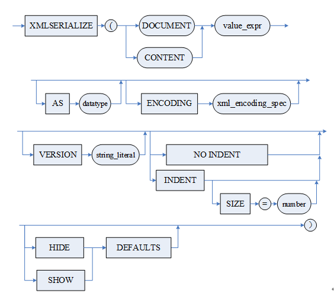

**功能说明：**

XMLSERIALIZE 用于将 xml 实例按照指定的选项进行格式化输出。

**参数说明：**

<value\_expr>：xml 实例。需要注意的是，当 INI 参数 COMPATIBLE\_MODE=2 时，<value\_expr> 参数仅允许为 xmltype 类型。

\<datatype>：仅支持 VARCHAR、BLOB、CLOB 三种数据类型。

<xml\_encoding\_spec>：字符串类型，用于指定输出串的编码，目前支持指定为 GBK、GB18030、UTF-8。仅在 datatype 为 BLOB 时可指定 ENCODING <xml\_encoding\_spec> 语句。

<string\_literal>：字符串类型，设置 xml 版本类型，不作合法性校验。

\<number>：整型数字，表示结点缩进格式。默认没有格式缩进，该参数取值不超过 20，即缩进不能超过 20。

<HIDE|SHOW> DEFAULTS：为语法兼容项，暂无实际意义。

**举例说明：**

例 1 指定为 CLOB 类型进行输出。

```
SELECT XMLSERIALIZE(content xmltype('<?xml version="1.1" encoding="GB18030"?> <a><c><x>d</x></c></a>') as Clob version '1.2' indent size = 10) AS xmlserialize_doc from dual;
```

查询结果如下：

```
行号    XMLSERIALIZE_DOC
---------- -----------------------------------------------------------------------------
1     <?xml version="1.2" encoding="GB18030"?>
<a>
      <c>
           <x>d</x>
      </c>
</a>
```

例 2 指定为 BLOB 类型进行输出。

```
SELECT XMLSERIALIZE(content xmltype('<?xml version="1.1" encoding="UTF-8"?> <a><c><x>d</x></c></a>') as Blob ENCODING 'UTF8' version '1.2' indent size = 10) AS xmlserialize_doc from dual;
```

查询结果如下：

```
行号    XMLSERIALIZE_DOC
---------- ------------------------------------------------------------------------
1     0x3C3F786D6C2076657273696F6E3D22312E322220656E636F64696E673D225554462D38223F3E0A3C613E0A202020202020202020203C633E0A20202020202020202020202020202020202020203C783E643C2F783E0A202020202020202020203C2F633E0A3C2F613E0A
```

### 22.4.3 XMLCAST

**语法格式：**

```
XMLCAST(exp AS type)
```

**图例：**


**功能说明：**

XMLCAST 用于将 exp 构建的 xml 数据中的 content 内容转换为指定类型输出。

**参数说明：**

exp：XMLTYPE 类型的数据。需要注意的是，当 INI 参数 COMPATIBLE\_MODE=2 时，exp 参数仅允许为 xmltype 类型。

type：指定类型。

**返回值：**

转换为指定类型的 xml 数据。exp 为 NULL 的情况下一律返回 NULL。

**举例说明：**

```
SELECT XMLCAST(XMLType( '<test><a>Hello</a><b> World</b>!</test>' ) AS varchar2(100)) AS XML_TO_VARCHAR2 FROM DUAL;
```

查询结果如下：

```
行号    XML_TO_VARCHAR2
---------- --------------------
1     Hello World!
```