本章节主要介绍在 DM 数据库中如何进行増、删、改操作。

## 一、适用场景

| 软件 | 版本 |
| --- | --- |
| 操作系统 | Redhat 7 及以上版本 |
| DM 数据库 | DM 8.0 及以上版本 |
| CPU 架构 | x86、ARM、龙芯、飞腾等国内外主流 CPU |

## 二、操作方法

### 2.1 插入新行

插入新行，示例语句如下所示：

```sql
INSERT INTO dmhr.employee VALUES 
(11146,'Dameng','220103198501166001','whdm@dameng.com','13712346385',
'2020-10-26','52',9500.00,0,11005,1105);
```

### 2.2 插入多行

创建测试表，示例语句如下所示：

```sql
CREATE TABLE dmhr.test
AS
   SELECT employee_id,
          employee_name,
          identity_card,
          salary,
          department_id
     FROM dmhr.employee
    WHERE 1 = 2;
```

插入多行并查询，示例语句如下所示：

```sql
INSERT INTO dmhr.test
     VALUES
(1109, '程东生', '410107197103252999', 4400, 102),
(1110, '王金玉', '410107197103258999', 4300, 102),
(1111, '程东生', '410107197103252999', 4400, 102);
COMMIT;

SELECT * FROM dmhr.test;
```

输出结果如下图所示：

### 2.3 选择性插入行

可以按指定列插入行，未指定值的列上若定义了默认值，则插入默认值。没有指定默认值，为 NULL，则插入 NULL 值。示例语句如下所示：

```sql
--创建测试表
CREATE TABLE dmhr.t1
(
   id         INTEGER PRIMARY KEY,
   name       VARCHAR (12) DEFAULT 'dm2024',
   class_id   INTEGER NOT NULL,
   tp         TIMESTAMP DEFAULT SYSDATE
);

--插入数据
INSERT INTO dmhr.t1 (id, class_id) VALUES (1, 103);
```

输出结果如下图所示：

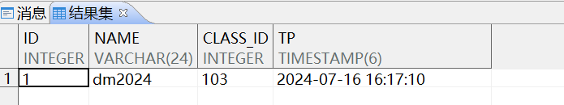

有缺省值在不列出的情况下，自动填入。

### 2.4 复制表结构

如需快速复制表结构且不需要数据，示例语句如下所示：

```sql
CREATE TABLE dmhr.t2 AS SELECT * FROM dmhr.t1 WHERE 1 = 0;
```

> **注意**
> 
> 使用 SP\_TABLEDEF 过程查看 t2 的结构，所有定义在 t1 列上的约束均没有被新表继承。

需使用如下语句添加各类约束：

```sql
ALTER TABLE dmhr.t2  ADD PRIMARY KEY (id);
ALTER TABLE dmhr.t2  ALTER COLUMN name SET DEFAULT 'dm2024';
ALTER TABLE dmhr.t2  ALTER COLUMN class_id SET NOT NULL;
ALTER TABLE dmhr.t2  ALTER COLUMN tp SET DEFAULT SYSDATE;
```

### 2.5 多表插入

使用上述表 t1 和 t2 演示多表插入。为了方便演示先创建一个序列，示例语句如下所示：

```sql
CREATE SEQUENCE dmhr.seq_id START WITH 1 INCREMENT BY 1 MAXVALUE 20000 NOCYCLE;
```

一次性向两张表中插入多条数据，存在默认值同样可以省略。示例语句如下所示：

```sql
INSERT ALL
  INTO dmhr.t1 (id,name,class_id,tp)
  INTO dmhr.t2 (id,name,class_id,tp)
   SELECT dmhr.seq_id.nextval， DBMS_RANDOM.STRING('X',4),
CEIL(DBMS_RANDOM.VALUE(100,106)), SYSDATE
FROM DUAL CONNECT BY LEVEL <10;
```

> **注意**
> 
> 使用 managerid=null 查询无效（测试表中没有 null 数据，需插入 null）

### 2.6 MERGE INTO 操作

使用 MERGE INTO 语法可合并 UPDATE 和 INSERT 语句。通过 MERGE 语句，根据一张表（或视图）的连接条件对另外一张表（或视图）进行查询，连接条件匹配上的进行 UPDATE（可能含有 DELETE），无法匹配的执行 INSERT。

使用 MERGE 可以实现记录“存在则 update，不存在则 insert”的逻辑。

创建两张表，示例语句如下所示：

```sql
CREATE TABLE dmhr.dup_emp
(
   employee_id     INTEGER PRIMARY KEY,
   employee_name   VARCHAR2 (12),
   identity_card   VARCHAR2 (18),
   salary          INTEGER,
   department_id   INTEGER
);

CREATE TABLE dmhr.emp_salary
(
   employee_id   INTEGER PRIMARY KEY,
   new_salary    INTEGER
);
```

插入数据，示例语句如下所示：

```sql
INSERT INTO dmhr.dup_emp
   SELECT employee_id,employee_name,identity_card,salary,department_id
     FROM dmhr.employee
    WHERE department_id = 102 AND salary < 9000;

INSERT INTO dmhr.emp_salary
   SELECT employee_id, salary + 2000 FROM dmhr.dup_emp;

INSERT INTO dmhr.emp_salary
     VALUES (1108, 4100);
```

输出结果如下图所示：

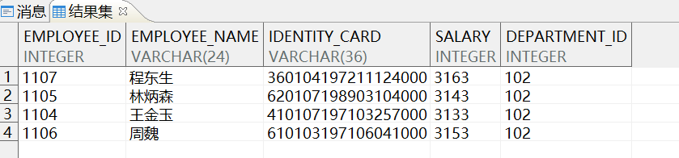

执行 merge 语句，示例语句如下所示：

```sql
MERGE INTO dmhr.dup_emp
     USING dmhr.emp_salary
        ON (dmhr.dup_emp.employee_id = dmhr.emp_salary.employee_id)
WHEN MATCHED
THEN
   UPDATE SET dmhr.dup_emp.salary = dmhr.emp_salary.new_salary
WHEN NOT MATCHED
THEN
   INSERT VALUES (dmhr.emp_salary.employee_id,
                      'dm2024',
                      410107197103257999,
                      dmhr.emp_salary.new_salary,
                      102);
```

输出结果如下图所示：

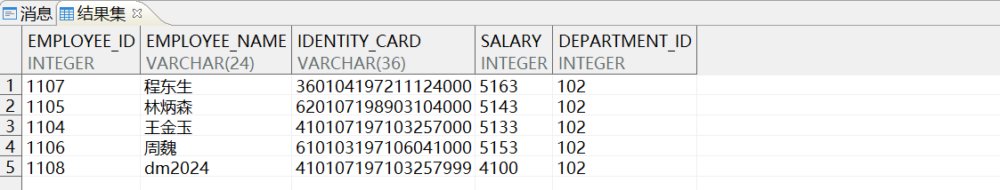

目标表 dup\_emp 中添加了一条数据，其余行的 salary 列被更新成 emp\_salary 中对应的值。如果 emp\_salary 中有多行和目标表匹配成功，将会报如下图所示错误：没有一组稳定的行。

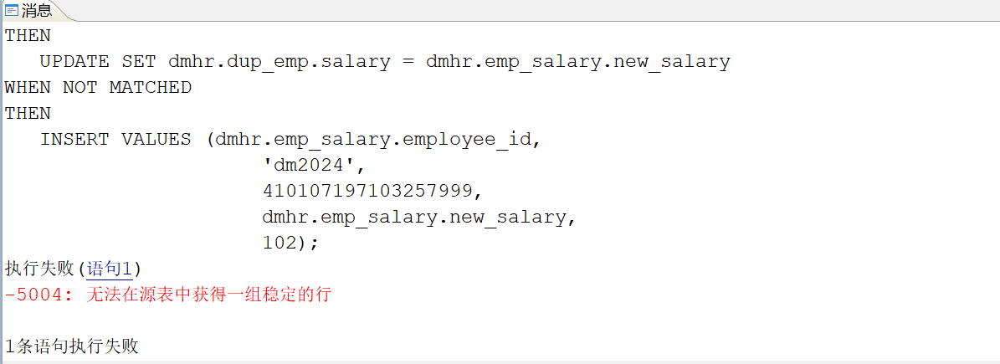

### 2.7 处理违反参照完整性的记录

该情况出现在有主外键关系的表中。

```sql
--环境准备-去掉 employee 表 department_id 列上的外键约束。
ALTER TABLE dmhr.employee DROP CONSTRAINT EMP_DEPT_FK;
```

例如需更新其中一个员工的部门编号为 999，该编号部门在 dempartment 表中不存在。示例语句如下所示：

```sql
UPDATE dmhr.employee SET department_id = 999 WHERE employee_id = 1003;

commit；
```

再次添加外键约束，报错，结果如下所示：

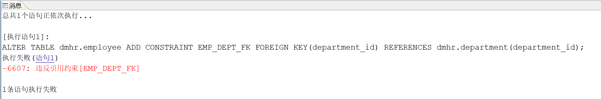

这种提示在业务操作中经常出现， **解决方法： 删除子表行或者添加主表行** 。示例语句如下所示：

```sql
DELETE FROM dmhr.employee e
      WHERE NOT EXISTS
               (SELECT 1
                  FROM dmhr.department d
                 WHERE d.department_id = e.department_id);
```

再次添加外键约束，成功。示例语句如下所示：

```sql
ALTER TABLE dmhr.employee ADD CONSTRAINT EMP_DEPT_FK FOREIGN KEY(department_id)
REFERENCES dmhr.department(department_id);
```

### 2.8 删除重复记录

实际工作中经常遇到表内包含重复数据的情况，下面介绍几种删除重复数据的方法。

```sql
--准备数据，使用上面创建的 dup_emp 表，插入重复数据:
INSERT INTO dmhr.dup_emp VALUES
(1109, '程东生', '410107197103252999', 4400, 102),
(1110, '王金玉', '410107197103258999', 4300, 102),
(1111, '程东生', '410107197103252999', 4400, 102);
COMMIT;
```

输出结果如下图所示：

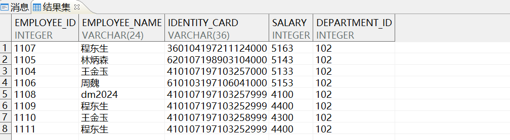

- 方法一：

通过 `group by + having` 子句分组查询的方式，查找员工名称相同的记录，示例语句如下所示：

```sql
SELECT employee_name, count(*) 
FROM dmhr.dup_emp GROUP BY employee_name HAVING COUNT(*) > 1;
```

输出结果如下图所示：

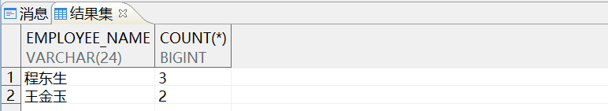

- 方法二：

通过 `group by + rowid` 的方式，查找员工名称重复的记录，示例语句如下所示：

```sql
SELECT *
  FROM dmhr.dup_emp
 WHERE ROWID NOT IN (  SELECT MAX (ROWID)
                         FROM dmhr.dup_emp
                     GROUP BY employee_name);
```

可在查找到重复记录后直接删除，示例语句如下所示：

```sql
DELETE FROM dmhr.dup_emp
      WHERE ROWID NOT IN (  SELECT MAX (ROWID)
                              FROM dmhr.dup_emp
                          GROUP BY employee_name);

DELETE FROM dmhr.dup_emp t
      WHERE ROWID <> (SELECT MAX (ROWID)
                        FROM dmhr.dup_emp
                       WHERE employee_name = t.employee_name);

SELECT * FROM dmhr.dup_emp;
```

输出结果如下图所示：

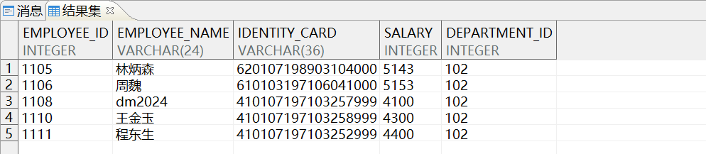

删除后记录由原来的 8 条减少为 5 条。

### 2.9 多表 update 容易犯的错误

场景示例：使用新表中的数据更新源表中的数据，通过编写关联 SQL 语句完成，新建两张表并准备数据。

- 源表
```sql
CREATE TABLE dmhr.test
AS
   SELECT employee_id,
          employee_name,
          identity_card,
          salary,
          department_id
     FROM dmhr.employee
    WHERE 1 = 2;

SELECT * FROM dmhr.test;

INSERT INTO dmhr.test
     VALUES
(1109, '程东', '410107197103252999', 4400, 102),
(1110, '王金玉', '410107197103258999', 5300, 102),
(1111, '陈仙', '410107197103252999', 2400, 102),
(1112, '张晓中', '410107197103252999', 9000, 102),
(1113, '吴迎', '410107197103252999', 7400, 102);
COMMIT;

SELECT * FROM dmhr.test;
```

源表输出结果如下图所示：

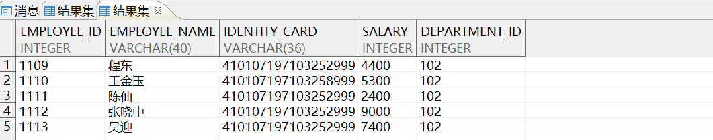

- 新表
```sql
CREATE TABLE dmhr.test_new
AS
   SELECT employee_id,employee_name,identity_card,salary,department_id
     FROM dmhr.employee
    WHERE 1 = 2;

INSERT INTO dmhr.test_new
     VALUES (1111, '陈仙', '410107197103252999', 8500, 104);
COMMIT;

SELECT * FROM dmhr.test_new;
```

新表输出结果如下图所示：

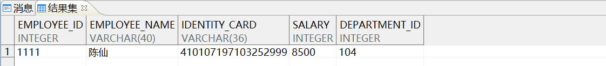

编写关联更新的 SQL 语句，按新表中的工资去更新原表。员工陈仙的工资从 2400 更改为 8500，示例语句如下所示：

```sql
UPDATE dmhr.test ot
   SET (salary, department_id) =
          (SELECT nt.salary, nt.department_id
             FROM dmhr.test_new nt
            WHERE ot.employee_id = nt.employee_id);

SELECT * FROM dmhr.test;
```

这样写看似正确，但却把所有其他的列都更改成了 NULL。

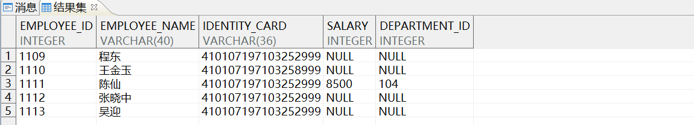

原因是当新表 dmhr.test 中的数据无法和源表 dmhr.test\_new 中的行匹配时，子查询选择不出来相应的值，所以用空值对不匹配的行进行了更新，产生了严重的错误。

```sql
--回滚
rollback;
```

正确写法应该 **再加一层判断** ，示例语句如下所示：

```sql
UPDATE dmhr.test ot
   SET (salary, department_id) =
          (SELECT nt.salary, nt.department_id
             FROM dmhr.test_new nt
            WHERE ot.employee_id = nt.employee_id)
 WHERE EXISTS
          (SELECT 1
             FROM dmhr.test_new nt
            WHERE ot.employee_id = nt.employee_id);

SELECT * FROM dmhr.test;
```

正确的输出结果如下图所示：

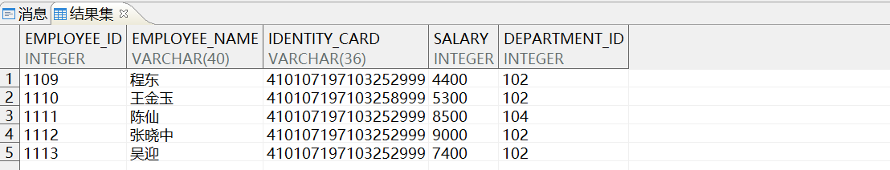

## 三、参考文档

更多 SQL 语言使用说明，请参考《DM8\_SQL 语言使用手册》，手册位于 **数据库安装路径** `/dmdbms/doc` 文件夹下。如有其他问题，请在 [社区](https://eco.dameng.com/community/question?_blank) 内咨询。