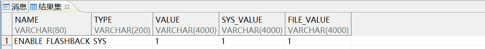
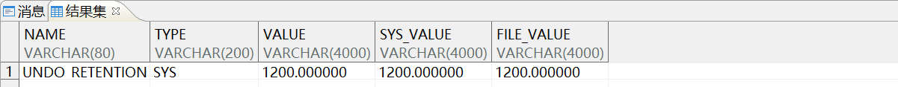
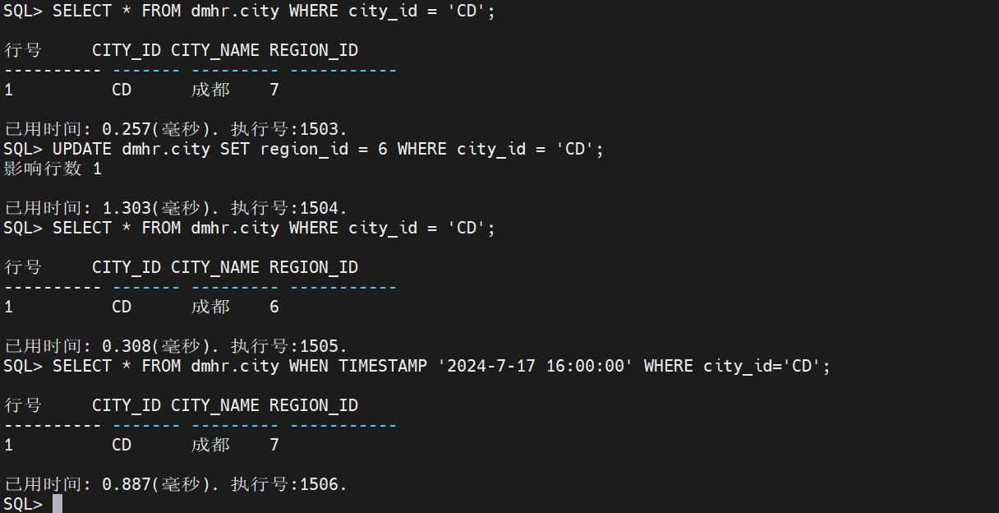
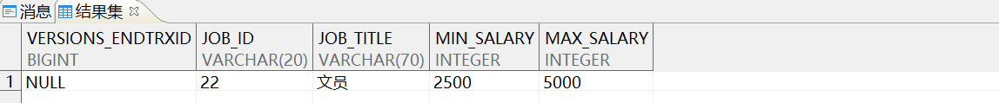
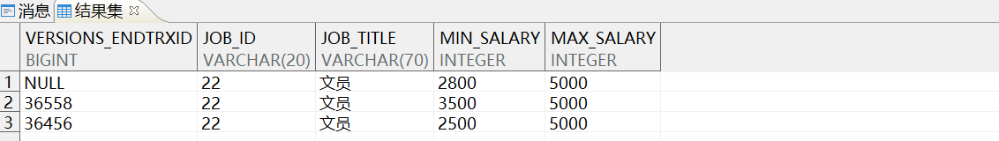

本章节主要介绍闪回技术在日常开发和数据库运维中所发挥的作用。

## 一、适用场景

| 软件 | 版本 |
| --- | --- |
| 操作系统 | Redhat 7 及以上版本 |
| DM 数据库 | DM 8.0 及以上版本 |
| CPU 架构 | x86、ARM、龙芯、飞腾等国内外主流 CPU |

## 二、使用说明

- 闪回查询只支持普通表（包括加密表与压缩表）、水平分区表和堆表，不支持临时表、列存储表、外部表与视图；
- 闪回查询中 trxid 的值，一般需要由闪回版本查询的伪列来确定。实际使用中多采用指定时刻的方式。

## 三、相关参数设置

查询闪回功能状态，数据库默认关闭 `（0-关闭，1-打开）` 。示例语句如下所示：

```sql
SELECT name,
       TYPE,
       VALUE,
       sys_value,
       file_value
  FROM v$parameter
 WHERE name LIKE '%FLASHBACK%';
```

输出结果：

- 开启闪回功能方法一，示例语句如下所示：
```sql
alter system set 'enable_flashback'=1 both;
```

输出结果：



> **注意**
> 
> 该方法设置参数时，参数名必须加单引号。

- 开启闪回功能方法二，示例语句如下所示：
```sql
SP_SET_PARA_VALUE (1, 'ENABLE_FLASHBACK', 1)；

--scope 为 1 表示 dm.ini 文件和内存参数都修改，不需要重启服务器。
--scope 为 2 表示只修改 dm.ini 文件，服务器重启后生效。
--value： 设置的值。
```

获取参数，示例语句如下所示：

```sql
SELECT SF_GET_PARA_VALUE (1, 'ENABLE_FLASHBACK') in_file,
       SF_GET_PARA_VALUE (2, 'ENABLE_FLASHBACK') in_mem;
```

由于回滚段默认 **每秒种都会自动清理，所以需要延长回滚记录的保留时间** ，单位是秒。回滚段参数太大容易引发回滚段膨胀，这里设置为 1200s。示例语句如下所示：

```sql
ALTER SYSTEM SET 'undo_retention'=1200 BOTH;

SELECT name,
       TYPE,
       VALUE,
       sys_value,
       file_value
  FROM v$parameter
 WHERE name = 'UNDO_RETENTION';
```

输出结果：



## 四、闪回查询

### 4.1 按时间查询历史记录

通过指定一个时间（timestamp 类型），通常可以用一个日期时间字符串表达。

测试在 disql 工具中进行，使用 dmhr 模式下的 city 表。示例语句如下所示：

```sql
--查询 city_id = 'CD' 时 city 表中的信息
SELECT * FROM dmhr.city WHERE city_id = 'CD';

--更新 city_id = 'CD' 时 REGION_ID 的值，更新时间为 '2024-7-17 16:01:06'
UPDATE dmhr.city SET region_id = 6 WHERE city_id = 'CD';

--再次查询 city_id = 'CD' 时 city 表中的信息，此时 REGION_ID 的值为更新后的值
SELECT * FROM dmhr.city WHERE city_id = 'CD';

--闪回查询 update 操作前的 city 表中的信息，结果显示的是更新前 'REGION_ID' 的值
SELECT * FROM dmhr.city WHEN TIMESTAMP '2024-7-17 16:00:00' WHERE city_id='CD';
```

输出结果如下图所示：



### 4.2 按事务 id 号查询历史记录

首先使用 `versions_endtrxid` 伪列查询事务 id 号。用户通过闪回版本查询子句，可以得到指定表过去某个时间段内，事务导致记录变化的全部记录，指定条件可以为时刻或事务号。

执行闪回版本查询，示例语句如下所示：

```sql
SELECT versions_endtrxid, *
  FROM dmhr.job VERSIONS BETWEEN TIMESTAMP '2024-7-17 16:06:00' AND SYSDATE
 WHERE JOB_ID = 22;
```

输出结果：



`NULL` 表示该行的版本仍然是当前版本。

- 第一次调整文员的最低工资为 3500 并提交，示例语句如下所示：
```sql
UPDATE dmhr.job SET MIN_SALARY = 3500 WHERE JOB_ID = 22；COMMIT;
```
- 第二次调整文员的最低工资为 2800 并提交，示例语句如下所示：
```sql
UPDATE dmhr.job SET MIN_SALARY = 2800 WHERE JOB_ID = 22；COMMIT;
```

再次执行闪回版本查询，示例语句如下所示：

```sql
SELECT versions_endtrxid, *
  FROM dmhr.job VERSIONS BETWEEN TIMESTAMP '2020-11-03 10:30:00' AND SYSDATE
 WHERE JOB_ID = 22;
```

输出结果：



## 五、闪回事务查询

闪回事务查询提供系统视图 `V$FLASHBACK_TRX_INFO` ，查看在事务级对数据库所做的更改。根据该视图信息，可以确定如何还原指定事务或指定时间段内的修改。

查询指定时间之后的事务信息，示例语句如下所示：

```sql
SELECT commit_trxid, operation,table_name,undo_sql FROM V$FLASHBACK_TRX_INFO;
```

## 六、参考文档

更多 SQL 语言使用说明，请参考《DM\_SQL 语言使用手册》，手册位于 **数据库安装路径** `/dmdbms/doc` 文件夹下。如有其他问题，请在 [社区](https://eco.dameng.com/community/question?_blank) 内咨询。