本章节主要介绍聚集函数、分析函数在数据库中所发挥的作用，以及根据不同场景进行数字运算。

## 一、适用场景

| 软件 | 版本 |
| --- | --- |
| 操作系统 | Redhat 7 及以上版本 |
| DM 数据库 | DM 8.0 及以上版本 |
| CPU 架构 | x86、ARM、龙芯、飞腾等国内外主流 CPU |

## 二、操作方法

### 2.1 常用聚集函数

通常我们可以利用聚集函数汇总表的数据，如果稍微复杂一些，我们还需要先对数据做筛选，然后再进行聚集。比如先按照某个条件进行分组，对分组条件进行筛选，然后得到筛选后的分组汇总信息。

**SQL 中的聚集函数共包括 5 个** (MAX、MIN、SUM、AVG、COUNT)，可以帮我们求某列的最大值、最小值及平均值等。示例语句如下所示：

```sql
--查询每个部门员工的平均薪资、最小薪资、最大薪资、总工资及总记录

  SELECT job_id,
         AVG (salary) AS 平均值,
         MIN (salary) AS 最小值,
         MAX (salary) AS 最大值,
         SUM (salary) AS 工资合计,
         COUNT (*) AS 总行数
    FROM dmhr.employee
GROUP BY job_id;
```

输出结果：

> **注意**
> 
> 当表中没有数据时，不加 group by 会返回一行数据，加了 group by 无数据返回。

- 建立空表，示例语句如下所示：
```sql
CREATE TABLE dmhr.employee2 AS SELECT * FROM dmhr.employee WHERE 1 = 2;
```
- 不加 group by，示例语句如下所示：
```sql
SELECT COUNT (*) AS cnt, SUM (salary) AS sum_sal
  FROM dmhr.employee2
 WHERE job_id = 11;
```

输出结果：

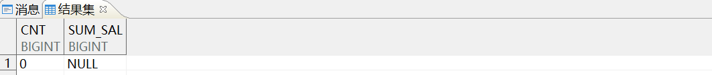

- 增加 group by，示例语句如下所示：
```sql
SELECT COUNT (*) AS cnt, SUM (salary) AS sum_sal
    FROM dmhr.employee2
   WHERE job_id = 11
GROUP BY job_id;
```

输出结果：

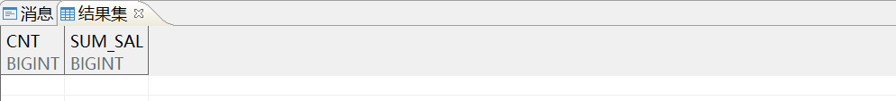

### 2.2 生成累计和

使用分析函数 **sum (…) over (order by…)** 可以生成累计和。

例如公司查看用人成本，需要对用员工的工资进行累加，了解员工人数与工资支出之间的对应关系。示例语句如下所示：

```sql
--按员工编号排序对员工的工资进行累加

SELECT employee_id AS 编号,
       employee_name AS 姓名,
       salary AS 人工成本,
       SUM (salary) OVER (ORDER BY employee_id) AS 成本累计
  FROM dmhr.employee
 WHERE job_id = 11;
```

输出结果：

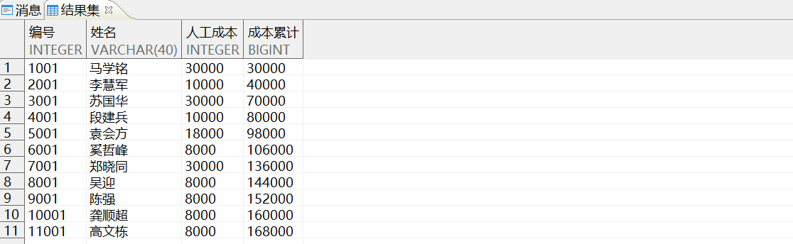

通过结果可以看出，分析函数“sum (salary) over (order by employee\_id)”的结果 (168000) 是排序“over (order by employee\_id)”后第一行到当前行的所有工资之和。

为了形象地说明这一点，我们用 `listagg` 模拟出每一行是哪些值相加。示例语句如下所示：

```sql
--使用 listagg 函数模拟员工总成本的累加值

  SELECT employee_id                                                AS 编号,
         employee_name                                              AS 姓名,
         salary                                                     AS 人工成本,
         SUM (salary) OVER (ORDER BY employee_id)                   AS 成本累计,
         (SELECT LISTAGG (salary, '+') WITHIN GROUP (ORDER BY employee_id)
            FROM dmhr.employee b
           WHERE b.job_id = 11 AND b.employee_id <= a.employee_id)  计算公式
    FROM dmhr.employee a
   WHERE job_id = 11
ORDER BY employee_id;
```

输出结果：

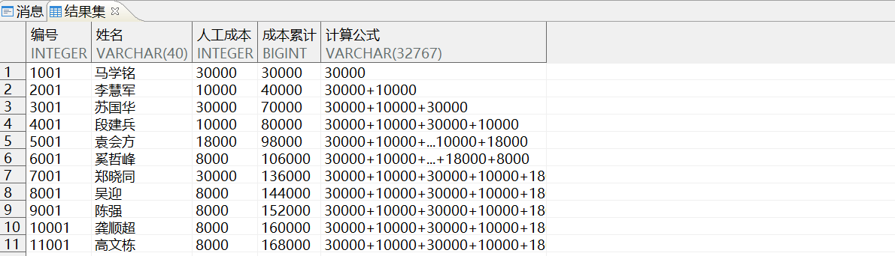

> **注意**
> 
> 本小节中示例语句中最后排序子句仅是为了方便观察，与分析函数的结果无关。

### 2.3 计算累计差

在实际应用中，我们也有需要用到计算累计差值的场景。为了方便引用，示例语句如下所示：

```sql
--创建测试表 dmhr.detail

 CREATE TABLE dmhr.detail
 (  编号 int not null,
    项目 varchar(24) null,
    金额 integer null,
    PRIMARY KEY(编号)
  );

--插入测试数据

INSERT INTO dmhr.detail VALUES(100,'预算费用',1000000);
commit;
INSERT INTO dmhr.detail SELECT employee_id as 编号,'支出' || rownum as 项目,
salary+1000 as 金额 FROM dmhr.employee WHERE job_id=11;
commit;

--查询

SELECT * FROM dmhr.detail;
```

输出结果：

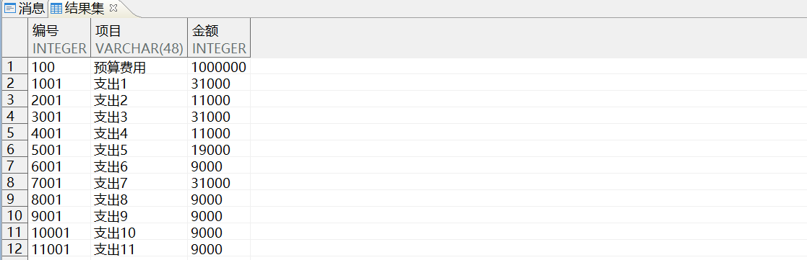

这是模拟的一个消费流水账， **假设已经预交费用 1000000，需要得到每笔费用的余额** 。

- 对流水账排序并生成序号，示例语句如下所示：
```sql
SELECT ROWNUM AS seq, a.*
  FROM (  SELECT 编号, 项目, 金额
            FROM dmhr.detail
        ORDER BY 编号) a;
```

输出结果：

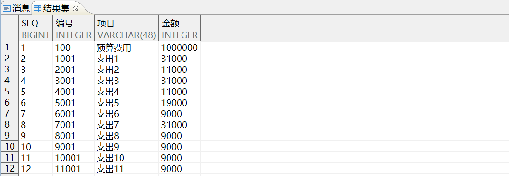

- 支出金额变成负数，示例语句如下所示：
```sql
WITH x
     AS (SELECT ROWNUM AS seq, a.*
           FROM (  SELECT 编号, 项目, 金额
                     FROM dmhr.detail
                 ORDER BY 编号) a)
SELECT 编号,项目,金额,
       (CASE WHEN seq = 1 THEN 金额 ELSE -金额 END) AS 转换后的值
  FROM x;
```

输出结果：

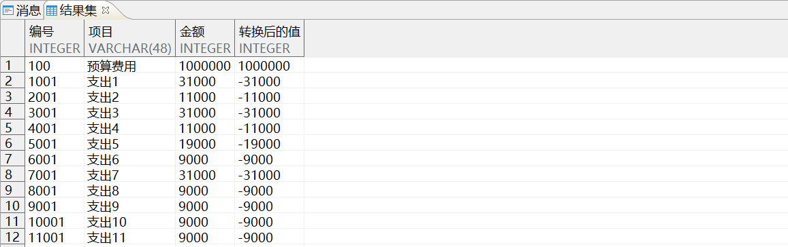

- 累加得到余额，示例语句如下所示：
```sql
WITH x
     AS (SELECT ROWNUM AS seq, a.*
           FROM (  SELECT 编号, 项目, 金额
                     FROM dmhr.detail
                 ORDER BY 编号) a)
SELECT 编号,项目,金额,
       SUM (CASE WHEN seq = 1 THEN 金额 ELSE -金额 END)
          OVER (ORDER BY seq)
          AS 余额
  FROM x;
```

输出结果：

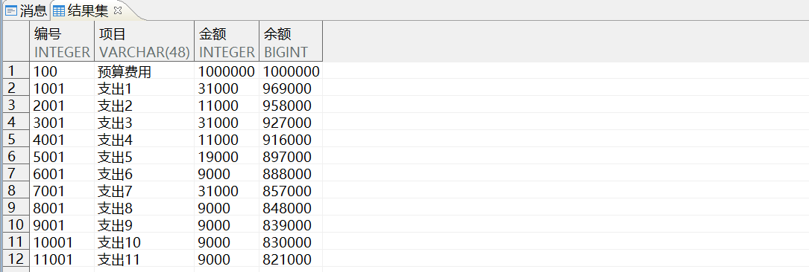

### 2.4 更改累计和的值

为了方便后面引用，我们先引入一个模拟 **存/取款列表** 的测试视图，示例语句如下所示：

```sql
CREATE OR REPLACE VIEW v (id,amt,trx) AS
SELECT 1,100,'PR' FROM dual UNION ALL
SELECT 2,100,'PR' FROM dual UNION ALL
SELECT 3,50,'PY' FROM dual UNION ALL
SELECT 4,100,'PR' FROM dual UNION ALL
SELECT 5,200,'PY' FROM dual UNION ALL
SELECT 6,50,'PY' FROM dual;

SELECT * FROM v;
```

输出结果：

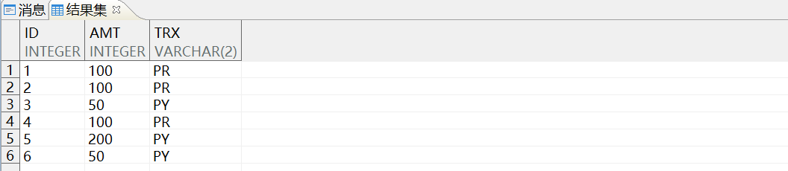

- id 是唯一列。
- amt 列表示每次事务处理（存款或取款）涉及到的金额。
- trx 定义了事务的类型，取款是 PY，存款是 PR。

先要求计算每次存/取款后的余额，如果 trx 是 PR，则加上 amt 值代表的金额；否则减去 amt 值代表的金额。 **这实际上是一个累加问题，我们可以把取款的值先变成负数。**

- 将取款值变成负数，示例语句如下所示：
```sql
SELECT id,
         CASE WHEN trx = 'PY' THEN '取款' ELSE '存款' END 存取类型,
         amt 金额,
         (CASE WHEN trx = 'PY' THEN -amt ELSE amt END) AS 余额
    FROM v
ORDER BY id;
```

输出结果：

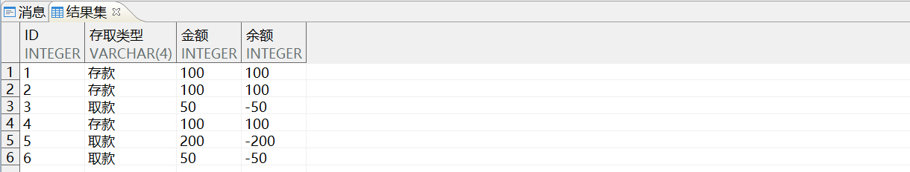

- 累加处理后的结果，示例语句如下所示：
```sql
SELECT id,
         CASE WHEN trx = 'PY' THEN '取款' ELSE '存款' END 存取类型,
         amt 金额,
         SUM (CASE WHEN trx = 'PY' THEN -amt ELSE amt END) OVER (ORDER BY id)
            AS 余额
    FROM v
ORDER BY id;
```

输出结果：

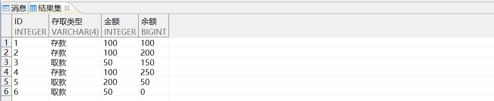

### 2.5 计算出现次数最多的值

使用 `partition by` 子句查看部门中哪个工资等级的员工最多。

这个问题可分成以下四步进行：

1. 计算不同工资出现的次数，示例语句如下所示：
```sql
SELECT salary, COUNT (*) AS 出现次数
    FROM dmhr.employee
   WHERE job_id = 11
GROUP BY salary;
```
2. 按次数排序生成序号，示例语句如下所示：
```sql
SELECT salary,
       DENSE_RANK () OVER (ORDER BY 出现次数 DESC) AS 次数排序
  FROM (  SELECT salary, COUNT (*) AS 出现次数
            FROM dmhr.employee
           WHERE job_id = 11
        GROUP BY salary);
```

输出结果：

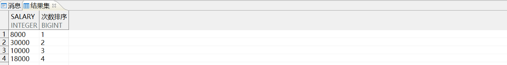

3. 根据序号过滤得到需要的结果，示例语句如下所示：
```sql
SELECT salary
  FROM (SELECT salary,
               DENSE_RANK () OVER (ORDER BY 出现次数 DESC)
                  AS 次数排序
          FROM (  SELECT salary, COUNT (*) AS 出现次数
                    FROM dmhr.employee
                   WHERE job_id = 11
                GROUP BY salary) x) y
 WHERE 次数排序 = 1;
```
4. 利用 partition by 子句查询各部门哪个工资等级的员工最多，示例语句如下所示：
```sql
SELECT job_id, salary
  FROM (SELECT job_id,
               salary,
               DENSE_RANK ()
                  OVER (PARTITION BY job_id ORDER BY 出现次数 DESC)
                  AS 次数排序
          FROM (  SELECT salary, job_id, COUNT (*) AS 出现次数
                    FROM dmhr.employee
                GROUP BY job_id, salary) x) y
 WHERE 次数排序 = 1;
```

输出结果：

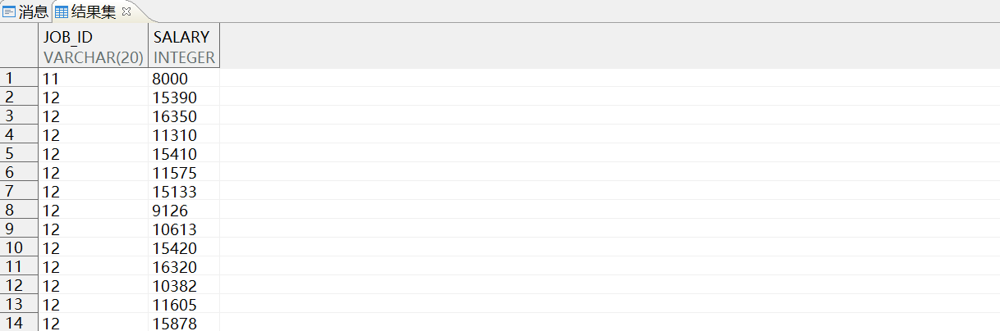

部门 12 中各工资档次出现次数都为 1，所以返回所有的数据。

### 2.6 返回最值所在的行数据

如需查询最大工资 (30000) 所在行的员工姓名。

我们可以使用分析函数满足这个需求，还可以同时取最大和最小值。示例语句如下所示：

```sql
SELECT job_id,
         employee_id,
         MAX (employee_name)
            KEEP (DENSE_RANK FIRST ORDER BY salary)
            OVER (PARTITION BY job_id)
            AS 工资最低的人,
         MAX (employee_name)
            KEEP (DENSE_RANK LAST ORDER BY salary)
            OVER (PARTITION BY job_id)
            AS 工资最高的人,
         employee_name,
         salary
    FROM dmhr.employee
   WHERE job_id = 11
ORDER BY 1, 6 DESC;
```

输出结果：

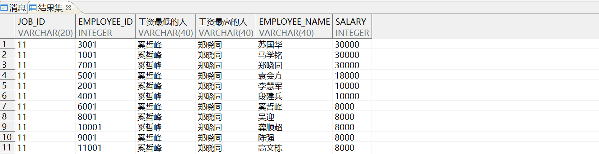

从上面的结果来看，此部门工资最低和最高的人都有重复值。 **keep (…)** 部分得到的是一个数据集合，在使用 MAX 的聚集函数后就会仅返回一个字段。

### 2.7 first\_value

使用分析函数 `first_value 和 last_value` ，输出同一个满足条件的首尾记录。示例语句如下所示：

```sql
SELECT job_id,employee_id,
         LAST_VALUE (employee_name) OVER (PARTITION BY job_id ORDER BY salary)
            AS 工资最高的人,
         employee_name,salary
    FROM dmhr.employee
   WHERE job_id = 11
ORDER BY 1, 5;
```

输出结果：

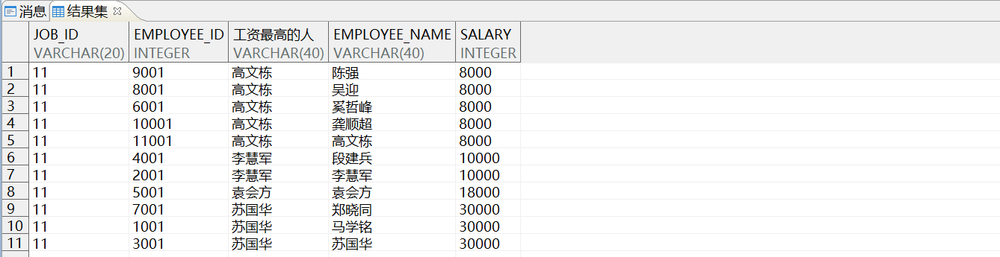

当使用 last\_value 时，我们发现结果不对，可以看到 first\_value 和 last\_value 的 order by 是在 `over()` 中，这实际上与累加模式类似。

### 2.8 求总和的百分比

使用分析函数 `SUM() 和 OVER()` 计算各部门工资合计及该合计工资占总工资的比例。用 `group by` 语句可以用到合计工资。

> **注意**
> 
> 当 OVER() 后不加任何内容时，就是对所有的数据进行汇总。

- 分组汇总，示例语句如下所示：
```sql
SELECT job_id, SUM (salary) 工资合计 FROM dmhr.employee GROUP BY job_id;
```

输出结果：

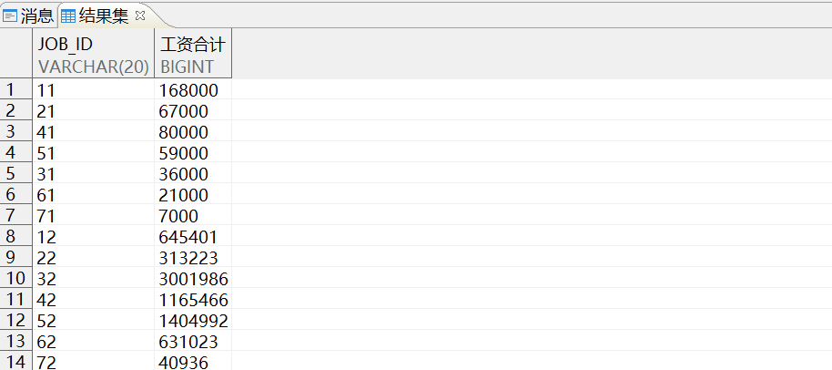

- 通过分析函数获取总合计，示例语句如下所示：
```sql
SELECT job_id, 工资合计, SUM (工资合计) OVER () AS 总合计
  FROM (  SELECT job_id, SUM (salary) 工资合计
            FROM dmhr.employee
        GROUP BY job_id) x;
```

输出结果：

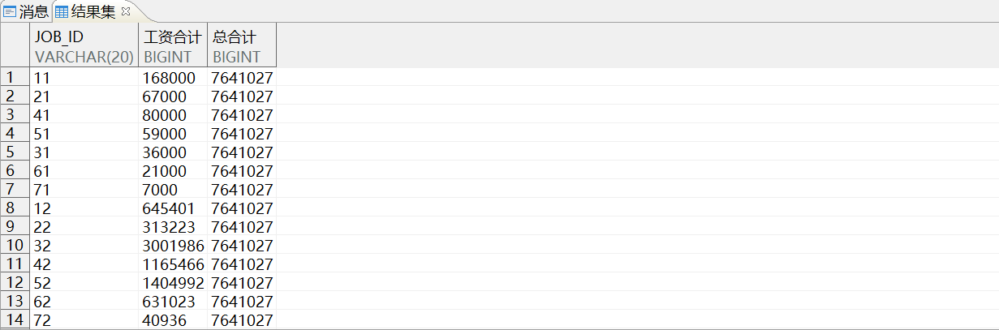

## 三、参考文献

更多 SQL 语言使用说明，请参考《DM8\_SQL 语言使用手册》，手册位于 **数据库安装路径** `/dmdbms/doc` 文件夹下。如有其他问题，请在 [社区](https://eco.dameng.com/community/question?_blank) 内咨询。