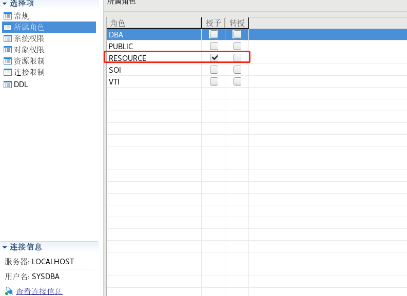

## 一、授予用户 DBA 权限

命令行方式参考如下：

```sql
grant "DBA" to "TEST";
```

## 二、授予用户 RESOURCE 权限，其余权限可根据需要自行选择权限



命令行方式参考如下：

```sql
grant "RESOURCE" to "TEST";
```

更多详细用户权限管理 SQL 语法可参考数据库安装目录下 doc 目录中《DM8 安全管理》手册。