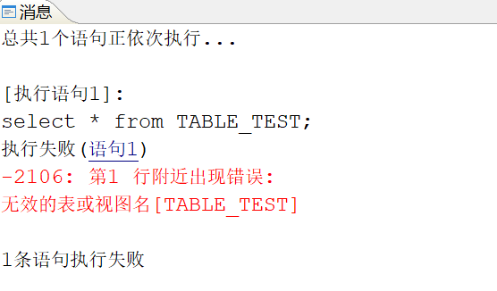
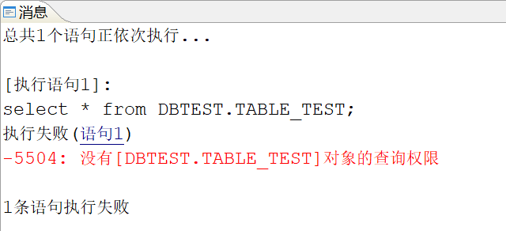
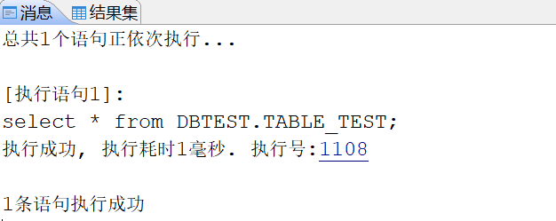

每个用户有一个默认的同名的模式，访问自己模式下的表、视图等，不需要加模式名，访问其他模式下的对象需要拥有访问权限，访问时还需加上模式名。

## 一、查询当前用户模式下的表，无需加对象名

以 TEST 用户为例，当查询自己模式下得表时，可以直接进行查询，无需加对象名，如下图所示：

```sql
select * from test
```

## 二、查询其他用户模式下的表，需要加对象名

以 TEST 用户为例，查询 DBTEST 用户模式下的表 TABLE\_TEST，如不加对象名，则查询会报错“无效的表名或者视图名\[TABLE\_TEST\]”，如下图所示：

```sql
select * from TABLE_TEST;
```



加上对象名后，没有授予查询权限，则查询会报错“没有对象\[DBTEST.TABLE\_TEST\]的查询权限”，如下图所示：

```sql
select * from DBTEST.TABLE_TEST;
```



这时需要授予 TEST 用户查询表 TABLE\_TEST 的权限，如下图所示：

```sql
--使用 root 用户授予 TEST 用户查询表 TABLE_TEST 的权限
grant SELECT on "DBTEST"."TABLE_TEST" to "TEST";
--使用 TEST 用户登录数据库查询表 TABLE_TEST
select * from DBTEST.TABLE_TEST;
```

