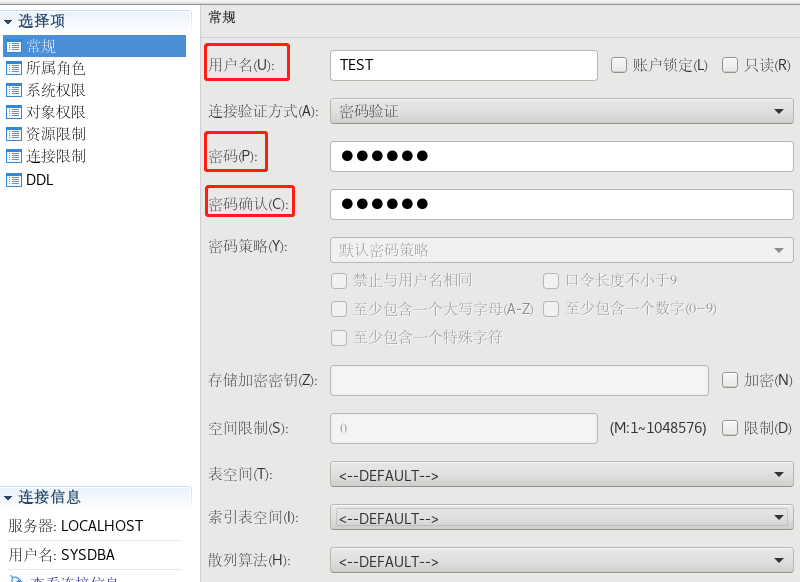
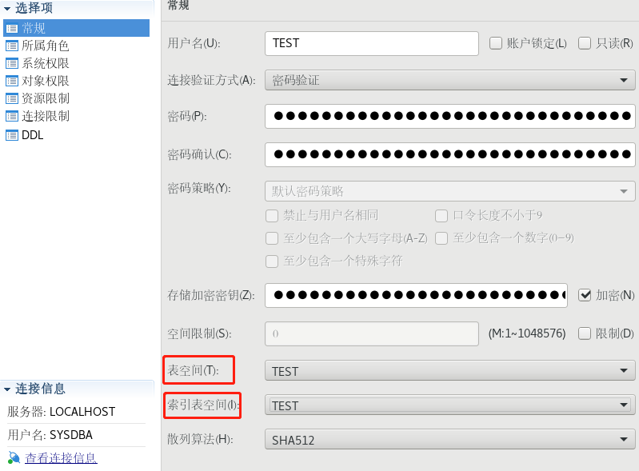

## 一、新建用户

使用 SYSDBA 用户登录 DM 管理工具。

展开用户模块，右键管理用户，点击【新建用户】，如下图所示：

## 二、用户名、密码

设置用户名、密码，如下图所示：



> **注意**
> 
> 密码长度由参数 PWD\_MIN\_LEN 控制，默认长度不少于 8 位。

## 三、定义表空间、索引表空间

表空间、索引表空间配置完成后，点击【确定】即可创建完成用户关联表空间，如下图所示：



使用命令行方式创建用户 TEST ，密码 “Dameng@123”，使用散列算法 SHA512 ，使用存储加密密钥为 “123456”，指定表空间为 TEST，索引表空间为 TEST，授予 “PUBLIC” 和 “SOI” 权限。示例参考如下：

```sql
create user "TEST" identified by "Dameng@123" hash with SHA512 salt
encrypt by "123456"
default tablespace "TEST"
default index tablespace "TEST";

grant "PUBLIC","SOI" to "TEST";
```

更多详细用户管理 SQL 语法可参考数据库安装目录下 doc 目录中《DM8\_SQL 语言使用手册》。