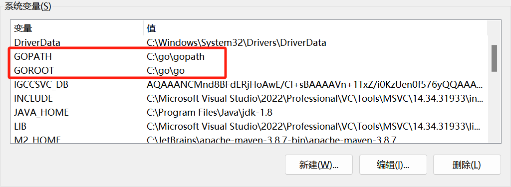
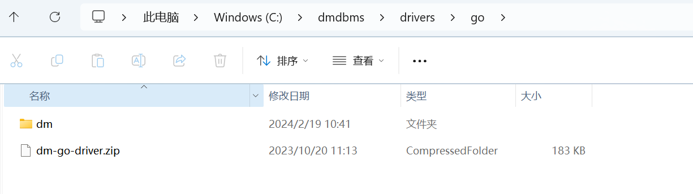
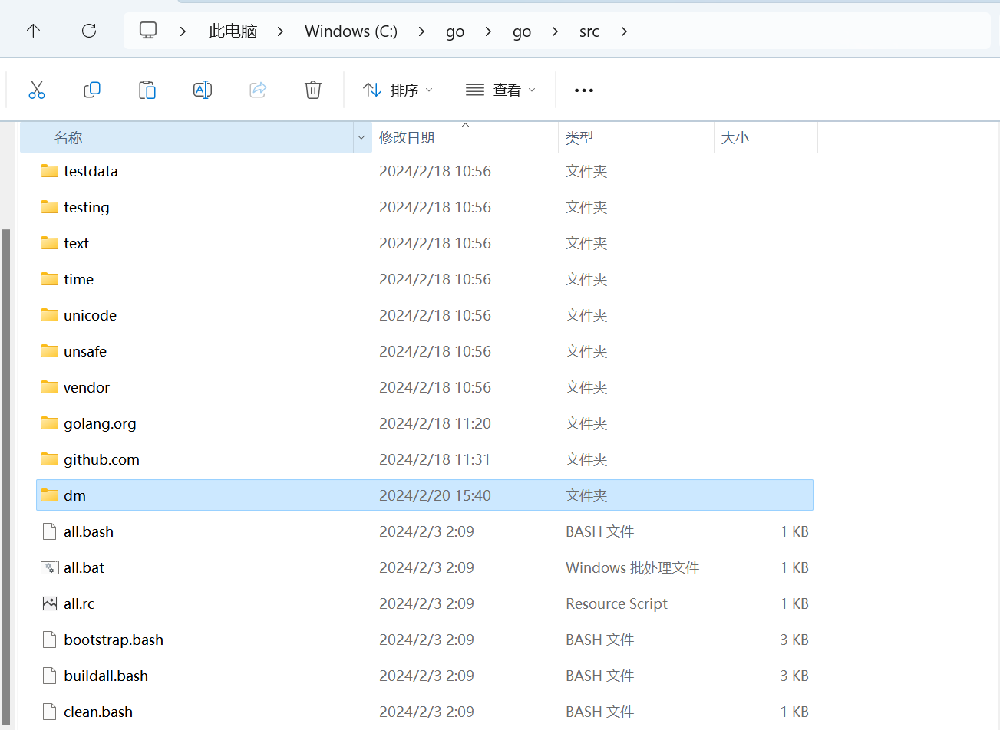
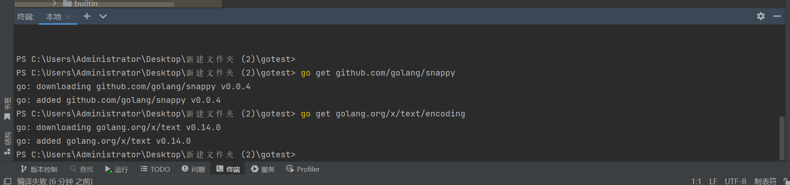
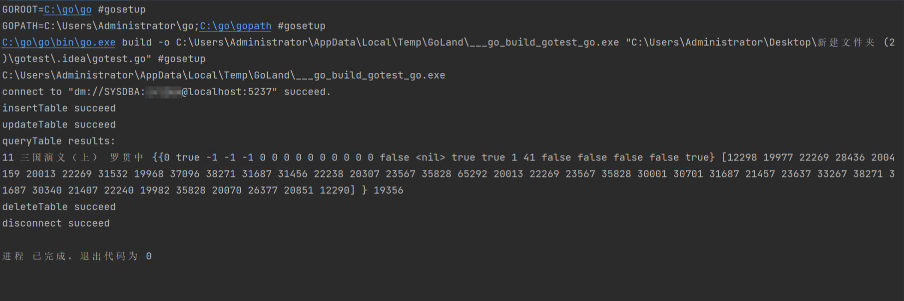
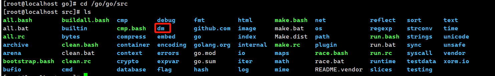

本章节主要介绍使用 GO 语言开发时，使用 DM 驱动连接达梦数据库。

## 一、Windows 环境下 go 连接数据库

### 1.1 准备工作

下载并安装 go，git 。

go 下载地址为 [https://studygolang.com/dl](https://studygolang.com/dl) 。

git 下载地址为 [https://git-scm.com/](https://git-scm.com/) 。

本次 Windows 使用 go 版本为 go1.22.0.windows-amd64 ，git 版本为 2.43.0.windows.1 。

### 1.2 环境配置

指定系统 path，指定到 go 的 bin 目录。

指定 GOPATH 和 GOROOT。



### 1.3 添加 DM GO 驱动

达梦 GO 驱动位于 C:\\dmdbms\\drivers\\go 下，进行解压后复制到 go 安装目录的 src 目录下。





### 1.4 开发步骤

1. 提前准备好图片, 本次例子图片在 C:\\Users\\Administrator\\Desktop\\th.jpg 。
2. 使用终端下载好所需的模块。
```java
go get github.com/golang/snappy

go get golang.org/x/text/encoding
```



3. 编写 godm.go,执行代码。
```
/*该例程实现插入数据，修改数据，删除数据，数据查询等基本操作。*/
package main
// 引入相关包
import (
    "database/sql"
    "dm"
    "fmt"
    "io/ioutil"
    "time"
)
var db *sql.DB
var err error
func main() {
    driverName := "dm"
    dataSourceName := "dm://SYSDBA:*****@192.168.40.1:5237"
    if db, err = connect(driverName, dataSourceName); err != nil {
        fmt.Println(err)
        return
    }
    if err = insertTable(); err != nil {
        fmt.Println(err)
        return
    }
    if err = updateTable(); err != nil {
        fmt.Println(err)
        return
    }
    if err = queryTable(); err != nil {
        fmt.Println(err)
        return
    }
    if err = deleteTable(); err != nil {
        fmt.Println(err)
        return
    }
    if err = disconnect(); err != nil {
        fmt.Println(err)
        return
    }
}
/* 创建数据库连接 */
func connect(driverName string, dataSourceName string) (*sql.DB, error) {
    var db *sql.DB
    var err error
    if db, err = sql.Open(driverName, dataSourceName); err != nil {
        return nil, err
    }
    if err = db.Ping(); err != nil {
        return nil, err
    }
    fmt.Printf("connect to \"%s\" succeed.\n", dataSourceName)
    return db, nil
}
/* 往产品信息表插入数据 */
func insertTable() error {
    var inFileName = "C:\\Users\\Administrator\\Desktop\\th.jpg"
    var sql = \`INSERT INTO production.product(name,author,publisher,publishtime,
product_subcategoryid,productno,satetystocklevel,originalprice,nowprice,discount,
description,photo,type,papertotal,wordtotal,sellstarttime,sellendtime)
VALUES(:1,:2,:3,:4,:5,:6,:7,:8,:9,:10,:11,:12,:13,:14,:15,:16,:17);\`
    data, err := ioutil.ReadFile(inFileName)
    if err != nil {
        return err
    }
    t1, _ := time.Parse("2006-Jan-02", "2005-Apr-01")
    t2, _ := time.Parse("2006-Jan-02", "2006-Mar-20")
    t3, _ := time.Parse("2006-Jan-02", "1900-Jan-01")
    _, err = db.Exec(sql, "三国演义", "罗贯中", "中华书局", t1, 4, "9787101046126", 10, 19.0000, 15.2000,
        8.0,
        "《三国演义》是中国第一部长篇章回体小说，中国小说由短篇发展至长篇的原因与说书有关。",
        data, "25", 943, 93000, t2, t3)
    if err != nil {
        return err
    }
    fmt.Println("insertTable succeed")
    return nil
}
/* 修改产品信息表数据 */
func updateTable() error {
    var sql = "UPDATE production.product SET name = :name WHERE productid = 11;"
    if _, err := db.Exec(sql, "三国演义（上）"); err != nil {
        return err
    }
    fmt.Println("updateTable succeed")
    return nil
}
/* 查询产品信息表 */
func queryTable() error {
    var productid int
    var name string
    var author string
    var description dm.DmClob
    var photo dm.DmBlob
    var sql = "SELECT productid,name,author,description,photo FROM production.product WHERE productid=11"
    rows, err := db.Query(sql)
    if err != nil {
        return err
    }
    defer rows.Close()
    fmt.Println("queryTable results:")
    for rows.Next() {
        if err = rows.Scan(&productid, &name, &author, &description, &photo); err != nil {
            return err
        }
        blobLen, _ := photo.GetLength()
        fmt.Printf("%v %v %v %v %v\n", productid, name, author, description, blobLen)
    }
    return nil
}
/* 删除产品信息表数据 */
func deleteTable() error {
    var sql = "DELETE FROM production.product WHERE productid = 12;"
    if _, err := db.Exec(sql); err != nil {
        return err
    }
    fmt.Println("deleteTable succeed")
    return nil
}
/* 关闭数据库连接 */
func disconnect() error {
    if err := db.Close(); err != nil {
        fmt.Printf("db close failed: %s.\n", err)
        return err
    }
    fmt.Println("disconnect succeed")
    return nil
}
```

 执行成功。

## 二、Linux 环境下 go 连接数据库

### 2.1 准备工作

下载并安装 go，git 。

go 下载地址为 [https://studygolang.com/dl](https://studygolang.com/dl) 。

本次 Linux 使用 go 版本为 go1.22.0.linux-amd64 。

使用命令下载 git。

```html
yum install git
yum install git-svn git-email gitk
```

### 2.2 环境配置

修改 /etc/profile 添加 go 环境变量。

```
vi /etc/profile
```

根据自己环境添加 PATH, GOPATH, GOROOT 。

```
export PATH=$PATH:/go/go/bin
export GOPATH=/root/go
export GOROOT=/go/go
```

使环境变量生效。

```
. /etc/profile
```

### 2.3 添加 DM GO 驱动

达梦 GO 驱动位于达梦安装目录下的/drivers/go/下，解压后会生成 dm 文件夹。


复制 dm 文件夹到 go 安装目录下的 src 下，本次例子对应的就是 /go/go/src 下。



### 2.4 开发步骤

1. 提前准备好图片,本次例子图片是位于 /root/go 下的 th.jpg 。
2. 提前确定 go mod 开启，如果未开启并执行以下命令。
	```
	go env -w GO111MODULE=on
	go env -w GOPROXY=https://goproxy.cn,direct 
	go mod init godm
	go get github.com/golang/snappy
	go get golang.org/x/text
	go mod tidy
	```
3. 编写 godm.go,使用 go run godm.go 执行代码。
	```
	/*该例程实现插入数据，修改数据，删除数据，数据查询等基本操作。*/
	package main
	// 引入相关包
	import (
	    "database/sql"
	    "dm"
	    "fmt"
	    "io/ioutil"
	    "time"
	)
	var db *sql.DB
	var err error
	func main() {
	    driverName := "dm"
	    dataSourceName := "dm://SYSDBA:*****@localhost:5236"
	    if db, err = connect(driverName, dataSourceName); err != nil {
	        fmt.Println(err)
	        return
	    }
	    if err = insertTable(); err != nil {
	        fmt.Println(err)
	        return
	    }
	    if err = updateTable(); err != nil {
	        fmt.Println(err)
	        return
	    }
	    if err = queryTable(); err != nil {
	        fmt.Println(err)
	        return
	    }
	    if err = deleteTable(); err != nil {
	        fmt.Println(err)
	        return
	    }
	    if err = disconnect(); err != nil {
	        fmt.Println(err)
	        return
	    }
	}
	/* 创建数据库连接 */
	func connect(driverName string, dataSourceName string) (*sql.DB, error) {
	    var db *sql.DB
	    var err error
	    if db, err = sql.Open(driverName, dataSourceName); err != nil {
	        return nil, err
	    }
	    if err = db.Ping(); err != nil {
	        return nil, err
	    }
	    fmt.Printf("connect to \"%s\" succeed.\n", dataSourceName)
	    return db, nil
	}
	/* 往产品信息表插入数据 */
	func insertTable() error {
	    var inFileName = "/root/go/th.jpg"
	    var sql = \`INSERT INTO production.product(name,author,publisher,publishtime,
	product_subcategoryid,productno,satetystocklevel,originalprice,nowprice,discount,
	description,photo,type,papertotal,wordtotal,sellstarttime,sellendtime)
	VALUES(:1,:2,:3,:4,:5,:6,:7,:8,:9,:10,:11,:12,:13,:14,:15,:16,:17);\`
	    data, err := ioutil.ReadFile(inFileName)
	    if err != nil {
	        return err
	    }
	    t1, _ := time.Parse("2006-Jan-02", "2005-Apr-01")
	    t2, _ := time.Parse("2006-Jan-02", "2006-Mar-20")
	    t3, _ := time.Parse("2006-Jan-02", "1900-Jan-01")
	    _, err = db.Exec(sql, "三国演义", "罗贯中", "中华书局", t1, 4, "9787101046126", 10, 19.0000, 15.2000,
	        8.0,
	        "《三国演义》是中国第一部长篇章回体小说，中国小说由短篇发展至长篇的原因与说书有关。",
	        data, "25", 943, 93000, t2, t3)
	    if err != nil {
	        return err
	    }
	    fmt.Println("insertTable succeed")
	    return nil
	}
	/* 修改产品信息表数据 */
	func updateTable() error {
	    var sql = "UPDATE production.product SET name = :name WHERE productid = 11;"
	    if _, err := db.Exec(sql, "三国演义（上）"); err != nil {
	        return err
	    }
	    fmt.Println("updateTable succeed")
	    return nil
	}
	/* 查询产品信息表 */
	func queryTable() error {
	    var productid int
	    var name string
	    var author string
	    var description dm.DmClob
	    var photo dm.DmBlob
	    var sql = "SELECT productid,name,author,description,photo FROM production.product WHERE productid=11"
	    rows, err := db.Query(sql)
	    if err != nil {
	        return err
	    }
	    defer rows.Close()
	    fmt.Println("queryTable results:")
	    for rows.Next() {
	        if err = rows.Scan(&productid, &name, &author, &description, &photo); err != nil {
	            return err
	        }
	        blobLen, _ := photo.GetLength()
	        fmt.Printf("%v %v %v %v %v\n", productid, name, author, description, blobLen)
	    }
	    return nil
	}
	/* 删除产品信息表数据 */
	func deleteTable() error {
	    var sql = "DELETE FROM production.product WHERE productid = 12;"
	    if _, err := db.Exec(sql); err != nil {
	        return err
	    }
	    fmt.Println("deleteTable succeed")
	    return nil
	}
	/* 关闭数据库连接 */
	func disconnect() error {
	    if err := db.Close(); err != nil {
	        fmt.Printf("db close failed: %s.\n", err)
	        return err
	    }
	    fmt.Println("disconnect succeed")
	    return nil
	}
	```