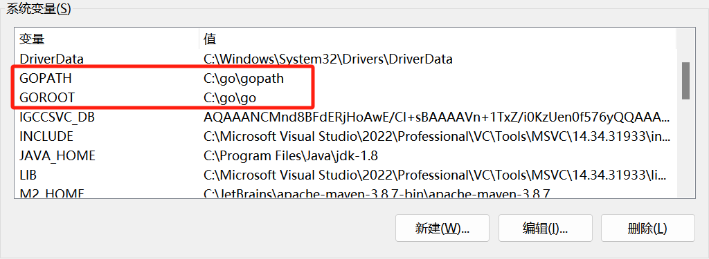
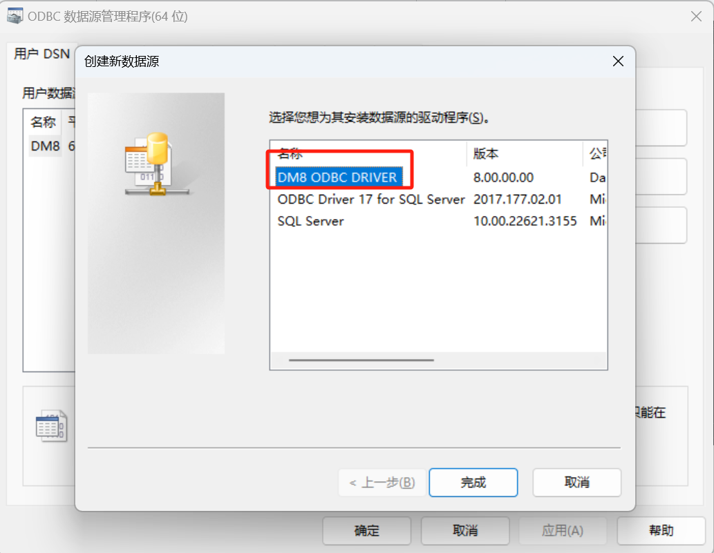
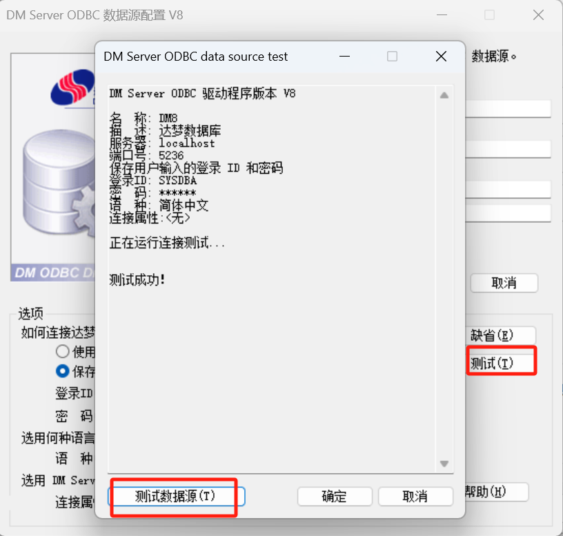
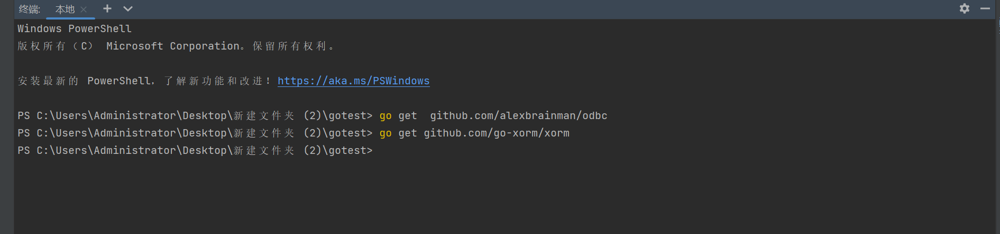
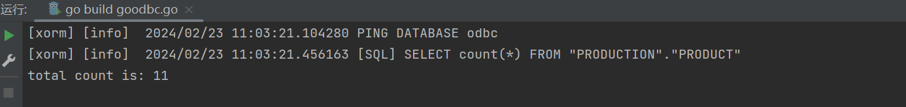
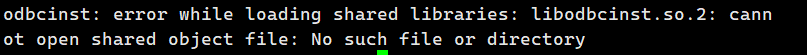
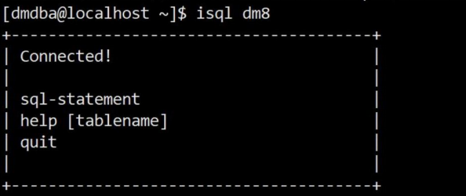
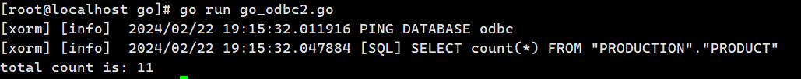

本章节主要介绍使用 GO 语言开发时，使用 ODBC 驱动连接达梦数据库。

## 一、Windows 环境下 go 连接数据库

### 1.1 准备工作

下载并安装 go，git 。

go 下载地址为 [https://studygolang.com/dl](https://studygolang.com/dl) 。

git 下载地址为 [https://git-scm.com/](https://git-scm.com/) 。

本次 Windows 使用 go 版本为 go1.22.0.windows-amd64，git 版本为 2.43.0.windows.1 。

### 1.2 环境配置

指定系统 path，指定到 go 的 bin 目录。

指定 GOPATH 和 GOROOT。



### 1.3 创建 ODBC 数据源





### 1.4 测试连接

1. 使用终端下载需要的依赖。
	```
	go get  github.com/alexbrainman/odbc
	go get github.com/go-xorm/xorm
	```
	
2. 创建 goodbc.go，执行代码。
	```
	package main
	import (
	    "fmt"
	    _ "github.com/alexbrainman/odbc"  // google's odbc driver
	    "github.com/go-xorm/xorm"
	    "xorm.io/core"
	)
	type Person struct {
	    PersonId     int         \`xorm:"PERSONID"\`
	    Sex          string         \`xorm:"SEX"\`
	    Name         string         \`xorm:"NAME"\`
	    Email        string         \`xorm:"EMAIL"\`
	    Phone        string      \`xorm:"PHONE"\`
	}
	func main() {
	    Engine, err := xorm.NewEngine("odbc", "driver={DM8 ODBC DRIVER};server=192.168.40.1:5237;database=DM8;uid=SYSDBA;pwd=*****;charset=utf8")
	    if err != nil {
	        fmt.Println("new engine got error:", err)
	        return
	    }
	    if err := Engine.Ping(); err != nil {
	        fmt.Println("ping got error:", err)
	        return
	    }
	    Engine.SetTableMapper(core.SameMapper{})
	    Engine.ShowSQL(true)
	    Engine.SetMaxOpenConns(5)
	    Engine.SetMaxIdleConns(5)
	    total, err := Engine.Table("PRODUCTION.PRODUCT").Count(&Person{})
	    if nil != err {
	        fmt.Println(\`engine query got error:\`, err.Error())
	        return
	    }
	    fmt.Println("total count is:",total)
	}
	```



## 二、Linux 环境下 go 连接数据库

### 2.1 准备工作

下载并安装 go，git 。

go 下载地址为 [https://studygolang.com/dl](https://studygolang.com/dl) 。

本次 Linux 使用 go 版本为 go1.22.0.linux-amd64 。

使用命令下载 git。

```
yum install git
yum install git-svn git-email gitk
```

### 2.2 环境配置

修改 /etc/profile 添加 go 环境变量。

```
vi /etc/profile
```

根据自己环境添加 PATH, GOPATH, GOROOT 。

```
export PATH=$PATH:/go/go/bin
export GOPATH=/root/go
export GOROOT=/go/go
```

使环境变量生效。

```
. /etc/profile
```

### 2.3 配置 odbc 数据源

DMODBC 在 Linux 操作系统依赖于 UnixODBC 库。

此链接为 2.3.12 版本安装包， [https://www.unixodbc.org/unixODBC-2.3.12.tar.gz](https://www.unixodbc.org/unixODBC-2.3.12.tar.gz) 。

如果需要下载其他版本,点击链接进入官网 [https://www.unixodbc.org/](https://www.unixodbc.org/) ，选择合适版本进行下载。

1. 下载好后，进行解压，使用命令进行配置。
```
./configure --enable -gui=no
```
2. 配置好后进行编译。
```
make && make install
```
3. 编译后查找配置文件位置。
```
odbcinst -j
```



> **注意**
> 
> 如果出现 so 文件缺失的情况，大部分可以通过 yum install unixODBC-devel 方式进行解决，如果还有部分缺失，需要自行下载

4. 编辑 `/etc/odbcinst.ini` ，如下所示：
```
[DM8 ODBC DRIVER]
Description = ODBC DRIVER FOR DM8
Driver = /home/dmdba/dmdbms/bin/libdodbc.so
```
5. 编辑 `/etc/odbc.ini` ，如下所示：
```
[dm8]
Description = DM ODBC DSN
Driver = DM8 ODBC DRIVER
SERVER = localhost
UID = SYSDBA
PWD = *****
TCP_PORT = 5236
```

> **注意**
> 
> odbc.ini 中的 Driver 内容一定要与 odbcinst.ini 中的 DM 驱动定义的节点名称相同。 odbc.ini 中的 SERVER 可以输入数据库服务器的 IP 。

6. 测试连接，出现以下内容说明连接成功。
```
isql  dm8
```



### 2.4 测试连接

1. 执行以下命令。
	```
	go env -w GO111MODULE=on
	go env -w GOPROXY=https://goproxy.cn,direct 
	go mod init godm
	go get  github.com/alexbrainman/odbc
	go get github.com/go-xorm/xorm
	go get github.com/xorm.io
	go mod tidy
	```
2. 创建 goodbc.go ，使用 go run goodbc.go 执行代码。
	```
	package main
	import (
	    "fmt"
	    _ "github.com/alexbrainman/odbc"  // google's odbc driver
	    "github.com/go-xorm/xorm"
	    "xorm.io/core"
	)
	type Person struct {
	    PersonId     int         \`xorm:"PERSONID"\`
	    Sex          string         \`xorm:"SEX"\`
	    Name         string         \`xorm:"NAME"\`
	    Email        string         \`xorm:"EMAIL"\`
	    Phone        string      \`xorm:"PHONE"\`
	}
	func main() {
	    Engine, err := xorm.NewEngine("odbc", "driver={DM8 ODBC DRIVER};server=192.168.40.1:5237;database=DM8;uid=SYSDBA;pwd=******;charset=utf8")
	    if err != nil {
	        fmt.Println("new engine got error:", err)
	        return
	    }
	    if err := Engine.Ping(); err != nil {
	        fmt.Println("ping got error:", err)
	        return
	    }
	    Engine.SetTableMapper(core.SameMapper{})
	    Engine.ShowSQL(true)
	    Engine.SetMaxOpenConns(5)
	    Engine.SetMaxIdleConns(5)
	    total, err := Engine.Table("PRODUCTION.PRODUCT").Count(&Person{})
	    if nil != err {
	        fmt.Println(\`engine query got error:\`, err.Error())
	        return
	    }
	    fmt.Println("total count is:",total)
	}
	```

