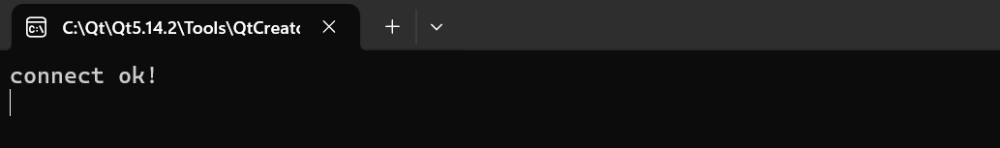
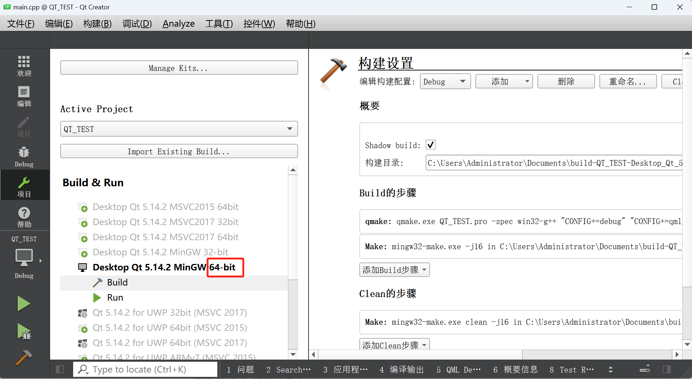
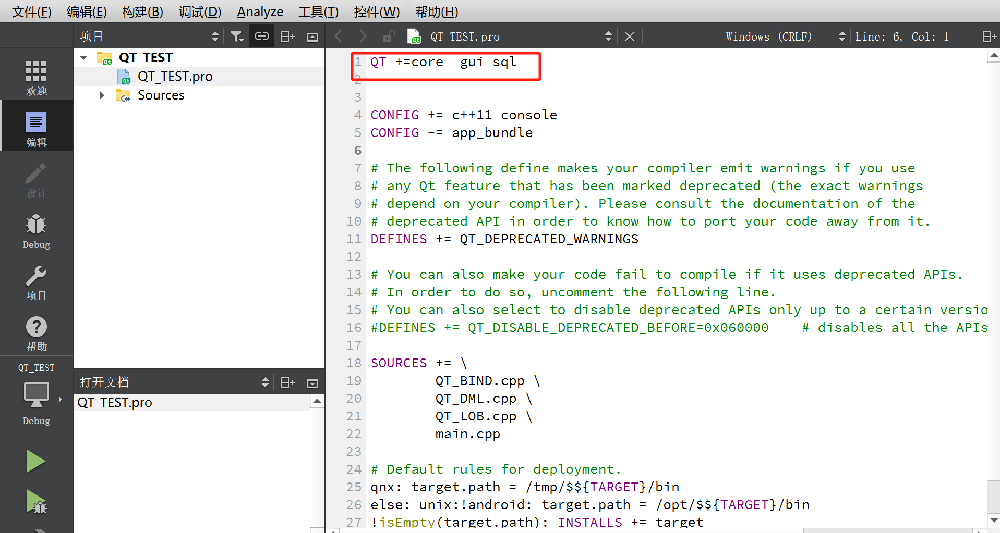

本章节主要介绍使用 QT 语言开发时，使用 QODBC 驱动连接达梦数据库。

## 一、达梦数据库安装

可访问达梦云适配中心 [下载试用](https://eco.dameng.com/download/?_blank) ，下载 DM8 数据库试用版并安装，安装步骤请参考 [DM 数据库安装](install-dm-windows-prepare.md) 。

## 二、 QT 下载链接

[QT 官网下载链接](https://download.qt.io/archive/qt/) 。

## 三、注册 ODBC 数据源

请参考 [通过 odbc 连接数据源](C_C++_development.md) 章节。

## 四、QT 使用 QODBC 连接达梦

1. 先通过第三章节步骤增加 ODBC 用户数据源。
2. 测试连接。
```
#include <QCoreApplication>
#include <QtSql>
#include <QDebug>
#include <QSqlDatabase>

int main(int argc, char *argv[])
{
    QCoreApplication a(argc, argv);
    QSqlDatabase db = QSqlDatabase::addDatabase("QODBC");
    db.setHostName("127.0.0.1");
    db.setPort(5236);
    db.setDatabaseName("DM8");
    db.setUserName("SYSDBA");
    db.setPassword("*****");
    if (db.open())
        qDebug() << "connect ok!";
    else
    {
        qDebug() << "connect fail! " << db.lastError().text().toLatin1();
    }

    return a.exec();
}
```

运行示例截图：



> **注意**
> 
> 如果 ODBC 数据源是 32 位，构建项目需要使用 32位 构建套件编译，如果 ODBC 数据源是 64 位，构建项目则需要使用 64 位构建套件编译，因当前数据源为 64 位，因此使用 64 位构建套件编译 。使用时需要添加core和sql。



