## 一、前言

JBoss 是一个基于 JavaEE 的开源容器，遵循 LGPL 许可，意味着可以在任何商业应用中免费使用。

## 二、环境准备

### 2.1 达梦数据库安装

可访问达梦云适配中心 [下载试用](https://eco.dameng.com/download/?_blank) ，下载 DM8 数据库试用版并安装，安装步骤请参考 数据库环境准备 。

### 2.2 JBOSS 下载

进入 [JBOSS 官网](https://developers.redhat.com/products/eap/download) 进行下载。

## 三、JBOSS 安装配置步骤

下面给出 jboss-eap-8.0.0 版本的配置过程，提供参考。

### 3.1 解压 JBOSS 包

```
unzip jboss-eap-8.0.0.zip
```

### 3.2 添加达梦 JDBC 驱动包

```
cd /add/jboss/jboss-eap-8.0/modules/system/layers/base/com/
mkdir -p dm/main
cd /add/jboss/jboss-eap-8.0/modules/system/layers/base/com/dm/main
cp /opt/dmdbms/drivers/jdbc/DmJdbcDriver18.jar  /add/jboss/jboss-eap-8.0/modules/system/layers/base/com/dm/main/
```

### 3.3 添加配置文件

```
cd /add/jboss/jboss-eap-8.0/modules/system/layers/base/com/dm/main
vi module.xml

<module xmlns="urn:jboss:module:1.3" name="com.dm">
    <resources>
        <resource-root path="DmJdbcDriver18.jar"/>
    </resources>
    <dependencies>
        <module name="javax.api"/>
        <module name="javax.transaction.api"/>
    </dependencies>
</module>
```

### 3.4 创建用户

```
cd /add/jboss/jboss-eap-8.0/bin
./add-user.sh
```

### 3.5 修改监听地址和端口

```
cd /add/jboss/jboss-eap-8.0/standalone/configuration
//修改 ip 地址为本地 ip
vi standalone.xml
```

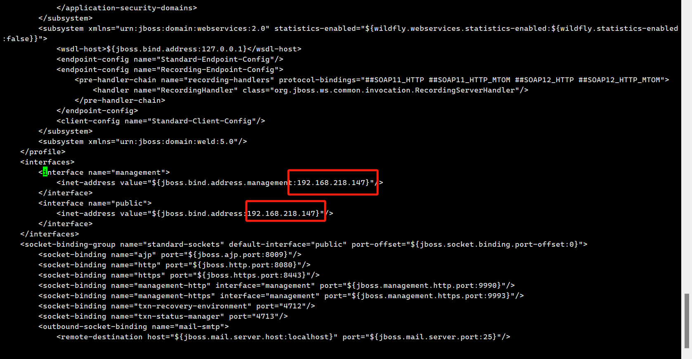

## 四、添加达梦数据源

### 4.1 启动 JBOSS

```
cd /add/jboss/jboss-eap-8.0/bin/
./standalone.sh
```

### 4.2 使用浏览器登陆

地址为 standalone.xml 配置文件中的 ip 地址，默认端口号为 9990 。

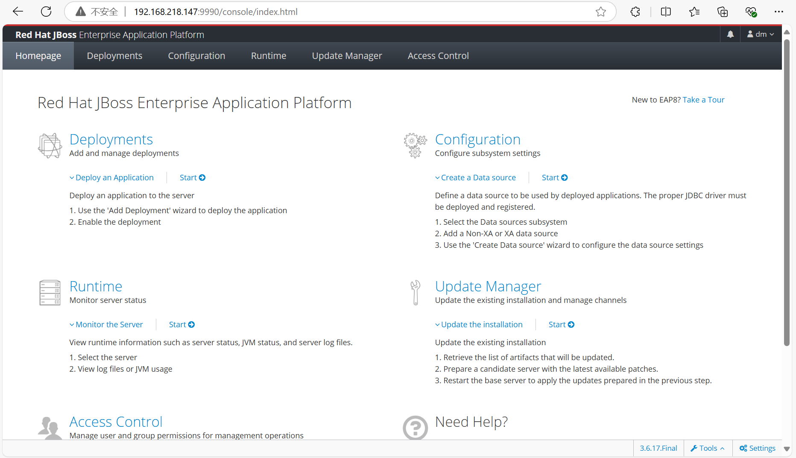

### 4.3 添加达梦 JDBC 驱动

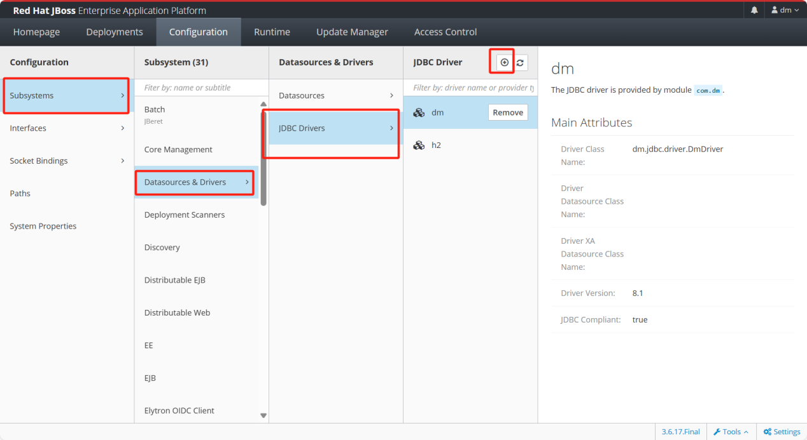

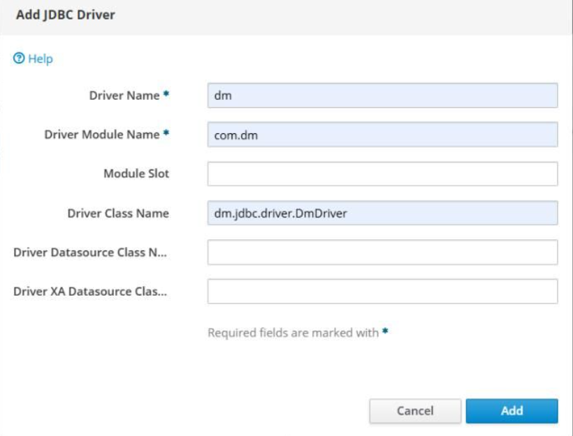

内容最终如下：

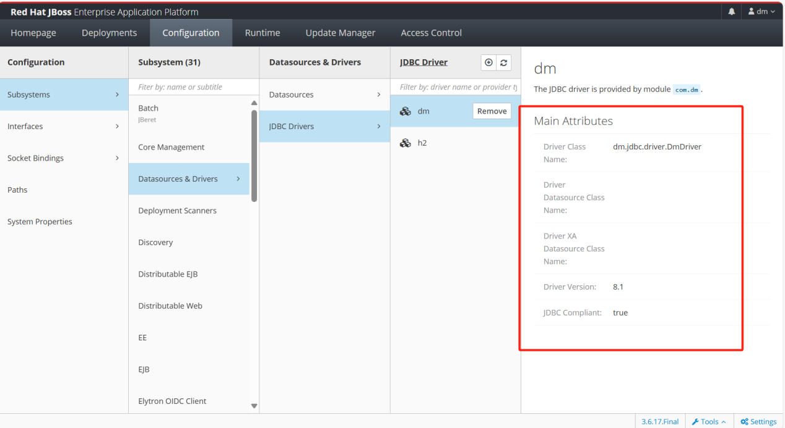

### 4.4 添加达梦数据源

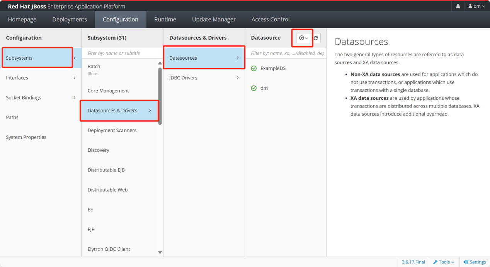

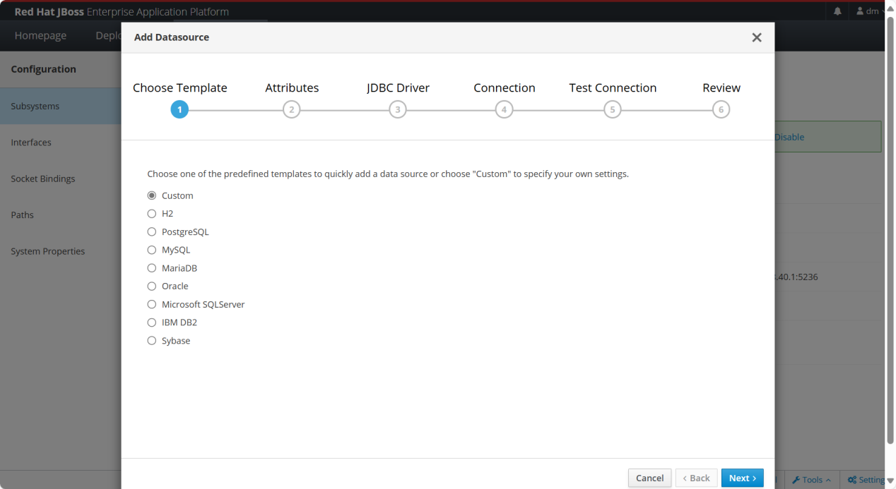

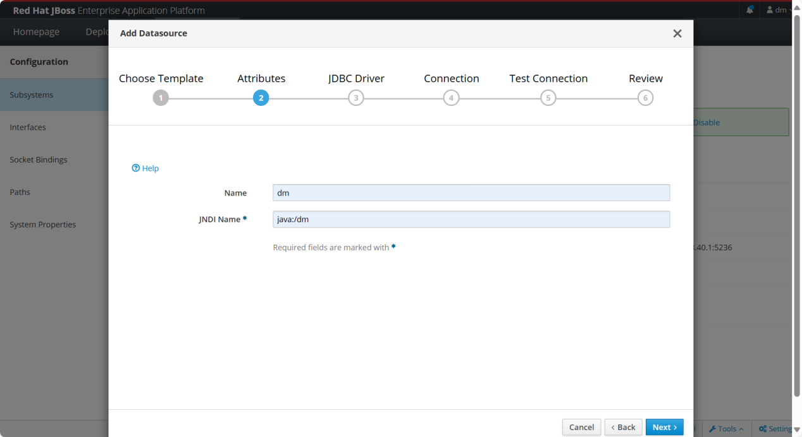

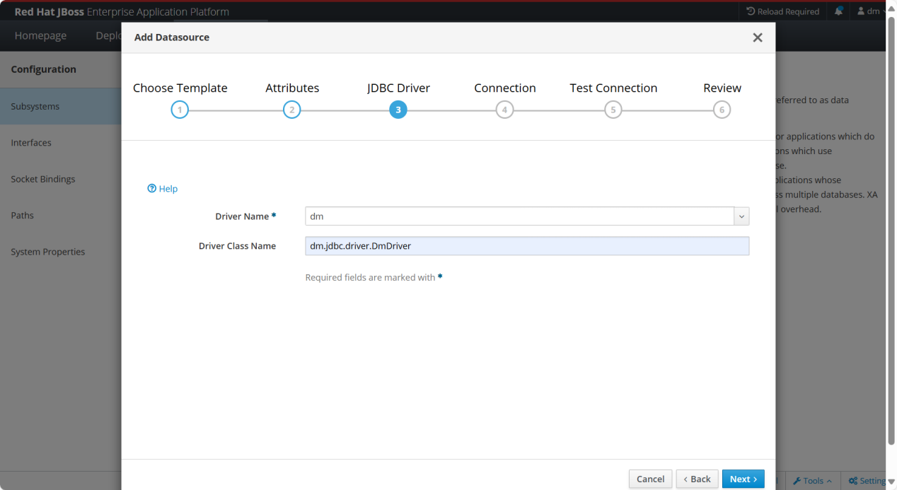

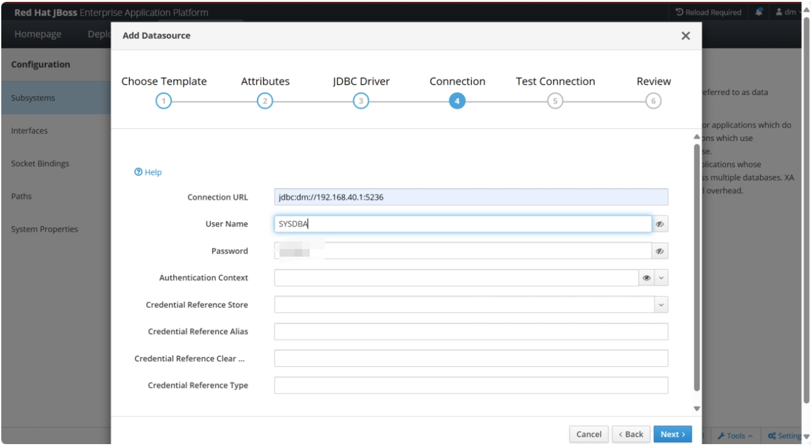

测试连接，出现下面图片，则连接成功。

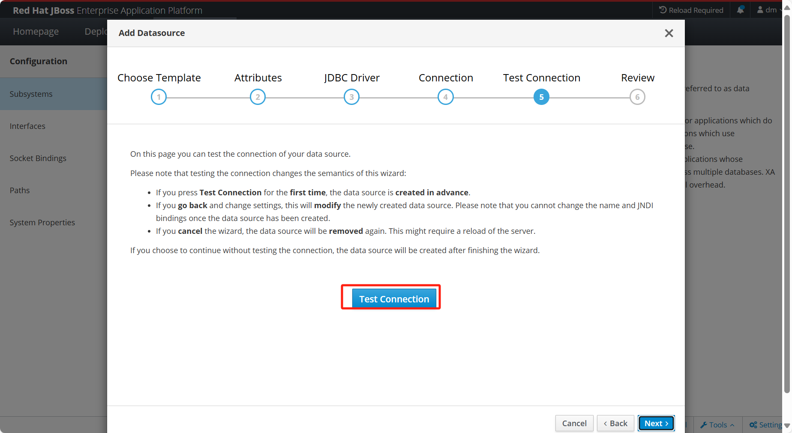

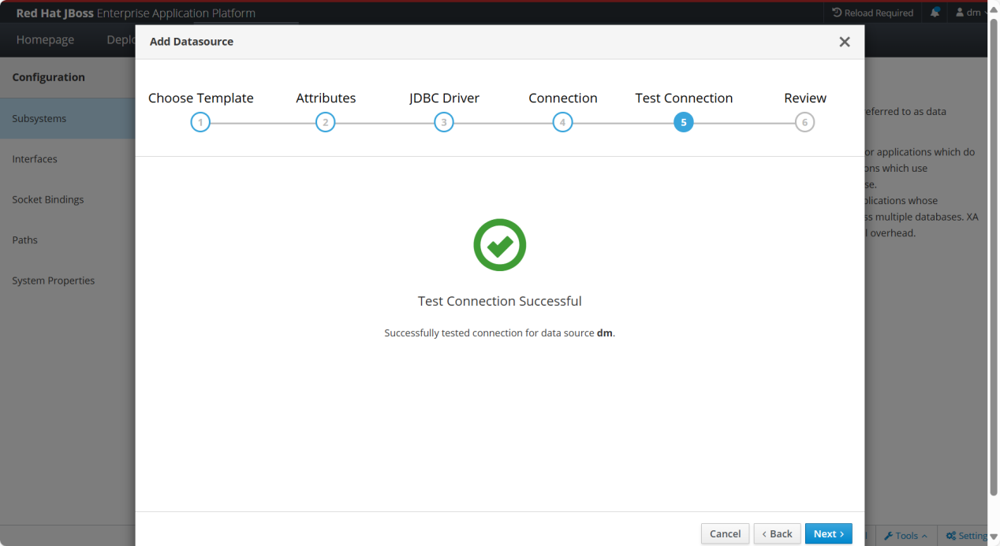

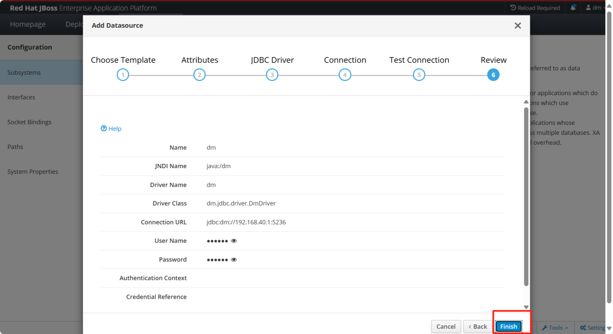

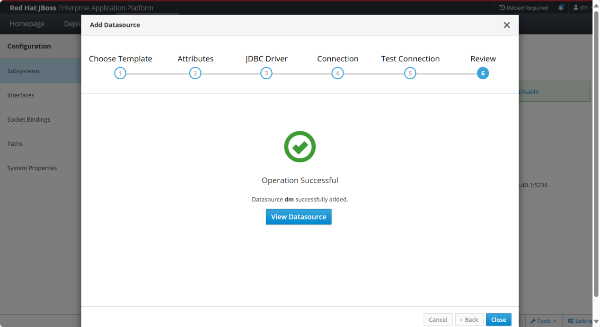

内容最终如下：

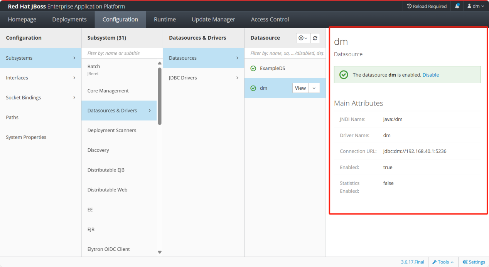